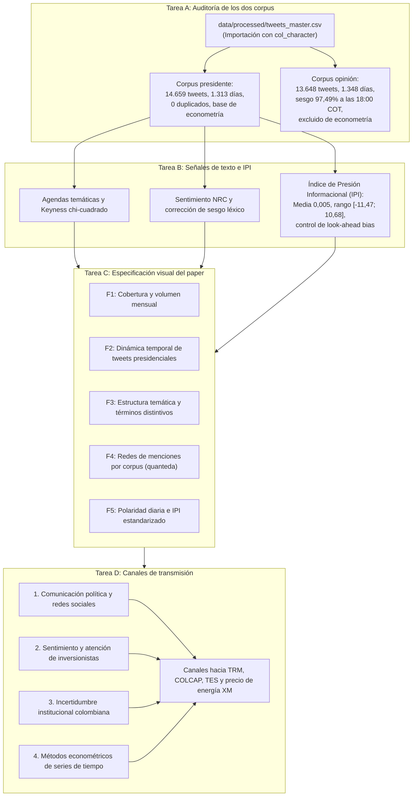

# Módulo de supervisión metodológica y control de calidad

Esta carpeta alberga el entorno de supervisión, auditoría de datos y control de consistencia metodológica del proyecto de investigación sobre la comunicación de Gustavo Petro y los mercados financieros colombianos (2022-2026). Su función es certificar la validez empírica de las señales discursivas y registrar las decisiones de diseño previo a su incorporación en el manuscrito formal del artículo ([`paper/español/quarto-tandf.qmd`](../paper/español/quarto-tandf.qmd)).

## Flujo del módulo de supervisión

El módulo organiza el control de calidad en cuatro tareas estructuradas:



## Estructura de archivos

| Archivo | Formato | Descripción |
|---|---|---|
| [`Supervision_Metodologica.qmd`](Supervision_Metodologica.qmd) | Quarto (`.qmd`) | Documento ejecutable que compila las cuatro tareas de supervisión y genera las tablas de auditoría. |
| [`Supervision_Metodologica.html`](Supervision_Metodologica.html) | HTML autocontenido | Versión compilada con tablas dinámicas y código desplegable para revisión de pares evaluadores. |
| [`README.md`](README.md) | Markdown | Esta guía descriptiva del módulo y su protocolo de reproducción. |

## Contenido de las cuatro tareas de supervisión

### Tarea A: Auditoría empírica de los dos corpus
- **Objetivo:** Evaluar la integridad, unicidad y cobertura temporal comparada entre la conversación ciudadana (`opinion`) y la emisión directa del mandatario (`presidente`).
- **Insumo:** Contrato contractual `data/processed/tweets_master.csv` (importando identificadores como `col_character()` para preservar los enteros de 64 bits sin desbordamiento numérico).
- **Resultados auditados:**
  - **Corpus `opinion`:** 13.648 tweets, 13.648 identificadores únicos, 0 duplicados, cubriendo 1.348 días entre el 2022-08-01 y el 2026-05-31.
  - **Corpus `presidente`:** 14.659 tweets, 14.659 identificadores únicos, 0 duplicados, 222 textos vacíos en `text_clean` (mensajes compuestos exclusivamente por URLs o menciones retiradas en el preprocesamiento), cubriendo 1.313 días con actividad.
- **Hallazgo de extracción (sesgo en `opinion`):** Se identificó que 13.305 de los 13.648 tweets (97,49%) en `opinion` se concentran a las 18:00 horas (hora local de Bogotá) y el 95,77% de los días exhiben un tope de 10 tweets por día. En consecuencia, el corpus `opinion` queda restringido a exploración textual descriptiva y auditoría, siendo excluido de modelos VAR, pruebas de Granger, GARCH/DCC, Markov-Switching y estudios de eventos, los cuales se ejecutan exclusivamente con el corpus `presidente` (`@petrogustavo`).
- **Salidas persistidas:** `output/tables/español/auditoria_comparada_dos_corpus.csv` y `output/tables/español/auditoria_sesgo_horario_opinion.csv`.

### Tarea B: Revisión de agendas temáticas, sentimiento e IPI
- **Temas y Keyness:** Diagnóstico de participación relativa (institucionalidad 20,1% en presidente; seguridad 22,9%; salud 11,4%; internacional 10,4%; laboral 9,7%). Confirmación de distintividad léxica mediante estadístico $\chi^2$ de Keyness ($p < 0,001$).
- **Sentimiento NRC y polaridad:** Identificación del sesgo positivo característico de los diccionarios léxicos generales. Se fundamenta la necesidad de evaluar variaciones relativas estandarizadas y no niveles absolutos.
- **Índice de Presión Informacional (IPI):** Distribución presidencial centrada en cero ($\mu = 0,005$, $\sigma = 1,226$, rango $[-11,47; 10,68]$). Se certifica la ausencia de sesgo de anticipación (*look-ahead bias*) mediante la sincronización temporal $S_t \to R_{t+1}$ frente a las series financieras.

### Tarea C: Especificación técnica para figuras F1-F5 del artículo
Especificación de cinco figuras compuestas en paneles complementarios para el cuerpo principal del artículo:
1. **F1 (Volumen y cobertura comparada):** Panel A (volumen mensual agrupado) y Panel B (días observados por mes).
2. **F2 (Actividad temporal presidencial):** Panel A (serie diaria con media móvil a 7 días) y Panel B (mapa de calor por día de la semana y hora).
3. **F3 (Estructura temática y Keyness):** Panel A (participación porcentual por tema) y Panel B (ranking $\chi^2$ de términos distintivos).
4. **F4 (Red de menciones institucionales):** Representación en estilo `quanteda` destacando centralidad de grado ponderado.
5. **F5 (Polaridad diaria e IPI):** Panel A (serie de polaridad neta) y Panel B (serie IPI estandarizada con umbrales de días extremos).

### Tarea D: Matriz de literatura y mecanismos de transmisión macrofinanciera
Matriz analítica organizada en cuatro bloques conceptuales:
1. *Comunicación presidencial en plataformas digitales* (Pérez & Llorente, 2020; Prada & Espinel, 2018; Casallas, 2020).
2. *Sentimiento y atención de agentes financieros* (Bollen et al., 2011; Da et al., 2011; Ardia et al., 2021).
3. *Incertidumbre institucional en Colombia* (Sandoval & Marín, 2022; Echeverry, 2023; Alonso & Berggrun, 2015; García & Soto, 2021).
4. *Métodos econométricos de series de tiempo* (Roberts et al., 2019; Engle, 2002; Benjamini & Hochberg, 1995; Hamilton, 1989 / Krolzig, 1997).
- Cada bloque vincula la hipótesis textual con el canal de transmisión específico hacia la TRM, el índice COLCAP, los títulos TES y el precio spot de energía en la bolsa de XM.

## Figuras de control y auditoría

### Retención de textos en el pipeline de limpieza

Verificación de la cantidad de mensajes retenidos a lo largo de las etapas de filtrado léxico y asignación temática.

<p align="center">
  
</p>

### Cobertura de series financieras oficiales

Verificación de fechas observadas para TRM, COLCAP, curvas TES y precio de energía de XM.

<p align="center">
  
</p>

## Instrucciones de compilación

Para renderizar el informe de supervisión completo desde la raíz del repositorio:

```bash
quarto render Methodology_Supervision/Supervision_Metodologica.qmd
```

El proceso compila el documento en HTML autocontenido con tabla de contenidos flotante y bloques de código plegados.

## Redirección y enlaces relacionados

- **Documentación principal:** [`README.es.md`](../README.es.md) | [`README.md`](../README.md)
- **Cuaderno metodológico principal:** [`Cuaderno_Paper_Español.qmd`](../notebooks/español/Cuaderno_Paper_Español.qmd)
- **Manuscrito formal del artículo:** [`quarto-tandf.qmd`](../paper/español/quarto-tandf.qmd)
- **Informe de auditoría econométrica final:** [`auditoria_final_cierre_metodologico.md`](../output/review/auditoria_final_cierre_metodologico.md)
