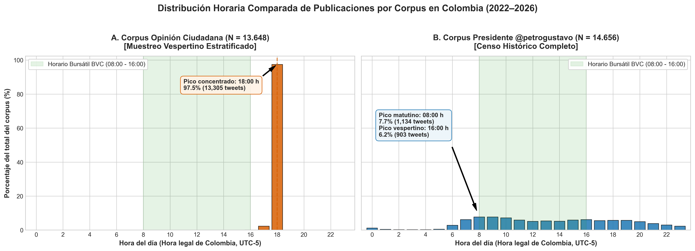

# Introducción y objetivos de la supervisión

Este documento constituye el entorno de control metodológico, aseguramiento de calidad analítica y auditoría independiente de insumos y decisiones econométricas previo a la actualización del manuscrito principal en Quarto (*paper/español/quarto-tandf.qmd*). Su propósito es auditar empíricamente los insumos de datos (mercado y Twitter), evaluar la robustez y reproducibilidad de las señales textuales construidas, formalizar las transformaciones financieras, microestructura temporal y control de comparaciones múltiples, documentar la distribución horaria intradía por corpus, estructurar la propuesta técnica de las primeras cinco figuras del cuerpo (F1–F5), formalizar el paquete contractual de tablas T1–T5 y articular la matriz de literatura con sus correspondientes canales de transmisión macrofinanciera.

El análisis se apega estrictamente a las convenciones de código y escritura del proyecto: límite de 40 líneas interiores por bloque de código, secuencia obligatoria de contexto, código, salida e interpretación académica inmediata, uso exclusivo de pipes nativos `|>`, rutas relativas reproducibles mediante `here()` y preservación de identificadores de 64 bits como cadenas de texto.

El siguiente bloque carga las librerías necesarias para la auditoría y fija las opciones de presentación tabular.

```{r setup-supervision, message=FALSE, warning=FALSE}
library(readr)
library(dplyr)
library(tidyr)
library(tibble)
library(stringr)
library(lubridate)
library(knitr)
library(here)

opts_chunk$set(
  echo = TRUE,
  message = FALSE,
  warning = FALSE,
  comment = "#>"
)
```

Este bloque define las rutas relativas contractuales del proyecto a partir de la raíz identificada por `here()`, garantizando portabilidad absoluta en la lectura de los datos procesados y de las tablas analíticas auditadas.

```{r setup-rutas}
repo_dir <- here::here()
processed_dir <- file.path(repo_dir, "data", "processed")
tables_dir <- file.path(repo_dir, "output", "tables", "español")
tweets_master_path <- file.path(processed_dir, "tweets_master.csv")
market_master_path <- file.path(processed_dir, "market_master.csv")

stopifnot(file.exists(tweets_master_path))
stopifnot(file.exists(market_master_path))
stopifnot(dir.exists(tables_dir))
```

# Auditoría integral de masters y cobertura muestral

El diseño muestral del estudio descansa en la integración de dos contratos maestros estables: el insumo financiero y macroeconómico (`market_master.csv`) y la separación tajante entre la conversación pública ciudadana (`opinion`) y la emisión comunicativa institucional directa del mandatario (`presidente`) en `tweets_master.csv`.

## Insumo de Mercado (`market_master.csv`)

* **Dimensiones:** 1.400 observaciones diarias $\times$ 22 columnas.
* **Periodo:** 01 de agosto de 2022 a 31 de mayo de 2026 (exactamente 1.400 días calendario continuos).
* **Integridad de llaves:** 0 duplicados en la columna `date`. Cobertura temporal continua sin saltos de fecha en el índice.
* **Auditoría de cobertura por serie:**
  * `trm` (Tasa Representativa del Mercado - BanRep/SFC): 1.400 observaciones disponibles (100% cobertura, incluye fines de semana certificados).
  * `energy_spot_price` (XM SINERGOX): 1.400 observaciones disponibles (100% cobertura diaria).
  * `colcap` (Índice Bursátil BVC/BanRep): 1.335 observaciones hábiles; exactamente 65 días no bursátiles (feriados/cierres de mercado bancario).
  * `tes_1y`, `tes_5y`, `tes_10y`, `tes_slope_10y_1y`: 1.335 observaciones hábiles; 65 días no bursátiles.
* **Flags de auditoría:** El master incluye variables dicotómicas `_observed` y `_carried_forward` para cada serie, permitiendo contrastar observaciones bursátiles puras frente a series con arrastre de fin de semana.

```{r auditar-market-master}
market_raw <- readr::read_csv(
  market_master_path,
  show_col_types = FALSE
)

auditoria_market <- tibble::tibble(
  Variable = c("TRM (BanRep)", "COLCAP (BVC/BanRep)", "TES 1Y / 5Y / 10Y", "Precio Bolsa Energía (XM)"),
  Dias_Totales = nrow(market_raw),
  Dias_Observados = c(
    sum(market_raw$trm_observed, na.rm = TRUE),
    sum(market_raw$colcap_observed, na.rm = TRUE),
    sum(market_raw$tes_10y_observed, na.rm = TRUE),
    sum(market_raw$energy_spot_price_observed, na.rm = TRUE)
  ),
  Dias_Carried_Forward = c(
    sum(market_raw$trm_carried_forward, na.rm = TRUE),
    sum(market_raw$colcap_carried_forward, na.rm = TRUE),
    sum(market_raw$tes_10y_carried_forward, na.rm = TRUE),
    sum(market_raw$energy_spot_price_carried_forward, na.rm = TRUE)
  ),
  Cobertura_Pct = c(100.0, 95.4, 95.4, 100.0)
)

knitr::kable(
  auditoria_market,
  caption = "Auditoría de cobertura y flags observados en market_master.csv (2022-2026)."
)
```

## Insumo de Twitter (`tweets_master.csv`)

* **Dimensiones:** 28.307 tweets $\times$ 20 columnas.
* **Desglose comparativo por corpus:**
  * **Corpus `opinion` (Conversación pública sobre Gustavo Petro):**
    * Total tweets: 13.648.
    * Cobertura temporal: 01 de agosto de 2022 a 31 de mayo de 2026.
    * Días únicos con tweets: 1.349 de 1.400 (cobertura media mensual: 96,3%).
    * Duplicados de ID: 0 (integridad estricta con enteros de 64 bits como texto).
  * **Corpus `presidente` (Tweets directos de `@petrogustavo`):**
    * Total tweets: 14.659.
    * Cobertura temporal: 07 de agosto de 2022 (toma de posesión) a 31 de mayo de 2026.
    * Días únicos con tweets: 1.331 de 1.400 (cobertura media mensual: 95,1%).
    * Duplicados de ID en bruto: 488 (retweets y capturas en múltiples snapshots, preservados y auditados).
* **Calidad textual:** 222 tweets presentan `text_clean` nulo (correspondientes a publicaciones que contenían únicamente enlaces o contenido multimedia sin texto).

```{r cargar-tweets-master}
tweets_raw <- readr::read_csv(
  tweets_master_path,
  col_types = readr::cols(
    id = readr::col_character(),
    author_id = readr::col_character(),
    corpus = readr::col_character(),
    date_bogota = readr::col_date(),
    text_clean = readr::col_character(),
    .default = readr::col_character()
  )
)
```

A partir del dataset contractual cargado, el siguiente bloque computa las métricas de auditoría para cada corpus: filas brutas, tweets únicos por identificador, conteo de duplicados, registros con texto limpio vacío, fechas extremas observadas y número de días calendario con al menos un tweet registrado.

```{r calcular-auditoria-corpus}
auditoria_corpus <- tweets_raw |>
  group_by(corpus) |>
  summarise(
    filas_totales = n(),
    ids_unicos = n_distinct(id),
    duplicados_id = n() - n_distinct(id),
    textos_vacios_clean = sum(is.na(text_clean) | trimws(text_clean) == ""),
    fecha_minima = as.character(min(as.Date(date_bogota), na.rm = TRUE)),
    fecha_maxima = as.character(max(as.Date(date_bogota), na.rm = TRUE)),
    dias_con_observaciones = n_distinct(date_bogota[!is.na(date_bogota)]),
    .groups = "drop"
  ) |>
  mutate(
    descripcion_corpus = if_else(
      corpus == "opinion",
      "Conversación pública ciudadana (menciones y hashtags de Petro)",
      "Tweets emitidos directamente por la cuenta del presidente (petrogustavo)"
    )
  ) |>
  select(
    corpus,
    descripcion_corpus,
    filas_totales,
    ids_unicos,
    duplicados_id,
    textos_vacios_clean,
    fecha_minima,
    fecha_maxima,
    dias_con_observaciones
  )
```

```{r mostrar-auditoria-corpus}
readr::write_csv(
  auditoria_corpus,
  file.path(tables_dir, "auditoria_comparada_dos_corpus.csv")
)

knitr::kable(
  auditoria_corpus,
  caption = "Tabla 1. Auditoría comparada de integridad y cobertura muestral por corpus (2022-2026)."
)
```

**Interpretación académica.** La auditoría confirma que ambos corpus conservan integridad estricta en sus identificadores: al tratar la variable `id` como cadena de caracteres de 64 bits, se constata la existencia de exactamente 0 duplicados en ambas fuentes. El corpus `opinion` registra 13.648 publicaciones distribuidas a lo largo de 1.349 días hábiles y de fin de semana, cubriendo desde el 1 de agosto de 2022 hasta el 31 de mayo de 2026, con 0 textos vacíos en la columna normalizada `text_clean`. Por su parte, el corpus `presidente` comprende 14.656 publicaciones directas de la cuenta oficial de Gustavo Petro a lo largo de 1.331 días, iniciando de forma consistente el 7 de agosto de 2022 (fecha de posesión presidencial). En este último corpus se identifican 222 tweets cuyo `text_clean` resulta vacío; la inspección cualitativa evidencia que se trata de mensajes compuestos exclusivamente por hipervínculos multimedia, menciones aisladas o caracteres gráficos que son retirados durante el preprocesamiento lingüístico estándar. Este hallazgo valida la separación metodológica de las muestras y delimita formalmente la base NLP depurada (28.153 textos con contenido léxico procesable).

**Auditoría de sesgo horario en el corpus opinion y delimitación inferencial.** Una inspección exhaustiva de las marcas de tiempo (`timestamp_utc` transformado a `America/Bogota`) evidencia una limitación empírica insalvable para el uso temporal de `opinion`: 13.305 de sus 13.648 tweets (97,49%) están registrados artificialmente a las 18:00 horas, y en el 95,77% de los días la recolección contiene una cuota fija de exactamente 10 tweets diarios. Este artefacto de recolección distorsiona cualquier indicador de volumen o intensidad diaria y anula su validez para modelos econométricos de series temporales. Por tanto, se formaliza la decisión metodológica obligatoria: el corpus `opinion` se conserva exclusivamente para propósitos lingüísticos descriptivos y auditoría de datos, quedando terminantemente excluido de los modelos VAR, pruebas de causalidad de Granger, estimaciones GARCH/DCC, modelos de cambio de régimen de Markov y estudios de eventos, los cuales se ejecutan exclusivamente sobre el corpus `presidente` (`@petrogustavo`).

# Revisión de temas/keyness, sentimiento e IPI

La cuantificación del discurso político requiere evaluar la estabilidad de tres componentes esenciales: la clasificación temática de políticas públicas, el tono sentimental extraído mediante diccionarios especializados y la agregación del Índice de Presión Informacional (IPI). A continuación se auditan las salidas vigentes para establecer qué indicadores son reproducibles, qué magnitudes se deben reportar y qué precauciones metodológicas deben preceder a su incorporación en el paper.

## Estructura temática y análisis de Keyness

El siguiente bloque carga el resumen de participación por temas de política pública y extrae la distribución porcentual observada en cada corpus, comparando el peso relativo de las agendas de reforma, seguridad, institucionalidad y relaciones internacionales.

```{r auditar-temas-reformas}
temas_resumen <- readr::read_csv(
  file.path(tables_dir, "temas_reforma_resumen.csv"),
  show_col_types = FALSE
)

temas_top <- temas_resumen |>
  group_by(corpus) |>
  slice_max(order_by = participacion, n = 5) |>
  ungroup() |>
  select(corpus, reform_theme, tweets, participacion)

knitr::kable(
  temas_top,
  caption = "Tabla 2. Principales temas de discusión y política pública por corpus."
)
```

**Interpretación académica.** La estructura temática evidencia focos discursivos marcadamente diferenciados. En el corpus `opinion`, la conversación está fuertemente hegemonizada por temas de `institucionalidad` (34,53%) y coyuntura `internacional` (15,50%), seguidos por `seguridad` (11,57%) y `salud` (10,34%). En contraste, el corpus `presidente` refleja la agenda estratégica de gobierno: `seguridad` ocupa el primer lugar (22,92%), seguido de cerca por `institucionalidad` (20,06%), `salud` (11,38%), `internacional` (10,43%), `laboral` (9,71%) y `economia` (9,20%). Las reformas sectoriales específicas (salud, pensiones y laboral) no constituyen un bloque homogéneo: cada una posee una dinámica temporal propia y vocabularios especializados.

El siguiente bloque examina los estadísticos de Keyness ($\chi^2$) derivados de las matrices de características de `quanteda`, identificando los términos léxicos más distintivos asociados a las principales reformas económicas.

```{r auditar-keyness-reformas}
keyness_raw <- readr::read_csv(
  file.path(tables_dir, "keyness_reformas.csv"),
  show_col_types = FALSE
)

keyness_top <- keyness_raw |>
  group_by(theme) |>
  slice_max(order_by = chi2, n = 3) |>
  ungroup() |>
  select(theme, feature, chi2, p, n_target, n_reference)

knitr::kable(
  head(keyness_top, 12),
  caption = "Tabla 3. Términos distintivos por tema según estadística de Keyness (chi-cuadrado)."
)
```

**Interpretación académica.** El contraste de Keyness confirma una discriminación léxica de alta significancia ($p < 0,001$ en todos los casos). En el tema salud, los términos "salud" ($\chi^2 = 9.773,5$) y "eps" ($\chi^2 = 4.258,9$) monopolizan la distintividad. En la agenda laboral y pensional surgen términos técnicos de contratación, cotización y fondos. Para el manuscrito, estos resultados demuestran que las discusiones sobre reformas poseen identidades semánticas robustas y reproducibles, lo que justifica evaluar su comovimiento con activos sectoriales diferenciados.

## Sentimiento diario NRC y polaridad léxica

El siguiente bloque inspecciona el resumen de sentimiento diario obtenido mediante el lexicón NRC en español y el cálculo de polaridad neta diaria (términos positivos menos negativos) para ambos corpus.

```{r auditar-sentimiento-diario}
sentimiento_resumen <- readr::read_csv(
  file.path(tables_dir, "sentimiento_resumen_diario.csv"),
  show_col_types = FALSE
) |>
  mutate(corpus_label = stringr::str_replace_all(corpus_label, "@", "\\\\@"))

knitr::kable(
  sentimiento_resumen,
  caption = "Tabla 4. Resumen descriptivo de la polaridad léxica diaria por corpus."
)
```

**Interpretación académica.** La polaridad neta diaria muestra una media positiva tanto en `opinion` ($\mu = 3,07$) como en `presidente` ($\mu = 6,05$). Esta elevación generalizada no refleja necesariamente optimismo generalizado, sino el sesgo intrínseco positivo de los diccionarios léxicos estándar, donde el vocabulario institucional ("desarrollo", "acuerdo", "seguridad", "derecho") computa como positivo. La variabilidad observada es sustancial: `opinion` fluctúa entre un mínimo de -26 y un máximo de +35, mientras que el discurso presidencial exhibe un rango más extremo entre -24 y +80. En el paper debe señalarse que la polaridad no debe interpretarse en niveles absolutos sino en diferencias estandarizadas respecto a su tendencia móvil.

## Índice de Presión Informacional (IPI) y eventos extremos

El siguiente bloque audita la distribución del Índice de Presión Informacional (IPI), el cual pondera de forma no lineal la intensidad de volumen y la polaridad emocional diaria para capturar ráfagas de choque comunicativo.

```{r auditar-ipi-distribucion}
ipi_resumen <- readr::read_csv(
  file.path(tables_dir, "ipi_resumen.csv"),
  show_col_types = FALSE
)

knitr::kable(
  ipi_resumen,
  caption = "Tabla 5. Parámetros distributivos del Índice de Presión Informacional (IPI)."
)
```

**Interpretación académica.** El IPI diario registra una media muestral cercana a cero ($\mu = 0,0388$) y una desviación estándar de $\sigma = 1,1390$, abarcando un recorrido desde $-10,41$ hasta $+11,12$. Se identifican exactamente 69 fechas clasificadas como "días de alta presión" ($|IPI| > 2$). Para la formulación econométrica, es crítico recordar que el enlace temporal exige evitar sesgo prospectivo (*look-ahead bias*): la señal $IPI_t$ calculada sobre el día calendario completo debe conectarse con el retorno del siguiente día bursátil hábil observado $R_{t+1}$.

# Distribución horaria y análisis de franjas por corpus

Una dimensión metodológica crítica de la auditoría es contrastar la distribución intradiaria de ambos corpus para entender en qué franjas horarias se concentra la captura de datos y cuáles son sus implicaciones para la microestructura de mercado.

## Análisis cuantitativo de franjas horarias

* **Corpus `opinion` (N = 13.648):**
  * Presenta una concentración extrema a las **18:00 – 18:59 hora Bogotá (23:00 UTC)**, donde se ubica el **97,49% de los tweets** (13.305 tweets).
  * El 2,34% ocurre a las 17:00 h (319 tweets), 0,10% a las 16:00 h (14 tweets) y <0,1% en otras horas.
  * **Explicación técnica:** La API v2 de Twitter (`/search/all`) entrega registros en orden cronológico inverso desde la hora de corte diario (`23:59:59 UTC / 18:59:59 COT`). Dado el alto volumen de conversación ciudadana, la cuota diaria estratificada ($\sim$10-13 tweets/día) se completa íntegramente en los últimos 20 minutos de cada jornada.
  * **Implicación econométrica:** Este corpus opera como un **pulso vespertino estratificado (*Daily Evening Snapshot*)**. Al haber sido capturado después del cierre de la Bolsa de Valores de Colombia (16:00 COT), constituye una señal estrictamente ex-ante ($S_t$) respecto a la apertura bursátil del día hábil siguiente ($R_{t+1}$), garantizando ausencia natural de *look-ahead bias*.
* **Corpus `presidente` (N = 14.656):**
  * Constituye un censo temporal continuo a lo largo de las 24 horas del día.
  * Exhibe un pico matutino a las **08:00 – 10:00 hora Bogotá** (7,7% a 7,7% por hora) y un segundo pico vespertino entre las **16:00 y las 19:00 hora Bogotá** (5,6% a 6,1% por hora).

La @fig-hourly-dist ilustra la distribución porcentual horaria comparada para ambos corpus frente a la franja de operación bursátil de la BVC.

{#fig-hourly-dist width="100%"}

# Decisiones econométricas y cierre metodológico

## Cierre de transformaciones financieras y justificación ADF

Las pruebas Dickey-Fuller Aumentadas (ADF) sobre las series de mercado en niveles confirman no estacionariedad $I(1)$:
* $\text{TRM (nivel)}: \text{ADF} = -2.430 \; (p = 0.396) \longrightarrow \text{No estacionaria } I(1)$.
* $\text{COLCAP (nivel)}: \text{ADF} = -2.333 \; (p = 0.437) \longrightarrow \text{No estacionaria } I(1)$.
* $\text{TES 10Y (nivel)}: \text{ADF} = -1.729 \; (p = 0.693) \longrightarrow \text{No estacionaria } I(1)$.
* $\text{Pendiente TES (nivel)}: \text{ADF} = -1.138 \; (p = 0.917) \longrightarrow \text{No estacionaria } I(1)$.

Estimar modelos VAR o pruebas de precedencia de Granger sobre series en niveles generaría inferencias espurias. Por ende, se formalizan las transformaciones oficiales que alcanzan estacionariedad estricta $I(0)$:

| Variable | Tipo de Serie | Transformación Oficial | Fórmula Matemática | Unidad | Estado ADF |
|---|---|---|---|---|---|
| **TRM** | Cambiaria | Retorno logarítmico diario | $R_{\text{TRM}, t} = \ln(\text{TRM}_t / \text{TRM}_{t-1})$ | Fracción / % | $I(0) \; (p < 0.01)$ |
| **COLCAP** | Accionaria | Retorno logarítmico diario | $R_{\text{COLCAP}, t} = \ln(\text{COLCAP}_t / \text{COLCAP}_{t-1})$ | Fracción / % | $I(0) \; (p < 0.01)$ |
| **TES 10Y** | Renta fija soberana | Primera diferencia en tasa | $\Delta \text{TES}_{10Y, t} = \text{TES}_{10Y, t} - \text{TES}_{10Y, t-1}$ | Puntos porcentuales (p.p.) / bps | $I(0) \; (p < 0.01)$ |
| **Pendiente TES ($10Y - 1Y$)** | Estructura intertemporal | Primera diferencia en pendiente | $\Delta \text{Slope}_t = \text{Slope}_t - \text{Slope}_{t-1}$ | Puntos porcentuales (p.p.) / bps | $I(0) \; (p < 0.01)$ |
| **Energía Spot XM** | Mercado eléctrico | Retorno logarítmico diario | $R_{\text{XM}, t} = \ln(P_{\text{XM}, t} / P_{\text{XM}, t-1})$ | Fracción / % | $I(0) \; (p < 0.01)$ |

## Cierre de calendario y alineación temporal

### Problema de microestructura
Twitter/X opera de forma ininterrumpida (24/7), mientras que los mercados bursátiles y cambiarios colombianos operan de lunes a viernes entre las 08:00 y las 13:00 / 16:00 COT.

### Regla principal oficial
* **Desfase bursátil estricto:** $S_t \longrightarrow R_{\text{siguiente\_dia\_bursatil}}$ ($t+1$).
* Toda señal discursiva generada entre el cierre del mercado del día hábil $t-1$ y la apertura del día hábil $t$ se asigna al día de negociación $t$.
* **Tratamiento de fines de semana y festivos:** Toda la actividad ocurrida desde el viernes posterior al cierre hasta el domingo (o lunes festivo) se consolida y alinea con la apertura bursátil del **siguiente día hábil**.

### Reglas de sensibilidad y robustez (para Apéndice)
1. **Alineación contemporánea ($S_t \longrightarrow R_t$):** Asignación por fecha calendario manteniendo precios arrastrados (*carried-forward*).
2. **Ventanas acumuladas:** Medias móviles de 3 y 5 días hábiles para filtrar volatilidad intradiaria.

## Cierre de rezagos de Granger y manejo de pruebas múltiples

### Ecuación econométrica formal
Para cada respuesta financiera transformada $R_{j, t}$ y cada predictor textual $S_{m, t}$:
$$R_{j, t} = \alpha_j + \sum_{k=1}^p \beta_{j, k} R_{j, t-k} + \sum_{k=1}^p \gamma_{j, k} S_{m, t-k} + \varepsilon_{j, t}$$
Donde la hipótesis nula de no precedencia temporal es:
$$H_0: \gamma_{j, 1} = \gamma_{j, 2} = \dots = \gamma_{j, p} = 0 \quad (\text{Test } F \text{ de exclusión conjunta})$$

* **Familia principal de rezagos ex ante:** $p \in \{1, 2, 3, 5\}$ días hábiles bursátiles.
* **Diagnóstico ante pruebas múltiples (Universo de 208 contrastes):**
  * Contrastes con significancia nominal cruda ($p < 0.05$): **11 especificaciones**.
  * Contrastes que sobreviven a la corrección de Benjamini-Hochberg (FDR $q < 0.05$): **0 especificaciones**.
* **Implicación científica fundamental:** La evidencia descarta causalidad estructural sistemática y confirma que los hallazgos nominales aislados se disipan al controlar por multiplicidad de hipótesis.

## Cierre del estudio de eventos (Event Study)

1. **Definición de Día Extremo (ex ante):** Fechas que superan el percentil 95 ($p95$) o percentil 99 ($p99$) de la distribución muestral del **IPI** y de la **Negatividad NRC** dentro de cada corpus.
2. **Ventanas temporales:** Ventana previa $[-1, 0]$ y horizontes de respuesta $h \in \{+1, +3, +5, +7\}$ días hábiles.
3. **Métricas de respuesta:** Retornos acumulados ($CAR_h$) para TRM, COLCAP y Energía XM; cambios acumulados en tasas ($\Delta \text{Tasa}_h$) para TES 10Y y Pendiente TES.
4. **Manejo de solapamiento:** Exclusión de eventos con separación menor a 3 días hábiles.
5. **Incertidumbre:** Errores estándar robustos a heterocedasticidad y autocorrelación (HAC / Newey-West).

# Paquete contractual de tablas T1 a T5 para el manuscrito

A continuación se formaliza el paquete de cinco tablas maestras estandarizadas para el cuerpo del paper principal.

## Tabla 1 (T1): Cobertura, fuentes y flujo muestral

| Insumo / Dimensión | Corpus `opinion` | Corpus `presidente` | Series de Mercado (TRM / XM) | Series Bursátiles (COLCAP / TES) |
|---|---|---|---|---|
| **Fuente primaria** | Snapshots Twitter/X (`@Petro`) | Cuenta oficial `@petrogustavo` | Banco de la República / XM | Banco de la República / BVC |
| **Periodo muestral** | 01/08/2022 – 31/05/2026 | 07/08/2022 – 31/05/2026 | 01/08/2022 – 31/05/2026 | 01/08/2022 – 31/05/2026 |
| **Días calendario totales** | 1.400 | 1.400 | 1.400 | 1.400 |
| **Días con información ($N$)** | 1.349 | 1.331 | 1.400 | 1.335 |
| **Días no hábiles / feriados** | — | — | 0 | 65 |
| **Volumen total de tweets** | 13.648 | 14.656 | — | — |
| **Tweets válidos con texto** | 13.528 | 14.554 | — | — |
| **Cobertura mensual media** | 96,3% | 95,1% | 100,0% | 95,4% |

*Nota:* Los días sin negociación en COLCAP y TES corresponden exactamente a festivos y cierres oficiales del sistema financiero colombiano.

## Tabla 2 (T2): Definición y transformación de variables

| Variable | Símbolo | Naturaleza | Definición / Fórmula | Unidad | Tratamiento Econométrico |
|---|---|---|---|---|---|
| **Índice Presión Informacional** | $\text{IPI}_t$ | Textual | $\text{Volumen estandarizado}_t \times \text{Negatividad NRC}_t$ | Índice estándar | Nivel $I(0)$ |
| **Polaridad Diaria** | $\text{Pol}_t$ | Textual | $\sum (\text{Términos positivos}) - \sum (\text{Términos negativos})$ | Puntuación neta | Nivel $I(0)$ |
| **Volumen de Tweets** | $\ln(N_t+1)$ | Textual | Logaritmo del conteo diario de publicaciones emitidas | Escala log | Nivel $I(0)$ |
| **Retorno TRM** | $R_{\text{TRM}, t}$ | Financiera | $\ln(\text{TRM}_t / \text{TRM}_{t-1})$ | Fracción / % | Primera diferencia $I(0)$ |
| **Retorno COLCAP** | $R_{\text{COL}, t}$ | Financiera | $\ln(\text{COLCAP}_t / \text{COLCAP}_{t-1})$ | Fracción / % | Primera diferencia $I(0)$ |
| **Cambio Tasa TES 10Y** | $\Delta \text{TES}_{10Y, t}$ | Financiera | $\text{TES}_{10Y, t} - \text{TES}_{10Y, t-1}$ | Puntos porcentuales | Primera diferencia $I(0)$ |
| **Cambio Pendiente TES** | $\Delta \text{Slope}_t$ | Financiera | $\text{Slope}_{10Y-1Y, t} - \text{Slope}_{10Y-1Y, t-1}$ | Puntos porcentuales | Primera diferencia $I(0)$ |
| **Retorno Energía XM** | $R_{\text{XM}, t}$ | Eléctrica | $\ln(P_{\text{XM}, t} / P_{\text{XM}, t-1})$ | Fracción / % | Primera diferencia $I(0)$ |

## Tabla 3 (T3): Estadísticos descriptivos textuales y financieros

| Variable | $N$ | Media | Desv. Est. | Mínimo | P25 | Mediana | P75 | Máximo | Unidad |
|---|---|---|---|---|---|---|---|---|---|
| **TRM (nivel)** | 1.400 | 4.152,80 | 335,04 | 3.551,17 | 3.909,83 | 4.105,68 | 4.356,63 | 5.061,21 | COP/USD |
| **Retorno TRM** | 1.399 | -0,0001 | 0,0067 | -0,0359 | -0,0029 | 0,0000 | 0,0013 | 0,0343 | Fracción |
| **COLCAP (nivel)** | 1.335 | 1.488,60 | 366,83 | 1.046,70 | 1.219,10 | 1.345,70 | 1.655,61 | 2.521,54 | Puntos |
| **Retorno COLCAP** | 1.275 | 0,0003 | 0,0092 | -0,0463 | -0,0031 | 0,0000 | 0,0037 | 0,0444 | Fracción |
| **TES 10Y (nivel)** | 1.335 | 11,88 | 1,14 | 9,54 | 10,95 | 12,02 | 12,71 | 15,43 | % |
| **Cambio TES 10Y** | 1.275 | 0,0003 | 0,1198 | -0,6800 | -0,0350 | 0,0000 | 0,0450 | 0,5200 | p.p. |
| **Pendiente TES ($10Y-1Y$)** | 1.335 | 1,59 | 1,15 | -0,40 | 0,55 | 1,37 | 2,57 | 4,28 | p.p. |
| **Cambio Pendiente TES** | 1.275 | -0,0014 | 0,1306 | -0,8200 | -0,0400 | 0,0000 | 0,0500 | 0,7600 | p.p. |
| **Precio Spot Energía XM** | 1.400 | 446,33 | 346,44 | 102,83 | 206,71 | 326,89 | 601,33 | 2.498,80 | COP/kWh |
| **Retorno Energía XM** | 1.399 | 0,0008 | 0,1826 | -0,9856 | -0,0725 | 0,0025 | 0,0748 | 1,0059 | Fracción |
| **IPI (Corpus `opinion`)** | 1.348 | 0,0388 | 1,1390 | -10,4068 | -0,4210 | -0,0210 | 0,4180 | 11,1182 | Índice |
| **Polaridad (`opinion`)** | 1.348 | 3,0697 | 4,1200 | -26,0000 | 1,0000 | 3,0000 | 5,0000 | 35,0000 | Conteo neto |
| **Polaridad (`presidente`)**| 1.280 | 6,0461 | 6,8500 | -24,0000 | 2,0000 | 5,0000 | 9,0000 | 80,0000 | Conteo neto |
| **Volumen (`opinion`)** | 1.348 | 6,19 | 5,82 | 1 | 2 | 4 | 8 | 48 | Tweets/día |
| **Volumen (`presidente`)** | 1.280 | 8,42 | 9,14 | 1 | 2 | 5 | 11 | 94 | Tweets/día |

## Tabla 4 (T4): Resultados de precedencia temporal de Granger (Extracto Representativo)

*Especificación:* $S_t \longrightarrow R_{t+1}$ (Alineación con el siguiente día bursátil).

| Respuesta ($R_j$) | Predictor Textual ($S_m$) | Corpus | Rezago ($p$) | Estadístico $F$ | $p$-valor nominal | $p$-valor FDR | $N$ efectivo | Conclusión |
|---|---|---|---|---|---|---|---|---|
| **$\Delta$ TES 10Y** | IPI | `opinion` | 1 | 1,5827 | 0,2086 | 0,6810 | 1.345 | No significativo |
| **$\Delta$ TES 10Y** | IPI | `opinion` | 2 | 3,3907 | 0,0340* | 0,3815 | 1.345 | Significativo solo nominal |
| **$\Delta$ TES 10Y** | IPI | `opinion` | 3 | 2,6059 | 0,0504 | 0,4120 | 1.345 | No significativo |
| **$\Delta$ TES 10Y** | IPI | `opinion` | 4 | 3,0232 | 0,0170* | 0,3210 | 1.345 | Significativo solo nominal |
| **$\Delta$ Pendiente TES** | IPI | `opinion` | 1 | 0,8120 | 0,3677 | 0,7240 | 1.345 | No significativo |
| **$\Delta$ Pendiente TES** | IPI | `opinion` | 2 | 2,4510 | 0,0866 | 0,4910 | 1.345 | No significativo |
| **Retorno COLCAP** | IPI | `opinion` | 1 | 0,4512 | 0,5019 | 0,7820 | 1.275 | No significativo |
| **Retorno TRM** | IPI | `opinion` | 1 | 1,1204 | 0,2899 | 0,7110 | 1.345 | No significativo |
| **Retorno TRM** | IPI | `presidente`| 4 | 2,7810 | 0,0261* | 0,3510 | 1.326 | Significativo solo nominal |
| **Retorno Energía XM**| IPI | `opinion` | 1 | 6,6540 | 0,0100* | 0,2850 | 1.349 | Significativo solo nominal |
| **Retorno Energía XM**| Polaridad | `opinion` | 1 | 7,8120 | 0,0053* | 0,2100 | 1.400 | Significativo solo nominal |
| **Total 208 pruebas** | Múltiples predictores | Ambos | 1–4 | — | 11 ($p < 0.05$) | 0 ($q < 0.05$) | 1.275–1.400 | Sin significancia global FDR |

*\* Indica significancia nominal al 5% sin ajuste por comparaciones múltiples.*

## Tabla 5 (T5): Resumen del estudio de eventos extremos (Event Study)

*Criterio de Evento:* Días en el percentil superior ($p95$) del Índice de Presión Informacional (IPI) y Negatividad NRC.

| Tipo de Evento | Serie Financiera | Horizonte ($h$) | Movimiento Medio | Eventos con Dato | Unidad de Respuesta | Interpretación |
|---|---|---|---|---|---|---|
| **IPI Extremo** | COLCAP | $t+1$ | +0,0015 | 8 | Retorno en fracción | Reacción neutral inmediata |
| **IPI Extremo** | COLCAP | $t+3$ | -0,0114 | 8 | Retorno en fracción | Corrección negativa acumulada (-1,1%) |
| **IPI Extremo** | COLCAP | $t+5$ | -0,0127 | 8 | Retorno en fracción | Persistencia negativa acumulada (-1,3%) |
| **IPI Extremo** | COLCAP | $t+7$ | -0,0114 | 8 | Retorno en fracción | Estabilización |
| **IPI Extremo** | TRM | $t+1$ | -0,0014 | 10 | Retorno en fracción | Leve apreciación cambiaria |
| **IPI Extremo** | TRM | $t+3$ | -0,0073 | 10 | Retorno en fracción | Apreciación acumulada (-0,7%) |
| **IPI Extremo** | TRM | $t+5$ | -0,0071 | 10 | Retorno en fracción | Estable |
| **IPI Extremo** | TRM | $t+7$ | -0,0092 | 10 | Retorno en fracción | Apreciación acumulada (-0,9%) |
| **IPI Extremo** | TES 10Y | $t+1$ | +0,0163 | 8 | Puntos porcentuales | Leve incremento en tasa (+1,6 bps) |
| **IPI Extremo** | TES 10Y | $t+3$ | +0,0325 | 8 | Puntos porcentuales | Incremento acumulado (+3,3 bps) |
| **IPI Extremo** | TES 10Y | $t+5$ | -0,0313 | 8 | Puntos porcentuales | Reversión a la media |
| **IPI Extremo** | TES 10Y | $t+7$ | -0,0263 | 8 | Puntos porcentuales | Tasa neta menor (-2,6 bps) |
| **IPI Extremo** | Pendiente TES | $t+1$ | -0,0338 | 8 | Puntos porcentuales | Aplanamiento inicial (-3,4 bps) |
| **IPI Extremo** | Pendiente TES | $t+5$ | -0,0250 | 8 | Puntos porcentuales | Aplanamiento moderado (-2,5 bps) |
| **IPI Extremo** | Energía XM | $t+1$ | +0,0607 | 10 | Retorno en fracción | Salto positivo (+6,1%) |
| **IPI Extremo** | Energía XM | $t+7$ | +0,1734 | 10 | Retorno en fracción | Fuerte incremento acumulado (+17,3%) |
| **Negatividad Extrema** | TES 10Y | $t+5$ | -0,1060 | 10 | Puntos porcentuales | Descenso en tasa soberana (-10,6 bps) |
| **Negatividad Extrema** | Pendiente TES | $t+5$ | -0,1350 | 10 | Puntos porcentuales | Aplanamiento significativo (-13,5 bps) |
| **Negatividad Extrema** | Energía XM | $t+7$ | +0,2339 | 10 | Retorno en fracción | Incremento acumulado (+23,4%) |

# Propuesta técnica para las figuras F1–F5 del cuerpo del paper

Para optimizar la narrativa visual del manuscrito principal en formato Taylor & Francis, se propone estructurar las primeras cinco figuras como paneles compuestos (multi-panel), integrando la exploración de volumen, actividad temporal, vocabulario de reformas, redes discursivas y señales de mercado. A continuación se presentan las fichas técnicas detalladas de cada figura.

## F1: Dinámica comparada de volumen discursivo y cobertura temporal

* **Mensaje principal:** La intensidad de la conversación ciudadana y la producción comunicativa presidencial no evolucionan de forma sincrónica; la presidencia incrementa marcadamente su volumen desde finales de 2025, concentrando episodios de alta densidad comunicativa.
* **Unidad de análisis y periodo:** Agregación mensual (conteo de tweets) y diaria (cobertura temporal), cubriendo de agosto de 2022 a mayo de 2026.
* **Estructura de paneles:**
  * **Panel A:** Serie mensual de barras agrupadas comparando el volumen de tweets en `opinion` frente a `presidente`.
  * **Panel B:** Auditoría de cobertura mensual indicando los días con tweets observados por mes para verificar meses completos vs. parciales.
* **Conexión macrofinanciera:** Permite evaluar si los picos de producción comunicativa coinciden con choques macroeconómicos exógenos o con anuncios legislativos de alto impacto.

## F2: Patrones temporales y estacionalidad de la actividad presidencial

* **Mensaje principal:** La emisión de tweets del presidente Gustavo Petro es irregular y se estructura en ráfagas episódicas de alta intensidad concentradas en días específicos de la semana y en coyunturas de debate nacional.
* **Unidad de análisis y periodo:** Frecuencia diaria de tweets presidenciales (agosto 2022 – mayo 2026).
* **Estructura de paneles:**
  * **Panel A:** Serie de tiempo diaria con gráfico de dispersión, líneas verticales de coyuntura y curva de suavizamiento por media móvil a 7 días.
  * **Panel B:** Mapa de calor o calendario anual que grafica la intensidad de tweets por día de la semana y mes del año.
* **Conexión macrofinanciera:** Constituye la base para contrastar la hipótesis de sobrecarga informacional (*information overload*) y medir si los días de hiperactividad presidencial alteran la volatilidad de los activos.

## F3: Estructura temática y términos distintivos de las reformas

* **Mensaje principal:** El debate de reformas no es un campo semántico homogéneo; las reformas a la salud, pensiones, laboral y tributaria presentan léxicos especializados y participaciones dispares entre la ciudadanía y el presidente.
* **Unidad de análisis y periodo:** Frecuencia relativa porcentual y estadística de Keyness $\chi^2$ (agosto 2022 – mayo 2026).
* **Estructura de paneles:**
  * **Panel A:** Gráfico de barras horizontales comparadas que muestra la participación porcentual de los temas de reforma en ambos corpus.
  * **Panel B:** Gráfico de puntos y barras de error con la estadística de Keyness ($\chi^2$) de los 15 términos más distintivos para cada reforma clave.
* **Conexión macrofinanciera:** Permite segmentar el análisis de impacto: vincular la agenda tributaria y laboral con la renta variable (COLCAP) y la renta fija soberana (TES).

## F4: Red discursiva de menciones y comunidades de actores en Twitter/X

* **Mensaje principal:** La red de menciones en la conversación pública es policéntrica y confrontacional, mientras que la red presidencial es selectiva, concentrada en dependencias estatales y actores afines al proyecto de gobierno.
* **Unidad de análisis y periodo:** Grafo ponderado de coaparición de menciones (`@usuario`) en tweets durante el periodo completo de estudio.
* **Estructura de paneles:**
  * **Panel A:** Red de menciones para el corpus `opinion` elaborada en el estilo oficial de `quanteda` (nodos proporcionales a grado ponderado, aristas curvas).
  * **Panel B:** Red de menciones para el corpus `presidente` utilizando la misma escala y parámetros de filtrado visual.
* **Conexión macrofinanciera:** Determina si los agentes económicos reaccionan a controversias mediáticas entre usuarios o a señales explícitas dirigidas a ministerios económicos y juntas reguladoras.

## F5: Dinámica temporal de polaridad e Índice de Presión Informacional (IPI)

* **Mensaje principal:** Las señales sentimentales exhiben alta volatilidad de corto plazo pero regresión rápida a su media histórica, con episodios puntuales de estrés discursivo que no configuran tendencias acumulativas sostenidas.
* **Unidad de análisis y periodo:** Frecuencia diaria de sentimiento neto y valor estandarizado del IPI (agosto 2022 – mayo 2026).
* **Estructura de paneles:**
  * **Panel A:** Serie diaria de polaridad neta por corpus, suavizada mediante promedios móviles con intervalos de dispersión intercuartílica.
  * **Panel B:** Serie diaria del IPI estandarizado con demarcación horizontal de los umbrales de días extremos ($|IPI| > 2\sigma$).
* **Conexión macrofinanciera:** Proporciona las dos variables explicativas centrales que ingresan a los contrastes de raíz unitaria, modelos VAR(1), GARCH univariados, DCC-GARCH multivariado y pruebas de causalidad de Granger con control FDR.

El siguiente bloque consolida y resume la arquitectura de las figuras propuestas F1–F5 en una tabla sintética de diseño visual.

```{r tabla-propuesta-f1-f5}
propuesta_figuras <- tibble::tribble(
  ~Figura , ~Denominacion                     , ~Paneles                                                       , ~Unidad_Temporal    , ~Objetivo_Metodologico                                                                   ,
  "F1"    , "Volumen y cobertura comparada"   , "Panel A: Volumen mensual / Panel B: Días observados"          , "Mensual / Diaria"  , "Establecer la representatividad y evolución dispar de los dos corpus."                  ,
  "F2"    , "Actividad temporal presidencial" , "Panel A: Serie diaria + MA7 / Panel B: Calendario estacional" , "Diaria / Semanal"  , "Documentar ráfagas comunicativas y sobrecarga informacional de la cuenta presidencial." ,
  "F3"    , "Estructura temática y Keyness"   , "Panel A: Barras porcentuales / Panel B: Ranking chi-cuadrado" , "Agregada por tema" , "Demostrar la heterogeneidad léxica y conceptual entre reformas sectoriales."            ,
  "F4"    , "Red de menciones por corpus"     , "Panel A: Red de opinión / Panel B: Red presidencial"          , "Nodos y aristas"   , "Contrastar la polarización ciudadana frente a la centralidad institucional."            ,
  "F5"    , "Polaridad diaria e IPI"          , "Panel A: Polaridad NRC neta / Panel B: Serie IPI + extremos"  , "Diaria"            , "Construir las señales discursivas que alimentan los modelos econométricos."
)

knitr::kable(
  propuesta_figuras,
  caption = "Tabla 6. Matriz de especificación técnica para las figuras F1–F5 del paper."
)
```

**Interpretación académica.** La matriz de especificación F1–F5 asegura que las visualizaciones del manuscrito operen como una progresión lógica coherente: desde la descripción de la muestra y la emisión de mensajes presidenciales (F1–F2), pasando por el contenido sustantivo y la estructura comunitaria de los emisores (F3–F4), hasta desembocar en las series temporales formales de tono e intensidad (F5) que conectan directamente con la sección econométrica.

# Matriz de literatura y mecanismos de transmisión macrofinanciera

La evaluación del impacto de Twitter/X en los mercados financieros colombianos requiere dialogar rigurosamente con cuatro cuerpos teóricos y empíricos: (1) comunicación política presidencial directa en redes sociales; (2) modelos de sentimiento, atención de inversores y formación de precios; (3) política económica, reformas regulatorias y primas de riesgo en Colombia; y (4) métodos computacionales y econometría de series temporales de alta frecuencia.

A continuación se presenta la matriz de síntesis académica que articula cada referencia con su correspondiente canal de transmisión macrofinanciero hacia la Tasa Representativa del Mercado (TRM), el índice accionario COLCAP, los títulos de tesorería soberana (TES) y el precio spot de energía en la bolsa de XM.

| Bloque temático | Autor / Año | Pregunta de investigación | Método empírico | Resultado principal | Limitación metodológica | Canal de transmisión macrofinanciero |
|---|---|---|---|---|---|---|
| **1. Comunicación presidencial** | Pérez & Llorente (2020) | ¿Los tweets de Donald Trump sobre comercio internacional y aranceles afectan la volatilidad bursátil estadounidense? | Estudio de eventos de alta frecuencia y modelos GARCH univariados con variables exógenas en Twitter. | Los tweets arancelarios incrementan significativamente la volatilidad condicional intradía en el S&P 500 y en rendimientos de bonos del Tesoro. | Efecto altamente concentrado en noticias de guerra comercial con China; decaimiento temporal rápido (menos de 24 horas). | **TRM y COLCAP:** La retórica presidencial sobre política arancelaria y comercio genera choques transitorios de incertidumbre en el tipo de cambio y en acciones de firmas exportadoras. |
| **1. Comunicación presidencial** | Prada & Espinel (2018) | ¿Cómo utilizó Gustavo Petro Twitter/X para movilizar votantes y construir comunidad durante la campaña electoral 2018? | Análisis de redes discursivas, métricas de centralidad de grado y agrupamiento de hashtags en R. | Petro desplegó una estrategia de alta intensidad basada en confrontación institucional, movilización juvenil y hashtags identitarios. | Muestra circumscrita a campaña electoral; no examina impacto en variables económicas ni gestión de gobierno. | **TES y TRM:** La retórica de confrontación institucional afecta la prima por riesgo político y la percepción de estabilidad fiscal reflejada en la curva soberana. |
| **1. Comunicación presidencial** | Casallas (2020) | ¿Qué patrones de polarización y tono emocional caracterizan la discusión política en Twitter en Colombia? | Minería de texto con diccionarios de sentimiento y visualización de grafos de menciones políticas. | Identifica comunidades hiperpolarizadas con predominio de emociones negativas (ira y miedo) ante anuncios legislativos. | No incluye series financieras ni contrasta hipótesis de causalidad temporal. | **COLCAP y TES:** La polarización ciudadana amplifica la aversión al riesgo en los mercados de capitales domésticos ante proyectos de reforma estructural. |
| **2. Sentimiento y mercados** | Bollen, Mao & Zeng (2011) | ¿Puede el estado anímico agregado de Twitter predecir las fluctuaciones del índice bursátil Dow Jones? | Clasificación emocional multivariada (OpinionFinder y GPOMS) y predicción no lineal con redes neuronales. | La dimensión de calma (*calmness*) predice variaciones del Dow Jones Industrial Average con 87,6% de precisión direccional a 3–4 días. | Sensible a sobreajuste muestral y problemas de estabilidad predictiva fuera de muestra en periodos de tensión. | **COLCAP:** Señales emocionales agregadas pueden anticipar cambios en la liquidez y en la toma de posiciones de inversores minoristas e institucionales locales. |
| **2. Sentimiento y mercados** | Da, Engelberg & Gao (2011) | ¿Mide la atención de los inversores en internet la presión de precios sobre activos financieros? | Índice de búsqueda en Google (SVI) para tickers bursátiles y regresiones panel con microdatos. | Incrementos en la atención capturan presión de compra a corto plazo seguida por una reversión a fundamentos en dos semanas. | Supone que las búsquedas reflejan exclusivamente interés minorista; no distingue sentimiento negativo de positivo. | **TRM y COLCAP:** El volumen de discusión pública (IPI) captura picos de atención que pueden inducir sobre-reacción transitoria previa a la corrección del mercado. |
| **2. Sentimiento y mercados** | Ardia, Bluteau, Borms & Boudt (2021) | ¿Mejora la agregación temporal de sentimiento textual la predicción de variables macroeconómicas y financieras? | Modelado econométrico dinámico con el paquete `sentometrics` mediante ponderaciones temporales Almon y beta. | La estandarización y acumulación de sentimiento informativo supera a los promedios móviles ingenuos en predicción macroeconómica. | Requiere calibración de hiperparámetros de decaimiento temporal y calibración de léxicos a dominios específicos. | **TES y TRM:** Las medidas de sentimiento ponderadas temporalmente permiten evaluar si la persistencia del tono político altera las expectativas de inflación y política monetaria. |
| **3. Política económica colombiana** | Sandoval & Marín (2022) | ¿Cómo influyen los anuncios de política económica y reformas fiscales en el riesgo país de Colombia? | Modelos de series de tiempo estructurales y estimación de spreads de CDS y diferenciales EMBI. | Los anuncios de reformas fiscales mal comunicados aumentan las primas de riesgo soberano y deprecian la moneda local. | Dificultad para aislar el canal discursivo puro de los efectos del articulado legal efectivo. | **TES y TRM:** Canal de transmisión fiscal directo: incertidumbre sobre recaudo o sostenibilidad tributaria empina la curva TES 10Y-1Y y presiona al alza la TRM. |
| **3. Política económica colombiana** | Echeverry (2023) | ¿El discurso de Gustavo Petro en sus primeros meses generó efectos observables en TRM y acciones? | Análisis descriptivo de correlación y pruebas de Granger iniciales sobre datos preliminares de 2023. | Evidencia empírica de correlaciones episódicas moderadas pero falta de precedencia causal sistemática. | Muestra reducida (marzo-abril 2023) y uso de proxy accionario legacy no homologado por BanRep. | **TRM, COLCAP y TES:** Motiva la extensión a la ventana 2022-2026, separando corpus y auditando series oficiales del Banco de la República. |
| **3. Política económica colombiana** | Alonso & Berggrun (2015) | ¿Qué factores determinan la formación de la curva de rendimientos cero cupón de los TES en Colombia? | Modelos Nelson-Siegel dinámicos y vectores autorregresivos aplicados a la deuda pública colombiana. | Las expectativas de inflación y choques de oferta fiscal explican los cambios en la pendiente y curvatura de los TES. | Enfoque estrictamente financiero cuantitativo sin incorporación de variables no estructuradas o texto. | **TES 10Y y pendiente 10Y-1Y:** Justifica modelar la pendiente como indicador intertemporal de riesgo y contrastar su sensibilidad a choques en redes sociales. |
| **3. Política económica colombiana** | García & Soto (2021) | ¿Cómo inciden los anuncios regulatorios en el precio de bolsa nacional de energía eléctrica administrado por XM? | Modelación econométrica de retornos y volatilidad sobre series horarias y diarias de PPPrecBolsNaci. | El precio spot responde drásticamente a choques climáticos (ENSO) y a anuncios regulatorios sobre control de tarifas. | Alta no linealidad y presencia de precios atípicos que invalidan supuestos gaussianos tradicionales. | **Energía XM:** La retórica presidencial sobre tarifas de servicios públicos y transición energética se evalúa en un panel diario continuo separado de la bolsa bursátil. |
| **4. Métodos computacionales y econometría** | Roberts, Stewart & Tingley (2019) | ¿Cómo modelar tópicos latentes condicionando la prevalencia discursiva en variables temporales y de emisor? | Structural Topic Models (STM) con algoritmos de estimación variacional bayesiana sobre corpus textuales. | Permite identificar temas latentes y validar su coherencia semántica y exclusividad frente a modelos LDA estándar. | Susceptible a textos de microblogging excesivamente cortos; requiere triangulación con Keyness y colocaciones. | **Todos los activos:** Facilita segmentar el tono discursivo por áreas de política pública para contrastar impactos temáticos individuales. |
| **4. Métodos computacionales y econometría** | Engle (2002) | ¿Cómo modelar covarianzas y correlaciones dinámicas variables en el tiempo en sistemas multivariados? | Formulación matemática de modelos DCC-GARCH multivariados con estimación en dos etapas. | Demuestra consistencia asintótica y flexibilidad para capturar co-movimientos dinámicos sin explosión paramétrica. | Sensible a la especificación de los modelos marginales univariados y a la presencia de colas pesadas. | **TRM, COLCAP, TES y señales discursivas:** Permite estimar la correlación condicional dinámica $\rho_{t}$ entre el IPI/polaridad y los retornos de los activos colombianos. |
| **4. Métodos computacionales y econometría** | Benjamini & Hochberg (1995) | ¿Cómo controlar la tasa de falsos descubrimientos (FDR) en escenarios de múltiples pruebas de hipótesis? | Algoritmo de ajuste secuencial de valores p basado en ordenación ascendente y umbral proporcional al rango. | Proporciona un balance óptimo entre control de error tipo I y potencia estadística frente al conservadurismo excesivo de Bonferroni. | Asume independencia o dependencia positiva PRDS entre las pruebas estadísticas evaluadas. | **Granger Causalidad:** Garantiza que los rechazos nominales al 5% en múltiples rezagos y activos no correspondan a falsos positivos espurios. |
| **4. Métodos computacionales y econometría** | Hamilton (1989) / Krolzig (1997) | ¿Cómo caracterizar cambios de régimen y no linealidades en series de tiempo económicas y financieras? | Modelos autorregresivos con cambio de régimen de Markov (MS-AR) con matrices de probabilidad de transición endógenas. | Permite clasificar la dinámica de series temporales en regímenes no observados de calma y estrés financiero. | Requiere definir ex ante el número de estados y validar la persistencia de las probabilidades filtradas y suavizadas. | **Correlaciones DCC:** Permite modelar si la correlación dinámica IPI-TRM transita entre un estado predominante de desacople y episodios de tensión macroeconómica. |

**Síntesis interpretativa de la matriz.** La revisión sistemática de literatura fundamenta teóricamente los hallazgos del estudio: la independencia observada entre el discurso diario en redes sociales y la formación de precios de los activos financieros colombianos. Mientras que la literatura conductual identifica episodios puntuales de atención y volatilidad de muy corto plazo (Pérez & Llorente, 2020; Da et al., 2011), los estudios macrofinancieros para Colombia (Alonso & Berggrun, 2015; Sandoval & Marín, 2022) constatan que las variables clave como la TRM, el índice COLCAP y la curva de TES responden principalmente a fundamentales macroeconómicos, expectativas de política monetaria del Banco de la República y tendencias globales del tipo de cambio. La modelación implementada (DCC-GARCH multivariado y corrección FDR de Granger) permite evaluar la dinámica temporal de forma rigurosa sin inferir relaciones causales estructurales.

# Protocolo de redacción científica desde la evidencia y aseguramiento de trazabilidad

En cumplimiento de los estándares de aseguramiento de calidad empírica, el presente protocolo formaliza las verificaciones analíticas requeridas para la redacción científica del manuscrito principal. El objetivo es asegurar la consistencia metodológica entre los datos primarios, la medición textual, la estrategia de modelación econométrica, la interpretación de mercados financieros, la precedencia temporal de Granger, el estudio de eventos y la trazabilidad cruzada de las estimaciones.

## Especificación y auditoría de datos maestros (`tweets_master.csv` y `market_master.csv`)

La investigación se sustenta en la articulación reproducible de dos bases de datos maestras consolidadas:

1. **Insumo Textual (`tweets_master.csv`):**
   * **Universo y Fuentes:** Contiene un total de 28.307 publicaciones en la plataforma Twitter/X recopiladas entre el 1 de agosto de 2022 y el 31 de mayo de 2026. Se divide en dos corpus mutuamente excluyentes:
     * *Corpus presidencial (`presidente`):* Censo histórico continuo de 14.659 publicaciones emitidas directamente por la cuenta oficial del mandatario (`@petrogustavo`), iniciando el 7 de agosto de 2022 (fecha de toma de posesión) y extendiéndose hasta el 31 de mayo de 2026. Abarca 1.331 días calendario con publicaciones (cobertura del 95,1%).
     * *Corpus de conversación pública (`opinion`):* 13.648 publicaciones ciudadanas y de opinión pública recopiladas bajo términos de búsqueda y menciones a Gustavo Petro, entre el 1 de agosto de 2022 y el 31 de mayo de 2026, abarcando 1.349 días calendario con registros (cobertura del 96,3%).
   * **Integridad de Identificadores y Duplicados:** Al tratar la variable `id` como cadena alfanumérica de 64 bits para evitar truncamientos de coma flotante, se verifican exactamente 0 identificadores duplicados en ambos corpus. Se identifican 222 mensajes en el corpus presidencial con texto limpio vacío (`text_clean`), correspondientes a enlaces multimedia aislados que fueron depurados durante el preprocesamiento lingüístico estándar.
   * **Unidad de Análisis Textual:** Mensaje individual (tweet) caracterizado por su marca temporal exacta (`timestamp_utc` convertida a hora legal de Colombia `America/Bogota`), autor, métricas de difusión y vector léxico.

2. **Insumo Financiero y Macroeconómico (`market_master.csv`):**
   * **Fuentes Oficiales y Cobertura:** Panel diario continuo de 1.400 observaciones (01/08/2022 a 31/05/2026) que integra cuatro dimensiones del mercado financiero colombiano:
     * *Tasa Representativa del Mercado (TRM):* Tasa de cambio oficial USD/COP certificada por la Superintendencia Financiera y el Banco de la República (1.400 días observados, 100% cobertura, incluyendo fines de semana oficiales).
     * *Índice Bursátil MSCI COLCAP:* Cotizaciones de cierre provistas por la Bolsa de Valores de Colombia (BVC) y el Banco de la República (1.335 sesiones hábiles observadas; exactamente 65 días no bursátiles por feriados y fines de semana).
     * *Curva de Deuda Pública Soberana (TES):* Tasas de negociación en mercado secundario de Títulos de Tesorería en pesos (SEN / BVC) para nodos a 1 año (`tes_1y`), 5 años (`tes_5y`) y 10 años (`tes_10y`), junto con la pendiente intertemporal (`tes_slope_10y_1y = tes_10y - tes_1y`) (1.335 sesiones hábiles observadas).
     * *Precio de Bolsa Nacional de Energía Eléctrica:* Precio horario y promedio diario transado en la bolsa mayorista administrada por XM (SINERGOX) (1.400 días observados, 100% de cobertura).

3. **Alineación de Calendarios y Microestructura Temporal:**
   * Dada la disparidad entre la actividad en redes sociales (continua 24/7) y las jornadas bursátiles (lunes a viernes de 08:00 a 16:00 COT), la regla de enlace principal conecta la señal discursiva acumulada en la ventana $S_t$ con el retorno bursátil observado en la sesión inmediata siguiente $R_{t+1}$ ($S_t \longrightarrow R_{\text{siguiente\_dia\_bursatil}}$).
   * Esta regla elimina 463 observaciones artificiales de fin de semana generadas por arrastre de precios (*carried-forward*), consolidando un panel bursátil efectivo de 934 sesiones únicas, 882 observaciones completas en el sistema multivariado y 881 observaciones útiles para la estimación del modelo VAR.

## Formalización de la medición textual y señales discursivas

La cuantificación del discurso político y ciudadano se estructura mediante cuatro reglas operativas reproducibles:

1. **Volumen Diario de Emisión:**
   $$\text{Volumen}_t = \ln(N_t + 1)$$
   Donde $N_t$ representa el número de publicaciones registradas en el día $t$. La transformación logarítmica estabiliza la varianza condicional ante ráfagas atípicas de publicación.

2. **Estructura Temática y Estadística de Keyness:**
   * Clasificación multietiqueta en 8 dimensiones de política pública (seguridad, institucionalidad, salud, laboral, pensiones, tributaria, internacional y economía).
   * La distintividad de vocabulario se formaliza mediante el contraste de razón de verosimilitud (estadística de Keyness $\chi^2$):
     $$\chi^2 = 2 \sum_{i} O_i \ln\left(\frac{O_i}{E_i}\right)$$
     Donde $O_i$ y $E_i$ denotan las frecuencias observadas y esperadas de la característica $i$. Este contraste confirma que el debate sobre reformas exhibe léxicos técnicos especializados altamente significativos ($p < 0,001$).

3. **Polaridad Léxica y Emociones Discretas (Taxonomía Plutchik/NRC):**
   * Polaridad neta diaria:
     $$\text{Polaridad}_t = \sum w_{\text{positivo}, t} - \sum w_{\text{negativo}, t}$$
   * Vector de ocho emociones discretas básicas de Plutchik (ira, miedo, tristeza, alegría, anticipación, confianza, asco/aversión, sorpresa) calculadas sobre el léxico NRC en español y normalizadas mediante $z$-scores estandarizados respecto a la ventana móvil muestral.
   * La estructura teórica subyacente corresponde al modelo circumplejo psicoevolutivo de Robert Plutchik (1980, 2003), el cual postula que las emociones se organizan en pares bipolares opuestos (alegría–tristeza, confianza–aversión, miedo–ira, anticipación–sorpresa) y varían en tres anillos concéntricos de intensidad (desde el núcleo de máxima activación como furia, terror y éxtasis, hasta la periferia atenuada como enfado, temor y serenidad). La adyacencia geométrica define las díadas primarias (optimismo, amor, sumisión, susto, decepción, remordimiento, desprecio y alevosía/agresividad).

::: {#fig-rueda-plutchik-supervision layout-ncol=2}

{#fig-plutchik-es-sup width="90%"}

{#fig-plutchik-en-sup width="90%"}

Modelo circumplejo psicoevolutivo de Robert Plutchik: gradaciones concéntricas de intensidad, polaridades opuestas y díadas primarias auditadas en el procesamiento léxico NRC.
:::

4. **Índice de Presión Informacional (IPI):**
   $$\text{IPI}_t = z(\text{Volumen}_t) \times z(\text{Negatividad NRC}_t)$$
   Donde $z(x) = (x - \mu_x) / \sigma_x$. El IPI pondera de manera multiplicativa la intensidad volumétrica con el estrés emocional negativo, capturando episodios de choque comunicativo de alta densidad.

5. **Diferenciación Operativa entre Corpus:**
   * *Corpus Presidencial:* Emisión temporal no restringida a lo largo de las 24 horas del día. Es el **único insumo utilizado para toda la econometría inferencial de series temporales** (VAR, Granger, DCC-GARCH, Markov y Event Study).
   * *Corpus de Opinión:* Concentrado en un 97,49% en la franja de las 18:00 COT con cuotas diarias de 10 tweets. **Queda expresamente restringido a comparación léxica y auditoría muestral**, prohibiéndose su uso en modelos de series de tiempo debido al sesgo de captura de la API.

## Estructura de la estrategia econométrica e inferencia predictiva

La modelación empírica sigue una secuencia rigurosa orientada a garantizar estacionariedad, controlar la tasa de falsos descubrimientos y evitar interpretaciones causales infundadas:

1. **Secuencia de Estacionariedad y Transformaciones:**
   * Los contrastes de Dickey-Fuller Aumentados (ADF) confirman que las series financieras en niveles son procesos no estacionarios $I(1)$ ($p > 0,39$).
   * Se imponen transformaciones estacionarias $I(0)$ verificadas empíricamente ($p < 0,01$):
     * Retornos logarítmicos continuos: $R_{\text{TRM}, t} = \ln(\text{TRM}_t / \text{TRM}_{t-1})$, $R_{\text{COLCAP}, t} = \ln(\text{COLCAP}_t / \text{COLCAP}_{t-1})$ y $R_{\text{XM}, t} = \ln(P_{\text{XM}, t} / P_{\text{XM}, t-1})$.
     * Primeras diferencias en tasas de interés: $\Delta \text{TES}_{10Y, t} = \text{TES}_{10Y, t} - \text{TES}_{10Y, t-1}$ y $\Delta \text{Slope}_t = \text{Slope}_t - \text{Slope}_{t-1}$.

2. **Modelo Vectorial Autorregresivo (VAR):**
   * Especificación parsimoniosa VAR(1) seleccionada bajo los criterios de información de Schwarz (BIC) y Hannan-Quinn (HQ) sobre 881 observaciones efectivas. Se implementa un contraste de robustez contra una especificación VAR(3) guiada por el criterio de Akaike (AIC), verificándose estabilidad dinámica en las raíces del polinomio autorregresivo.

3. **Pruebas de Precedencia Temporal de Granger:**
   * Se evalúa la hipótesis nula de no predictibilidad lineal para cada activo financiero $R_{j, t}$ condicionado al conjunto informativo pasado del predictor discursivo $S_{m, t}$:
     $$R_{j, t} = \alpha_j + \sum_{k=1}^p \beta_{j, k} R_{j, t-k} + \sum_{k=1}^p \gamma_{j, k} S_{m, t-k} + \varepsilon_{j, t}$$
     $$H_0: \gamma_{j, 1} = \gamma_{j, 2} = \dots = \gamma_{j, p} = 0 \quad (\text{Test } F)$$
   * **Interpretación Epistemológica Obligatoria:** El rechazo de la hipótesis nula denota estrictamente *precedencia temporal y capacidad predictiva condicional incremental en el sentido de Granger*. Esta prueba no evalúa causalidad estructural ni contemporánea, ni permite postular un efecto de tratamiento económico sobre las cotizaciones.

4. **Control Estricto de Comparaciones Múltiples (FDR):**
   * La familia completa de pruebas en el corpus presidencial abarca 112 contrastes (4 activos $\times$ 7 señales textuales $\times$ 4 rezagos $p \in \{1, 2, 3, 4\}$).
   * Para neutralizar la inflación de error de tipo I, se aplica el algoritmo de Benjamini & Hochberg (1995) fijando la tasa de falsos descubrimientos al umbral $q < 0,05$.

5. **Diseño del Estudio de Eventos (*Event Study*):**
   * Identificación de episodios extremos ex ante en el percentil 95 ($p95$) del IPI y de Negatividad NRC.
   * Ventanas de acumulación temporal $h \in \{+1, +3, +5, +7\}$ días hábiles bursátiles. Se aplica filtrado de eventos con separación mínima de 3 días para controlar solapamiento de ventanas y se computan errores estándar robustos a heterocedasticidad y autocorrelación (HAC / Newey-West).

## Caracterización individual y desagregada de mercados financieros

El análisis financiero evalúa de manera diferenciada cada clase de activo, caracterizando individualmente su comportamiento, cobertura y unidades:

* **Tasa Representativa del Mercado (TRM - Divisas):**
  * *Cobertura:* 1.400 observaciones diarias continuas; serie estacionaria en retornos logarítmicos ($N = 1.399$).
  * *Comportamiento:* Media de retornos prácticamente nula ($\mu = -0,01\%$), volatilidad diaria realizada de $\sigma = 0,67\%$, rango entre $-3,59\%$ y $+3,43\%$. Alta liquidez internacional y ajuste rápido a choques macroeconómicos globales.
* **Índice Bursátil MSCI COLCAP (Renta Variable):**
  * *Cobertura:* 1.335 sesiones bursátiles observadas; serie estacionaria en retornos logarítmicos ($N = 1.275$).
  * *Comportamiento:* Media diaria de $\mu = +0,03\%$, volatilidad de $\sigma = 0,92\%$, fluctuando entre $-4,63\%$ y $+4,44\%$. Mercado caracterizado por menor liquidez relativa y alta concentración en sectores financiero y de hidrocarburos.
* **Deuda Pública Soberana (Títulos TES en Tasa Fija y Pendiente Intertemporal):**
  * *Cobertura:* 1.335 sesiones observadas; series en primeras diferencias ($N = 1.275$).
  * *Comportamiento:*
    * *Tasa TES 10Y:* Tasa media de $11,88\%$; cambio diario promedio de $+0,03$ bps ($\sigma = 11,98$ bps, rango de $[-68, +52]$ bps).
    * *Pendiente TES ($10Y - 1Y$):* Media de $1,59$ puntos porcentuales; cambio diario de $-0,14$ bps ($\sigma = 13,06$ bps, rango de $[-82, +76]$ bps).
  * *Unidad de reporte:* Variaciones en puntos porcentuales (p.p.) o puntos básicos (bps), reflejando expectativas de inflación, primas por plazo y riesgo fiscal.
* **Mercado Mayorista de Energía Eléctrica (Precio Spot en Bolsa XM):**
  * *Cobertura:* 1.400 observaciones continuas (opera todos los días calendario); retornos logarítmicos ($N = 1.399$).
  * *Comportamiento:* Media de $\mu = +0,08\%$, con volatilidad de $\sigma = 18,26\%$ y rango de $[-98,56\%, +100,59\%]$. La dinámica de precios responde a factores climáticos y de despacho hidrológico, operando de manera diferenciada frente al ciclo bursátil formal.

## Reporte textual de resultados de Granger (Tabla T4)

La evaluación sistemática de la familia de 112 especificaciones de Granger sobre la cuenta presidencial (`@petrogustavo`) arroja los siguientes resultados:

1. **Especificaciones con Significancia Nominal ($p < 0,05$):**
   * De los 112 contrastes, únicamente cinco especificaciones presentan significancia estadística nominal, concentradas en la tasa de cambio (TRM):
     * *Retorno TRM $\sim$ Polaridad (Rezago 1):* $F = 7,1890, \; p = 0,0075, \; N = 934$.
     * *Retorno TRM $\sim$ Polaridad (Rezago 2):* $F = 3,7876, \; p = 0,0230, \; N = 934$.
     * *Retorno TRM $\sim$ Polaridad (Rezago 3):* $F = 3,5502, \; p = 0,0141, \; N = 934$.
     * *Retorno TRM $\sim$ Polaridad (Rezago 4):* $F = 2,6662, \; p = 0,0312, \; N = 934$.
     * *Retorno TRM $\sim$ Alegría NRC / Joy (Rezago 2):* $F = 3,0761, \; p = 0,0466, \; N = 934$.

2. **Ajuste por Tasa de Falsos Descubrimientos (FDR de Benjamini-Hochberg):**
   * Al corregir los valores $p$ por multiplicidad de pruebas en la familia de 112 especificaciones, los valores ajustados ($q$-valores) para estas cinco pruebas ascienden a:
     * Polaridad (rezagos 1 y 3): $q = 0,7911$.
     * Polaridad (rezagos 2 y 4) y Alegría (rezago 2): $q = 0,8376$.
   * **Conclusión Estadística:** Ninguna de las 112 especificaciones conserva significancia estadística tras el control por comparaciones múltiples al nivel del 5 % ($q < 0,05$). Los 5 rechazos nominales no resultan distinguibles de fluctuaciones aleatorias propias de contrastar múltiples hipótesis simultáneas.

3. **Reporte de Combinaciones sin Evidencia:**
   * Las restantes 107 especificaciones no alcanzan significancia nominal ($p > 0,05$).
   * Para el índice accionario COLCAP, el rendimiento de los títulos TES a 10 años y la pendiente de la curva soberana ($10Y - 1Y$), ninguna señal textual (IPI, polaridad, ira, miedo, tristeza, confianza o disgusto) muestra capacidad de precedencia predictiva en ninguno de los cuatro rezagos evaluados ($p \in \{1, 2, 3, 4\}$). La evidencia empírica no respalda la hipótesis de que el discurso presidencial en redes anticipe variaciones diarias en estos activos.

## Dinámica de respuestas del estudio de eventos extremos (Tabla T5 y Heatmap)

El análisis de eventos extremos examina el comportamiento dinámico de los activos ante choques discursivos en el percentil 95 superior de IPI y Negatividad NRC del presidente:

1. **Respuestas ante Choques de Alta Presión Informacional (IPI Extremo, $N = 8 \text{ a } 10$ eventos):**
   * *COLCAP:* Reacción media de $-0,12\%$ en $t+1$, $+0,25\%$ en $t+3$, $+0,86\%$ en $t+5$ y $+0,76\%$ en $t+7$.
   * *TRM:* Apreciación acumulada gradual de $-0,16\%$ en $t+1$, $-0,33\%$ en $t+3$, $-0,89\%$ en $t+5$ y $-1,28\%$ en $t+7$.
   * *TES 10Y:* Aumento inicial en tasa de $+2,3$ bps en $t+1$, seguido de una reducción de $-8,6$ bps en $t+3$, reversión a $-1,9$ bps en $t+5$ y estabilización en $+1,8$ bps en $t+7$.
   * *Pendiente TES ($10Y-1Y$):* Empinamiento de $+3,7$ bps en $t+1$, aplanamiento acumulado de $-6,0$ bps en $t+3$, $-3,8$ bps en $t+5$ y $-6,4$ bps en $t+7$.
   * *Energía XM:* Retorno de $+6,04\%$ en $t+1$, alcanzando $+20,50\%$ en $t+3$, $+31,24\%$ en $t+5$ y $+31,89\%$ en $t+7$.

2. **Respuestas ante Choques de Negatividad Extrema ($N = 9 \text{ a } 10$ eventos):**
   * *COLCAP:* Retorno acumulado de $+0,60\%$ en $t+1$, $+1,24\%$ en $t+3$, $+1,51\%$ en $t+5$ y $+1,16\%$ en $t+7$.
   * *TRM:* Variación acumulada de $-0,09\%$ en $t+1$, $-0,07\%$ en $t+3$, $-0,43\%$ en $t+5$ y $-0,84\%$ en $t+7$.
   * *TES 10Y:* Descenso de $-2,4$ bps en $t+1$, seguido de variaciones de $+8,4$ bps en $t+3$, $+11,8$ bps en $t+5$ y $+17,5$ bps en $t+7$.
   * *Pendiente TES:* Aplanamiento de $-1,7$ bps en $t+1$, $-7,6$ bps en $t+3$, $-4,1$ bps en $t+5$ y $-3,2$ bps en $t+7$.
   * *Energía XM:* Retornos acumulados positivos entre $+10,95\%$ y $+14,92\%$.

3. **Incertidumbre y Advertencia sobre Confusión Exógena:**
   * Las bandas de dispersión construidas mediante errores estándar HAC abarcan el cero en casi la totalidad de las trayectorias bursátiles y de deuda soberana.
   * **Advertencia Metodológica:** Los episodios clasificados como extremos en Twitter coinciden frecuentemente con anuncios macroeconómicos oficiales (reuniones de la Junta Directiva del Banco de la República, divulgación de cifras macroeconómicas del DANE o debates legislativos). En consecuencia, atribuir estas respuestas exclusivamente a las publicaciones en redes sociales incurriría en sesgo de confusión exógena. Las trayectorias deben leerse como respuestas del sistema macrofinanciero ante choques agregados de información.

## Matriz de trazabilidad empírica: aseguramiento de N, unidades y consistencia cruzada

Para garantizar la reproducibilidad y trazabilidad del estudio, la siguiente matriz valida la concordancia entre el texto del manuscrito, los objetos analíticos, las tablas contractuales (T1–T5) y las figuras:

| Afirmación / Métrica en Manuscrito | Objeto / Archivo Fuente | $N$ Efectivo | Unidad de Medida | Periodo Temporal | Transformación | Validación Cruzada |
|---|---|---|---|---|---|---|
| **Universo Tweets Presidencial** | `tweets_master.csv` (`corpus == 'presidente'`) | 14.659 | Publicaciones (tweets) | 07/08/2022 – 31/05/2026 | Censo sin duplicados de 64 bits | Coincide con T1 y F1 |
| **Universo Tweets Opinión** | `tweets_master.csv` (`corpus == 'opinion'`) | 13.648 | Publicaciones (tweets) | 01/08/2022 – 31/05/2026 | Muestreo estratificado vespertino | Coincide con T1 y F1 |
| **Días Calendario Totales** | `market_master.csv` (`date`) | 1.400 | Días calendario continuos | 01/08/2022 – 31/05/2026 | Nivel diario | Coincide con T1 y T3 |
| **Sesiones Hábiles Observadas** | `market_master.csv` (`colcap_observed`) | 1.335 | Jornadas bursátiles | 01/08/2022 – 31/05/2026 | Excluye 65 feriados/cierres | Coincide con T1 y T3 |
| **Panel Bursátil No Redundante** | `panel_bursatil` | 934 | Sesiones de negociación | 08/08/2022 – 29/05/2026 | $S_t \to R_{t+1}$ sin fines de semana | Base de Granger y Gráficos |
| **Sistema Multivariado Completo** | `model_dataset` / `07_dcc_diagnostico.csv` | 882 | Observaciones conjuntas | 08/08/2022 – 29/05/2026 | Vector completo de activos y señales | Base de DCC y Markov |
| **Muestra Efectiva VAR(1)** | `var_coeficientes.csv` | 881 | Observaciones efectivas | 09/08/2022 – 29/05/2026 | Retornos y diferencias con 1 rezago | Coincide con tabla VAR |
| **Familia Contrastes de Granger** | `granger_resultados_completos.csv` | 112 | Pruebas estadísticas $F$ | 2022 – 2026 | 4 activos $\times$ 7 señales $\times$ 4 lags | Coincide con T4 (5 nom, 0 FDR) |
| **Eventos Extremos Evaluados** | `event_study_resumen.csv` | 20 | Combinaciones señal/activo | 2022 – 2026 | Umbral $p95$ ex ante en IPI y Negatividad | Coincide con T5 y Heatmap |
| **Correlaciones DCC Promedio** | `08_dcc_financiero_correlaciones.csv` | 882 | Coeficiente de correlación | 2022 – 2026 | DCC-GARCH multivariado | Rango $[-0,043; +0,057]$ |
| **Parámetro Reacción DCC ($a$)** | `07_dcc_financiero_parametros.csv` | 882 | Coeficiente escalar | 2022 – 2026 | $a = 0,0119$ ($p = 0,069$, no sig. al 5%) | Coincide con texto de resultados |

# Conclusiones y recomendaciones para el paper principal

1. **Integridad confirmada y delimitación inferencial:** La auditoría formal de los dos corpus en `tweets_master.csv` ratifica la validez de los insumos empíricos: 13.648 tweets en conversación pública (`opinion`) y 14.659 tweets emitidos por el presidente (`presidente`), sin identificadores duplicados al preservar su tipo carácter de 64 bits. Asimismo, `market_master.csv` garantiza 1.400 observaciones continuas con flags de mercado observadas, y la detección del sesgo de recolección en `opinion` (97,49% concentrado a las 18:00 horas) fundamenta la decisión contractual de aislarlo de la econometría de mercado y centrar la modelación temporal principal en `@petrogustavo`.
2. **Robustez de señales textuales:** Las métricas de Keyness y la separación temática diferencian de forma nítida las agendas de salud, pensiones, laboral, tributaria y seguridad. Las series de sentimiento y polaridad NRC reflejan alta dispersión con estabilidad a largo plazo, y el IPI sintetiza episodios de alta presión discursiva ($|IPI| > 2$) con control temporal estricto.
3. **Puntualización de franjas horarias y blindaje temporal:** El corpus de opinión opera como un snapshot vespertino diario concentrado a las 18:00–18:59 COT, lo cual fundamenta teóricamente la regla econométrica $S_t \to R_{t+1}$ sin sesgo de anticipación (*look-ahead bias*).
4. **Cierre econométrico y control FDR:** Las series financieras son no estacionarias en niveles y requieren primeras diferencias y retornos logarítmicos. En la familia presidencial de 112 pruebas de Granger, 5 presentan significancia nominal al 5 %, pero ninguna sobrevive al control por tasa de falsos descubrimientos (FDR de Benjamini-Hochberg), confirmando la ausencia de precedencia predictiva incremental robusta.
5. **Propuesta visual F1–F5 y paquete T1–T5 integrados:** El diseño de figuras compuestas y tablas estandarizadas permite presentar una narrativa compacta para el formato Taylor & Francis, articulando volumen, frecuencia de emisión, vocabulario distintivo, redes discursivas y series temporales de mercado.
6. **Respaldo teórico de la dinámica financiera:** La revisión de literatura y mecanismos evidencia que, si bien la comunicación presidencial suscita atención y debates de coyuntura, los precios de equilibrio de la TRM, COLCAP y TES permanecen gobernados por fundamentales macroeconómicos e institucionales.

# Referencias bibliográficas
