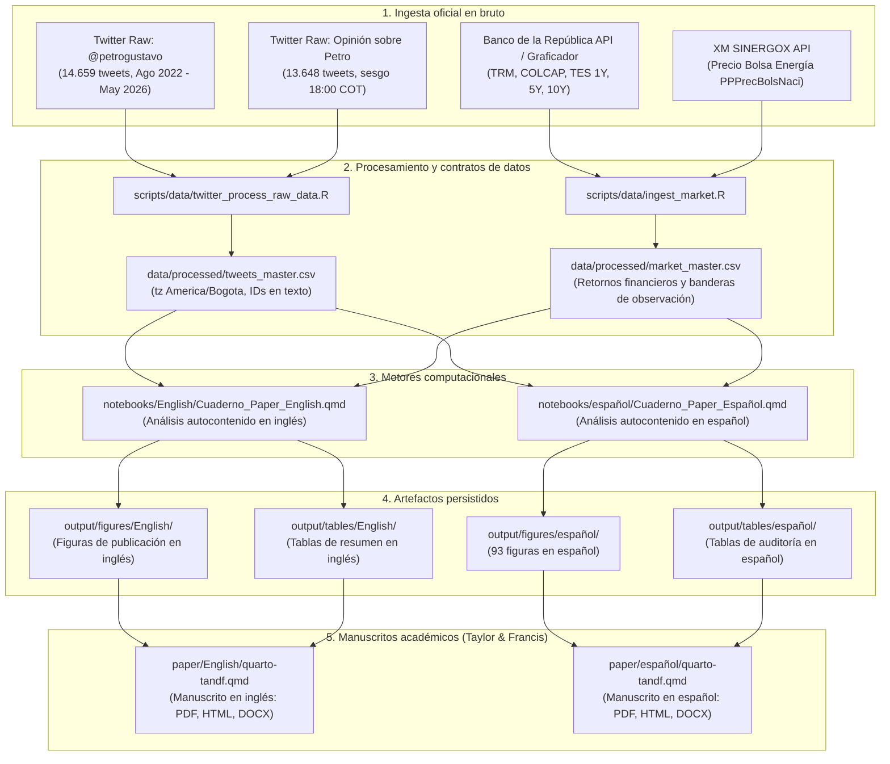
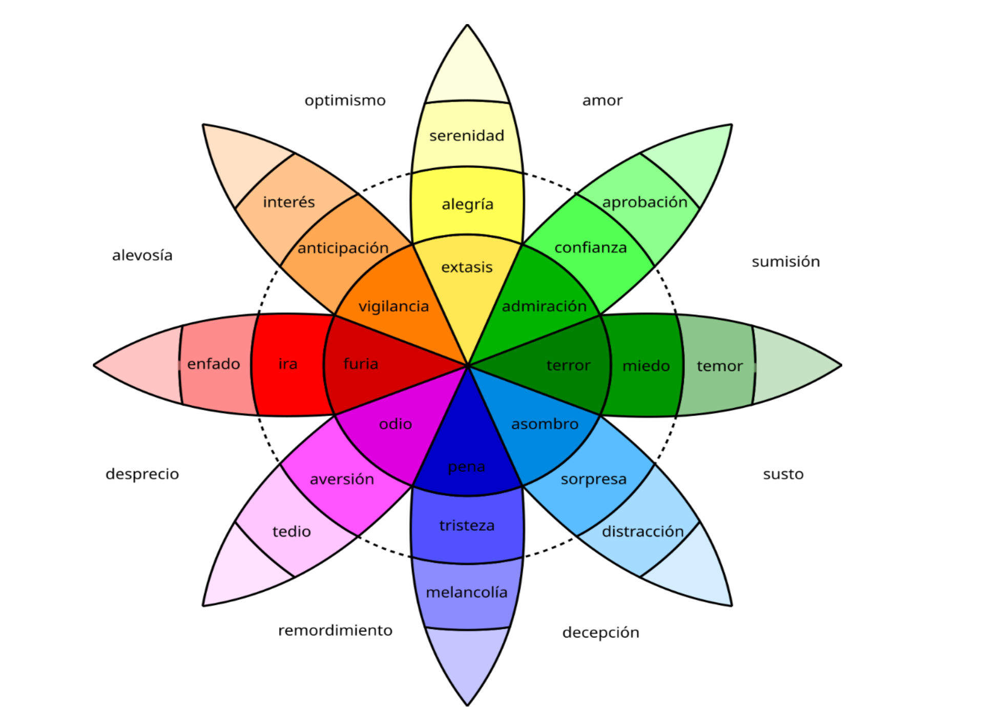
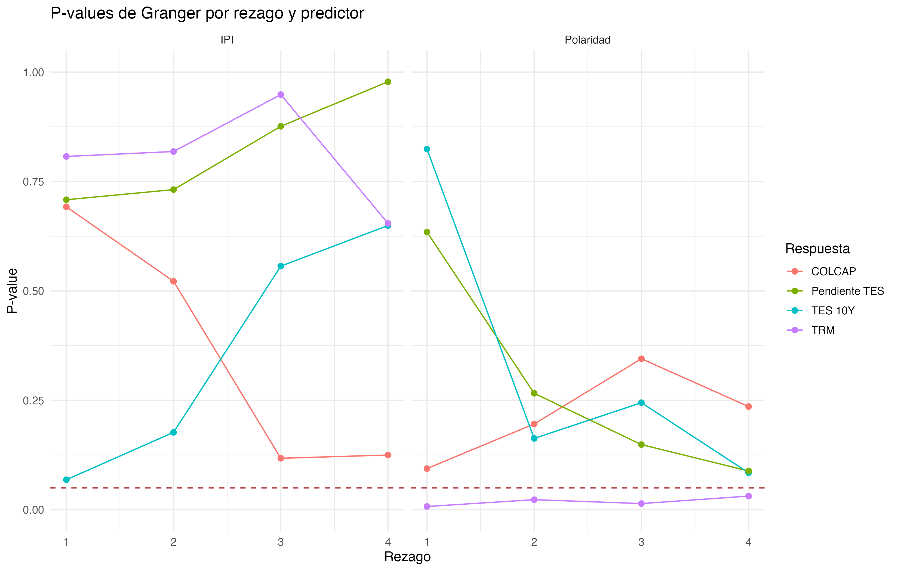
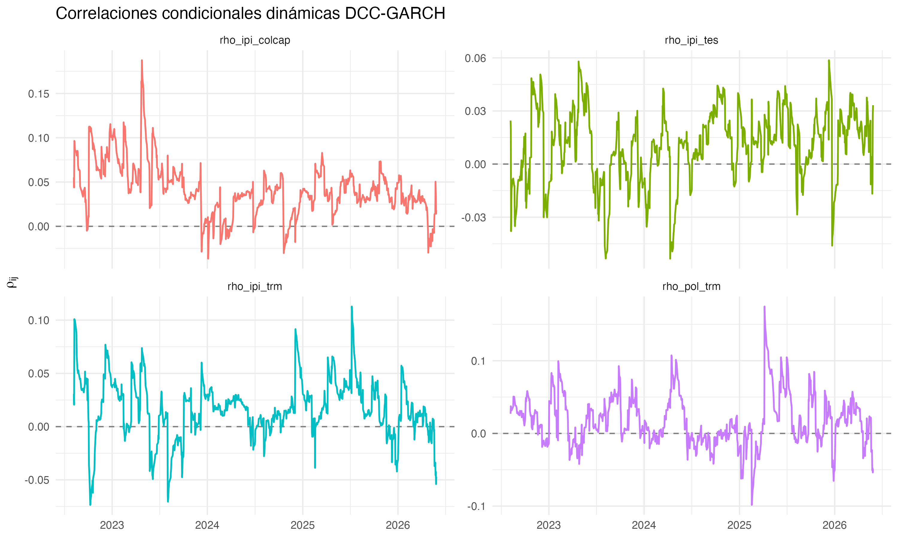
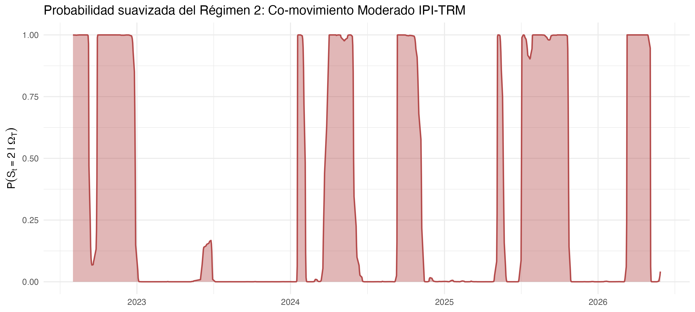
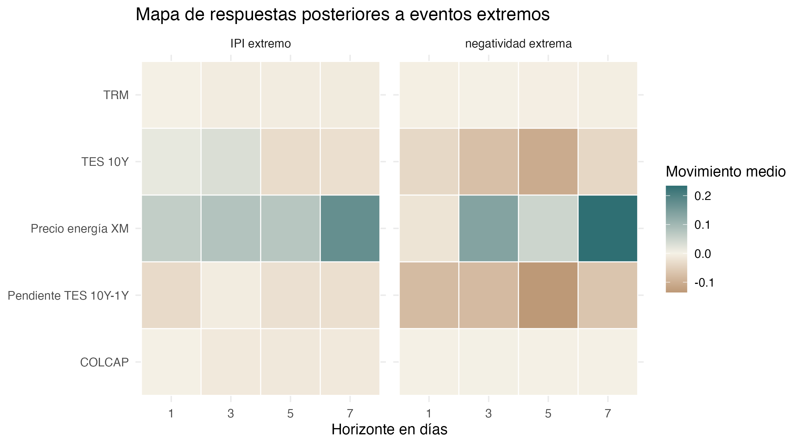

<p><strong>🌐 Leer en:</strong> <a href="README.md">English</a> | <a href="README.es.md">Español</a></p>

# Comunicación presidencial y mercados financieros en Colombia: evidencia textual y de series de tiempo

<p>
  
  
  
  
  
</p>

Este repositorio contiene el artículo de investigación formal, la base de código computacional y el paquete de reproducibilidad que examina si la comunicación emitida por el presidente colombiano Gustavo Petro en Twitter/X (`@petrogustavo`) precede o se asocia con variaciones de corto plazo en los principales indicadores financieros de Colombia.

La ventana temporal comprende desde **agosto de 2022 hasta mayo de 2026** (1.400 días calendario). Metodológicamente, el análisis establece una separación estricta entre dos corpus:

1. **Corpus principal (`presidente`):** Publicaciones emitidas directamente por `@petrogustavo` en `data/raw/twitter/Tweets de Gustavo Petro/` (14.659 tweets en bruto; 14.437 textos limpios no vacíos). Constituye el insumo exclusivo para todo el procesamiento de lenguaje natural, los índices diarios de presión informacional ($IPI_d$) y los modelos econométricos de series de tiempo.
2. **Corpus complementario (`opinion`):** Mensajes públicos recuperados mediante la consulta sobre "Gustavo Petro" en `data/raw/twitter/Opinión sobre Petro/` (13.648 tweets). Se conserva para exploración textual descriptiva y auditoría de calidad de datos, pero queda estrictamente excluido de la econometría financiera debido a un artefacto de recolección documentado: el 97,49% de los registros se concentran a las 18:00 hora de Bogotá y existen topes diarios de 10 tweets por día.

El bloque financiero integra series oficiales diarias: tasa de cambio representativa del mercado (`TRM`), índice bursátil (`COLCAP`), rendimientos de bonos soberanos cero cupón (`TES` a 1, 5 y 10 años, junto a la pendiente 10Y-1Y) del Banco de la República, y el precio de bolsa nacional de energía de XM. Todos los insumos se consolidan en dos contratos de datos en `data/processed/` (`tweets_master.csv` y `market_master.csv`).

El paquete de investigación se publica en dos pistas idiomáticas paralelas y sincronizadas:
- **Pista en inglés:** Manuscrito académico formal en [`paper/English/quarto-tandf.qmd`](paper/English/quarto-tandf.qmd) ([PDF](paper/English/quarto-tandf.pdf), [HTML](paper/English/quarto-tandf.html), [DOCX](paper/English/quarto-tandf.docx)) y cuaderno computacional en [`notebooks/English/Cuaderno_Paper_English.qmd`](notebooks/English/Cuaderno_Paper_English.qmd) ([HTML](notebooks/English/Cuaderno_Paper_English.html)).
- **Pista en español:** Manuscrito académico formal en [`paper/español/quarto-tandf.qmd`](paper/español/quarto-tandf.qmd) ([PDF](paper/español/quarto-tandf.pdf), [HTML](paper/español/quarto-tandf.html), [DOCX](paper/español/quarto-tandf.docx)) y cuaderno computacional en [`notebooks/español/Cuaderno_Paper_Español.qmd`](notebooks/español/Cuaderno_Paper_Español.qmd) ([HTML](notebooks/español/Cuaderno_Paper_Español.html)).

## Tabla de Contenido

- [Pregunta de investigación y alcance](#pregunta-de-investigación-y-alcance)
- [Flujo del proyecto](#flujo-del-proyecto)
- [Estructura del repositorio](#estructura-del-repositorio)
- [Trazabilidad metodológica](#trazabilidad-metodológica)
- [Estándar pedagógico de código y documentación](#estándar-pedagógico-de-código-y-documentación)
- [Instalación](#instalación)
- [Guía de reproducción](#guía-de-reproducción)
- [Resumen metodológico](#resumen-metodológico)
- [Salidas principales y figuras empíricas](#salidas-principales-y-figuras-empíricas)
- [Procedencia y cobertura de datos](#procedencia-y-cobertura-de-datos)
- [Índice de documentación](#índice-de-documentación)
- [Solución de problemas](#solución-de-problemas)
- [Créditos](#créditos)

## Pregunta de investigación y alcance

**Pregunta de investigación:** ¿En qué medida el contenido, el tono emocional y la actividad observada en las publicaciones de `@petrogustavo` preceden o acompañan variaciones en la TRM, COLCAP, rendimientos TES y precio de bolsa de energía en Colombia durante el periodo presidencial 2022-2026?

La investigación empírica aborda:

- Distribución temporal y frecuencia de los mensajes presidenciales en agregaciones diarias, semanales y mensuales.
- Redes discursivas de hashtags, menciones entre cuentas, co-menciones y co-ocurrencias léxicas.
- Clasificación temática débilmente supervisada del discurso presidencial en agendas de reformas (tributaria, salud, pensional, laboral, transición energética, paz total e institucional).
- Análisis de sentimiento léxico NRC en español, polaridad neta y cálculo del Índice de Presión Informacional diario ($IPI_d$).
- Auditoría empírica que documenta las restricciones de recolección y concentración horaria del corpus secundario de opinión.
- Pruebas de estacionariedad (ADF y KPSS), contrastes de cointegración de Johansen, modelos VAR y contrastes de precedencia temporal de Granger con corrección FDR de Benjamini-Hochberg.
- Modelación de correlaciones condicionales dinámicas (DCC-GARCH) entre señales discursivas y series financieras.
- Modelos Markov-Switching para caracterizar transiciones de régimen en la relación discurso-mercado.
- Estudios de eventos sobre respuestas financieras acumuladas ante choques discursivos extremos bajo un marco observacional.

Toda la modelación econométrica se sustenta en series oficiales de Banco de la República y XM, utilizando de manera exclusiva el corpus presidencial.

## Flujo del proyecto

El siguiente diagrama presenta la arquitectura completa de datos, procesamiento analítico y compilación del artículo:



## Estructura del repositorio

La organización del proyecto separa datos en bruto, contratos procesados, motor analítico, manuscrito académico y salidas persistidas:

```text
What_is_the_economic_impact_of_Colombian_President_tweets/
|-- data/
|   |-- processed/                              # Contratos de datos estables para los cuadernos
|   |   |-- market_master.csv
|   |   |-- tweets_master.csv
|   |   `-- daily_nrc_by_corpus.csv
|   `-- raw/
|       |-- market/                             # Series de mercado descargadas de BanRep y XM
|       `-- twitter/
|           |-- Opinión sobre Petro/            # Corpus secundario de conversación ciudadana
|           `-- Tweets de Gustavo Petro/        # Corpus primario presidencial (@petrogustavo)
|-- notebooks/
|   |-- English/
|   |   |-- Cuaderno_Paper_English.qmd          # Motor computacional en inglés
|   |   |-- Cuaderno_Paper_English.html         # Versión HTML renderizada (inglés)
|   |   |-- index.html                          # Documento raíz de entrada para Posit Connect
|   |   |-- manifest.json                       # Contrato de despliegue para Posit Connect Cloud
|   |   `-- README.md                           # Guía del cuaderno en inglés
|   `-- español/
|       |-- Cuaderno_Paper_Español.qmd          # Motor computacional en español
|       |-- Cuaderno_Paper_Español.html         # Versión HTML renderizada (español)
|       |-- index.html                          # Documento raíz de entrada para Posit Connect
|       |-- manifest.json                       # Contrato de despliegue para Posit Connect Cloud
|       `-- README.md                           # Guía del cuaderno en español
|-- paper/
|   |-- English/                                # Manuscrito académico formal en inglés (Taylor & Francis)
|   |   |-- quarto-tandf.qmd                    # Fuente Quarto del artículo
|   |   |-- quarto-tandf.pdf                    # Manuscrito compilado en PDF
|   |   |-- quarto-tandf.html                   # Manuscrito compilado en HTML
|   |   |-- quarto-tandf.docx                   # Manuscrito compilado en Word
|   |   |-- bibliography.bib                    # Bibliografía verificada en BibTeX
|   |   `-- README.md                           # Guía del manuscrito en inglés
|   |-- español/                                # Manuscrito académico formal en español (Taylor & Francis)
|   |   |-- quarto-tandf.qmd                    # Fuente Quarto del artículo
|   |   |-- quarto-tandf.pdf                    # Manuscrito compilado en PDF
|   |   |-- quarto-tandf.html                   # Manuscrito compilado en HTML
|   |   |-- quarto-tandf.docx                   # Manuscrito compilado en Word
|   |   |-- bibliography.bib                    # Bibliografía verificada en BibTeX
|   |   `-- README.md                           # Guía del manuscrito en español
|   `-- figures/                                # Figuras portables del manuscrito
|       |-- English/                            # 10 figuras de publicación en inglés
|       `-- español/                            # Figuras de publicación en español
|-- Methodology_Supervision/                    # Módulo de supervisión metodológica y auditoría
|   |-- Supervision_Metodologica.qmd
|   |-- Supervision_Metodologica.html
|   `-- README.md
|-- output/
|   |-- figures/
|   |   |-- English/                            # Figuras de publicación en inglés
|   |   `-- español/                            # 93 figuras generadas por el cuaderno
|   |-- tables/
|   |   |-- English/                            # Tablas de resumen en inglés
|   |   `-- español/                            # Tablas persistidas en HTML y CSV
|   `-- review/                                 # Informes de auditoría econométrica y de datos
|-- scripts/
|   |-- generate_english_figures.R              # Generador independiente de figuras en inglés
|   `-- data/
|       |-- ingest_market.R                     # Actualizador de series de BanRep y XM
|       `-- twitter_process_raw_data.R          # Valida y construye los contratos master CSV
|-- README.es.md                                # Documentación principal en español
|-- README.md                                   # Documentación principal en inglés
`-- What_is_the_economic_impact_of_Colombian_President_tweets.Rproj
```

| Ruta | Propósito | Consumidor principal |
|---|---|---|
| [`data/raw/twitter/Tweets de Gustavo Petro/`](data/raw/twitter/Tweets%20de%20Gustavo%20Petro/) | Corpus principal: CSVs de `@petrogustavo` | `scripts/data/twitter_process_raw_data.R` |
| [`data/raw/twitter/Opinión sobre Petro/`](data/raw/twitter/Opinión%20sobre%20Petro/) | Corpus complementario de opinión ciudadana | Auditoría textual del cuaderno |
| [`data/raw/market/`](data/raw/market/) | Descargas de series en bruto de BanRep y XM | `scripts/data/twitter_process_raw_data.R` |
| [`data/processed/`](data/processed/) | Dos contratos estables: `tweets_master.csv` y `market_master.csv` | Cuadernos computacionales |
| [`notebooks/English/`](notebooks/English/) | Cuaderno computacional reproducible en inglés | Comunidad académica internacional |
| [`notebooks/español/`](notebooks/español/) | Cuaderno computacional reproducible en español | Pares evaluadores para réplica |
| [`paper/English/`](paper/English/) | Artículo académico formal en inglés (PDF, HTML, DOCX) | Envío a revistas internacionales |
| [`paper/español/`](paper/español/) | Artículo académico formal en español (PDF, HTML, DOCX) | Evaluadores y comités editoriales |
| [`Methodology_Supervision/`](Methodology_Supervision/) | Módulo de supervisión metodológica y calidad | Auditoría metodológica independiente |
| [`output/figures/English/`](output/figures/English/) | Figuras de publicación con etiquetas en inglés | Manuscrito y evaluación visual |
| [`output/figures/español/`](output/figures/español/) | Figuras de alta resolución exportadas por el cuaderno | Manuscrito y análisis visual |
| [`output/tables/English/`](output/tables/English/) | Tablas de resumen en inglés | Comprobación numérica en inglés |
| [`output/tables/español/`](output/tables/español/) | Tablas persistidas en formatos HTML y CSV | Comprobación numérica de estimaciones |

## Trazabilidad metodológica

### Ubicación de parámetros y fuentes

El proyecto no depende de archivos YAML externos. Los scripts de ingesta definen fechas muestrales, rutas, identificadores de series y URLs de consulta en la cabecera de cada archivo. En el cuaderno, cada parámetro o constante analítica precede directamente al bloque de código que la consume. La trazabilidad de mercado se guarda en [`output/tables/español/ingesta_mercado_fuentes.csv`](output/tables/español/ingesta_mercado_fuentes.csv).

### Función de `scripts/` y `notebooks/`

El motor de cálculo reside íntegramente en [`notebooks/español/Cuaderno_Paper_Español.qmd`](notebooks/español/Cuaderno_Paper_Español.qmd). Las rutinas de limpieza, clasificación temática, modelos de temas, métricas de sentimiento, redes discursivas y modelos econométricos se ejecutan en el cuaderno.

La carpeta `scripts/` alberga dos procesos preparatorios:
1. `scripts/data/ingest_market.R` descarga las series oficiales de BanRep y XM cuando se requiere renovar las fuentes de mercado.
2. `scripts/data/twitter_process_raw_data.R` unifica la zona horaria a `America/Bogota`, asegura identificadores de 64 bits como texto y genera los contratos `data/processed/tweets_master.csv` y `data/processed/market_master.csv`.

El cuaderno lee únicamente esos dos archivos CSV procesados. No utiliza llamadas a `source()` ni ejecuta scripts externos durante su renderizado.

## Estándar pedagógico de código y documentación

El repositorio implementa cinco criterios de calidad documental:

1. **Prueba humana:** Cada sección analítica declara previamente el problema substantive, los datos de entrada, la transformación o modelo estadístico, la salida generada y la decisión metodológica subsiguiente.
2. **Estructura en tres capas:** La exposición sigue el orden: contexto conceptual en Markdown, comentarios explicativos en el código, e interpretación académica inmediata tras cada resultado visual o tabular.
3. **Calibración del lenguaje inferencial:** Las afirmaciones se ajustan a la identificación empírica. Se diferencian rigurosamente descripción, correlación, predicción, precedencia temporal (Granger) y causalidad. No se emplean verbos causales al interpretar regresiones observacionales o modelos VAR.
4. **Resultados dinámicos:** Los estadísticos, tamaños muestrales y valores p derivan de las salidas reproducibles y no de valores fijos en el texto narrativo.
5. **Bloques modulares de código:** Cada bloque atiende una sola tarea analítica (aproximadamente 40 líneas internas), preservando la integridad de funciones y secuencias gráficas.

## Instalación

Instale R (versión 4.1 o superior) y los paquetes requeridos desde la raíz del proyecto:

```r
install.packages(c(
  "readr", "readxl", "dplyr", "tidyr", "stringr", "lubridate",
  "purrr", "ggplot2", "ggwordcloud", "httr2", "xml2", "jsonlite",
  "syuzhet", "lmtest", "zoo", "scales", "janitor", "tibble",
  "quanteda", "quanteda.textstats", "quanteda.textplots",
  "quanteda.textmodels", "sentometrics", "stm", "igraph",
  "ggraph", "tidygraph", "vars", "tseries", "urca", "sandwich",
  "forcats", "rmarkdown", "knitr", "here", "DiagrammeR",
  "DiagrammeRsvg", "rsvg", "ragg", "spacyr", "reticulate", "fs", "glue"
))

install.packages(
  "printtree",
  repos = c("https://cran.r-universe.dev", "https://cloud.r-project.org")
)
```

Para la anotación lingüística con spaCy, instale Python con spaCy y el modelo en español `es_core_news_sm`:

```bash
pip install spacy
python -m spacy download es_core_news_sm
```

## Guía de reproducción

Para reconstruir el artículo y los resultados empíricos desde una sesión limpia:

1. Verifique que los contratos de datos existan en `data/processed/` (`tweets_master.csv` y `market_master.csv`).
2. Para la pista en inglés:

```bash
# Renderizar el cuaderno computacional en inglés
quarto render notebooks/English/Cuaderno_Paper_English.qmd

# Renderizar el manuscrito formal en inglés (PDF, HTML, DOCX)
quarto render paper/English/quarto-tandf.qmd
```

3. Para la pista en español:

```bash
# Renderizar el cuaderno computacional en español
quarto render notebooks/español/Cuaderno_Paper_Español.qmd

# Renderizar el manuscrito formal en español (PDF, HTML, DOCX)
quarto render paper/español/quarto-tandf.qmd
```

4. Para regenerar todas las figuras de publicación en inglés de forma independiente:

```bash
Rscript scripts/generate_english_figures.R
```

### Despliegue continuo en Posit Connect Cloud

Ambas carpetas de cuadernos incorporan su respectivo archivo `manifest.json` configurado bajo modalidad estática (`appmode: "static"`). Esta arquitectura facilita el despliegue continuo desde GitHub hacia Posit Connect Cloud o un servidor local de Posit Connect:

- **Cuaderno en inglés:** Directorio `notebooks/English` (sirve `index.html` respaldado por `Cuaderno_Paper_English.html`).
- **Cuaderno en español:** Directorio `notebooks/español` (sirve `index.html` respaldado por `Cuaderno_Paper_Español.html`).

Para configurar el seguimiento automático en Posit Connect Cloud:
1. Seleccione **New Content** -> **From Git Repository**.
2. Conecte el repositorio: `https://github.com/juanjo-edm/What_is_the_economic_impact_of_Colombian_President_tweets`.
3. Defina la rama de seguimiento en `main`.
4. Indique `notebooks/English` o `notebooks/español` en el campo del directorio de la aplicación.
5. Posit Connect Cloud procesará el archivo `manifest.json` correspondiente y publicará el documento de inmediato. Cada nuevo push a la rama `main` actualizará el contenido desplegado sin demoras ni errores de compilación.

## Resumen metodológico

- **Preprocesamiento textual:** Normalización léxica, filtrado de stopwords, estandarización de entidades y lematización mediante spaCy.
- **Clasificación temática supervisada:** Clasificador Naive Bayes sobre agendas de reformas, reasignando mensajes no clasificados únicamente ante umbrales calibrados de certidumbre.
- **Análisis de sentimiento:** Puntuación léxica de emociones NRC mediante `syuzhet`, cálculo de polaridad neta y estimación del Índice de Presión Informacional ($IPI_d$) como producto del sentimiento estandarizado y el logaritmo del volumen diario de publicaciones.
- **Series temporales y estacionariedad:** Pruebas ADF y KPSS fundamentan retornos logarítmicos en activos bursátiles y diferencias simples en tasas de interés TES.
- **Cointegración y modelos VAR:** El contraste de traza de Johansen ($27,85 < 34,91$, no se rechaza $r=0$) descarta vectores de cointegración en niveles, validando un VAR(1) estacionario en diferencias con raíz máxima de $0,281$.
- **Causalidad de Granger:** 112 pruebas bivariadas entre 4 respuestas financieras, 7 señales discursivas presidenciales y 4 rezagos. 5 pruebas muestran significancia nominal ($p < 0,05$), y ninguna se mantiene significativa tras aplicar la corrección FDR de Benjamini-Hochberg ($q \ge 0,791$).
- **Correlaciones condicionales dinámicas:** En el modelo DCC-GARCH, los parámetros son $a = 0,0119$ ($p = 0,069$) y $b = 0,9224$ ($p < 10^{-10}$), indicando alta persistencia pero sensibilidad inmediata estadísticamente débil de los mercados ante choques de tono presidencial.
- **Cambios de régimen de Markov:** Dos estados capturan regímenes de baja y alta volatilidad en la correlación entre el IPI presidencial y la TRM.
- **Estudio de eventos:** Respuestas acumuladas observadas a 1, 3, 5 y 7 días ante 10 eventos de IPI extremo y 10 eventos de negatividad extrema, interpretadas de manera observacional sin supuestos contrafactuales.

## Salidas principales y figuras empíricas

El cuaderno produce **93 figuras de alta resolución** y **7 tablas visibles**, acompañadas de interpretaciones analíticas inmediatas.

### Series financieras y dinámica discursiva presidencial

El siguiente panel presenta las series normalizadas de sentimiento presidencial, IPI y los indicadores de mercado financiero durante la ventana 2022-2026.

<p align="center">
  
</p>

### Fundamento léxico y clasificación emocional

La modelación de emociones discursivas se apoya en el modelo psicoevolutivo de Plutchik, adaptado al español mediante el léxico NRC.

<p align="center">
  
</p>

### Rejilla de contrastes de Granger (Corpus Presidencial)

Valores p nominales de los 112 contrastes de precedencia temporal entre discurso presidencial y series de mercado para los rezagos 1 a 4. Las líneas punteadas rojas indican el umbral nominal $\alpha = 0,05$. Ningún contraste sobrevive al ajuste FDR de Benjamini-Hochberg.

<p align="center">
  
</p>

### Correlaciones condicionales dinámicas (DCC-GARCH)

Correlaciones condicionales estimadas entre señales presidenciales (IPI, polaridad) y los activos financieros colombianos (TRM, COLCAP, TES 10Y y pendiente TES).

<p align="center">
  
</p>

### Probabilidades suavizadas del modelo Markov-Switching

Probabilidades de estado del modelo de regímenes markovianos entre el IPI presidencial y los retornos cambiarios de la TRM.

<p align="center">
  
</p>

### Mapa de calor del estudio de eventos

Respuestas financieras promedio acumuladas tras 10 eventos de choque extremo de IPI y 10 de negatividad discursiva en horizontes de 1, 3, 5 y 7 días.

<p align="center">
  
</p>

## Procedencia y cobertura de datos

1. **Datos de Twitter:** Las publicaciones presidenciales provienen de `data/raw/twitter/Tweets de Gustavo Petro/petrogustavo_full.csv`. Las fechas se validan en hora local de Bogotá (`America/Bogota`), conservando los identificadores de 64 bits como texto para evitar truncamiento numérico.
2. **Datos de mercado:** TRM, COLCAP y curvas TES cero cupón provienen de APIs y del graficador oficial del Banco de la República. Los precios de energía provienen de la API de XM SINERGOX (`PPPrecBolsNaci`).
3. **Tablas de auditoría:** La cobertura y el estado de consulta se registran en:
   - [`output/tables/español/cobertura_mercado.html`](output/tables/español/cobertura_mercado.html)
   - [`output/tables/español/fuentes_mercado_auditadas.html`](output/tables/español/fuentes_mercado_auditadas.html)
   - [`output/tables/español/auditoria_comparada_dos_corpus.csv`](output/tables/español/auditoria_comparada_dos_corpus.csv)

## Índice de documentación

### Paquete de investigación en inglés
- **Manuscrito en inglés (fuente Quarto):** [`paper/English/quarto-tandf.qmd`](paper/English/quarto-tandf.qmd)
- **Artículo en inglés (PDF):** [`paper/English/quarto-tandf.pdf`](paper/English/quarto-tandf.pdf)
- **Artículo en inglés (HTML):** [`paper/English/quarto-tandf.html`](paper/English/quarto-tandf.html)
- **Artículo en inglés (DOCX):** [`paper/English/quarto-tandf.docx`](paper/English/quarto-tandf.docx)
- **Guía del artículo en inglés:** [`paper/English/README.md`](paper/English/README.md)
- **Cuaderno computacional en inglés:** [`notebooks/English/Cuaderno_Paper_English.qmd`](notebooks/English/Cuaderno_Paper_English.qmd)
- **Salida del cuaderno en inglés (HTML):** [`notebooks/English/Cuaderno_Paper_English.html`](notebooks/English/Cuaderno_Paper_English.html)
- **Guía del cuaderno en inglés:** [`notebooks/English/README.md`](notebooks/English/README.md)
- **Figuras de publicación en inglés:** [`output/figures/English/`](output/figures/English/)

### Paquete de investigación en español
- **README en español:** [`README.es.md`](README.es.md)
- **Manuscrito en español (fuente Quarto):** [`paper/español/quarto-tandf.qmd`](paper/español/quarto-tandf.qmd)
- **Artículo en español (PDF):** [`paper/español/quarto-tandf.pdf`](paper/español/quarto-tandf.pdf)
- **Artículo en español (HTML):** [`paper/español/quarto-tandf.html`](paper/español/quarto-tandf.html)
- **Artículo en español (DOCX):** [`paper/español/quarto-tandf.docx`](paper/español/quarto-tandf.docx)
- **Guía del artículo en español:** [`paper/español/README.md`](paper/español/README.md)
- **Cuaderno computacional en español:** [`notebooks/español/Cuaderno_Paper_Español.qmd`](notebooks/español/Cuaderno_Paper_Español.qmd)
- **Salida del cuaderno en español (HTML):** [`notebooks/español/Cuaderno_Paper_Español.html`](notebooks/español/Cuaderno_Paper_Español.html)
- **Guía del cuaderno en español:** [`notebooks/español/README.md`](notebooks/español/README.md)
- **Figuras generadas en español (93):** [`output/figures/español/`](output/figures/español/)

### Supervisión, metodología y datos
- **Módulo de supervisión metodológica:** [`Methodology_Supervision/README.md`](Methodology_Supervision/README.md)
- **Procedencia de datos de mercado:** [`data/raw/market/README.md`](data/raw/market/README.md)
- **Informe de auditoría econométrica:** [`output/review/auditoria_final_cierre_metodologico.md`](output/review/auditoria_final_cierre_metodologico.md)

## Solución de problemas

| Problema | Diagnóstico | Solución |
|---|---|---|
| Paquete R ausente | Error al cargar librería durante compilación | Ejecute el bloque en [Instalación](#instalación), incluyendo `printtree` desde R-universe. |
| Pandoc no encontrado | Error de compilación en Quarto | Instale Quarto CLI o configure `RSTUDIO_PANDOC` hacia el binario de Pandoc provisto por Quarto. |
| Falta el modelo spaCy | Error de inicialización en `spacyr` | Ejecute `python -m spacy download es_core_news_sm` en el entorno de Python activo. |
| Falla al descargar datos de mercado | Error de conexión con endpoints oficiales | Revise la conectividad a BanRep/XM; consulte `output/tables/español/ingesta_mercado_fuentes.csv`. |
| Figura faltante en salidas | Chunk no renderizado o archivo eliminado | Vuelva a renderizar `notebooks/español/Cuaderno_Paper_Español.qmd` desde una sesión limpia de R. |

## Créditos

Este trabajo utiliza librerías de código abierto de R para minería de texto, modelado temático, redes y econometría de series temporales, incluyendo `quanteda`, `stm`, `sentometrics`, `syuzhet`, `vars`, `urca`, `rmgarch` y `MSwM`.

Las series financieras provienen del Banco de la República y de XM SINERGOX. Los contratos de datos, scripts y cuadernos se estructuran para garantizar réplica computacional completa.
