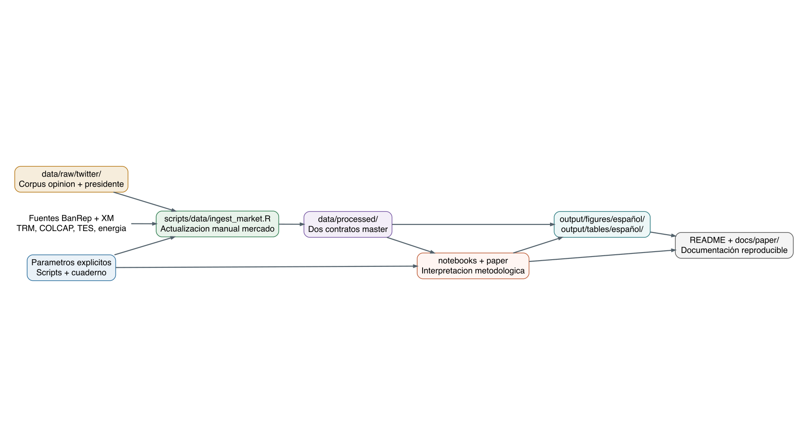
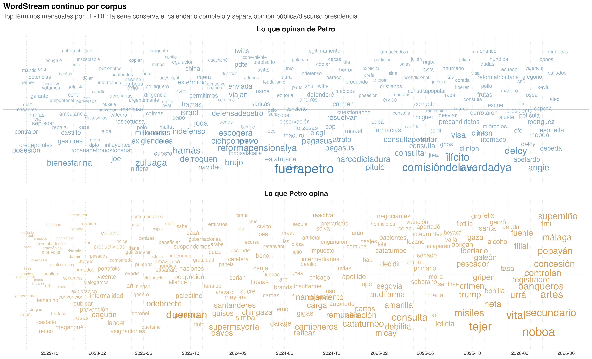

<p><strong>🌐 Leer en:</strong> <a href="README.md">English</a> | <a href="README.es.md">Español</a></p>

# Impacto económico de los tweets del presidente Petro

<p>
  
  
  
  
  
</p>

Este repositorio actualiza el paper **`Impacto_discurso_petro__ENG_`**
para estudiar si la conversación en Twitter/X alrededor del presidente
colombiano Gustavo Petro se asocia con movimientos de corto plazo en
indicadores financieros de Colombia.

El proyecto está organizado como un flujo reproducible en R para los
snapshots mensuales de tweets entre **agosto de 2022 y mayo de 2026**.
El diseño actual distingue dos corpus: `opinion`, con conversación
pública sobre Petro en `data/raw/twitter/Opinión sobre Petro/`, y
`presidente`, con tweets escritos por `@petrogustavo` en
`data/raw/twitter/Tweets de Gustavo Petro/`. El bloque financiero usa
`TRM` como serie cambiaria, `COLCAP` como proxy bursátil principal,
tasas cero cupón `TES` en pesos como bloque de renta fija soberana y el
precio diario ponderado nacional de energía de XM como serie del mercado
eléctrico. Esas series se descargan como CSV oficiales en bruto en
`data/raw/market/`. El script de procesamiento consolida después todos
los insumos en dos contratos estables en `data/processed/`, y las
auditorías de descarga y procedencia quedan en `output/tables/español/`.
El paper original de 2023 se conserva como referencia conceptual e
histórica en
[`docs/paper/Impacto_discurso_petro__ENG_.pdf`](docs/paper/Impacto_discurso_petro__ENG_.pdf).
La versión activa del paper está en Quarto y actualiza la narrativa con
redes estilo `quanteda`, EDA de frecuencia de tweets presidenciales,
sentimientos, tópicos y diagnósticos financieros exploratorios.

## Tabla de Contenido

- [Descripción del Proyecto](#descripción-del-proyecto)
- [Flujo del Proyecto](#flujo-del-proyecto)
- [Estructura del Repositorio](#estructura-del-repositorio)
- [Trazabilidad metodológica](#trazabilidad-metodológica)
- [Estándar pedagógico de código y documentación](#estándar-pedagógico-de-código-y-documentación)
  - [5.1 Prueba humana de cinco preguntas](#51-prueba-humana-de-cinco-preguntas)
  - [5.2 Documentación en tres capas](#52-documentación-en-tres-capas)
  - [5.3 Calibración del lenguaje inferencial](#53-calibración-del-lenguaje-inferencial)
  - [5.4 Resultados dinámicos y legibilidad humana sobre compactación](#54-resultados-dinámicos-y-legibilidad-humana-sobre-compactación)
  - [5.5 Checklist de verificación de 25 puntos](#55-checklist-de-verificación-de-25-puntos)
- [Instalación](#instalación)
- [Reproducir el Análisis](#reproducir-el-análisis)
- [Metodología](#metodología)
- [Salidas y Resultados](#salidas-y-resultados)
- [Datos, Cobertura y Credenciales](#datos-cobertura-y-credenciales)
- [Documentación](#documentación)
- [Solución de Problemas](#solución-de-problemas)
- [Créditos](#créditos)

## Descripción del Proyecto

**Pregunta de investigación.** ¿Los tweets presidenciales y la
conversación pública relacionada producen movimientos medibles de corto
plazo en los mercados financieros colombianos?

El análisis actualizado se concentra en:

- frecuencia diaria de tweets y calidad de metadata;
- frecuencia diaria, semanal y mensual de tweets emitidos por
  `@petrogustavo`;
- hashtags, menciones, co-menciones y redes de co-ocurrencia léxica;
- redes de hashtags y menciones con el estilo visual del ejemplo de
  Twitter de `quanteda`;
- nubes de palabras por corpus, tiempo, temas, sentimientos, tópicos y
  comunidades;
- evolución temporal TF-IDF como apoyo reproducible al word stream;
- clasificación temática con supervisión débil y evaluación holdout;
- sentimiento NRC en español, polaridad y sentimiento diario ponderado;
- minería de texto con `quanteda`, `quanteda.textstats` y
  `quanteda.textplots`;
- escalamiento Wordfish con `quanteda.textmodels`;
- modelado de tópicos con `stm`;
- diagnósticos de estacionariedad, pruebas de Granger y diagnósticos VAR
  para `TRM`, `COLCAP`, `TES 10Y`, la pendiente `TES 10Y - TES 1Y` y el
  precio de energía XM.

El flujo actual usa series oficiales de BanRep para `TRM`, `COLCAP` y
`TES`, además del precio oficial de energía de XM; el análisis activo ya
no depende del proxy accionario antiguo usado en el estudio de caso
original.

## Flujo del Proyecto

Las fuentes del README generan este diagrama con `DiagrammeR` y lo
exportan como imagen estática para que se vea correctamente en GitHub.



## Estructura del Repositorio

El árbol siguiente se produce desde el repositorio actual con
`printtree::print_rtree()` o con `printree::print_rtree()` si ese
namespace existe en su instalación local de R.

``` text
What_is_the_economic_impact_of_Colombian_President_tweets/
|-- data/
|   |-- Archive/
|   |-- processed/
|   `-- raw/
|-- docs/
|   |-- assets/
|   `-- paper/
|-- notebooks/
|   `-- español/
|-- paper/
|   |-- English/
|   |-- español/
|   `-- figures/
|-- scripts/
|   |-- api_data_extraction/
|   `-- data/
|-- README.es.md
|-- README.md
`-- What_is_the_economic_impact_of_Colombian_President_tweets.Rproj
```

| Ruta | Propósito |
|----|----|
| `data/raw/twitter/Opinión sobre Petro/` | Corpus `opinion`: CSV mensuales de conversación pública sobre Gustavo Petro. |
| `data/raw/twitter/Tweets de Gustavo Petro/` | Corpus `presidente`: `petrogustavo_full.csv` consolidado con tweets escritos por `@petrogustavo`. |
| `data/raw/market/` | Series oficiales de mercado en bruto actualizadas por el script de ingesta. |
| `data/processed/` | Exactamente dos insumos estables del cuaderno: `tweets_master.csv` y `market_master.csv`. |
| `scripts/data/ingest_market.R` | Actualizador manual de mercado raw; sus auditorías quedan en `output/tables/español/`. |
| `notebooks/español/` | Cuaderno metodológico principal en español para actualizar el paper. |
| `paper/español/` | Paper Quarto activo en español con template Taylor & Francis y figuras portables. |
| `paper/English/` | Carpeta reservada para la futura versión en inglés del paper. |
| `output/figures/español/` | Figuras persistidas por el cuaderno. |
| `output/tables/español/` | Tablas HTML persistidas, más copias CSV para auditoría. |
| `docs/paper/` | PDF del paper original usado como referencia metodológica. |

## Trazabilidad metodológica

### ¿Dónde se definen los parámetros y las fuentes?

El proyecto ya no usa un archivo YAML de configuración separado. Los
scripts de datos definen fechas, rutas, IDs de fuente, endpoints y URLs
de referencia de forma explícita al inicio de cada archivo, mientras el
cuaderno ubica cada constante analítica junto a su primer bloque
consumidor. La procedencia de cada actualización de mercado se persiste
bajo `output/tables/español/`.

### ¿Cuál es el papel de `scripts/`?

El análisis principal está autocontenido en
`notebooks/español/Cuaderno_Paper_Español.qmd`. Las funciones de
limpieza, clasificación, visualización, NLP, redes, series, econometría
y validación de modelos viven dentro del cuaderno.

Dos scripts se ejecutan antes de renderizar cuando se deban refrescar
insumos: `scripts/data/ingest_market.R` descarga las series oficiales de
mercado en bruto, y `scripts/data/twitter_process_raw_data.R` valida y
escribe `tweets_master.csv` y `market_master.csv`. El cuaderno lee
únicamente esos dos contratos; no ejecuta scripts externos.

Orden de ejecución recomendado:

1.  Actualice manualmente datos de mercado sólo cuando haga falta.
2.  Ejecute `Rscript scripts/data/twitter_process_raw_data.R` para
    preparar Twitter y mercado raw.
3.  Confirme que los CSV requeridos existen en `data/processed/`.
4.  Renderice `notebooks/español/Cuaderno_Paper_Español.qmd`.
5.  Revise figuras y tablas generadas bajo `output/`.

### ¿El cuaderno depende de `source()`?

No. El cuaderno define en su chunk de setup los helpers que necesita y
consume los CSV preparados bajo `data/processed/`. Puede recalcular
análisis textuales, tablas, figuras, redes y diagnósticos econométricos
para trazabilidad, pero no llama scripts externos.

### ¿Cómo se extraen los datos de mercado y cómo se diferencian raw y processed?

Las series principales de mercado se extraen con el actualizador manual
`scripts/data/ingest_market.R`, que puede ejecutarse con
`Rscript scripts/data/ingest_market.R`. Ese script consulta servicios
del Banco de la República para TRM, COLCAP y tasas cero cupón TES, y la
API diaria SINERGOX de XM para `PPPrecBolsNaci`. Los endpoints, IDs de
serie y URLs de referencia se definen como constantes del script y se
registran en `output/tables/español/ingesta_mercado_fuentes.csv`. Por
eso `data/raw/market/` contiene las series oficiales en bruto
(`*_raw.csv`), mientras `data/processed/market_master.csv` contiene el
panel diario validado.

La trazabilidad de mercado queda en:

- `data/processed/market_master.csv`: series diarias usadas en modelos.
- `output/tables/español/ingesta_mercado_fuentes.csv`: `retrieved_at`,
  `source_url`, `source_series_id`, `source_series_name`, `status` y
  mensajes de extracción.
- `output/tables/español/ingesta_mercado_cobertura.csv`: días esperados,
  días observados, `coverage_ratio` y estado de cobertura.

Si se necesita congelar una extracción exacta para réplica cerrada,
deben conservarse ambos master junto con los insumos raw y las
auditorías de ingesta.

## Estándar pedagógico de código y documentación

Este repositorio adopta formalmente como política contractual de desarrollo la **Guía pedagógica para escribir código y documentación en R**. Todo script en `scripts/`, cuaderno metodológico en `notebooks/` y manuscrito en `paper/` debe ajustarse rigurosamente a los siguientes principios de legibilidad humana, rigor metodológico y reproducibilidad:

### 5.1 Prueba humana de cinco preguntas

Ninguna sección analítica, script de datos o bloque de modelado se considera concluido si un revisor técnico o par evaluador no puede responder de manera inmediata a cinco interrogantes esenciales antes de examinar el código:

1. **¿Qué problema se resuelve?** (Propósito sustantivo de la sección).
2. **¿Qué datos entran?** (Fuentes, rutas contractuales, llaves y filtros aplicados).
3. **¿Qué transformación o modelo se aplica?** (Regla de negocio, algoritmo o especificación econométrica).
4. **¿Qué evidencia sale?** (Tablas, gráficos, matrices o indicadores persistidos).
5. **¿Qué decisión o paso sigue?** (Interpretación metodológica y conexión con la siguiente etapa).

Si cualquiera de estas respuestas solo puede deducirse inspeccionando el código línea a línea, la documentación se considera insuficiente y no conforme. La unidad de lectura útil es la acción analítica completa, no la línea de código aislada.

### 5.2 Documentación en tres capas

La articulación técnica del código y la narrativa se estructura obligatoriamente en tres niveles complementarios:

```
[ Capa 1: Markdown antes del bloque ] -> Propósito, datos de entrada, regla/modelo y salida esperada
                 ↓
[ Capa 2: Comentarios dentro del código ] -> Justificación de decisiones, unidades, denominadores y excepciones
                 ↓
[ Capa 3: Interpretación tras el resultado ] -> Análisis académico inmediato de magnitudes, patrones y límites
```

- **Capa 1 (Markdown previo al código):** Explica el contexto sustantivo, los insumos recibidos, la transformación aplicada y el artefacto producido. Quedan expresamente prohibidas las introducciones mecánicas o vacías (tales como *"A continuación se ejecuta el siguiente código"* o *"Comprobar que la dependencia necesaria esté disponible"*).
- **Capa 2 (Comentarios en el código):** Explican el *por qué* de la operación, unidades de medida, denominadores de ratios, ventanas temporales, tratamiento de observaciones incompletas y reglas de excepciones. No se limitan a describir la sintaxis elemental de R.
- **Capa 3 (Interpretación posterior inmediata):** Toda tabla o figura final visible debe estar sucedida inmediatamente por un párrafo de interpretación académica que evalúe magnitudes numéricas o patrones gráficos, explicite limitaciones y vincule la evidencia con la hipótesis central siguiendo la secuencia obligatoria: `contexto → código → salida → interpretación`. Queda prohibido saltar de una figura al siguiente código sin interpretar.

### 5.3 Calibración del lenguaje inferencial

La fuerza de las afirmaciones analíticas debe corresponderse estrictamente con el grado de identificación del diseño empírico. Se prohíbe categóricamente afirmar causalidad en ausencia de una estrategia formal de identificación contrafactual. Un p-valor, una correlación, un modelo predictivo o un contraste de precedencia temporal no transforman automáticamente una relación en un efecto causal. El lenguaje técnico debe catalogar con precisión:

- **Descripción:** Caracterización cuantitativa de la muestra observada (conteos, distribuciones, frecuencias).
- **Asociación / Correlación:** Co-variación estadística entre variables (correlaciones, coeficientes OLS sin exogeneidad).
- **Predicción:** Capacidad de anticipación algorítmica fuera de muestra bajo una métrica de error específica.
- **Precedencia temporal:** Orden cronológico e informatividad estadística en rezagos (p. ej., contrastes de causalidad de Granger y modelos VAR). **La precedencia temporal no demuestra causalidad económica estructural.**
- **Causalidad:** Efecto atribuible exclusivamente a la variación exógena de un tratamiento bajo supuestos de identificación formalmente demostrados.

Todo resultado econométrico debe articularse según la cadena:
$$\text{Referencia teórica} \longrightarrow \text{Pregunta} \longrightarrow \text{Ecuación/Modelo} \longrightarrow \text{Muestra/Datos} \longrightarrow \text{Código} \longrightarrow \text{Resultado} \longrightarrow \text{Interpretación}$$

Queda expresamente prohibido el uso de verbos causales (*"causa"*, *"determina"*, *"impacta"*, *"genera"*) ante salidas descriptivas, correlacionales o contrastes de Granger/VAR no identificados estructuralmente.

### 5.4 Resultados dinámicos y legibilidad humana sobre compactación

- **Legibilidad sobre compactación:** Se priorizan nombres de objetos descriptivos en `snake_case`, pasos analíticos explícitos y estructuras auditables frente a sintaxis hiper-compactas o metaprogramación oscura.
- **Resultados dinámicos:** Ningún valor estadístico clave debe redactarse como una constante fija en el texto que corra el riesgo de desactualizarse. Las conclusiones numéricas deben derivarse de las salidas generadas en la corrida reproducible.
- **Foco modular de chunks:** Como estándar pedagógico, cada bloque de código se mantiene en un máximo aproximado de **40 líneas interiores**, delimitando una única responsabilidad analítica. **Jamás se dividen llamadas completas, funciones o tuberías sintácticas a la mitad únicamente por acatar el conteo de líneas.**
- **Figuras y tablas autocontenidas:** Los gráficos y tablas deben ser interpretables de manera autónoma, incorporando títulos informativos, ejes con unidades explícitas, períodos muestrales y notas explicativas. Los objetos auxiliares intermedios no deben imprimirse en el documento renderizado.

### 5.5 Checklist de verificación de 25 puntos

Antes de integrar cambios o publicar versiones definitivas del código y documentación, debe auditarse el cumplimiento de la siguiente lista de control organizada en cinco dimensiones:

#### Dimensión 1: Prueba humana (Puntos 1–5)
- [ ] **1. Claridad de objetivo y problema:** La pregunta y el propósito de cada sección son comprensibles sin leer el código línea por línea.
- [ ] **2. Transparencia de insumos:** Las fuentes de datos, rutas contractuales, llaves y filtros aplicados se identifican con anterioridad a la ejecución.
- [ ] **3. Especificación de transformación o modelo:** La regla de negocio, algoritmo o especificación econométrica se explicita con claridad antes de los chunks de código.
- [ ] **4. Evidencia y salidas autónomas:** Las tablas, gráficos o indicadores producidos emergen transparentemente del flujo y están catalogados.
- [ ] **5. Conexión decisional y paso siguiente:** Cada sección analítica establece un puente explícito hacia la siguiente fase y declara la incertidumbre metodológica remanente.

#### Dimensión 2: Estructura y legibilidad (Puntos 6–10)
- [ ] **6. Convención de nombres:** Objetos y variables siguen una convención `snake_case` descriptiva e informativa, evitando abreviaturas crípticas (`tmp`, `df2`).
- [ ] **7. Estilo R estable:** Asignaciones con `<-`, indentación de 2 espacios y uso consistente del pipe nativo `|>`.
- [ ] **8. Dependencias directas y control de conflictos:** Paquetes directos declarados al inicio con comentarios sobre su finalidad analítica; desambiguación documentada con `conflict_prefer()`.
- [ ] **9. Rutas portables y parámetros centralizados:** Rutas construidas estrictamente mediante `here::here()` sin `setwd()` ni rutas absolutas locales; parámetros globales, semillas y umbrales unificados al inicio.
- [ ] **10. Modularidad, tamaño y etiquetas de chunks:** Chunks breves (~40 líneas interiores) orientados a una única tarea, con etiquetas únicas en `kebab-case` y preservación de la integridad sintáctica sin divisiones artificiales.

#### Dimensión 3: Calibración inferencial (Puntos 11–15)
- [ ] **11. Capa 1 (Markdown previo al código):** Prosa introductoria sustantiva con insumo, objetivo, transformación y salida esperada (sin introducciones vacías).
- [ ] **12. Capa 2 (Comentarios en el código):** Justificación del *por qué*, unidades de medida, denominadores de ratios, ventanas temporales y manejo de excepciones en el código.
- [ ] **13. Capa 3 (Interpretación posterior inmediata):** Párrafo de análisis académico inmediato tras cada resultado final visible siguiendo `contexto → código → salida → interpretación`.
- [ ] **14. Gráficos y tablas autocontenidas:** Figuras con títulos descriptivos, ejes rotulados con unidades explícitas, leyendas y notas de muestra interpretables por sí solas.
- [ ] **15. Calibración estricta del lenguaje inferencial:** Distinción rigurosa de descripción, asociación, predicción, precedencia temporal y causalidad, sin afirmaciones causales no demostradas.

#### Dimensión 4: Metodología y econometría (Puntos 16–20)
- [ ] **16. Validación de insumos y tipos seguros:** Verificación programática de existencia de archivos, esquemas, cobertura y tipos seguros (`col_character` para IDs de 64 bits).
- [ ] **17. Auditoría de cruces (joins):** Verificación explícita de cardinalidad esperada, conteos de filas antes/después y control de registros sin correspondencia.
- [ ] **18. Aserciones críticas con `stopifnot()`:** Controles críticos explícitos que detienen la ejecución ante fallos de precondiciones, esquemas o supuestos.
- [ ] **19. Trazabilidad de estados analíticos:** Conservación de estados intermedios identificables (`_raw`, `_master`, etc.) a lo largo de las transformaciones de datos.
- [ ] **20. Cadena metodológica econométrica:** Trazabilidad formal: referencia teórica $\to$ pregunta $\to$ ecuación/modelo $\to$ muestra/datos $\to$ código $\to$ diagnóstico adverso $\to$ interpretación.

#### Dimensión 5: Gobernanza y reproducibilidad (Puntos 21–25)
- [ ] **21. Supresión de salidas accesorias:** Supresión de objetos auxiliares intermedios y tablas borrador en el documento renderizado.
- [ ] **22. Transparencia de limitaciones y diagnósticos adversos:** Declaración explícita de diagnósticos desfavorables (p. ej., inestabilidad VAR, Johansen $r=0$, Granger FDR nulos), sesgos léxicos y supuestos no cumplidos.
- [ ] **23. Reproducibilidad desde sesión limpia:** Compilación exitosa en entorno limpio (`quarto render` / `Rscript --vanilla`) sin dependencia del Global Environment ni variables residuales.
- [ ] **24. Transparencia de advertencias y mensajes:** Errores y advertencias sustantivas no silenciados artificialmente para simular ejecuciones limpias.
- [ ] **25. Verificación de artefactos persistidos y consistencia del README:** Reapertura y validación de tablas y figuras persistidas en disco, asegurando total coherencia con los README y la documentación.

## Instalación

Instale R y los paquetes usados por el actualizador manual de mercado,
el cuaderno y la generación de los README. Desde la raíz del
repositorio:

``` r
install.packages(c(
  "readr", "readxl", "dplyr", "tidyr", "stringr", "lubridate",
  "purrr", "ggplot2", "ggwordcloud", "httr2", "xml2", "jsonlite", "syuzhet", "lmtest", "zoo", "scales",
  "janitor", "tibble", "quanteda", "quanteda.textstats",
  "quanteda.textplots", "quanteda.textmodels", "sentometrics", "stm",
  "igraph", "ggraph", "tidygraph", "vars", "tseries", "urca", "sandwich",
  "forcats", "rmarkdown", "knitr", "here", "DiagrammeR", "DiagrammeRsvg", "rsvg",
  "ragg", "spacyr", "reticulate", "fs", "glue"
))

install.packages(
  "printtree",
  repos = c("https://cran.r-universe.dev", "https://cloud.r-project.org")
)
```

La solicitud del README menciona `printree`. El paquete disponible
actualmente en R es `printtree`; `Cuaderno_Paper_Español.qmd` busca primero `printree` y luego
usa `printtree` como implementación compatible.

## Reproducir el Análisis

El cuaderno es la superficie principal del análisis. Antes de
renderizar, confirme que estos dos contratos existan bajo
`data/processed/`; actualice datos de mercado manualmente sólo cuando
las series BanRep lo requieran:

- `data/processed/tweets_master.csv`
- `data/processed/market_master.csv`
- figuras en `output/figures/español/`
- tablas HTML y CSV en `output/tables/español/`

`data/processed/` excluye intencionalmente productos analíticos como
sentimiento diario, comparaciones de corpus, datasets de modelos y
diagnósticos de Granger. Esos objetos se construyen dentro del cuaderno
y se persisten como tablas o figuras bajo `output/`.

Renderice el cuaderno metodológico en español:

``` bash
quarto render notebooks/español/Cuaderno_Paper_Español.qmd
```

Renderice el paper Quarto activo:

``` bash
quarto render paper/español/quarto-tandf.qmd
```

## Metodología

El artefacto académico principal es el cuaderno:
[`notebooks/español/Cuaderno_Paper_Español.qmd`](notebooks/español/Cuaderno_Paper_Español.qmd).
Está escrito en español y organizado en secciones numeradas que explican
cada bloque antes de ejecutar el código.

El flujo incluye:

- **Diseño de datos.** Snapshots mensuales de tweets, datos de mercado,
  auditorías de cobertura y parámetros explícitos dentro del cuaderno.
- **Limpieza y preprocesamiento.** Normalización de fechas, filtro de
  idioma, control de duplicados, limpieza de texto, tokens y etiquetas
  de temas de reforma.
- **Supervisión temática débil.** Un clasificador Naive Bayes
  transparente evalúa etiquetas derivadas de reglas, se compara contra
  un modelo base y sólo reasigna `otros` con confianza conservadora.
- **Exploración político-discursiva.** Frecuencia de tweets
  presidenciales, hashtags, menciones, co-menciones, nubes de palabras,
  evolución temporal de términos y redes estilo `quanteda`.
- **Corpus y modelos textuales.** Corpus `quanteda`, dfm, frecuencias,
  keyness, colocaciones, co-ocurrencias léxicas y Wordfish.
- **Modelado de tópicos.** Tópicos `stm` con prevalencia, coherencia
  semántica y exclusividad.
- **Sentimiento.** Emociones NRC y polaridad en español con `syuzhet`;
  medidas diarias ponderadas con `sentometrics`.
- **Econometría.** Diagnósticos de estacionariedad, pruebas de Granger y
  diagnósticos VAR con `lmtest`, `vars`, `tseries`, `urca` y `sandwich`.

## Salidas y Resultados

Todo resultado relevante del cuaderno queda persistido. El proyecto no
depende de figuras o tablas que sólo existan dentro de una sesión
interactiva.

Figuras generadas seleccionadas:

| Salida | Descripción |
|----|----|
| [`output/figures/español/serie_sentimientos_trm_colcap.png`](output/figures/español/serie_sentimientos_trm_colcap.png) | Series normalizadas de sentimiento, IPI, `TRM`, `COLCAP`, `TES` y precio de energía XM. |
| [`output/figures/español/tes_curva_cero_cupon.png`](output/figures/español/tes_curva_cero_cupon.png) | Tasas cero cupón `TES` oficiales a 1, 5 y 10 años. |
| [`output/figures/español/tes_pendiente_10y_1y.png`](output/figures/español/tes_pendiente_10y_1y.png) | Pendiente soberana `TES 10Y - TES 1Y`. |
| [`output/figures/español/eda_petro_tweets_diarios.png`](output/figures/español/eda_petro_tweets_diarios.png) | Serie diaria de frecuencia de tweets emitidos por `@petrogustavo`. |
| [`output/figures/español/eda_petro_tweets_mensuales.png`](output/figures/español/eda_petro_tweets_mensuales.png) | Agregación mensual de actividad presidencial en Twitter/X. |
| [`output/figures/español/eda_petro_calendario_actividad.png`](output/figures/español/eda_petro_calendario_actividad.png) | Calendario de actividad de tweets presidenciales. |
| [`output/figures/español/red_hashtags_quanteda.png`](output/figures/español/red_hashtags_quanteda.png) | Red global de hashtags con estilo `quanteda`. |
| [`output/figures/español/red_menciones_quanteda.png`](output/figures/español/red_menciones_quanteda.png) | Red global de menciones con estilo `quanteda`. |
| [`output/figures/español/red_hashtags_quanteda_por_corpus.png`](output/figures/español/red_hashtags_quanteda_por_corpus.png) | Redes de hashtags separadas por corpus. |
| [`output/figures/español/red_menciones_quanteda_por_corpus.png`](output/figures/español/red_menciones_quanteda_por_corpus.png) | Redes de menciones separadas por corpus. |
| [`output/figures/español/wordcloud_corpus_general.png`](output/figures/español/wordcloud_corpus_general.png) | Nubes de palabras por corpus, ponderadas por TF-IDF acumulado. |
| [`output/figures/español/wordcloud_temporal_periodos.png`](output/figures/español/wordcloud_temporal_periodos.png) | Nubes semestrales de palabras distintivas como word stream reproducible. |
| [`output/figures/español/wordstream_tfidf_temporal.png`](output/figures/español/wordstream_tfidf_temporal.png) | Heatmap temporal TF-IDF usado como apoyo matricial al word stream. |
| [`output/figures/español/wordcloud_temas_tfidf.png`](output/figures/español/wordcloud_temas_tfidf.png) | Nubes de términos distintivos por tema, ponderadas por TF-IDF. |
| [`output/figures/español/wordcloud_sentimientos_nrc.png`](output/figures/español/wordcloud_sentimientos_nrc.png) | Nubes de palabras asociadas a emociones y polaridad NRC. |
| [`output/figures/español/wordcloud_topicos_stm.png`](output/figures/español/wordcloud_topicos_stm.png) | Nubes de palabras principales por tópico STM. |
| [`output/figures/español/wordcloud_redes_comunidades.png`](output/figures/español/wordcloud_redes_comunidades.png) | Nubes de nodos relevantes por comunidad de red. |
| [`output/figures/español/ml_matriz_confusion_temas.png`](output/figures/español/ml_matriz_confusion_temas.png) | Matriz de confusión del clasificador temático con supervisión débil. |
| [`output/figures/español/ml_confianza_temas.png`](output/figures/español/ml_confianza_temas.png) | Distribución de confianza del clasificador y umbral de reasignación. |
| [`output/figures/español/ml_reduccion_otros.png`](output/figures/español/ml_reduccion_otros.png) | Cambio de la categoría `otros` después de la reasignación ML conservadora. |
| [`output/figures/español/limpieza_retencion_textos.png`](output/figures/español/limpieza_retencion_textos.png) | Retención de textos a través de limpieza, reglas y clasificación final. |
| [`output/figures/español/red_menciones.png`](output/figures/español/red_menciones.png) | Red de co-menciones entre cuentas. |
| [`output/figures/español/red_coocurrencias_corpus.png`](output/figures/español/red_coocurrencias_corpus.png) | Red de co-ocurrencias léxicas del corpus. |
| [`output/figures/español/red_menciones_centralidad.png`](output/figures/español/red_menciones_centralidad.png) | Ranking de centralidad por grado ponderado en la red de menciones. |
| [`output/figures/español/stm_topicos_reformas.png`](output/figures/español/stm_topicos_reformas.png) | Prevalencia estimada de tópicos STM. |
| [`output/figures/español/wordfish_reformas.png`](output/figures/español/wordfish_reformas.png) | Escalamiento Wordfish por tema de reforma. |
| [`output/figures/español/event_study_respuestas_heatmap.png`](output/figures/español/event_study_respuestas_heatmap.png) | Heatmap de respuestas promedio por horizonte y serie financiera. |

Tablas generadas seleccionadas:

| Salida | Descripción |
|----|----|
| [`output/tables/español/cobertura_mercado.html`](output/tables/español/cobertura_mercado.html) | Estado de cobertura de `TRM`, `COLCAP`, `TES` y precio de energía XM. |
| [`output/tables/español/fuentes_mercado_auditadas.html`](output/tables/español/fuentes_mercado_auditadas.html) | Proveedores, URLs, fecha de consulta, filas y estado de las fuentes financieras. |
| [`output/tables/español/keyness_reformas.html`](output/tables/español/keyness_reformas.html) | Términos distintivos por tema de reforma. |
| [`output/tables/español/ml_metricas_temas.html`](output/tables/español/ml_metricas_temas.html) | Accuracy, precision, recall y F1 del modelo base y Naive Bayes temático. |
| [`output/tables/español/ml_matriz_confusion_temas.html`](output/tables/español/ml_matriz_confusion_temas.html) | Matriz de confusión por clase para la supervisión temática débil. |
| [`output/tables/español/modelos_ml_descartados.html`](output/tables/español/modelos_ml_descartados.html) | Modelos NLP/ML considerados pero descartados, con justificación. |
| [`output/tables/español/red_centralidad_nodos.html`](output/tables/español/red_centralidad_nodos.html) | Diagnósticos de grado ponderado, componente y comunidad por nodo. |
| [`output/tables/español/stm_topicos_reformas.html`](output/tables/español/stm_topicos_reformas.html) | Tópicos STM y términos principales. |
| [`output/tables/español/sentometrics_resumen.html`](output/tables/español/sentometrics_resumen.html) | Resumen de sentimiento diario ponderado. |
| [`output/tables/español/granger_trm_colcap_tes.html`](output/tables/español/granger_trm_colcap_tes.html) | Diagnósticos Granger para respuestas cambiarias, bursátiles, TES y precio de energía XM. |
| [`output/tables/español/eda_frecuencia_tweets_petro.html`](output/tables/español/eda_frecuencia_tweets_petro.html) | Frecuencia diaria, semanal y mensual de tweets de `@petrogustavo`. |

Ejemplo visual:

<figure>

<figcaption aria-hidden="true">Wordstream Plot</figcaption>
</figure>

## Datos, Cobertura y Credenciales

Los snapshots mensuales de tweets se tratan como la fuente reproducible
de verdad. Algunos snapshots son parciales; revise
[`output/tables/español/auditoria_tweets.html`](output/tables/español/auditoria_tweets.html)
antes de interpretar dinámicas mensuales.

Las carpetas de tweets se organizan por corpus.
`data/raw/twitter/Opinión sobre Petro/` contiene conversación pública
sobre Petro; `data/raw/twitter/Tweets de Gustavo Petro/` contiene tweets
emitidos por la cuenta presidencial en `petrogustavo_full.csv`. Futuras
búsquedas deben usar carpetas paralelas como
`data/raw/twitter/@OtraQuery/`, sin mezclar CSV de emisores, consultas u
objetivos metodológicos distintos en una carpeta genérica.

La cobertura de mercado se audita explícitamente. Las fuentes operativas
son servicios del Banco de la República: SDMX/graficador para `TRM`,
metadata BanRep/BVC para `COLCAP`, tasas cero cupón `TES` en pesos a 1,
5 y 10 años, y la API diaria SINERGOX de XM para `PPPrecBolsNaci`. MSCI
y BVC quedan como referencias metodológicas del índice COLCAP, no como
alimentación diaria. Cada actualización manual registra `retrieved_at`,
`source_url`, `source_series_id`, `status` y `coverage_ratio` en las
auditorías de `output/tables/español/`. Granger/VAR se marca como
**diagnóstico, no conclusión causal**, porque evalúa precedencia
temporal y no identificación estructural.

Ningún script activo del repositorio lee credenciales de la API de X.
Los snapshots de tweets se tratan como insumos preparados, y cualquier
recolección futura debe permanecer manual y fuera del cuaderno
principal. No se deben versionar credenciales reales; cualquier token
expuesto previamente debe rotarse antes de volver a usar la API de X.

## Documentación

- README en inglés: [`README.md`](README.md)
- README en español: [`README.es.md`](README.es.md)
- Paper original de referencia:
  [`docs/paper/Impacto_discurso_petro__ENG_.pdf`](docs/paper/Impacto_discurso_petro__ENG_.pdf)
- Cuaderno metodológico en español:
  [`notebooks/español/Cuaderno_Paper_Español.qmd`](notebooks/español/Cuaderno_Paper_Español.qmd)
- Paper Quarto activo:
  [`paper/español/quarto-tandf.qmd`](paper/español/quarto-tandf.qmd)
- PDF renderizado del paper:
  [`paper/español/quarto-tandf.pdf`](paper/español/quarto-tandf.pdf)

## Solución de Problemas

| Síntoma | Qué revisar |
|----|----|
| Error por paquete faltante | Vuelva a ejecutar el bloque de instalación, incluyendo `printtree` desde R-universe. |
| `pandoc` no aparece | Instale RStudio/Positron o configure `RSTUDIO_PANDOC` apuntando al Pandoc de Quarto; por ejemplo `/Applications/quarto/bin/tools/aarch64`. |
| Falta cobertura de mercado | Revise la conexión a internet, el actualizador manual de BanRep, la referencia de endpoints/IDs y `output/tables/español/ingesta_mercado_fuentes.csv`; actualice datos de mercado manualmente si hace falta. |
| Faltan tablas o figuras | Renderice de nuevo el cuaderno después de confirmar que existen los CSV requeridos en `data/processed/`. |
| Falta el diagrama del README | Verifique que exista `docs/assets/readme_project_flow_es.png` o regenérelo con DiagrammeR en R. |

## Créditos

Este proyecto actualiza y extiende el paper original
`Impacto_discurso_petro__ENG_`. Usa paquetes abiertos de R para minería
de texto, sentimiento, tópicos, visualización, tablas y econometría,
entre ellos `quanteda`, `stm`, `sentometrics`, `ggwordcloud`,
`DiagrammeR` y `printtree`.

Las series financieras provienen del Banco de la República, mientras el
precio de energía proviene de XM SINERGOX. Los IDs de fuente, endpoints
y URLs de referencia se documentan en los scripts y en las auditorías
bajo `output/tables/español/` para separar procedencia de datos y
metodología.
