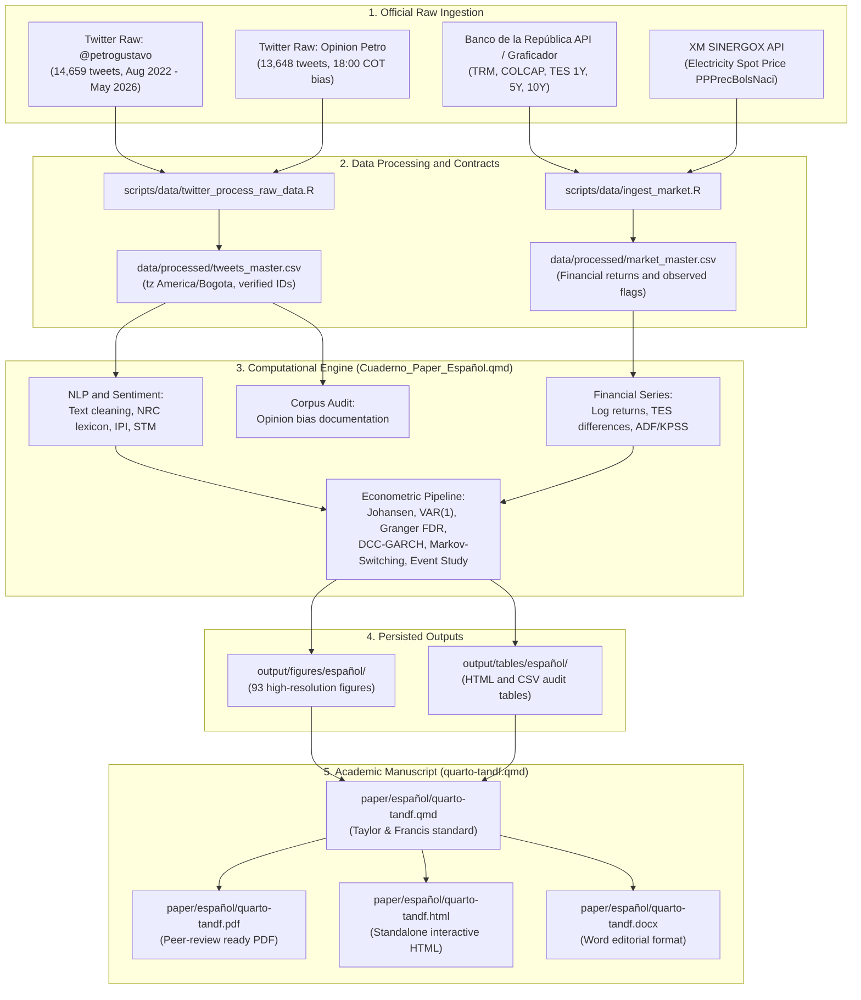

<p><strong>🌐 Read this in:</strong> <a href="README.md">English</a> | <a href="README.es.md">Español</a></p>

# Presidential Communication and Financial Markets in Colombia: Textual and Time Series Evidence

<p>
  
  
  
  
  
</p>

This repository contains the canonical research paper, analytical codebase, and replication package investigating whether communications published by Colombian President Gustavo Petro on Twitter/X (`@petrogustavo`) precede or associate with short-run variations in key Colombian financial indicators.

The empirical window covers **August 2022 to May 2026** (1,400 calendar days). The project establishes a strict separation between two textual corpora:

1. **Principal corpus (`presidente`):** Tweets published directly by `@petrogustavo` in `data/raw/twitter/Tweets de Gustavo Petro/` (14,659 total tweets, 14,437 non-empty clean texts). This corpus serves as the exclusive input for all natural language processing, daily Information Pressure Indices ($IPI_d$), and all econometric time-series models.
2. **Complementary corpus (`opinion`):** Public tweets recovered via the search query for "Gustavo Petro" in `data/raw/twitter/Opinión sobre Petro/` (13,648 tweets). This corpus is preserved exclusively for descriptive textual exploration and data quality auditing. It is strictly excluded from financial econometrics because of a documented extraction limitation: 97.49% of records concentrate at 18:00 Bogota time and daily collection quotas cap retrieval at 10 tweets per day.

The financial block integrates official daily series: `TRM` (representative market exchange rate), `COLCAP` (equity market index), zero-coupon `TES` sovereign bond yields (1Y, 5Y, 10Y, and the 10Y-1Y slope) from Banco de la República, and the national electricity spot price from XM. All inputs consolidate into two stable data contracts in `data/processed/` (`tweets_master.csv` and `market_master.csv`). The academic manuscript is written in Quarto following Taylor & Francis standards in [`paper/español/quarto-tandf.qmd`](paper/español/quarto-tandf.qmd), accompanied by the self-contained computational notebook in [`notebooks/español/Cuaderno_Paper_Español.qmd`](notebooks/español/Cuaderno_Paper_Español.qmd).

## Table of Contents

- [Research Question and Empirical Scope](#research-question-and-empirical-scope)
- [Project Workflow](#project-workflow)
- [Repository Structure](#repository-structure)
- [Methodological Traceability](#methodological-traceability)
- [Pedagogical Standard for Code and Documentation](#pedagogical-standard-for-code-and-documentation)
- [Installation](#installation)
- [Replication Guide](#replication-guide)
- [Methodological Summary](#methodological-summary)
- [Key Outputs and Empirical Figures](#key-outputs-and-empirical-figures)
- [Data Provenance and Coverage](#data-provenance-and-coverage)
- [Documentation Index](#documentation-index)
- [Troubleshooting](#troubleshooting)
- [Credits and License](#credits-and-license)

## Research Question and Empirical Scope

**Research question:** To what extent do the content, emotional tone, and observed volume in the publications of `@petrogustavo` precede or accompany variations in the TRM, COLCAP, TES yields, and the XM electricity spot price in Colombia during the 2022-2026 presidential period?

The empirical investigation focuses on:

- Frequency distributions and temporal patterns of presidential messages across daily, weekly, and monthly aggregations.
- Discourse networks covering presidential hashtags, user mentions, co-mentions, and lexical co-occurrences.
- Weakly supervised thematic classification of presidential discourse across reform agendas (tax, health, pension, labor, energy transition, peace, institutional).
- Spanish NRC sentiment, net polarity, and daily Information Pressure Index ($IPI_d$) estimation.
- Data provenance audits documenting extraction limits and hourly concentration in secondary opinion data.
- Stationarity tests (ADF and KPSS), Johansen cointegration tests, VAR modeling, and Benjamini-Hochberg FDR-corrected Granger causality tests.
- Dynamic Conditional Correlation (DCC-GARCH) modeling between presidential signals and financial markets.
- Markov-Switching models evaluating regime transitions in speech-market co-movements.
- Event studies examining market trajectories after extreme discursive shocks under an observational framework.

All econometrics rely on official series from Banco de la República and XM, using exclusively the presidential corpus.

## Project Workflow

The diagram below outlines the end-to-end data processing, modeling, and manuscript generation pipeline.



## Repository Structure

The layout separates raw data, processed contracts, computational analysis, manuscript sources, and persisted artifacts:

```text
What_is_the_economic_impact_of_Colombian_President_tweets/
|-- data/
|   |-- processed/                              # Verified data contracts for the notebook
|   |   |-- market_master.csv
|   |   `-- tweets_master.csv
|   `-- raw/
|       |-- market/                             # Official raw financial series
|       `-- twitter/
|           |-- Opinión sobre Petro/            # Complementary opinion corpus
|           `-- Tweets de Gustavo Petro/        # Primary presidential corpus (@petrogustavo)
|-- notebooks/
|   `-- español/
|       |-- Cuaderno_Paper_Español.qmd          # Self-contained computational engine
|       |-- Cuaderno_Paper_Español.html         # Rendered HTML analysis
|       `-- README.md                           # Notebook execution and reproduction guide
|-- paper/
|   |-- English/                                # English adaptation assets and README
|   |   `-- README.md
|   |-- español/                                # Canonical Quarto manuscript (Taylor & Francis)
|   |   |-- quarto-tandf.qmd                    # Manuscript source
|   |   |-- quarto-tandf.pdf                    # Compiled PDF
|   |   |-- quarto-tandf.html                   # Compiled HTML
|   |   |-- quarto-tandf.docx                   # Compiled Word document
|   |   |-- bibliography.bib                    # Curated BibTeX bibliography
|   |   `-- README.md                           # Manuscript guide
|   `-- figures/                                # Portable figures embedded in manuscript
|       `-- español/
|-- Methodology_Supervision/                    # Methodological supervision and quality control
|   |-- Supervision_Metodologica.qmd
|   |-- Supervision_Metodologica.html
|   `-- README.md
|-- output/
|   |-- figures/español/                        # 93 figures generated by the notebook
|   |-- tables/español/                         # Persisted audit tables (HTML and CSV)
|   `-- review/                                 # Econometric and data audit reports
|-- scripts/
|   `-- data/
|       |-- ingest_market.R                     # Official market series updater
|       `-- twitter_process_raw_data.R          # Builds master CSV contracts from raw inputs
|-- README.es.md                                # Spanish repository documentation
|-- README.md                                   # Master English documentation
`-- What_is_the_economic_impact_of_Colombian_President_tweets.Rproj
```

| Path | Purpose | Primary Consumer |
|---|---|---|
| [`data/raw/twitter/Tweets de Gustavo Petro/`](data/raw/twitter/Tweets%20de%20Gustavo%20Petro/) | Primary corpus: raw CSVs of `@petrogustavo` tweets | `scripts/data/twitter_process_raw_data.R` |
| [`data/raw/twitter/Opinión sobre Petro/`](data/raw/twitter/Opinión%20sobre%20Petro/) | Secondary opinion corpus: raw monthly CSVs | Textual audit in notebook |
| [`data/raw/market/`](data/raw/market/) | Official raw market downloads from BanRep and XM | `scripts/data/twitter_process_raw_data.R` |
| [`data/processed/`](data/processed/) | Two stable contracts: `tweets_master.csv` and `market_master.csv` | `notebooks/español/Cuaderno_Paper_Español.qmd` |
| [`notebooks/español/`](notebooks/español/) | Spanish computational engine and reproduction guide | Peer review replication |
| [`paper/español/`](paper/español/) | Academic manuscript in Quarto (PDF, HTML, DOCX) | Peer reviewers and editors |
| [`Methodology_Supervision/`](Methodology_Supervision/) | Methodological audit and quality control suite | Evaluators reviewing empirical validity |
| [`output/figures/español/`](output/figures/español/) | High-resolution figures generated by the notebook | Manuscript and visual evaluation |
| [`output/tables/español/`](output/tables/español/) | Persisted tables in HTML and CSV format | Quantitative verification |

## Methodological Traceability

### Parameter and Source Locations

The project does not use external YAML configuration files. Data ingestion scripts define sample dates, file paths, endpoint URLs, and series identifiers explicitly at the top of each file. In the notebook, analytical constants sit immediately before their consuming code chunk. Market provenance is saved directly to [`output/tables/español/ingesta_mercado_fuentes.csv`](output/tables/español/ingesta_mercado_fuentes.csv).

### Role of `scripts/` vs `notebooks/`

The analytical engine is fully self-contained in [`notebooks/español/Cuaderno_Paper_Español.qmd`](notebooks/español/Cuaderno_Paper_Español.qmd). Data cleaning, topic models, sentiment scoring, discourse networks, time series diagnostics, and econometrics execute directly inside the notebook.

The `scripts/` folder contains only two preparatory scripts:
1. `scripts/data/ingest_market.R` retrieves official market series when a fresh download from BanRep or XM is required.
2. `scripts/data/twitter_process_raw_data.R` standardizes dates to `America/Bogota`, validates integer IDs as character strings, and writes `data/processed/tweets_master.csv` and `data/processed/market_master.csv`.

The notebook consumes only those two CSV contracts. It does not invoke `source()` or read external script files during execution.

## Pedagogical Standard for Code and Documentation

All scripts, notebooks, and manuscript files adhere to five core requirements:

1. **Human test:** Every analytical section states the substantive problem, ingoing data, transformation or statistical model, expected output, and resulting decision before running code.
2. **Three-layer structure:** Technical work follows the sequence: introductory Markdown context, explanatory comments within code, and immediate academic interpretation of numerical results after each output.
3. **Calibrated inferential language:** Claims stay strictly proportional to empirical identification. The prose separates description, correlation, prediction, temporal precedence (Granger), and causality. Causal verbs are omitted when discussing observational regressions and VAR models.
4. **Dynamic results over hardcoding:** Statistical values, sample sizes, and p-values derive from execution outputs rather than static narrative text.
5. **Modular code blocks:** Code chunks focus on a single analytical step (roughly 40 internal lines), keeping functions and pipelines intact without artificial splits.

## Installation

Install R (version 4.1 or higher) and the required packages. From the repository root:

```r
install.packages(c(
  "readr", "readxl", "dplyr", "tidyr", "stringr", "lubridate",
  "purrr", "ggplot2", "ggwordcloud", "httr2", "xml2", "jsonlite",
  "syuzhet", "lmtest", "zoo", "scales", "janitor", "tibble",
  "quanteda", "quanteda.textstats", "quanteda.textplots",
  "quanteda.textmodels", "sentometrics", "stm", "igraph",
  "ggraph", "tidygraph", "vars", "tseries", "urca", "sandwich",
  "forcats", "rmarkdown", "knitr", "here", "DiagrammeR",
  "DiagrammeRsvg", "rsvg", "ragg", "spacyr", "reticulate", "fs", "glue"
))

install.packages(
  "printtree",
  repos = c("https://cran.r-universe.dev", "https://cloud.r-project.org")
)
```

For linguistic annotation with spaCy, install Python with spaCy and the Spanish model `es_core_news_sm`:

```bash
pip install spacy
python -m spacy download es_core_news_sm
```

## Replication Guide

To reproduce the complete research paper and analytical outputs from scratch:

1. Confirm the presence of the data contracts in `data/processed/` (`tweets_master.csv` and `market_master.csv`).
2. Render the Spanish methodological notebook:

```bash
quarto render notebooks/español/Cuaderno_Paper_Español.qmd
```

3. Render the academic manuscript:

```bash
quarto render paper/español/quarto-tandf.qmd
```

This compiles the paper into PDF, HTML, and Word documents in `paper/español/`.

## Methodological Summary

- **Textual preprocessing:** Text normalization, stopword filtering, entity standardization, and lemmatization using spaCy.
- **Thematic supervision:** Transparent Naive Bayes classification over reform agendas, reassigning unclassified tweets only when confidence exceeds calibrated thresholds.
- **Sentiment analysis:** NRC emotion scoring (Spanish) via `syuzhet`, net polarity calculation, and daily Information Pressure Index ($IPI_d$) combining standardized sentiment and daily log tweet volume.
- **Time series and stationarity:** Augmented Dickey-Fuller (ADF) and KPSS tests establishing log-differencing for asset prices and first-differencing for bond yields.
- **Cointegration and VAR:** Johansen trace tests ($27.85 < 34.91$, $r=0$ not rejected) confirm absence of cointegrating vectors in levels, validating a stationary VAR(1) in differences with max root $0.281$.
- **Granger causality:** 112 bivariate tests across 4 financial responses, 7 presidential signals, and 4 lags. 5 tests show nominal significance ($p < 0.05$), and 0 remain significant after Benjamini-Hochberg False Discovery Rate correction ($q \ge 0.791$).
- **Dynamic Conditional Correlations:** DCC-GARCH models show parameter $a = 0.0119$ ($p = 0.069$) and $b = 0.9224$ ($p < 10^{-10}$), indicating high persistence but statistically weak immediate market sensitivity to presidential sentiment shocks.
- **Markov-Switching:** Two distinct regimes capture low-volatility and high-volatility co-movements between presidential IPI and currency returns.
- **Event study:** Average cumulative responses across 1, 3, 5, and 7 days around 10 extreme IPI and 10 extreme negativity events, interpreted observationally without causal counterfactuals.

## Key Outputs and Empirical Figures

The notebook generates **93 high-resolution figures** and **7 visible tables**, each followed by immediate academic interpretations.

### Financial Series and Presidential Discursive Dynamics

The panel below displays normalized presidential sentiment, Information Pressure Index ($IPI_d$), and daily financial market series across the August 2022 to May 2026 window.

<p align="center">
  
</p>

### Lexical Foundations and Emotional Classification

Discursive emotion modeling relies on Plutchik's psychodevelopmental framework, adapted to Spanish text via the NRC lexicon.

<p align="center">
  
</p>

### Granger Causality Test Grid (Presidential Corpus)

Nominal p-values for 112 presidential Granger tests across lags 1 through 4. Red dashed lines denote the nominal $\alpha = 0.05$ threshold. Zero tests survive Benjamini-Hochberg FDR correction.

<p align="center">
  
</p>

### Dynamic Conditional Correlations (DCC-GARCH)

Estimated conditional correlations between presidential signals (IPI, net polarity) and Colombian asset prices (TRM, COLCAP, TES 10Y, TES slope).

<p align="center">
  
</p>

### Markov-Switching Regime Probabilities

Smoothed regime probabilities from the two-state Markov-switching model relating presidential IPI to currency fluctuations.

<p align="center">
  
</p>

### Event Study Heatmap

Observed cumulative financial responses following 10 extreme presidential IPI shocks and 10 extreme negativity shocks over 1, 3, 5, and 7 day windows.

<p align="center">
  
</p>

## Data Provenance and Coverage

1. **Twitter data:** Presidential messages come from `data/raw/twitter/Tweets de Gustavo Petro/petrogustavo_full.csv`. Dates are validated against Bogota local time (`America/Bogota`), keeping 64-bit integer IDs as character strings to prevent numerical overflow.
2. **Financial market data:** TRM, COLCAP, and zero-coupon TES curves come from official Banco de la República APIs and graficador services. Energy spot prices come from XM SINERGOX API (`PPPrecBolsNaci`).
3. **Audit tables:** Data coverage and source verification details are preserved in:
   - [`output/tables/español/cobertura_mercado.html`](output/tables/español/cobertura_mercado.html)
   - [`output/tables/español/fuentes_mercado_auditadas.html`](output/tables/español/fuentes_mercado_auditadas.html)
   - [`output/tables/español/auditoria_comparada_dos_corpus.csv`](output/tables/español/auditoria_comparada_dos_corpus.csv)

## Documentation Index

- **Spanish README:** [`README.es.md`](README.es.md)
- **Methodological Notebook:** [`notebooks/español/Cuaderno_Paper_Español.qmd`](notebooks/español/Cuaderno_Paper_Español.qmd)
- **Notebook Guide:** [`notebooks/español/README.md`](notebooks/español/README.md)
- **Academic Manuscript (Quarto source):** [`paper/español/quarto-tandf.qmd`](paper/español/quarto-tandf.qmd)
- **Compiled Paper (PDF):** [`paper/español/quarto-tandf.pdf`](paper/español/quarto-tandf.pdf)
- **Compiled Paper (HTML):** [`paper/español/quarto-tandf.html`](paper/español/quarto-tandf.html)
- **Compiled Paper (DOCX):** [`paper/español/quarto-tandf.docx`](paper/español/quarto-tandf.docx)
- **Manuscript Guide:** [`paper/español/README.md`](paper/español/README.md)
- **English Package Guide:** [`paper/English/README.md`](paper/English/README.md)
- **Methodological Supervision Module:** [`Methodology_Supervision/README.md`](Methodology_Supervision/README.md)
- **Market Data Provenance:** [`data/raw/market/README.md`](data/raw/market/README.md)
- **Econometric Audit Report:** [`output/review/auditoria_final_cierre_metodologico.md`](output/review/auditoria_final_cierre_metodologico.md)

## Troubleshooting

| Issue | Diagnostic | Resolution |
|---|---|---|
| Missing R package | Package load error during render | Run the installation block in [Installation](#installation), including `printtree` from R-universe. |
| Pandoc not found | Pandoc execution error | Install Quarto CLI or verify that `RSTUDIO_PANDOC` points to the Quarto Pandoc binary. |
| spaCy model missing | `spacyr` initialization error | Run `python -m spacy download es_core_news_sm` in your active Python environment. |
| Market data refresh failure | Incomplete network download | Check connection to BanRep/XM endpoints; inspect `output/tables/español/ingesta_mercado_fuentes.csv`. |
| Missing output figure | Unrendered chunk or file deletion | Re-render `notebooks/español/Cuaderno_Paper_Español.qmd` from a clean R session. |

## Credits and License

This study uses open-source R packages for text mining, natural language processing, network science, and time-series econometrics, including `quanteda`, `stm`, `sentometrics`, `syuzhet`, `vars`, `urca`, `rmgarch`, and `MSwM`.

Financial series are sourced from Banco de la República and XM SINERGOX. Data contracts, code, and documentation are structured for full computational reproducibility.
