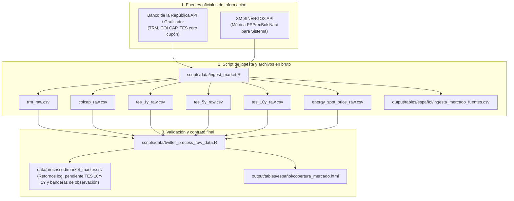
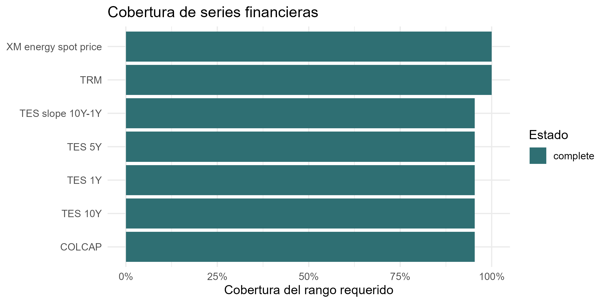

# Procedencia y descarga de datos oficiales de mercado

Esta carpeta almacena las series financieras en bruto descargadas directamente desde los servicios oficiales del Banco de la República y de XM antes de su consolidación en el contrato final de datos.

## Flujo de ingesta y procesamiento de mercado

El diagrama describe el flujo de extracción, validación y construcción del contrato de datos de mercado:



## Archivos descargados por `ingest_market.R`

| Archivo | Fuente oficial | Frecuencia | Unidad | Tratamiento posterior |
|---|---|---|---|---|
| `trm_raw.csv` | Banco de la República (SDMX / Graficador) | Diaria (1.400 obs) | COP / USD | Retornos logarítmicos en días hábiles financieros |
| `colcap_raw.csv` | Banco de la República (BVC) | Bursátil (935 obs) | Puntos | Retornos logarítmicos sobre días de cotización efectiva |
| `tes_1y_raw.csv` | Banco de la República (Curva cero cupón) | Bursátil (935 obs) | Porcentaje | Nivel de tasa soberana en pesos a 1 año |
| `tes_5y_raw.csv` | Banco de la República (Curva cero cupón) | Bursátil (935 obs) | Porcentaje | Nivel de tasa soberana en pesos a 5 años |
| `tes_10y_raw.csv` | Banco de la República (Curva cero cupón) | Bursátil (935 obs) | Porcentaje | Diferencias simples de tasa soberana a 10 años |
| `energy_spot_price_raw.csv` | XM SINERGOX (`PPPrecBolsNaci`) | Diaria continua | COP / kWh | Retornos logarítmicos con calendario propio sin arrastre |

## Cobertura temporal de las series

La siguiente figura documenta la cobertura temporal y las fechas observadas de cada serie financiera a lo largo de la ventana de análisis (agosto de 2022 a mayo de 2026):

<p align="center">
  
</p>

## Reglas de transformación hacia `market_master.csv`

1. **Retornos continuos vs diferencias de tasas:** La TRM y el índice COLCAP se transforman en retornos logarítmicos ($r_t = \ln(P_t) - \ln(P_{t-1})$). Las tasas soberanas TES se transforman en diferencias simples ($\Delta y_t = y_t - y_{t-1}$), dado que son rendimientos porcentuales y no precios de activos.
2. **Pendiente de la curva soberana:** Se calcula como la diferencia simple entre el rendimiento a 10 años y a 1 año (`tes_slope_10y_1y = tes_10y - tes_1y`).
3. **Control de días hábiles y arrastre:** `market_master.csv` incluye banderas explícitas (`*_observed` y `*_carried_forward`) para que los modelos econométricos filtren únicamente observaciones reales de mercado y no traten valores propagados de fines de semana como información nueva.
4. **Precio de energía XM:** Se procesa sin arrastre de fines de semana. Si un día no es reportado por XM, el valor permanece como faltante sin imputación artificial.

## Comandos para actualizar datos de mercado

Para ejecutar una actualización controlada desde la raíz del repositorio:

```bash
# 1. Descargar series oficiales en bruto
Rscript scripts/data/ingest_market.R

# 2. Reconstruir los contratos procesados
Rscript scripts/data/twitter_process_raw_data.R
```

El script de ingesta cuenta con protecciones automáticas: si una llamada de red falla o devuelve cero observaciones, el script se detiene con código de error 1 antes de sobreescribir los archivos en bruto existentes.

## Redirección y enlaces relacionados

- **Contrato procesado:** [`market_master.csv`](../../processed/market_master.csv)
- **Tabla de fuentes y URLs auditadas:** [`fuentes_mercado_auditadas.html`](../../../output/tables/español/fuentes_mercado_auditadas.html)
- **Tabla de cobertura de mercado:** [`cobertura_mercado.html`](../../../output/tables/español/cobertura_mercado.html)
- **Cuaderno computacional:** [`Cuaderno_Paper_Español.qmd`](../../../notebooks/español/Cuaderno_Paper_Español.qmd)
- **Documentación general:** [`README.es.md`](../../../README.es.md)
