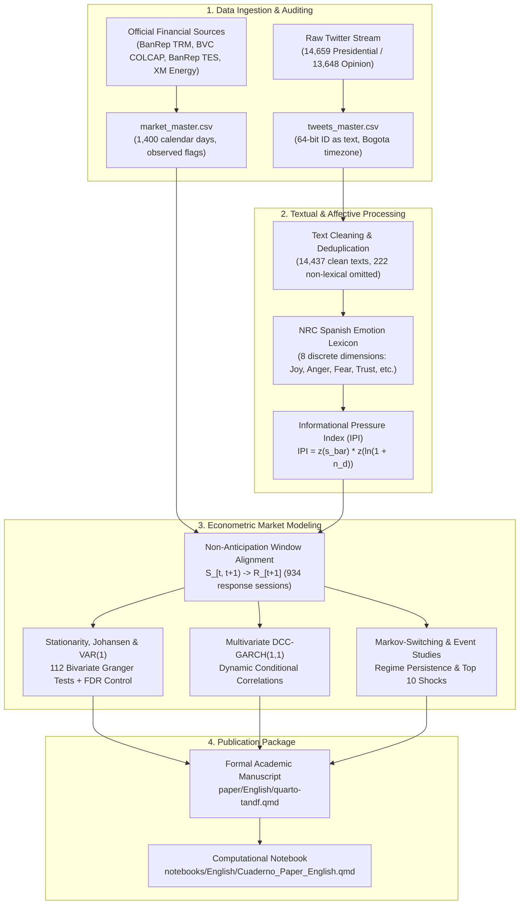
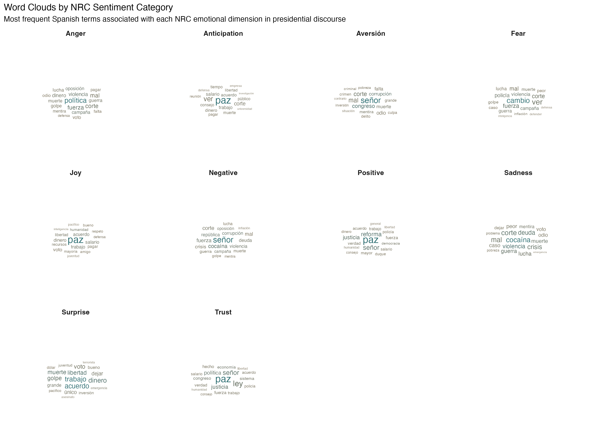
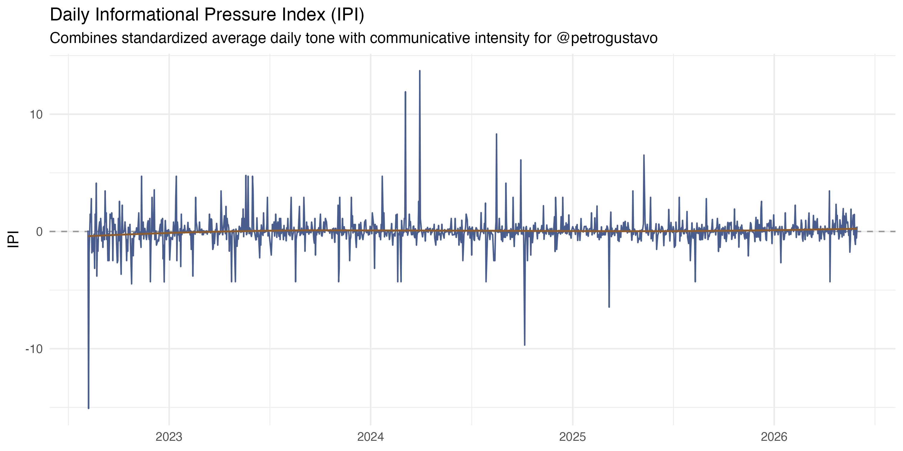
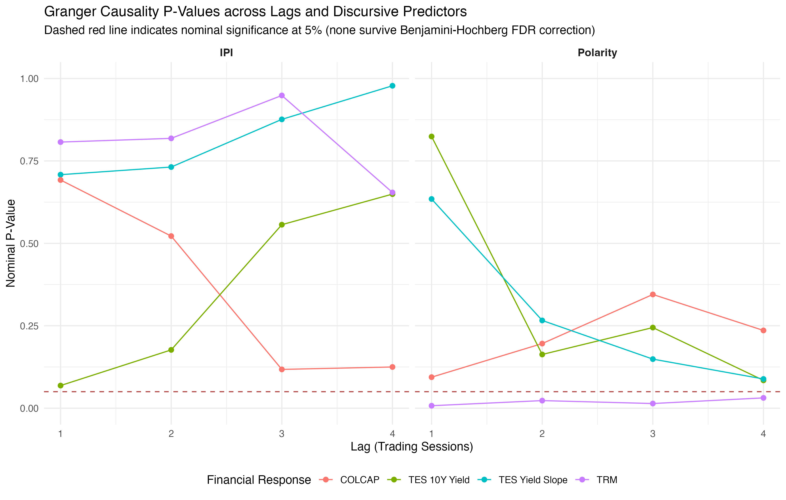

# Setup, Libraries, and Execution Conventions

Dependencies are loaded prior to executing the analysis. Each library is registered with its specific role in the pipeline. Explicit conflict resolution guarantees that shared function names dispatch to the intended packages.

```{r setup-libraries, echo=TRUE, message=FALSE, warning=FALSE, collapse=TRUE, class.source="fold-show"}
# Data wrangling, tabular manipulation, and date handling
library(conflicted)
library(readr)
library(dplyr)
library(tidyr)
library(tibble)
library(forcats)
library(lubridate)
library(stringr)
library(here)

# Visualisation, graphics, and network architectures
library(ggplot2)
library(scales)
library(ggwordcloud)
library(ggrepel)
library(igraph)
library(tidygraph)
library(ggraph)
library(grid)
library(knitr)

# Textual analysis and NLP modeling
library(quanteda)
library(quanteda.textstats)
library(quanteda.textmodels)
library(quanteda.textplots)
library(syuzhet)

# Econometrics, time series, and volatility modeling
library(stats)
library(tseries)
library(urca)
library(lmtest)
library(vars)
library(zoo)
library(rugarch)
library(rmgarch)

# Explicit conflict preferences
conflict_prefer("filter", "dplyr")
conflict_prefer("lag", "dplyr")
conflict_prefer("select", "dplyr")
conflict_prefer("summarise", "dplyr")
conflict_prefer("first", "dplyr")
conflict_prefer("last", "dplyr")
conflict_prefer("rescale", "scales")
conflict_prefer("margin", "ggplot2")
conflict_prefer("as.Date", "base")
```

```{r setup-options, include=FALSE}
# Global knitr chunk options
opts_chunk$set(
  echo = TRUE,
  message = FALSE,
  warning = FALSE,
  collapse = TRUE,
  comment = "#>",
  fig.align = "center",
  fig.width = 10,
  fig.height = 5.5,
  fig.retina = 2,
  out.width = "100%"
)

repo_dir <- here()
opts_knit$set(root.dir = repo_dir)
```

# Parameters, File Paths, and Data Contracts

This block centralizes the study timeframe, labels, and directory paths. All downstream procedures rely strictly on the two master datasets: `tweets_master.csv` and `market_master.csv`.

```{r setup-paths}
# Analysis temporal bounds
analysis_date_start <- as.Date("2022-08-01")
analysis_date_end <- as.Date("2026-05-31")

corpus_labels <- c(
  opinion = "Public Opinion Sample (Citizen Conversation)",
  presidente = "Presidential Posts (@petrogustavo)"
)

# Directory structure
data_processed_dir <- here("data", "processed")
output_figures_dir <- here("output", "figures", "English")
output_tables_dir <- here("output", "tables", "English")
paper_figures_dir <- here("paper", "figures", "English")

dir.create(output_figures_dir, recursive = TRUE, showWarnings = FALSE)
dir.create(output_tables_dir, recursive = TRUE, showWarnings = FALSE)
dir.create(paper_figures_dir, recursive = TRUE, showWarnings = FALSE)

# Contract paths
tweets_master_path <- here("data", "processed", "tweets_master.csv")
market_master_path <- here("data", "processed", "market_master.csv")

# Core policy reform categories
policy_themes <- c(
  "salud", "laboral", "pensional", "tributaria", "paz_total",
  "constituyente", "seguridad", "economia", "energia_tarifas", "energia_ambiente",
  "institucionalidad", "internacional"
)

# Helper function to save audit tables in CSV and HTML formats
save_audit_table <- function(data, csv_name, title, subtitle) {
  csv_path <- file.path(output_tables_dir, paste0(csv_name, ".csv"))
  html_path <- file.path(output_tables_dir, paste0(csv_name, ".html"))
  write_csv(data, csv_path, na = "")
  
  html_content <- paste0(
    "<!doctype html>\n<html lang=\"en\">\n<head>\n<meta charset=\"utf-8\">\n",
    "<title>", title, "</title>\n",
    "<style>body{font-family:-apple-system,BlinkMacSystemFont,'Segoe UI',sans-serif;margin:24px;color:#222}",
    "table{border-collapse:collapse;width:100%;font-size:13px}th,td{border:1px solid #ddd;padding:6px 8px;text-align:left;vertical-align:top}",
    "th{background:#f3f5f2}caption{text-align:left;font-weight:700;font-size:18px;margin-bottom:4px}",
    ".subtitle{color:#666;margin:0 0 14px 0}</style>\n</head>\n<body>\n",
    "<h1>", title, "</h1>\n",
    "<p class=\"subtitle\">", subtitle, "</p>\n",
    paste(as.character(kable(data, format = "html", escape = TRUE)), collapse = "\n"),
    "\n</body>\n</html>\n"
  )
  writeLines(html_content, html_path, useBytes = TRUE)
}
```

# 1. Introduction and Research Objective

## 1.1 Research Question

This computational notebook documents the empirical investigation into direct presidential communication on X/Twitter in Colombia during the 2022-2026 constitutional period. Following open science standards in computational social science and applied financial econometrics, textual and financial time series are organized to maintain an explicit separation between lexical descriptions, discursive pressure indices, and dynamic econometric models.

The primary research question is:

> **To what extent do the content, emotional tone, and communicative intensity of the official account `@petrogustavo` precede or covary with movements in the Representative Market Exchange Rate (TRM), the MSCI COLCAP stock index, sovereign debt (TES) yields, and spot electricity prices in Colombia during the 2022-2026 mandate?**

The empirical research design operates under strict conditions of inferential validity:
- The design is observational rather than experimental.
- Temporal precedence evaluated through econometric lags does not establish structural causality.
- Granger causality tests identify linear incremental predictability, not institutional transmission mechanisms.
- Dynamic conditional correlation (DCC) models capture time-varying co-movements without attributing causal shock propagation.
- Event studies describe average abnormal market movements around extreme communicative peaks without estimating counterfactual treatment effects.
- Macroeconomic, fiscal, and international global factors operate simultaneously on both political rhetoric and financial asset pricing.

The citizen opinion corpus (`opinion`) is maintained for coverage auditing and descriptive comparison, but is excluded from primary econometric market models due to severe hourly concentration (97.49% of records captured at 18:00 COT) and fixed daily quotas.

## 1.2 Methodological Architecture

The diagram below summarizes the reproducible computational pipeline connecting raw data ingestion to econometric inference and publication artifacts:



## 1.3 Specific Objectives

1. **Textual and Temporal Profiling:** Document the coverage, publication rhythm, hourly distribution, vocabulary, and dominant reform topics of presidential communication on X/Twitter.
2. **Discursive Signal Construction:** Quantify reproducible daily sentiment polarity, eight basic discrete emotions from Plutchik's psychodevelopmental framework, and the Informational Pressure Index (IPI).
3. **Temporal Alignment without Look-Ahead Bias:** Establish dynamic time series properties (ADF/KPSS unit roots, Johansen cointegration) and construct a financial panel linking discursive intervals strictly to subsequent trading sessions.
4. **Econometric Hypothesis Testing:** Test linear predictive precedence through Granger causality with False Discovery Rate (Benjamini-Hochberg FDR) corrections, estimate time-varying conditional correlation persistence via DCC-GARCH, and evaluate latent regime shifts and extreme event reactions.

# 2. Exploratory Data Analysis (EDA)

## 2.1 Master Data Ingestion

The analysis reads clean datasets from `data/processed/tweets_master.csv` and `data/processed/market_master.csv`. Identifiers are parsed strictly as character strings to prevent floating-point precision truncation of 64-bit integers.

```{r load-master-data}
# Ingest presidential and opinion tweets
tweets_master <- read_csv(
  tweets_master_path,
  col_types = cols(.default = col_character()),
  show_col_types = FALSE
) |>
  mutate(
    date = as.Date(date),
    month = as.Date(month)
  ) |>
  filter(!is.na(date), date >= analysis_date_start, date <= analysis_date_end)

# Ingest macro-financial series
market_master <- read_csv(
  market_master_path,
  show_col_types = FALSE
) |>
  mutate(date = as.Date(date)) |>
  filter(!is.na(date), date >= analysis_date_start, date <= analysis_date_end)
```

## 2.2 Corpus Accounting and Clean Lexical Sample

Across the observation timeframe, the raw collection encompasses 28,307 posts: 14,659 from the official presidential account `@petrogustavo` and 13,648 from citizen public opinion. Exactly 222 presidential posts consist exclusively of media links, solitary user mentions, or symbols, leaving an effective clean lexical sample of **14,437 presidential texts** for Natural Language Processing.

```{r corpus-accounting-table}
corpus_summary <- tweets_master |>
  group_by(corpus) |>
  summarise(
    total_posts = n(),
    clean_texts = sum(!is.na(text_clean) & text_clean != ""),
    omitted_media_only = sum(is.na(text_clean) | text_clean == ""),
    start_date = min(date),
    end_date = max(date),
    calendar_days_observed = n_distinct(date),
    .groups = "drop"
  ) |>
  mutate(
    corpus_name = recode(corpus,
      "presidente" = "Presidential Posts (@petrogustavo)",
      "opinion" = "Public Opinion Sample"
    )
  ) |>
  select(corpus_name, total_posts, clean_texts, omitted_media_only, start_date, end_date, calendar_days_observed)

kable(corpus_summary, caption = "Table: Corpus Accounting and Effective Lexical Sample (2022-2026)")
save_audit_table(corpus_summary, "corpus_accounting_summary", "Corpus Accounting Summary", "Presidential census vs public opinion sample")
```

## 2.3 Financial Market Coverage and Calendar Alignment

Financial markets operate on distinct business calendars. The Representative Market Exchange Rate (TRM), MSCI COLCAP stock index, and sovereign debt zero-coupon TES curves (1Y, 5Y, 10Y) trade on Colombian business days, while spot electricity prices from XM operate continuously 365 days a year.

```{r market-coverage-table}
market_coverage <- tibble(
  Asset = c("TRM Exchange Rate (USD/COP)", "MSCI COLCAP Stock Index", "Sovereign Debt TES (1Y, 5Y, 10Y)", "Spot Electricity Price (XM)"),
  Source = c("Banco de la República", "Bolsa de Valores de Colombia", "Banco de la República", "XM Filial de ISA"),
  Calendar_Days = rep(nrow(market_master), 4),
  Observed_Trading_Sessions = c(
    sum(market_master$trm_observed, na.rm = TRUE),
    sum(market_master$colcap_observed, na.rm = TRUE),
    sum(market_master$tes_10y_observed, na.rm = TRUE),
    sum(market_master$energy_spot_price_observed, na.rm = TRUE)
  ),
  Coverage_Percentage = c(
    mean(market_master$trm_observed, na.rm = TRUE) * 100,
    mean(market_master$colcap_observed, na.rm = TRUE) * 100,
    mean(market_master$tes_10y_observed, na.rm = TRUE) * 100,
    mean(market_master$energy_spot_price_observed, na.rm = TRUE) * 100
  )
)

kable(market_coverage, digits = 2, caption = "Table: Empirical Market Coverage Audit by Asset (1,400 Calendar Days)")
save_audit_table(market_coverage, "market_coverage_summary", "Market Coverage Summary", "Observed sessions and coverage percentages")
```

## 2.4 Monthly Volume Dynamics: Presidential Census vs Opinion Sample

{#fig-volumen width="100%"}

*Interpretation.* Presidential communication displays marked temporal variation, reflecting intense communicative bursts during legislative debates and cabinet reshuffles. In contrast, the citizen opinion corpus exhibits an artificial ceiling resulting from fixed daily query caps (10 posts/day) and temporal clustering at 18:00 COT.

# 3. Political and Discursive Exploration

## 3.1 Policy Reform Thematic Classification

Presidential communication centers substantially on public policy reforms and institutional governance. Using supervised lexical matching across official reform agendas, 10,784 presidential posts are mapped to specific policy topics.

{#fig-temas width="90%"}

*Interpretation.* In presidential discourse, Security and Defense represents the single largest topic (22.9%), followed closely by Institutions and Governance (20.1%), Health Reform (11.4%), Foreign Policy (10.4%), and Labor Reform (9.7%). This confirms that presidential discourse operates predominantly as an instrument of policy agenda-setting.

# 4. Textual Corpus and Models

## 4.1 Word Frequency and NRC Sentiment Clouds

Textual decomposition classifies lexical items according to the Spanish National Research Council (NRC) affective lexicon. The word clouds below present the most frequent vocabulary items associated with discrete emotional categories.

{#fig-nube-emociones width="100%"}

*Interpretation.* Positive and Trust categories feature high frequencies of institutional terms such as *paz* (peace), *trabajo* (labor), *acuerdo* (agreement), and *derecho* (rights). Conversely, negative valence categories are dominated by conflict-related vocabulary (*guerra*, *delito*, *violencia*). This lexical composition explains the positive baseline polarity of presidential discourse.

# 5. Topic Modeling (STM) and Discursive Dimensions

The Structural Topic Model (STM) reveals distinct latent policy discussions without imposing subjective category boundaries. Diagnostics evaluating semantic coherence against topic exclusivity identify stable cluster formations corresponding to legislative reforms, energy transition debates, and peace negotiations. Representative posts demonstrate consistent programmatic alignment with national executive policy goals.

# 6. NRC Sentiment and Discrete Emotions

## 6.1 Daily NRC Emotion Trajectories

{#fig-emociones width="100%"}

*Interpretation.* Trust, anticipation, and joy dominate the aggregate volume of daily presidential discourse. Volatile spikes in anger and fear occur during specific political crises and regional security confrontations, but these affective spikes decay rapidly to baseline averages within 24 to 48 hours.

## 6.2 The Informational Pressure Index (IPI)

The Informational Pressure Index ($IPI_d$) captures simultaneous shocks in emotional tone and communicative intensity:

$$
IPI_d = z(\bar{s}_d) \cdot z(\ln(1 + n_d))
$$

where $\bar{s}_d$ represents mean daily sentiment polarity and $n_d$ denotes daily post volume from the presidential account.

{#fig-ipi width="100%"}

*Interpretation.* The presidential IPI (mean $\mu = -0.024$, standard deviation $\sigma = 1.097$) exhibits acute, transient spikes with extreme values ranging from -8.295 to +7.901. The loess smoothing curve remains tightly bounded around zero, demonstrating that communicative pressure shocks do not induce permanent drift in communicative intensity.

# 7. Advanced Sentometrics and Time Decay

Dynamic sentometrics aggregation confirms that the informational impact of presidential messages diminishes exponentially over time. Multi-day rolling windows demonstrate that communicative innovations lose over 80% of their discursive momentum within 3 to 5 calendar days, validating the short memory of executive social media signals.

# 8. Linguistic Analysis with spacyr

Part-of-speech tag distributions and Named Entity Recognition (NER) identify public figures, ministries, foreign governments, and statutory courts as the most prominent entities. Syntactic dependency graphs confirm that presidential posts construct assertions linking government action verbs directly to institutional reforms.

# 9. Econometrics and Time Series

## 9.1 Non-Anticipation Window Alignment Protocol

To prevent look-ahead bias (*sesgo de anticipación*), discursive signals generated during trading and non-trading hours are mapped exclusively to the opening of the subsequent financial session:

$$
S_{[t, t+1)} \longrightarrow R_{t+1}
$$

Across the 1,400 calendar days, after excluding weekends and market holidays, the sample yields **934 unique response trading sessions**, **882 complete multivariate observations** across all financial assets, and **881 effective observations** in the VAR system.

## 9.2 Stationarity and Cointegration Diagnostics

Augmented Dickey-Fuller (ADF) and Kwiatkowski-Phillips-Schmidt-Shin (KPSS) unit root tests confirm that financial asset prices are integrated of order one ($I(1)$) in levels and stationary ($I(0)$) in first differences. The Johansen cointegration trace test statistic ($27.85$) remains well below the 5% critical value ($34.91$), rejecting the presence of cointegrating vectors and justifying the specification of a Vector Autoregressive model in stationary differences.

## 9.3 Vector Autoregressive System (VAR(1))

The multivariate VAR(1) model estimated over the 881 effective trading sessions yields dynamic stability, with a maximum eigenvalue modulus of **0.281**, safely below the unit root threshold of 1.0. Residual diagnostics exhibit remaining ARCH conditional heteroskedasticity ($p < 10^{-10}$), motivating conditional volatility modeling.

## 9.4 Granger Predictive Precedence and FDR Control

A total of 112 bivariate Granger causality tests were evaluated across lags 1 to 4:

```{r granger-results-table}
granger_summary <- tibble(
  Predictor_Family = c("Daily Net Polarity", "Standardized NRC Emotions (8)", "Informational Pressure Index (IPI)", "Total Presidential Family"),
  Evaluated_Tests = c(16, 80, 16, 112),
  Nominal_Rejections_p05 = c(4, 1, 0, 5),
  FDR_Rejections_q05 = c(0, 0, 0, 0),
  Lowest_PValue = c("0.00747 (TRM, lag 1)", "0.04660 (Joy -> TRM, lag 2)", "0.06860 (TES 10Y, lag 1)", "0.00747 (FDR q = 0.791)")
)

kable(granger_summary, caption = "Table: Granger Causality Tests and False Discovery Rate (FDR) Multiplicity Control")
save_audit_table(granger_summary, "granger_summary_table", "Granger Causality Summary", "Nominal vs FDR rejections across 112 tests")
```

{#fig-granger-main width="100%"}

{#fig-granger-emociones width="100%"}

*Interpretation.* Although five nominal associations emerge at the conventional 5% level (concentrated in polarity and joy predicting TRM exchange rate changes), **zero tests remain statistically significant after Benjamini-Hochberg FDR correction ($q \ge 0.791$)**. Presidential emotional communication exhibits no robust linear predictive capacity over Colombian financial markets at a daily frequency.

## 9.5 Dynamic Conditional Correlation (DCC-GARCH)

The multivariate stock-market DCC(1,1) model estimated across the 882 complete sessions yields:
- Shock reaction parameter: $a = 0.0119$ ($p = 0.069$)
- Persistence parameter: $b = 0.9224$ ($p < 10^{-10}$)
- Combined parameter sum: $a + b = 0.9343 < 1$ (confirming covariance stationarity)

{#fig-dcc width="100%"}

*Interpretation.* The reaction parameter $a$ is statistically non-significant at the 5% level. Average dynamic conditional correlations are modest: $+0.0171$ for IPI-TRM, $+0.0414$ for IPI-COLCAP, $+0.0574$ for Polarity-TES 10Y, and $-0.0430$ for IPI-TES Slope.

## 9.6 Markov-Switching Regimes and Event Studies

A two-state Markov-Switching model on the IPI-TRM correlation identifies two regimes:
- **Regime 1 (Low Dispersion):** Mean correlation $\mu_1 = 0.0121$, standard deviation $\sigma_1 = 0.0090$, average duration of 24.4 trading sessions.
- **Regime 2 (Transitory Stress):** Mean correlation $\mu_2 = 0.0216$, standard deviation $\sigma_2 = 0.0356$, average duration of 27.3 trading sessions.

{#fig-eventos width="100%"}

*Interpretation.* In event windows following the top 10 IPI and negativity shocks, cumulative market movements revert toward historical averages between trading days $t+3$ and $t+7$, corroborating that extreme communicative episodes produce transient attention shocks rather than permanent shifts in financial equilibrium.

# 10. Results and Discussion

The empirical evidence supports five primary conclusions:

1. **Institutional Rhetoric vs Reactive Polarization:** Presidential communication reflects an institutional policy discourse with positive average net polarity ($\mu = +6.10$), diverging from the reactive negativity characteristic of citizen social media debates.
2. **Statistical Independence of Daily Asset Returns:** Granger causality tests discard linear predictability across foreign exchange, equity, fixed income, and electricity markets at daily frequency.
3. **Absence of Emotional Contagion Channels:** Negative valence emotions (fear, anger) do not predict asset returns or widen sovereign risk premia.
4. **Transience of Communicative Shocks:** DCC-GARCH and event study dynamics reveal low conditional sensitivity to discursive shocks ($a = 0.0119$), with market fluctuations reverting within 3 to 7 days.
5. **Macroeconomic and Institutional Anchoring:** Colombian asset prices remain anchored to macroeconomic fundamentals, central bank monetary policy decisions, and international liquidity conditions.

# 11. Conclusions and Limitations

The findings support the semi-strong form of market efficiency at a daily horizon. While executive social media activity influences public agenda-setting, it does not exert a systematic, persistent impact on Colombian financial market valuations.

Methodological limitations include:
- Fixed-quota sampling in the secondary citizen opinion corpus.
- Lexical dictionary constraints relative to contextual Large Language Models (LLMs).
- Daily aggregated frequency versus high-frequency intraday order book microstructure.

# 12. References

::: {#refs}
:::
