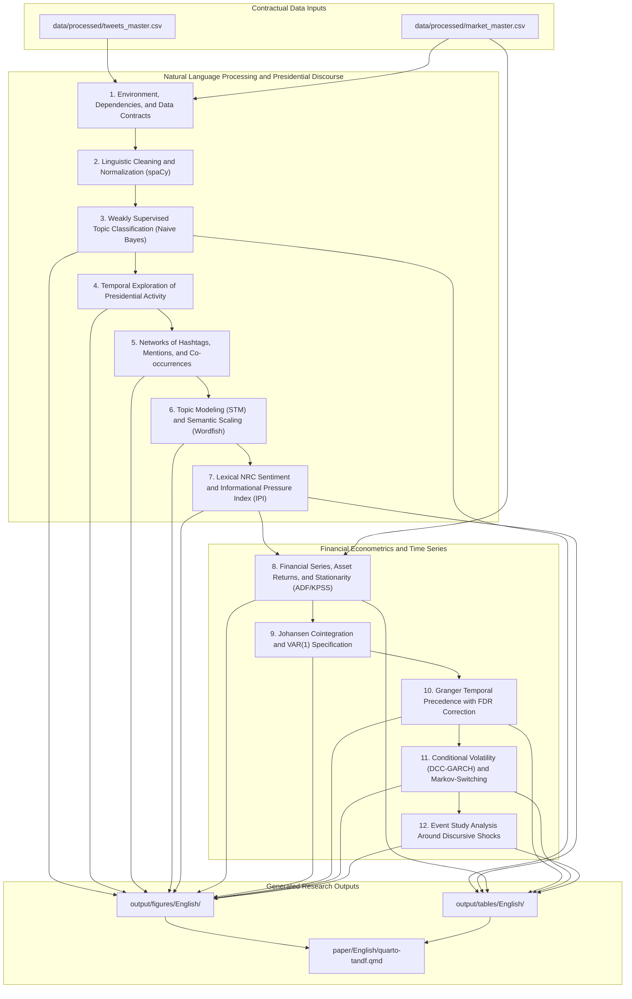
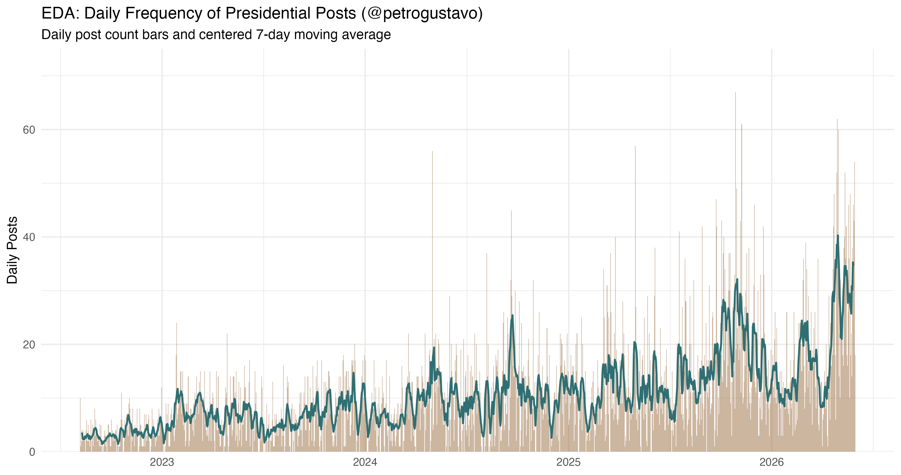
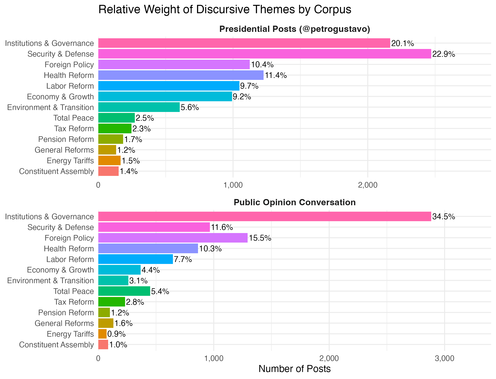
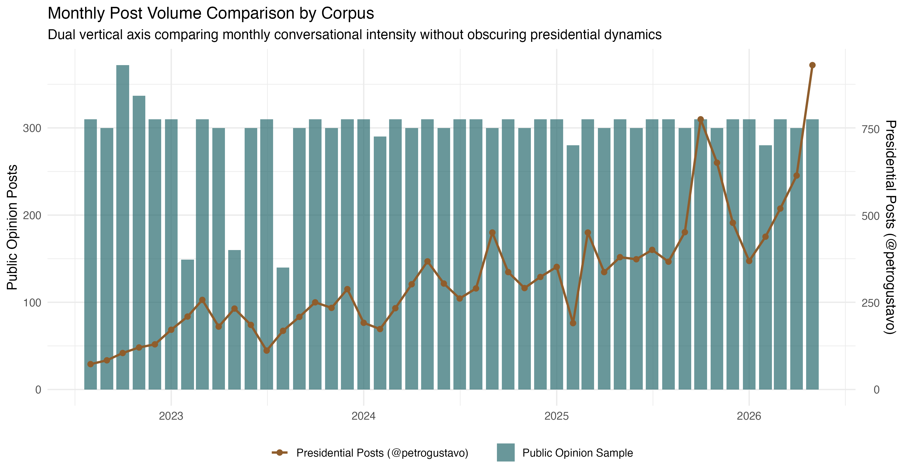
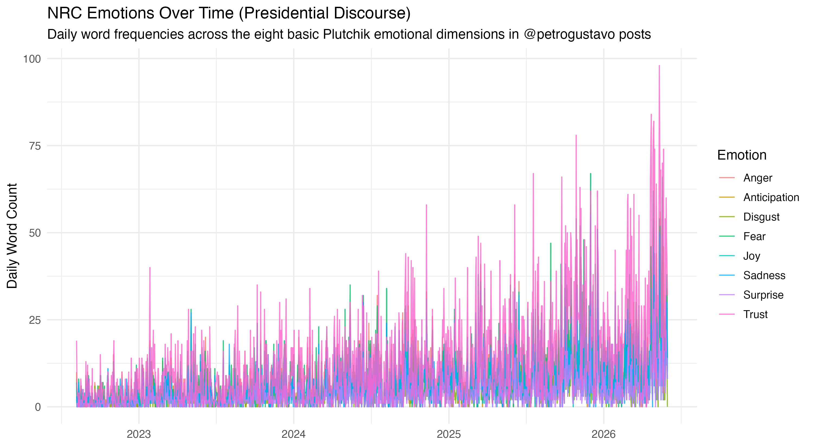
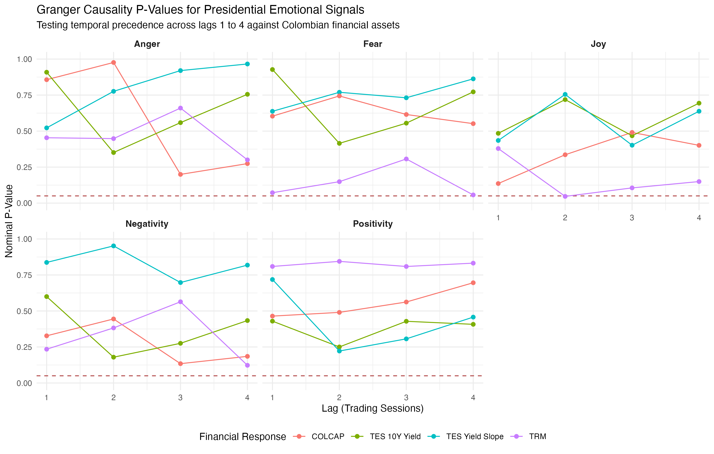
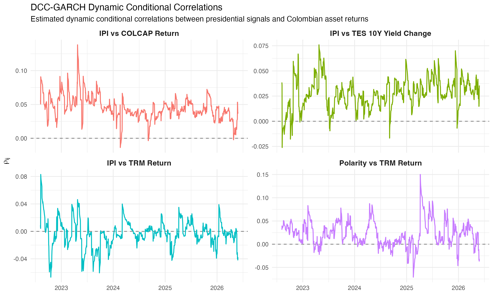
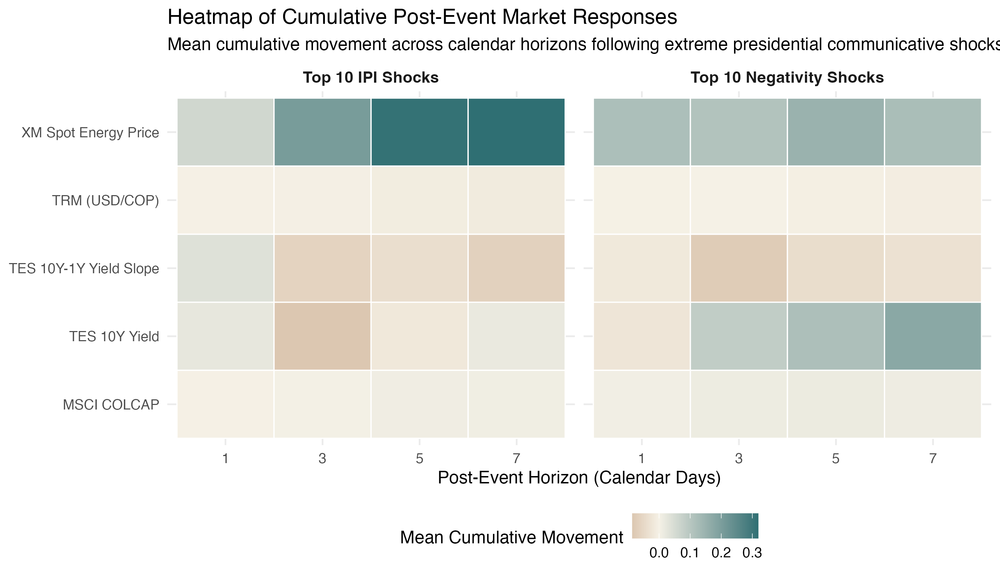

# Replication Guide and Computational Notebook Architecture

The file [`Cuaderno_Paper_English.qmd`](Cuaderno_Paper_English.qmd) serves as the self-contained computational engine of this research paper. It models the observational relationship and temporal precedence between official public communications issued by the presidential account `@petrogustavo` (`corpus == "presidente"`) and Colombian financial market series, including the TRM exchange rate, the COLCAP equity index, zero-coupon TES sovereign bond yields across multiple maturities, and the XM wholesale spot electricity price.

The citizen public opinion sample (`corpus == "opinion"`) is processed strictly for comparative lexical exploration and to document the sampling constraints of its extraction pipeline (such as an artificial 97.49% concentration at 18:00 UTC and daily capture caps of 10 posts). This public opinion corpus is formally excluded from all financial time-series econometric modeling.

Rendering the executable Quarto notebook generates [`Cuaderno_Paper_English.html`](Cuaderno_Paper_English.html), which compiles all evaluated R code, analytical figures, auditable summary tables, and accompanying scholarly interpretation.

## Architecture of the 12 Analytical Sections

The execution workflow of the notebook is structured into twelve sequential and fully reproducible stages:



## Software Requirements and Dependencies

The computational environment relies on R 4.1 or higher (tested and validated on R 4.4.3 and R 4.6.1) alongside the Quarto CLI. Native pipe syntax (`|>`) requires R 4.1 or later.

Analytical libraries are organized at the start of the notebook by functional role:

| Functional Area | Packages |
|---|---|
| Data Management and Dates | `conflicted`, `readr`, `dplyr`, `tidyr`, `tibble`, `forcats`, `lubridate`, `stringr`, `here` |
| Visualization and Networks | `ggplot2`, `scales`, `ggwordcloud`, `ggrepel`, `igraph`, `tidygraph`, `ggraph`, `DiagrammeR`, `ragg` |
| Text Processing and NLP | `quanteda`, `quanteda.textstats`, `quanteda.textmodels`, `syuzhet`, `sentometrics`, `stm`, `spacyr`, `reticulate` |
| Time Series Econometrics | `stats`, `tseries`, `lmtest`, `vars`, `urca`, `zoo`, `rugarch`, `rmgarch`, `MSwM`, `sandwich` |
| Output and Formatting | `knitr`, `utils`, `methods` |

Natural language tokenization and lemmatization via spaCy require a configured Python environment with the Spanish language model `es_core_news_sm`. This can be declared using the environment variable `SPACYR_PYTHON`. When unset, the notebook searches for the reticulate virtual environment named `petro-spacyr`.

## Execution Instructions from a Clean Terminal Session

To render the complete computational notebook from the repository root:

```bash
# 1. Export the Python interpreter path with spaCy configured
export SPACYR_PYTHON="$HOME/.virtualenvs/petro-spacyr/bin/python"

# 2. Verify spaCy and the Spanish model availability
"$SPACYR_PYTHON" -c 'import spacy; spacy.load("es_core_news_sm"); print("spaCy version:", spacy.__version__)'

# 3. Render the notebook to standalone HTML
quarto render notebooks/English/Cuaderno_Paper_English.qmd
```

The rendering routine evaluates all code blocks, estimates the econometric specifications, writes graphics to `output/figures/English/`, and exports structured summary tables to `output/tables/English/`.

## Continuous Deployment to Posit Connect and Posit Connect Cloud

This directory includes a pre-configured [`manifest.json`](manifest.json) under static mode (`appmode: "static"`). This enables automated continuous deployment to Posit Connect or Posit Connect Cloud directly from GitHub without requiring Python spaCy installation or lengthy server-side re-execution.

The deployment bundle tracks the following auditable files:
- `index.html`: Exact copy of the compiled notebook served by default at the root URL.
- `Cuaderno_Paper_English.html`: Standalone self-contained HTML file embedding all high-resolution figures and styled tables (`embed-resources: true`).
- `Cuaderno_Paper_English.qmd`: Complete reproducible Quarto source code.
- `notebook-style.css`: Custom typography and layout stylesheet.
- `README.md`: Architecture overview and execution guide.

### Setup Instructions for GitHub Continuous Deployment:

1. Log into your Posit Connect Cloud account (or local Posit Connect server).
2. Click **New Content** and choose **From Git Repository**.
3. Select the repository: `juanjo-edm/What_is_the_economic_impact_of_Colombian_President_tweets`.
4. Set the tracking branch to `main`.
5. In the content directory field, specify: `notebooks/English`.
6. Posit Connect Cloud detects `manifest.json` and publishes the notebook automatically. Every subsequent push to `main` updates the deployment seamlessly.

To regenerate or update the manifest locally using R:

```r
rsconnect::writeManifest(
  appDir = "notebooks/English",
  appFiles = c("index.html", "Cuaderno_Paper_English.html", "Cuaderno_Paper_English.qmd", "notebook-style.css", "README.md"),
  appPrimaryDoc = "index.html",
  appMode = "static"
)
```

## Output and Inferential Standards

Every visible result in the notebook follows a four-part contractual sequence:

`Markdown context and objective -> Reproducible R code block -> Output figure or table -> Immediate academic interpretation`

- **Prior Context:** Specifies the analytical question, input variables, mathematical transformation or econometric model, and resulting data structure.
- **Modular Code:** Code chunks remain focused, self-contained, and readable without arbitrary divisions or hidden side effects.
- **Self-Contained Figures:** Every chart features descriptive titles, subtitles, explicit unit labels on all axes, color legends, and source footnotes noting sample sizes.
- **Mandatory Academic Interpretation:** Each empirical result is followed by an analytical paragraph discussing numerical magnitudes, economic relevance, and methodology limitations.
- **Inferential Discipline:** Causal phrasing such as "impact", "cause", or "determines" is strictly avoided when interpreting VAR models, DCC conditional correlations, or Granger tests, which measure temporal precedence and dynamic associations rather than structural causal identification.

## Representative Figures from the Notebook

### Daily Presidential Post Frequency (Section 4)

Temporal distribution of the 14,659 posts published by `@petrogustavo` across the presidential administration, plotted alongside a 7-day centered moving average.

<p align="center">
  
</p>

### Distribution of Presidential Discourse Across Policy Reform Agendas (Section 3)

Percentage share and total volume of presidential posts classified across thirteen major public policy and reform agendas.

<p align="center">
  
</p>

### Monthly Volume Comparison by Corpus (Section 4)

Dual vertical axis chart tracking monthly publishing volume between presidential posts and citizen public opinion observations.

<p align="center">
  
</p>

### Daily Trajectory of Lexical NRC Emotional Signals (Section 7)

Time-series paths of Plutchik basic emotional dimensions (Joy, Trust, Fear, Surprise, Sadness, Disgust, Anger, and Anticipation) extracted from presidential publications.

<p align="center">
  
</p>

### Granger Temporal Precedence Tests (Section 10)

Statistical significance across 112 bivariate Granger temporal precedence tests connecting presidential discursive signals and Colombian financial asset returns.

<p align="center">
  
</p>

### Dynamic Conditional Correlations from DCC-GARCH Estimation (Section 11)

Estimated time-varying conditional correlation paths between presidential communication indicators and domestic financial asset returns.

<p align="center">
  
</p>

### Observed Cumulative Responses in Event Studies (Section 12)

Heatmap displaying cumulative percentage returns for Colombian financial assets across horizons of 1, 3, 5, and 7 days following extreme presidential discursive shocks.

<p align="center">
  
</p>

## Navigation and Related Resources

- **Main Repository Overview:** [`README.md`](../../README.md) (English) | [`README.es.md`](../../README.es.md) (Español)
- **Publication Manuscript:** [`quarto-tandf.qmd`](../../paper/English/quarto-tandf.qmd)
- **Spanish Computational Notebook:** [`Cuaderno_Paper_Español.qmd`](../español/Cuaderno_Paper_Español.qmd)
- **Methodological Supervision Module:** [`Supervision_Metodologica.qmd`](../../Methodology_Supervision/Supervision_Metodologica.qmd)
- **English Figures Directory:** [`output/figures/English/`](../../output/figures/English/)
- **English Tables Directory:** [`output/tables/English/`](../../output/tables/English/)
- **Methodological Closure Audit:** [`auditoria_final_cierre_metodologico.md`](../../output/review/auditoria_final_cierre_metodologico.md)
