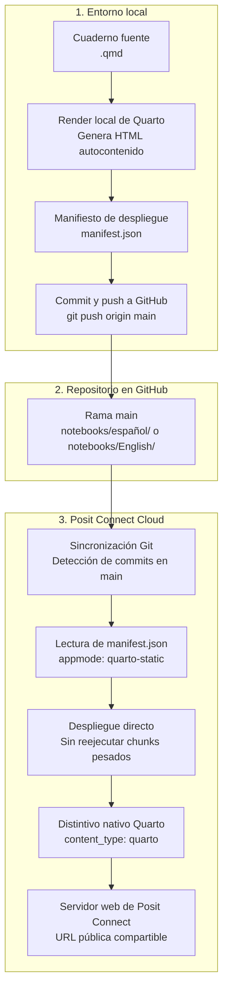

# Cuadernos computacionales y despliegue continuo en Posit Connect Cloud

Esta carpeta contiene los cuadernos computacionales que reproducen los análisis empíricos, modelos econométricos y procesamientos de lenguaje natural del estudio.

## Organización del directorio

El directorio se divide por idioma del cuaderno:

- [`español/`](español/): Cuaderno principal en español ([`Cuaderno_Paper_Español.qmd`](español/Cuaderno_Paper_Español.qmd)), su salida interactiva ([`Cuaderno_Paper_Español.html`](español/Cuaderno_Paper_Español.html)), configuración Quarto ([`_quarto.yml`](español/_quarto.yml)) y manifiesto de publicación ([`manifest.json`](español/manifest.json)). Es la versión desplegada actualmente en Posit Connect Cloud.
- [`English/`](English/): Cuaderno computacional traducido al inglés ([`Cuaderno_Paper_English.qmd`](English/Cuaderno_Paper_English.qmd)), su salida interactiva ([`Cuaderno_Paper_English.html`](English/Cuaderno_Paper_English.html)) y manifiesto de despliegue ([`manifest.json`](English/manifest.json)).

## Arquitectura del despliegue continuo desde GitHub

El despliegue automático utiliza el mecanismo Git-backed de Posit Connect Cloud. Cada cambio enviado a la rama `main` en GitHub que modifique los archivos de la carpeta correspondiente actualiza de forma automática la publicación en la nube.



## Por qué se utiliza el modo pre-renderizado (`quarto-static`)

El cuaderno de replicación en español contiene 831 bloques de código, modelos de series de tiempo multivariadas (VAR, DCC-GARCH, Markov-Switching) y etapas de procesamiento textual con spaCy que requieren el modelo lingüístico `es_core_news_sm`.

La ejecución completa del cuaderno toma más de una hora de cómputo y consume datos intermedios ubicados en `data/processed/`. Si Posit Connect Cloud intentara ejecutar `quarto render` desde cero en sus servidores durante cada despliegue:

1. El proceso fallaría por la ausencia de los archivos de datos dentro del subdirectorio del cuaderno.
2. La compilación fallaría por la falta de paquetes del sistema como spaCy o modelos de lenguaje en el contenedor Linux de compilación.
3. El tiempo de construcción superaría el límite máximo de ejecución en la nube.

Para resolver esta limitación, el despliegue se configura bajo la modalidad `quarto-static` pre-renderizada:

- El documento se compila localmente generando un archivo HTML de 38 MB con todas las tablas interactivas, ecuaciones en MathJax y 93 gráficos vectoriales incrustados.
- El archivo `manifest.json` declara `"appmode": "quarto-static"`, asigna `primary_rmd` al archivo `.qmd` y define `primary_html` apuntando al `.html` generado.
- Posit Connect Cloud reconoce el contenido con el logotipo y distintivo nativo de Quarto, sirve el archivo HTML de inmediato y evita la re-ejecución de código en el servidor.

## Función de los archivos de configuración

Cada subcarpeta de cuaderno incluye tres elementos técnicos para Posit Connect Cloud:

### 1. `manifest.json`

Es el contrato técnico que interpreta Posit Connect Cloud al recibir el repositorio. Especifica los metadatos de ejecución, la versión de Quarto y la lista de archivos con sus sumas de verificación MD5:

```json
{
  "version": 1,
  "locale": "es_CO.UTF-8",
  "platform": "4.4.3",
  "metadata": {
    "appmode": "quarto-static",
    "primary_rmd": "Cuaderno_Paper_Español.qmd",
    "primary_html": "Cuaderno_Paper_Español.html",
    "content_category": null,
    "has_parameters": false
  },
  "quarto": {
    "version": "1.7.32",
    "engines": []
  },
  "files": {
    "Cuaderno_Paper_Español.html": {
      "checksum": "..."
    },
    "Cuaderno_Paper_Español.qmd": {
      "checksum": "..."
    },
    "index.html": {
      "checksum": "..."
    }
  }
}
```

La lista vacía `"engines": []` le indica a Posit Connect Cloud que no ejecute motores interactivos durante la publicación, garantizando que el despliegue sea inmediato y estable.

### 2. `_quarto.yml`

Declara el subdirectorio como un proyecto Quarto válido:

```yaml
project:
  type: default
```

Este archivo permite que herramientas como `quarto inspect` y el cliente de `rsconnect` validen la estructura del proyecto sin emitir advertencias de ruta.

### 3. `index.html`

Es una copia directa o enlace simbólico del archivo HTML principal (`Cuaderno_Paper_Español.html`). Funciona como la página raíz por defecto para los navegadores que acceden a la URL base de Posit Connect Cloud.

## Procedimiento para vincular un cuaderno a Posit Connect Cloud

Para conectar un cuaderno nuevo desde GitHub a Posit Connect Cloud se siguen estos pasos:

1. Iniciar sesión en [Posit Connect Cloud](https://connect.posit.cloud).
2. Hacer clic en **Publish New Content** y seleccionar **From Git Repository**.
3. Autorizar el acceso a la cuenta de GitHub y elegir el repositorio `What_is_the_economic_impact_of_Colombian_President_tweets`.
4. Seleccionar la rama `main`.
5. En el campo de ruta de directorio (**Content Directory**), indicar la ruta del cuaderno:
   - Para español: `notebooks/español`
   - Para inglés: `notebooks/English`
6. Posit Connect Cloud detectará el archivo `manifest.json` y configurará el tipo de contenido como **Quarto Document**.
7. Seleccionar visibilidad pública o privada y hacer clic en **Deploy**.
8. A partir de ese momento, cada commit que llegue a la rama `main` en esa carpeta disparará una actualización automática.

## Actualización manual mediante R

Si se requiere forzar una actualización manual directa sin pasar por el webhook de GitHub, puede ejecutarse este comando desde la consola de R:

```r
acct <- rsconnect::accountInfo("juanjoseecheverrydemendoza", "connect.posit.cloud")
client <- rsconnect:::clientForAccount(acct)

dir <- normalizePath("notebooks/español")
appId <- "01a140be-e668-770b-6777-90ed0ae24b38"
appFiles <- c("Cuaderno_Paper_Español.html", "Cuaderno_Paper_Español.qmd", "_quarto.yml", "index.html")

manifest <- list(
  version = 1,
  locale = "es_CO.UTF-8",
  platform = "4.4.3",
  metadata = list(
    appmode = "quarto-static",
    primary_rmd = "Cuaderno_Paper_Español.html",
    primary_html = "Cuaderno_Paper_Español.html",
    content_category = NULL,
    has_parameters = FALSE
  ),
  quarto = list(version = "1.7.32", engines = list()),
  files = list()
)

for (f in appFiles) {
  manifest$files[[f]] <- list(checksum = rsconnect:::fileMD5(file.path(dir, f)))
}

bundleDir <- tempfile()
dir.create(bundleDir)
for (f in appFiles) file.copy(file.path(dir, f), file.path(bundleDir, f))
jsonlite::write_json(manifest, file.path(bundleDir, "manifest.json"), auto_unbox = TRUE, pretty = TRUE)
bundlePath <- tempfile(fileext = ".tar.gz")
rsconnect:::writeBundle(bundleDir, bundlePath)

content <- client$updateContent(appId, envVars = character(), newBundle = TRUE, primaryFile = "Cuaderno_Paper_Español.html", appMode = "quarto-static")
client$uploadBundle(bundlePath, content$next_revision$source_bundle_upload_url)
client$publish(appId)
client$awaitCompletion(content$next_revision$id)
```

## Estado actual del despliegue

- **Cuaderno activo**: Versión en español ([`español/Cuaderno_Paper_Español.qmd`](español/Cuaderno_Paper_Español.qmd))
- **Identificador de contenido**: `01a140be-e668-770b-6777-90ed0ae24b38`
- **Tipo de contenido**: Quarto Document (`content_type: "quarto"`, `app_mode: "quarto-static"`)
- **Panel de administración**: [https://connect.posit.cloud/juanjoseecheverrydemendoza/content/01a140be-e668-770b-6777-90ed0ae24b38](https://connect.posit.cloud/juanjoseecheverrydemendoza/content/01a140be-e668-770b-6777-90ed0ae24b38)
- **URL de visualización directa**: [https://01a140be-e668-770b-6777-90ed0ae24b38.share.connect.posit.cloud/](https://01a140be-e668-770b-6777-90ed0ae24b38.share.connect.posit.cloud/)
