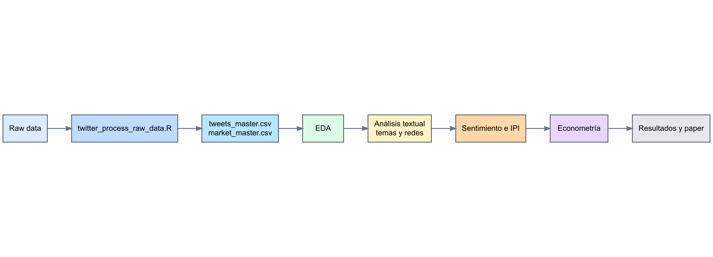

# Librerías y convenciones de nombres

Las dependencias se cargan antes de configurar o ejecutar el análisis. Cada comentario identifica su utilidad en el estudio; las preferencias fijan la implementación de los nombres compartidos. Una dependencia ausente detiene la ejecución e identifica el paquete requerido.

La nota de validación de la sección 11.2 y las etiquetas de protección del EDA registran la revisión anterior. En esta revisión de dependencias se autoriza reorganizar también el inicio, conservando sus cálculos y explicaciones. La preferencia explícita de `rescale` resuelve aquí el conflicto histórico entre `scales` y `syuzhet`, sin un alias externo de ejecución.

Datos, fechas y estructuras tabulares: este bloque carga las herramientas que utilizarán los pasos siguientes y declara las preferencias de nombres correspondientes.

```{r librerias-datos, echo=TRUE, message=FALSE, warning=TRUE, collapse=TRUE, class.source="fold-show"}
library(conflicted) # resolución explícita de nombres compartidos
library(readr) # lectura y exportación de datos
library(dplyr) # transformación y resumen de observaciones
library(tidyr) # organización de tablas y combinaciones
library(tibble) # construcción de tablas
library(vctrs) # compatibilidad de tipos y vectores
library(forcats) # orden de categorías
library(lubridate) # fechas y periodos
library(stringr) # limpieza y búsqueda de texto
library(here) # rutas reproducibles desde la raíz del proyecto

# Fijar explícitamente el paquete que resolverá este nombre compartido.
conflict_prefer("filter", "dplyr")
conflict_prefer("lag", "dplyr")
conflict_prefer("select", "dplyr")
conflict_prefer("summarise", "dplyr")
conflict_prefer("first", "dplyr")
conflict_prefer("last", "dplyr")
conflict_prefer("crossing", "tidyr")
```

Visualización y redes: este bloque carga las herramientas que utilizarán los pasos siguientes y declara las preferencias de nombres correspondientes.

```{r librerias-graficos, echo=TRUE, message=FALSE, warning=TRUE, collapse=TRUE, class.source="fold-show"}
library(ggplot2) # figuras del estudio
library(scales) # escalas y tamaños gráficos
library(ggwordcloud) # nubes de palabras
library(ggrepel) # etiquetas legibles
library(igraph) # métricas y comunidades de redes
library(tidygraph) # estructuras de redes para gráficos
library(ggraph) # visualización de redes
library(DiagrammeR) # definición del diagrama metodológico
library(DiagrammeRsvg) # exportación estática del diagrama
library(rsvg) # conversión del diagrama SVG a PNG
library(ragg) # dispositivo PNG estable durante el render en Windows
library(png) # lectura de dimensiones para la auditoría visual final
library(grid) # unidades y elementos gráficos
library(graphics) # gráficos estadísticos básicos
library(grDevices) # colores y dispositivos gráficos

# Fijar explícitamente el paquete que resolverá este nombre compartido.
conflict_prefer("rescale", "scales")
# Fijar explícitamente el paquete que resolverá este nombre compartido.
conflict_prefer("margin", "ggplot2")
# Fijar explícitamente el paquete que resolverá este nombre compartido.
conflict_prefer("as_data_frame", "igraph")
```

Análisis textual y sentimiento: este bloque carga las herramientas que utilizarán los pasos siguientes y declara las preferencias de nombres correspondientes.

```{r librerias-texto, echo=TRUE, message=FALSE, warning=TRUE, collapse=TRUE, class.source="fold-show"}
library(quanteda) # corpus y matrices documento-término
library(quanteda.textstats) # estadísticos textuales y colocaciones
library(quanteda.textmodels) # escalamiento Wordfish
library(quanteda.textplots) # figuras de análisis textual
library(syuzhet) # léxicos y sentimiento NRC
library(sentometrics) # agregación del sentimiento
library(stm) # modelos estructurales de tópicos
library(spacyr) # anotación lingüística en español
library(reticulate) # enlace con el entorno Python
library(Matrix) # operaciones con matrices dispersas

# Fijar explícitamente el paquete que resolverá este nombre compartido.
conflict_prefer("convert", "quanteda")
# Fijar explícitamente el paquete que resolverá este nombre compartido.
conflict_prefer("colSums", "Matrix")
# Fijar explícitamente el paquete que resolverá este nombre compartido.
conflict_prefer("rowSums", "Matrix")
# Fijar explícitamente el paquete que resolverá este nombre compartido.
conflict_prefer("t", "Matrix")
```

Econometría y presentación: este bloque carga las herramientas que utilizarán los pasos siguientes y declara las preferencias de nombres correspondientes.

```{r librerias-modelos, echo=TRUE, message=FALSE, warning=TRUE, collapse=TRUE, class.source="fold-show"}
library(stats) # estimación y estadística básica
library(tseries) # pruebas de estacionariedad
library(urca) # pruebas de raíces unitarias y cointegración
library(lmtest) # pruebas de Granger
library(vars) # estimación VAR
library(zoo) # series temporales y ventanas móviles
library(forecast) # auto.arima y selección temporal
library(rugarch) # modelos ARMA-GARCH univariados
library(rmgarch) # modelos DCC-GARCH multivariados
library(MSwM) # modelos de regímenes Markovianos (MS-AR)
library(FinTS) # pruebas diagnósticas ARCH-LM
library(ca) # análisis de correspondencias
library(methods) # clases y despacho de matrices
library(knitr) # ejecución y presentación de tablas
library(utils) # utilidades y declaraciones de variables

conflict_prefer("as.Date", "base")
conflict_prefer("plot", "graphics")
conflict_prefer("AIC", "stats")
conflict_prefer("BIC", "stats")
conflict_prefer("residuals", "stats")
conflict_prefer("coef", "stats")
conflict_prefer("first", "dplyr")
conflict_prefer("last", "dplyr")
conflict_prefer("reduce", "purrr")
conflict_prefer("boundary", "stringr")
```

Este bloque fija las opciones globales de ejecución de `knitr`. Define cómo se muestran mensajes, advertencias y figuras para que el render del cuaderno sea consistente y fácil de revisar.

```{r setup-opciones, include=FALSE}
if (.Platform$OS.type == "windows") {
  invisible(suppressWarnings(Sys.setlocale("LC_CTYPE", "Spanish_Colombia.UTF-8")))
}

# Configurar las opciones de ejecución o presentación del cuaderno.
opts_chunk$set(
  echo = TRUE,
  message = FALSE,
  warning = FALSE,
  collapse = TRUE,
  comment = "#>",
  fig.align = "center",
  fig.width = 10,
  fig.height = 5.5,
  fig.retina = 2,
  out.width = "100%"
)

# Usar un dispositivo reproducible para todas las figuras PNG exportadas.
ggsave_original <- ggsave
ggsave <- function(filename, ..., device = NULL) {
  if (is.null(device) && str_ends(str_to_lower(filename), ".png")) {
    device <- agg_png
  }
  ggsave_original(filename, ..., device = device)
}
```


El promedio móvil de actividad utiliza el filtro estadístico de R. Este alias conserva esa implementación y permite reservar `filter()` para seleccionar filas en las transformaciones de datos.

```{r configuracion-filtro-estadistico}
# Reservar el filtro estadístico, distinto de la selección de filas.
stats_filter <- stats::filter
```

Las variables empleadas en la evaluación de tablas se declaran para evitar falsos positivos del linter. Esta declaración auxiliar no transforma los datos ni modifica los modelos.

```{r declaraciones-variables, results='hide'}
# Variables declaradas para evitar falsos positivos del linter con tidy evaluation.
globalVariables(c(
  "author_id", "centralidad", "clasificacion", "clustering_local", "componente",
  "componente_principal_pct", "comunidades_louvain", "comunidad", "confidence",
  "corpus", "corpus_label", "cosine", "count", "date", "densidad", "dia",
  "dias_esperados", "dias_observados", "Dim1", "Dim2", "doc_id", "edge_alpha",
  "edge_color", "edge_size", "eigenvector", "emocion", "entity", "etiqueta",
  "feature", "fecha_max", "fecha_min", "from", "grado", "grado_medio",
  "grado_ponderado", "hashtag", "id", "intermediacion", "ipi", "label_clean",
  "label_plot", "lemma", "mean", "mention", "meses_coaparicion", "min_meses",
  "month", "n", "n_docs", "negative", "node_type", "nodo", "panel",
  "pagerank", "pct_dias", "peso_plot", "peso_total", "peso_visual", "polarity",
  "positive", "reform_theme", "red", "sentiment", "status", "termino",
  "termino_plot", "text", "text_clean", "tfidf", "theme", "tipo",
  "tipo_entidad", "tipo_nodo", "to", "top_edges", "top_features", "tweets",
  "tweets_from", "tweets_n", "tweets_to", "value", "var_dim1", "var_dim2",
  "weight", "x", "x_from", "x_to", "y", "y_from", "y_to"
))
```

La función `save_audit_table()` recibe una tabla, sus rutas y sus títulos. Escribe las versiones CSV y HTML con el formato común que utilizarán las secciones de resultados.

```{r exportacion-tablas-auditables}
# Exportación HTML/CSV reutilizable para tablas auditables
save_audit_table <- function(data, csv_path, html_path, title, subtitle) {
  dir.create(dirname(csv_path), recursive = TRUE, showWarnings = FALSE)
  dir.create(dirname(html_path), recursive = TRUE, showWarnings = FALSE)
  # Guardar la tabla en CSV conservando la representación indicada de los faltantes.
  tryCatch(
    write_csv(data, csv_path, na = ""),
    error = function(e) {
      if (file.exists(csv_path)) {
        unlink(csv_path, force = TRUE)
      }
      write_csv(data, csv_path, na = "")
    }
  )
  table_html <- paste0(
    "<!doctype html>\n<html lang=\"es\">\n<head>\n<meta charset=\"utf-8\">\n",
    "<title>", title, "</title>\n",
    "<style>body{font-family:-apple-system,BlinkMacSystemFont,'Segoe UI',sans-serif;margin:24px;color:#222}",
    "table{border-collapse:collapse;width:100%;font-size:13px}th,td{border:1px solid #ddd;padding:6px 8px;text-align:left;vertical-align:top}",
    "th{background:#f3f5f2}caption{text-align:left;font-weight:700;font-size:18px;margin-bottom:4px}",
    ".subtitle{color:#666;margin:0 0 14px 0}</style>\n</head>\n<body>\n",
    "<h1>", title, "</h1>",
    "<p class=\"subtitle\">", subtitle, "</p>",
    paste(as.character(kable(data, format = "html", escape = TRUE)), collapse = "\n"),
    "\n</body>\n</html>\n"
  )
  # Escribir el documento HTML ensamblado, conservando su codificación.
  tryCatch(
    writeLines(table_html, html_path, useBytes = TRUE),
    error = function(e) {
      if (file.exists(html_path)) {
        unlink(html_path, force = TRUE)
      }
      writeLines(table_html, html_path, useBytes = TRUE)
    }
  )
}
```

El catálogo de interpretación visual vincula de forma explícita cada gráfico con su objeto de origen, dimensión focal y pregunta analítica de partida. A continuación se registran los metadatos correspondientes a las figuras G01 hasta G24 (correspondencias, series de cobertura, colocaciones y análisis exploratorio inicial).

```{r registro-interpretaciones-g01-g24}
plot_registry_part1 <- tribble(
  ~identificador, ~archivo, ~objeto_fuente, ~foco, ~valor, ~grupo, ~fecha, ~pregunta,
  "G01", "ca_temas_quanteda.png", "ca_temas_plot_data", "ca temas quanteda", "Dim1", "corpus_label", "", "La figura ubica términos o temas en las dimensiones de correspondencias; la separación relativa es el patrón principal.",
  "G02", "cobertura_mercado_series.png", "market_coverage_interpreted", "cobertura mercado series", "coverage_ratio", "status", "month_date", "La figura muestra la cobertura observada y permite comparar estados o corpus a lo largo del calendario.",
  "G03", "cobertura_tweets_mensual.png", "tweet_audit", "cobertura tweets mensual", "coverage_ratio", "status", "month_date", "La figura muestra la cobertura observada y permite comparar estados o corpus a lo largo del calendario.",
  "G04", "collocations_reformas.png", "collocations", "collocations reformas", "lambda", "collocation", "", "La figura compara la fuerza lambda de las colocaciones de reformas.",
  "G05", "collocations_robustas.png", "colloc_robust_plot_data", "collocations robustas", "asociacion", "colocacion", "", "La figura compara la asociación de las colocaciones robustas.",
  "G06", "comparacion_corpus_cobertura.png", "tweet_audit_by_corpus", "comparacion corpus cobertura", "coverage_ratio", "status", "month_date", "La figura muestra la cobertura observada y permite comparar estados o corpus a lo largo del calendario.",
  "G07", "comparacion_corpus_sentimiento.png", "corpus_sentiment_long", "comparacion corpus sentimiento", "valor", "corpus_label", "date", "La figura compara la evolución temporal del tono, sentimiento o IPI y sus diferencias visibles entre series.",
  "G08", "comparacion_corpus_volumen.png", "corpus_volume_monthly", "comparacion corpus volumen", "tweets", "corpus_label", "date", "La figura compara el volumen de tweets entre corpus o periodos y permite localizar concentraciones de actividad.",
  "G09", "coocurrencias_ca_terminos.png", "ca_plot_data", "coocurrencias ca terminos", "Dim1", "corpus_label", "", "La figura ubica términos o temas en las dimensiones de correspondencias; la separación relativa es el patrón principal.",
  "G10", "coocurrencias_ppmi_dendrograma.png", "cooccurrence_dendrogram_terms", "coocurrencias ppmi dendrograma", "coseno", "cluster", "", "La figura organiza términos o temas por distancia de similitud; la altura indica separación relativa.",
  "G11", "coocurrencias_ppmi_fuerza.png", "ppmi_strength", "coocurrencias ppmi fuerza", "fuerza_ppmi", "red", "", "La figura compara el peso o fuerza de las relaciones discursivas.",
  "G12", "coocurrencias_ppmi_red.png", "cooccurrence_ppmi_edges_plot", "coocurrencias ppmi red", "weight", "red", "", "La figura muestra las aristas principales de la red y su peso de coaparición.",
  "G13", "dataset_modelo_disponibilidad.png", "model_dataset_ipi", "dataset modelo disponibilidad", "disponibilidad", "serie", "", "La figura cuantifica qué proporción de observaciones está disponible para cada serie financiera.",
  "G14", "dendrograma_temas_quanteda.png", "quanteda_dendrogram_data", "dendrograma temas quanteda", "coseno", "cluster", "", "La figura organiza términos o temas por distancia de similitud; la altura indica separación relativa.",
  "G15", "eda_cobertura_mensual.png", "tweet_audit_by_corpus", "eda cobertura mensual", "tweets", "corpus_label", "month", "La figura compara el volumen de tweets entre corpus o periodos y permite localizar concentraciones de actividad.",
  "G16", "eda_disponibilidad_mercado.png", "eda_market_availability", "eda disponibilidad mercado", "tweets", "corpus_label", "date", "La figura compara el volumen de tweets entre corpus o periodos y permite localizar concentraciones de actividad.",
  "G17", "eda_heatmap_intensidad_diaria.png", "eda_heatmap_data", "eda heatmap intensidad diaria", "tweets", "corpus_label", "date", "La figura compara el volumen de tweets entre corpus o periodos y permite localizar concentraciones de actividad.",
  "G18", "eda_longitud_textos.png", "tweets_text", "eda longitud textos", "tweets", "corpus_label", "date", "La figura compara el volumen de tweets entre corpus o periodos y permite localizar concentraciones de actividad.",
  "G19", "eda_petro_calendario_actividad.png", "petro_frequency_heatmap_data", "eda petro calendario actividad", "tweets", "corpus_label", "date", "La figura compara el volumen de tweets entre corpus o periodos y permite localizar concentraciones de actividad.",
  "G20", "eda_petro_tweets_diarios.png", "petro_daily_plot_data", "eda petro tweets diarios", "tweets", "corpus_label", "date", "La figura compara el volumen de tweets entre corpus o periodos y permite localizar concentraciones de actividad.",
  "G21", "eda_petro_tweets_mensuales.png", "petro_monthly_frequency", "eda petro tweets mensuales", "tweets", "corpus_label", "month", "La figura compara el volumen de tweets entre corpus o periodos y permite localizar concentraciones de actividad.",
  "G22", "eda_sentimiento_inicial.png", "eda_sentimiento", "eda sentimiento inicial", "tweets", "corpus_label", "date", "La figura compara el volumen de tweets entre corpus o periodos y permite localizar concentraciones de actividad.",
  "G23", "eda_temas_volumen.png", "tweets_text", "eda temas volumen", "tweets", "corpus_label", "date", "La figura compara el volumen de tweets entre corpus o periodos y permite localizar concentraciones de actividad.",
  "G24", "eda_tweets_diarios.png", "eda_daily_volume", "eda tweets diarios", "tweets", "corpus_label", "date", "La figura compara el volumen de tweets entre corpus o periodos y permite localizar concentraciones de actividad."
)
```

El segundo bloque del registro incorpora las especificaciones de las figuras G25 hasta G48, cubriendo volumen financiero, estacionariedad, estudios de eventos, frecuencias léxicas, causalidad de Granger, keyness y modelos de clasificación supervisada.

```{r registro-interpretaciones-g25-g48}
plot_registry_part2 <- tribble(
  ~identificador, ~archivo, ~objeto_fuente, ~foco, ~valor, ~grupo, ~fecha, ~pregunta,
  "G25", "eda_volumen_mercado.png", "eda_volume_market_data", "eda volumen mercado", "tweets", "corpus_label", "date", "La figura compara el volumen de tweets entre corpus o periodos y permite localizar concentraciones de actividad.",
  "G26", "estacionariedad_series.png", "stationarity_plot_data", "estacionariedad series", "p_value_plot", "variable", "", "La figura compara los p-values de las pruebas de estacionariedad por variable.",
  "G27", "estado_metodologico.png", "method_status", "estado metodologico", "bloques", "estado", "", "La figura compara el número de bloques metodológicos por estado de ejecución.",
  "G28", "event_study_ipi_trm_colcap.png", "event_study_plot_data", "event study ipi trm colcap", "movimiento_medio", "serie", "horizonte", "La figura compara movimientos medios posteriores a eventos extremos por horizonte y serie.",
  "G29", "event_study_respuestas_heatmap.png", "event_study_plot_data", "event study respuestas heatmap", "movimiento_medio", "serie", "horizonte", "La figura compara movimientos medios posteriores a eventos extremos por horizonte y serie.",
  "G30", "flujo_cuaderno_autocontenido.png", "flow_graph", "flujo cuaderno autocontenido", "", "", "", "La figura presenta el resultado específico de flujo cuaderno autocontenido, con la unidad y comparación declaradas en su título.",
  "G31", "frecuencia_terminos_corpus.png", "term_frequencies", "frecuencia terminos corpus", "frecuencia", "feature", "", "La figura ordena los términos por frecuencia en el corpus analizado.",
  "G32", "frecuencia_tweets_mensual.png", "theme_monthly", "frecuencia tweets mensual", "tweets", "corpus_label", "month", "La figura compara el volumen de tweets entre corpus o periodos y permite localizar concentraciones de actividad.",
  "G33", "granger_presidencial_emociones.png", "granger_emociones_plot_data", "granger presidencial emociones", "p_value", "response", "", "La figura compara p-values de Granger por rezago y respuesta; valores menores indican mayor evidencia nominal de precedencia.",
  "G34", "granger_trm_colcap.png", "granger_plot_data", "granger trm colcap", "p_value", "response", "", "La figura compara p-values de Granger por rezago y respuesta; valores menores indican mayor evidencia nominal de precedencia.",
  "G35", "hashtags_principales.png", "top_hashtags", "hashtags principales", "frecuencia", "hashtag", "", "La figura ordena los hashtags o menciones por frecuencia observada.",
  "G36", "inventario_fuentes_cuaderno.png", "raw_inventory", "inventario fuentes cuaderno", "filas", "tipo", "", "La figura contrasta el número de filas por fuente y tipo de corpus.",
  "G37", "ipi_por_tema.png", "ipi_theme", "ipi por tema", "ipi_medio_abs", "reform_theme", "", "La figura compara la intensidad IPI entre temas.",
  "G38", "ipi_serie_diaria.png", "ipi_daily", "ipi serie diaria", "ipi", "", "date", "La figura compara la evolución temporal del tono, sentimiento o IPI y sus diferencias visibles entre series.",
  "G39", "keyness_reformas.png", "keyness_reforms", "keyness reformas", "chi2", "theme", "", "La figura ordena los términos por asociación chi-cuadrado con los temas.",
  "G40", "limpieza_retencion_textos.png", "cleaning_retention", "limpieza retencion textos", "tweets", "etapa", "", "La figura muestra cuántos tweets permanecen en cada etapa de limpieza.",
  "G41", "menciones_principales.png", "top_mentions", "menciones principales", "frecuencia", "mention", "", "La figura ordena los hashtags o menciones por frecuencia observada.",
  "G42", "metadata_longitud_tweets.png", "tweets_text", "metadata longitud tweets", "palabras_recortadas", "corpus_label", "", "La figura compara la longitud textual observada por corpus.",
  "G43", "ml_confianza_temas.png", "tweets_text", "ml confianza temas", "ml_confidence", "reasignado", "", "La figura muestra la distribución de confianza asociada a las reasignaciones temáticas.",
  "G44", "ml_matriz_confusion_temas.png", "ml_confusion", "ml matriz confusion temas", "n", "prediccion", "", "La figura compara aciertos y errores por clase mediante los conteos de la matriz de confusión.",
  "G45", "ml_metricas_temas.png", "ml_metrics", "ml metricas temas", "valor", "metrica", "", "La figura compara las métricas de desempeño del clasificador temático.",
  "G46", "ml_reduccion_otros.png", "tweets_text", "ml reduccion otros", "participacion", "escenario", "", "La figura cuantifica la participación conservada y reasignada en la reducción de clases.",
  "G47", "pesos_redes_discursivas.png", "network_centrality_table", "pesos redes discursivas", "weight", "red", "", "La figura compara el peso o fuerza de las relaciones discursivas.",
  "G48", "polaridad_diaria.png", "daily_nrc", "polaridad diaria", "polaridad", "", "date", "La figura compara la evolución temporal del tono, sentimiento o IPI y sus diferencias visibles entre series."
)
```

El tercer bloque del catálogo registra las figuras G49 hasta G72, que comprenden el análisis de redes discursivas, centralidades, comunidades, polaridad léxica, índices de sentometrics, curvas de deuda soberana y representaciones de spaCy.

```{r registro-interpretaciones-g49-g72}
plot_registry_part3 <- tribble(
  ~identificador, ~archivo, ~objeto_fuente, ~foco, ~valor, ~grupo, ~fecha, ~pregunta,
  "G49", "red_centralidad_comparada.png", "red_centralidad_comparada", "red centralidad comparada", "grado_ponderado", "familia_red", "", "La figura compara la centralidad ponderada de los nodos y permite identificar los más conectados.",
  "G50", "red_coocurrencias_corpus.png", "cooc_edges", "red coocurrencias corpus", "weight", "red", "", "La figura muestra las aristas principales de la red y su peso de coaparición.",
  "G51", "red_hashtags_quanteda.png", "hashtag_edges_quanteda", "red hashtags quanteda", "frecuencia", "hashtag", "", "La figura ordena los hashtags o menciones por frecuencia observada.",
  "G52", "red_hashtags_quanteda_por_corpus.png", "social_quanteda_edges_by_corpus", "red hashtags quanteda por corpus", "tweets", "corpus_label", "date", "La figura compara el volumen de tweets entre corpus o periodos y permite localizar concentraciones de actividad.",
  "G53", "red_menciones.png", "mention_edges", "red menciones", "weight", "red", "", "La figura muestra las aristas principales de la red y su peso de coaparición.",
  "G54", "red_menciones_centralidad.png", "network_centrality_table", "red menciones centralidad", "grado_ponderado", "nodo", "", "La figura compara la centralidad ponderada de los nodos y permite identificar los más conectados.",
  "G55", "red_menciones_centralidad_por_corpus.png", "mention_corpus_centrality", "red menciones centralidad por corpus", "grado_ponderado", "nodo", "", "La figura compara la centralidad ponderada de los nodos y permite identificar los más conectados.",
  "G56", "red_menciones_por_corpus.png", "social_quanteda_edges_by_corpus", "red menciones por corpus", "weight", "red", "", "La figura muestra las aristas principales de la red y su peso de coaparición.",
  "G57", "red_menciones_quanteda.png", "mention_edges_quanteda", "red menciones quanteda", "weight", "red", "", "La figura muestra las aristas principales de la red y su peso de coaparición.",
  "G58", "red_menciones_quanteda_por_corpus.png", "social_quanteda_edges_by_corpus", "red menciones quanteda por corpus", "tweets", "corpus_label", "date", "La figura compara el volumen de tweets entre corpus o periodos y permite localizar concentraciones de actividad.",
  "G59", "red_temas_coaparicion.png", "theme_coappearance_edges", "red temas coaparicion", "weight", "red", "", "La figura muestra las aristas principales de la red y su peso de coaparición.",
  "G60", "red_temas_entidades.png", "theme_entity_edges", "red temas entidades", "weight", "red", "", "La figura muestra las aristas principales de la red y su peso de coaparición.",
  "G61", "sentimiento_emociones_diarias.png", "emotion_long", "sentimiento emociones diarias", "conteo", "", "date", "La figura compara la evolución temporal del tono, sentimiento o IPI y sus diferencias visibles entre series.",
  "G62", "sentometrics_componentes_lexicon.png", "sentometrics_theme", "sentometrics componentes lexicon", "mean", "lexicon", "", "La figura compara los componentes medios de los léxicos de sentimiento.",
  "G63", "sentometrics_corpus_resumen.png", "sentometrics_corpus", "sentometrics corpus resumen", "mean", "corpus_label", "", "La figura compara el resumen de sentimiento entre corpus.",
  "G64", "sentometrics_ipi_temas.png", "sentometrics_ipi_theme", "sentometrics ipi temas", "ipi_medio_abs", "reform_theme", "", "La figura compara la intensidad IPI entre temas.",
  "G65", "sentometrics_paz_total_vs_resto_resumen.png", "sentometrics_paz", "sentometrics paz total vs resto resumen", "mean_difference_paz_vs_resto", "lexicon", "", "La figura compara la diferencia media de sentimiento entre Paz Total y el resto.",
  "G66", "sentometrics_peak_dates.png", "sentometrics_peakdates", "sentometrics peak dates", "ranking", "feature", "date", "La figura ordena las fechas de mayor intensidad o sentimiento extremo.",
  "G67", "sentometrics_series_corpus.png", "sento_series_plot_data", "sentometrics series corpus", "value_ma7", "feature", "date", "La figura muestra las series suavizadas de sentimiento en el tiempo.",
  "G68", "serie_sentimientos_trm_colcap.png", "model_dataset_ipi", "serie sentimientos trm colcap", "valor", "", "date", "La figura compara la evolución temporal del tono, sentimiento o IPI y sus diferencias visibles entre series.",
  "G69", "similitud_temas_heatmap.png", "similitud_temas_plot_data", "similitud temas heatmap", "coseno", "doc_a_plot", "", "La figura compara la similitud coseno entre los documentos o temas representados.",
  "G70", "spacyr_entidades_tipo.png", "spacy_entities", "spacyr entidades tipo", "frecuencia", "entity_type", "", "La figura compara la frecuencia de tipos de entidad reconocidos por spaCy.",
  "G71", "spacyr_lemas_paz_total.png", "spacy_lemmas", "spacyr lemas paz total", "frecuencia", "lemma", "", "La figura ordena los lemas más frecuentes en el corpus Paz Total.",
  "G72", "spacyr_red_entidades.png", "spacy_edges", "spacyr red entidades", "weight", "red", "", "La figura muestra las aristas principales de la red y su peso de coaparición."
)
```

El cuarto bloque finaliza el catálogo con las figuras G73 hasta G93, abarcando modelos STM, curvas cero cupón TES, TF-IDF, nubes de palabras, escalamiento Wordfish, wordstreams continuos y redes bipartitas tema-hashtag.

```{r registro-interpretaciones-g73-g93}
plot_registry_part4 <- tribble(
  ~identificador, ~archivo, ~objeto_fuente, ~foco, ~valor, ~grupo, ~fecha, ~pregunta,
  "G73", "stm_diagnostico.png", "stm_diagnostics", "stm diagnostico", "semantic_coherence", "topic", "", "La figura contrasta coherencia semántica y exclusividad de los tópicos.",
  "G74", "stm_searchk_diagnostico.png", "stm_searchk_results", "stm searchk diagnostico", "score", "K", "", "La figura compara el criterio de selección de K en la búsqueda STM.",
  "G75", "stm_topicos_reformas.png", "stm_topics", "stm topicos reformas", "prevalence", "topic_label", "", "La figura compara la prevalencia estimada de los tópicos STM.",
  "G76", "temas_reforma_resumen.png", "theme_summary", "temas reforma resumen", "tweets", "corpus_label", "date", "La figura compara el volumen de tweets entre corpus o periodos y permite localizar concentraciones de actividad.",
  "G77", "tes_curva_cero_cupon.png", "tes_curve_data", "tes curva cero cupon", "rate", "tenor", "date", "La figura compara las tasas TES por plazo y fecha.",
  "G78", "tes_pendiente_10y_1y.png", "model_dataset", "tes pendiente 10y 1y", "tes_slope_10y_1y", "", "date", "La figura muestra la pendiente TES a 10 años menos 1 año en el tiempo.",
  "G79", "tfidf_temas.png", "tfidf_theme_terms", "tfidf temas", "tfidf", "reform_theme", "", "La figura compara los términos con mayor TF-IDF por tema.",
  "G80", "tributaria_frecuencia_mensual.png", "tributaria_monthly", "tributaria frecuencia mensual", "tweets", "corpus_label", "month", "La figura compara el volumen de tweets entre corpus o periodos y permite localizar concentraciones de actividad.",
  "G81", "tributaria_terminos_frecuentes.png", "tributaria_terms", "tributaria terminos frecuentes", "frecuencia", "token", "", "La figura ordena los términos por frecuencia en el corpus analizado.",
  "G82", "viabilidad_propuesta.png", "viabilidad_propuesta", "viabilidad propuesta", "", "estado", "", "La figura resume cuántos componentes de la propuesta se encuentran en cada estado de viabilidad.",
  "G83", "wordcloud_corpus_general.png", "wordcloud_corpus_plot_data", "wordcloud corpus general", "peso_plot", "termino", "", "La figura identifica los términos con mayor peso visual dentro del corpus o dimensión declarada.",
  "G84", "wordcloud_redes_comunidades.png", "network_community_words", "wordcloud redes comunidades", "peso_plot", "termino", "", "La figura identifica los términos con mayor peso visual dentro del corpus o dimensión declarada.",
  "G85", "wordcloud_sentimientos_nrc.png", "sentiment_wordcloud_plot_data", "wordcloud sentimientos nrc", "valor", "", "date", "La figura compara la evolución temporal del tono, sentimiento o IPI y sus diferencias visibles entre series.",
  "G86", "wordcloud_temas_tfidf.png", "theme_wordcloud_plot_data", "wordcloud temas tfidf", "peso_plot", "termino", "", "La figura identifica los términos con mayor peso visual dentro del corpus o dimensión declarada.",
  "G87", "wordcloud_temporal_periodos.png", "wordcloud_temporal_plot_data", "wordcloud temporal periodos", "peso_plot", "termino", "", "La figura identifica los términos con mayor peso visual dentro del corpus o dimensión declarada.",
  "G88", "wordcloud_topicos_stm.png", "topic_wordcloud_plot_data", "wordcloud topicos stm", "peso_plot", "termino", "", "La figura identifica los términos con mayor peso visual dentro del corpus o dimensión declarada.",
  "G89", "wordfish_reformas.png", "wordfish_table", "wordfish reformas", "estimate", "feature", "", "La figura muestra la posición léxica y los términos extremos del escalamiento Wordfish.",
  "G90", "wordfish_terminos_extremos.png", "wordfish_terms_plot_data", "wordfish terminos extremos", "beta", "extremo", "", "La figura muestra la posición léxica y los términos extremos del escalamiento Wordfish.",
  "G91", "wordstream_continuo_corpus.png", "wordstream_continuo_data", "wordstream continuo corpus", "peso_plot", "termino", "", "La figura muestra la continuidad temporal de los términos ponderados.",
  "G92", "wordstream_tfidf_temporal.png", "word_tfidf_time_plot_data", "wordstream tfidf temporal", "tfidf", "termino", "month", "La figura muestra qué términos concentran el TF-IDF en cada periodo.",
  "G93", "red_temas_hashtags_por_corpus.png", "theme_hashtag_edges_by_corpus", "red temas hashtags por corpus", "weight", "corpus_label", "", "La figura compara las asociaciones observadas entre temas y hashtags en cada corpus; el peso de cada arista corresponde al número de tweets distintos que respaldan la combinación."
)
plot_interpretation_registry <- bind_rows(plot_registry_part1, plot_registry_part2, plot_registry_part3, plot_registry_part4)
```

Para cada figura se definen formalmente las dimensiones de lectura secundaria y el tipo de regla analítica (posicional, jerárquica, ranking, red o temporal). Esta parametrización previene inferencias automatizadas a partir del nombre del archivo o heurísticas no auditadas.

```{r registro-especificaciones-metricas}
plot_metric_specs <- tribble(
  ~identificador, ~tipo_metrica, ~valor2, ~transformacion,
  "G01", "posicion", "Dim2", "directa", "G02", "disponibilidad", "", "directa", "G03", "temporal", "", "directa",
  "G04", "ranking", "", "directa", "G05", "ranking", "", "directa", "G06", "temporal", "", "directa",
  "G07", "temporal", "", "directa", "G08", "temporal", "", "directa", "G09", "posicion", "Dim2", "directa",
  "G10", "orden", "", "directa", "G11", "ranking", "", "directa", "G12", "red", "", "directa",
  "G13", "disponibilidad", "", "availability_model", "G14", "orden", "", "directa", "G15", "temporal", "", "directa",
  "G16", "disponibilidad", "", "directa", "G17", "heatmap", "", "directa", "G18", "distribucion", "", "directa",
  "G19", "heatmap", "", "directa", "G20", "temporal", "", "directa", "G21", "temporal", "", "directa",
  "G22", "temporal", "", "directa", "G23", "ranking", "", "theme_volume", "G24", "temporal", "", "directa",
  "G25", "temporal", "", "directa", "G26", "pvalue", "", "directa", "G27", "categorica", "", "directa",
  "G28", "evento", "", "directa", "G29", "evento", "", "directa", "G30", "proceso", "", "directa",
  "G31", "ranking", "", "directa", "G32", "temporal", "", "directa", "G33", "pvalue", "", "directa",
  "G34", "pvalue", "", "directa", "G35", "ranking", "", "directa", "G36", "ranking", "", "directa",
  "G37", "ranking", "", "directa", "G38", "temporal", "", "directa", "G39", "ranking", "", "directa",
  "G40", "categorica", "", "directa", "G41", "ranking", "", "directa", "G42", "distribucion", "", "directa",
  "G43", "distribucion", "", "directa", "G44", "confusion", "", "directa", "G45", "ranking", "", "directa",
  "G46", "reduccion", "", "other_share", "G47", "red", "", "edge_weights", "G48", "temporal", "", "directa",
  "G49", "red", "", "directa", "G50", "red", "", "directa", "G51", "red", "", "directa",
  "G52", "red", "", "directa", "G53", "red", "", "directa", "G54", "red", "", "directa",
  "G55", "red", "", "directa", "G56", "red", "", "directa", "G57", "red", "", "directa",
  "G58", "red", "", "directa", "G59", "red", "", "directa", "G60", "red", "", "directa",
  "G61", "temporal", "", "directa", "G62", "ranking", "", "directa", "G63", "ranking", "", "directa",
  "G64", "ranking", "", "directa", "G65", "ranking", "", "directa", "G66", "temporal", "", "directa",
  "G67", "serie", "", "directa", "G68", "serie", "", "series_normalizadas", "G69", "heatmap", "doc_b_plot", "directa",
  "G70", "ranking", "", "directa", "G71", "ranking", "", "directa", "G72", "red", "", "directa",
  "G73", "diagnostico", "exclusivity", "directa", "G74", "ranking", "", "directa", "G75", "ranking", "", "directa",
  "G76", "ranking", "", "directa", "G77", "temporal", "", "directa", "G78", "temporal", "", "directa",
  "G79", "terminos", "", "directa", "G80", "temporal", "", "directa", "G81", "terminos", "", "directa",
  "G82", "categorica", "", "directa", "G83", "terminos", "", "directa", "G84", "terminos", "", "directa",
  "G85", "terminos", "", "directa", "G86", "terminos", "", "directa", "G87", "terminos", "", "directa",
  "G88", "terminos", "", "directa", "G89", "modelo", "", "directa", "G90", "terminos", "", "directa",
  "G91", "terminos", "", "directa", "G92", "terminos", "", "directa",
  "G93", "red", "", "tweets_distintos"
)
```

El ensamblado final combina las descripciones y especificaciones de métricas, aplicando las transformaciones de objetos requeridas para los 93 productos gráficos y validando la completitud de la tabla de metadatos.

```{r registro-interpretaciones-ensamblado}
plot_interpretation_registry <- plot_interpretation_registry |>
  left_join(plot_metric_specs, by = "identificador") |>
  mutate(
    objeto_fuente = recode(identificador,
      G08 = "model_dataset_by_corpus", G14 = "cooccurrence_dendrogram_terms", G15 = "tweet_audit_by_corpus", G16 = "eda_market_availability",
      G17 = "eda_heatmap_data", G18 = "tweets_text", G19 = "petro_frequency_heatmap_data", G22 = "eda_sentimiento", G23 = "tweets_text",
      G27 = "method_status", G31 = "term_frequencies", G32 = "theme_monthly", G47 = "mention_edges", G51 = "hashtag_edges_quanteda",
      G52 = "social_quanteda_edges_by_corpus", G55 = "mention_corpus_centrality", G56 = "mention_corpus_edges_plot",
      G58 = "social_quanteda_edges_by_corpus", G68 = "model_dataset_ipi", G72 = "spacy_entity_edges", G74 = "stm_search_plot_data",
      G76 = "theme_summary", G79 = "tfidf_theme_terms", G84 = "network_community_wordcloud_data", G85 = "sentiment_wordcloud_plot_data",
      G89 = "wordfish_table", G91 = "wordstream_continuo_data", .default = objeto_fuente
    ),
    valor = recode(identificador,
      G08 = "tweets", G10 = "orden", G14 = "orden", G15 = "rows", G16 = "disponible", G18 = "palabras", G19 = "tweets", G20 = "tweets",
      G21 = "tweets", G22 = "sentimiento_promedio", G23 = "tweets", G25 = "valor_normalizado", G31 = "frequency", G36 = "archivos",
      G37 = "ipi_medio_abs", G42 = "palabras_recortadas", G47 = "weight", G51 = "weight", G52 = "weight", G56 = "weight",
      G58 = "weight", G68 = "valor_normalizado", G72 = "weight", G74 = "score", G85 = "peso_plot", G82 = "componentes",
      G84 = "peso_plot", G89 = "theta", G91 = "tfidf", .default = valor
    ),
    grupo = recode(identificador,
      G08 = "serie", G10 = "cluster", G14 = "cluster", G15 = "status", G16 = "serie", G17 = "dia_semana", G18 = "reform_theme",
      G19 = "dia_semana", G20 = "corpus_label", G21 = "corpus_label", G22 = "", G23 = "reform_theme", G25 = "serie",
      G31 = "feature", G32 = "reform_theme", G47 = "red", G51 = "", G52 = "corpus_label", G56 = "corpus_label",
      G58 = "corpus_label", G68 = "serie", G72 = "", G74 = "K", G76 = "reform_theme", G82 = "estado",
      G84 = "termino_plot", G85 = "termino", G89 = "reform_theme", G91 = "termino", .default = grupo
    ),
    fecha = recode(identificador,
      G08 = "month", G15 = "month_date", G17 = "semana", G19 = "semana", G20 = "date", G21 = "month",
      G22 = "date", G25 = "date", G32 = "month", G38 = "date", G48 = "date", G61 = "date",
      G67 = "date", G68 = "date", G77 = "date", G78 = "date", G80 = "month", G92 = "month", .default = fecha
    ),
    transformacion = recode(identificador,
      G08 = "corpus_volume", G14 = "hclust_order", G27 = "status_counts", G37 = "ipi_theme_summary",
      G66 = "peakdates_plot", G82 = "viability_counts", .default = transformacion
    ),
    subconjunto = recode(identificador, G52 = "Hashtag", G58 = "Mención", G93 = "Hashtag por tema", .default = "")
  ) |>
  arrange(match(identificador, sprintf("G%02d", 1:93)))
stopifnot(nrow(plot_interpretation_registry) == 93L, all(!is.na(plot_interpretation_registry$tipo_metrica)))
```

Las funciones de formateo estandarizan la presentación numérica y textual de los valores reportados en cada interpretación, garantizando un tratamiento consistente de escalas porcentuales y valores ausentes.

```{r funciones-formato-interpretacion}
fmt_interpretation_value <- function(x, metric = "") {
  x <- suppressWarnings(as.numeric(x))
  if (!length(x) || !is.finite(x[1])) return("no disponible")
  x <- x[1]
  if (metric %in% c("coverage_ratio", "disponibilidad", "participacion", "prevalence")) {
    return(scales::percent(x, accuracy = 0.1, decimal.mark = ","))
  }
  format(round(x, 3), big.mark = ".", decimal.mark = ",", trim = TRUE)
}

as_interpretation_label <- function(x) {
  if (length(x) == 0 || is.na(x[1]) || !nzchar(as.character(x[1]))) "sin etiqueta" else as.character(x[1])
}
```

La extracción de datos para interpretación consulta de manera determinista los objetos generados en memoria y sus transformaciones analíticas básicas, sin recurrir a llamadas directas prohibidas.

```{r extraccion-datos-interpretacion-01}
# Extractor seguro de data frames u objetos ggplot
plot_get_df <- function(nombre) {
  objeto <- tryCatch(get(nombre, inherits = TRUE), error = function(e) NULL)
  if (is.null(objeto)) return(tibble())
  if (is.data.frame(objeto)) return(objeto)
  if (inherits(objeto, "ggplot") && is.data.frame(objeto$data)) return(objeto$data)
  tibble()
}

plot_transform_primary <- function(registro) {
  tr <- registro$transformacion
  if (identical(tr, "availability_model")) {
    obj <- plot_get_df("model_dataset_ipi")
    if (!nrow(obj)) return(tibble())
    return(obj |> summarise(
      tweets = mean(!is.na(tweets_n) & tweets_n > 0), ipi = mean(!is.na(ipi)),
      trm = mean(!is.na(trm)), colcap = mean(!is.na(colcap)), tes_10y = mean(!is.na(tes_10y)),
      tes_slope_10y_1y = mean(!is.na(tes_slope_10y_1y)), energy_spot_price = mean(!is.na(energy_spot_price))
    ) |> pivot_longer(everything(), names_to = "serie", values_to = "disponibilidad"))
  }
  if (identical(tr, "corpus_volume")) {
    return(plot_get_df("model_dataset_by_corpus") |>
      mutate(month = floor_date(as.Date(date), "month"), tweets_n = suppressWarnings(as.numeric(as.character(tweets_n)))) |>
      group_by(corpus, corpus_label, month) |> summarise(tweets = sum(tweets_n, na.rm = TRUE), .groups = "drop") |>
      mutate(serie = if_else(corpus == "presidente", "Tweets de Petro", "Opinión pública")))
  }
  if (identical(tr, "hclust_order")) {
    hc <- tryCatch(get("hc_theme_quanteda", inherits = TRUE), error = function(e) NULL)
    if (is.null(hc) || !inherits(hc, "hclust")) return(tibble())
    orden <- hc$labels[hc$order]
    return(tibble(termino = orden, orden = seq_along(orden), cluster = as.integer(cutree(hc, k = min(5, length(hc$labels)))[orden])))
  }
  if (identical(tr, "ipi_theme_summary")) {
    return(plot_get_df("ipi_theme") |> filter(reform_theme %in% sento_theme_features) |>
      group_by(reform_theme) |> summarise(ipi_medio_abs = mean(abs(ipi), na.rm = TRUE), dias = n(), .groups = "drop"))
  }
  NULL
}
```

Las transformaciones secundarias procesan conteos de viabilidad, fechas pico, participaciones en clasificación supervisada, pesos en grafos combinados y normalización de series multivariadas.

```{r extraccion-datos-interpretacion-02}
plot_transform_secondary <- function(registro) {
  tr <- registro$transformacion
  if (identical(tr, "viability_counts")) return(plot_get_df("viabilidad_propuesta") |> count(estado, name = "componentes"))
  if (identical(tr, "status_counts")) return(plot_get_df("method_status") |> count(estado, name = "bloques"))
  if (identical(tr, "peakdates_plot")) {
    picos <- plot_get_df("sentometrics_peakdates")
    if (!"date" %in% names(picos)) return(tibble())
    return(picos |> mutate(date = as.Date(date), ranking = row_number()) |> filter(!is.na(date)))
  }
  if (identical(tr, "theme_volume")) {
    return(plot_get_df("tweets_text") |> filter(!is.na(reform_theme), reform_theme != "otros") |> count(reform_theme, name = "tweets"))
  }
  if (identical(tr, "other_share")) {
    return(plot_get_df("tweets_text") |> transmute(`Reglas iniciales` = reform_theme_rule, `Clasificación final` = reform_theme_final) |>
      pivot_longer(everything(), names_to = "escenario", values_to = "tema") |> count(escenario, tema, name = "tweets") |>
      group_by(escenario) |> mutate(participacion = tweets / sum(tweets)) |> ungroup() |> filter(tema == "otros"))
  }
  if (identical(tr, "edge_weights")) {
    return(bind_rows(plot_get_df("mention_edges") |> mutate(red = "Menciones"), plot_get_df("cooc_edges") |> mutate(red = "Co-ocurrencias")) |> filter(!is.na(weight)))
  }
  if (identical(tr, "series_normalizadas")) {
    return(plot_get_df("model_dataset_ipi") |> select(date, polaridad, ipi, trm, colcap, tes_10y, tes_slope_10y_1y, energy_spot_price) |>
      pivot_longer(-date, names_to = "serie", values_to = "valor") |> group_by(serie) |>
      mutate(valor = suppressWarnings(as.numeric(valor)), valor_min = min(valor, na.rm = TRUE), valor_max = max(valor, na.rm = TRUE),
             valor_normalizado = if_else(!is.finite(valor_min) | !is.finite(valor_max) | valor_min == valor_max, NA_real_, (valor - valor_min) / (valor_max - valor_min))) |>
      ungroup() |> select(date, serie, valor_normalizado))
  }
  NULL
}

plot_source_data <- function(registro) {
  res <- plot_transform_primary(registro)
  if (!is.null(res)) return(res)
  res <- plot_transform_secondary(registro)
  if (!is.null(res)) return(res)
  datos <- plot_get_df(registro$objeto_fuente)
  if (nzchar(registro$subconjunto) && "tipo" %in% names(datos)) datos <- datos |> filter(tipo == registro$subconjunto)
  datos
}
```

Las reglas de interpretación para mapas factoriales, órdenes jerárquicos, redes y matrices de disponibilidad traducen las coordenadas numéricas en afirmaciones descriptivas estrictamente no causales.

```{r reglas-interpretacion-estructura}
evaluar_interpretacion_estructura <- function(tipo, datos, registro, valor, v) {
  if (tipo == "proceso") {
    return("El diagrama documenta explícitamente la secuencia raw → procesamiento → análisis → salidas del cuaderno; su función es hacer trazable el flujo de producción, no medir una magnitud estadística. La representación es metodológica y no establece causalidad.")
  }
  if (tipo == "posicion") {
    ok <- nzchar(valor) && valor %in% names(datos) && registro$valor2 %in% names(datos) && length(v) == nrow(datos)
    if (!ok) return(paste0("La figura ubica los elementos de ", registro$foco, " con las dimensiones declaradas ", valor, " y ", registro$valor2, "; no hay coordenadas completas suficientes para identificar una separación interpretable."))
    y <- suppressWarnings(as.numeric(datos[[registro$valor2]])); z <- which.max(abs(v) + abs(y))
    etiqueta <- if ("termino" %in% names(datos)) datos$termino[z] else if ("reform_theme" %in% names(datos)) datos$reform_theme[z] else z
    return(paste0("La separación más extrema del mapa corresponde a ", as_interpretation_label(etiqueta), " (", valor, " = ", fmt_interpretation_value(v[z], valor), "; ", registro$valor2, " = ", fmt_interpretation_value(y[z], registro$valor2), "). La figura describe proximidades relativas de vocabulario, no una distancia sustantiva ni una relación causal."))
  }
  if (tipo == "orden") {
    if (!nzchar(valor) || !valor %in% names(datos) || !nrow(datos)) return(paste0("El orden jerárquico de ", registro$foco, " no contiene posiciones finitas en el objeto fuente."))
    ix <- which.min(v); etiqueta <- if ("termino" %in% names(datos)) datos$termino[ix] else if ("doc" %in% names(datos)) datos$doc[ix] else ix
    cluster_txt <- if (registro$grupo %in% names(datos)) paste0(" del cluster ", as_interpretation_label(datos[[registro$grupo]][ix])) else ""
    return(paste0("El primer elemento del orden jerárquico es ", as_interpretation_label(etiqueta), " (posición ", fmt_interpretation_value(v[ix], valor), cluster_txt, "); la figura describe proximidad relativa bajo la distancia declarada y no una clasificación causal."))
  }
  if (tipo == "red") {
    if (all(c("from", "to", valor) %in% names(datos))) { ix <- which.max(suppressWarnings(as.numeric(datos[[valor]]))); return(paste0("La red contiene ", nrow(datos), " aristas observadas; la conexión de mayor peso une ", as_interpretation_label(datos$from[ix]), " con ", as_interpretation_label(datos$to[ix]), " (", valor, " = ", fmt_interpretation_value(datos[[valor]][ix], valor), "). La unidad es la arista definida por el procedimiento y la red no prueba influencia causal.")) }
    if (all(c("x_from", "x_to", valor) %in% names(datos))) { ix <- which.max(suppressWarnings(as.numeric(datos[[valor]]))); panel <- if ("corpus_label" %in% names(datos)) datos$corpus_label[ix] else "el panel"; return(paste0("La red muestra ", nrow(datos), " segmentos de co-mención; el peso máximo es ", fmt_interpretation_value(datos[[valor]][ix], valor), " en ", as_interpretation_label(panel), ". Las coordenadas representan la disposición del panel y no permiten inferir causalidad.")) }
    if (all(c("nodo", valor) %in% names(datos))) { ix <- which.max(suppressWarnings(as.numeric(datos[[valor]]))); return(paste0("La figura compara ", nrow(datos), " nodos; ", as_interpretation_label(datos$nodo[ix]), " presenta la mayor centralidad o peso (", valor, " = ", fmt_interpretation_value(datos[[valor]][ix], valor), "). Esto identifica concentración estructural, no capacidad causal.")) }
    return(paste0("La red se construye desde ", registro$objeto_fuente, ", pero sus aristas o nodos no están disponibles con la métrica declarada ", valor, "; no se infiere una estructura alternativa."))
  }
  if (tipo == "disponibilidad") {
    if (!nzchar(valor) || !valor %in% names(datos)) return("La figura resume disponibilidad, pero la columna disponibilidad declarada no está presente en la salida fuente; no se interpreta como ausencia de datos.")
    ix <- which.max(v); campos <- c("series", "corpus_label", registro$grupo); campos <- campos[!is.na(campos) & nzchar(campos) & campos %in% names(datos)]; etiqueta <- if (length(campos)) datos[[campos[1]]][ix] else ix
    return(paste0("La mayor disponibilidad corresponde a ", as_interpretation_label(etiqueta), " con ", fmt_interpretation_value(v[ix], valor), ". La figura informa soporte observable para el análisis de esa serie, no calidad ni causalidad de los datos."))
  }
  NULL
}
```

Las reglas de interpretación para series temporales, mapas de calor, distribuciones, categorías y p-values cuantifican los contrastes empíricos preservando una calibración inferencial prudente.

```{r reglas-interpretacion-series-distribucion}
evaluar_interpretacion_series_dist <- function(tipo, datos, registro, valor, v, datos_validos) {
  grupo <- registro$grupo; fecha <- registro$fecha; tiene_valor <- nzchar(valor) && valor %in% names(datos)
  if (tipo %in% c("temporal", "serie")) {
    if (!tiene_valor || !nrow(datos_validos)) return(paste0("La serie temporal declara ", valor, " como métrica, pero no contiene valores finitos suficientes para identificar máximos, mínimos o tendencia."))
    if (identical(registro$identificador, "G66")) {
      ix <- which.min(v); fecha_pico <- if ("date" %in% names(datos)) as.character(datos$date[ix]) else "la fecha no disponible"
      return(paste0("La fecha que ocupa el primer lugar entre los picos de sentimiento es ", fecha_pico, " (ranking = ", fmt_interpretation_value(v[ix], valor), "). La figura ordena extremos descriptivos de sentometrics; no demuestra que un evento cause el sentimiento observado."))
    }
    ix <- which.max(v); campos <- c("series", "corpus_label", grupo); campos <- campos[!is.na(campos) & nzchar(campos) & campos %in% names(datos)]
    etiqueta <- if (length(campos) >= 2) paste(as_interpretation_label(datos[[campos[1]]][ix]), as_interpretation_label(datos[[campos[2]]][ix]), sep = " / ") else if (length(campos)) as_interpretation_label(datos[[campos[1]]][ix]) else "la serie"
    fecha_txt <- if (nzchar(fecha) && fecha %in% names(datos)) as.character(datos[[fecha]][ix]) else "la observación extrema"
    return(paste0("El máximo observado de ", valor, " corresponde a ", as_interpretation_label(etiqueta), " en ", fecha_txt, ", con ", fmt_interpretation_value(v[ix], valor), ". La lectura es temporal y descriptiva; la figura no establece que el evento produzca el movimiento observado."))
  }
  if (tipo == "heatmap") {
    if (!tiene_valor || !nrow(datos_validos)) return("El mapa de calor no contiene valores finitos en la métrica declarada; por tanto no permite identificar una celda dominante ni evidencia interpretable.")
    ix <- which.max(v); etiquetas <- c(if (fecha %in% names(datos)) as.character(datos[[fecha]][ix]) else NULL, if (grupo %in% names(datos)) as.character(datos[[grupo]][ix]) else NULL)
    return(paste0("La celda de mayor intensidad combina ", paste(etiquetas, collapse = " / "), " y alcanza ", valor, " = ", fmt_interpretation_value(v[ix], valor), ". El patrón señala concentración descriptiva en esa unidad temporal/categórica y no una relación causal."))
  }
  if (tipo == "distribucion") {
    if (!tiene_valor || !nrow(datos_validos)) return(paste0("La distribución de ", valor, " no tiene observaciones finitas suficientes para resumir su forma."))
    med <- median(v, na.rm = TRUE); etiqueta <- if (grupo %in% names(datos)) as.character(datos[[grupo]][which.max(v)]) else "la muestra"
    return(paste0("La distribución de ", valor, " tiene mediana ", fmt_interpretation_value(med, valor), " y rango de ", fmt_interpretation_value(min(v), valor), " a ", fmt_interpretation_value(max(v), valor), "; el extremo superior se observa en ", as_interpretation_label(etiqueta), ". El resultado describe heterogeneidad, no un efecto causal."))
  }
  if (tipo == "categorica") {
    if (!tiene_valor || !nrow(datos_validos)) return(paste0("La tabla categórica ", registro$objeto_fuente, " no contiene la métrica ", valor, " en esta ejecución; no se fuerza una conclusión."))
    ix <- which.max(v); etiqueta <- if (grupo %in% names(datos)) datos[[grupo]][ix] else ix
    return(paste0("La categoría dominante es ", as_interpretation_label(etiqueta), " con ", valor, " = ", fmt_interpretation_value(v[ix], valor), ". La figura resume composición observada dentro del objeto fuente y no implica que una categoría cause otra."))
  }
  if (tipo == "pvalue") {
    if (!tiene_valor || !nrow(datos_validos)) return(paste0("No hay p-values finitos en ", registro$objeto_fuente, " para evaluar el diagnóstico declarado."))
    ix <- which.min(v); etiqueta <- if (grupo %in% names(datos)) datos[[grupo]][ix] else ix; n_sig <- sum(v < 0.05, na.rm = TRUE)
    return(paste0("El menor p-value es ", fmt_interpretation_value(v[ix], valor), " para ", as_interpretation_label(etiqueta), "; ", n_sig, " de ", length(v), " contrastes están por debajo de 0,05. Esto describe evidencia nominal de asociación o precedencia predictiva, no causalidad."))
  }
  NULL
}
```

Las reglas restantes procesan rankings de términos, estudios de eventos, matrices de confusión y diagnósticos temáticos, centralizando la función despachadora `interpretar_figura_registrada_contenido()`.

```{r reglas-interpretacion-modelos-ensamblado}
interpretar_figura_registrada_contenido <- function(registro) {
  datos <- plot_source_data(registro); tipo <- registro$tipo_metrica; valor <- registro$valor; grupo <- registro$grupo; fecha <- registro$fecha
  if (tipo == "proceso") return("El diagrama documenta explícitamente la secuencia raw → procesamiento → análisis → salidas del cuaderno; su función es hacer trazable el flujo de producción, no medir una magnitud estadística. La representación es metodológica y no establece causalidad.")
  if (!nrow(datos)) return(paste0("La figura ", registro$foco, " depende explícitamente de ", registro$objeto_fuente, " y de la métrica ", ifelse(nzchar(valor), valor, "la estructura gráfica"), "; ese objeto no contiene observaciones interpretables en esta ejecución. Por ello se informa ausencia de evidencia para esta salida, sin convertirla en un cero ni inventar un resultado."))
  tiene_valor <- nzchar(valor) && valor %in% names(datos)
  v <- if (tiene_valor) suppressWarnings(as.numeric(as.character(datos[[valor]]))) else numeric()
  datos_validos <- if (length(v)) datos[is.finite(v), , drop = FALSE] else datos
  res_est <- evaluar_interpretacion_estructura(tipo, datos, registro, valor, v)
  if (!is.null(res_est)) return(res_est)
  res_ser <- evaluar_interpretacion_series_dist(tipo, datos, registro, valor, v, datos_validos)
  if (!is.null(res_ser)) return(res_ser)
  if (tipo %in% c("ranking", "terminos", "modelo")) {
    if (!tiene_valor || !nrow(datos_validos)) return(paste0("La figura ordena la métrica declarada ", valor, " del objeto ", registro$objeto_fuente, ", pero no hay valores finitos para establecer un ranking interpretable."))
    ix <- which.max(abs(v)); campos <- if (nzchar(grupo) && grupo != "lexicon") c(grupo, "termino", "termino_plot", "feature", "reform_theme", "hashtag", "mention", "token", "topic_label", "topic", "entity_type", "date") else c("feature", "termino", "termino_plot", "reform_theme", "hashtag", "mention", "token", "topic_label", "topic", "entity_type", "date", grupo); campos <- campos[!is.na(campos) & nzchar(campos) & campos %in% names(datos)]; etiqueta <- if (length(campos)) datos[[campos[1]]][ix] else ix
    contexto <- c(if (fecha %in% names(datos)) as.character(datos[[fecha]][ix]) else NULL, if ("corpus_label" %in% names(datos)) as.character(datos$corpus_label[ix]) else NULL, if ("panel" %in% names(datos)) as.character(datos$panel[ix]) else NULL, if ("sentimiento" %in% names(datos)) as.character(datos$sentimiento[ix]) else NULL)
    contexto_txt <- if (length(contexto)) paste0(" en ", paste(unique(contexto), collapse = " / ")) else ""
    return(paste0("El resultado principal es ", as_interpretation_label(etiqueta), contexto_txt, ", que ocupa el extremo del orden mostrado con ", valor, " = ", fmt_interpretation_value(v[ix], valor), ". La comparación permite identificar saliencia o discriminación dentro del objeto analítico, pero no atribuye por sí sola un efecto causal."))
  }
  if (tipo == "evento") {
    if (!tiene_valor || !nrow(datos_validos)) return("El estudio de eventos no aporta movimientos medios finitos para comparar respuestas por horizonte.")
    ix <- which.max(abs(v)); serie_txt <- if (grupo %in% names(datos)) datos[[grupo]][ix] else "la serie"; hor <- if (fecha %in% names(datos)) datos[[fecha]][ix] else "el horizonte declarado"
    return(paste0("La respuesta de mayor magnitud absoluta es ", fmt_interpretation_value(v[ix], valor), " para ", as_interpretation_label(serie_txt), " en ", as_interpretation_label(hor), ". Es una comparación descriptiva alrededor de eventos y no identifica un efecto causal."))
  }
  if (tipo == "confusion") {
    if (!tiene_valor || !nrow(datos_validos)) return("La matriz de confusión no tiene conteos finitos suficientes para identificar aciertos y errores.")
    ix <- which.max(v); diagonal <- if (all(c("verdad", "prediccion") %in% names(datos))) sum(v[datos[["verdad"]] == datos[["prediccion"]]], na.rm = TRUE) else NA_real_
    return(paste0("La celda más frecuente corresponde a verdad = ", as_interpretation_label(datos$verdad[ix]), " y predicción = ", as_interpretation_label(datos$prediccion[ix]), " con ", valor, " = ", fmt_interpretation_value(v[ix], valor), ". La diagonal total observada es ", ifelse(is.na(diagonal), "no disponible", diagonal), "; el gráfico describe desempeño en esta muestra."))
  }
  if (tipo == "reduccion") {
    ix <- which.max(v); return(paste0("La participación de la categoría otros es ", fmt_interpretation_value(v[ix], valor), " bajo el escenario ", as_interpretation_label(datos$escenario[ix]), ". La comparación cuantifica el cambio de clasificación entre reglas y modelo, sin atribuirle causalidad externa."))
  }
  if (tipo == "diagnostico") {
    ix <- which.max(suppressWarnings(as.numeric(datos[[valor]]))); return(paste0("El diagnóstico STM ubica al tópico ", as_interpretation_label(datos$topic[ix]), " en el máximo de coherencia semántica (", fmt_interpretation_value(datos[[valor]][ix], valor), ") y con exclusividad ", fmt_interpretation_value(datos[[registro$valor2]][ix], registro$valor2), ". La figura sirve para comparar calidad relativa de tópicos, no para establecer causalidad."))
  }
  paste0("La figura usa explícitamente ", registro$objeto_fuente, " y la métrica ", valor, "; la salida fue generada, pero no hay una regla interpretativa específica disponible para este identificador.")
}
```

Con las reglas interpretativas modularizadas, construimos el diccionario global de interpretaciones vinculando cada identificador gráfico G01–G93 con su función evaluadora y estableciendo la secuencia exacta de renderizado.

```{r catalogo-interpretaciones-finales}
interpretar_figura_registrada <- function(registro) {
  paste0("Para la figura ", registro$foco, ": ", interpretar_figura_registrada_contenido(registro))
}

interpretaciones_finales <- setNames(lapply(seq_len(nrow(plot_interpretation_registry)), function(i) {
  registro <- plot_interpretation_registry[i, ]
  list(registro = registro, texto = function() interpretar_figura_registrada(registro))
}), plot_interpretation_registry$identificador)

interpretaciones_finales[["G93"]] <- list(
  registro = plot_interpretation_registry |> filter(identificador == "G93"),
  texto = function() get("theme_hashtag_interpretation_text", envir = knitr::knit_global())
)

plot_print_order <- c(
  "flujo_cuaderno_autocontenido.png", "inventario_fuentes_cuaderno.png", "comparacion_corpus_volumen.png", "comparacion_corpus_sentimiento.png", "cobertura_tweets_mensual.png", "comparacion_corpus_cobertura.png", "cobertura_mercado_series.png", "viabilidad_propuesta.png", "ml_metricas_temas.png", "ml_matriz_confusion_temas.png", "ml_reduccion_otros.png", "ml_confianza_temas.png", "limpieza_retencion_textos.png", "metadata_longitud_tweets.png", "eda_tweets_diarios.png", "eda_petro_tweets_diarios.png", "eda_petro_tweets_mensuales.png", "eda_petro_calendario_actividad.png", "eda_cobertura_mensual.png", "eda_heatmap_intensidad_diaria.png", "eda_longitud_textos.png", "eda_temas_volumen.png", "eda_sentimiento_inicial.png", "eda_disponibilidad_mercado.png", "eda_volumen_mercado.png", "wordcloud_corpus_general.png", "wordcloud_temporal_periodos.png", "wordstream_tfidf_temporal.png", "wordstream_continuo_corpus.png", "tes_curva_cero_cupon.png", "tes_pendiente_10y_1y.png", "temas_reforma_resumen.png", "frecuencia_tweets_mensual.png", "tributaria_frecuencia_mensual.png", "hashtags_principales.png", "menciones_principales.png", "red_menciones.png", "red_coocurrencias_corpus.png", "red_menciones_centralidad.png", "pesos_redes_discursivas.png", "wordcloud_redes_comunidades.png", "red_menciones_por_corpus.png", "red_menciones_centralidad_por_corpus.png", "red_temas_coaparicion.png", "red_temas_entidades.png", "red_temas_hashtags_por_corpus.png", "red_centralidad_comparada.png", "red_hashtags_quanteda.png", "red_menciones_quanteda.png", "red_hashtags_quanteda_por_corpus.png", "red_menciones_quanteda_por_corpus.png", "frecuencia_terminos_corpus.png", "dendrograma_temas_quanteda.png", "similitud_temas_heatmap.png", "ca_temas_quanteda.png", "tfidf_temas.png", "wordcloud_temas_tfidf.png", "keyness_reformas.png", "collocations_reformas.png", "collocations_robustas.png", "coocurrencias_ppmi_fuerza.png", "coocurrencias_ppmi_red.png", "coocurrencias_ppmi_dendrograma.png", "coocurrencias_ca_terminos.png", "wordfish_reformas.png", "wordfish_terminos_extremos.png", "stm_topicos_reformas.png", "stm_diagnostico.png", "stm_searchk_diagnostico.png", "wordcloud_topicos_stm.png", "wordcloud_sentimientos_nrc.png", "ipi_serie_diaria.png", "ipi_por_tema.png", "polaridad_diaria.png", "sentimiento_emociones_diarias.png", "sentometrics_componentes_lexicon.png", "sentometrics_paz_total_vs_resto_resumen.png", "sentometrics_corpus_resumen.png", "sentometrics_series_corpus.png", "sentometrics_peak_dates.png", "sentometrics_ipi_temas.png", "spacyr_entidades_tipo.png", "spacyr_lemas_paz_total.png", "spacyr_red_entidades.png", "tributaria_terminos_frecuentes.png", "dataset_modelo_disponibilidad.png", "estacionariedad_series.png", "granger_trm_colcap.png", "granger_presidencial_emociones.png", "serie_sentimientos_trm_colcap.png", "event_study_ipi_trm_colcap.png", "event_study_respuestas_heatmap.png", "estado_metodologico.png"
)
plot_print_order_ids <- match(plot_print_order, plot_interpretation_registry$archivo)
stopifnot(length(plot_print_order) == 93L, all(!is.na(plot_print_order_ids)), !anyDuplicated(plot_print_order_ids))
```

El gancho de knitr para gráficos captura cada figura impresa en el orden predeterminado e inyecta inmediatamente su párrafo de interpretación auditable en el documento final, manteniendo el contador sincronizado sin comprobaciones no reproducibles.

```{r gancho-interpretacion-graficos}
assign(".interpretacion_grafico_indice", 0L, envir = knitr::knit_global())

interpretacion_final_grafico <- function() {
  indice <- get(".interpretacion_grafico_indice", envir = knitr::knit_global(), inherits = FALSE) + 1L
  assign(".interpretacion_grafico_indice", indice, envir = knitr::knit_global())
  stopifnot(indice <= length(plot_print_order_ids))
  identificador <- plot_interpretation_registry$identificador[[plot_print_order_ids[[indice]]]]
  registro <- interpretaciones_finales[[identificador]]
  stopifnot(!is.null(registro))
  paste0("<p class=\"interpretacion-final\" data-plot-id=\"", identificador, "\"><strong>Interpretación.</strong> ", registro$texto(), "</p>")
}

plot_hook_original <- knitr::knit_hooks$get("plot")
knitr::knit_hooks$set(plot = function(x, options) {
  paste0(plot_hook_original(x, options), "\n\n", interpretacion_final_grafico())
})

interpretacion_final_tabla <- function(texto) {
  cat(paste0("<p class=\"interpretacion-final\"><strong>Interpretación.</strong> ", texto, "</p>\n"))
}
```


Este bloque fija `here()` como única referencia para los archivos internos. El proyecto se identifica mediante `Paper_Twitter.Rproj`, sin depender del directorio desde el cual se invoque el render.

```{r detectar-raiz-proyecto, include=FALSE}
# Resolver todas las rutas desde el proyecto reconocido por here.
repo_dir <- here()
opts_knit$set(root.dir = repo_dir)
```

# Parámetros y rutas del análisis


Este bloque conserva únicamente las fechas, etiquetas y rutas contractuales que utiliza el análisis. Los dos masters son los únicos insumos procesados del cuaderno.

```{r parametros-rutas-analisis}
# Fijar la fecha inicial del periodo de estudio.
analysis_date_start <- as.Date("2022-08-01")
# Fijar la fecha final del periodo de estudio.
analysis_date_end <- as.Date("2026-05-31")

corpus_labels <- c(
  opinion = "Conversación pública sobre Gustavo Petro",
  presidente = "Tweets escritos por @petrogustavo"
)

processed_dir <- here("data", "processed")
outputs_dir <- here("output")
figures_dir <- here("output", "figures", "español")
tables_dir <- here("output", "tables", "español")
paper_figures_dir <- here("paper", "español", "figures")
tweets_master_path <- here("data", "processed", "tweets_master.csv")
market_master_path <- here("data", "processed", "market_master.csv")

```

Las categorías siguientes son decisiones analíticas y se declaran antes de la clasificación temática que las utiliza.

```{r categorias-analiticas}
policy_themes <- c(
  "salud", "laboral", "pensional", "tributaria", "paz_total",
  "constituyente", "seguridad", "economia", "energia_tarifas", "energia_ambiente",
  "institucionalidad", "internacional"
)
# Conservar policy_themes en sento_theme_features para la etapa siguiente.
sento_theme_features <- policy_themes
market_series <- c("trm", "colcap", "tes_1y", "tes_5y", "tes_10y", "tes_slope_10y_1y", "energy_spot_price")
market_weekend_carry_series <- setdiff(market_series, "energy_spot_price")
# Definir las formas normalizadas reconocidas como referencias a Petro.
petro_entities_clean <- c("petrogustavo", "gustavopetro", "gustavo petro")

```

Este bloque crea las carpetas de salida que usará el cuaderno. Garantiza que tablas, figuras y copias para el paper puedan escribirse sin depender de que esos directorios existan previamente.

```{r crear-carpetas-salida}
# Crear la carpeta de productos si todavía no existe.
dir.create(outputs_dir, recursive = TRUE, showWarnings = FALSE)
# Crear la carpeta de productos si todavía no existe.
dir.create(figures_dir, recursive = TRUE, showWarnings = FALSE)
# Crear la carpeta de productos si todavía no existe.
dir.create(paper_figures_dir, recursive = TRUE, showWarnings = FALSE)
# Crear la carpeta de productos si todavía no existe.
dir.create(tables_dir, recursive = TRUE, showWarnings = FALSE)
```


Este bloque valida que existan los CSV procesados que el cuaderno necesita antes de avanzar. Si falta algún insumo, detiene el render temprano con una lista concreta de archivos pendientes.

```{r validaciones-iniciales}
# Construir archivos_requeridos con las columnas y valores indicados.
archivos_requeridos <- tribble(
  ~objeto, ~ruta,
  "master de tweets", tweets_master_path,
  "master de mercado", market_master_path
)

# Partir de archivos_requeridos para construir archivos_faltantes.
archivos_faltantes <- archivos_requeridos |>
  filter(!file.exists(ruta))

# Comprobar el tamaño disponible antes de calcular o representar resultados.
if (nrow(archivos_faltantes) > 0) {
  # Detener esta ejecución con un diagnóstico identificable.
  stop(
    "Faltan archivos requeridos:\n",
    paste(archivos_faltantes$ruta, collapse = "\n"),
    call. = FALSE
  )
}

```


Este bloque configura el tema visual global y las palabras vacías adicionales para el análisis textual. Con eso estandariza los gráficos y evita que términos demasiado generales dominen las salidas léxicas.

```{r setup-tema-stopwords, include=FALSE}
# =============================
# ESTILO VISUAL Y STOPWORDS
# =============================
plot_dims <- list(
  wide_time = c(width = 10, height = 5.5),
  wide_dense = c(width = 11, height = 6.5),
  bar_rank = c(width = 8.5, height = 6),
  facet = c(width = 11, height = 7),
  network = c(width = 9, height = 7)
)

theme_set(
  theme_minimal(base_size = 12) +
    theme(
      plot.margin = margin(10, 18, 10, 10),
      legend.position = "bottom"
    )
)

spanish_stopwords_extra <- c(
  "petro", "gustavo", "presidente", "presidencia", "colombia", "colombiano", "colombiana",
  "colombianos", "colombianas", "gobierno", "pais", "país", "sera", "será", "solo", "sólo",
  "mas", "más", "asi", "así", "tambien", "también", "usted", "ustedes", "hoy", "cada",
  "dice", "hacer", "puede", "pueden", "tiene", "tras", "van", "vamos", "https", "tco"
)
```

<div class="quick-guide">

## Guía rápida de lectura

Este cuaderno está organizado como una cadena de evidencia: primero valida datos y cobertura, luego describe agendas discursivas, convierte texto en señales diarias de sentimiento e intensidad, y finalmente contrasta esas señales con series de mercado.

- **Para entender los datos:** lea las secciones 2.1 a 2.4.
- **Para ver los hallazgos descriptivos:** vaya a las secciones 3.2, 3.3 y 4.1.
- **Para redes y lenguaje político:** revise las secciones 4.2 a 5.2.
- **Para sentimiento, IPI y agendas polémicas:** use las secciones 7 y 8.
- **Para mercado y diagnóstico financiero:** vaya directo a la sección 10.
- **Para una lectura ejecutiva:** cierre con las secciones 11 y 12.

</div>

# 1. Introducción y objetivo

## 1.1 Pregunta de investigación

Este cuaderno documenta la investigación empírica sobre la comunicación directa de la presidencia de Colombia durante el periodo constitucional 2022-2026. Siguiendo estándares reproducibles en ciencia política computacional y econometría aplicada, el diseño organiza datos textuales y financieros en formato ordenado, asegurando la separación explícita entre descripción léxica, señales discursivas y modelación de series temporales. La pregunta principal de investigación es:

**¿En qué medida el contenido, el tono y la actividad observada en las publicaciones de la cuenta presidencial `@petrogustavo` preceden o acompañan variaciones de la TRM, el índice COLCAP, los rendimientos de títulos de deuda pública TES y el precio de bolsa de energía en Colombia durante la ventana empírica disponible?**

El marco metodológico establece estrictamente las siguientes condiciones de validez inferencial:
- El diseño es **observacional** y no experimental;
- La **precedencia temporal** evaluada mediante rezagos no equivale a causalidad estructural;
- Las pruebas de causalidad de Granger identifican capacidad predictiva lineal en series de tiempo, no mecanismos de causalidad institucional;
- Los modelos de correlación condicional dinámica (DCC) describen comovimientos temporales y no transmisión causal de shocks;
- El estudio descriptivo de eventos mide movimientos observados alrededor de extremos empíricos y no estima efectos de tratamiento causal contrafactual;
- Factores exógenos y shocks políticos o macroeconómicos simultáneos pueden incidir al mismo tiempo en el discurso presidencial y en las cotizaciones financieras.

El corpus de conversación pública (`opinion`) se mantiene en el repositorio para auditorías de cobertura, descripciones léxicas secundarias y análisis de calidad de extracción, pero queda estrictamente excluido de los modelos econométricos principales debido a un sesgo de concentración horaria (97,49 % en las 18:00) y topes fijos diarios derivados de su proceso histórico de recolección.

## 1.2 Mapa gráfico del flujo analítico

El siguiente bloque construye el mapa del flujo metodológico autocontenido con DiagrammeR, separando la fuente presidencial principal de la auditoría del corpus secundario antes de proceder a la alineación temporal de mercado y la econometría.

```{r flow-plot}
# Definir la cadena que conecta insumos, procesamiento y análisis.
flow_graph <- grViz("digraph pipeline {
  graph [rankdir=LR, bgcolor=white, nodesep=0.35, ranksep=0.45]
  node [shape=box, style=filled, fontname=Arial, fontsize=10, color='#4b5563']
  edge [color='#6b7280', penwidth=1.2, arrowsize=0.7]
  raw [label='Raw data\n(Twitter + Mercado)', fillcolor='#dbeafe']
  process [label='twitter_process_raw_data.R\ningest_market.R', fillcolor='#bfdbfe']
  masters [label='tweets_master.csv\nmarket_master.csv', fillcolor='#bae6fd']
  eda [label='EDA presidencial\n+ Auditoría opinión', fillcolor='#dcfce7']
  text [label='Análisis textual\n@petrogustavo', fillcolor='#fef3c7']
  sent [label='Señales discursivas\nTono e IPI presidencial', fillcolor='#fed7aa']
  econ [label='Econometría bursátil\nVAR, Granger, GARCH, DCC', fillcolor='#e9d5ff']
  paper [label='Resultados, limitaciones\ny artículo final', fillcolor='#e5e7eb']
  raw -> process -> masters -> eda -> text -> sent -> econ -> paper
}")

# Exportar el widget sin incrustarlo en el documento final.
flow_svg <- export_svg(flow_graph)
flow_png_path <- here("output", "figures", "español", "flujo_cuaderno_autocontenido.png")
rsvg_png(charToRaw(flow_svg), flow_png_path, width = 1800, height = 650)
invisible(file.copy(flow_png_path, here("paper", "español", "figures", "flujo_cuaderno_autocontenido.png"), overwrite = TRUE))
```

{width="100%"}

```{r flow-interpretation, results='asis', echo=FALSE}
cat(interpretacion_final_grafico())
```

## 1.3 Objetivos de la investigación

El objetivo general es **caracterizar la comunicación emitida por la cuenta presidencial `@petrogustavo` y evaluar cuantitativamente su asociación y contenido predictivo frente a las variaciones observadas en los mercados financieros colombianos durante el periodo 2022-2026**.

Para cumplir este propósito, el estudio se articula en cuatro objetivos específicos:

1. **Caracterización textual y temporal:** Documentar la cobertura, frecuencia, distribución horaria, temáticas dominantes y vocabulario de las publicaciones de `@petrogustavo`, diferenciándolas del corpus secundario de consulta pública.
2. **Construcción de señales discursivas:** Extraer medidas reproducibles de sentimiento léxico, polaridad neta, emociones NRC y el Índice de Presión Informacional (IPI) presidencial a partir del tono y volumen de la cuenta oficial.
3. **Alineación temporal con mercados:** Establecer las propiedades dinámicas de las series (estacionariedad, cointegración) y estructurar un panel bursátil sin sesgo de anticipación (*look-ahead bias*) que asocie cada intervalo discursivo con la sesión financiera inmediatamente posterior.
4. **Evaluación econométrica de precedencia y comovimiento:** Contrastar hipótesis de precedencia predictiva mediante pruebas de causalidad de Granger con control de tasa de falso descubrimiento (FDR), estimar la persistencia de correlaciones dinámicas mediante ARMA-GARCH y DCC-GARCH, y explorar regímenes markovianos y ventanas de eventos extremos.

# 2. Análisis exploratorio de los datos

## 2.1 Carga de los master datasets

El cuaderno trabaja desde las salidas limpias ubicadas en `data/processed/`. Esas salidas provienen de dos corpus separados: `opinion`, que mide conversación pública sobre Gustavo Petro, y `presidente`, que mide tweets escritos por `@petrogustavo`. Para el corpus `presidente`, el script twitter_process_raw_data.R usa como fuente principal `petrogustavo_full.csv`; si existen, conserva `twitter_data` y `twitter_archive` como fuentes de respaldo. La separación evita confundir reacción social con discurso presidencial directo.

Los datos de mercado y la limpieza textual base se actualizan antes de correr el cuaderno con `scripts/data/ingest_market.R` y `scripts/data/twitter_process_raw_data.R`. El cuaderno no ejecuta esos scripts: lee exclusivamente `tweets_master.csv` y `market_master.csv` y construye desde ellos todas las variables analíticas.

### 2.1.1 Tweets y clasificación temática

La sección empieza fijando el universo textual contractual y delimitando las muestras analíticas. El archivo `tweets_master.csv` consolida 28.307 publicaciones en total, correspondientes a dos corpus diferenciados: conversación pública ciudadana (`opinion`, 13.648 tweets) y emisión institucional directa del presidente Gustavo Petro (`presidente`, 14.659 tweets). Los identificadores de tweet y de autor se importan estrictamente como cadenas de texto para evitar truncamientos derivados de la representación en punto flotante de enteros de 64 bits, certificando la existencia de exactamente 0 duplicados en ambas fuentes.

En términos de cobertura temporal, el corpus de opinión comprende observaciones desde el 1 de agosto de 2022 (capturando los seis días de transición y expectativa previos a la posesión presidencial), mientras que el corpus presidencial inicia formalmente el 7 de agosto de 2022 con el inicio constitucional del mandato, finalizando ambos el 31 de mayo de 2026. Para análisis comparativos y de precedencia sincrónica, la ventana común efectiva se delimita a partir del 7 de agosto de 2022.

```{r cargar-tweets}
# Cargar el contrato de tweets con tipos explícitos.
tweets_master <- read_csv(
  tweets_master_path,
  col_types = cols(.default = col_character()),
  show_col_types = FALSE
) |>
  mutate(
    date = as.Date(date),
    date_bogota = coalesce(as.Date(date_bogota), date),
    month = as.Date(month),
    created_at = suppressWarnings(ymd_hms(created_at, tz = "UTC", quiet = TRUE)),
    timestamp_utc = suppressWarnings(ymd_hms(coalesce(timestamp_utc, created_at_raw), tz = "UTC", quiet = TRUE)),
    timestamp_bogota = with_tz(timestamp_utc, tzone = "America/Bogota"),
    date = date_bogota
  ) |>
  filter(!is.na(date), date >= analysis_date_start, date <= analysis_date_end)

# Conservar aliases históricos para no alterar la lógica analítica posterior.
tweets_all_normalized <- tweets_master
tweets_normalized <- tweets_all_normalized |>
  filter(corpus == "opinion")
tweets_presidente <- tweets_all_normalized |>
  filter(corpus == "presidente")
```


La clasificación temática es una decisión analítica y por ello se calcula aquí, no en el master, conservando la precedencia de las reglas léxicas que alimentan la supervisión débil posterior.

En este punto se formaliza la delimitación de la **muestra léxica efectiva para NLP**: mientras que el conteo bruto de actividad preserva los 28.307 tweets para evaluar ritmos de emisión, exactamente 222 tweets del corpus presidencial están compuestos por enlaces multimedia, menciones aisladas o símbolos gráficos que se retiran durante el preprocesamiento, dejando `text_clean` vacío. Al aplicar el filtro `filter(!is.na(text_clean), text_clean != "")`, el universo textual depurado para clasificación temática, sentimiento NRC, STM, Wordfish y modelos de redes queda fijado en **28.085 textos efectivos** (14.437 del presidente y 13.648 de opinión), garantizando denominadores estrictos y reproducibles.

```{r construir-sentimiento-diario}
# Reconstruir exactamente las etiquetas débiles del análisis original.
tweets_text <- tweets_master |>
  mutate(
    reform_theme = case_when(
      str_detect(text_clean, "\\bsalud\\b|\\beps\\b|\\bmedic|\\bhospital|\\bcl[ií]nica|\\bpacientes?\\b|\\bsanitas\\b|\\bnueva\\s+eps\\b") ~ "salud",
      str_detect(text_clean, "\\blaboral\\b|\\btrabajo\\b|\\btrabajador|\\btrabajadoras\\b|\\bempleo\\b|\\bsalario\\b|\\bsindic|\\bcontrato\\b|\\bhoras\\s+extras\\b") ~ "laboral",
      str_detect(text_clean, "\\bpensional\\b|\\bpension\\b|\\bpensiones\\b|\\bpensionad|\\brais\\b|\\bcolpensiones\\b|\\bfondos\\s+privados\\b|\\badultos\\s+mayores\\b") ~ "pensional",
      str_detect(text_clean, "\\breforma\\s+tributaria\\b|\\btributari[ao]s?\\b|\\bimpuestos?\\b|\\brenta\\b|\\biva\\b|\\bdian\\b|\\brecaudo\\b|\\bgrav[aá]men\\b|\\bpatrimonio\\b|\\bsobretasa\\b|\\bevas[ií]on\\b|\\belusi[oó]n\\b") ~ "tributaria",
      str_detect(text_clean, "\\bpaz\\s+total\\b|\\bcese\\s+al\\s+fuego\\b|\\beln\\b|\\bdisidencias\\b|\\bjep\\b|\\bacuerdo\\s+de\\s+paz\\b|\\bguerrilla\\b|\\bdi[aá]logos?\\s+de\\s+paz\\b|\\bnegociaci[oó]n\\s+de\\s+paz\\b|\\bcomisionado\\s+de\\s+paz\\b") ~ "paz_total",
      str_detect(text_topic, "\\bconstituyente\\b|\\basamblea\\s+(nacional\\s+)?constituyente\\b|\\bpoder\\s+constituyente\\b|\\bproceso\\s+constituyente\\b|\\bconstituci[oó]n\\s+(del\\s+91|de\\s+1991)\\b|\\breforma\\s+constitucional\\b|\\bcambio\\s+constitucional\\b") ~ "constituyente",
      str_detect(text_clean, "\\bseguridad\\b|\\bpolic[ií]a\\b|\\bej[eé]rcito\\b|\\bfuerza\\s+p[úu]blica\\b|\\bviolencia\\b|\\bnarcotr[aá]fico\\b|\\bcoca[ií]na\\b|\\bbombardeo\\b|\\bdelincuencia\\b|\\bcrimen\\b") ~ "seguridad",
      str_detect(text_clean, "\\beconom[ií]a\\b|\\binflaci[oó]n\\b|\\bd[oó]lar\\b|\\btrm\\b|\\bdeuda\\b|\\bd[eé]ficit\\b|\\bcrecimiento\\b|\\bpib\\b|\\btasas?\\s+de\\s+inter[eé]s\\b|\\bempleos?\\b|\\bmercado\\b") ~ "economia",
      str_detect(text_topic, "\\breforma\\s+energ[eé]tica\\b|\\benerg[ií]a\\s+el[eé]ctrica\\b|\\bcreg\\b|\\bxm\\b|\\btarifas?\\b|\\bfactura\\s+de\\s+luz\\b|\\bprecio\\s+de\\s+bolsa\\b|\\bbolsa\\s+de\\s+energ[ií]a\\b|\\bkwh\\b|\\bkilovatios?\\b|\\bservicios\\s+p[úu]blicos\\b|\\bcomisi[oó]n\\s+de\\s+regulaci[oó]n\\b|\\bair\\s*e\\b|\\bafinia\\b") ~ "energia_tarifas",
      str_detect(text_clean, "\\benerg[ií]a\\b|\\bminas?\\b|\\bpetr[oó]leo\\b|\\bgas\\b|\\bcarb[oó]n\\b|\\becopetrol\\b|\\bambiente\\b|\\bambiental\\b|\\btransici[oó]n\\s+energ[eé]tica\\b|\\bcambio\\s+clim[aá]tico\\b") ~ "energia_ambiente",
      str_detect(text_clean, "\\bcongreso\\b|\\bcorte\\b|\\bfiscal[ií]a\\b|\\bprocuradur[ií]a\\b|\\bcontralor[ií]a\\b|\\bconstituci[oó]n\\b|\\bdemocracia\\b|\\belecciones?\\b|\\bcorrupci[oó]n\\b|\\bjusticia\\b|\\bconsejo\\s+de\\s+estado\\b") ~ "institucionalidad",
      str_detect(text_clean, "\\bestados\\s+unidos\\b|\\beeuu\\b|\\bvenezuela\\b|\\bisrael\\b|\\bpalestina\\b|\\bgaza\\b|\\bukrania\\b|\\bucrania\\b|\\bchina\\b|\\brusia\\b|\\binternacional\\b|\\btrump\\b|\\bmaduro\\b") ~ "internacional",
      str_detect(text_clean, "\\breforma\\b|\\breformas\\b") ~ "reforma_general",
      TRUE ~ "otros"
    ),
    reform_theme_rule = reform_theme,
    caracteres = str_length(text_clean),
    palabras = str_count(text_clean, "\\S+")
  ) |>
  filter(!is.na(text_clean), text_clean != "")

# Partir de tweets_text para construir tweets_text_analysis.
tweets_text_analysis <- tweets_text |>
  # Restringir la muestra a las categorías temáticas indicadas y su disponibilidad.
  filter(!is.na(.data$reform_theme), .data$reform_theme != "otros")

sentiment_emotions <- c("anger", "anticipation", "disgust", "fear", "joy", "sadness", "surprise", "trust")
sentiment_cols <- c(sentiment_emotions, "negative", "positive")

# Construir todas las combinaciones de las dimensiones indicadas.
corpus_calendar <- crossing(
  tibble(corpus = names(corpus_labels), corpus_label = unname(corpus_labels)),
  date = seq(analysis_date_start, analysis_date_end, by = "day")
)
```

Antes de estimar tono o emociones, el cuaderno fija la unidad temporal del análisis: el día. Ese conteo convierte los textos individuales en una serie de intensidad discursiva comparable entre corpus.

```{r contar-tweets-por-dia}
# Cuenta volumen diario de tweets por corpus.
tweet_counts_by_day <- tweets_text |>
  # Contar las observaciones de cada combinación de categorías.
  count(corpus, corpus_label, date, name = "tweets_n")

```

Con el volumen diario identificado, cada tweet se traduce a un vocabulario emocional. Esta lectura aproxima el tono afectivo del texto antes de agregarlo al calendario analítico.

```{r calcular-nrc-documentos}
# Contar las categorías NRC en español para cada documento.
nrc_initial <- get_nrc_sentiment(tweets_text$text_clean, lang = "spanish") |>
  as_tibble() |>
  mutate(doc_id = tweets_text$doc_id)
```

La señal emocional individual se agrega por fecha para pasar del nivel tweet al nivel serie de tiempo. Si el diccionario NRC no está disponible, el notebook conserva una estructura vacía para mantener la reproducibilidad del flujo.

```{r agregar-nrc-diario}
# Agregar los puntajes individuales al calendario diario de cada corpus.
sentiment_daily_values <- nrc_initial |>
  left_join(tweets_text |> select(doc_id, corpus, corpus_label, date, palabras), by = "doc_id") |>
  group_by(corpus, corpus_label, date) |>
  summarise(
    across(all_of(sentiment_cols), sum, na.rm = TRUE),
    total_palabras = sum(palabras, na.rm = TRUE),
    .groups = "drop"
  )
```

El calendario completo entra como columna vertebral del panel. Al cruzarlo con volumen y sentimiento, el cuaderno distingue explícitamente entre días sin actividad y días sin información observable.

```{r unir-sentimiento-volumen}
# Une calendario, volumen y sentimiento diario.
daily_sentiment_by_corpus <- corpus_calendar |>
  # Incorporar los campos coincidentes conservando las filas de la tabla izquierda.
  left_join(tweet_counts_by_day, by = c("corpus", "corpus_label", "date")) |>
  # Incorporar los campos coincidentes conservando las filas de la tabla izquierda.
  left_join(sentiment_daily_values, by = c("corpus", "corpus_label", "date")) |>
  # Reemplazar únicamente los faltantes de las variables indicadas con la regla existente.
  mutate(tweets_n = replace_na(tweets_n, 0L))
```

A partir de la tabla diaria se derivan las variables interpretables: polaridad, proporciones emocionales e Índice de Presión Informacional. Estas métricas conectan la conversación pública con el lenguaje de modelos posteriores.

```{r derivar-metricas-sentimiento}
# Deriva polaridad, participaciones emocionales e IPI.
daily_sentiment_by_corpus <- daily_sentiment_by_corpus |>
  # Crear o actualizar las variables indicadas sin reducir las filas.
  mutate(
    across(all_of(sentiment_cols), ~ if_else(tweets_n == 0 & is.na(.x), 0, .x)),
    total_palabras = replace_na(total_palabras, 0L),
    polarity_total = positive + negative,
    # Construir el balance entre la señal positiva y negativa con la fórmula indicada.
    polaridad = positive - negative,
    across(all_of(sentiment_cols), ~ if_else(polarity_total > 0, .x / polarity_total, NA_real_), .names = "share_{.col}"),
    total_emociones_nrc = anger + anticipation + disgust + fear + joy + sadness + surprise + trust,
    across(all_of(sentiment_emotions), ~ if_else(total_emociones_nrc > 0, .x / total_emociones_nrc, 0), .names = "nrc_share_{.col}"),
    across(all_of(sentiment_cols), ~ if_else(tweets_n > 0, .x / tweets_n, 0), .names = "nrc_por_tweet_{.col}"),
    across(all_of(sentiment_cols), ~ if_else(total_palabras > 0, (.x / total_palabras) * 1000, 0), .names = "tasa1k_{.col}"),
    across(all_of(sentiment_cols), ~ if_else(total_palabras > 0, (.x / total_palabras) * 1000, 0), .names = "nrc_tasa1k_{.col}"),
    across(starts_with("tasa1k_"), ~ as.numeric(scale(.x)), .names = "z_{sub('^tasa1k_', '', .col)}"),
    across(starts_with("tasa1k_"), ~ as.numeric(scale(.x)), .names = "z_tasa1k_{sub('^tasa1k_', '', .col)}"),
    # Dividir la polaridad por el número de tweets; conservar NA si no hay actividad.
    sentimiento_promedio_diario = if_else(tweets_n > 0, polaridad / tweets_n, NA_real_),
    # Centrar y escalar el sentimiento diario dentro del universo de esta tabla.
    sentimiento_estandarizado = as.numeric(scale(sentimiento_promedio_diario)),
    # Centrar y escalar el volumen de tweets dentro del universo de esta tabla.
    volumen_estandarizado = as.numeric(scale(log1p(tweets_n))),
    # Combinar las señales estandarizadas con la fórmula heredada del IPI.
    ipi = sentimiento_estandarizado * volumen_estandarizado
  )
```

Finalmente se extrae el corpus presidencial como serie principal de trabajo para la modelación discursiva y econométrica, asegurando que las señales provengan exclusivamente de @petrogustavo. La versión de opinión se conserva en `opinion_daily_sentiment` para auditorías de calidad y comparaciones descriptivas secundarias.

```{r construir-sentimiento-diario-paso-04}
# Extraer la serie diaria principal a partir del corpus presidencial.
daily_sentiment <- daily_sentiment_by_corpus |>
  # Restringir la muestra a los tweets de la cuenta presidencial.
  filter(corpus == "presidente") |>
  # Conservar o retirar las columnas indicadas para la etapa siguiente.
  select(-any_of(c("corpus", "corpus_label")))

# Conservar el corpus complementario de opinión para fines descriptivos.
opinion_daily_sentiment <- daily_sentiment_by_corpus |>
  filter(corpus == "opinion") |>
  select(-any_of(c("corpus", "corpus_label")))
```

### 2.1.2 Mercado y procedencia


El análisis económico requiere que las series financieras lleguen con reglas claras. Aquí se lee el panel de mercado ya procesado, se mantiene continuidad para activos financieros y se evita imputar artificialmente la serie XM.

```{r cargar-mercado}
# Cargar el panel ya alineado por fecha por el script de procesamiento.
market_master <- read_csv(market_master_path, show_col_types = FALSE) |>
  mutate(date = as.Date(date)) |>
  arrange(date)

market_flag_cols <- paste0(
  c("trm", "colcap", "tes_1y", "tes_5y", "tes_10y", "energy_spot_price", "tes_slope_10y_1y"),
  rep(c("_observed", "_carried_forward"), each = 7)
)
for (flag_col in market_flag_cols) {
  if (!flag_col %in% names(market_master)) {
    market_master[[flag_col]] <- if (str_detect(flag_col, "_observed$")) {
      base_col <- str_remove(flag_col, "_observed$")
      !is.na(market_master[[base_col]])
    } else {
      FALSE
    }
  }
}

# Conservar el nombre histórico utilizado por las especificaciones.
market_daily <- market_master
```

La información financiera se documenta en dos niveles: valores observados y metadatos de procedencia. Separarlos permite auditar cobertura y fuente sin contaminar el panel usado en los modelos.

```{r cargar-mercado-paso-02}
# Registrar la procedencia documentada sin crear un tercer dataset base.
market_sources <- tribble(
  ~series, ~provider, ~source_url, ~source_series_id, ~source_series_name,
  "trm", "Banco de la República", "https://www.banrep.gov.co/es/estadisticas/trm", "1", "TRM",
  "colcap", "Banco de la República", "https://www.banrep.gov.co/en/node/50428", "6", "COLCAP",
  "tes_1y", "Banco de la República", "https://www.banrep.gov.co/en/node/50444", "15272", "TES 1Y",
  "tes_5y", "Banco de la República", "https://www.banrep.gov.co/en/node/50444", "15273", "TES 5Y",
  "tes_10y", "Banco de la República", "https://www.banrep.gov.co/en/node/50444", "15274", "TES 10Y",
  "tes_slope_10y_1y", "Banco de la República", "https://www.banrep.gov.co/en/node/50444", NA, "TES slope 10Y-1Y",
  "energy_spot_price", "XM S.A. E.S.P.", "https://servapibi.xm.com.co/daily", "PPPrecBolsNaci", "XM energy spot price"
) |>
  mutate(retrieved_at = NA_character_, rows = NA_integer_, first_date = as.Date(NA),
         last_date = as.Date(NA), status = "documented", message = "Fuente del insumo raw")
```

### 2.1.3 Datasets de modelado


Una vez construidas las señales textuales y financieras, el cuaderno prepara los datasets de modelado. La versión principal conserva el corpus de opinión, mientras que la versión por corpus sostiene las comparaciones con la cuenta presidencial.

```{r auditoria-tweets-dias-esperados}
# Cuenta los días esperados por mes y corpus.
tweet_expected_by_corpus <- corpus_calendar |>
  # Asignar cada fecha al inicio del periodo indicado para su agregación.
  mutate(month = floor_date(date, "month")) |>
  # Separar los cálculos por corpus, corpus_label, month.
  group_by(corpus, corpus_label, month) |>
  # Calcular los resúmenes y reducir las observaciones al nivel de agrupación.
  summarise(expected_days = n(), .groups = "drop")
```

La auditoría pasa entonces de lo esperado a lo efectivamente observado. El resumen mensual muestra cuántas filas, días, archivos y autores sostienen cada tramo del corpus.

```{r auditoria-tweets-observados}
# Resume observaciones reales y consistencia de autor por mes.
tweet_observed_by_corpus <- tweets_all_normalized |>
  # Asignar cada fecha al inicio del periodo indicado para su agregación.
  mutate(month = floor_date(date, "month")) |>
  # Separar los cálculos por corpus, corpus_label, month.
  group_by(corpus, corpus_label, month) |>
  # Calcular los resúmenes y reducir las observaciones al nivel de agrupación.
  summarise(
    rows = n(), observed_days = n_distinct(date),
    first_date = min(date, na.rm = TRUE), last_date = max(date, na.rm = TRUE),
    source_files = n_distinct(source_file), total_snapshot_files = n_distinct(source_file),
    president_author_rows = sum(author_id == "49849732", na.rm = TRUE),
    other_author_rows = sum(!is.na(author_id) & author_id != "49849732", na.rm = TRUE),
    missing_author_rows = sum(is.na(author_id) | author_id == "", na.rm = TRUE),
    .groups = "drop"
  )
```

La comparación entre calendario esperado y datos observados produce el diagnóstico de cobertura. Cada mes queda clasificado como completo, parcial o faltante antes de avanzar a visualizaciones o modelos.

```{r construir-dataset-modelado}
# Clasifica cobertura mensual y auditoría de autor por corpus.
tweet_audit_by_corpus <- tweet_expected_by_corpus |>
  # Incorporar los campos coincidentes conservando las filas de la tabla izquierda.
  left_join(tweet_observed_by_corpus, by = c("corpus", "corpus_label", "month")) |>
  # Reemplazar únicamente los faltantes de las variables indicadas con la regla existente.
  mutate(across(c(rows, observed_days, source_files, president_author_rows, other_author_rows, missing_author_rows, total_snapshot_files), ~ replace_na(.x, 0L))) |>
  # Crear o actualizar las variables indicadas sin reducir las filas.
  mutate(
    coverage_ratio = if_else(expected_days > 0, observed_days / expected_days, NA_real_),
    status = case_when(observed_days == 0 ~ "missing", coverage_ratio < 0.60 ~ "partial", TRUE ~ "complete"),
    expected_president_author_id = if_else(corpus == "presidente", "49849732", NA_character_),
    author_audit_status = case_when(corpus != "presidente" ~ "not_applicable", president_author_rows > 0 & other_author_rows == 0 ~ "expected_author_only", president_author_rows > 0 & other_author_rows > 0 ~ "mixed_authors", TRUE ~ "missing_expected_author")
  )

# Restringir la auditoría mensual principal al corpus de comunicación presidencial.
tweet_audit <- tweet_audit_by_corpus |> filter(corpus == "presidente")
opinion_tweet_audit <- tweet_audit_by_corpus |> filter(corpus == "opinion")
```

Con la cobertura textual auditada, el cuaderno integra sentimiento y mercado por fecha. Esta tabla es el puente entre el procesamiento de texto y la econometría financiera, delimitada exclusivamente alrededor de las publicaciones de la cuenta presidencial.

```{r construir-dataset-modelado-paso-02}
# Partir de daily_sentiment_by_corpus para construir model_dataset_by_corpus.
model_dataset_by_corpus <- daily_sentiment_by_corpus |>
  # Normalizar los tipos de las fechas y marcas de tiempo indicadas.
  mutate(date = as.Date(date)) |>
  # Incorporar los campos coincidentes conservando las filas de la tabla izquierda.
  left_join(market_daily, by = "date") |>
  # Crear o actualizar las variables indicadas sin reducir las filas.
  mutate(log_tweets_n = log1p(tweets_n)) |>
  # Ordenar las observaciones para mantener la secuencia de lectura o cálculo.
  arrange(across(any_of(c("corpus", "corpus_label"))), date)

# Validación y construcción del dataset principal de modelado con tweets presidenciales.
stopifnot(any(model_dataset_by_corpus$corpus == "presidente"))
model_dataset <- model_dataset_by_corpus |>
  filter(corpus == "presidente") |>
  select(-any_of(c("corpus", "corpus_label"))) |>
  arrange(date)

# Conservar dataset complementario de opinión para fines descriptivos y auditoría.
opinion_model_dataset <- model_dataset_by_corpus |>
  filter(corpus == "opinion") |>
  select(-any_of(c("corpus", "corpus_label"))) |>
  arrange(date)
```

El panel conserva directamente la continuidad financiera y la pendiente TES ya validadas en `market_master`; no vuelve a imputarlas ni recalcularlas.

### 2.1.4 Contratos cargados


Antes de interpretar resultados, el inventario resume los dos contratos efectivamente cargados. No inspecciona raw ni usa el número de archivos como sustituto de la cobertura observada.

```{r cargar-inventario-fuentes}
# Resumir filas y columnas de los únicos datasets base.
raw_inventory <- tibble(
  tipo = c("tweets_master.csv", "market_master.csv"),
  archivos = c(
    nrow(tweets_master),
    nrow(market_master)
  )
)
```

El inventario se guarda como evidencia revisable: el CSV queda disponible para control externo y el HTML permite inspección rápida dentro del flujo del paper.

```{r exportar-inventario-fuentes}
# Exporta el inventario para revisión externa.
save_audit_table(raw_inventory, file.path(tables_dir, "inventario_fuentes_cuaderno.csv"), file.path(tables_dir, "inventario_fuentes_cuaderno.html"), "Inventario de fuentes y productos", "Archivos disponibles para el análisis")
```

## Mapa de objetos principales

Después de la carga y preparación inicial quedan disponibles los siguientes objetos:

- `tweets_all_normalized`, `tweets_normalized` y `tweets_presidente`: insumos de tweets separados por corpus.
- `daily_sentiment_by_corpus`, `daily_sentiment`, `tweet_audit_by_corpus` y `tweet_audit`: sentimiento diario y auditoría mensual.
- `market_daily`, `market_coverage` y `market_sources`: series financieras y trazabilidad de fuentes.
- `model_dataset` y `model_dataset_by_corpus`: bases analíticas construidas dentro del cuaderno para gráficos, diagnósticos y econometría.
- `granger_complete`: contrastes de la familia temática presidencial exportados a `output/tables/español/`.
- `raw_inventory`: resumen de filas de los dos contratos cargados.


La visualización traduce los conteos de observaciones a una lectura operativa y confirma la granularidad diferente de los contratos.

```{r inventory-plot}
# Grafica el inventario para revisar rápidamente la trazabilidad de archivos.
inventory_plot <- raw_inventory |>
  # Ordenar las categorías según sus valores para facilitar la comparación gráfica.
  mutate(tipo = fct_reorder(tipo, archivos)) |>
  # Definir los datos y las correspondencias visuales de la figura.
  ggplot(aes(x = archivos, y = tipo, fill = tipo)) +
  # Representar los valores ya calculados mediante barras.
  geom_col(show.legend = FALSE) +
  # Añadir etiquetas con los valores o nombres definidos en el gráfico.
  geom_text(aes(label = archivos), hjust = -0.1, size = 3.5) +
  scale_x_continuous(expand = expansion(mult = c(0, 0.15))) +
  # Identificar el contenido de la figura, sus ejes y sus leyendas.
  labs(title = "Observaciones en los master datasets", x = "Filas", y = NULL) +
  theme_minimal(base_size = 12)

{
  # Fijar la ruta de plot_path dentro de la estructura del proyecto.
  plot_path <- file.path(figures_dir, "inventario_fuentes_cuaderno.png")
  # Guardar la figura con el tamaño, resolución y ruta especificados.
  ggsave(plot_path, inventory_plot, width = 8, height = 4.5, dpi = 300)
  # Copiar la figura exportada a la carpeta del artículo.
  file.copy(plot_path, file.path(paper_figures_dir, "inventario_fuentes_cuaderno.png"), overwrite = TRUE)
}

# Mostrar inventory_plot, calculado en los pasos anteriores.
inventory_plot
```

## 2.2 Diseño comparativo de corpus


La comparación entre corpus se documenta de forma explícita. La tabla muestra qué representa cada fuente, qué pregunta ayuda a responder y por qué la etiqueta de corpus debe preservarse.

```{r corpus-comparison-design}
# Resume tamaño, autores, fechas y archivos de cada corpus.
corpus_design_summary <- tweets_all_normalized |>
  # Separar los cálculos por corpus, corpus_label.
  group_by(corpus, corpus_label) |>
  # Calcular los resúmenes y reducir las observaciones al nivel de agrupación.
  summarise(tweets = n(), autores = n_distinct(author_id, na.rm = TRUE), fecha_minima = min(date, na.rm = TRUE), fecha_maxima = max(date, na.rm = TRUE), archivos = n_distinct(source_file), .groups = "drop")
```

El resumen comparativo no solo se calcula para inspección interna; también se guarda como tabla del proyecto. Esto deja trazabilidad sobre tamaño, fechas y fuentes de cada corpus.

```{r exportar-corpus-comparison-design}
# Exporta el resumen comparativo de corpus.
save_audit_table(corpus_design_summary, file.path(tables_dir, "corpus_comparacion_resumen.csv"), file.path(tables_dir, "corpus_comparacion_resumen.html"), "Resumen comparativo de corpus", "Conversación pública frente a discurso presidencial")
```


El primer contraste sustantivo es de intensidad. Al comparar volumen temporal, el cuaderno pregunta si la conversación pública y los mensajes presidenciales comparten ritmos o si responden a dinámicas distintas.

```{r corpus-comparison-volume}
# Agrega volumen mensual por corpus.
corpus_volume_monthly <- model_dataset_by_corpus |>
  # Asignar cada fecha al inicio del periodo indicado para su agregación.
  mutate(month = floor_date(date, "month")) |>
  # Separar los cálculos por corpus, corpus_label, month.
  group_by(corpus, corpus_label, month) |>
  # Calcular los resúmenes y reducir las observaciones al nivel de agrupación.
  summarise(tweets_n = sum(tweets_n, na.rm = TRUE), .groups = "drop") |>
  # Crear o actualizar las variables indicadas sin reducir las filas.
  mutate(serie = if_else(corpus == "presidente", "Tweets de Petro", "Opinión pública")) |>
  # Seleccionar las columnas month, serie, tweets_n.
  select(month, serie, tweets_n) |>
  # Distribuir las categorías entre columnas para facilitar su comparación.
  pivot_wider(names_from = serie, values_from = tweets_n, values_fill = 0) |>
  # Ordenar las observaciones por month.
  arrange(month)
```

Como los corpus tienen escalas distintas, el gráfico necesita un factor de conversión explícito. Al calcularlo por separado, el doble eje queda documentado y no como una decisión visual escondida.

```{r preparar-eje-volumen-corpus}
# Calcula factor de escala para comparar corpus en doble eje.
if (!"Opinión pública" %in% names(corpus_volume_monthly)) corpus_volume_monthly[["Opinión pública"]] <- 0
if (!"Tweets de Petro" %in% names(corpus_volume_monthly)) corpus_volume_monthly[["Tweets de Petro"]] <- 0

max_opinion_monthly <- max(corpus_volume_monthly[["Opinión pública"]], na.rm = TRUE)
max_petro_monthly <- max(corpus_volume_monthly[["Tweets de Petro"]], na.rm = TRUE)
corpus_volume_axis_factor <- if (is.finite(max_opinion_monthly) && is.finite(max_petro_monthly) && max_opinion_monthly > 0 && max_petro_monthly > 0) max_opinion_monthly / max_petro_monthly else 1
```

Con el factor definido, la figura puede comparar magnitudes sin borrar la escala de ninguna serie. La lectura buscada es si los picos de conversación pública coinciden con el ritmo presidencial o se desacoplan.

```{r corpus-comparison-volume-paso-02}
# Construye la figura mensual de volumen por corpus.
corpus_volume_plot <- corpus_volume_monthly |>
  # Definir los datos y las correspondencias visuales de la figura.
  ggplot(aes(x = month)) +
  # Representar los valores ya calculados mediante barras.
  geom_col(aes(y = `Opinión pública`, fill = "Opinión pública"), width = 24, alpha = 0.72) +
  # Unir observaciones para mostrar la evolución de la serie.
  geom_line(aes(y = `Tweets de Petro` * corpus_volume_axis_factor, color = "Tweets de Petro"), linewidth = 0.95) +
  # Mostrar cada observación mediante un punto.
  geom_point(aes(y = `Tweets de Petro` * corpus_volume_axis_factor, color = "Tweets de Petro"), size = 1.9) +
  scale_fill_manual(values = c("Opinión pública" = "#2f6f73")) +
  scale_color_manual(values = c("Tweets de Petro" = "#8f5d2c")) +
  scale_y_continuous(
    name = "Tweets de Opinión Pública",
    labels = comma,
    sec.axis = sec_axis(~ . / corpus_volume_axis_factor, name = "Tweets de Petro", labels = comma)
  ) +
  # Identificar el contenido de la figura, sus ejes y sus leyendas.
  labs(title = "Volumen mensual por corpus", subtitle = "Doble eje para comparar magnitudes sin ocultar la serie presidencial", x = NULL, fill = NULL, color = NULL) +
  theme_minimal(base_size = 12)
```

La figura se guarda solo después de construirse y revisarse como objeto. Esa separación deja claro qué parte produce el resultado visual y qué parte lo incorpora a los outputs del proyecto.

```{r corpus-comparison-volume-paso-03}
# Guarda la figura mensual de volumen en outputs del notebook y del paper.
{
  # Fijar la ruta de plot_path dentro de la estructura del proyecto.
  plot_path <- file.path(figures_dir, "comparacion_corpus_volumen.png")
  # Guardar la figura con el tamaño, resolución y ruta especificados.
  ggsave(plot_path, corpus_volume_plot, width = 11, height = 5.8, dpi = 300)
  # Copiar la figura exportada a la carpeta del artículo.
  file.copy(plot_path, file.path(paper_figures_dir, "comparacion_corpus_volumen.png"), overwrite = TRUE)
}

# Mostrar corpus_volume_plot, calculado en los pasos anteriores.
corpus_volume_plot
```


El contraste deja de ser solo de cantidad y pasa al tono. Las series diarias permiten revisar si opinión pública y mensajes presidenciales se mueven con señales emocionales parecidas o divergentes.

Con la tabla en formato largo, el gráfico compara dos señales centrales: sentimiento promedio e IPI. La lectura buscada es si ambos corpus transmiten presiones informacionales similares o diferenciadas.

```{r corpus-comparison-sentiment-data}
# Prepara sentimiento e IPI en formato largo.
corpus_sentiment_long <- model_dataset_by_corpus |>
  # Seleccionar las columnas corpus_label, date, sentimiento_promedio_diario, ipi.
  select(corpus_label, date, sentimiento_promedio_diario, ipi) |>
  # Convertir las columnas de medición en pares de variable y valor.
  pivot_longer(c(sentimiento_promedio_diario, ipi), names_to = "serie", values_to = "valor") |>
  # Crear o actualizar las variables indicadas sin reducir las filas.
  mutate(serie = recode(serie, sentimiento_promedio_diario = "Sentimiento promedio", ipi = "IPI"))
```

Con los datos ya organizados en formato largo, el siguiente gráfico compara la evolución de las señales emocionales entre corpus. Esta visualización permite observar si el discurso presidencial y la conversación pública se mueven juntos o si producen presiones informacionales distintas.

```{r corpus-comparison-sentiment}
# Visualiza sentimiento e IPI por corpus.
corpus_sentiment_plot <- corpus_sentiment_long |>
  # Definir los datos y las correspondencias visuales de la figura.
  ggplot(aes(x = date, y = valor, color = corpus_label)) +
  # Añadir la referencia horizontal indicada para interpretar los valores.
  geom_hline(yintercept = 0, linetype = "dashed", color = "#999999") +
  # Unir observaciones para mostrar la evolución de la serie.
  geom_line(linewidth = 0.45, alpha = 0.75, na.rm = TRUE) +
  # Separar los paneles por las categorías indicadas.
  facet_wrap(~ serie, scales = "free_y", ncol = 1) +
  scale_color_manual(values = c("#2f6f73", "#8f5d2c")) +
  # Identificar el contenido de la figura, sus ejes y sus leyendas.
  labs(title = "Sentimiento e IPI por corpus", x = NULL, y = NULL, color = NULL) +
  theme_minimal(base_size = 12)
```

La figura resultante se copia al directorio del paper para mantener sincronía entre notebook y manuscrito. Así, la visualización usada en el argumento académico proviene del mismo flujo reproducible.

```{r exportar-corpus-comparison-sentiment}
# Guarda y muestra el gráfico comparativo de sentimiento.
plot_path <- file.path(figures_dir, "comparacion_corpus_sentimiento.png")
# Guardar la figura con el tamaño, resolución y ruta especificados.
ggsave(plot_path, corpus_sentiment_plot, width = 10, height = 7, dpi = 300)
# Copiar la figura exportada a la carpeta del artículo.
file.copy(plot_path, file.path(paper_figures_dir, "comparacion_corpus_sentimiento.png"), overwrite = TRUE)
# Mostrar corpus_sentiment_plot, calculado en los pasos anteriores.
corpus_sentiment_plot
```

## 2.3 Cobertura de tweets


La cobertura del corpus de opinión se revisa antes de interpretar tendencias. El diagnóstico mensual separa meses completos, parciales o faltantes, y evita atribuir a la realidad lo que podría ser un hueco de datos.

```{r tweet-coverage}
# Resume la cobertura mensual del corpus principal.
tweet_coverage_summary <- tweet_audit |>
  # Calcular los resúmenes y reducir las observaciones al nivel de agrupación.
  summarise(meses_esperados = n(), meses_completos = sum(status == "complete", na.rm = TRUE), meses_parciales = sum(status == "partial", na.rm = TRUE), meses_sin_datos = sum(status == "missing", na.rm = TRUE), filas_tweets = sum(rows, na.rm = TRUE), dias_observados = sum(observed_days, na.rm = TRUE), cobertura_media_mensual = mean(coverage_ratio, na.rm = TRUE))
```

El resumen del corpus principal se exporta para dejar constancia de la base empírica. Antes de modelar efectos económicos, el notebook documenta cuántos meses están completos, parciales o faltantes.

```{r exportar-tweet-coverage}
# Exporta la cobertura del corpus principal.
save_audit_table(tweet_coverage_summary, file.path(tables_dir, "cobertura_tweets_resumen.csv"), file.path(tables_dir, "cobertura_tweets_resumen.html"), "Resumen de cobertura de snapshots", "Agosto de 2022 a mayo de 2026")
```


La misma auditoría se extiende a todos los corpus para no privilegiar una fuente sin verificarla. Así se observa si opinión y presidente tienen trazabilidad comparable por mes, archivo y autor esperado.

```{r tweet-coverage-by-corpus}
# Resume cobertura mensual por corpus.
tweet_coverage_by_corpus <- tweet_audit_by_corpus |>
  # Separar los cálculos por corpus, corpus_label.
  group_by(corpus, corpus_label) |>
  # Calcular los resúmenes y reducir las observaciones al nivel de agrupación.
  summarise(meses_esperados = n(), meses_completos = sum(status == "complete", na.rm = TRUE), meses_parciales = sum(status == "partial", na.rm = TRUE), meses_sin_datos = sum(status == "missing", na.rm = TRUE), filas_tweets = sum(rows, na.rm = TRUE), dias_observados = sum(observed_days, na.rm = TRUE), cobertura_media_mensual = mean(coverage_ratio, na.rm = TRUE), .groups = "drop")
```

La cobertura por corpus también se guarda porque las comparaciones son sensibles a huecos asimétricos. Esta tabla permite revisar si una diferencia sustantiva podría provenir de disponibilidad desigual.

```{r exportar-tweet-coverage-by-corpus}
# Exporta la cobertura separada por corpus.
save_audit_table(tweet_coverage_by_corpus, file.path(tables_dir, "cobertura_tweets_por_corpus.csv"), file.path(tables_dir, "cobertura_tweets_por_corpus.html"), "Resumen de cobertura por corpus", "La cobertura se audita sin mezclar corpus")
```


La cobertura mensual también se lleva a una figura. El objetivo es que cualquier hueco temporal sea visible antes de leer patrones de sentimiento, volumen o presión informacional.

```{r tweet-coverage-plot}
# Grafica la cobertura mensual del corpus principal.
coverage_plot <- tweet_audit |>
  # Normalizar los tipos de las fechas y marcas de tiempo indicadas.
  mutate(month_date = as.Date(paste0(month, "-01"))) |>
  # Definir los datos y las correspondencias visuales de la figura.
  ggplot(aes(x = month_date, y = coverage_ratio, fill = status)) +
  # Representar los valores ya calculados mediante barras.
  geom_col(width = 25) +
  scale_y_continuous(labels = percent_format(accuracy = 1), limits = c(0, 1)) +
  scale_fill_manual(values = c(complete = "#2f6f73", partial = "#c28f2c", missing = "#b44b4b")) +
  # Identificar el contenido de la figura, sus ejes y sus leyendas.
  labs(title = "Cobertura diaria de snapshots mensuales", x = NULL, y = "Días observados / días del mes", fill = "Estado") +
  theme_minimal(base_size = 12)

{
  # Fijar la ruta de plot_path dentro de la estructura del proyecto.
  plot_path <- file.path(figures_dir, "cobertura_tweets_mensual.png")
  # Guardar la figura con el tamaño, resolución y ruta especificados.
  ggsave(plot_path, coverage_plot, width = 10, height = 5.5, dpi = 300)
  # Copiar la figura exportada a la carpeta del artículo.
  file.copy(plot_path, file.path(paper_figures_dir, "cobertura_tweets_mensual.png"), overwrite = TRUE)
}

# Mostrar coverage_plot, calculado en los pasos anteriores.
coverage_plot
```


La cobertura por corpus permite una lectura más exigente de la comparación. Si una fuente tiene huecos distintos a la otra, la asimetría queda documentada antes de formular inferencias.

```{r tweet-coverage-plot-by-corpus}
# Grafica la cobertura mensual separada por corpus.
coverage_corpus_plot <- tweet_audit_by_corpus |>
  # Normalizar los tipos de las fechas y marcas de tiempo indicadas.
  mutate(month_date = as.Date(paste0(month, "-01"))) |>
  # Definir los datos y las correspondencias visuales de la figura.
  ggplot(aes(x = month_date, y = coverage_ratio, fill = status)) +
  # Representar los valores ya calculados mediante barras.
  geom_col(width = 25) +
  # Separar los paneles por las categorías indicadas.
  facet_wrap(~ corpus_label, ncol = 1) +
  scale_y_continuous(labels = percent_format(accuracy = 1), limits = c(0, 1)) +
  scale_fill_manual(values = c(complete = "#2f6f73", partial = "#c28f2c", missing = "#b44b4b")) +
  # Identificar el contenido de la figura, sus ejes y sus leyendas.
  labs(title = "Cobertura mensual por corpus", x = NULL, y = "Días observados / días del mes", fill = "Estado") +
  theme_minimal(base_size = 12)

{
  # Fijar la ruta de plot_path dentro de la estructura del proyecto.
  plot_path <- file.path(figures_dir, "comparacion_corpus_cobertura.png")
  # Guardar la figura con el tamaño, resolución y ruta especificados.
  ggsave(plot_path, coverage_corpus_plot, width = 10, height = 7, dpi = 300)
  # Copiar la figura exportada a la carpeta del artículo.
  file.copy(plot_path, file.path(paper_figures_dir, "comparacion_corpus_cobertura.png"), overwrite = TRUE)
}

# Mostrar coverage_corpus_plot, calculado en los pasos anteriores.
coverage_corpus_plot
```

## 2.4 Cobertura de mercado


La auditoría financiera traduce disponibilidad en criterio metodológico. Cada serie se clasifica según si puede entrar a modelos principales o si debe mantenerse como diagnóstico.

```{r market-coverage}
# Reconstruir la cobertura directamente desde market_master.
market_coverage <- tibble(column = market_series) |>
  rowwise() |>
  mutate(
    non_missing_days = sum(!is.na(market_master[[column]])),
    expected_days = nrow(market_master),
    coverage_ratio = non_missing_days / expected_days,
    first_date = min(market_master$date[!is.na(market_master[[column]])]),
    last_date = max(market_master$date[!is.na(market_master[[column]])]),
    status = case_when(
      non_missing_days == 0 ~ "missing",
      coverage_ratio < 0.60 ~ "partial",
      TRUE ~ "complete"
    )
  ) |>
  ungroup() |>
  mutate(series = recode(column, trm = "TRM", colcap = "COLCAP", tes_1y = "TES 1Y",
    tes_5y = "TES 5Y", tes_10y = "TES 10Y", tes_slope_10y_1y = "TES slope 10Y-1Y",
    energy_spot_price = "XM energy spot price"), rows = non_missing_days)

# Clasificar cada serie financiera según cobertura útil.
market_coverage_interpreted <- market_coverage |>
  filter(!str_detect(column, "^legacy_")) |>
  # Crear o actualizar las variables indicadas sin reducir las filas.
  mutate(interpretacion = case_when(coverage_ratio >= 0.8 ~ "suficiente para modelos principales", coverage_ratio > 0 ~ "parcial: interpretar como diagnóstico", TRUE ~ "sin cobertura usable"))
```

La cobertura de mercado se exporta con una interpretación metodológica. Esto convierte la disponibilidad financiera en una decisión explícita sobre qué puede modelarse y qué solo debe leerse como diagnóstico.

```{r exportar-market-coverage}
# Exporta la cobertura de mercado interpretada.
save_audit_table(market_coverage_interpreted, file.path(tables_dir, "cobertura_mercado.csv"), file.path(tables_dir, "cobertura_mercado.html"), "Cobertura de TRM, COLCAP, TES y precio de energía XM", "La econometría se interpreta según cobertura")
```

Además de saber si una serie tiene datos, importa saber de dónde proviene. Este paso ordena los metadatos de fuentes para que la trazabilidad financiera sea verificable.

```{r preparar-fuentes-mercado}
# Selecciona metadatos de origen para cada serie financiera auditada.
market_sources_display <- market_sources |>
  filter(!str_detect(series, "^legacy_")) |>
  select(-rows, -first_date, -last_date, -status) |>
  left_join(
    market_coverage |> select(series = column, rows, first_date, last_date, status),
    by = "series"
  ) |>
  # Conservar o retirar las columnas indicadas para la etapa siguiente.
  select(series, provider, source_url, retrieved_at, rows, first_date, last_date, status, source_series_id, source_series_name, message)
```

La tabla de fuentes se exporta como respaldo documental del panel financiero. En términos académicos, este archivo funciona como anexo de procedencia y recuperabilidad de las series.

```{r exportar-fuentes-mercado}
# Exporta fuentes financieras auditadas.
save_audit_table(market_sources_display, file.path(tables_dir, "fuentes_mercado_auditadas.csv"), file.path(tables_dir, "fuentes_mercado_auditadas.html"), "Fuentes financieras auditadas", "Banco de la República como fuente primaria; MSCI/BVC como referencias metodológicas")
```


La visualización de mercado resume qué tan robusta es cada serie para el periodo de estudio. Antes de hablar de precedencia temporal o eventos, el lector puede ver qué variables sostienen mejor la ventana empírica.

```{r market-coverage-plot}
# Grafica la cobertura de cada serie financiera disponible.
market_coverage_plot <- market_coverage_interpreted |>
  # Ordenar las categorías según sus valores para facilitar la comparación gráfica.
  mutate(series = fct_reorder(series, coverage_ratio)) |>
  # Definir los datos y las correspondencias visuales de la figura.
  ggplot(aes(x = coverage_ratio, y = series, fill = status)) +
  # Representar los valores ya calculados mediante barras.
  geom_col() +
  scale_x_continuous(labels = percent_format(accuracy = 1), limits = c(0, 1)) +
  scale_fill_manual(values = c(complete = "#2f6f73", partial = "#c28f2c", missing = "#b44b4b"), na.value = "#999999") +
  # Identificar el contenido de la figura, sus ejes y sus leyendas.
  labs(title = "Cobertura de series financieras", x = "Cobertura del rango requerido", y = NULL, fill = "Estado") +
  theme_minimal(base_size = 12)

{
  # Fijar la ruta de plot_path dentro de la estructura del proyecto.
  plot_path <- file.path(figures_dir, "cobertura_mercado_series.png")
  # Guardar la figura con el tamaño, resolución y ruta especificados.
  ggsave(plot_path, market_coverage_plot, width = 8, height = 4, dpi = 300)
  # Copiar la figura exportada a la carpeta del artículo.
  file.copy(plot_path, file.path(paper_figures_dir, "cobertura_mercado_series.png"), overwrite = TRUE)
}

# Mostrar market_coverage_plot, calculado en los pasos anteriores.
market_coverage_plot
```

El gráfico resume si cada serie financiera tiene observaciones suficientes dentro de la ventana 2022-2026. Para la pregunta de investigación, esto determina qué mercados pueden entrar a los modelos de precedencia temporal: tipo de cambio, renta variable y renta fija soberana. La cobertura se mide contra días calendario, por lo que una serie bursátil o TES puede aparecer por debajo de 100% sin estar incompleta en sentido operativo, debido a fines de semana y festivos.

## 2.5 Viabilidad metodológica de la propuesta

La propuesta combina NLP, redes sociales y econometría financiera. Antes de modelar, el cuaderno clasifica cada componente según la información realmente disponible en el repositorio.

```{r proposal-viability}
# Clasifica componentes metodológicos según disponibilidad actual.
viabilidad_propuesta <- tibble(
  componente = c("Tweets 2022-2026", "Sentimiento diario", "Volumen de conversación", "Índice de Presión Informacional", "TRM", "COLCAP", "TES", "Volatilidad", "Granger", "VAR/IRF", "Markov Switching", "Event Study"),
  estado = c("viable", "viable", "viable", "viable", "viable", "viable", "viable", "futuro", "diagnóstico", "condicionado", "futuro", "diagnóstico"),
  razon = c("snapshots mensuales existentes", "NRC y sentometrics disponibles", "conteo diario de tweets disponible", "se construye con sentimiento y volumen", "serie oficial BanRep procesada", "serie diaria oficial disponible vía BanRep/BVC", "tasas cero cupón oficiales BanRep a 1, 5 y 10 años", "no hay serie procesada en el repo", "interpretable sólo como precedencia predictiva", "requiere cobertura financiera suficiente", "requiere series largas y completas por régimen", "permite describir ventanas alrededor de eventos extremos")
)
```

La matriz de viabilidad se guarda como cierre metodológico de la sección. Resume qué partes del diseño pueden estimarse con los datos actuales y cuáles quedan condicionadas a futuras extensiones.

```{r exportar-proposal-viability}
# Exporta matriz de viabilidad metodológica.
save_audit_table(viabilidad_propuesta, file.path(tables_dir, "viabilidad_propuesta.csv"), file.path(tables_dir, "viabilidad_propuesta.html"), "Viabilidad metodológica de la propuesta", "Qué se estima ahora y qué queda condicionado")
```


La última figura funciona como cierre de auditoría metodológica. Distingue lo que el repositorio permite ejecutar hoy de lo que queda condicionado o planteado como extensión futura.

```{r proposal-viability-plot}
# Resume visualmente la viabilidad de la propuesta metodológica.
viabilidad_plot <- viabilidad_propuesta |>
  # Contar las observaciones de cada combinación de categorías.
  count(estado, name = "componentes") |>
  # Ordenar las categorías según sus valores para facilitar la comparación gráfica.
  mutate(estado = fct_reorder(estado, componentes)) |>
  # Definir los datos y las correspondencias visuales de la figura.
  ggplot(aes(x = componentes, y = estado, fill = estado)) +
  # Representar los valores ya calculados mediante barras.
  geom_col(show.legend = FALSE) +
  # Añadir etiquetas con los valores o nombres definidos en el gráfico.
  geom_text(aes(label = componentes), hjust = -0.1, size = 3.5) +
  scale_x_continuous(expand = expansion(mult = c(0, 0.2))) +
  # Identificar el contenido de la figura, sus ejes y sus leyendas.
  labs(title = "Qué partes de la propuesta son viables hoy", x = "Componentes", y = NULL) +
  theme_minimal(base_size = 12)

{
  # Fijar la ruta de plot_path dentro de la estructura del proyecto.
  plot_path <- file.path(figures_dir, "viabilidad_propuesta.png")
  # Guardar la figura con el tamaño, resolución y ruta especificados.
  ggsave(plot_path, viabilidad_plot, width = 8, height = 4.5, dpi = 300)
  # Copiar la figura exportada a la carpeta del artículo.
  file.copy(plot_path, file.path(paper_figures_dir, "viabilidad_propuesta.png"), overwrite = TRUE)
}

# Mostrar viabilidad_plot, calculado en los pasos anteriores.
viabilidad_plot
```

## 2.6 Preparación del corpus analítico

La normalización de rutas, columnas, fechas y texto ya no se recalcula dentro del cuaderno. Esa etapa corresponde al script `scripts/data/twitter_process_raw_data.R`, que toma los archivos raw de Twitter y mercado, aplica la limpieza textual base y escribe las bases preparadas en `data/processed/`. El cuaderno carga esas salidas para mantener el análisis exploratorio, la clasificación temática de sensibilidad, las visualizaciones y los modelos en una superficie reproducible.

```{r cargar-twitter-process-raw-data}
# Partir de tweets_text para construir metadata_summary.
metadata_summary <- tweets_text |>
  # Separar los cálculos por corpus, corpus_label.
  group_by(corpus, corpus_label) |>
  # Calcular los resúmenes y reducir las observaciones al nivel de agrupación.
  summarise(
    tweets = n(),
    fecha_minima = min(date, na.rm = TRUE),
    fecha_maxima = max(date, na.rm = TRUE),
    autores = n_distinct(author_id, na.rm = TRUE),
    palabras_media = mean(palabras, na.rm = TRUE),
    caracteres_media = mean(caracteres, na.rm = TRUE),
    .groups = "drop"
  )

# Partir de tweets_text para construir theme_residual_audit.
theme_residual_audit <- tweets_text |>
  # Contar las observaciones de cada combinación de categorías.
  count(corpus, corpus_label, clasificacion = reform_theme, name = "tweets") |>
  # Separar los cálculos por corpus, corpus_label.
  group_by(corpus, corpus_label) |>
  # Crear o actualizar las variables indicadas sin reducir las filas.
  mutate(participacion = tweets / sum(tweets)) |>
  # Retirar la agrupación antes de las operaciones siguientes.
  ungroup() |>
  # Seleccionar las filas según los criterios de clasificacion.
  filter(clasificacion == "otros")
```

La etiqueta constituyente se revisa primero en el tiempo. Si aparece concentrada en meses específicos, puede sugerir coyunturas discursivas que conviene examinar con mayor detalle.

```{r constituyente-audit-monthly}
# Cuenta menciones mensuales clasificadas inicialmente como constituyente.
constituyente_audit_monthly <- tweets_text |>
  # Restringir la muestra a las categorías temáticas indicadas y su disponibilidad.
  filter(reform_theme_rule == "constituyente") |>
  # Contar las observaciones de cada combinación de categorías.
  count(corpus, corpus_label, month, name = "tweets") |>
  # Ordenar las observaciones por corpus_label, month.
  arrange(corpus_label, month)
```

El conteo mensual no basta para auditar una etiqueta sensible. Por eso se extraen ejemplos textuales largos que permitan revisar si la clasificación corresponde al sentido del mensaje.

```{r constituyente-audit-examples}
# Extrae ejemplos largos para auditar la etiqueta constituyente.
constituyente_audit_examples <- tweets_text |>
  # Restringir la muestra a las categorías temáticas indicadas y su disponibilidad.
  filter(reform_theme_rule == "constituyente") |>
  # Separar los cálculos por corpus, corpus_label.
  group_by(corpus, corpus_label) |>
  # Seleccionar los mayores valores con la regla de empates especificada.
  slice_max(palabras, n = 6, with_ties = FALSE) |>
  # Retirar la agrupación antes de las operaciones siguientes.
  ungroup() |>
  # Construir las variables de salida y conservar únicamente esas columnas.
  transmute(corpus, corpus_label, date, doc_id, ejemplo = str_trunc(text_original, 220))
```

Además de ejemplos, la auditoría mira vocabulario frecuente. Los términos dominantes ayudan a identificar si la etiqueta se activa por lenguaje sustantivo o por ruido de palabras clave.

```{r constituyente-audit-terms}
# Resume términos frecuentes dentro de la etiqueta constituyente.
constituyente_audit_terms <- tweets_text |>
  # Restringir la muestra a las categorías temáticas indicadas y su disponibilidad.
  filter(reform_theme_rule == "constituyente") |>
  # Seleccionar las columnas doc_id, corpus, corpus_label, text_clean.
  select(doc_id, corpus, corpus_label, text_clean) |>
  # Separar las unidades de texto en filas usando el delimitador indicado.
  separate_rows(text_clean, sep = "\\s+") |>
  # Aplicar las condiciones de disponibilidad de text_clean.
  filter(!is.na(text_clean), str_length(text_clean) >= 4, !text_clean %in% spanish_stopwords_extra) |>
  # Contar las observaciones de cada combinación de categorías.
  count(corpus, corpus_label, termino = text_clean, sort = TRUE, name = "frecuencia") |>
  # Separar los cálculos por corpus, corpus_label.
  group_by(corpus, corpus_label) |>
  # Seleccionar los mayores valores con la regla de empates especificada.
  slice_max(frecuencia, n = 15, with_ties = FALSE) |>
  # Retirar la agrupación antes de las operaciones siguientes.
  ungroup()
```

Las auditorías anteriores se guardan para dejar huella de la revisión. Estos archivos permiten volver a inspeccionar la clasificación sin depender de la memoria del notebook.

```{r cargar-twitter-process-raw-data-paso-03}
# Guardar la tabla en CSV conservando la representación indicada de los faltantes.
write_csv(metadata_summary, file.path(tables_dir, "metadata_resumen.csv"), na = "")
# Guardar la tabla en CSV conservando la representación indicada de los faltantes.
write_csv(theme_residual_audit, file.path(tables_dir, "auditoria_temas_residuales.csv"), na = "")
# Guardar la tabla en CSV conservando la representación indicada de los faltantes.
write_csv(constituyente_audit_monthly, file.path(tables_dir, "auditoria_constituyente_mensual.csv"), na = "")
# Guardar la tabla en CSV conservando la representación indicada de los faltantes.
write_csv(
  constituyente_audit_examples,
  file.path(tables_dir, "auditoria_constituyente_ejemplos.csv"),
  na = ""
)
# Guardar la tabla en CSV conservando la representación indicada de los faltantes.
write_csv(constituyente_audit_terms, file.path(tables_dir, "auditoria_constituyente_terminos.csv"), na = "")
```

El objeto `tweets_text` conserva la trazabilidad de la limpieza por reglas (`reform_theme_rule`) y el objeto `tweets_text_analysis` filtra la base a temas no residuales para los bloques exploratorios. La clasificación débil siguiente puede modificar `reform_theme` como análisis de sensibilidad, pero la regla original queda persistida desde el script twitter_process_raw_data.R.

### 2.6.1 Clasificación temática con weak supervision

La clasificación de diccionario anterior es transparente, pero deja una categoría `otros` grande. La estrategia de *weak supervision* toma como etiquetas de entrenamiento únicamente las reglas temáticas no residuales, entrena un Naive Bayes multinomial con términos del propio corpus y evalúa contra un holdout estratificado. La salida no reemplaza una anotación humana; sólo reclasifica casos `otros` cuando el modelo asigna una probabilidad alta.

La regla probabilística del clasificador se documenta así:

$$
\hat{c}=\arg\max_c P(c)\prod_t P(t\mid c)^{x_t}
$$

La evaluación compara la predicción $\hat{c}$ contra la etiqueta débil $c$ derivada por reglas. Las métricas se leen como consistencia interna, no como verdad humana definitiva:

$$
\operatorname{Accuracy}=\frac{TP+TN}{TP+TN+FP+FN}
$$

$$
\operatorname{Precision}=\frac{TP}{TP+FP},\qquad
\operatorname{Recall}=\frac{TP}{TP+FN},\qquad
F_1=2\frac{\operatorname{Precision}\operatorname{Recall}}{\operatorname{Precision}+\operatorname{Recall}}
$$

#### Paso 1 de 3: `weak-supervision-topic-model`

**Propósito:** Ejecutar una etapa acotada del bloque `weak-supervision-topic-model`, manteniendo visibles sus insumos, salidas y fallbacks para que la transformación sea legible sin revisar todo el código de una vez.
**Insumo:** Objetos creados en los pasos anteriores o datos ya cargados del cuaderno.
**Producto:** Objetos intermedios, tablas, figuras o archivos que usa el siguiente paso.
**Condición analítica:** Si la muestra o el vocabulario son insuficientes, el bloque registra ese estado sin sustituir el cálculo por resultados persistidos.

#### Preparacion 1 de 5: `weak-supervision-topic-model-01`

**Propósito:** Preparar parámetros e insumos antes de evaluar la condición principal.
**Insumo:** Objetos creados en pasos anteriores y datos ya cargados del cuaderno.
**Producto:** Objetos intermedios o finales que usa el paso siguiente.
**Fallback:** La rama alternativa conserva los datos persistidos o una tabla de estado cuando aplica.

```{r weak-supervision-topic-model-01-preparacion-01}
# Fijar en 0,65 el umbral heredado para reasignar temas residuales.
ml_confidence_threshold <- 0.65

```

#### Condicion 2 de 5: `weak-supervision-topic-model-01`

**Propósito:** Definir la condición de ejecución del bloque.
**Insumo:** Objetos creados en pasos anteriores y datos ya cargados del cuaderno.
**Producto:** Objetos intermedios o finales que usa el paso siguiente.
**Fallback:** La rama alternativa conserva los datos persistidos o una tabla de estado cuando aplica.

```{r weak-supervision-topic-model-01-condicion}
# Comprobar que la dependencia necesaria esté disponible en esta sesión.
has_quanteda_section3 <- TRUE
# Comprobar que la dependencia necesaria esté disponible en esta sesión.
has_matrix_section3 <- TRUE
# Registrar si están disponibles los insumos necesarios para este bloque.
ready_weak_supervision_topic_model_01 <- has_quanteda_section3 && has_matrix_section3

if (has_quanteda_section3) {
  # Conservar el enlace a la función exportada por el paquete indicado.
  q_corpus <- getExportedValue("quanteda", "corpus")
  # Conservar el enlace a la función exportada por el paquete indicado.
  q_tokens <- getExportedValue("quanteda", "tokens")
  # Conservar el enlace a la función exportada por el paquete indicado.
  q_tokens_remove <- getExportedValue("quanteda", "tokens_remove")
  # Conservar el enlace a la función exportada por el paquete indicado.
  q_tokens_keep <- getExportedValue("quanteda", "tokens_keep")
  # Conservar el enlace a la función exportada por el paquete indicado.
  q_stopwords <- getExportedValue("quanteda", "stopwords")
  # Conservar el enlace a la función exportada por el paquete indicado.
  q_dfm <- getExportedValue("quanteda", "dfm")
  # Conservar el enlace a la función exportada por el paquete indicado.
  q_dfm_trim <- getExportedValue("quanteda", "dfm_trim")
  # Conservar el enlace a la función exportada por el paquete indicado.
  q_dfm_match <- getExportedValue("quanteda", "dfm_match")
  # Conservar el enlace a la función exportada por el paquete indicado.
  q_dfm_group <- getExportedValue("quanteda", "dfm_group")
  # Conservar el enlace a la función exportada por el paquete indicado.
  q_docvars <- getExportedValue("quanteda", "docvars")
  # Conservar el enlace a la función exportada por el paquete indicado.
  q_featnames <- getExportedValue("quanteda", "featnames")
  # Conservar el enlace a la función exportada por el paquete indicado.
  q_convert <- getExportedValue("quanteda", "convert")
}

if (has_matrix_section3) {
  # Conservar el enlace a la función exportada por el paquete indicado.
  matrix_sparse <- getExportedValue("Matrix", "Matrix")
}
```

#### Calculo 3 de 5: `weak-supervision-topic-model-01`

**Propósito:** Calcular el objeto intermedio de esta etapa con los insumos preparados en los chunks anteriores y dejarlo disponible para las tablas, figuras o diagnósticos siguientes.
**Insumo:** Objetos creados en pasos anteriores y datos ya cargados del cuaderno.
**Producto:** Objetos intermedios o finales que usa el paso siguiente.
**Fallback:** La rama alternativa conserva los datos persistidos o una tabla de estado cuando aplica.

```{r weak-topic-corpus-dfm}
# Prepara corpus, tokens y matriz documento-término para el clasificador temático.
if (ready_weak_supervision_topic_model_01) {
  # Fijar la semilla para reproducir el muestreo o la disposición gráfica.
  set.seed(123)
  # Construir el corpus conservando texto e identificadores documentales.
  ml_corpus <- q_corpus(tweets_text, text_field = "text_clean", docid_field = "doc_id")
  # Segmentar el corpus y aplicar las exclusiones de caracteres indicadas.
  ml_tokens <- q_tokens(
    ml_corpus,
    remove_punct = TRUE,
    remove_numbers = TRUE,
    remove_symbols = TRUE,
    remove_url = TRUE
  ) |>

    # Retirar del vocabulario los términos excluidos por el patrón.
    q_tokens_remove(c(q_stopwords("spanish"), spanish_stopwords_extra)) |>
    # Conservar únicamente los tokens que cumplen el patrón indicado.
    q_tokens_keep(pattern = "^[[:alpha:]áéíóúñü]{3,}$", valuetype = "regex")
  # Contabilizar términos por documento en una matriz dispersa.
  ml_dfm_all <- q_dfm(ml_tokens) |>
    # Retener términos según los umbrales de frecuencia especificados.
    q_dfm_trim(min_termfreq = 5, min_docfreq = 3, docfreq_type = "count")
}
```

Con la matriz de términos lista, el modelo necesita una prueba honesta. La partición por clase evita que los temas más frecuentes dominen por completo la evaluación.

```{r weak-topic-train-test}
# Divide etiquetas débiles entre entrenamiento y prueba por clase temática.
if (ready_weak_supervision_topic_model_01) {
  labelled_idx <- which(tweets_text$reform_theme_rule != "otros" & !is.na(tweets_text$reform_theme_rule))
  # Construir labelled_data con las columnas y valores indicados.
  labelled_data <- tibble(
    row_id = labelled_idx,
    reform_theme_rule = tweets_text$reform_theme_rule[labelled_idx]
  ) |>

    # Separar los cálculos por reform_theme_rule.
    group_by(reform_theme_rule) |>
    # Crear o actualizar las variables indicadas sin reducir las filas.
    mutate(split_rank = row_number(), class_n = n()) |>
    # Retirar la agrupación antes de las operaciones siguientes.
    ungroup() |>
    # Crear o actualizar las variables indicadas sin reducir las filas.
    mutate(split = if_else(split_rank <= pmax(1, floor(0.8 * class_n)), "train", "test"))
  # Seleccionar las filas según los criterios de train_idx, split.
  train_idx <- labelled_data |> filter(split == "train") |> pull(row_id)
  # Seleccionar las filas según los criterios de test_idx, split.
  test_idx <- labelled_data |> filter(split == "test") |> pull(row_id)
  y_train <- factor(tweets_text$reform_theme_rule[train_idx])
  y_test <- factor(tweets_text$reform_theme_rule[test_idx], levels = levels(y_train))
}
```

El clasificador se mantiene deliberadamente simple. Contar términos por clase hace que el mecanismo sea interpretable y compatible con una auditoría de etiquetas débiles.

```{r weak-topic-naive-bayes-counts}
# Estima conteos por clase para el Naive Bayes multinomial.
if (ready_weak_supervision_topic_model_01) {
  # Conservar el suavizado aditivo de los conteos del clasificador.
  nb_alpha <- 1
  nb_classes <- levels(y_train)
  nb_vocab <- q_featnames(ml_dfm_all)
  nb_class_indicator <- model.matrix(~ 0 + y_train)
  colnames(nb_class_indicator) <- nb_classes
  nb_class_indicator_t <- matrix_sparse(t(nb_class_indicator), sparse = TRUE)
  nb_term_count_matrix <- nb_class_indicator_t %*% ml_dfm_all[train_idx, ]
  nb_term_count_triplets <- as(nb_term_count_matrix, "TsparseMatrix")
  # Construir nb_term_counts con las columnas y valores indicados.
  nb_term_counts <- tibble(
    class = rownames(nb_term_count_matrix)[nb_term_count_triplets@i + 1L],
    feature = colnames(nb_term_count_matrix)[nb_term_count_triplets@j + 1L],
    count = as.numeric(nb_term_count_triplets@x)
  )
}
```

Los conteos se convierten en probabilidades suavizadas para evitar ceros extremos. Así el modelo puede clasificar sin sobrerreaccionar a términos raros.

```{r weak-topic-naive-bayes-probs}
# Convierte conteos en probabilidades logarítmicas y priors por clase.
if (ready_weak_supervision_topic_model_01) {
  # Partir de nb_term_counts para construir nb_class_token_totals.
  nb_class_token_totals <- nb_term_counts |>
    # Separar los cálculos por class.
    group_by(class) |>
    # Calcular los resúmenes y reducir las observaciones al nivel de agrupación.
    summarise(total = sum(count), .groups = "drop")
  # Construir todas las combinaciones de las dimensiones indicadas.
  nb_likelihood <- crossing(class = nb_classes, feature = nb_vocab) |>
    # Incorporar los campos coincidentes conservando las filas de la tabla izquierda.
    left_join(nb_term_counts, by = c("class", "feature")) |>
    # Reemplazar únicamente los faltantes de las variables indicadas con la regla existente.
    mutate(count = replace_na(count, 0)) |>
    # Incorporar los campos coincidentes conservando las filas de la tabla izquierda.
    left_join(nb_class_token_totals, by = "class") |>
    # Crear o actualizar las variables indicadas sin reducir las filas.
    mutate(
      total = replace_na(total, 0),
      # Aplicar suavizado aditivo y expresar la probabilidad término-clase en logaritmos.
      log_prob = log((count + nb_alpha) / (total + nb_alpha * length(nb_vocab)))
    ) |>

    # Seleccionar las columnas class, feature, log_prob.
    select(class, feature, log_prob)
  # Construir nb_priors con las columnas y valores indicados.
  nb_priors <- tibble(class = nb_classes, n = as.numeric(table(factor(y_train, levels = nb_classes)))) |>
    # Estimar las probabilidades previas de clase con el suavizado heredado.
    mutate(log_prior = log((n + nb_alpha) / (sum(n) + nb_alpha * length(nb_classes))))
  # Organizar las probabilidades logarítmicas por término y clase.
  nb_log_prob_matrix <- nb_likelihood |>
    # Distribuir las categorías entre columnas para facilitar su comparación.
    pivot_wider(names_from = class, values_from = log_prob) |>
    # Ordenar las observaciones para mantener la secuencia de lectura o cálculo.
    arrange(match(feature, nb_vocab)) |>
    select(-feature) |> # Seleccionar las columnas -feature.
    as.matrix()
  colnames(nb_log_prob_matrix) <- nb_classes
  nb_prior_vec <- nb_priors$log_prior[match(nb_classes, nb_priors$class)] # Alinear las probabilidades previas con el orden de las clases.
}
```

#### Calculo 4 de 5: `weak-supervision-topic-model-01`

**Propósito:** Calcular el objeto intermedio de esta etapa con los insumos preparados en los chunks anteriores y dejarlo disponible para las tablas, figuras o diagnósticos siguientes.
**Insumo:** Objetos creados en pasos anteriores y datos ya cargados del cuaderno.
**Producto:** Objetos intermedios o finales que usa el paso siguiente.
**Fallback:** La rama alternativa conserva los datos persistidos o una tabla de estado cuando aplica.

```{r weak-topic-test-predictions}
# Predice etiquetas del conjunto de prueba y calcula confianza máxima.
if (ready_weak_supervision_topic_model_01) {
  # Alinear las columnas con el vocabulario de referencia.
  ml_dfm_test_aligned <- q_dfm_match(ml_dfm_all[test_idx, ], features = nb_vocab)
  # Calcular las puntuaciones de clase de los documentos de prueba.
  nb_test_scores <- as.matrix(ml_dfm_test_aligned %*% nb_log_prob_matrix)
  # Añadir a cada clase su logaritmo de probabilidad previa.
  nb_test_scores <- sweep(nb_test_scores, 2, nb_prior_vec, `+`)
  # Elegir la clase con mayor puntuación; resolver empates por la primera.
  nb_test_best_idx <- max.col(nb_test_scores, ties.method = "first")
  # Recuperar el máximo de cada documento para estabilizar la normalización.
  nb_test_max_scores <- nb_test_scores[cbind(seq_len(nrow(nb_test_scores)), nb_test_best_idx)]
  # Restar el máximo por documento antes de exponenciar para estabilizar el cálculo.
  nb_test_exp_scores <- exp(sweep(nb_test_scores, 1, nb_test_max_scores, `-`))
  # Normalizar las puntuaciones exponenciadas para que cada documento sume uno.
  nb_test_probs <- nb_test_exp_scores / rowSums(nb_test_exp_scores)
  # Construir nb_test_pred con las columnas y valores indicados.
  nb_test_pred <- tibble(
    prediction = nb_classes[nb_test_best_idx],
    confidence = nb_test_probs[cbind(seq_len(nrow(nb_test_probs)), nb_test_best_idx)]
  )
}
```

La primera evaluación se mira por clase. Esto permite detectar si el modelo solo acierta temas grandes o si también conserva desempeño en categorías menos frecuentes.

```{r weak-topic-metrics-by-class}
# Compara Naive Bayes contra baseline de clase mayoritaria.
if (ready_weak_supervision_topic_model_01) {
  # Identificar la clase más frecuente del conjunto de entrenamiento.
  baseline_class <- names(sort(table(y_train), decreasing = TRUE))[[1]]
  # Asignar esa clase a toda la muestra de prueba para construir el comparador.
  baseline_pred <- rep(baseline_class, length(y_test))
  # Reunir las filas de las tablas, alineando columnas por nombre.
  ml_predictions_long <- bind_rows(
    tibble(
      modelo = "Naive Bayes TF-IDF debil",
      verdad = as.character(y_test),
      prediccion = nb_test_pred$prediction
    ),
    tibble(modelo = "Baseline clase mayoritaria", verdad = as.character(y_test), prediccion = baseline_pred)
  )
  # Partir de ml_predictions_long para construir ml_metrics_by_class.
  ml_metrics_by_class <- tidyr::expand_grid(ml_predictions_long, clase = nb_classes) |>
    # Separar los cálculos por modelo, clase.
    group_by(modelo, clase) |>
    # Calcular los resúmenes y reducir las observaciones al nivel de agrupación.
    summarise(
      tp = sum(verdad == clase & prediccion == clase, na.rm = TRUE),
      fp = sum(verdad != clase & prediccion == clase, na.rm = TRUE),
      fn = sum(verdad == clase & prediccion != clase, na.rm = TRUE),
      soporte = sum(verdad == clase, na.rm = TRUE),
      .groups = "drop"
    ) |>

    # Crear o actualizar las variables indicadas sin reducir las filas.
    mutate(
      precision = if_else((tp + fp) == 0, 0, tp / (tp + fp)),
      recall = if_else((tp + fn) == 0, 0, tp / (tp + fn)),
      f1 = if_else((precision + recall) == 0, 0, 2 * precision * recall / (precision + recall)),
      accuracy = NA_real_
    ) |>

    select(modelo, clase, precision, recall, f1, soporte, accuracy) # Seleccionar las columnas modelo, clase, precision, recall, f1, soporte, accuracy.
  stopifnot(all(tapply(ml_metrics_by_class$soporte,
                       ml_metrics_by_class$modelo, sum) == length(y_test)))
}
```

Después de la lectura por clase, el resumen macro ofrece una medida sintética comparable contra el baseline de mayoría.

```{r weak-topic-metrics-overall}
# Resume desempeño macro y matriz de confusión del clasificador.
if (ready_weak_supervision_topic_model_01) {
  # Partir de ml_metrics_by_class para construir ml_metrics_overall.
  ml_metrics_overall <- ml_metrics_by_class |>
    # Separar los cálculos por modelo.
    group_by(modelo) |>
    # Calcular los resúmenes y reducir las observaciones al nivel de agrupación.
    summarise(
      clase = "macro_promedio",
      precision = mean(precision, na.rm = TRUE),
      recall = mean(recall, na.rm = TRUE),
      f1 = mean(f1, na.rm = TRUE),
      soporte = length(y_test),
      accuracy = mean(
        ml_predictions_long$verdad[ml_predictions_long$modelo == first(modelo)] ==
          ml_predictions_long$prediccion[ml_predictions_long$modelo == first(modelo)],
        na.rm = TRUE
      ),
      .groups = "drop"
    )
  # Reunir las filas de las tablas, alineando columnas por nombre.
  ml_metrics <- bind_rows(ml_metrics_by_class, ml_metrics_overall)
  # Construir ml_confusion con las columnas y valores indicados.
  ml_confusion <- tibble(verdad = as.character(y_test), prediccion = nb_test_pred$prediction) |>
    # Contar las observaciones de cada combinación de categorías.
    count(verdad, prediccion, name = "n")
}
```

#### Cálculo final: `weak-supervision-topic-model`

**Propósito:** Aplicar el clasificador débil a todo el corpus y actualizar el tema final.
**Insumo:** Probabilidades del modelo Naive Bayes y `tweets_text`.
**Producto:** `tweets_text` con tema final y tabla `ml_reassignment_summary`.
**Fallback:** Si el modelo no está disponible, el chunk anterior deja objetos de estado.

```{r weak-topic-predict-all}
# Predice tema y confianza para todos los tweets del corpus.
if (ready_weak_supervision_topic_model_01) {
  # Alinear las columnas con el vocabulario de referencia.
  ml_dfm_all_aligned <- q_dfm_match(ml_dfm_all, features = nb_vocab)
  # Calcular las puntuaciones de clase para el conjunto documental.
  nb_all_scores <- as.matrix(ml_dfm_all_aligned %*% nb_log_prob_matrix)
  # Añadir a cada clase su logaritmo de probabilidad previa.
  nb_all_scores <- sweep(nb_all_scores, 2, nb_prior_vec, `+`)
  # Elegir la clase con mayor puntuación; resolver empates por la primera.
  nb_all_best_idx <- max.col(nb_all_scores, ties.method = "first")
  # Recuperar el máximo de cada documento para estabilizar la normalización.
  nb_all_max_scores <- nb_all_scores[cbind(seq_len(nrow(nb_all_scores)), nb_all_best_idx)]
  # Restar el máximo por documento antes de exponenciar para estabilizar el cálculo.
  nb_all_exp_scores <- exp(sweep(nb_all_scores, 1, nb_all_max_scores, `-`))
  # Normalizar las puntuaciones exponenciadas para que cada documento sume uno.
  nb_all_probs <- nb_all_exp_scores / rowSums(nb_all_exp_scores)
  # Construir ml_all_pred con las columnas y valores indicados.
  ml_all_pred <- tibble(
    prediction = nb_classes[nb_all_best_idx],
    confidence = nb_all_probs[cbind(seq_len(nrow(nb_all_probs)), nb_all_best_idx)]
  )
}
```

La reasignación se aplica con prudencia: solo cambia casos `otros` cuando la confianza supera el umbral definido. El objetivo es ganar cobertura sin reescribir etiquetas claras.

```{r weak-topic-apply-reassignment}
# Reasigna solo casos residuales con confianza suficiente.
if (ready_weak_supervision_topic_model_01) {
  # Partir de tweets_text para construir tweets_text.
  tweets_text <- tweets_text |>
    # Crear o actualizar las variables indicadas sin reducir las filas.
    mutate(
      reform_theme_ml = ml_all_pred$prediction,
      ml_confidence = ml_all_pred$confidence,
      ml_reassigned = reform_theme_rule == "otros" & ml_confidence >= ml_confidence_threshold,
      reform_theme_final = if_else(ml_reassigned, reform_theme_ml, reform_theme_rule),
      reform_theme = reform_theme_final
    )
  # Partir de tweets_text para construir ml_reassignment_summary.
  ml_reassignment_summary <- tweets_text |>
    # Calcular los resúmenes y reducir las observaciones al nivel de agrupación.
    summarise(
      tweets = n(),
      otros_reglas = sum(reform_theme_rule == "otros", na.rm = TRUE),
      otros_final = sum(reform_theme_final == "otros", na.rm = TRUE),
      reasignados = sum(ml_reassigned, na.rm = TRUE),
      reduccion_otros = otros_reglas - otros_final,
      participacion_otros_reglas = otros_reglas / tweets,
      participacion_otros_final = otros_final / tweets
    )
}
```

#### Fallback 5 de 5: `weak-supervision-topic-model-01`

**Propósito:** Ejecutar el fallback cuando no están disponibles los insumos o paquetes.
**Insumo:** Objetos creados en pasos anteriores y datos ya cargados del cuaderno.
**Producto:** Objetos intermedios o finales que usa el paso siguiente.
**Fallback:** La rama alternativa conserva los datos persistidos o una tabla de estado cuando aplica.

```{r weak-topic-fallback-labels}
# Conserva reglas originales cuando no se puede estimar el clasificador.
if (!ready_weak_supervision_topic_model_01) {
  # Partir de tweets_text para construir tweets_text.
  tweets_text <- tweets_text |>
    # Crear o actualizar las variables indicadas sin reducir las filas.
    mutate(
      reform_theme_ml = NA_character_,
      ml_confidence = NA_real_,
      ml_reassigned = FALSE,
      reform_theme_final = reform_theme_rule,
      reform_theme = reform_theme_final
    )
  # Construir ml_metrics con las columnas y valores indicados.
  ml_metrics <- tibble(
    modelo = "Naive Bayes TF-IDF debil",
    clase = "no estimado",
    precision = NA_real_,
    recall = NA_real_,
    f1 = NA_real_,
    soporte = NA_integer_,
    accuracy = NA_real_
  )
  # Construir ml_confusion con las columnas y valores indicados.
  ml_confusion <- tibble(verdad = "no estimado", prediccion = "faltan quanteda o Matrix", n = NA_integer_)
}
```

Si no están disponibles las dependencias del modelo, el flujo no se detiene. La clasificación basada en reglas permanece como versión transparente y reproducible.

```{r weak-supervision-topic-model-01-fallback-01}
# Resume fallback de reasignación temática.
if (!ready_weak_supervision_topic_model_01) {
  tweets_total <- nrow(tweets_text)
  otros_rule_total <- sum(tweets_text$reform_theme_rule == "otros", na.rm = TRUE)
  otros_final_total <- sum(tweets_text$reform_theme_final == "otros", na.rm = TRUE)
  # Construir ml_reassignment_summary con las columnas y valores indicados.
  ml_reassignment_summary <- tibble(
    tweets = tweets_total,
    otros_reglas = otros_rule_total,
    otros_final = otros_final_total,
    reasignados = 0L,
    reduccion_otros = 0L,
    participacion_otros_reglas = otros_rule_total / tweets_total,
    participacion_otros_final = otros_final_total / tweets_total
  )
}
```


#### Paso 2 de 3: `weak-supervision-topic-model`

**Propósito:** Ejecutar una etapa acotada del bloque `weak-supervision-topic-model`, manteniendo visibles sus insumos, salidas y fallbacks para que la transformación sea legible sin revisar todo el código de una vez.
**Insumo:** Objetos creados en los pasos anteriores o datos ya cargados del cuaderno.
**Producto:** Objetos intermedios, tablas, figuras o archivos que usa el siguiente paso.
**Condición analítica:** Si la muestra o el vocabulario son insuficientes, el bloque registra ese estado sin sustituir el cálculo por resultados persistidos.

```{r weak-supervision-topic-model-02}
# Actualiza el subconjunto analítico con temas finales no residuales.
tweets_text_analysis <- tweets_text |>
  # Restringir la muestra a las categorías temáticas indicadas y su disponibilidad.
  filter(!is.na(.data$reform_theme), .data$reform_theme != "otros")
```

Las métricas se exportan para que la decisión de usar el clasificador pueda revisarse fuera del notebook.

```{r exportar-weak-supervision-metrics}
# Exporta métricas del clasificador temático débil.
save_audit_table(
  ml_metrics,
  file.path(tables_dir, "ml_metricas_temas.csv"),
  file.path(tables_dir, "ml_metricas_temas.html"),
  "Evaluación de clasificación temática débil",
  "Holdout estratificado sobre etiquetas de reglas no residuales"
)
```

La matriz de confusión complementa las métricas promedio. Permite ver qué temas se confunden entre sí y dónde el modelo es más frágil.

```{r weak-supervision-topic-model-02-paso-02}
# Guarda la matriz de confusión con el mismo formato auditable del cuaderno.
save_audit_table(
  ml_confusion,
  file.path(tables_dir, "ml_matriz_confusion_temas.csv"),
  file.path(tables_dir, "ml_matriz_confusion_temas.html"),
  "Matriz de confusión del clasificador temático",
  "Verdad debil de reglas frente a predicción del modelo"
)
```

La reducción de `otros` se documenta porque es el beneficio principal del clasificador. Si esa reducción fuera pequeña, el modelo aportaría poco al análisis.

```{r weak-supervision-topic-model-02-paso-03}
# Documenta cuánto logra reducirse la categoría residual.
save_audit_table(
  ml_reassignment_summary,
  file.path(tables_dir, "ml_reduccion_otros.csv"),
  file.path(tables_dir, "ml_reduccion_otros.html"),
  "Reducción de la categoría otros",
  "Reclasificación sólo con confianza alta"
)
```

#### Paso 3 de 3: `weak-supervision-topic-model`

**Propósito:** Ejecutar una etapa acotada del bloque `weak-supervision-topic-model`, manteniendo visibles sus insumos, salidas y fallbacks para que la transformación sea legible sin revisar todo el código de una vez.
**Insumo:** Objetos creados en los pasos anteriores o datos ya cargados del cuaderno.
**Producto:** Objetos intermedios, tablas, figuras o archivos que usa el siguiente paso.
**Condición analítica:** Si la muestra o el vocabulario son insuficientes, el bloque registra ese estado sin sustituir el cálculo por resultados persistidos.

```{r weak-supervision-topic-model-03}
# Resume confianza del clasificador por deciles.
ml_confidence_summary <- tweets_text |>
  # Aplicar las condiciones de disponibilidad de ml_confidence.
  filter(!is.na(ml_confidence)) |>
  # Crear o actualizar las variables indicadas sin reducir las filas.
  mutate(decil_confianza = ntile(ml_confidence, 10)) |>
  # Separar los cálculos por decil_confianza, ml_reassigned.
  group_by(decil_confianza, ml_reassigned) |>
  # Calcular los resúmenes y reducir las observaciones al nivel de agrupación.
  summarise(tweets = n(), confianza_media = mean(ml_confidence, na.rm = TRUE), .groups = "drop")
```

La confianza se guarda por deciles para inspeccionar si las reasignaciones provienen de casos claramente identificables o de zonas ambiguas.

```{r exportar-weak-supervision-confidence}
# Exporta deciles de confianza y reasignación.
save_audit_table(
  ml_confidence_summary,
  file.path(tables_dir, "ml_confianza_temas.csv"),
  file.path(tables_dir, "ml_confianza_temas.html"),
  "Confianza del clasificador temático",
  "Deciles de probabilidad máxima y reasignación"
)
```


Los resultados del clasificador se leen visualmente para revisar desempeño, errores y confianza. La capa ML solo es útil si mejora la codificación sin ocultar incertidumbre.

```{r weak-supervision-topic-plots}
# Partir de ml_metrics para construir ml_metrics_plot.
ml_metrics_plot <- ml_metrics |>
  # Seleccionar las filas según los criterios de clase.
  filter(clase == "macro_promedio") |>
  # Convertir las columnas de medición en pares de variable y valor.
  pivot_longer(c(accuracy, precision, recall, f1), names_to = "metrica", values_to = "valor") |>
  # Aplicar las condiciones de disponibilidad de valor.
  filter(!is.na(valor)) |>
  # Definir los datos y las correspondencias visuales de la figura.
  ggplot(aes(x = valor, y = metrica, fill = modelo)) +
  # Representar los valores ya calculados mediante barras.
  geom_col(position = "dodge") +
  scale_x_continuous(labels = percent_format(accuracy = 1), limits = c(0, 1)) +
  # Identificar el contenido de la figura, sus ejes y sus leyendas.
  labs(
    title = "Evaluación del clasificador temático debil",
    subtitle = "Comparación contra baseline de clase mayoritaria",
    x = "Valor",
    y = NULL,
    fill = "Modelo"
  ) +
  theme_minimal(base_size = 12)

# Partir de ml_confusion para construir ml_confusion_plot.
ml_confusion_plot <- ml_confusion |>
  # Aplicar las condiciones de disponibilidad de n.
  filter(!is.na(n)) |>
  ggplot(aes(x = prediccion, y = verdad, fill = n)) + # Definir los datos y las correspondencias visuales de la figura.
  geom_tile(color = "white", linewidth = 0.3) + # Representar los valores de cada combinación mediante celdas de color.
  geom_text(aes(label = n), size = 3) + # Añadir etiquetas con los valores o nombres definidos en el gráfico.
  scale_fill_gradient(low = "#f3f0e6", high = "#4a5d8f") +
  labs( # Identificar el contenido de la figura, sus ejes y sus leyendas.
    title = "Matriz de confusión temática",
    subtitle = "Evaluación sobre etiquetas debiles de reglas",
    x = "Predicción",
    y = "Etiqueta debil",
    fill = "Tweets"
  ) +
  theme_minimal(base_size = 11) +
  theme(axis.text.x = element_text(angle = 35, hjust = 1))
```

La matriz de confusión traduce errores del modelo a una imagen legible. Para auditoría, importa tanto acertar como saber dónde se equivoca.

```{r weak-supervision-topic-plots-paso-02}
# Partir de tweets_text para construir otros_reduction_plot.
otros_reduction_plot <- tweets_text |>
  # Construir las variables de salida y conservar únicamente esas columnas.
  transmute(
    `Reglas iniciales` = reform_theme_rule,
    `Clasificación final` = reform_theme_final
  ) |>
  # Convertir las columnas de medición en pares de variable y valor.
  pivot_longer(everything(), names_to = "escenario", values_to = "tema") |>
  # Contar las observaciones de cada combinación de categorías.
  count(escenario, tema, name = "tweets") |>
  # Separar los cálculos por escenario.
  group_by(escenario) |>
  # Crear o actualizar las variables indicadas sin reducir las filas.
  mutate(participacion = tweets / sum(tweets)) |>
  # Retirar la agrupación antes de las operaciones siguientes.
  ungroup() |>
  # Seleccionar las filas según los criterios de tema.
  filter(tema == "otros") |>
  # Definir los datos y las correspondencias visuales de la figura.
  ggplot(aes(x = escenario, y = participacion, fill = escenario)) +
  # Representar los valores ya calculados mediante barras.
  geom_col(show.legend = FALSE) +
  # Añadir etiquetas con los valores o nombres definidos en el gráfico.
  geom_text(aes(label = percent(participacion, accuracy = 0.1)), vjust = -0.25) +
  scale_y_continuous(labels = percent_format(accuracy = 1), limits = c(0, 1)) +
  # Identificar el contenido de la figura, sus ejes y sus leyendas.
  labs(
    title = "Peso de la categoría otros antes y después del modelo",
    x = NULL,
    y = "Participación en tweets"
  ) +
  theme_minimal(base_size = 12)
```

El gráfico de `otros` muestra si el modelo mejora la cobertura temática sin ocultar cuánto residuo queda.

```{r weak-supervision-topic-plots-paso-03}
# Partir de tweets_text para construir ml_confidence_plot.
ml_confidence_plot <- tweets_text |>
  # Aplicar las condiciones de disponibilidad de ml_confidence.
  filter(!is.na(ml_confidence)) |>
  # Crear o actualizar las variables indicadas sin reducir las filas.
  mutate(reasignado = if_else(ml_reassigned, "Reasignado", "No reasignado")) |>
  # Definir los datos y las correspondencias visuales de la figura.
  ggplot(aes(x = ml_confidence, fill = reasignado)) +
  # Agrupar las observaciones en intervalos para mostrar su distribución.
  geom_histogram(binwidth = 0.025, color = "white", alpha = 0.85, position = "identity") +
  # Añadir la referencia vertical indicada para interpretar los valores.
  geom_vline(xintercept = ml_confidence_threshold, linetype = "dashed", color = "#8f5d2c") +
  scale_x_continuous(labels = percent_format(accuracy = 1), limits = c(0, 1)) +
  # Identificar el contenido de la figura, sus ejes y sus leyendas.
  labs(
    title = "Distribución de confianza del clasificador",
    subtitle = "La línea punteada marca el umbral conservador de reasignación",
    x = "Confianza máxima del modelo",
    y = "Tweets",
    fill = NULL
  ) +
  theme_minimal(base_size = 12)

{
  # Fijar la ruta de plot_path dentro de la estructura del proyecto.
  plot_path <- file.path(figures_dir, "ml_metricas_temas.png")
  # Guardar la figura con el tamaño, resolución y ruta especificados.
  ggsave(plot_path, ml_metrics_plot, width = 8, height = 4.8, dpi = 300)
  # Copiar la figura exportada a la carpeta del artículo.
  file.copy(plot_path, file.path(paper_figures_dir, "ml_metricas_temas.png"), overwrite = TRUE)
}
```

La distribución de confianza ayuda a juzgar si el umbral elegido es conservador o permisivo.

```{r weak-supervision-topic-plots-paso-04}
{
  # Fijar la ruta de plot_path dentro de la estructura del proyecto.
  plot_path <- file.path(figures_dir, "ml_matriz_confusion_temas.png")
  # Guardar la figura con el tamaño, resolución y ruta especificados.
  ggsave(plot_path, ml_confusion_plot, width = 9, height = 7, dpi = 300)
  # Copiar la figura exportada a la carpeta del artículo.
  file.copy(plot_path, file.path(paper_figures_dir, "ml_matriz_confusion_temas.png"), overwrite = TRUE)
}

{
  # Fijar la ruta de plot_path dentro de la estructura del proyecto.
  plot_path <- file.path(figures_dir, "ml_reduccion_otros.png")
  # Guardar la figura con el tamaño, resolución y ruta especificados.
  ggsave(plot_path, otros_reduction_plot, width = 7, height = 4.5, dpi = 300)
  # Copiar la figura exportada a la carpeta del artículo.
  file.copy(plot_path, file.path(paper_figures_dir, "ml_reduccion_otros.png"), overwrite = TRUE)
}

{
  # Fijar la ruta de plot_path dentro de la estructura del proyecto.
  plot_path <- file.path(figures_dir, "ml_confianza_temas.png")
  # Guardar la figura con el tamaño, resolución y ruta especificados.
  ggsave(plot_path, ml_confidence_plot, width = 8, height = 4.8, dpi = 300)
  # Copiar la figura exportada a la carpeta del artículo.
  file.copy(plot_path, file.path(paper_figures_dir, "ml_confianza_temas.png"), overwrite = TRUE)
}
```

Los gráficos se guardan como evidencia visual del diagnóstico del clasificador.

```{r weak-supervision-topic-plots-paso-05}
# Mostrar ml_metrics_plot, calculado en los pasos anteriores.
ml_metrics_plot
# Mostrar ml_confusion_plot, calculado en los pasos anteriores.
ml_confusion_plot
# Mostrar otros_reduction_plot, calculado en los pasos anteriores.
otros_reduction_plot
# Mostrar ml_confidence_plot, calculado en los pasos anteriores.
ml_confidence_plot
```

El modelo aporta valor si supera al baseline y reduce `otros` sin reasignar casos de baja confianza. Las métricas deben leerse como consistencia con reglas transparentes: no prueban verdad sustantiva porque no hay etiquetas humanas independientes. Por eso, los temas reclasificados se usan como una capa final para visualización y sensibilidad, mientras la columna `reform_theme_rule` conserva la trazabilidad de la codificación original.

```{r cleaning-retention-data}
# Calcula cuántos tweets sobreviven a cada etapa textual.
cleaning_retention <- tibble(
  etapa = c("Tweets cargados", "Texto limpio", "Reglas no otros", "Final no otros", "Análisis temático"),
  tweets = c(
    nrow(tweets_all_normalized),
    sum(!is.na(tweets_text$text_clean) & tweets_text$text_clean != ""),
    sum(tweets_text$reform_theme_rule != "otros", na.rm = TRUE),
    sum(tweets_text$reform_theme_final != "otros", na.rm = TRUE),
    nrow(tweets_text_analysis)
  )
) |>
  # Crear o actualizar las variables indicadas sin reducir las filas.
  mutate(etapa = factor(etapa, levels = etapa))
```

La tabla de retención queda exportada para que el lector pueda rastrear el tamaño de muestra que sobrevive a cada decisión de limpieza.

```{r exportar-cleaning-retention}
# Exporta la retención textual como tabla auditable.
save_audit_table(
  cleaning_retention,
  file.path(tables_dir, "limpieza_retencion_textos.csv"),
  file.path(tables_dir, "limpieza_retencion_textos.html"),
  "Retención textual por etapa",
  "De tweets cargados a análisis temático final"
)
```

La figura de retención convierte la tabla en una lectura rápida de pérdidas y conservación de información.

```{r cleaning-retention-plot-paso-02}

# Partir de cleaning_retention para construir cleaning_retention_plot.
cleaning_retention_plot <- cleaning_retention |>
  # Definir los datos y las correspondencias visuales de la figura.
  ggplot(aes(x = etapa, y = tweets, group = 1)) +
  # Representar los valores ya calculados mediante barras.
  geom_col(fill = "#2f6f73", width = 0.68) +
  # Añadir etiquetas con los valores o nombres definidos en el gráfico.
  geom_text(aes(label = comma(tweets)), vjust = -0.25, size = 3.4) +
  scale_y_continuous(labels = comma, expand = expansion(mult = c(0, 0.12))) +
  # Identificar el contenido de la figura, sus ejes y sus leyendas.
  labs(
    title = "Retención de textos hasta la muestra analítica",
    subtitle = "El salto entre reglas y final muestra la reasignación conservadora de otros",
    x = NULL,
    y = "Tweets"
  ) +
  theme_minimal(base_size = 12) +
  theme(axis.text.x = element_text(angle = 20, hjust = 1))

{
  # Fijar la ruta de plot_path dentro de la estructura del proyecto.
  plot_path <- file.path(figures_dir, "limpieza_retencion_textos.png")
  # Guardar la figura con el tamaño, resolución y ruta especificados.
  ggsave(plot_path, cleaning_retention_plot, width = 8, height = 4.8, dpi = 300)
  # Copiar la figura exportada a la carpeta del artículo.
  file.copy(plot_path, file.path(paper_figures_dir, "limpieza_retencion_textos.png"), overwrite = TRUE)
}
```

Guardar la figura permite reutilizarla en el paper sin reconstruir manualmente el diagnóstico.

```{r cleaning-retention-plot-paso-03}
# Mostrar cleaning_retention_plot, calculado en los pasos anteriores.
cleaning_retention_plot
```

La gráfica de retención convierte la limpieza en una auditoría visual. Cada barra cuenta tweets disponibles después de una etapa: carga, texto limpio, reglas temáticas no residuales, clasificación final y muestra analítica. Si el salto de `Reglas no otros` a `Final no otros` es grande, significa que el modelo reasignó parte de `otros`; por eso la interpretación se mantiene como sensibilidad y no como recodificación humana definitiva.

```{r metadata-plot}
# Partir de tweets_text para construir metadata_plot.
metadata_plot <- tweets_text |>
  # Crear o actualizar las variables indicadas sin reducir las filas.
  mutate(palabras_recortadas = pmin(palabras, 80)) |>
  # Definir los datos y las correspondencias visuales de la figura.
  ggplot(aes(x = palabras_recortadas, fill = corpus_label)) +
  # Agrupar las observaciones en intervalos para mostrar su distribución.
  geom_histogram(binwidth = 2, color = "white", show.legend = FALSE) +
  scale_fill_manual(values = c("#2f6f73", "#8f5d2c")) +
  # Separar los paneles por las categorías indicadas.
  facet_wrap(~ corpus_label, ncol = 1) +
  # Identificar el contenido de la figura, sus ejes y sus leyendas.
  labs(
    title = "Distribución de longitud de tweets",
    subtitle = "Palabras por tweet, recortado visualmente en 80",
    x = "Palabras",
    y = "Tweets"
  ) +
  theme_minimal(base_size = 12)

{
  # Fijar la ruta de plot_path dentro de la estructura del proyecto.
  plot_path <- file.path(figures_dir, "metadata_longitud_tweets.png")
  # Guardar la figura con el tamaño, resolución y ruta especificados.
  ggsave(plot_path, metadata_plot, width = 8, height = 4.5, dpi = 300)
  # Copiar la figura exportada a la carpeta del artículo.
  file.copy(plot_path, file.path(paper_figures_dir, "metadata_longitud_tweets.png"), overwrite = TRUE)
}

# Mostrar metadata_plot, calculado en los pasos anteriores.
metadata_plot
```

## 2.7 Cobertura y disponibilidad de datos

Antes de estimar modelos, el cuaderno inspecciona visualmente la base. Este EDA funciona como control de calidad para la pregunta central: muestra si hay suficiente cobertura temporal, si la conversación se concentra en episodios identificables y si las series de mercado tienen datos comparables para contrastar señales discursivas con TRM, COLCAP, TES y precio de energía XM.

La disponibilidad de mercado se combina luego con métricas textuales. Este cruce muestra si ambos lados del análisis tienen suficiente densidad empírica.

```{r eda-summary-market}
# Resume disponibilidad de series de mercado en el dataset principal.
eda_resumen_mercado <- tibble(
  metrica = c(
    "días con TRM",
    "días con COLCAP",
    "días con TES 10Y",
    "días con pendiente TES",
    "días con precio energía XM"
  ),
  valor = c(
    sum(!is.na(model_dataset$trm)),
    sum(!is.na(model_dataset$colcap)),
    sum(!is.na(model_dataset$tes_10y)),
    sum(!is.na(model_dataset$tes_slope_10y_1y)),
    sum(!is.na(model_dataset$energy_spot_price))
  ),
  corpus_label = "Mercado"
)
```

Con la disponibilidad financiera resumida, el siguiente paso añade el lado textual del EDA. El resultado combina alcance de mercado y densidad del corpus en una sola tabla de control.

```{r eda-summary}
# Combina resumen de mercado con métricas textuales por corpus.
eda_resumen_general <- tweets_text |>
  # Separar los cálculos por corpus_label.
  group_by(corpus_label) |>
  # Calcular los resúmenes y reducir las observaciones al nivel de agrupación.
  summarise(
    tweets = n(),
    dias_con_tweets = n_distinct(date),
    palabras_promedio = mean(palabras, na.rm = TRUE),
    temas_identificados = n_distinct(reform_theme),
    .groups = "drop"
  ) |>

  # Convertir las columnas de medición en pares de variable y valor.
  pivot_longer(-corpus_label, names_to = "metrica", values_to = "valor") |>
  # Reunir las filas de las tablas, alineando columnas por nombre.
  bind_rows(eda_resumen_mercado) |>
  # Seleccionar las columnas corpus_label, metrica, valor.
  select(corpus_label, metrica, valor)
```

El resumen general se exporta como punto de control inicial del EDA.

```{r exportar-eda-summary}
# Exporta resumen general del EDA inicial.
save_audit_table(
  eda_resumen_general,
  file.path(tables_dir, "eda_resumen_general.csv"),
  file.path(tables_dir, "eda_resumen_general.html"),
  "EDA inicial: resumen general",
  "Tamaño, cobertura y disponibilidad básica"
)
```


El volumen diario por corpus permite ubicar picos, continuidad y episodios de alta conversación. Es una primera forma de detectar momentos que luego pueden contrastarse con temas y mercado.

```{r eda-daily-volume}
# Partir de tweets_text para construir eda_daily_volume.
eda_daily_volume <- tweets_text |>
  # Contar las observaciones de cada combinación de categorías.
  count(corpus_label, date, name = "tweets")

# Partir de eda_daily_volume para construir eda_daily_volume_plot.
eda_daily_volume_plot <- eda_daily_volume |>
  # Definir los datos y las correspondencias visuales de la figura.
  ggplot(aes(x = date, y = tweets, fill = corpus_label)) +
  # Representar los valores ya calculados mediante barras.
  geom_col(alpha = 0.75, show.legend = FALSE) +
  # Añadir el suavizado especificado como referencia visual de la tendencia.
  geom_smooth(method = "loess", se = FALSE, color = "#4a2f2a", linewidth = 0.7, show.legend = FALSE) +
  # Separar los paneles por las categorías indicadas.
  facet_wrap(~ corpus_label, ncol = 1, scales = "free_y") +
  scale_fill_manual(values = c("#2f6f73", "#8f5d2c")) +
  scale_y_sqrt(labels = comma, n.breaks = 5, expand = expansion(mult = c(0, 0.14))) +
  # Identificar el contenido de la figura, sus ejes y sus leyendas.
  labs(
    title = "EDA: volumen diario de tweets",
    subtitle = "Escala raíz-cuadrada para conservar picos sin aplastar los días típicos",
    x = NULL,
    y = "Tweets"
  ) +
  theme_minimal(base_size = 12)

{
  # Fijar la ruta de plot_path dentro de la estructura del proyecto.
  plot_path <- file.path(figures_dir, "eda_tweets_diarios.png")
  # Guardar la figura con el tamaño, resolución y ruta especificados.
  ggsave(plot_path, eda_daily_volume_plot, width = 11, height = 6.4, dpi = 300)
  # Copiar la figura exportada a la carpeta del artículo.
  file.copy(plot_path, file.path(paper_figures_dir, "eda_tweets_diarios.png"), overwrite = TRUE)
}

# Mostrar eda_daily_volume_plot, calculado en los pasos anteriores.
eda_daily_volume_plot
```

### Frecuencia de tweets escritos por Petro

La actividad propia de `@petrogustavo` se separa de la conversación pública. La lectura es descriptiva: continuidad, picos y concentración temporal del discurso presidencial antes de cruzarlo con sentimiento, temas o mercado.

```{r eda-petro-frequency-data}
# Partir de tweets_presidente para construir petro_daily_frequency.
petro_daily_frequency <- tweets_presidente |>
  # Aplicar las condiciones de disponibilidad de date.
  filter(!is.na(date), date >= analysis_date_start, date <= analysis_date_end) |>
  # Contar las observaciones de cada combinación de categorías.
  count(date, name = "tweets")

# Construir petro_daily_calendar con las columnas y valores indicados.
petro_daily_calendar <- tibble(date = seq(analysis_date_start, analysis_date_end, by = "day")) |>
  # Incorporar los campos coincidentes conservando las filas de la tabla izquierda.
  left_join(petro_daily_frequency, by = "date") |>
  # Reemplazar únicamente los faltantes de las variables indicadas con la regla existente.
  mutate(tweets = replace_na(tweets, 0L))

# Partir de petro_daily_calendar para construir petro_weekly_frequency.
petro_weekly_frequency <- petro_daily_calendar |>
  # Asignar cada fecha al inicio del periodo indicado para su agregación.
  mutate(periodo = floor_date(date, "week", week_start = 1)) |>
  # Separar los cálculos por periodo.
  group_by(periodo) |>
  # Calcular los resúmenes y reducir las observaciones al nivel de agrupación.
  summarise(tweets = sum(tweets, na.rm = TRUE), .groups = "drop")

# Partir de petro_daily_calendar para construir petro_monthly_frequency.
petro_monthly_frequency <- petro_daily_calendar |>
  # Asignar cada fecha al inicio del periodo indicado para su agregación.
  mutate(periodo = floor_date(date, "month")) |>
  # Separar los cálculos por periodo.
  group_by(periodo) |>
  # Calcular los resúmenes y reducir las observaciones al nivel de agrupación.
  summarise(tweets = sum(tweets, na.rm = TRUE), .groups = "drop")
```

Las frecuencias diaria, semanal y mensual se consolidan para revisar la actividad presidencial en distintas escalas.

```{r eda-petro-frequency-table}
# Consolida frecuencia diaria, semanal y mensual de tweets presidenciales.
petro_frequency_table <- bind_rows(
  # Construir las variables de salida y conservar únicamente esas columnas.
  petro_daily_calendar |> transmute(periodicidad = "día", periodo = date, tweets),
  # Construir las variables de salida y conservar únicamente esas columnas.
  petro_weekly_frequency |> transmute(periodicidad = "semana", periodo, tweets),
  # Construir las variables de salida y conservar únicamente esas columnas.
  petro_monthly_frequency |> transmute(periodicidad = "mes", periodo, tweets)
) |>
  # Ordenar las observaciones por periodicidad, periodo.
  arrange(periodicidad, periodo)
```

La tabla de frecuencia presidencial queda disponible para comparar picos de actividad con eventos o resultados posteriores.

```{r exportar-eda-petro-frequency}
# Exporta la frecuencia de tweets presidenciales.
save_audit_table(
  petro_frequency_table,
  file.path(tables_dir, "eda_frecuencia_tweets_petro.csv"),
  file.path(tables_dir, "eda_frecuencia_tweets_petro.html"),
  "EDA: frecuencia de tweets de Petro",
  "Conteos diarios, semanales y mensuales de @petrogustavo"
)
```


La frecuencia presidencial se visualiza en escalas diaria, mensual y calendario. Las figuras ayudan a distinguir rutina comunicativa, picos de actividad y concentración semanal.

```{r eda-petro-frequency-plots}
# Partir de petro_daily_calendar para construir petro_daily_plot_data.
petro_daily_plot_data <- petro_daily_calendar |>
  # Aplicar la media móvil centrada de siete días a la actividad de tweets.
  mutate(tweets_ma7 = as.numeric(stats_filter(tweets, rep(1 / 7, 7), sides = 2)))

# Partir de petro_daily_plot_data para construir petro_daily_frequency_plot.
petro_daily_frequency_plot <- petro_daily_plot_data |>
  # Definir los datos y las correspondencias visuales de la figura.
  ggplot(aes(x = date)) +
  # Representar los valores ya calculados mediante barras.
  geom_col(aes(y = tweets), fill = "#8f5d2c", alpha = 0.45, width = 1) +
  # Unir observaciones para mostrar la evolución de la serie.
  geom_line(aes(y = tweets_ma7), color = "#2f6f73", linewidth = 0.8, na.rm = TRUE) +
  scale_y_continuous(labels = comma, expand = expansion(mult = c(0, 0.12))) +
  # Identificar el contenido de la figura, sus ejes y sus leyendas.
  labs(
    title = "EDA: frecuencia diaria de tweets de Petro",
    subtitle = "Barras diarias y media móvil centrada de 7 días",
    x = NULL,
    y = "Tweets"
  ) +
  theme_minimal(base_size = 12)

# Partir de petro_monthly_frequency para construir petro_monthly_frequency_plot.
petro_monthly_frequency_plot <- petro_monthly_frequency |>
  # Definir los datos y las correspondencias visuales de la figura.
  ggplot(aes(x = periodo, y = tweets)) +
  # Representar los valores ya calculados mediante barras.
  geom_col(fill = "#4a5d8f", width = 25) +
  # Añadir etiquetas con los valores o nombres definidos en el gráfico.
  geom_text(aes(label = comma(tweets)), vjust = -0.25, size = 3, check_overlap = TRUE) +
  scale_y_continuous(labels = comma, expand = expansion(mult = c(0, 0.16))) +
  # Identificar el contenido de la figura, sus ejes y sus leyendas.
  labs(title = "EDA: tweets mensuales de Petro", x = NULL, y = "Tweets") +
  theme_minimal(base_size = 12)
```

La escala semanal suaviza el ruido diario y revela periodos de mayor intensidad comunicativa.

```{r eda-petro-frequency-plots-paso-02}
# Partir de petro_daily_calendar para construir petro_frequency_heatmap_data.
petro_frequency_heatmap_data <- petro_daily_calendar |>
  # Crear o actualizar las variables indicadas sin reducir las filas.
  mutate(
    semana = floor_date(date, "week", week_start = 1),
    dia_semana = factor(wday(date, week_start = 1), levels = 1:7,
      labels = c("Lun", "Mar", "Mié", "Jue", "Vie", "Sáb", "Dom"))
  )

# Partir de petro_frequency_heatmap_data para construir petro_frequency_heatmap_plot.
petro_frequency_heatmap_plot <- petro_frequency_heatmap_data |>
  # Definir los datos y las correspondencias visuales de la figura.
  ggplot(aes(x = semana, y = dia_semana, fill = tweets)) +
  # Representar los valores de cada combinación mediante celdas de color.
  geom_tile(color = "white", linewidth = 0.2) +
  scale_fill_gradient(low = "#f2eee8", high = "#8f5d2c") +
  # Identificar el contenido de la figura, sus ejes y sus leyendas.
  labs(title = "EDA: calendario de actividad de Petro", x = "Semana", y = NULL, fill = "Tweets") +
  theme_minimal(base_size = 12)

{
  # Fijar la ruta de plot_path dentro de la estructura del proyecto.
  plot_path <- file.path(figures_dir, "eda_petro_tweets_diarios.png")
  # Guardar la figura con el tamaño, resolución y ruta especificados.
  ggsave(plot_path, petro_daily_frequency_plot, width = 11, height = 5.8, dpi = 300)
  # Copiar la figura exportada a la carpeta del artículo.
  file.copy(plot_path, file.path(paper_figures_dir, "eda_petro_tweets_diarios.png"), overwrite = TRUE)
}
```

La escala mensual ubica el discurso presidencial en el calendario completo del periodo analizado.

```{r eda-petro-frequency-plots-paso-03}
{
  # Fijar la ruta de plot_path dentro de la estructura del proyecto.
  plot_path <- file.path(figures_dir, "eda_petro_tweets_mensuales.png")
  # Guardar la figura con el tamaño, resolución y ruta especificados.
  ggsave(plot_path, petro_monthly_frequency_plot, width = 10, height = 4.8, dpi = 300)
  # Copiar la figura exportada a la carpeta del artículo.
  file.copy(plot_path, file.path(paper_figures_dir, "eda_petro_tweets_mensuales.png"), overwrite = TRUE)
}

{
  # Fijar la ruta de plot_path dentro de la estructura del proyecto.
  plot_path <- file.path(figures_dir, "eda_petro_calendario_actividad.png")
  # Guardar la figura con el tamaño, resolución y ruta especificados.
  ggsave(plot_path, petro_frequency_heatmap_plot, width = 10, height = 4.8, dpi = 300)
  # Copiar la figura exportada a la carpeta del artículo.
  file.copy(plot_path, file.path(paper_figures_dir, "eda_petro_calendario_actividad.png"), overwrite = TRUE)
}

# Mostrar petro_daily_frequency_plot, calculado en los pasos anteriores.
petro_daily_frequency_plot
# Mostrar petro_monthly_frequency_plot, calculado en los pasos anteriores.
petro_monthly_frequency_plot
# Mostrar petro_frequency_heatmap_plot, calculado en los pasos anteriores.
petro_frequency_heatmap_plot
```


La cobertura mensual de tweets disponibles se vuelve una advertencia de lectura. La gráfica deja visibles meses completos, parciales o faltantes para no sobreinterpretar periodos con poca observación.

```{r eda-monthly-coverage}
# Partir de tweet_audit_by_corpus para construir eda_monthly_plot.
eda_monthly_plot <- tweet_audit_by_corpus |>
  # Normalizar los tipos de las fechas y marcas de tiempo indicadas.
  mutate(month_date = as.Date(paste0(month, "-01"))) |>
  # Definir los datos y las correspondencias visuales de la figura.
  ggplot(aes(x = month_date, y = rows, fill = status)) +
  # Representar los valores ya calculados mediante barras.
  geom_col(width = 25) +
  # Separar los paneles por las categorías indicadas.
  facet_wrap(~ corpus_label, ncol = 1, scales = "free_y") +
  scale_fill_manual(
    values = c(complete = "#2f6f73", partial = "#c28f2c", missing = "#b44b4b"),
    na.value = "#999999"
  ) +
  # Identificar el contenido de la figura, sus ejes y sus leyendas.
  labs(
    title = "EDA: tweets disponibles por mes",
    subtitle = "La cobertura parcial se mantiene visible",
    x = NULL,
    y = "Tweets",
    fill = "Estado"
  ) +
  theme_minimal(base_size = 12)

{
  # Fijar la ruta de plot_path dentro de la estructura del proyecto.
  plot_path <- file.path(figures_dir, "eda_cobertura_mensual.png")
  # Guardar la figura con el tamaño, resolución y ruta especificados.
  ggsave(plot_path, eda_monthly_plot, width = 10, height = 4.8, dpi = 300)
  # Copiar la figura exportada a la carpeta del artículo.
  file.copy(plot_path, file.path(paper_figures_dir, "eda_cobertura_mensual.png"), overwrite = TRUE)
}

# Mostrar eda_monthly_plot, calculado en los pasos anteriores.
eda_monthly_plot
```


El mapa calendario muestra intensidad diaria de conversación. Permite ver patrones semanales y periodos de alta actividad sin depender solo de promedios mensuales.

```{r eda-heatmap}
# Partir de eda_daily_volume para construir eda_heatmap_data.
eda_heatmap_data <- eda_daily_volume |>
  # Crear o actualizar las variables indicadas sin reducir las filas.
  mutate(
    semana = floor_date(date, "week", week_start = 1),
    dia_semana = factor(wday(date, week_start = 1), levels = 1:7,
      labels = c("Lun", "Mar", "Mié", "Jue", "Vie", "Sáb", "Dom"))
  )

# Partir de eda_heatmap_data para construir eda_heatmap_plot.
eda_heatmap_plot <- eda_heatmap_data |>
  # Definir los datos y las correspondencias visuales de la figura.
  ggplot(aes(x = semana, y = dia_semana, fill = tweets)) +
  # Representar los valores de cada combinación mediante celdas de color.
  geom_tile(color = "white", linewidth = 0.2) +
  scale_fill_gradient(low = "#e8efe9", high = "#2f6f73") +
  # Identificar el contenido de la figura, sus ejes y sus leyendas.
  labs(title = "EDA: intensidad diaria de conversación", x = "Semana", y = NULL, fill = "Tweets") +
  theme_minimal(base_size = 12)

{
  # Fijar la ruta de plot_path dentro de la estructura del proyecto.
  plot_path <- file.path(figures_dir, "eda_heatmap_intensidad_diaria.png")
  # Guardar la figura con el tamaño, resolución y ruta especificados.
  ggsave(plot_path, eda_heatmap_plot, width = 10, height = 4.8, dpi = 300)
  # Copiar la figura exportada a la carpeta del artículo.
  file.copy(plot_path, file.path(paper_figures_dir, "eda_heatmap_intensidad_diaria.png"), overwrite = TRUE)
}

# Mostrar eda_heatmap_plot, calculado en los pasos anteriores.
eda_heatmap_plot
```


La longitud de los textos por tema funciona como indicador de densidad discursiva. Algunas agendas pueden aparecer en mensajes más extensos y otras en formulaciones más breves.

```{r eda-text-length}
# Partir de tweets_text para construir eda_length_plot.
eda_length_plot <- tweets_text |>
  # Restringir la muestra a las categorías temáticas indicadas y su disponibilidad.
  filter(!is.na(reform_theme), reform_theme != "otros") |>
  # Definir los datos y las correspondencias visuales de la figura.
  ggplot(aes(x = reform_theme, y = pmin(palabras, 90), fill = reform_theme)) +
  # Resumir mediana, dispersión y valores extremos mediante cajas.
  geom_boxplot(show.legend = FALSE, outlier.alpha = 0.15) +
  # Intercambiar la orientación de los ejes para facilitar la lectura.
  coord_flip() +
  # Identificar el contenido de la figura, sus ejes y sus leyendas.
  labs(
    title = "EDA: longitud de textos por tema",
    subtitle = "Palabras por tweet, recortado visualmente en 90",
    x = NULL,
    y = "Palabras"
  ) +
  theme_minimal(base_size = 12)

{
  # Fijar la ruta de plot_path dentro de la estructura del proyecto.
  plot_path <- file.path(figures_dir, "eda_longitud_textos.png")
  # Guardar la figura con el tamaño, resolución y ruta especificados.
  ggsave(plot_path, eda_length_plot, width = 8, height = 5.5, dpi = 300)
  # Copiar la figura exportada a la carpeta del artículo.
  file.copy(plot_path, file.path(paper_figures_dir, "eda_longitud_textos.png"), overwrite = TRUE)
}

# Mostrar eda_length_plot, calculado en los pasos anteriores.
eda_length_plot
```


El conteo por agenda discursiva ordena los temas no residuales. Así se identifica qué agendas sostienen mayor parte de la muestra analítica.

```{r eda-theme-volume}
# Partir de tweets_text para construir eda_theme_volume_plot.
eda_theme_volume_plot <- tweets_text |>
  # Restringir la muestra a las categorías temáticas indicadas y su disponibilidad.
  filter(!is.na(reform_theme), reform_theme != "otros") |>
  # Contar las observaciones de cada combinación de categorías.
  count(reform_theme, name = "tweets") |>
  # Ordenar las categorías según sus valores para facilitar la comparación gráfica.
  mutate(reform_theme = fct_reorder(reform_theme, tweets)) |>
  # Definir los datos y las correspondencias visuales de la figura.
  ggplot(aes(x = tweets, y = reform_theme, fill = reform_theme)) +
  # Representar los valores ya calculados mediante barras.
  geom_col(show.legend = FALSE) +
  # Añadir etiquetas con los valores o nombres definidos en el gráfico.
  geom_text(aes(label = tweets), hjust = -0.1, size = 3.5) +
  scale_x_continuous(expand = expansion(mult = c(0, 0.18))) +
  # Identificar el contenido de la figura, sus ejes y sus leyendas.
  labs(title = "EDA: volumen por agenda discursiva", x = "Tweets", y = NULL) +
  theme_minimal(base_size = 12)

{
  # Fijar la ruta de plot_path dentro de la estructura del proyecto.
  plot_path <- file.path(figures_dir, "eda_temas_volumen.png")
  # Guardar la figura con el tamaño, resolución y ruta especificados.
  ggsave(plot_path, eda_theme_volume_plot, width = 8, height = 5, dpi = 300)
  # Copiar la figura exportada a la carpeta del artículo.
  file.copy(plot_path, file.path(paper_figures_dir, "eda_temas_volumen.png"), overwrite = TRUE)
}

# Mostrar eda_theme_volume_plot, calculado en los pasos anteriores.
eda_theme_volume_plot
```


La primera señal diaria de sentimiento combina línea observada y suavizada. La intención es leer tendencias de tono antes de pasar a métricas más elaboradas.

```{r eda-initial-sentiment}
# Partir de daily_sentiment para construir eda_sentimiento.
eda_sentimiento <- daily_sentiment |>
  # Crear o actualizar las variables indicadas sin reducir las filas.
  mutate(
    sentimiento_promedio = case_when(
      "share_positive" %in% names(daily_sentiment) && "share_negative" %in% names(daily_sentiment) ~ share_positive - share_negative,
      tweets_n > 0 ~ polarity_total / tweets_n,
      TRUE ~ NA_real_
    )
  )

# Partir de eda_sentimiento para construir eda_sentiment_plot.
eda_sentiment_plot <- eda_sentimiento |>
  # Definir los datos y las correspondencias visuales de la figura.
  ggplot(aes(x = date, y = sentimiento_promedio)) +
  # Añadir la referencia horizontal indicada para interpretar los valores.
  geom_hline(yintercept = 0, linetype = "dashed", color = "#999999") +
  # Unir observaciones para mostrar la evolución de la serie.
  geom_line(color = "#8f5d2c", linewidth = 0.55, na.rm = TRUE) +
  # Añadir el suavizado especificado como referencia visual de la tendencia.
  geom_smooth(method = "loess", se = FALSE, color = "#2f6f73", linewidth = 0.7, na.rm = TRUE) +
  # Identificar el contenido de la figura, sus ejes y sus leyendas.
  labs(title = "EDA: primera señal de sentimiento diario", x = NULL, y = "Positivo - negativo") +
  theme_minimal(base_size = 12)
```

El histograma complementa la serie temporal mostrando la distribución de polaridad, no solo su evolución.

```{r eda-initial-sentiment-paso-02}
{
  # Fijar la ruta de plot_path dentro de la estructura del proyecto.
  plot_path <- file.path(figures_dir, "eda_sentimiento_inicial.png")
  # Guardar la figura con el tamaño, resolución y ruta especificados.
  ggsave(plot_path, eda_sentiment_plot, width = 10, height = 4.8, dpi = 300)
  # Copiar la figura exportada a la carpeta del artículo.
  file.copy(plot_path, file.path(paper_figures_dir, "eda_sentimiento_inicial.png"), overwrite = TRUE)
}

# Mostrar eda_sentiment_plot, calculado en los pasos anteriores.
eda_sentiment_plot
```


La disponibilidad diaria de mercado define dónde los cruces con tweets son interpretables. TRM, COLCAP, TES y XM no aportan igual cobertura en todos los días.

```{r eda-market-availability}
# Partir de model_dataset para construir eda_market_availability.
eda_market_availability <- model_dataset |>
  # Construir las variables de salida y conservar únicamente esas columnas.
  transmute(
    date,
    TRM = !is.na(trm),
    COLCAP = !is.na(colcap),
    `TES 10Y` = !is.na(tes_10y),
    `Pendiente TES 10Y-1Y` = !is.na(tes_slope_10y_1y),
    `Precio energía XM` = !is.na(energy_spot_price)
  ) |>
  # Convertir las columnas de medición en pares de variable y valor.
  pivot_longer(-date, names_to = "serie", values_to = "disponible")

# Partir de eda_market_availability para construir eda_market_availability_plot.
eda_market_availability_plot <- eda_market_availability |>
  # Definir los datos y las correspondencias visuales de la figura.
  ggplot(aes(x = date, y = serie, fill = disponible)) +
  # Representar los valores de cada combinación mediante celdas de color.
  geom_tile(height = 0.75) +
  scale_fill_manual(values = c(`TRUE` = "#2f6f73", `FALSE` = "#eeeeee")) +
  # Identificar el contenido de la figura, sus ejes y sus leyendas.
  labs(title = "EDA: disponibilidad diaria de mercado", x = NULL, y = NULL, fill = "Disponible") +
  theme_minimal(base_size = 12)
```

La tabla de disponibilidad financiera se convierte en gráfico para detectar rápidamente qué series son más completas.

```{r eda-market-availability-paso-02}
{
  # Fijar la ruta de plot_path dentro de la estructura del proyecto.
  plot_path <- file.path(figures_dir, "eda_disponibilidad_mercado.png")
  # Guardar la figura con el tamaño, resolución y ruta especificados.
  ggsave(plot_path, eda_market_availability_plot, width = 10, height = 4.5, dpi = 300)
  # Copiar la figura exportada a la carpeta del artículo.
  file.copy(plot_path, file.path(paper_figures_dir, "eda_disponibilidad_mercado.png"), overwrite = TRUE)
}

# Mostrar eda_market_availability_plot, calculado en los pasos anteriores.
eda_market_availability_plot
```

Este mapa de disponibilidad permite ver qué días tienen datos financieros compatibles con los tweets. Para el análisis empírico, la incorporación de TES amplía la lectura desde mercado cambiario y accionario hacia expectativas de tasas y prima soberana, mientras el precio de energía XM agrega una señal diaria regulada por el mercado eléctrico. La cautela es que la disponibilidad se observa día a día: TES, TRM y COLCAP usan continuidad financiera procesada, pero XM no se imputa si no reporta un día.

La normalización 0-1 permite comparar series con unidades distintas sin sugerir equivalencia causal.

```{r eda-volume-market-data}
# Normaliza sentimiento, IPI y mercado a escala común 0-1.
eda_volume_market_data <- model_dataset |>
  # Seleccionar las columnas date, polaridad, ipi, trm, colcap, tes_10y, tes_slope_10y_1y, energy_spot_price.
  select(date, polaridad, ipi, trm, colcap, tes_10y, tes_slope_10y_1y, energy_spot_price) |>
  # Convertir las columnas de medición en pares de variable y valor.
  pivot_longer(-date, names_to = "serie", values_to = "valor") |>
  # Separar los cálculos por serie.
  group_by(serie) |>
  # Crear o actualizar las variables indicadas sin reducir las filas.
  mutate(
    valor = suppressWarnings(as.numeric(valor)),
    valor_min = min(valor, na.rm = TRUE),
    valor_max = max(valor, na.rm = TRUE),
    valor_normalizado = if_else(
      !is.finite(valor_min) | !is.finite(valor_max) | valor_min == valor_max,
      NA_real_,
      (valor - valor_min) / (valor_max - valor_min)
    )
  ) |>

  # Retirar la agrupación antes de las operaciones siguientes.
  ungroup() |>
  # Seleccionar las columnas date, serie, valor_normalizado.
  select(date, serie, valor_normalizado)
```

Una vez normalizadas las series, la comparación visual puede enfocarse en movimientos relativos. La escala común no prueba relaciones, pero ayuda a detectar periodos que merecen análisis posterior.

```{r eda-volume-market}
# Grafica señales textuales y financieras en una escala comparable.
eda_volume_market_plot <- eda_volume_market_data |>
  # Crear o actualizar las variables indicadas sin reducir las filas.
  mutate(serie = recode(
    serie,
    # Construir el balance entre la señal positiva y negativa con la fórmula indicada.
    polaridad = "Polaridad",
    # Combinar las señales estandarizadas con la fórmula heredada del IPI.
    ipi = "IPI",
    trm = "TRM",
    colcap = "COLCAP",
    tes_10y = "TES 10Y",
    tes_slope_10y_1y = "Pendiente TES 10Y-1Y",
    energy_spot_price = "Precio energía XM"
  )) |>

  # Definir los datos y las correspondencias visuales de la figura.
  ggplot(aes(x = date, y = valor_normalizado, color = serie)) +
  # Unir observaciones para mostrar la evolución de la serie.
  geom_line(linewidth = 0.55, na.rm = TRUE) +
  # Identificar el contenido de la figura, sus ejes y sus leyendas.
  labs(
    title = "EDA: sentimiento, IPI y mercado en escala comparable",
    x = NULL,
    y = "Índice 0-1",
    color = "Serie"
  ) +
  theme_minimal(base_size = 12)
```

El gráfico conjunto sirve como exploración visual de co-movimientos potenciales entre lenguaje y mercado.

```{r eda-volume-market-paso-02}
{
  # Fijar la ruta de plot_path dentro de la estructura del proyecto.
  plot_path <- file.path(figures_dir, "eda_volumen_mercado.png")
  # Guardar la figura con el tamaño, resolución y ruta especificados.
  ggsave(plot_path, eda_volume_market_plot, width = 11, height = 6.5, dpi = 300)
  # Copiar la figura exportada a la carpeta del artículo.
  file.copy(plot_path, file.path(paper_figures_dir, "eda_volumen_mercado.png"), overwrite = TRUE)
}

# Mostrar eda_volume_market_plot, calculado en los pasos anteriores.
eda_volume_market_plot
```

El gráfico normaliza polaridad, IPI, TRM, COLCAP, TES y precio de energía XM para comparar sincronías visuales sin mezclar unidades. Su valor para la pregunta de investigación es exploratorio: ayuda a identificar episodios donde presión discursiva y mercados se mueven cerca en el tiempo antes de pasar a pruebas de precedencia. La normalización Min-Max no mide efectos económicos; sólo facilita inspección visual previa a las pruebas.

### 2.7.1 Nubes de palabras y evolución temporal

La librería `wordstream-library` combina nubes de palabras y streamgraphs en JavaScript/D3 para mostrar evolución temática [@dang_wordstream_2019]. En este cuaderno se conserva esa intuición, pero se implementa de forma reproducible con R, `quanteda`, TF-IDF y `ggwordcloud`, siguiendo la lógica tidy text de ponderar términos antes de graficarlos [@silge_robinson_2017; @kwartler_2017]. Primero se calculan frecuencias y TF-IDF; luego se visualizan nubes por corpus, por semestre y como una nube longitudinal continua. El heatmap queda como apoyo secundario para leer continuidad temporal, pero la lectura principal ahora es una nube de palabras real.

La ponderación TF-IDF usada en las nubes temporales y por tema es:

$$
\operatorname{tfidf}_{t,d}=tf_{t,d}\log\left(\frac{N}{df_t}\right)
$$

donde $tf_{t,d}$ es la frecuencia del término $t$ en el documento o periodo $d$, $N$ es el número de documentos/periodos comparados y $df_t$ es el número de documentos/periodos donde aparece el término. Así, una palabra grande en la nube no sólo es frecuente: también es distintiva frente al resto.

```{r temporal-wordstream-source}
# Filtra documentos útiles para medir evolución temporal de vocabulario.
has_quanteda_wordstream <- TRUE
# Partir de tweets_text para construir word_time_source.
word_time_source <- tweets_text |>
  # Restringir la muestra a las categorías temáticas indicadas y su disponibilidad.
  filter(reform_theme != "otros", !is.na(month), !is.na(text_clean), text_clean != "") |>
  # Seleccionar las columnas doc_id, corpus, corpus_label, month, reform_theme, text_clean.
  select(doc_id, corpus, corpus_label, month, reform_theme, text_clean)
```

La matriz de términos por periodo convierte textos en una estructura temporal comparable.

```{r temporal-wordstream-dfm}
# Construye matriz de términos por periodo si quanteda está disponible.
if (has_quanteda_wordstream && nrow(word_time_source) > 0) {
  # Construir el corpus conservando texto e identificadores documentales.
  word_corpus <- q_corpus(word_time_source, text_field = "text_clean", docid_field = "doc_id")
  # Segmentar el corpus y aplicar las exclusiones de caracteres indicadas.
  word_tokens <- q_tokens(
    word_corpus,
    remove_punct = TRUE,
    remove_numbers = TRUE,
    remove_symbols = TRUE,
    remove_url = TRUE
  ) |>

    # Retirar del vocabulario los términos excluidos por el patrón.
    q_tokens_remove(c(q_stopwords("spanish"), spanish_stopwords_extra)) |>
    # Conservar únicamente los tokens que cumplen el patrón indicado.
    q_tokens_keep(pattern = "^[[:alpha:]áéíóúñü]{3,}$", valuetype = "regex")
  # Contabilizar términos por documento en una matriz dispersa.
  word_dfm <- q_dfm(word_tokens)
  period_id <- paste(q_docvars(word_dfm, "corpus_label"), as.Date(q_docvars(word_dfm, "month")), sep = "___")
  # Sumar las filas documentales según los grupos indicados.
  word_period_dfm <- q_dfm_group(word_dfm, groups = period_id) |> q_dfm_trim(min_termfreq = 4)
}
```

La matriz se transforma a formato largo porque las tablas y gráficos posteriores necesitan términos, meses y frecuencias explícitas.

```{r temporal-wordstream-table}
# Convierte la matriz a tabla larga de frecuencias por término y mes.
if (has_quanteda_wordstream && nrow(word_time_source) > 0) {
  # Convertir la matriz al formato que necesita el modelo de destino.
  word_period_table <- q_convert(word_period_dfm, to = "data.frame") |>
    as_tibble() |>
    # Convertir las columnas de medición en pares de variable y valor.
    pivot_longer(-doc_id, names_to = "termino", values_to = "frecuencia") |>
    # Seleccionar las filas según los criterios de frecuencia.
    filter(frecuencia > 0) |>
    # Descomponer el identificador en las columnas indicadas.
    separate(doc_id, into = c("corpus_label", "month"), sep = "___", remove = FALSE) |>
    # Normalizar los tipos de las fechas y marcas de tiempo indicadas.
    mutate(month = as.Date(month))
} else {
  # Construir word_period_table con las columnas y valores indicados.
  word_period_table <- tibble(
    doc_id = character(),
    corpus_label = character(),
    month = as.Date(character()),
    termino = character(),
    frecuencia = numeric()
  )
}
```

El TF-IDF temporal prioriza términos que distinguen periodos, no palabras frecuentes en todo el corpus.

```{r temporal-wordstream-tfidf}
# Calcula TF-IDF temporal y conserva los términos con mayor peso total.
if (nrow(word_period_table) > 0) {
  n_periods <- n_distinct(word_period_table$doc_id)
  # Partir de word_period_table para construir word_tfidf_time.
  word_tfidf_time <- word_period_table |>
    # Separar los cálculos por termino.
    group_by(termino) |>
    # Crear o actualizar las variables indicadas sin reducir las filas.
    mutate(idf = log(n_periods / n_distinct(doc_id))) |>
    # Retirar la agrupación antes de las operaciones siguientes.
    ungroup() |>
    # Crear o actualizar las variables indicadas sin reducir las filas.
    mutate(tfidf = frecuencia * idf) |>
    group_by(termino) |> # Separar los cálculos por termino.
    mutate(tfidf_total = sum(tfidf, na.rm = TRUE), frecuencia_total = sum(frecuencia, na.rm = TRUE)) |> # Crear o actualizar las variables indicadas sin reducir las filas.
    ungroup() # Retirar la agrupación antes de las operaciones siguientes.
  top_temporal_terms <- word_tfidf_time |> # Partir de word_tfidf_time para construir top_temporal_terms.
    distinct(termino, tfidf_total, frecuencia_total) |> # Eliminar duplicados según las columnas indicadas.
    slice_max(tfidf_total, n = 24, with_ties = FALSE) |> # Seleccionar los mayores valores con la regla de empates especificada.
    pull(termino)
  word_tfidf_time_plot_data <- word_tfidf_time |> # Partir de word_tfidf_time para construir word_tfidf_time_plot_data.
    filter(termino %in% top_temporal_terms) |> # Seleccionar las filas según los criterios de termino.
    group_by(corpus_label, month, termino) |> # Separar los cálculos por corpus_label, month, termino.
    summarise( # Calcular los resúmenes y reducir las observaciones al nivel de agrupación.
      tfidf = sum(tfidf, na.rm = TRUE),
      frecuencia = sum(frecuencia, na.rm = TRUE),
      .groups = "drop"
    ) |>
    left_join(word_tfidf_time |> distinct(termino, tfidf_total), by = "termino") # Incorporar los campos coincidentes conservando las filas de la tabla izquierda.
} else {
  word_tfidf_time <- tibble( # Construir word_tfidf_time con las columnas y valores indicados.
    corpus_label = character(),
    month = as.Date(character()),
    termino = character(),
    frecuencia = numeric(),
    tfidf = numeric(),
    tfidf_total = numeric()
  )
  word_tfidf_time_plot_data <- word_tfidf_time # Conservar word_tfidf_time en word_tfidf_time_plot_data para la etapa siguiente.
}
```

Si no hay vocabulario suficiente, se crea una salida mínima para que el notebook siga siendo reproducible.

```{r temporal-wordstream-fallback}
# Asegura una tabla mínima si no hay términos temporales suficientes.
if (nrow(word_tfidf_time_plot_data) == 0) {
  # Construir word_tfidf_time_plot_data con las columnas y valores indicados.
  word_tfidf_time_plot_data <- tibble(
    corpus_label = "sin datos",
    month = analysis_date_start,
    termino = "sin terminos",
    tfidf = NA_real_,
    frecuencia = NA_real_,
    tfidf_total = NA_real_
  )
}
```

La tabla TF-IDF temporal se exporta como respaldo del WordStream reproducible.

```{r exportar-temporal-wordstream-data}
# Exporta la evolución temporal de términos.
save_audit_table(
  word_tfidf_time_plot_data,
  file.path(tables_dir, "wordstream_tfidf_temporal.csv"),
  file.path(tables_dir, "wordstream_tfidf_temporal.html"),
  "Evolución temporal de términos",
  "Alternativa reproducible en R a un word stream"
)
```

#### Paso 1 de 3: `wordcloud-corpus-temporal`

**Propósito:** Ejecutar una etapa acotada del bloque `wordcloud-corpus-temporal`, manteniendo visibles sus insumos, salidas y fallbacks para que la transformación sea legible sin revisar todo el código de una vez.
**Insumo:** Objetos creados en los pasos anteriores o datos ya cargados del cuaderno.
**Producto:** Objetos intermedios, tablas, figuras o archivos que usa el siguiente paso.
**Condición analítica:** Si la muestra o el vocabulario son insuficientes, el bloque registra ese estado sin sustituir el cálculo por resultados persistidos.

```{r wordcloud-corpus-data}
# Selecciona términos principales por corpus para la nube general.
if (TRUE && nrow(word_tfidf_time) > 0) {
  # Partir de word_tfidf_time para construir wordcloud_corpus_data.
  wordcloud_corpus_data <- word_tfidf_time |>
    # Separar los cálculos por corpus_label, termino.
    group_by(corpus_label, termino) |>
    # Calcular los resúmenes y reducir las observaciones al nivel de agrupación.
    summarise(
      frecuencia = sum(frecuencia, na.rm = TRUE),
      tfidf = sum(tfidf, na.rm = TRUE),
      .groups = "drop"
    ) |>

    # Separar los cálculos por corpus_label.
    group_by(corpus_label) |>
    # Seleccionar los mayores valores con la regla de empates especificada.
    slice_max(tfidf, n = 55, with_ties = FALSE) |>
    # Retirar la agrupación antes de las operaciones siguientes.
    ungroup()
} else {
  # Construir wordcloud_corpus_data con las columnas y valores indicados.
  wordcloud_corpus_data <- tibble(
    corpus_label = "sin datos",
    termino = "sin terminos",
    frecuencia = 1,
    tfidf = 1
  )
}
```

La nube temporal reorganiza los términos por semestre para conectar vocabulario con etapas del gobierno.

```{r wordcloud-temporal-data}
# Selecciona términos principales por semestre y corpus.
if (TRUE && nrow(word_tfidf_time) > 0) {
  # Partir de word_tfidf_time para construir wordcloud_temporal_data.
  wordcloud_temporal_data <- word_tfidf_time |>
    # Crear o actualizar las variables indicadas sin reducir las filas.
    mutate(
      semestre = paste0(year(month), " S", if_else(month(month) <= 6, 1L, 2L)),
      corpus_corto = if_else(str_detect(corpus_label, "presidencial|@petrogustavo"), "Presidente", "Opinión"),
      panel = paste(corpus_corto, semestre, sep = " — ")
    ) |>

    # Separar los cálculos por panel, termino.
    group_by(panel, termino) |>
    # Calcular los resúmenes y reducir las observaciones al nivel de agrupación.
    summarise(
      tfidf = sum(tfidf, na.rm = TRUE),
      frecuencia = sum(frecuencia, na.rm = TRUE),
      .groups = "drop"
    ) |>

    # Separar los cálculos por panel.
    group_by(panel) |>
    # Seleccionar los mayores valores con la regla de empates especificada.
    slice_max(tfidf, n = 24, with_ties = FALSE) |>
    # Retirar la agrupación antes de las operaciones siguientes.
    ungroup()
} else {
  # Construir wordcloud_temporal_data con las columnas y valores indicados.
  wordcloud_temporal_data <- tibble(panel = "sin datos", termino = "sin terminos", frecuencia = 1, tfidf = 1)
}
```

La tabla de nube por corpus se guarda para que las palabras visibles puedan auditarse como datos.

```{r wordcloud-corpus-temporal-01-paso-02}
# Deja trazabilidad tabular de los términos que alimentan la visual.
save_audit_table(
  wordcloud_corpus_data,
  file.path(tables_dir, "wordcloud_corpus_general.csv"),
  file.path(tables_dir, "wordcloud_corpus_general.html"),
  "Nube de palabras por corpus",
  "Términos principales ponderados por TF-IDF"
)
```

La tabla temporal se exporta para revisar qué términos explican cada panel semestral.

```{r wordcloud-corpus-temporal-01-paso-03}
# Conserva el detalle semestral que sustenta cada panel temporal.
save_audit_table(
  wordcloud_temporal_data,
  file.path(tables_dir, "wordcloud_temporal_periodos.csv"),
  file.path(tables_dir, "wordcloud_temporal_periodos.html"),
  "Nube temporal de palabras",
  "Semestres por corpus ponderados por TF-IDF"
)
```

#### Paso 2 de 3: `wordcloud-corpus-temporal`

**Propósito:** Ejecutar una etapa acotada del bloque `wordcloud-corpus-temporal`, manteniendo visibles sus insumos, salidas y fallbacks para que la transformación sea legible sin revisar todo el código de una vez.
**Insumo:** Objetos creados en los pasos anteriores o datos ya cargados del cuaderno.
**Producto:** Objetos intermedios, tablas, figuras o archivos que usa el siguiente paso.
**Condición analítica:** Si la muestra o el vocabulario son insuficientes, el bloque registra ese estado sin sustituir el cálculo por resultados persistidos.

```{r wordcloud-corpus-temporal-02}
# Partir de wordcloud_corpus_data para construir wordcloud_corpus_plot_data.
wordcloud_corpus_plot_data <- wordcloud_corpus_data |>
  # Reunir las filas de las tablas, alineando columnas por nombre.
  bind_rows(tibble(corpus_label = NA, termino = NA, tfidf = NA)) |>
  # Crear o actualizar las variables indicadas sin reducir las filas.
  mutate(termino_plot = as.character(termino), peso_plot = suppressWarnings(as.numeric(tfidf))) |>
  # Aplicar las condiciones de disponibilidad de termino_plot, peso_plot.
  filter(!is.na(termino_plot), termino_plot != "", !is.na(peso_plot), peso_plot > 0) |>
  # Separar los cálculos por corpus_label.
  group_by(corpus_label) |>
  # Seleccionar los mayores valores con la regla de empates especificada.
  slice_max(peso_plot, n = 34, with_ties = FALSE) |>
  # Crear o actualizar las variables indicadas sin reducir las filas.
  mutate(
    peso_visual = if (max(peso_plot, na.rm = TRUE) == min(peso_plot, na.rm = TRUE)) {
      rep(1, n())
    } else {
      scales::rescale(peso_plot, to = c(0.22, 1))
    }
  ) |>
  # Retirar la agrupación antes de las operaciones siguientes.
  ungroup()
```

La nube general resume diferencias de vocabulario entre corpus.

```{r wordcloud-corpus-temporal-02-paso-02}
wordcloud_corpus_plot <- if (nrow(wordcloud_corpus_plot_data) == 0) {
  # Definir los datos y las correspondencias visuales de la figura.
  ggplot() +
    # Mostrar el aviso o la referencia visual correspondiente a esta rama.
    annotate("text", x = 0, y = 0, label = "Sin términos suficientes") +
    # Identificar el contenido de la figura, sus ejes y sus leyendas.
    labs(
      title = "Nube de palabras por corpus",
      subtitle = "Tamaño proporcional al TF-IDF acumulado; stopwords y términos residuales excluidos"
    ) +
    theme_void()
} else {
  # Definir los datos y las correspondencias visuales de la figura.
  ggplot(wordcloud_corpus_plot_data, aes(label = termino_plot, size = peso_visual, color = peso_visual)) +
    # Dimensionar las palabras con la ponderación definida para la nube.
    geom_text_wordcloud_area(
      eccentricity = 0.65,
      rstep = 0.008,
      tstep = 0.015,
      max_steps = 60,
      grid_size = 2,
      grid_margin = 4,
      seed = 2026,
      rm_outside = TRUE
    ) +
    scale_size_area(max_size = 11, guide = "none") +
    scale_color_gradient(low = "#7a6f57", high = "#2f6f73", guide = "none") +
    facet_wrap(~ corpus_label, scales = "free") + # Separar los paneles por las categorías indicadas.
    labs( # Identificar el contenido de la figura, sus ejes y sus leyendas.
      title = "Nube de palabras por corpus",
      subtitle = "Tamaño proporcional al TF-IDF acumulado; stopwords y términos residuales excluidos"
    ) +
    theme_minimal(base_size = 11) +
    theme(
      axis.text = element_blank(),
      axis.title = element_blank(),
      panel.grid = element_blank(),
      strip.text = element_text(face = "bold", size = 9)
    )
}
```

La nube temporal muestra cómo cambia el peso relativo de palabras entre semestres.

```{r wordcloud-corpus-temporal-02-paso-03}
# Partir de wordcloud_temporal_data para construir wordcloud_temporal_plot_data.
wordcloud_temporal_plot_data <- wordcloud_temporal_data |>
  # Reunir las filas de las tablas, alineando columnas por nombre.
  bind_rows(tibble(panel = NA, termino = NA, tfidf = NA)) |>
  # Crear o actualizar las variables indicadas sin reducir las filas.
  mutate(termino_plot = as.character(termino), peso_plot = suppressWarnings(as.numeric(tfidf))) |>
  # Aplicar las condiciones de disponibilidad de termino_plot, peso_plot.
  filter(!is.na(termino_plot), termino_plot != "", !is.na(peso_plot), peso_plot > 0) |>
  # Separar los cálculos por panel.
  group_by(panel) |>
  # Seleccionar los mayores valores con la regla de empates especificada.
  slice_max(peso_plot, n = 12, with_ties = FALSE) |>
  # Crear o actualizar las variables indicadas sin reducir las filas.
  mutate(
    peso_visual = if (max(peso_plot, na.rm = TRUE) == min(peso_plot, na.rm = TRUE)) {
      rep(1, n())
    } else {
      scales::rescale(peso_plot, to = c(0.22, 1))
    }
  ) |>
  # Retirar la agrupación antes de las operaciones siguientes.
  ungroup()
```

Las figuras de nubes se guardan para sincronizar notebook y paper.

```{r wordcloud-corpus-temporal-02-paso-04}
wordcloud_temporal_plot <- if (nrow(wordcloud_temporal_plot_data) == 0) {
  # Definir los datos y las correspondencias visuales de la figura.
  ggplot() +
    # Mostrar el aviso o la referencia visual correspondiente a esta rama.
    annotate("text", x = 0, y = 0, label = "Sin términos suficientes") +
    # Identificar el contenido de la figura, sus ejes y sus leyendas.
    labs(
      title = "Word stream equivalente: nubes semestrales de palabras distintivas",
      subtitle = "Cada panel resume términos distintivos de un semestre y corpus"
    ) +
    theme_void()
} else {
  # Definir los datos y las correspondencias visuales de la figura.
  ggplot(wordcloud_temporal_plot_data, aes(label = termino_plot, size = peso_visual, color = peso_visual)) +
    # Dimensionar las palabras con la ponderación definida para la nube.
    geom_text_wordcloud_area(
      eccentricity = 0.65,
      rstep = 0.008,
      tstep = 0.015,
      max_steps = 60,
      grid_size = 2,
      grid_margin = 4,
      seed = 2026,
      rm_outside = TRUE
    ) +
    scale_size_area(max_size = 11, guide = "none") +
    scale_color_gradient(low = "#7a6f57", high = "#2f6f73", guide = "none") +
    facet_wrap(~ panel, scales = "free", ncol = 2) + # Separar los paneles por las categorías indicadas.
    labs( # Identificar el contenido de la figura, sus ejes y sus leyendas.
      title = "Word stream equivalente: nubes semestrales de palabras distintivas",
      subtitle = "Cada panel resume términos distintivos de un semestre y corpus"
    ) +
    theme_minimal(base_size = 11) +
    theme(
      axis.text = element_blank(),
      axis.title = element_blank(),
      panel.grid = element_blank(),
      strip.text = element_text(face = "bold", size = 9)
    )
}
```

El cierre del bloque devuelve las figuras al lector para inspección inmediata.

```{r wordcloud-corpus-temporal-02-paso-05}
{
  # Fijar la ruta de plot_path dentro de la estructura del proyecto.
  plot_path <- file.path(figures_dir, "wordcloud_corpus_general.png")
  # Guardar la figura con el tamaño, resolución y ruta especificados.
  ggsave(plot_path, wordcloud_corpus_plot, width = 10, height = 6.2, dpi = 300)
  # Copiar la figura exportada a la carpeta del artículo.
  file.copy(plot_path, file.path(paper_figures_dir, "wordcloud_corpus_general.png"), overwrite = TRUE)
}
```

#### Paso 3 de 3: `wordcloud-corpus-temporal`

**Propósito:** Ejecutar una etapa acotada del bloque `wordcloud-corpus-temporal`, manteniendo visibles sus insumos, salidas y fallbacks para que la transformación sea legible sin revisar todo el código de una vez.
**Insumo:** Objetos creados en los pasos anteriores o datos ya cargados del cuaderno.
**Producto:** Objetos intermedios, tablas, figuras o archivos que usa el siguiente paso.
**Condición analítica:** Si la muestra o el vocabulario son insuficientes, el bloque registra ese estado sin sustituir el cálculo por resultados persistidos.

```{r wordcloud-corpus-temporal-03, fig.height=18, fig.width=18, message=FALSE, warning=FALSE}
{
  # Fijar la ruta de plot_path dentro de la estructura del proyecto.
  plot_path <- file.path(figures_dir, "wordcloud_temporal_periodos.png")
  # Guardar la figura con el tamaño, resolución y ruta especificados.
  ggsave(plot_path, wordcloud_temporal_plot, width = 18, height = 18, dpi = 300)
  # Copiar la figura exportada a la carpeta del artículo.
  file.copy(plot_path, file.path(paper_figures_dir, "wordcloud_temporal_periodos.png"), overwrite = TRUE)
}

# Mostrar wordcloud_corpus_plot, calculado en los pasos anteriores.
wordcloud_corpus_plot
# Mostrar wordcloud_temporal_plot, calculado en los pasos anteriores.
wordcloud_temporal_plot
```


La nube temporal ponderada por TF-IDF resume palabras distintivas por periodo. Su función es leer cambios de agenda a lo largo del tiempo.

```{r temporal-wordstream-plot}
# Partir de word_tfidf_time_plot_data para construir wordstream_temporal_plot.
wordstream_temporal_plot <- word_tfidf_time_plot_data |>
  # Ordenar las categorías según sus valores para facilitar la comparación gráfica.
  mutate(termino = fct_reorder(termino, tfidf_total, .desc = FALSE)) |>
  # Definir los datos y las correspondencias visuales de la figura.
  ggplot(aes(x = month, y = termino, fill = tfidf)) +
  # Representar los valores de cada combinación mediante celdas de color.
  geom_tile(color = "white", linewidth = 0.2, na.rm = TRUE) +
  scale_fill_gradient(low = "#f5f1e6", high = "#4a5d8f", na.value = "#eeeeee") +
  # Separar los paneles por las categorías indicadas.
  facet_wrap(~ corpus_label, ncol = 1) +
  # Identificar el contenido de la figura, sus ejes y sus leyendas.
  labs(
    title = "Evolución temporal de palabras distintivas",
    subtitle = "TF-IDF mensual por corpus; alternativa reproducible a WordStream",
    x = NULL,
    y = NULL,
    fill = "TF-IDF"
  ) +
  theme_minimal(base_size = 11)

{
  # Fijar la ruta de plot_path dentro de la estructura del proyecto.
  plot_path <- file.path(figures_dir, "wordstream_tfidf_temporal.png")
  # Guardar la figura con el tamaño, resolución y ruta especificados.
  ggsave(plot_path, wordstream_temporal_plot, width = 10, height = 8, dpi = 300)
  # Copiar la figura exportada a la carpeta del artículo.
  file.copy(plot_path, file.path(paper_figures_dir, "wordstream_tfidf_temporal.png"), overwrite = TRUE)
}

# Mostrar wordstream_temporal_plot, calculado en los pasos anteriores.
wordstream_temporal_plot
```

#### Paso 1 de 4: `wordstream-continuo-corpus`

**Propósito:** Ejecutar una etapa acotada del bloque `wordstream-continuo-corpus`, manteniendo visibles sus insumos, salidas y fallbacks para que la transformación sea legible sin revisar todo el código de una vez.
**Insumo:** Objetos creados en los pasos anteriores o datos ya cargados del cuaderno.
**Producto:** Objetos intermedios, tablas, figuras o archivos que usa el siguiente paso.
**Condición analítica:** Si la muestra o el vocabulario son insuficientes, el bloque registra ese estado sin sustituir el cálculo por resultados persistidos.

```{r wordstream-continuo-source}
# Selecciona la fuente TF-IDF más completa disponible para el WordStream.
wordstream_terms_per_month <- 12L
wordstream_has_full_source <- TRUE &&
  nrow(word_tfidf_time) > 0 &&
  all(c("corpus_label", "month", "termino", "frecuencia", "tfidf") %in% names(word_tfidf_time))

wordstream_continuo_source <- if (wordstream_has_full_source) {
  # Mostrar word_tfidf_time, calculado en los pasos anteriores.
  word_tfidf_time
} else {
  # Mostrar word_tfidf_time_plot_data, calculado en los pasos anteriores.
  word_tfidf_time_plot_data
}
```

La normalización traduce etiquetas y pesos a una estructura común para que ambos corpus se grafiquen bajo la misma regla.

```{r wordstream-continuo-normalizar}
# Normaliza corpus, fechas y pesos de términos para graficar la serie continua.
wordstream_continuo_data <- wordstream_continuo_source |>
  # Reunir las filas de las tablas, alineando columnas por nombre.
  bind_rows(tibble(
    corpus = NA,
    corpus_label = NA,
    month = NA,
    termino = NA,
    frecuencia = NA,
    tfidf = NA
  )) |>

  # Crear o actualizar las variables indicadas sin reducir las filas.
  mutate(
    corpus_label_original = as.character(corpus_label),
    corpus = case_when(
      !is.na(corpus) & corpus %in% c("opinion", "presidente") ~ as.character(corpus),
      # Pasar el texto a minúsculas para comparar formas equivalentes.
      str_detect(str_to_lower(corpus_label_original), "petrogustavo|presidencial") ~ "presidente",
      TRUE ~ "opinion"
    ),
    corpus_label = if_else(corpus == "presidente", "Lo que Petro opina", "Lo que opinan de Petro"),
    month = as.Date(month),
    termino = as.character(termino),
    frecuencia = suppressWarnings(as.numeric(frecuencia)),
    tfidf = suppressWarnings(as.numeric(tfidf))
  ) |>

  # Aplicar las condiciones de disponibilidad de month, termino, tfidf.
  filter(!is.na(month), !is.na(termino), termino != "", !is.na(tfidf), tfidf > 0)
```

El ranking mensual evita saturar la figura y conserva solo los términos más informativos de cada periodo.

```{r wordstream-continuo-ranking}
# Conserva los términos mensuales más relevantes por corpus.
wordstream_continuo_data <- wordstream_continuo_data |>
  # Separar los cálculos por corpus, corpus_label, corpus_label_original, month, termino.
  group_by(corpus, corpus_label, corpus_label_original, month, termino) |>
  # Calcular los resúmenes y reducir las observaciones al nivel de agrupación.
  summarise(frecuencia = sum(frecuencia, na.rm = TRUE), tfidf = sum(tfidf, na.rm = TRUE), .groups = "drop") |>
  # Seleccionar las filas según los criterios de frecuencia, tfidf.
  filter(frecuencia > 0, tfidf > 0) |>
  # Separar los cálculos por corpus, corpus_label, termino.
  group_by(corpus, corpus_label, termino) |>
  # Crear o actualizar las variables indicadas sin reducir las filas.
  mutate(tfidf_total = sum(tfidf, na.rm = TRUE)) |>
  # Retirar la agrupación antes de las operaciones siguientes.
  ungroup() |>
  # Separar los cálculos por corpus, corpus_label, month.
  group_by(corpus, corpus_label, month) |>
  # Ordenar las observaciones para mantener la secuencia de lectura o cálculo.
  arrange(desc(tfidf), desc(frecuencia), termino, .by_group = TRUE) |>
  # Crear o actualizar las variables indicadas sin reducir las filas.
  mutate(rank_mes = row_number()) |>
  # Seleccionar las filas según los criterios de rank_mes.
  filter(rank_mes <= wordstream_terms_per_month) |>
  # Crear o actualizar las variables indicadas sin reducir las filas.
  mutate(n_mes = n()) |>
  # Retirar la agrupación antes de las operaciones siguientes.
  ungroup()
```

#### Paso 2 de 4: `wordstream-continuo-corpus`

**Propósito:** Ejecutar una etapa acotada del bloque `wordstream-continuo-corpus`, manteniendo visibles sus insumos, salidas y fallbacks para que la transformación sea legible sin revisar todo el código de una vez.
**Insumo:** Objetos creados en los pasos anteriores o datos ya cargados del cuaderno.
**Producto:** Objetos intermedios, tablas, figuras o archivos que usa el siguiente paso.
**Condición analítica:** Si la muestra o el vocabulario son insuficientes, el bloque registra ese estado sin sustituir el cálculo por resultados persistidos.

```{r wordstream-continuo-posiciones}
# Calcula posiciones temporales y verticales para ubicar palabras sin solaparlas demasiado.
if (nrow(wordstream_continuo_data) > 0) {
  wordstream_month_levels <- sort(unique(wordstream_continuo_data$month))
  # Partir de wordstream_continuo_data para construir wordstream_continuo_data.
  wordstream_continuo_data <- wordstream_continuo_data |>
    # Crear o actualizar las variables indicadas sin reducir las filas.
    mutate(
      month_index = match(month, wordstream_month_levels),
      offset_index = rank_mes - ((n_mes + 1) / 2),
      x_offset_days = pmax(-11, pmin(11, round(offset_index * 1.8))),
      x_plot_raw = as.Date(month + days(x_offset_days)),
      x_plot = as.Date(
        pmin(pmax(as.numeric(x_plot_raw), as.numeric(floor_date(analysis_date_start, "month"))), as.numeric(analysis_date_end)),
        origin = "1970-01-01"
      ),
      y_plot = offset_index * 0.15 + sin((month_index * 0.9) + (rank_mes * 1.35)) * 0.18,
      sqrt_tfidf = sqrt(tfidf),
      termino_plot = str_trunc(termino, width = 24)
    )
}
```

Tamaño y transparencia codifican importancia. La visualización no solo muestra palabras: jerarquiza su peso relativo.

```{r wordstream-continuo-pesos}
# Escala tamaño y transparencia visual según la importancia TF-IDF.
if (nrow(wordstream_continuo_data) > 0) {
  tfidf_range <- range(wordstream_continuo_data$sqrt_tfidf, na.rm = TRUE)
  if (all(is.finite(tfidf_range)) && diff(tfidf_range) > 0) {
    # Partir de wordstream_continuo_data para construir wordstream_continuo_data.
    wordstream_continuo_data <- wordstream_continuo_data |>
      # Crear o actualizar las variables indicadas sin reducir las filas.
      mutate(
        peso_visual = scales::rescale(sqrt_tfidf, to = c(2.0, 7.8), from = tfidf_range),
        alpha_visual = scales::rescale(sqrt_tfidf, to = c(0.45, 0.95), from = tfidf_range)
      )
  } else {
    # Crear o actualizar las variables indicadas sin reducir las filas.
    wordstream_continuo_data <- wordstream_continuo_data |> mutate(peso_visual = 4.5, alpha_visual = 0.85)
  }
}
```

El fallback garantiza que la figura no rompa el render cuando el vocabulario filtrado queda vacío.

```{r wordstream-continuo-fallback}
# Crea una fila mínima si no hay términos suficientes para graficar.
if (nrow(wordstream_continuo_data) == 0) {
  # Construir wordstream_continuo_data con las columnas y valores indicados.
  wordstream_continuo_data <- tibble(
    corpus = "sin datos",
    corpus_label = "sin datos",
    corpus_label_original = "sin datos",
    month = analysis_date_start,
    termino = "sin terminos",
    frecuencia = NA_real_,
    tfidf = NA_real_,
    tfidf_total = NA_real_,
    rank_mes = NA_integer_,
    n_mes = NA_integer_,
    month_index = 1L,
    offset_index = 0,
    x_offset_days = 0,
    x_plot_raw = analysis_date_start,
    x_plot = analysis_date_start,
    y_plot = 0,
    sqrt_tfidf = NA_real_,
    termino_plot = "sin terminos",
    peso_visual = 4.5,
    alpha_visual = 0.85
  )
}
```

#### Paso 3 de 4: `wordstream-continuo-corpus`

**Propósito:** Ejecutar una etapa acotada del bloque `wordstream-continuo-corpus`, manteniendo visibles sus insumos, salidas y fallbacks para que la transformación sea legible sin revisar todo el código de una vez.
**Insumo:** Objetos creados en los pasos anteriores o datos ya cargados del cuaderno.
**Producto:** Objetos intermedios, tablas, figuras o archivos que usa el siguiente paso.
**Condición analítica:** Si la muestra o el vocabulario son insuficientes, el bloque registra ese estado sin sustituir el cálculo por resultados persistidos.

```{r wordstream-continuo-corpus-03}
# Partir de wordstream_continuo_data para construir wordstream_continuo_export.
wordstream_continuo_export <- wordstream_continuo_data |>
  # Conservar o retirar las columnas indicadas para la etapa siguiente.
  select(
    corpus,
    corpus_label,
    corpus_label_original,
    month,
    termino,
    frecuencia,
    tfidf,
    tfidf_total,
    rank_mes,
    peso_visual,
    x_plot,
    # Mostrar y_plot, calculado en los pasos anteriores.
    y_plot
  )

# Exportar la tabla en CSV y HTML para su revisión fuera del cuaderno.
save_audit_table(
  wordstream_continuo_export,
  file.path(tables_dir, "wordstream_continuo_corpus.csv"),
  file.path(tables_dir, "wordstream_continuo_corpus.html"),
  "WordStream continuo por corpus",
  "Top términos mensuales ponderados por TF-IDF; serie continua separada sólo en dos grupos"
)
```

Las líneas de tiempo introducen referencias visuales para leer continuidad mensual y cambios de año.

```{r wordstream-continuo-lineas-tiempo}
# Define líneas mensuales y anuales para orientar la lectura temporal.
wordstream_month_lines <- tibble(
  month = seq(
    floor_date(analysis_date_start, "month"),
    floor_date(analysis_date_end, "month"),
    by = "month"
  )
)
# Partir de wordstream_month_lines para construir wordstream_year_lines.
wordstream_year_lines <- wordstream_month_lines |>
  # Seleccionar las filas según los criterios de month.
  filter(month(month) == 1 | month == min(month))
```

La capa base ubica palabras en el calendario y separa los corpus en el eje visual.

```{r wordstream-continuo-plot-base}
# Construye la capa principal del WordStream continuo.
wordstream_continuo_plot <- wordstream_continuo_data |>
  # Ordenar las observaciones para mantener la secuencia de lectura o cálculo.
  arrange(desc(tfidf)) |>
  # Definir los datos y las correspondencias visuales de la figura.
  ggplot(aes(x = x_plot, y = y_plot)) +
  # Añadir la referencia vertical indicada para interpretar los valores.
  geom_vline(
    data = wordstream_month_lines,
    aes(xintercept = month),
    inherit.aes = FALSE,
    color = "#d7d7d7",
    linetype = "dotted",
    linewidth = 0.18
  ) +
  # Añadir la referencia vertical indicada para interpretar los valores.
  geom_vline(
    data = wordstream_year_lines,
    aes(xintercept = month),
    inherit.aes = FALSE,
    color = "#aeb7bd",
    linetype = "dotted",
    linewidth = 0.32
  ) +
  # Añadir la referencia horizontal indicada para interpretar los valores.
  geom_hline(yintercept = 0, color = "#c9cfd3", linewidth = 0.25) +
  # Añadir etiquetas con los valores o nombres definidos en el gráfico.
  geom_text(
    aes(label = termino_plot, size = peso_visual, color = corpus_label, alpha = alpha_visual),
    check_overlap = TRUE,
    family = "sans",
    lineheight = 0.82,
    na.rm = TRUE
  )
```

Las escalas y facetas terminan de convertir los datos en una lectura comparativa entre voces.

```{r wordstream-continuo-plot-estilo}
# Añade escalas, facetas y tema visual al WordStream.
wordstream_continuo_plot <- wordstream_continuo_plot +
  scale_size_identity() +
  scale_alpha_identity() +
  scale_color_manual(values = c("Lo que opinan de Petro" = "#3c78a8", "Lo que Petro opina" = "#c4832f", "sin datos" = "#777777")) +
  scale_x_date(
    limits = c(floor_date(analysis_date_start, "month") - days(45), analysis_date_end + days(45)),
    date_breaks = "4 months",
    date_labels = "%Y-%m",
    expand = expansion(mult = c(0.01, 0.01))
  ) +
  scale_y_continuous(limits = c(-1.15, 1.15), breaks = NULL) +
  # Separar los paneles por las categorías indicadas.
  facet_wrap(~ corpus_label, ncol = 1) +
  # Identificar el contenido de la figura, sus ejes y sus leyendas.
  labs(
    title = "WordStream continuo por corpus",
    subtitle = paste(
      "Top términos mensuales por TF-IDF;",
      "la serie conserva el calendario completo y separa opinión pública/discurso presidencial"
    ),
    x = NULL,
    y = NULL,
    color = NULL
  ) +
  theme_minimal(base_size = 11) +
  theme(
    legend.position = "none",
    panel.grid = element_blank(),
    strip.text = element_text(face = "bold", size = 12),
    axis.text.x = element_text(size = 8, color = "#444444"),
    plot.title = element_text(face = "bold"),
    plot.subtitle = element_text(color = "#555555")
  )
```

#### Paso 4 de 4: `wordstream-continuo-corpus`

**Propósito:** Ejecutar una etapa acotada del bloque `wordstream-continuo-corpus`, manteniendo visibles sus insumos, salidas y fallbacks para que la transformación sea legible sin revisar todo el código de una vez.
**Insumo:** Objetos creados en los pasos anteriores o datos ya cargados del cuaderno.
**Producto:** Objetos intermedios, tablas, figuras o archivos que usa el siguiente paso.
**Condición analítica:** Si la muestra o el vocabulario son insuficientes, el bloque registra ese estado sin sustituir el cálculo por resultados persistidos.

```{r wordstream-continuo-corpus-04}
{
  # Fijar la ruta de plot_path dentro de la estructura del proyecto.
  plot_path <- file.path(figures_dir, "wordstream_continuo_corpus.png")
  # Guardar la figura con el tamaño, resolución y ruta especificados.
  ggsave(plot_path, wordstream_continuo_plot, width = 14, height = 8.5, dpi = 300, device = "png")
  # Copiar la figura exportada a la carpeta del artículo.
  file.copy(plot_path, file.path(paper_figures_dir, "wordstream_continuo_corpus.png"), overwrite = TRUE)
}

# Mostrar wordstream_continuo_plot, calculado en los pasos anteriores.
wordstream_continuo_plot
```


Las nubes funcionan como una versión visual y reproducible del WordStream: no buscan mostrar todas las palabras, sino las que ayudan a diferenciar corpus y periodos. Si un término aparece grande en un semestre específico, señala un episodio discursivo; si aparece de forma persistente, muestra una agenda estable. El nuevo WordStream continuo mantiene la escala temporal completa y separa sólo dos voces analíticas: lo que se opina de Petro y lo que Petro opina. El heatmap conserva la lectura matricial de TF-IDF mensual para quien quiera revisar continuidad con más detalle.

### 2.7.2 Bloque TES: curva cero cupón y pendiente


La curva TES y la pendiente 10Y-1Y contextualizan la renta fija soberana. Antes de usarlas como respuesta de mercado, conviene observar su evolución descriptiva.

```{r tes-market-plots}
# Partir de model_dataset para construir tes_curve_data.
tes_curve_data <- model_dataset |>
  # Seleccionar las columnas date, tes_1y, tes_5y, tes_10y.
  select(date, tes_1y, tes_5y, tes_10y) |>
  # Convertir las columnas de medición en pares de variable y valor.
  pivot_longer(-date, names_to = "tenor", values_to = "rate") |>
  # Aplicar las condiciones de disponibilidad de rate.
  filter(!is.na(rate)) |>
  # Crear o actualizar las variables indicadas sin reducir las filas.
  mutate(
    tenor = factor(
      tenor,
      levels = c("tes_1y", "tes_5y", "tes_10y"),
      labels = c("TES 1Y", "TES 5Y", "TES 10Y")
    )
  )

# Partir de tes_curve_data para construir tes_curve_plot.
tes_curve_plot <- tes_curve_data |>
  # Definir los datos y las correspondencias visuales de la figura.
  ggplot(aes(x = date, y = rate, color = tenor)) +
  # Unir observaciones para mostrar la evolución de la serie.
  geom_line(linewidth = 0.6, na.rm = TRUE) +
  scale_color_manual(values = c("TES 1Y" = "#2f6f73", "TES 5Y" = "#1f5aa6", "TES 10Y" = "#b44b4b")) +
  # Identificar el contenido de la figura, sus ejes y sus leyendas.
  labs(title = "Tasas cero cupón TES en pesos", x = NULL, y = "Tasa (%)", color = NULL) +
  theme_minimal(base_size = 12)
```

La pendiente TES se grafica para observar cambios en la estructura temporal de tasas.

```{r tes-market-plots-paso-02}
# Partir de model_dataset para construir tes_slope_plot.
tes_slope_plot <- model_dataset |>
  # Aplicar las condiciones de disponibilidad de tes_slope_10y_1y.
  filter(!is.na(tes_slope_10y_1y)) |>
  # Definir los datos y las correspondencias visuales de la figura.
  ggplot(aes(x = date, y = tes_slope_10y_1y)) +
  # Añadir la referencia horizontal indicada para interpretar los valores.
  geom_hline(yintercept = 0, color = "#777777", linewidth = 0.35) +
  # Unir observaciones para mostrar la evolución de la serie.
  geom_line(color = "#2b8cbe", linewidth = 0.65) +
  # Identificar el contenido de la figura, sus ejes y sus leyendas.
  labs(title = "Pendiente de la curva TES: 10Y menos 1Y", x = NULL, y = "Puntos porcentuales") +
  theme_minimal(base_size = 12)

{
  # Fijar la ruta de plot_path dentro de la estructura del proyecto.
  plot_path <- file.path(figures_dir, "tes_curva_cero_cupon.png")
  # Guardar la figura con el tamaño, resolución y ruta especificados.
  ggsave(plot_path, tes_curve_plot, width = 10, height = 5.5, dpi = 300)
  # Copiar la figura exportada a la carpeta del artículo.
  file.copy(plot_path, file.path(paper_figures_dir, "tes_curva_cero_cupon.png"), overwrite = TRUE)
}
```

Guardar las figuras TES permite llevar el diagnóstico de renta fija al paper sin pasos manuales.

```{r tes-market-plots-paso-03}
{
  # Fijar la ruta de plot_path dentro de la estructura del proyecto.
  plot_path <- file.path(figures_dir, "tes_pendiente_10y_1y.png")
  # Guardar la figura con el tamaño, resolución y ruta especificados.
  ggsave(plot_path, tes_slope_plot, width = 10, height = 5.5, dpi = 300)
  # Copiar la figura exportada a la carpeta del artículo.
  file.copy(plot_path, file.path(paper_figures_dir, "tes_pendiente_10y_1y.png"), overwrite = TRUE)
}

# Mostrar tes_curve_plot, calculado en los pasos anteriores.
tes_curve_plot
# Mostrar tes_slope_plot, calculado en los pasos anteriores.
tes_slope_plot
```

Las tasas TES de 1, 5 y 10 años resumen la estructura temporal de la renta fija soberana colombiana. La pendiente 10Y-1Y aproxima cómo el mercado diferencia tasas cortas frente a tasas largas, lo que puede reflejar expectativas de política monetaria, prima de plazo y percepción de riesgo soberano. Frente al discurso político, estos gráficos permiten contrastar si episodios de presión informacional coinciden con desplazamientos o empinamientos de la curva, siempre con cautela descriptiva porque no aislan choques macroeconómicos simultáneos.

## 2.8 Temas de reforma, energía, paz total y constituyente

La codificación parte de reglas de diccionario reproducibles y luego incorpora la capa de weak supervision documentada arriba. En las tablas siguientes, `reform_theme` corresponde a la clasificación final usada para gráficos y sensibilidad; `reform_theme_rule` conserva la etiqueta original de reglas para auditoría. `energia_tarifas` separa CREG, XM, tarifas, factura de luz y precio de bolsa de `energia_ambiente`, que queda reservada para petróleo, gas, carbón, transición y ambiente. El objetivo no es sólo ordenar asuntos de agenda: es identificar en qué temas se concentra la presión informacional que luego se compara con TRM, COLCAP, TES y precio de energía XM. Siguiendo la filosofía aplicada de *AnalizaR Datos Políticos*, cada tabla descriptiva se acompaña con un gráfico para que la interpretación no dependa solo de inspeccionar filas.

```{r theme-summary}
# Resume participación temática por corpus.
theme_summary <- tweets_text |>
  # Restringir la muestra a las categorías temáticas indicadas y su disponibilidad.
  filter(!is.na(reform_theme), reform_theme != "otros") |>
  # Contar las observaciones de cada combinación de categorías.
  count(corpus, corpus_label, reform_theme, sort = TRUE, name = "tweets") |>
  # Separar los cálculos por corpus, corpus_label.
  group_by(corpus, corpus_label) |>
  # Crear o actualizar las variables indicadas sin reducir las filas.
  mutate(participacion = tweets / sum(tweets)) |>
  # Retirar la agrupación antes de las operaciones siguientes.
  ungroup()
```

La tabla temática se exporta como mapa de los focos políticos que sostienen el cierre de la sección.

```{r exportar-theme-summary}
# Exporta la clasificación temática del corpus.
save_audit_table(
  theme_summary,
  file.path(tables_dir, "temas_reforma_resumen.csv"),
  file.path(tables_dir, "temas_reforma_resumen.html"),
  "Clasificación temática del corpus",
  "Reglas transparentes de palabras clave"
)
```


El resumen de temas por corpus permite comparar qué agendas dominan la conversación pública frente al discurso presidencial.

```{r theme-summary-plot}
# Partir de theme_summary para construir theme_summary_plot.
theme_summary_plot <- theme_summary |>
  # Ordenar las categorías según sus valores para facilitar la comparación gráfica.
  mutate(reform_theme = fct_reorder(reform_theme, tweets)) |>
  # Definir los datos y las correspondencias visuales de la figura.
  ggplot(aes(x = tweets, y = reform_theme, fill = reform_theme)) +
  # Representar los valores ya calculados mediante barras.
  geom_col(show.legend = FALSE) +
  # Añadir etiquetas con los valores o nombres definidos en el gráfico.
  geom_text(aes(label = percent(participacion, accuracy = 0.1)), hjust = -0.05, size = 3.5) +
  # Separar los paneles por las categorías indicadas.
  facet_wrap(~ corpus_label, ncol = 1, scales = "free_x") +
  scale_x_continuous(expand = expansion(mult = c(0, 0.18))) +
  # Identificar el contenido de la figura, sus ejes y sus leyendas.
  labs(title = "Peso relativo de cada tema discursivo", x = "Tweets", y = NULL) +
  theme_minimal(base_size = 12)

{
  # Fijar la ruta de plot_path dentro de la estructura del proyecto.
  plot_path <- file.path(figures_dir, "temas_reforma_resumen.png")
  # Guardar la figura con el tamaño, resolución y ruta especificados.
  ggsave(plot_path, theme_summary_plot, width = 8, height = 6, dpi = 300)
  # Copiar la figura exportada a la carpeta del artículo.
  file.copy(plot_path, file.path(paper_figures_dir, "temas_reforma_resumen.png"), overwrite = TRUE)
}

# Mostrar theme_summary_plot, calculado en los pasos anteriores.
theme_summary_plot
```


La evolución mensual de temas identifica momentos en los que reformas, paz, constituyente o energía ganan visibilidad.

```{r theme-monthly-plot}
# Partir de tweets_text para construir theme_monthly.
theme_monthly <- tweets_text |>
  # Restringir la muestra a las categorías temáticas indicadas y su disponibilidad.
  filter(!is.na(reform_theme), reform_theme != "otros") |>
  # Contar las observaciones de cada combinación de categorías.
  count(corpus_label, month, reform_theme, name = "tweets")

# Partir de theme_monthly para construir monthly_theme_plot.
monthly_theme_plot <- theme_monthly |>
  # Definir los datos y las correspondencias visuales de la figura.
  ggplot(aes(x = month, y = tweets, color = reform_theme)) +
  # Unir observaciones para mostrar la evolución de la serie.
  geom_line(linewidth = 0.7) +
  # Mostrar cada observación mediante un punto.
  geom_point(size = 1.4) +
  # Separar los paneles por las categorías indicadas.
  facet_wrap(~ corpus_label, ncol = 1, scales = "free_y") +
  # Identificar el contenido de la figura, sus ejes y sus leyendas.
  labs(title = "Frecuencia mensual de tweets por tema", x = NULL, y = "Tweets", color = "Tema") +
  theme_minimal(base_size = 12)

{
  # Fijar la ruta de plot_path dentro de la estructura del proyecto.
  plot_path <- file.path(figures_dir, "frecuencia_tweets_mensual.png")
  # Guardar la figura con el tamaño, resolución y ruta especificados.
  ggsave(plot_path, monthly_theme_plot, width = 10, height = 6.5, dpi = 300)
  # Copiar la figura exportada a la carpeta del artículo.
  file.copy(plot_path, file.path(paper_figures_dir, "frecuencia_tweets_mensual.png"), overwrite = TRUE)
}

# Mostrar monthly_theme_plot, calculado en los pasos anteriores.
monthly_theme_plot
```


La trayectoria mensual de la agenda tributaria funciona como zoom de una reforma específica y permite revisar picos antes de análisis lexical y de sentimiento.

```{r tributaria-frequency-plot}
# Partir de theme_monthly para construir tributaria_monthly.
tributaria_monthly <- theme_monthly |>
  # Restringir la muestra a las categorías temáticas indicadas y su disponibilidad.
  filter(reform_theme == "tributaria")

# Partir de tributaria_monthly para construir tributaria_frequency_plot.
tributaria_frequency_plot <- tributaria_monthly |>
  # Definir los datos y las correspondencias visuales de la figura.
  ggplot(aes(x = month, y = tweets, fill = corpus_label)) +
  # Representar los valores ya calculados mediante barras.
  geom_col(fill = "#8f5d2c") +
  # Unir observaciones para mostrar la evolución de la serie.
  geom_line(color = "#4a2f2a", linewidth = 0.7) +
  # Mostrar cada observación mediante un punto.
  geom_point(color = "#4a2f2a", size = 1.5) +
  # Separar los paneles por las categorías indicadas.
  facet_wrap(~ corpus_label, ncol = 1, scales = "free_y") +
  # Identificar el contenido de la figura, sus ejes y sus leyendas.
  labs(title = "Frecuencia mensual de tweets sobre reforma tributaria", x = NULL, y = "Tweets") +
  theme_minimal(base_size = 12)

{
  # Fijar la ruta de plot_path dentro de la estructura del proyecto.
  plot_path <- file.path(figures_dir, "tributaria_frecuencia_mensual.png")
  # Guardar la figura con el tamaño, resolución y ruta especificados.
  ggsave(plot_path, tributaria_frequency_plot, width = 9, height = 4.5, dpi = 300)
  # Copiar la figura exportada a la carpeta del artículo.
  file.copy(plot_path, file.path(paper_figures_dir, "tributaria_frecuencia_mensual.png"), overwrite = TRUE)
}

# Mostrar tributaria_frequency_plot, calculado en los pasos anteriores.
tributaria_frequency_plot
```

# 3. Exploración política-discursiva

Esta sección continúa con los datos, parámetros y resultados construidos arriba. Esos objetos se usan como insumos y conservan sus definiciones. Desde aquí todos los bloques se calculan en esta ejecución: las tablas exportadas son productos, no insumos sustitutos de modelos que no se hayan ejecutado.

Las dependencias de redes, texto y econometría se cargan como obligatorias al comienzo del cuaderno. Una instalación incompleta detiene el render al cargar la biblioteca correspondiente; desde este punto los errores también detienen la ejecución y los warnings sustantivos quedan visibles.


```{r dependencias-replicacion-desde-cuatro}
# Configurar las opciones de ejecución o presentación del cuaderno.
opts_chunk$set(error = FALSE, warning = TRUE)
```

Antes de extraer menciones sutilizamos funciones establecidas. Estas dos funciones normalizan la cuenta y comparan con `petro_entities_clean`; permiten aplicar el mismo filtro en los conteos y en las redes posteriores.


```{r normalizar-menciones-petro}
# Normalizar la escritura para comparar menciones equivalentes de Petro.
clean_petro_entity <- function(entity) {
  entity |>
    # Convertir a minuscula
    str_to_lower() |>
    # Elimina un @ solo si está al comienzo.
    str_replace_all("^@", "") |>
    # elimina cualquier carácter especiales
    str_replace_all("[^[:alnum:]_áéíóúñü\\s]", "") |>
    # limpiar espacios al inicio y al final 
    str_squish()
}

# Comprobar si la entidad normalizada pertenece a las formas de Petro.
is_petro_entity <- function(entity) {
  clean_petro_entity(entity) %in% petro_entities_clean
}
```


## 3.1 Hashtags y menciones


La primera entrada a las redes son las entidades explícitas del texto: hashtags y menciones. Su conteo permite ubicar qué etiquetas y actores aparecen con suficiente frecuencia antes de modelar vínculos.


```{r social-entities}
# Partir de tweets_all_normalized para construir hashtags.
hashtags <- tweets_all_normalized |>
# Construir las variables de salida y conservar únicamente esas columnas.
transmute(
    corpus,
    corpus_label,
    id,
    date,
    month = floor_date(date, "month"),
    # Recuperar todas las menciones o etiquetas que coinciden con el patrón.
    entity = str_extract_all(text, "#[A-Za-zÁÉÍÓÚáéíóúÑñ0-9_]+")
  ) |>
  # Expandir los resultados guardados en columnas de listas.
  unnest(entity) |>
  mutate(type = "hashtag", entity = str_to_lower(entity)) # Crear o actualizar las variables indicadas sin reducir las filas.

mentions <- tweets_all_normalized |> # Partir de tweets_all_normalized para construir mentions.
  transmute(corpus, corpus_label, id, date, month = floor_date(date, "month"), entity = str_extract_all(text, "@[A-Za-z0-9_]+")) |> # Construir las variables de salida y conservar únicamente esas columnas.
  unnest(entity) |> # Expandir los resultados guardados en columnas de listas.
  mutate(type = "mention", entity = str_to_lower(entity)) |> # Crear o actualizar las variables indicadas sin reducir las filas.
  filter(!is_petro_entity(entity)) # Aplicar la exclusión de autorreferencias a Petro en las entidades.

social_entities <- bind_rows(hashtags, mentions) # Reunir las filas de las tablas, alineando columnas por nombre.

social_entities <- social_entities |> # Partir de social_entities para construir social_entities.
  mutate(corpus_label = if_else(corpus == "presidente", "Discurso presidencial", corpus_label)) # Crear o actualizar las variables indicadas sin reducir las filas.

top_hashtags <- social_entities |> # Partir de social_entities para construir top_hashtags.
  filter(type == "hashtag") |> # Seleccionar las filas según los criterios de type.
  count(corpus, corpus_label, entity, sort = TRUE, name = "frecuencia") |> # Contar las observaciones de cada combinación de categorías.
  group_by(corpus, corpus_label) |> # Separar los cálculos por corpus, corpus_label.
  slice_head(n = 25) |> # Conservar las primeras filas del orden actual para la presentación.
  ungroup() # Retirar la agrupación antes de las operaciones siguientes.

top_mentions <- social_entities |> # Partir de social_entities para construir top_mentions.
  filter(type == "mention") |> # Seleccionar las filas según los criterios de type.
  count(corpus, corpus_label, entity, sort = TRUE, name = "frecuencia") |> # Contar las observaciones de cada combinación de categorías.
  group_by(corpus, corpus_label) |> # Separar los cálculos por corpus, corpus_label.
  slice_head(n = 25) |> # Conservar las primeras filas del orden actual para la presentación.
  ungroup() # Retirar la agrupación antes de las operaciones siguientes.
```

Se exportan `top_hashtags`, `top_mentions` a `hashtags_principales.csv`, `menciones_principales.csv` y sus versiones HTML. Estas tablas conservan columnas y valores del cálculo anterior y permiten contrastar las figuras y la interpretación que siguen.

```{r social-entities-etapa-2}
# Exportar la tabla en CSV y HTML para su revisión fuera del cuaderno.
save_audit_table(
  top_hashtags,
  file.path(tables_dir, "hashtags_principales.csv"),
  file.path(tables_dir, "hashtags_principales.html"),
  "Hashtags principales",
  "Extracción directa desde el texto original"
)

# Exportar la tabla en CSV y HTML para su revisión fuera del cuaderno.
save_audit_table(
  top_mentions,
  file.path(tables_dir, "menciones_principales.csv"),
  file.path(tables_dir, "menciones_principales.html"),
  "Menciones principales",
  "Usuarios mencionados con mayor frecuencia"
)
```


La visualización inicial funciona como control de plausibilidad. Si los actores o etiquetas dominantes no son reconocibles, las redes posteriores deben leerse con más cautela.


```{r hashtags-mentions-plot}
# Partir de top_hashtags para construir hashtag_plot.
hashtag_plot <- top_hashtags |>
  # Ordenar las categorías según sus valores para facilitar la comparación gráfica.
  mutate(entity = fct_reorder(entity, frecuencia)) |>
  # Definir los datos y las correspondencias visuales de la figura.
  ggplot(aes(x = frecuencia, y = entity)) +
  # Representar los valores ya calculados mediante barras.
  geom_col(fill = "#2f6f73") +
  # Separar los paneles por las categorías indicadas.
  facet_wrap(~ corpus_label, ncol = 1, scales = "free") +
  scale_x_continuous(labels = comma, expand = expansion(mult = c(0, 0.12))) +
  # Identificar el contenido de la figura, sus ejes y sus leyendas.
  labs(title = "Hashtags más frecuentes", x = "Frecuencia", y = NULL) +
  theme_minimal(base_size = 12)

# Partir de top_mentions para construir mention_plot.
mention_plot <- top_mentions |>
  mutate(entity = fct_reorder(entity, frecuencia)) |> # Ordenar las categorías según sus valores para facilitar la comparación gráfica.
  ggplot(aes(x = frecuencia, y = entity)) + # Definir los datos y las correspondencias visuales de la figura.
  geom_col(fill = "#4a5d8f") + # Representar los valores ya calculados mediante barras.
  facet_wrap(~ corpus_label, ncol = 1, scales = "free") + # Separar los paneles por las categorías indicadas.
  scale_x_continuous(labels = comma, expand = expansion(mult = c(0, 0.12))) +
  labs(title = "Menciones más frecuentes", x = "Frecuencia", y = NULL) + # Identificar el contenido de la figura, sus ejes y sus leyendas.
  theme_minimal(base_size = 12)

{
  plot_path <- file.path(figures_dir, "hashtags_principales.png") # Fijar la ruta de plot_path dentro de la estructura del proyecto.
  ggsave(plot_path, hashtag_plot, width = 10, height = 7.4, dpi = 300) # Guardar la figura con el tamaño, resolución y ruta especificados.
  invisible(file.copy(plot_path, file.path(paper_figures_dir, "hashtags_principales.png"), overwrite = TRUE)) # Copiar la figura exportada a la carpeta del artículo.
}

{
  plot_path <- file.path(figures_dir, "menciones_principales.png") # Fijar la ruta de plot_path dentro de la estructura del proyecto.
  ggsave(plot_path, mention_plot, width = 10, height = 7.4, dpi = 300) # Guardar la figura con el tamaño, resolución y ruta especificados.
  invisible(file.copy(plot_path, file.path(paper_figures_dir, "menciones_principales.png"), overwrite = TRUE)) # Copiar la figura exportada a la carpeta del artículo.
}

hashtag_plot # Mostrar hashtag_plot, calculado en los pasos anteriores.

mention_plot # Mostrar mention_plot, calculado en los pasos anteriores.
```

## 3.2 Redes de co-mención y co-ocurrencia

La red sigue la lógica descriptiva de Kolaczyk y Csárdi: una red se resume como nodos, aristas, pesos y atributos [@kolaczyk_csardi_2020]. En la red de menciones, cada nodo es una cuenta mencionada y cada conexión indica que dos cuentas fueron mencionadas dentro del mismo tweet; el peso cuenta cuántos tweets generan esa co-mención. En la red léxica, cada nodo es un término y cada conexión indica co-ocurrencia dentro de una ventana de cinco palabras; el peso cuenta la frecuencia de esa co-ocurrencia. Se filtran cuentas de Petro, términos residuales y aristas débiles para que el grafo sea legible.

La centralidad descriptiva principal es el grado ponderado:

$$
s_i=\sum_j w_{ij}
$$

donde $w_{ij}$ es el peso de la arista entre los nodos $i$ y $j$. En términos sustantivos, $s_i$ resume cuántas conexiones repetidas concentra una cuenta o término, sin afirmar causalidad ni apoyo político.

Antes de construir grafos, el cuaderno fija una gramática común para todas las redes. La misma función limpia aristas, calcula centralidades, resume métricas globales y genera coordenadas reproducibles; así las redes de menciones, temas y entidades son comparables.


```{r network-audit-helpers-edges}
# Definir prepare_network_edges para reutilizar esta operación con los argumentos indicados.
prepare_network_edges <- function(edge_data) {
  edge_data |>
    # Reunir las filas de las tablas, alineando columnas por nombre.
    bind_rows(tibble(from = NA, to = NA, weight = NA)) |>
    # Crear o actualizar las variables indicadas sin reducir las filas.
    mutate(weight = suppressWarnings(as.numeric(weight))) |>
    filter(
      !is.na(from), !is.na(to),
      from != "", to != "", from != to,
      !is.na(weight), weight > 0
    )
}

# Definir build_weighted_graph para reutilizar esta operación con los argumentos indicados.
build_weighted_graph <- function(edge_data) {
  # Preparar extremos y pesos de las relaciones que forman la red.
  edge_df <- prepare_network_edges(edge_data)

  # Comprobar el tamaño disponible antes de calcular o representar resultados.
  if (nrow(edge_df) == 0) {
    return(NULL)
  }

  # Construir la red a partir de sus aristas y atributos.
  graph_from_data_frame(edge_df, directed = FALSE) |>
    # Combinar aristas repetidas y retirar bucles según las opciones indicadas.
    simplify(edge.attr.comb = list(weight = "sum", "ignore"))
}
```

La centralidad se calcula con una sola función para evitar diferencias accidentales entre redes. El grado ponderado, PageRank, eigenvector e intermediación quedan bajo la misma convención de pesos.


```{r network-audit-helpers-nodes}
# Definir network_metadata para reutilizar esta operación con los argumentos indicados.
network_metadata <- function(metadata, rows = 1L) {
  meta <- as_tibble(metadata)

  if (rows == 0L) {
    return(meta[0, , drop = FALSE])
  }

  meta[rep(1L, rows), , drop = FALSE]
}

# Definir empty_network_nodes para reutilizar esta operación con los argumentos indicados.
empty_network_nodes <- function() {
  tibble(
        nodo = NA_character_,
        grado = NA_real_,
        grado_ponderado = NA_real_,
        intermediacion = NA_real_,
        cercania = NA_real_,
        pagerank = NA_real_,
        eigenvector = NA_real_,
        clustering_local = NA_real_,
        comunidad = NA_integer_,
        componente = NA_integer_,
        status = "sin aristas"
  )
}
```

`network_node_metrics()` recibe el grafo y sus metadatos. Usa pesos de arista para fuerza y centralidades espectrales, e inversos de pesos para distancias; devuelve una fila por nodo con comunidad y componente. Los grafos vacíos se identifican explícitamente y un error real de cálculo se propaga, de modo que las tablas posteriores no lo etiqueten como éxito.

```{r network-audit-helpers-nodes-etapa-2}
# Definir network_node_metrics para reutilizar esta operación con los argumentos indicados.
network_node_metrics <- function(graph, metadata) {
  if (is.null(graph) || vcount(graph) == 0) {
    # Anexar columnas por posición; conservar el orden de las observaciones.
    return(bind_cols(network_metadata(metadata), empty_network_nodes()))
  }

  weights <- E(graph)$weight
  inverse_weights <- 1 / pmax(weights, .Machine$double.eps)
  # Detectar comunidades usando los pesos de la red.
  community <- tryCatch(cluster_louvain(graph, weights = weights), error = function(e) stop("Fallo de cálculo: ", conditionMessage(e), call. = FALSE))
  membership <- if (is.null(community)) rep(1L, vcount(graph)) else membership(community) # Asignar a cada nodo la comunidad detectada.

  bind_cols( # Anexar columnas por posición; conservar el orden de las observaciones.
    network_metadata(metadata, vcount(graph)), # Reunir los identificadores y el alcance de esta red.
    tibble(
      nodo = V(graph)$name,
      grado = as.numeric(degree(graph)), # Contar las conexiones de cada nodo.
      grado_ponderado = as.numeric(strength(graph, weights = weights)), # Sumar los pesos de las conexiones de cada nodo.
      intermediacion = as.numeric(betweenness(graph, normalized = TRUE, weights = inverse_weights)), # Medir la intermediación en los caminos definidos por los pesos.
      cercania = as.numeric(closeness(graph, normalized = TRUE, weights = inverse_weights)), # Medir la cercanía a los demás nodos con las distancias indicadas.
      pagerank = as.numeric(tryCatch(
        page_rank(graph, weights = weights)$vector, # Calcular la relevancia relacional de los nodos mediante PageRank.
        error = function(e) stop("Fallo de cálculo: ", conditionMessage(e), call. = FALSE) # Detener esta ejecución con un diagnóstico identificable.
      )),
      eigenvector = as.numeric(tryCatch(
        eigen_centrality(graph, weights = weights)$vector, # Calcular centralidad según las conexiones con otros nodos centrales.
        error = function(e) stop("Fallo de cálculo: ", conditionMessage(e), call. = FALSE) # Detener esta ejecución con un diagnóstico identificable.
      )),
      clustering_local = as.numeric(tryCatch(
        transitivity(graph, type = "local", isolates = "zero"),
        error = function(e) stop("Fallo de cálculo: ", conditionMessage(e), call. = FALSE) # Detener esta ejecución con un diagnóstico identificable.
      )),
      comunidad = as.integer(membership),
      componente = as.integer(components(graph)$membership), # Identificar los componentes conectados de la red.
      status = "ok"
    )
  ) |>
    arrange(desc(grado_ponderado)) # Ordenar las observaciones para mantener la secuencia de lectura o cálculo.
}
```

Las métricas globales resumen si una red es suficientemente densa y conectada para interpretarse visualmente. Cuando no hay aristas, el resultado no falla: queda una fila explícita de diagnóstico.


```{r network-audit-helpers-global}
# Definir network_global_metrics para reutilizar esta operación con los argumentos indicados.
network_global_metrics <- function(graph, metadata) {
  if (is.null(graph) || vcount(graph) == 0) {
    return(bind_cols( # Anexar columnas por posición; conservar el orden de las observaciones.
      network_metadata(metadata), # Reunir los identificadores y el alcance de esta red.
      tibble(status = "sin aristas", nodos = 0, aristas = 0)
    ))
  }
  weights <- E(graph)$weight
  components <- components(graph) # Identificar los componentes conectados de la red.
  largest_nodes <- which(components$membership == which.max(components$csize))
  largest_graph <- induced_subgraph(graph, vids = largest_nodes)
  community <- tryCatch(cluster_louvain(graph, weights = weights), error = function(e) stop("Fallo de cálculo: ", conditionMessage(e), call. = FALSE)) # Detectar comunidades usando los pesos de la red.
  community_membership <- if (is.null(community)) rep(1L, vcount(graph)) else membership(community) # Asignar a cada nodo la comunidad detectada.
  bind_cols( # Anexar columnas por posición; conservar el orden de las observaciones.
    network_metadata(metadata), # Reunir los identificadores y el alcance de esta red.
    tibble(
      status = "ok",
      nodos = vcount(graph),
      aristas = ecount(graph),
      peso_total = sum(weights, na.rm = TRUE),
      densidad = edge_density(graph, loops = FALSE),
      componentes = components$no,
      componente_principal_pct = max(components$csize) / vcount(graph),
      grado_medio = mean(degree(graph), na.rm = TRUE), # Contar las conexiones de cada nodo.
      transitividad = tryCatch(transitivity(graph, type = "global"),
        error = function(e) stop("Fallo de cálculo: ", conditionMessage(e), call. = FALSE)), # Detener esta ejecución con un diagnóstico identificable.
      comunidades_louvain = n_distinct(community_membership),
      modularidad_louvain = if (is.null(community)) {
        NA_real_ # Mostrar NA_real_, calculado en los pasos anteriores.
      } else {
        tryCatch(modularity(community), error = function(e) stop("Fallo de cálculo: ", conditionMessage(e), call. = FALSE)) # Detener esta ejecución con un diagnóstico identificable.
      },
      diametro_componente_principal = tryCatch(
        diameter(largest_graph, directed = FALSE, weights = NA),
        error = function(e) stop("Fallo de cálculo: ", conditionMessage(e), call. = FALSE) # Detener esta ejecución con un diagnóstico identificable.
      )
    )
  )
}
```

La posición de los nodos se fija con semillas derivadas del panel. Esto evita que dos renders del notebook cambien visualmente por azar y hace más estable la revisión comparativa.


```{r network-audit-helpers-layout}
# Definir set_network_seed para reutilizar esta operación con los argumentos indicados.
set_network_seed <- function(metadata, seed_base) {
  panel <- paste(unlist(metadata), collapse = " · ")
  set.seed(seed_base + (sum(utf8ToInt(panel)) %% 1000)) # Fijar la semilla para reproducir el muestreo o la disposición gráfica.
}

network_layout_nodes <- function(graph, node_data, metadata, seed_base, label_quantile = 0.84) { # Definir network_layout_nodes para reutilizar esta operación con los argumentos indicados.
  if (is.null(graph) || nrow(node_data) == 0 || !"nodo" %in% names(node_data)) { # Comprobar el tamaño disponible antes de calcular o representar resultados.
    return(tibble())
  }

  set_network_seed(metadata, seed_base)
  layout <- tryCatch(
    layout_with_fr(graph, weights = E(graph)$weight, niter = 1000), # Situar los nodos con el algoritmo de Fruchterman-Reingold.
    error = function(e) layout_nicely(graph) # Obtener una disposición de nodos adecuada a la estructura de la red.
  )
  coords <- tibble(nodo = V(graph)$name, x = layout[, 1], y = layout[, 2]) # Construir coords con las columnas y valores indicados.

  node_data |>
    left_join(coords, by = "nodo") |> # Incorporar los campos coincidentes conservando las filas de la tabla izquierda.
    mutate(label_plot = if_else(grado_ponderado >= quantile(grado_ponderado, label_quantile, na.rm = TRUE), nodo, "")) # Crear o actualizar las variables indicadas sin reducir las filas.
}

network_layout_edges <- function(graph, metadata, seed_base) { # Definir network_layout_edges para reutilizar esta operación con los argumentos indicados.
  if (is.null(graph)) {
    return(tibble())
  }

  set_network_seed(metadata, seed_base)
  layout <- tryCatch(
    layout_with_fr(graph, weights = E(graph)$weight, niter = 1000), # Situar los nodos con el algoritmo de Fruchterman-Reingold.
    error = function(e) layout_nicely(graph) # Obtener una disposición de nodos adecuada a la estructura de la red.
  )
  coords <- tibble(nodo = V(graph)$name, x = layout[, 1], y = layout[, 2]) # Construir coords con las columnas y valores indicados.
  edge_layout <- as_data_frame(graph, what = "edges") |>
    left_join(coords |> rename(from = nodo, x_from = x, y_from = y), by = "from") |> # Incorporar los campos coincidentes conservando las filas de la tabla izquierda.
    left_join(coords |> rename(to = nodo, x_to = x, y_to = y), by = "to") # Incorporar los campos coincidentes conservando las filas de la tabla izquierda.

  bind_cols(network_metadata(metadata, nrow(edge_layout)), edge_layout) # Anexar columnas por posición; conservar el orden de las observaciones.
}
```

La capa visual también se estandariza. Las etiquetas usan `ggrepel` y el tema fija fondos blancos para que las figuras exportadas sean consistentes con el paper.


```{r network-audit-helpers-plot}
# Definir network_label_layer para reutilizar esta operación con los argumentos indicados.
network_label_layer <- function(data, seed = 2026, size = 3.1) {
  # Comprobar que la dependencia necesaria esté disponible en esta sesión.
  if (TRUE) {
    # Separar las etiquetas para reducir sus solapamientos.
    geom_text_repel(
      data = data,
      aes(x = x, y = y, label = label_plot),
      size = size,
      color = "#252525",
      seed = seed,
      max.overlaps = Inf,
      min.segment.length = 0,
      box.padding = 0.35,
      point.padding = 0.2
    )
  } else {
    # Añadir etiquetas con los valores o nombres definidos en el gráfico.
    geom_text(
      data = data,
      aes(x = x, y = y, label = label_plot),
      check_overlap = TRUE,
      size = size,
      color = "#252525"
    )
  }
}

# Definir network_void_theme para reutilizar esta operación con los argumentos indicados.
network_void_theme <- function() {
  theme_void(base_size = 12) +
    theme(
      legend.position = "bottom",
      strip.text = element_text(face = "bold", color = "#222222"),
      plot.title = element_text(face = "bold", color = "#222222"),
      plot.subtitle = element_text(color = "#555555"),
      plot.background = element_rect(fill = "white", color = NA),
      panel.background = element_rect(fill = "white", color = NA)
    )
}
```


`mentions` se reduce a entidades únicas por corpus y tweet. La unión de cada documento consigo mismo produce pares sin duplicar su orientación; `mention_edges` resume las co-menciones que alimentarán el grafo de cuentas.

```{r network-edge-tables-01}
# Partir de mentions para construir mention_entities_by_doc.
mention_entities_by_doc <- mentions |>
  # Aplicar las condiciones de disponibilidad de id.
  filter(!is.na(id), id != "") |>
  # Eliminar duplicados según las columnas indicadas.
  distinct(corpus, id, entity)

# Partir de mention_entities_by_doc para construir mention_edges.
mention_edges <- mention_entities_by_doc |>
  # Combinar únicamente las observaciones con claves presentes en ambas tablas.
  inner_join(mention_entities_by_doc, by = c("corpus", "id"), suffix = c("_from", "_to"), relationship = "many-to-many") |>
  # Seleccionar las filas según los criterios de entity_from.
  filter(entity_from < entity_to) |>
  # Construir las variables de salida y conservar únicamente esas columnas.
  transmute(from = entity_from, to = entity_to) |>
  # Contar las observaciones de cada combinación de categorías.
  count(from, to, sort = TRUE, name = "weight") |>
  # Seleccionar las filas según los criterios de weight.
  filter(weight >= 3) |>
  # Conservar las primeras filas del orden actual para la presentación.
  slice_head(n = 120)
```

Los textos de `tweets_text_analysis` se tokenizan con la limpieza y stopwords originales. Entre los 48 términos más frecuentes se cuentan co-ocurrencias en ventanas de cinco palabras; `cooc_edges` conserva pesos de al menos diez y hasta 120 aristas para la red léxica. Un vocabulario insuficiente deja una tabla vacía con columnas definidas.

```{r network-edge-tables-01-etapa-2}
# Comprobar que la dependencia necesaria esté disponible en esta sesión.
if (TRUE && nrow(tweets_text_analysis) > 0) {
  # Construir el corpus conservando texto e identificadores documentales.
  cooc_corpus <- corpus(tweets_text_analysis, text_field = "text_clean", docid_field = "doc_id")
  # Segmentar el corpus y aplicar las exclusiones de caracteres indicadas.
  cooc_tokens <- tokens(
    cooc_corpus,
    remove_punct = TRUE,
    remove_numbers = TRUE,
    remove_symbols = TRUE,
    remove_url = TRUE
  ) |>
    # Retirar del vocabulario los términos excluidos por el patrón.
    tokens_remove(c(stopwords("spanish"), spanish_stopwords_extra)) |>
    tokens_keep(pattern = "^[[:alpha:]áéíóúñü]{3,}$", valuetype = "regex") # Conservar únicamente los tokens que cumplen el patrón indicado.
  cooc_dfm <- dfm(cooc_tokens) # Contabilizar términos por documento en una matriz dispersa.
  cooc_top_terms <- names(topfeatures(cooc_dfm, n = 48))
  if (length(cooc_top_terms) >= 2) {
    cooc_fcm <- fcm(cooc_tokens, context = "window", window = 5, count = "frequency") |> # Construir la matriz de coapariciones con el contexto y los pesos indicados.
      fcm_select(pattern = cooc_top_terms, selection = "keep") # Restringir la matriz de coapariciones a los términos seleccionados.
    cooc_mat <- as.matrix(cooc_fcm)
    cooc_edges_idx <- which(upper.tri(cooc_mat) & cooc_mat >= 10, arr.ind = TRUE)
    cooc_edges <- if (nrow(cooc_edges_idx) == 0) {
      tibble(from = character(), to = character(), weight = numeric())
    } else {
      tibble(
        from = rownames(cooc_mat)[cooc_edges_idx[, 1]],
        to = colnames(cooc_mat)[cooc_edges_idx[, 2]],
        weight = as.numeric(cooc_mat[cooc_edges_idx])
      ) |>
        filter(!is.na(from), !is.na(to), from != to) |> # Aplicar las condiciones de disponibilidad de from, to.
        arrange(desc(weight)) |> # Ordenar las observaciones para mantener la secuencia de lectura o cálculo.
        slice_head(n = 120) # Conservar las primeras filas del orden actual para la presentación.
    }
  } else {
    cooc_edges <- tibble(from = character(), to = character(), weight = numeric()) # Construir cooc_edges con las columnas y valores indicados.
  }
} else {
  cooc_edges <- tibble(from = character(), to = character(), weight = numeric()) # Construir cooc_edges con las columnas y valores indicados.
}
```

Antes del grafo se vuelve a aplicar a ambos extremos de `mention_edges` la misma exclusión de entidades de Petro. Esta comprobación mantiene el universo de actores y evita que una cuenta excluida reaparezca al construir vínculos.

```{r network-edge-tables-01-etapa-3}
if (all(c("from", "to") %in% names(mention_edges))) {
  # Partir de mention_edges para construir mention_edges.
  mention_edges <- mention_edges |>
    # Aplicar la exclusión de autorreferencias a Petro en las entidades.
    filter(!is_petro_entity(from), !is_petro_entity(to))
}
```


Se exportan `mention_edges`, `cooc_edges` a `red_menciones_aristas.csv`, `red_coocurrencias_aristas.csv` y sus versiones HTML. Estas tablas conservan columnas y valores del cálculo anterior y permiten contrastar las figuras y la interpretación que siguen.

```{r network-edge-tables-02}
# Exportar la tabla en CSV y HTML para su revisión fuera del cuaderno.
save_audit_table(
  mention_edges,
  file.path(tables_dir, "red_menciones_aristas.csv"),
  file.path(tables_dir, "red_menciones_aristas.html"),
  "Aristas de red de menciones",
  "Co-menciones frecuentes"
)

# Exportar la tabla en CSV y HTML para su revisión fuera del cuaderno.
save_audit_table(
  cooc_edges,
  file.path(tables_dir, "red_coocurrencias_aristas.csv"),
  file.path(tables_dir, "red_coocurrencias_aristas.html"),
  "Aristas de red de co-ocurrencias",
  "Ventana textual de palabras"
)
```


`mention_edges` se convierte en un grafo ponderado no dirigido. `mention_nodes` calcula sus centralidades con la función común y `mention_network` reúne ambos objetos para exportar métricas y dibujar la red de cuentas.

```{r network-edge-tables-03}
# Construir la red ponderada a partir de las relaciones preparadas.
mention_graph <- build_weighted_graph(mention_edges)

# Calcular los indicadores de centralidad para los nodos de esta red.
mention_nodes <- network_node_metrics(mention_graph, list(red = "Menciones"))

mention_network <- list(graph = mention_graph, nodes = mention_nodes)
```


`cooc_edges` se convierte en el grafo léxico con los pesos ya calculados. `cooc_nodes` contiene centralidades y comunidades; `cooc_network` mantiene juntos nodos y grafo para comparar su estructura con la red de menciones.

```{r network-edge-tables-04}
# Construir la red ponderada a partir de las relaciones preparadas.
cooc_graph <- build_weighted_graph(cooc_edges)

# Calcular los indicadores de centralidad para los nodos de esta red.
cooc_nodes <- network_node_metrics(cooc_graph, list(red = "Co-ocurrencias"))

cooc_network <- list(graph = cooc_graph, nodes = cooc_nodes)
```


A partir de los dos grafos se obtienen métricas globales y se reúnen sus centralidades en `network_centrality_table`. La exportación permite comparar densidad, conectividad y posición de nodos antes de las representaciones gráficas, conservando la identificación de cada red.

```{r network-edge-tables-05}
# Reunir las filas de las tablas, alineando columnas por nombre.
base_network_metrics <- bind_rows(
  # Resumir conectividad, componentes y comunidades de esta red.
  network_global_metrics(mention_network$graph, list(red = "Menciones globales")),
  # Resumir conectividad, componentes y comunidades de esta red.
  network_global_metrics(cooc_network$graph, list(red = "Co-ocurrencias globales"))
)

# Partir de base_network_metrics para construir mention_network_metrics.
mention_network_metrics <- base_network_metrics |>
  # Seleccionar las filas según los criterios de red.
  filter(red == "Menciones globales")

# Partir de base_network_metrics para construir cooc_network_metrics.
cooc_network_metrics <- base_network_metrics |>
  # Seleccionar las filas según los criterios de red.
  filter(red == "Co-ocurrencias globales")

# Reunir las filas de las tablas, alineando columnas por nombre.
network_centrality_table <- bind_rows(mention_network$nodes, cooc_network$nodes)

# Exportar la tabla en CSV y HTML para su revisión fuera del cuaderno.
save_audit_table(
  network_centrality_table,
  file.path(tables_dir, "red_centralidad_nodos.csv"),
  file.path(tables_dir, "red_centralidad_nodos.html"),
  "Centralidad en redes discursivas",
  "Grado, grado ponderado e intermediación de nodos principales"
)
```


La preparación gráfica genera `mention_network_plot`. La representación permite examinar la intensidad y estructura de las relaciones discursivas; las escalas y etiquetas se aplican a los objetos calculados antes de exportar la figura.

Las centralidades ya calculadas se unen a los nodos por su nombre antes de dibujar la red. `mention_plot_graph` añade únicamente atributos visuales: conserva las aristas y usa el cuantil 0,84 de grado ponderado para etiquetar, como la función de disposición común del cuaderno.

```{r atributos-grafico-mention}
mention_plot_graph <- NULL
if (!is.null(mention_network$graph)) {
  mention_plot_graph <- as_tbl_graph(mention_network$graph) |>
    activate(nodes) |>
    # Incorporar los campos coincidentes conservando las filas de la tabla izquierda.
    left_join(
      # Seleccionar las columnas nodo, grado_ponderado, comunidad.
      mention_network$nodes |> select(nodo, grado_ponderado, comunidad),
      by = c("name" = "nodo")
    ) |>
    # Crear o actualizar las variables indicadas sin reducir las filas.
    mutate(
      comunidad = as.factor(comunidad),
      label_plot = if_else(
        grado_ponderado >= quantile(grado_ponderado, 0.84, na.rm = TRUE),
        name, ""
      )
    )
}
```

La red representa las conexiones ponderadas con los atributos recién unidos. El tamaño muestra centralidad, el color identifica comunidades y el grosor refleja coapariciones, sin interpretar esos vínculos como apoyo político.

```{r network-edge-plots-01}
mention_network_plot <- if (is.null(mention_network$graph)) {
  # Definir los datos y las correspondencias visuales de la figura.
  ggplot() +
    annotate("text", x = 0, y = 0, label = "No hay aristas suficientes") + # Mostrar el aviso o la referencia visual correspondiente a esta rama.
    labs( # Identificar el contenido de la figura, sus ejes y sus leyendas.
      title = "Red de co-menciones entre cuentas",
      subtitle = "Nodos: cuentas mencionadas; aristas: co-mención en un mismo tweet; tamaño: grado ponderado; etiquetas: cuantil 0,84"
    ) +
    theme_void()
} else {
  set.seed(2026) # Fijar la semilla para reproducir el muestreo o la disposición gráfica.
  ggraph(mention_plot_graph, layout = "fr") + # Preparar el gráfico a partir de la estructura y disposición de la red.
    geom_edge_link(aes(width = weight, alpha = weight), color = "#727272", show.legend = FALSE) + # Dibujar las relaciones con los atributos de las aristas.
    scale_edge_width(range = c(0.15, 1.8), guide = "none") +
    scale_edge_alpha(range = c(0.08, 0.38), guide = "none") +
    geom_node_point(aes(size = grado_ponderado, color = comunidad), alpha = 0.92) + # Representar los nodos mediante sus atributos visuales.
    geom_node_text( # Añadir los nombres de los nodos a la red.
      aes(label = label_plot),
      repel = TRUE,
      size = 3.2,
      max.overlaps = Inf,
      point.padding = unit(0.25, "lines"),
      box.padding = unit(0.4, "lines")
    ) +
    scale_size_continuous(range = c(2.5, 9.5), guide = "none") +
    labs( # Identificar el contenido de la figura, sus ejes y sus leyendas.
      title = "Red de co-menciones entre cuentas",
      subtitle = "Nodos: cuentas mencionadas; aristas: co-mención en un mismo tweet; tamaño: grado ponderado; etiquetas: cuantil 0,84",
      color = "Comunidad"
    ) +
    theme_void(base_size = 12) +
    theme(
      legend.position = "bottom",
      plot.background = element_rect(fill = "white", color = NA),
      panel.background = element_rect(fill = "white", color = NA),
      plot.title = element_text(face = "bold", color = "#222222"),
      plot.subtitle = element_text(color = "#555555"),
      plot.margin = margin(12, 16, 12, 16)
    )
}
```

La red de co-menciones permite identificar a quiénes convoca o referencia el discurso. Antes de comparar centralidades, conviene revisar esa estructura por sí sola: si no hay aristas suficientes, el gráfico deja explícita la limitación en vez de ocultarla.

La preparación gráfica genera `cooc_network_plot`. La representación permite examinar la intensidad y estructura de las relaciones discursivas; las escalas y etiquetas se aplican a los objetos calculados antes de exportar la figura.

Las centralidades ya calculadas se unen a los nodos por su nombre antes de dibujar la red. `cooc_plot_graph` añade únicamente atributos visuales: conserva las aristas y usa el cuantil 0,84 de grado ponderado para etiquetar, como la función de disposición común del cuaderno.

```{r atributos-grafico-cooc}
cooc_plot_graph <- NULL
if (!is.null(cooc_network$graph)) {
  cooc_plot_graph <- as_tbl_graph(cooc_network$graph) |>
    activate(nodes) |>
    # Incorporar los campos coincidentes conservando las filas de la tabla izquierda.
    left_join(
      # Seleccionar las columnas nodo, grado_ponderado, comunidad.
      cooc_network$nodes |> select(nodo, grado_ponderado, comunidad),
      by = c("name" = "nodo")
    ) |>
    # Crear o actualizar las variables indicadas sin reducir las filas.
    mutate(
      comunidad = as.factor(comunidad),
      label_plot = if_else(
        grado_ponderado >= quantile(grado_ponderado, 0.84, na.rm = TRUE),
        name, ""
      )
    )
}
```

La red representa las conexiones ponderadas con los atributos recién unidos. El tamaño muestra centralidad, el color identifica comunidades y el grosor refleja coapariciones, sin interpretar esos vínculos como apoyo político.

```{r network-edge-plots-01-cooc}
cooc_network_plot <- if (is.null(cooc_network$graph)) {
  # Definir los datos y las correspondencias visuales de la figura.
  ggplot() +
    annotate("text", x = 0, y = 0, label = "No hay aristas suficientes") + # Mostrar el aviso o la referencia visual correspondiente a esta rama.
    labs( # Identificar el contenido de la figura, sus ejes y sus leyendas.
      title = "Red de co-ocurrencias léxicas",
      subtitle = "Nodos: términos; aristas: co-ocurrencia en ventana de cinco palabras; color: comunidad Louvain; etiquetas: cuantil 0,84"
    ) +
    theme_void()
} else {
  set.seed(2026) # Fijar la semilla para reproducir el muestreo o la disposición gráfica.
  ggraph(cooc_plot_graph, layout = "fr") + # Preparar el gráfico a partir de la estructura y disposición de la red.
    geom_edge_link(aes(width = weight, alpha = weight), color = "#727272", show.legend = FALSE) + # Dibujar las relaciones con los atributos de las aristas.
    scale_edge_width(range = c(0.15, 1.8), guide = "none") +
    scale_edge_alpha(range = c(0.08, 0.38), guide = "none") +
    geom_node_point(aes(size = grado_ponderado, color = comunidad), alpha = 0.92) + # Representar los nodos mediante sus atributos visuales.
    geom_node_text( # Añadir los nombres de los nodos a la red.
      aes(label = label_plot),
      repel = TRUE,
      size = 3.2,
      max.overlaps = Inf,
      point.padding = unit(0.25, "lines"),
      box.padding = unit(0.4, "lines")
    ) +
    scale_size_continuous(range = c(2.5, 9.5), guide = "none") +
    labs( # Identificar el contenido de la figura, sus ejes y sus leyendas.
      title = "Red de co-ocurrencias léxicas",
      subtitle = "Nodos: términos; aristas: co-ocurrencia en ventana de cinco palabras; color: comunidad Louvain; etiquetas: cuantil 0,84",
      color = "Comunidad"
    ) +
    theme_void(base_size = 12) +
    theme(
      legend.position = "bottom",
      plot.background = element_rect(fill = "white", color = NA),
      panel.background = element_rect(fill = "white", color = NA),
      plot.title = element_text(face = "bold", color = "#222222"),
      plot.subtitle = element_text(color = "#555555"),
      plot.margin = margin(12, 16, 12, 16)
    )
}
```

La red léxica desplaza la mirada desde actores hacia vocabulario. Con esa separación, el auditor puede distinguir si una comunidad emerge por cuentas mencionadas o por términos que suelen aparecer juntos.


```{r network-edge-plots-01-centralidad}
# Partir de network_centrality_table para construir mention_centrality_plot.
mention_centrality_plot <- network_centrality_table |>
  # Reunir las filas de las tablas, alineando columnas por nombre.
  bind_rows(tibble(red = NA, nodo = NA, grado_ponderado = NA)) |>
  # Aplicar la exclusión de autorreferencias a Petro en las entidades.
  filter(red == "Menciones", !is.na(grado_ponderado), !is_petro_entity(nodo)) |>
  # Seleccionar los mayores valores con la regla de empates especificada.
  slice_max(grado_ponderado, n = 15, with_ties = FALSE) |>
  # Ordenar las categorías según sus valores para facilitar la comparación gráfica.
  mutate(nodo = fct_reorder(nodo, grado_ponderado)) |>
  # Definir los datos y las correspondencias visuales de la figura.
  ggplot(aes(x = grado_ponderado, y = nodo)) +
  # Representar los valores ya calculados mediante barras.
  geom_col(fill = "#4a5d8f") +
  # Identificar el contenido de la figura, sus ejes y sus leyendas.
  labs(title = "Nodos más centrales en la red de menciones", x = "Grado ponderado", y = NULL) +
  theme_minimal(base_size = 12)
```


Los pesos de `mention_edges` y `cooc_edges` alimentan histogramas separados para observar su concentración. De `network_centrality_table` se seleccionan los 18 nodos de mayor grado ponderado por comunidad; `network_community_words` se exporta como base verificable de la nube posterior.

```{r network-edge-plots-02}
# Reunir las filas de las tablas, alineando columnas por nombre.
edge_weight_plot <- bind_rows(
  # Crear o actualizar las variables indicadas sin reducir las filas.
  mention_edges |> mutate(red = "Menciones"),
  # Crear o actualizar las variables indicadas sin reducir las filas.
  cooc_edges |> mutate(red = "Co-ocurrencias")
) |>
  # Reunir las filas de las tablas, alineando columnas por nombre.
  bind_rows(tibble(weight = NA)) |>
  # Aplicar las condiciones de disponibilidad de weight.
  filter(!is.na(weight)) |>
  # Crear o actualizar las variables indicadas sin reducir las filas.
  mutate(weight = as.numeric(weight)) |>
  # Definir los datos y las correspondencias visuales de la figura.
  ggplot(aes(x = weight, fill = red)) +
  # Agrupar las observaciones en intervalos para mostrar su distribución.
  geom_histogram(bins = 25, alpha = 0.75, position = "identity") +
  facet_wrap(~red, scales = "free_y") + # Separar los paneles por las categorías indicadas.
  labs(title = "Distribución de pesos en redes discursivas", x = "Peso de arista", y = "Aristas", fill = NULL) + # Identificar el contenido de la figura, sus ejes y sus leyendas.
  theme_minimal(base_size = 12)

network_community_words <- network_centrality_table |> # Partir de network_centrality_table para construir network_community_words.
  bind_rows(tibble(red = NA, nodo = NA, grado_ponderado = NA, comunidad = NA)) |> # Reunir las filas de las tablas, alineando columnas por nombre.
  filter(!is.na(grado_ponderado), grado_ponderado > 0, !is_petro_entity(nodo)) |> # Aplicar la exclusión de autorreferencias a Petro en las entidades.
  mutate(panel = paste(red, "· Comunidad", comunidad)) |> # Crear o actualizar las variables indicadas sin reducir las filas.
  group_by(panel) |> # Separar los cálculos por panel.
  slice_max(grado_ponderado, n = 18, with_ties = FALSE) |> # Seleccionar los mayores valores con la regla de empates especificada.
  ungroup() # Retirar la agrupación antes de las operaciones siguientes.

if (nrow(network_community_words) == 0) { # Comprobar el tamaño disponible antes de calcular o representar resultados.
  network_community_words <- tibble(panel = "Sin red suficiente", nodo = "sin terminos", grado_ponderado = 1) # Construir network_community_words con las columnas y valores indicados.
}

save_audit_table( # Exportar la tabla en CSV y HTML para su revisión fuera del cuaderno.
  network_community_words,
  file.path(tables_dir, "wordcloud_redes_comunidades.csv"),
  file.path(tables_dir, "wordcloud_redes_comunidades.html"),
  "Nube de palabras por comunidad de red",
  "Nodos ponderados por grado ponderado"
)
```

`network_community_words` se prepara para la nube: se excluyen filas sin término o peso positivo y se normaliza el peso visual dentro de cada panel. `network_community_wordcloud_data` conserva términos y grado ponderado junto con la escala gráfica, sin cambiar las centralidades.

```{r network-edge-plots-02-etapa-2}
# Partir de network_community_words para construir network_community_wordcloud_data.
network_community_wordcloud_data <- network_community_words |>
  # Reunir las filas de las tablas, alineando columnas por nombre.
  bind_rows(tibble(panel = NA, nodo = NA, grado_ponderado = NA)) |>
  # Crear o actualizar las variables indicadas sin reducir las filas.
  mutate(termino_plot = as.character(nodo), peso_plot = suppressWarnings(as.numeric(grado_ponderado))) |>
  # Aplicar las condiciones de disponibilidad de termino_plot, peso_plot.
  filter(!is.na(termino_plot), termino_plot != "", !is.na(peso_plot), peso_plot > 0) |>
  # Separar los cálculos por panel.
  group_by(panel) |>
  # Seleccionar los mayores valores con la regla de empates especificada.
  slice_max(peso_plot, n = 14, with_ties = FALSE) |>
  # Crear o actualizar las variables indicadas sin reducir las filas.
  mutate(
    peso_visual = if (max(peso_plot, na.rm = TRUE) == min(peso_plot, na.rm = TRUE)) {
      rep(1, n())
    } else {
      scales::rescale(peso_plot, to = c(0.22, 1))
    }
  ) |>
  # Retirar la agrupación antes de las operaciones siguientes.
  ungroup()
```


`network_community_wordcloud_data` distribuye los nodos por comunidad, con tamaño derivado del grado ponderado y la semilla gráfica original. `network_community_wordcloud` permite reconocer actores dominantes; si no hay términos se muestra un aviso explícito antes de exportar.

```{r network-edge-plots-03}
network_community_wordcloud <- if (nrow(network_community_wordcloud_data) == 0) {
  # Definir los datos y las correspondencias visuales de la figura.
  ggplot() +
    # Mostrar el aviso o la referencia visual correspondiente a esta rama.
    annotate("text", x = 0, y = 0, label = "Sin términos suficientes") +
    # Identificar el contenido de la figura, sus ejes y sus leyendas.
    labs(title = "Nube de nodos por comunidad de red", subtitle = "Tamaño proporcional al grado ponderado dentro de cada comunidad") +
    theme_void()
} else {
  # Definir los datos y las correspondencias visuales de la figura.
  ggplot(network_community_wordcloud_data, aes(label = termino_plot, size = peso_visual, color = peso_visual)) +
    # Dimensionar las palabras con la ponderación definida para la nube.
    geom_text_wordcloud_area(
      eccentricity = 0.65,
      rstep = 0.008,
      tstep = 0.015,
      max_steps = 60,
      grid_size = 2,
      grid_margin = 4,
      seed = 2026,
      rm_outside = TRUE
    ) +
    scale_size_area(max_size = 8, guide = "none") +
    scale_color_gradient(low = "#7a6f57", high = "#2f6f73", guide = "none") +
    # Separar los paneles por las categorías indicadas.
    facet_wrap(~ panel, scales = "free", ncol = 2) +
    # Identificar el contenido de la figura, sus ejes y sus leyendas.
    labs(title = "Nube de nodos por comunidad de red", subtitle = "Tamaño proporcional al grado ponderado dentro de cada comunidad") +
    theme_minimal(base_size = 11) +
    theme(
      axis.text = element_blank(),
      axis.title = element_blank(),
      panel.grid = element_blank(),
      strip.text = element_text(face = "bold", size = 9)
    )
}
```

Las figuras principales se guardan en una sola rutina de persistencia para que el paper use las mismas salidas revisadas en el cuaderno. El cálculo visual queda separado del acto de escribir archivos.


```{r network-edge-plots-03-export}
{
  # Fijar la ruta de plot_path dentro de la estructura del proyecto.
  plot_path <- file.path(figures_dir, "red_menciones.png")
  # Guardar la figura con el tamaño, resolución y ruta especificados.
  ggsave(plot_path, mention_network_plot, width = 13, height = 10, dpi = 300)
  # Copiar la figura exportada a la carpeta del artículo.
  invisible(file.copy(plot_path, file.path(paper_figures_dir, "red_menciones.png"), overwrite = TRUE))
}

{
  # Fijar la ruta de plot_path dentro de la estructura del proyecto.
  plot_path <- file.path(figures_dir, "red_coocurrencias_corpus.png")
  # Guardar la figura con el tamaño, resolución y ruta especificados.
  ggsave(plot_path, cooc_network_plot, width = 13, height = 10, dpi = 300)
  # Copiar la figura exportada a la carpeta del artículo.
  invisible(file.copy(plot_path, file.path(paper_figures_dir, "red_coocurrencias_corpus.png"), overwrite = TRUE))
}

{
  # Fijar la ruta de plot_path dentro de la estructura del proyecto.
  plot_path <- file.path(figures_dir, "red_menciones_centralidad.png")
  # Guardar la figura con el tamaño, resolución y ruta especificados.
  ggsave(plot_path, mention_centrality_plot, width = 9, height = 5.8, dpi = 300)
  # Copiar la figura exportada a la carpeta del artículo.
  invisible(file.copy(plot_path, file.path(paper_figures_dir, "red_menciones_centralidad.png"), overwrite = TRUE))
}

{
  # Fijar la ruta de plot_path dentro de la estructura del proyecto.
  plot_path <- file.path(figures_dir, "pesos_redes_discursivas.png")
  # Guardar la figura con el tamaño, resolución y ruta especificados.
  ggsave(plot_path, edge_weight_plot, width = 9, height = 4.5, dpi = 300)
  invisible(file.copy(plot_path, file.path(paper_figures_dir, "pesos_redes_discursivas.png"), overwrite = TRUE)) # Copiar la figura exportada a la carpeta del artículo.
}

{
  plot_path <- file.path(figures_dir, "wordcloud_redes_comunidades.png") # Fijar la ruta de plot_path dentro de la estructura del proyecto.
  ggsave(plot_path, network_community_wordcloud, width = 12, height = 9, dpi = 300) # Guardar la figura con el tamaño, resolución y ruta especificados.
  invisible(file.copy(plot_path, file.path(paper_figures_dir, "wordcloud_redes_comunidades.png"), overwrite = TRUE)) # Copiar la figura exportada a la carpeta del artículo.
}
```

La impresión conjunta deja una revisión rápida de consistencia: estructura de menciones, estructura léxica, nodos centrales, distribución de pesos y vocabulario por comunidad.


La red de co-menciones se muestra con las mismas dimensiones que su exportación para mantener legibles los nodos y sus etiquetas.

```{r network-edge-plots-03-display, fig.width=13, fig.height=10}
# Mostrar mention_network_plot, calculado en los pasos anteriores.
mention_network_plot
```

La red léxica utiliza la ventana de cinco palabras y los pesos ya calculados. Su tamaño de presentación conserva la legibilidad de la versión exportada.

```{r mostrar-red-lexica, fig.width=13, fig.height=10}
# Mostrar cooc_network_plot, calculado en los pasos anteriores.
cooc_network_plot
```

El ranking permite comparar el grado ponderado de las cuentas seleccionadas en la misma escala, como complemento de la disposición espacial de la red.

```{r mostrar-centralidad-menciones, fig.width=9, fig.height=5.8}
# Mostrar mention_centrality_plot, calculado en los pasos anteriores.
mention_centrality_plot
```

La distribución de pesos muestra la recurrencia de las conexiones que sostienen las redes anteriores; no mide afinidad ni efectos políticos.

```{r mostrar-pesos-redes, fig.width=9, fig.height=4.5}
# Mostrar edge_weight_plot, calculado en los pasos anteriores.
edge_weight_plot
```

La nube se presenta con las dimensiones de su archivo exportado para alojar los mismos términos por comunidad. Se conserva la selección de palabras, sus pesos y la semilla de disposición.

```{r mostrar-nube-comunidades, fig.width=12, fig.height=9}
# Mostrar network_community_wordcloud, calculado en los pasos anteriores.
network_community_wordcloud
```


La interpretación principal no depende de un único nodo aislado. Los nodos grandes indican actores o términos que conectan muchas relaciones ponderadas; las comunidades sugieren subconjuntos de conversación que comparten cuentas o vocabulario; y las aristas gruesas señalan asociaciones repetidas, no causalidad ni afinidad política necesaria. La red de menciones sirve para ubicar actores visibles en la conversación, mientras la red de co-ocurrencias muestra cómo se agrupan los términos de agendas como reformas, paz, seguridad y economía.

## 3.3 Redes avanzadas basadas en LADAL

El tutorial de LADAL recomienda pasar de una red como imagen a una red como objeto analítico: lista de aristas, atributos de nodos, centralidades, comunidades y visualizaciones estáticas. Esta sección agrega tres redes complementarias sin reemplazar las anteriores: menciones por corpus, coaparición temática mensual y una red bipartita entre temas, hashtags y cuentas.


```{r network-ladal-mentions-by-corpus-01}
mention_entities_by_corpus_doc <- mentions |> # Partir de mentions para construir mention_entities_by_corpus_doc.
  filter(!is.na(id), id != "", !is.na(entity), entity != "") |> # Aplicar las condiciones de disponibilidad de id, entity.
  mutate(corpus_label = if_else(corpus == "presidente", "Lo que Petro opina", "Lo que opinan de Petro")) |> # Crear o actualizar las variables indicadas sin reducir las filas.
  distinct(corpus, corpus_label, id, entity) # Eliminar duplicados según las columnas indicadas.

mention_edges_by_corpus <- mention_entities_by_corpus_doc |> # Partir de mention_entities_by_corpus_doc para construir mention_edges_by_corpus.
inner_join( # Combinar únicamente las observaciones con claves presentes en ambas tablas.
    mention_entities_by_corpus_doc,
    by = c("corpus", "corpus_label", "id"),
    suffix = c("_from", "_to"),
    relationship = "many-to-many"
  ) |>
  filter(entity_from < entity_to) |> # Seleccionar las filas según los criterios de entity_from.
  transmute(corpus, corpus_label, from = entity_from, to = entity_to) |> # Construir las variables de salida y conservar únicamente esas columnas.
  filter(!is_petro_entity(from), !is_petro_entity(to)) |> # Aplicar la exclusión de autorreferencias a Petro en las entidades.
  count(corpus, corpus_label, from, to, sort = TRUE, name = "weight") |> # Contar las observaciones de cada combinación de categorías.
  mutate(min_weight = if_else(corpus == "presidente", 2, 3)) |> # Crear o actualizar las variables indicadas sin reducir las filas.
  filter(weight >= min_weight) |> # Seleccionar las filas según los criterios de weight.
  group_by(corpus, corpus_label) |> # Separar los cálculos por corpus, corpus_label.
  slice_max(weight, n = 100, with_ties = FALSE) |> # Seleccionar los mayores valores con la regla de empates especificada.
  ungroup() |> # Retirar la agrupación antes de las operaciones siguientes.
  select(-min_weight) # Seleccionar las columnas -min_weight.

if (nrow(mention_edges_by_corpus) == 0) { # Comprobar el tamaño disponible antes de calcular o representar resultados.
  mention_edges_by_corpus <- tibble( # Construir mention_edges_by_corpus con las columnas y valores indicados.
    corpus = character(),
    corpus_label = character(),
    from = character(),
    to = character(),
    weight = numeric()
  )
}

save_audit_table( # Exportar la tabla en CSV y HTML para su revisión fuera del cuaderno.
  mention_edges_by_corpus,
  file.path(tables_dir, "red_menciones_por_corpus_aristas.csv"),
  file.path(tables_dir, "red_menciones_por_corpus_aristas.html"),
  "Aristas de menciones por corpus",
  "Co-menciones separadas entre opinión pública y discurso presidencial"
)
```


La condición `ready_network_ladal_mentions_by_corpus_02` comprueba los objetos y dependencias necesarios para este bloque. Se evalúa antes del cálculo para que una ausencia de insumos no se confunda con evidencia sobre la intensidad y estructura de las relaciones discursivas.

```{r network-ladal-mentions-by-corpus-02-condicion}
# Registrar si están disponibles los insumos necesarios para este bloque.
ready_network_ladal_mentions_by_corpus_02 <- nrow(mention_edges_by_corpus) > 0
```


Las aristas de `mention_edges_by_corpus` se separan por corpus. `mention_corpus_networks` guarda grafo, centralidades, métricas y coordenadas de cada panel con la misma convención de pesos; el bloque siguiente despliega esas columnas de listas para su auditoría.

```{r network-ladal-mentions-by-corpus-02-calculo-01}
# Evaluar la disponibilidad requerida para ejecutar esta rama.
if (ready_network_ladal_mentions_by_corpus_02) {
  # Partir de mention_edges_by_corpus para construir mention_corpus_networks.
  mention_corpus_networks <- mention_edges_by_corpus |>
    # Separar los cálculos por corpus, corpus_label.
    group_by(corpus, corpus_label) |>
    # Calcular los resúmenes y reducir las observaciones al nivel de agrupación.
    summarise(edge_data = list(pick(from, to, weight)), .groups = "drop") |>
    # Crear o actualizar las variables indicadas sin reducir las filas.
    mutate(red = paste("Menciones", corpus_label, sep = " - ")) |>
    # Evaluar cada especificación o registro por separado.
    rowwise() |>
    # Crear o actualizar las variables indicadas sin reducir las filas.
    mutate(graph = list(build_weighted_graph(edge_data))) |>
    # Crear o actualizar las variables indicadas sin reducir las filas.
    mutate(metadata = list(list(corpus = corpus, corpus_label = corpus_label, red = red))) |>
    # Crear o actualizar las variables indicadas sin reducir las filas.
    mutate(
      # Calcular los indicadores de centralidad para los nodos de esta red.
      nodes = list(network_node_metrics(graph, metadata)),
      # Resumir conectividad, componentes y comunidades de esta red.
      metrics = list(network_global_metrics(graph, metadata)),
      # Asignar coordenadas y atributos gráficos a los nodos.
      layout_nodes = list(network_layout_nodes(graph, nodes, metadata, 2026)),
      # Unir las coordenadas de origen y destino de las aristas.
      layout_edges = list(network_layout_edges(graph, metadata, 2026))
    ) |>
    # Retirar la agrupación antes de las operaciones siguientes.
    ungroup()

}
```


De `mention_corpus_networks` se extraen las tablas de centralidad y métricas y las coordenadas de nodos y aristas. `mention_corpus_layout` fija las posiciones utilizadas por los gráficos siguientes, conservando la identidad del corpus en cada observación.

```{r network-ladal-mentions-by-corpus-02-calculo-02}
# Evaluar la disponibilidad requerida para ejecutar esta rama.
if (ready_network_ladal_mentions_by_corpus_02) {
    # Partir de mention_corpus_networks para construir mention_corpus_centrality.
    mention_corpus_centrality <- mention_corpus_networks |>
      # Seleccionar las columnas nodes.
      select(nodes) |>
      # Expandir los resultados guardados en columnas de listas.
      unnest(nodes)

    # Partir de mention_corpus_networks para construir mention_corpus_metrics.
    mention_corpus_metrics <- mention_corpus_networks |>
      # Seleccionar las columnas metrics.
      select(metrics) |>
      # Expandir los resultados guardados en columnas de listas.
      unnest(metrics)

    mention_corpus_layout <- list(
      # Seleccionar las columnas layout_nodes.
      nodes = mention_corpus_networks |> select(layout_nodes) |> unnest(layout_nodes),
      # Seleccionar las columnas layout_edges.
      edges = mention_corpus_networks |> select(layout_edges) |> unnest(layout_edges)
    )
}
```


Cuando no hay aristas de co-mención, las tablas `mention_corpus_centrality` y `mention_corpus_metrics` registran la ausencia de red y `mention_corpus_layout` queda vacío. Así los gráficos posteriores informan falta de conexiones sin inventar actores ni centralidades.

```{r network-ladal-mentions-by-corpus-02-fallback-01}
# Evaluar la disponibilidad requerida para ejecutar esta rama.
if (!ready_network_ladal_mentions_by_corpus_02) {
    # Construir mention_corpus_centrality con las columnas y valores indicados.
    mention_corpus_centrality <- tibble(
      corpus = character(),
      corpus_label = character(),
      red = character(),
      nodo = character(),
      grado_ponderado = numeric(),
      status = "sin aristas"
    )
    # Construir mention_corpus_metrics con las columnas y valores indicados.
    mention_corpus_metrics <- tibble(
      corpus = character(),
      corpus_label = character(),
      red = "Menciones por corpus",
      status = "sin aristas",
      nodos = 0,
      aristas = 0
    )
    # Construir mention_corpus_layout con las columnas y valores indicados.
    mention_corpus_layout <- list(nodes = tibble(), edges = tibble())
}
```


Se exportan `mention_corpus_centrality` a `red_menciones_por_corpus_centralidad.csv` y sus versiones HTML. Estas tablas conservan columnas y valores del cálculo anterior y permiten contrastar las figuras y la interpretación que siguen.

```{r network-ladal-mentions-by-corpus-03}
# Exportar la tabla en CSV y HTML para su revisión fuera del cuaderno.
save_audit_table(
  mention_corpus_centrality,
  file.path(tables_dir, "red_menciones_por_corpus_centralidad.csv"),
  file.path(tables_dir, "red_menciones_por_corpus_centralidad.html"),
  "Centralidad de menciones por corpus",
  "Métricas de nodos calculadas por red separada"
)
```


`mention_corpus_layout` aporta coordenadas de nodos y aristas para cada corpus. Se preparan comunidades como categorías y etiquetas legibles, excluyendo filas auxiliares sin coordenadas; los objetos de dibujo conservan los pesos y alimentan el panel de redes.

```{r network-ladal-mentions-by-corpus-plots-01}
mention_corpus_nodes_plot <- mention_corpus_layout$nodes |>
  # Reunir las filas de las tablas, alineando columnas por nombre.
  bind_rows(tibble(
    corpus_label = NA,
    nodo = NA,
    grado_ponderado = NA,
    comunidad = NA,
    label_plot = NA,
    x = NA,
    y = NA
  )) |>
  # Crear o actualizar las variables indicadas sin reducir las filas.
  mutate(
    comunidad = factor(comunidad),
    label_plot = if_else(is.na(label_plot), "", label_plot)
  )

mention_corpus_edges_plot <- mention_corpus_layout$edges |>
  # Reunir las filas de las tablas, alineando columnas por nombre.
  bind_rows(tibble(
    corpus_label = NA,
    weight = NA,
    x_from = NA,
    y_from = NA,
    x_to = NA,
    y_to = NA
  ))

# Partir de mention_corpus_nodes_plot para construir mention_corpus_labels_plot.
mention_corpus_labels_plot <- mention_corpus_nodes_plot |>
  # Aplicar la exclusión de autorreferencias a Petro en las entidades.
  filter(!is.na(grado_ponderado), !is.na(nodo), !is_petro_entity(nodo)) |>
  # Separar los cálculos por corpus_label.
  group_by(corpus_label) |>
  # Seleccionar los mayores valores con la regla de empates especificada.
  slice_max(grado_ponderado, n = 8, with_ties = FALSE) |>
  # Retirar la agrupación antes de las operaciones siguientes.
  ungroup() |>
  # Crear o actualizar las variables indicadas sin reducir las filas.
  mutate(label_plot = nodo)
```

La figura separada por corpus usa esos objetos ya preparados. La ausencia de aristas no detiene el cuaderno: se muestra un mensaje gráfico de estado.


Las filas vacías añadidas para asegurar columnas no son nodos ni aristas observados. Se retiran de las copias de presentación antes del gráfico, conservando las tablas analíticas; esto evita paneles NA y advertencias por coordenadas ausentes.

```{r limpiar-filas-visuales-mention-corpus}
# Partir de mention_corpus_nodes_plot para construir mention_corpus_nodes_plot.
mention_corpus_nodes_plot <- mention_corpus_nodes_plot |>
  # Aplicar las condiciones de disponibilidad de nodo.
  filter(!is.na(nodo), is.finite(x), is.finite(y))
# Partir de mention_corpus_edges_plot para construir mention_corpus_edges_plot.
mention_corpus_edges_plot <- mention_corpus_edges_plot |>
  filter(is.finite(x_from), is.finite(y_from), is.finite(x_to), is.finite(y_to))
```

Los nodos y aristas con coordenadas se representan con las escalas anteriores. La figura permite comprobar comunidades y pesos sin incluir las filas vacías de preparación.

```{r network-ladal-mentions-by-corpus-plots-01-figura}
red_menciones_por_corpus_plot <- if (nrow(mention_corpus_nodes_plot) == 0 || nrow(mention_corpus_edges_plot) == 0) {
  # Definir los datos y las correspondencias visuales de la figura.
  ggplot() +
    # Mostrar el aviso o la referencia visual correspondiente a esta rama.
    annotate("text", x = 0, y = 0, label = "No hay co-menciones suficientes por corpus") +
    # Identificar el contenido de la figura, sus ejes y sus leyendas.
    labs(title = "Red de menciones por corpus") +
    theme_void()
} else {
  # Definir los datos y las correspondencias visuales de la figura.
  ggplot() +
    # Dibujar los segmentos que conectan las coordenadas indicadas.
    geom_segment(
      data = mention_corpus_edges_plot,
      aes(x = x_from, y = y_from, xend = x_to, yend = y_to, linewidth = weight, alpha = weight),
      color = "#747474",
      lineend = "round"
    ) +
    # Mostrar cada observación mediante un punto.
    geom_point(
      data = mention_corpus_nodes_plot,
      aes(x = x, y = y, size = grado_ponderado, color = comunidad),
      alpha = 0.92
    ) +
    # Añadir las etiquetas seleccionadas con el estilo de la red.
    network_label_layer(mention_corpus_labels_plot, seed = 2026, size = 3.1) +
    # Separar los paneles por las categorías indicadas.
    facet_wrap(~ corpus_label, ncol = 2) +
    scale_linewidth_continuous(range = c(0.15, 1.6), guide = "none") +
    scale_alpha_continuous(range = c(0.08, 0.36), guide = "none") +
    scale_size_continuous(range = c(2.4, 8.8), guide = "none") +
    # Identificar el contenido de la figura, sus ejes y sus leyendas.
    labs(
      title = "Red de menciones por corpus",
      subtitle = "Cada panel separa la conversación pública de lo que Petro opina; tamaño por grado ponderado",
      color = "Comunidad"
    ) +
    network_void_theme()
}
```


`mention_corpus_centrality` se ordena dentro de cada corpus para mostrar sus actores más conectados. El gráfico de centralidad complementa las posiciones del panel de redes: la longitud de las barras expresa grado ponderado, no influencia causal.

```{r network-ladal-mentions-by-corpus-plots-02}
# Partir de mention_corpus_centrality para construir red_menciones_centralidad_por_corpus_plot.
red_menciones_centralidad_por_corpus_plot <- mention_corpus_centrality |>
  # Reunir las filas de las tablas, alineando columnas por nombre.
  bind_rows(tibble(corpus_label = NA, nodo = NA, grado_ponderado = NA)) |>
  # Aplicar la exclusión de autorreferencias a Petro en las entidades.
  filter(!is.na(grado_ponderado), !is.na(nodo), !is_petro_entity(nodo)) |>
  # Separar los cálculos por corpus_label.
  group_by(corpus_label) |>
  # Seleccionar los mayores valores con la regla de empates especificada.
  slice_max(grado_ponderado, n = 12, with_ties = FALSE) |>
  # Retirar la agrupación antes de las operaciones siguientes.
  ungroup() |>
  # Ordenar las categorías según sus valores para facilitar la comparación gráfica.
  mutate(nodo = fct_reorder(nodo, grado_ponderado)) |>
  # Definir los datos y las correspondencias visuales de la figura.
  ggplot(aes(x = grado_ponderado, y = nodo, fill = corpus_label)) +
  # Representar los valores ya calculados mediante barras.
  geom_col(show.legend = FALSE) +
  # Separar los paneles por las categorías indicadas.
  facet_wrap(~ corpus_label, ncol = 1, scales = "free") +
  scale_x_continuous(labels = comma, expand = expansion(mult = c(0, 0.14))) +
  # Identificar el contenido de la figura, sus ejes y sus leyendas.
  labs(title = "Centralidad de menciones por corpus", x = "Grado ponderado", y = NULL) +
  theme_minimal(base_size = 12)

{
  plot_path <- file.path(figures_dir, "red_menciones_por_corpus.png") # Fijar la ruta de plot_path dentro de la estructura del proyecto.
  ggsave(plot_path, red_menciones_por_corpus_plot, width = 14, height = 9, dpi = 300) # Guardar la figura con el tamaño, resolución y ruta especificados.
  invisible(file.copy(plot_path, file.path(paper_figures_dir, "red_menciones_por_corpus.png"), overwrite = TRUE)) # Copiar la figura exportada a la carpeta del artículo.
}

{
  plot_path <- file.path(figures_dir, "red_menciones_centralidad_por_corpus.png") # Fijar la ruta de plot_path dentro de la estructura del proyecto.
  ggsave(plot_path, red_menciones_centralidad_por_corpus_plot, width = 10, height = 8, dpi = 300) # Guardar la figura con el tamaño, resolución y ruta especificados.
  invisible(file.copy(plot_path, file.path(paper_figures_dir, "red_menciones_centralidad_por_corpus.png"), overwrite = TRUE)) # Copiar la figura exportada a la carpeta del artículo.
}

red_menciones_por_corpus_plot # Mostrar red_menciones_por_corpus_plot, calculado en los pasos anteriores.

red_menciones_centralidad_por_corpus_plot # Mostrar red_menciones_centralidad_por_corpus_plot, calculado en los pasos anteriores.
```


`tweets_text_analysis` aporta conteos por corpus, mes y tema. Cada par de temas recibe el mínimo de sus volúmenes mensuales y se suma a través del tiempo; `theme_coappearance_edges` conserva los filtros originales de uno o dos meses según corpus y hasta 80 aristas. Mide coexistencia mensual de agendas, no coincidencia dentro del tweet.

```{r network-ladal-theme-coappearance-01}
# Partir de tweets_text_analysis para construir theme_month_counts_network.
theme_month_counts_network <- tweets_text_analysis |>
  filter(!is.na(month), !is.na(reform_theme), reform_theme != "otros") |> # Restringir la muestra a las categorías temáticas indicadas y su disponibilidad.
  mutate( # Crear o actualizar las variables indicadas sin reducir las filas.
    corpus_label = if_else(corpus == "presidente", "Lo que Petro opina", "Lo que opinan de Petro"),
    reform_theme = str_replace_all(reform_theme, "_", " ") # Sustituir todas las coincidencias del patrón por el texto indicado.
  ) |>
  count(corpus, corpus_label, month, reform_theme, name = "tweets") # Contar las observaciones de cada combinación de categorías.

theme_pairs_monthly <- theme_month_counts_network |> # Partir de theme_month_counts_network para construir theme_pairs_monthly.
  inner_join( # Combinar únicamente las observaciones con claves presentes en ambas tablas.
    theme_month_counts_network,
    by = c("corpus", "corpus_label", "month"),
    suffix = c("_from", "_to"),
    relationship = "many-to-many"
  ) |>
  filter(reform_theme_from < reform_theme_to) |> # Restringir la muestra a las categorías temáticas indicadas y su disponibilidad.
  transmute( # Construir las variables de salida y conservar únicamente esas columnas.
    corpus,
    corpus_label,
    month,
    from = reform_theme_from,
    to = reform_theme_to,
    weight = pmin(tweets_from, tweets_to),
    meses_coaparicion = 1L
  )

theme_coappearance_edges <- theme_pairs_monthly |> # Partir de theme_pairs_monthly para construir theme_coappearance_edges.
  group_by(corpus, corpus_label, from, to) |> # Separar los cálculos por corpus, corpus_label, from, to.
  summarise( # Calcular los resúmenes y reducir las observaciones al nivel de agrupación.
    weight = sum(weight, na.rm = TRUE),
    meses_coaparicion = sum(meses_coaparicion, na.rm = TRUE),
    .groups = "drop"
  ) |>
  mutate(min_meses = if_else(corpus == "presidente", 1L, 2L)) |> # Crear o actualizar las variables indicadas sin reducir las filas.
  filter(weight > 0, meses_coaparicion >= min_meses) |> # Seleccionar las filas según los criterios de weight, meses_coaparicion.
  group_by(corpus, corpus_label) |> # Separar los cálculos por corpus, corpus_label.
  slice_max(weight, n = 80, with_ties = FALSE) |> # Seleccionar los mayores valores con la regla de empates especificada.
  ungroup() |> # Retirar la agrupación antes de las operaciones siguientes.
  select(-min_meses) # Seleccionar las columnas -min_meses.
```

Si ningún par supera los filtros de `theme_coappearance_edges`, se fija su esquema vacío con peso y meses de coaparición. Esto permite exportar la ausencia de conexiones y continuar al diagnóstico sin sustituir los umbrales originales.

```{r network-ladal-theme-coappearance-01-etapa-2}
# Comprobar el tamaño disponible antes de calcular o representar resultados.
if (nrow(theme_coappearance_edges) == 0) {
  # Construir theme_coappearance_edges con las columnas y valores indicados.
  theme_coappearance_edges <- tibble(
    corpus = character(),
    corpus_label = character(),
    from = character(),
    to = character(),
    weight = numeric(),
    meses_coaparicion = integer()
  )
}
```

Las aristas temáticas se exportan antes de construir la red para dejar trazabilidad de la regla de conexión. La tabla permite auditar meses compartidos, pesos y filtros por corpus.


```{r network-ladal-theme-coappearance-01-export}
# Exportar la tabla en CSV y HTML para su revisión fuera del cuaderno.
save_audit_table(
  theme_coappearance_edges,
  file.path(tables_dir, "red_temas_coaparicion_aristas.csv"),
  file.path(tables_dir, "red_temas_coaparicion_aristas.html"),
  "Aristas de coaparición temática",
  "Temas conectados cuando aparecen en el mismo mes y corpus"
)
```


La condición `ready_network_ladal_theme_coappearance_02` comprueba los objetos y dependencias necesarios para este bloque. Se evalúa antes del cálculo para que una ausencia de insumos no se confunda con evidencia sobre la intensidad y estructura de las relaciones discursivas.

```{r network-ladal-theme-coappearance-02-condicion}
# Registrar si están disponibles los insumos necesarios para este bloque.
ready_network_ladal_theme_coappearance_02 <- nrow(theme_coappearance_edges) > 0
```


`theme_coappearance_edges` se separa por corpus para construir los grafos de agendas. `theme_coappearance_networks` reúne sus centralidades, métricas y posiciones, que después se despliegan en tablas comparables por corpus.

```{r network-ladal-theme-coappearance-02-calculo-01}
# Evaluar la disponibilidad requerida para ejecutar esta rama.
if (ready_network_ladal_theme_coappearance_02) {
  # Partir de theme_coappearance_edges para construir theme_coappearance_networks.
  theme_coappearance_networks <- theme_coappearance_edges |>
    # Separar los cálculos por corpus, corpus_label.
    group_by(corpus, corpus_label) |>
    # Calcular los resúmenes y reducir las observaciones al nivel de agrupación.
    summarise(edge_data = list(pick(from, to, weight)), .groups = "drop") |>
    # Crear o actualizar las variables indicadas sin reducir las filas.
    mutate(red = paste("Temas", corpus_label, sep = " - ")) |>
    # Evaluar cada especificación o registro por separado.
    rowwise() |>
    # Crear o actualizar las variables indicadas sin reducir las filas.
    mutate(graph = list(build_weighted_graph(edge_data))) |>
    # Crear o actualizar las variables indicadas sin reducir las filas.
    mutate(metadata = list(list(corpus = corpus, corpus_label = corpus_label, red = red))) |>
    # Crear o actualizar las variables indicadas sin reducir las filas.
    mutate(
      # Calcular los indicadores de centralidad para los nodos de esta red.
      nodes = list(network_node_metrics(graph, metadata)),
      # Resumir conectividad, componentes y comunidades de esta red.
      metrics = list(network_global_metrics(graph, metadata)),
      # Asignar coordenadas y atributos gráficos a los nodos.
      layout_nodes = list(network_layout_nodes(graph, nodes, metadata, 3026, label_quantile = 0.82)),
      # Unir las coordenadas de origen y destino de las aristas.
      layout_edges = list(network_layout_edges(graph, metadata, 3026))
    ) |>
    # Retirar la agrupación antes de las operaciones siguientes.
    ungroup()

}
```


Las columnas de resultados de `theme_coappearance_networks` se convierten en tablas de centralidad y métricas. `theme_coappearance_layout` conserva las coordenadas y aristas de cada corpus para que los paneles visuales representen exactamente las redes estimadas.

```{r network-ladal-theme-coappearance-02-calculo-02}
# Evaluar la disponibilidad requerida para ejecutar esta rama.
if (ready_network_ladal_theme_coappearance_02) {
    # Partir de theme_coappearance_networks para construir theme_coappearance_centrality.
    theme_coappearance_centrality <- theme_coappearance_networks |>
      # Seleccionar las columnas nodes.
      select(nodes) |>
      # Expandir los resultados guardados en columnas de listas.
      unnest(nodes)

    # Partir de theme_coappearance_networks para construir theme_coappearance_metrics.
    theme_coappearance_metrics <- theme_coappearance_networks |>
      # Seleccionar las columnas metrics.
      select(metrics) |>
      # Expandir los resultados guardados en columnas de listas.
      unnest(metrics)

    theme_coappearance_layout <- list(
      # Seleccionar las columnas layout_nodes.
      nodes = theme_coappearance_networks |> select(layout_nodes) |> unnest(layout_nodes),
      # Seleccionar las columnas layout_edges.
      edges = theme_coappearance_networks |> select(layout_edges) |> unnest(layout_edges)
    )
}
```


La falta de aristas temáticas se representa mediante tablas de diagnóstico y coordenadas vacías. `theme_coappearance_centrality`, `theme_coappearance_metrics` y `theme_coappearance_layout` permiten que las exportaciones y figuras posteriores distingan falta de datos de una red estimada.

```{r network-ladal-theme-coappearance-02-fallback-01}
# Evaluar la disponibilidad requerida para ejecutar esta rama.
if (!ready_network_ladal_theme_coappearance_02) {
    # Construir theme_coappearance_centrality con las columnas y valores indicados.
    theme_coappearance_centrality <- tibble(
      corpus = character(),
      corpus_label = character(),
      red = "Temas por corpus",
      nodo = character(),
      grado_ponderado = numeric(),
      status = "sin aristas"
    )
    # Construir theme_coappearance_metrics con las columnas y valores indicados.
    theme_coappearance_metrics <- tibble(
      corpus = character(),
      corpus_label = character(),
      red = "Temas por corpus",
      status = "sin aristas",
      nodos = 0,
      aristas = 0
    )
    # Construir theme_coappearance_layout con las columnas y valores indicados.
    theme_coappearance_layout <- list(nodes = tibble(), edges = tibble())
}
```


Se exportan `theme_coappearance_centrality` a `red_temas_coaparicion_nodos.csv` y sus versiones HTML. Estas tablas conservan columnas y valores del cálculo anterior y permiten contrastar las figuras y la interpretación que siguen.

```{r network-ladal-theme-coappearance-03}
# Exportar la tabla en CSV y HTML para su revisión fuera del cuaderno.
save_audit_table(
  theme_coappearance_centrality,
  file.path(tables_dir, "red_temas_coaparicion_nodos.csv"),
  file.path(tables_dir, "red_temas_coaparicion_nodos.html"),
  "Nodos de coaparición temática",
  "Centralidad y comunidades por corpus"
)
```


La red de coaparición temática muestra qué agendas tienden a viajar juntas dentro de los textos. Las aristas ponderadas permiten distinguir coincidencias marginales de vínculos discursivos más persistentes.


```{r network-ladal-theme-coappearance-plot-parte-01}
theme_coappearance_nodes_plot <- theme_coappearance_layout$nodes |>
  # Reunir las filas de las tablas, alineando columnas por nombre.
  bind_rows(tibble(
    corpus_label = NA,
    nodo = NA,
    grado_ponderado = NA,
    comunidad = NA,
    label_plot = NA,
    x = NA,
    y = NA
  )) |>
  # Crear o actualizar las variables indicadas sin reducir las filas.
  mutate(
    comunidad = factor(comunidad),
    label_plot = str_to_sentence(nodo)
  )

theme_coappearance_edges_plot <- theme_coappearance_layout$edges |>
  # Reunir las filas de las tablas, alineando columnas por nombre.
  bind_rows(tibble(
    corpus_label = NA,
    weight = NA,
    x_from = NA,
    y_from = NA,
    x_to = NA,
    y_to = NA
  ))
```

La visualización muestra qué agendas se conectan dentro de cada corpus, usando grosor y transparencia para indicar recurrencia mensual.


Las filas vacías añadidas para asegurar columnas no son nodos ni aristas observados. Se retiran de las copias de presentación antes del gráfico, conservando las tablas analíticas; esto evita paneles NA y advertencias por coordenadas ausentes.

```{r limpiar-filas-visuales-theme-coappearance}
# Partir de theme_coappearance_nodes_plot para construir theme_coappearance_nodes_plot.
theme_coappearance_nodes_plot <- theme_coappearance_nodes_plot |>
  # Aplicar las condiciones de disponibilidad de nodo.
  filter(!is.na(nodo), is.finite(x), is.finite(y))
# Partir de theme_coappearance_edges_plot para construir theme_coappearance_edges_plot.
theme_coappearance_edges_plot <- theme_coappearance_edges_plot |>
  filter(is.finite(x_from), is.finite(y_from), is.finite(x_to), is.finite(y_to))
```

Los nodos y aristas con coordenadas se representan con las escalas anteriores. La figura permite comprobar comunidades y pesos sin incluir las filas vacías de preparación.

```{r network-ladal-theme-coappearance-plot-parte-01-figura}
red_temas_coaparicion_plot <- if (nrow(theme_coappearance_nodes_plot) == 0 || nrow(theme_coappearance_edges_plot) == 0) {
  # Definir los datos y las correspondencias visuales de la figura.
  ggplot() +
    # Mostrar el aviso o la referencia visual correspondiente a esta rama.
    annotate("text", x = 0, y = 0, label = "No hay coapariciones temáticas suficientes") +
    # Identificar el contenido de la figura, sus ejes y sus leyendas.
    labs(title = "Red de coaparición temática") +
    theme_void()
} else {
  # Definir los datos y las correspondencias visuales de la figura.
  ggplot() +
    # Dibujar los segmentos que conectan las coordenadas indicadas.
    geom_segment(
      data = theme_coappearance_edges_plot,
      aes(x = x_from, y = y_from, xend = x_to, yend = y_to, linewidth = weight, alpha = weight),
      color = "#6d6d6d",
      lineend = "round"
    ) +
    # Mostrar cada observación mediante un punto.
    geom_point(
      data = theme_coappearance_nodes_plot,
      aes(x = x, y = y, size = grado_ponderado, color = comunidad),
      alpha = 0.93
    ) +
    # Añadir las etiquetas seleccionadas con el estilo de la red.
    network_label_layer(theme_coappearance_nodes_plot |> filter(label_plot != ""), size = 3.2) +
    # Separar los paneles por las categorías indicadas.
    facet_wrap(~ corpus_label, ncol = 2) +
    scale_linewidth_continuous(range = c(0.2, 2.1), guide = "none") +
    scale_alpha_continuous(range = c(0.12, 0.42), guide = "none") +
    scale_size_continuous(range = c(4, 12), guide = "none") +
    # Identificar el contenido de la figura, sus ejes y sus leyendas.
    labs(
      title = "Red de coaparición temática",
      subtitle = "Aristas ponderadas por intensidad mensual compartida dentro de cada corpus",
      color = "Comunidad"
    ) +
    network_void_theme()
}
```


La figura se guarda después de construirla para que el archivo del paper y la vista del cuaderno respondan al mismo objeto. Esa separación facilita revisar la salida sin mezclar diseño y cálculo.


```{r network-ladal-theme-coappearance-plot-parte-02}
{
  # Fijar la ruta de plot_path dentro de la estructura del proyecto.
  plot_path <- file.path(figures_dir, "red_temas_coaparicion.png")
  # Guardar la figura con el tamaño, resolución y ruta especificados.
  ggsave(plot_path, red_temas_coaparicion_plot, width = 14, height = 8.5, dpi = 300)
  # Copiar la figura exportada a la carpeta del artículo.
  invisible(file.copy(plot_path, file.path(paper_figures_dir, "red_temas_coaparicion.png"), overwrite = TRUE))
}

# Mostrar red_temas_coaparicion_plot, calculado en los pasos anteriores.
red_temas_coaparicion_plot
```


Las categorías de `tweets_text_analysis` se enlazan con `social_entities` por corpus e identificador de tweet. Se conservan entidades con al menos dos apariciones y hasta seis por tema y tipo; `theme_entity_edges` limita la red a 100 conexiones y relaciona agendas con hashtags o cuentas mencionadas.

```{r network-ladal-theme-entity-01}
# Partir de tweets_text_analysis para construir theme_lookup_network.
theme_lookup_network <- tweets_text_analysis |>
  # Restringir la muestra a las categorías temáticas indicadas y su disponibilidad.
  filter(!is.na(id), !is.na(reform_theme), reform_theme != "otros") |>
  # Crear o actualizar las variables indicadas sin reducir las filas.
  mutate(id = as.character(id)) |>
  # Eliminar duplicados según las columnas indicadas.
  distinct(corpus, id, reform_theme)

# Partir de social_entities para construir theme_entity_counts.
theme_entity_counts <- social_entities |>
  # Aplicar la exclusión de autorreferencias a Petro en las entidades.
  filter(type %in% c("hashtag", "mention"), !is.na(id), !is.na(entity), entity != "", !is_petro_entity(entity)) |>
  # Crear o actualizar las variables indicadas sin reducir las filas.
  mutate(id = as.character(id)) |>
  # Combinar únicamente las observaciones con claves presentes en ambas tablas.
  inner_join(theme_lookup_network, by = c("corpus", "id")) |>
  # Crear o actualizar las variables indicadas sin reducir las filas.
  mutate(
    # Sustituir todas las coincidencias del patrón por el texto indicado.
    reform_theme = str_replace_all(reform_theme, "_", " "),
    tipo_entidad = if_else(type == "hashtag", "Hashtag", "Cuenta")
  ) |>
  count(reform_theme, tipo_entidad, entity, sort = TRUE, name = "weight") |> # Contar las observaciones de cada combinación de categorías.
  filter(weight >= 2) |> # Seleccionar las filas según los criterios de weight.
  group_by(reform_theme, tipo_entidad) |> # Separar los cálculos por reform_theme, tipo_entidad.
  slice_max(weight, n = 6, with_ties = FALSE) |> # Seleccionar los mayores valores con la regla de empates especificada.
  ungroup() # Retirar la agrupación antes de las operaciones siguientes.

theme_entity_edges <- theme_entity_counts |> # Partir de theme_entity_counts para construir theme_entity_edges.
  transmute( # Construir las variables de salida y conservar únicamente esas columnas.
    from = paste("Tema:", reform_theme),
    to = paste(tipo_entidad, entity, sep = ": "),
    weight,
    reform_theme,
    tipo_entidad,
    entity # Mostrar entity, calculado en los pasos anteriores.
  ) |>
  arrange(desc(weight)) |> # Ordenar las observaciones para mantener la secuencia de lectura o cálculo.
  slice_head(n = 100) # Conservar las primeras filas del orden actual para la presentación.
```

Cuando `theme_entity_edges` no tiene conexiones suficientes, se mantiene una tabla vacía con las columnas de tema, entidad, tipo y peso. Este esquema permite aplicar las funciones de red sin introducir vínculos artificiales.

```{r network-ladal-theme-entity-01-etapa-2}
# Comprobar el tamaño disponible antes de calcular o representar resultados.
if (nrow(theme_entity_edges) == 0) {
  # Construir theme_entity_edges con las columnas y valores indicados.
  theme_entity_edges <- tibble(
    from = character(),
    to = character(),
    weight = numeric(),
    reform_theme = character(),
    tipo_entidad = character(),
    entity = character()
  )
}
```

La tabla tema-entidad conserva la evidencia exacta de cada vínculo: tema, tipo de entidad, nombre y peso. Separarla de la red hace auditable qué entra al grafo.


```{r network-ladal-theme-entity-01-export}
# Exportar la tabla en CSV y HTML para su revisión fuera del cuaderno.
save_audit_table(
  theme_entity_edges,
  file.path(tables_dir, "red_temas_entidades_aristas.csv"),
  file.path(tables_dir, "red_temas_entidades_aristas.html"),
  "Aristas de red tema-entidad",
  "Conexiones entre agendas, hashtags y cuentas"
)
```

Con las aristas ya respaldadas, el objeto mínimo para la red conserva solo origen, destino y peso. Ese formato evita arrastrar columnas descriptivas que no intervienen en el cálculo del grafo.


```{r network-ladal-theme-entity-01-data}
# Partir de theme_entity_edges para construir theme_entity_edge_data.
theme_entity_edge_data <- theme_entity_edges |>
  # Seleccionar las columnas from, to, weight.
  select(from, to, weight) |>
  # Crear o actualizar las variables indicadas sin reducir las filas.
  mutate(weight = suppressWarnings(as.numeric(weight))) |>
  # Aplicar las condiciones de disponibilidad de from, to, weight.
  filter(!is.na(from), !is.na(to), from != to, !is.na(weight), weight > 0)
```


`theme_entity_edge_data` define el grafo entre temas y entidades. Se calculan centralidades y posiciones con los pesos ya filtrados y se guardan métricas y coordenadas; la rama sin conexiones deja un diagnóstico que puede representarse en el siguiente gráfico.

```{r network-ladal-theme-entity-02}
# Comprobar el tamaño disponible antes de calcular o representar resultados.
if (nrow(theme_entity_edge_data) > 0) {
  theme_entity_metadata <- list(red = "Tema-entidad/hashtag")
  # Construir la red ponderada a partir de las relaciones preparadas.
  theme_entity_graph <- build_weighted_graph(theme_entity_edge_data)
  # Calcular los indicadores de centralidad para los nodos de esta red.
  theme_entity_nodes <- network_node_metrics(theme_entity_graph, theme_entity_metadata)
  # Resumir conectividad, componentes y comunidades de esta red.
  theme_entity_metrics <- network_global_metrics(theme_entity_graph, theme_entity_metadata)
  theme_entity_layout <- list(
    # Asignar coordenadas y atributos gráficos a los nodos.
    nodes = network_layout_nodes(theme_entity_graph, theme_entity_nodes, theme_entity_metadata, 4026, 0.72),
    # Unir las coordenadas de origen y destino de las aristas.
    edges = network_layout_edges(theme_entity_graph, theme_entity_metadata, 4026)
  )
  theme_entity_network <- list(graph = theme_entity_graph, nodes = theme_entity_nodes)
} else {
  theme_entity_metadata <- list(red = "Tema-entidad/hashtag")
  # Calcular los indicadores de centralidad para los nodos de esta red.
  theme_entity_nodes <- network_node_metrics(NULL, theme_entity_metadata)
  # Resumir conectividad, componentes y comunidades de esta red.
  theme_entity_metrics <- network_global_metrics(NULL, theme_entity_metadata)
  # Construir theme_entity_layout con las columnas y valores indicados.
  theme_entity_layout <- list(nodes = tibble(), edges = tibble())
  theme_entity_network <- list(graph = NULL, nodes = theme_entity_nodes)
}
```


Los prefijos de `theme_entity_nodes$nodo` distinguen temas, hashtags y cuentas en `theme_entity_centrality`. Su exportación preserva las centralidades calculadas y añade una categoría descriptiva útil para interpretar los símbolos del gráfico.

```{r network-ladal-theme-entity-03}
# Partir de theme_entity_nodes para construir theme_entity_centrality.
theme_entity_centrality <- theme_entity_nodes |>
  # Reunir las filas de las tablas, alineando columnas por nombre.
  bind_rows(tibble(red = NA, nodo = NA, grado_ponderado = NA, status = NA)) |>
  # Crear o actualizar las variables indicadas sin reducir las filas.
  mutate(
    tipo_nodo = case_when(
      str_detect(nodo, "^Tema:") ~ "Tema",
      str_detect(nodo, "^Hashtag:") ~ "Hashtag",
      str_detect(nodo, "^Cuenta:") ~ "Cuenta",
      TRUE ~ "Nodo"
    ),
    etiqueta = nodo |>
      # Sustituir la primera coincidencia del patrón en cada elemento.
      str_replace("^Tema: ", "") |>
      # Sustituir la primera coincidencia del patrón en cada elemento.
      str_replace("^Hashtag: ", "") |>
      # Sustituir la primera coincidencia del patrón en cada elemento.
      str_replace("^Cuenta: ", "") |>
      str_to_sentence()
  )

# Exportar la tabla en CSV y HTML para su revisión fuera del cuaderno.
save_audit_table(
  theme_entity_centrality,
  file.path(tables_dir, "red_temas_entidades_nodos.csv"),
  file.path(tables_dir, "red_temas_entidades_nodos.html"),
  "Nodos de red tema-entidad",
  "Centralidad de temas, hashtags y cuentas"
)
```


De `theme_entity_layout` se obtienen posiciones y conexiones para la figura. Los prefijos de los nodos determinan su tipo visual y las comunidades se representan como categorías; `theme_entity_nodes_plot` y `theme_entity_edges_plot` conservan la geometría de la red.

```{r network-ladal-theme-entity-plot-01}
theme_entity_nodes_plot <- theme_entity_layout$nodes |>
  # Reunir las filas de las tablas, alineando columnas por nombre.
  bind_rows(tibble(
    nodo = NA,
    grado_ponderado = NA,
    comunidad = NA,
    label_plot = NA,
    x = NA,
    y = NA
  )) |>
  # Crear o actualizar las variables indicadas sin reducir las filas.
  mutate(
    tipo_nodo = case_when(
      str_detect(nodo, "^Tema:") ~ "Tema",
      str_detect(nodo, "^Hashtag:") ~ "Hashtag",
      str_detect(nodo, "^Cuenta:") ~ "Cuenta",
      TRUE ~ "Nodo"
    ),
    etiqueta = nodo |>
      # Sustituir la primera coincidencia del patrón en cada elemento.
      str_replace("^Tema: ", "") |>
      # Sustituir la primera coincidencia del patrón en cada elemento.
      str_replace("^Hashtag: ", "") |>
      # Sustituir la primera coincidencia del patrón en cada elemento.
      str_replace("^Cuenta: ", ""),
    etiqueta = if_else(tipo_nodo == "Tema", str_to_sentence(etiqueta), etiqueta),
    label_plot = if_else(grado_ponderado >= quantile(grado_ponderado, 0.72, na.rm = TRUE), etiqueta, "")
  )

theme_entity_edges_plot <- theme_entity_layout$edges |>
  # Reunir las filas de las tablas, alineando columnas por nombre.
  bind_rows(tibble(weight = NA, x_from = NA, y_from = NA, x_to = NA, y_to = NA))
```


La figura tema-entidad se persiste como evidencia visual del puente entre agendas discursivas y actores nombrados. La copia para el paper conserva exactamente la misma versión que se muestra en el cuaderno.


Las filas vacías añadidas para asegurar columnas no son nodos ni aristas observados. Se retiran de las copias de presentación antes del gráfico, conservando las tablas analíticas; esto evita paneles NA y advertencias por coordenadas ausentes.

```{r limpiar-filas-visuales-theme-entity}
# Partir de theme_entity_nodes_plot para construir theme_entity_nodes_plot.
theme_entity_nodes_plot <- theme_entity_nodes_plot |>
  # Aplicar las condiciones de disponibilidad de nodo.
  filter(!is.na(nodo), is.finite(x), is.finite(y))
# Partir de theme_entity_edges_plot para construir theme_entity_edges_plot.
theme_entity_edges_plot <- theme_entity_edges_plot |>
  filter(is.finite(x_from), is.finite(y_from), is.finite(x_to), is.finite(y_to))
```

Los nodos y aristas con coordenadas se representan con las escalas anteriores. La figura permite comprobar comunidades y pesos sin incluir las filas vacías de preparación.

```{r network-ladal-theme-entity-plot-figura}
red_temas_entidades_plot <- if (nrow(theme_entity_nodes_plot) == 0 || nrow(theme_entity_edges_plot) == 0) {
  # Definir los datos y las correspondencias visuales de la figura.
  ggplot() +
    annotate("text", x = 0, y = 0, label = "No hay conexiones tema-entidad suficientes") + # Mostrar el aviso o la referencia visual correspondiente a esta rama.
    labs(title = "Red tema-entidad") + # Identificar el contenido de la figura, sus ejes y sus leyendas.
    theme_void()
} else {
  ggplot() + # Definir los datos y las correspondencias visuales de la figura.
    geom_segment( # Dibujar los segmentos que conectan las coordenadas indicadas.
      data = theme_entity_edges_plot,
      aes(x = x_from, y = y_from, xend = x_to, yend = y_to, linewidth = weight, alpha = weight),
      color = "#777777",
      lineend = "round"
    ) +
    geom_point( # Mostrar cada observación mediante un punto.
      data = theme_entity_nodes_plot,
      aes(x = x, y = y, size = grado_ponderado, color = tipo_nodo, shape = tipo_nodo),
      alpha = 0.94
    ) +
    network_label_layer(theme_entity_nodes_plot |> filter(label_plot != ""), seed = 2026, size = 3.0) + # Añadir las etiquetas seleccionadas con el estilo de la red.
    scale_color_manual(values = c(Tema = "#2f6f73", Hashtag = "#c28f2c", Cuenta = "#4a5d8f", Nodo = "#777777")) +
    scale_shape_manual(values = c(Tema = 19, Hashtag = 17, Cuenta = 15, Nodo = 16)) +
    scale_linewidth_continuous(range = c(0.15, 1.9), guide = "none") +
    scale_alpha_continuous(range = c(0.08, 0.34), guide = "none") +
    scale_size_continuous(range = c(2.8, 10.5), guide = "none") +
    labs( # Identificar el contenido de la figura, sus ejes y sus leyendas.
      title = "Red tema-entidad y hashtag",
      subtitle = "Temas conectados con las cuentas y etiquetas más recurrentes dentro de sus tweets",
      color = "Tipo de nodo",
      shape = "Tipo de nodo"
    ) +
    theme_void(base_size = 12) +
    theme(
      legend.position = "bottom",
      plot.title = element_text(face = "bold", color = "#222222"),
      plot.subtitle = element_text(color = "#555555"),
      plot.background = element_rect(fill = "white", color = NA),
      panel.background = element_rect(fill = "white", color = NA)
    )
}
```


Se guardan `red_temas_entidades_plot` en `red_temas_entidades.png`. Las figuras conservan dimensiones y estilo de exportación y se presentan para contrastar las tablas de esta sección con sus patrones visibles.

```{r network-ladal-theme-entity-plot-02}
{
  # Fijar la ruta de plot_path dentro de la estructura del proyecto.
  plot_path <- file.path(figures_dir, "red_temas_entidades.png")
  # Guardar la figura con el tamaño, resolución y ruta especificados.
  ggsave(plot_path, red_temas_entidades_plot, width = 14, height = 9, dpi = 300)
  # Copiar la figura exportada a la carpeta del artículo.
  invisible(file.copy(plot_path, file.path(paper_figures_dir, "red_temas_entidades.png"), overwrite = TRUE))
}

# Mostrar red_temas_entidades_plot, calculado en los pasos anteriores.
red_temas_entidades_plot
```


#### Red complementaria tema ↔ hashtag por corpus

La red hashtag ↔ hashtag anterior conecta dos etiquetas solamente cuando aparecen conjuntamente dentro del mismo tweet. La nueva red tema ↔ hashtag responde una pregunta diferente: conecta un tema con un hashtag cuando la etiqueta aparece en un tweet clasificado dentro de ese tema. Por ello, una red hashtag ↔ hashtag vacía en el corpus presidencial no invalida asociaciones tema ↔ hashtag respaldadas por tweets individuales.

La unidad de respaldo es el documento. Antes del conteo se conserva una sola observación por `corpus + id + reform_theme + hashtag`; así, repetir una etiqueta dentro de un mismo tweet no incrementa artificialmente el peso. La auditoría siguiente conserva la distribución completa antes de aplicar el mismo filtro visual a ambos corpus.

```{r network-theme-hashtag-by-corpus-data}
theme_hashtag_documents_by_corpus <- social_entities |>
  filter(
    type == "hashtag", !is.na(id), id != "",
    !is.na(entity), entity != "", !is_petro_entity(entity)
  ) |>
  mutate(id = as.character(id)) |>
  inner_join(theme_lookup_network, by = c("corpus", "id")) |>
  filter(!is.na(reform_theme), reform_theme != "otros") |>
  distinct(corpus, id, reform_theme, entity)

theme_hashtag_counts_by_corpus <- theme_hashtag_documents_by_corpus |>
  count(corpus, reform_theme, entity, name = "weight") |>
  mutate(corpus_label = if_else(
    corpus == "presidente", "Lo que Petro opina", "Lo que opinan de Petro"
  )) |>
  select(corpus, corpus_label, reform_theme, entity, weight)

theme_hashtag_weight_audit_by_corpus <- theme_hashtag_counts_by_corpus |>
  group_by(corpus, corpus_label) |>
  summarise(
    conexiones_candidatas = n(), conexiones_weight_ge_2 = sum(weight >= 2),
    peso_minimo = min(weight), mediana = median(weight),
    percentil_75 = quantile(weight, 0.75), peso_maximo = max(weight),
    .groups = "drop"
  )
```

La regla de presentación es idéntica: `weight >= 1` y hasta 30 conexiones de mayor peso por corpus. Los empates se resuelven de forma determinista por tema y hashtag. `weight` es el número de tweets distintos que respaldan cada combinación, no la frecuencia bruta de aparición de la etiqueta.

```{r network-theme-hashtag-by-corpus-edges}
theme_hashtag_edges_by_corpus <- theme_hashtag_counts_by_corpus |>
  filter(weight >= 1) |>
  group_by(corpus, corpus_label) |>
  arrange(desc(weight), reform_theme, entity, .by_group = TRUE) |>
  slice_head(n = 30) |>
  ungroup() |>
  mutate(
    hashtag = entity,
    from = paste("Tema:", str_replace_all(reform_theme, "_", " ")),
    to = paste("Hashtag:", entity)
  ) |>
  select(corpus, corpus_label, reform_theme, hashtag, entity, weight, from, to)

theme_hashtag_panel_check <- theme_hashtag_edges_by_corpus |>
  count(corpus, corpus_label, name = "conexiones_mostradas")

if (n_distinct(theme_hashtag_panel_check$corpus) != 2L ||
    any(theme_hashtag_panel_check$conexiones_mostradas == 0L)) {
  stop(
    "weight >= 1 no produce una red tema-hashtag informativa en ambos corpus; revise la auditoría antes de cambiar el criterio.",
    call. = FALSE
  )
}
```

Las auditorías CSV/HTML registran tanto la distribución previa de pesos como las aristas efectivamente mostradas. No se imprimen como tablas finales del cuaderno y, por tanto, no alteran las siete tablas visibles existentes.

```{r network-theme-hashtag-by-corpus-export-edges}
save_audit_table(
  theme_hashtag_weight_audit_by_corpus,
  file.path(tables_dir, "red_temas_hashtags_por_corpus_distribucion_pesos.csv"),
  file.path(tables_dir, "red_temas_hashtags_por_corpus_distribucion_pesos.html"),
  "Distribución de pesos tema-hashtag por corpus",
  "Auditoría previa al filtro común weight >= 1"
)

save_audit_table(
  theme_hashtag_edges_by_corpus,
  file.path(tables_dir, "red_temas_hashtags_por_corpus_aristas.csv"),
  file.path(tables_dir, "red_temas_hashtags_por_corpus_aristas.html"),
  "Aristas de red tema-hashtag por corpus",
  "Peso: tweets distintos por combinación de corpus, tema y hashtag"
)
```

Cada corpus se convierte por separado en un grafo bipartito ponderado. Las funciones comunes del cuaderno calculan centralidades y posiciones con una semilla derivada del panel, manteniendo exactamente la misma metodología en ambas redes.

```{r network-theme-hashtag-by-corpus-graphs}
theme_hashtag_networks_by_corpus <- theme_hashtag_edges_by_corpus |>
  group_by(corpus, corpus_label) |>
  summarise(edge_data = list(pick(from, to, weight)), .groups = "drop") |>
  mutate(red = paste("Tema-hashtag", corpus_label, sep = " - ")) |>
  rowwise() |>
  mutate(
    graph = list(build_weighted_graph(edge_data)),
    metadata = list(list(corpus = corpus, corpus_label = corpus_label, red = red))
  ) |>
  mutate(
    nodes = list(network_node_metrics(graph, metadata)),
    metrics = list(network_global_metrics(graph, metadata)),
    layout_nodes = list(network_layout_nodes(graph, nodes, metadata, 9326, 0.72)),
    layout_edges = list(network_layout_edges(graph, metadata, 9326))
  ) |>
  ungroup()
```

Las tablas de nodos distinguen temas y hashtags por sus prefijos. Para la figura se etiquetan todos los temas y, en cada corpus, solamente los ocho hashtags con mayor grado ponderado; los empates se resuelven por nombre del nodo.

```{r network-theme-hashtag-by-corpus-layout}
theme_hashtag_nodes_by_corpus <- theme_hashtag_networks_by_corpus |>
  select(nodes) |>
  unnest(nodes) |>
  mutate(
    tipo_nodo = if_else(str_detect(nodo, "^Tema:"), "Tema", "Hashtag"),
    etiqueta = nodo |>
      str_replace("^Tema: ", "") |>
      str_replace("^Hashtag: ", "")
  )

theme_hashtag_layout_by_corpus <- list(
  nodes = theme_hashtag_networks_by_corpus |>
    select(layout_nodes) |>
    unnest(layout_nodes) |>
    mutate(tipo_nodo = if_else(str_detect(nodo, "^Tema:"), "Tema", "Hashtag")) |>
    group_by(corpus, tipo_nodo) |>
    arrange(desc(grado_ponderado), nodo, .by_group = TRUE) |>
    mutate(
      ranking_tipo = row_number(),
      etiqueta = str_remove(nodo, "^(Tema|Hashtag): "),
      etiqueta = if_else(tipo_nodo == "Tema", str_to_sentence(etiqueta), etiqueta),
      label_plot = if_else(tipo_nodo == "Tema" | ranking_tipo <= 8L, etiqueta, "")
    ) |>
    ungroup(),
  edges = theme_hashtag_networks_by_corpus |>
    select(layout_edges) |>
    unnest(layout_edges)
)
```

La tabla de nodos permite reconstruir la estructura visual y auditar grado, fuerza, comunidad y componente en cada corpus. Se exporta sin convertirse en una tabla visible final.

```{r network-theme-hashtag-by-corpus-export-nodes}
save_audit_table(
  theme_hashtag_nodes_by_corpus,
  file.path(tables_dir, "red_temas_hashtags_por_corpus_nodos.csv"),
  file.path(tables_dir, "red_temas_hashtags_por_corpus_nodos.html"),
  "Nodos de red tema-hashtag por corpus",
  "Centralidades de temas y hashtags en cada panel"
)
```

La síntesis siguiente se calcula exclusivamente sobre las aristas mostradas. Además de enumerar conexiones, temas y hashtags, identifica el vínculo de mayor peso y mide la concentración de los tres vínculos principales dentro de cada panel.

```{r network-theme-hashtag-by-corpus-interpretation}
theme_hashtag_interpretation_summary <- theme_hashtag_edges_by_corpus |>
  group_by(corpus, corpus_label) |>
  arrange(desc(weight), reform_theme, hashtag, .by_group = TRUE) |>
  summarise(
    conexiones = n(), temas = n_distinct(reform_theme),
    hashtags = n_distinct(hashtag), tema_principal = first(reform_theme),
    hashtag_principal = first(hashtag), peso_principal = first(weight),
    participacion_top3 = sum(head(weight, 3L)) / sum(weight), .groups = "drop"
  ) |>
  mutate(
    concentracion = case_when(
      participacion_top3 >= 0.50 ~ "concentrada",
      participacion_top3 <= 0.30 ~ "dispersa", TRUE ~ "intermedia"
    ),
    panel_text = sprintf(
      "%s presenta %d conexiones entre %d temas y %d hashtags; el vínculo principal une %s con #%s (%d tweets distintos) y los tres vínculos mayores reúnen %.1f%% del peso mostrado, una estructura %s.",
      corpus_label, conexiones, temas, hashtags, str_replace_all(tema_principal, "_", " "),
      str_remove(hashtag_principal, "^#"), peso_principal, 100 * participacion_top3, concentracion
    )
  )

panel_mas_concentrado <- theme_hashtag_interpretation_summary |>
  arrange(desc(participacion_top3), corpus_label) |>
  slice_head(n = 1L)

theme_hashtag_interpretation_text <- paste0(
  paste(theme_hashtag_interpretation_summary$panel_text, collapse = " "),
  " Comparativamente, ", panel_mas_concentrado$corpus_label,
  " concentra una proporción mayor del peso en sus tres conexiones dominantes. ",
  "Estas asociaciones describen coocurrencias observadas dentro de tweets y no identifican efectos causales."
)
```

La visualización mantiene la bipartición de forma explícita: círculos para temas y triángulos para hashtags. El grosor y la opacidad de cada arista representan tweets distintos; el tamaño de los nodos resume su grado ponderado.

```{r network-theme-hashtag-by-corpus-plot-data}
theme_hashtag_nodes_plot <- theme_hashtag_layout_by_corpus$nodes |>
  mutate(corpus_label = factor(
    corpus_label,
    levels = c("Lo que opinan de Petro", "Lo que Petro opina")
  ))

theme_hashtag_edges_plot <- theme_hashtag_layout_by_corpus$edges |>
  mutate(corpus_label = factor(
    corpus_label,
    levels = c("Lo que opinan de Petro", "Lo que Petro opina")
  ))

red_temas_hashtags_por_corpus_plot <- ggplot() +
  geom_segment(
    data = theme_hashtag_edges_plot,
    aes(x = x_from, y = y_from, xend = x_to, yend = y_to,
        linewidth = weight, alpha = weight), color = "#777777", lineend = "round"
  ) +
  geom_point(
    data = theme_hashtag_nodes_plot,
    aes(x = x, y = y, size = grado_ponderado, color = tipo_nodo, shape = tipo_nodo),
    alpha = 0.94
  ) +
  network_label_layer(theme_hashtag_nodes_plot |> filter(label_plot != ""), seed = 9326, size = 3.0) +
  facet_wrap(~corpus_label, ncol = 2, scales = "free") +
  scale_color_manual(values = c(Tema = "#2f6f73", Hashtag = "#c28f2c")) +
  scale_shape_manual(values = c(Tema = 19, Hashtag = 17)) +
  scale_linewidth_continuous(range = c(0.2, 2.2), name = "Tweets distintos") +
  scale_alpha_continuous(range = c(0.10, 0.48), guide = "none") +
  scale_size_continuous(range = c(3.0, 10.5), name = "Grado ponderado") +
  labs(
    title = "Red tema-hashtag por corpus",
    subtitle = "Mismo filtro en ambos paneles: weight >= 1 y hasta 30 conexiones de mayor peso",
    color = "Tipo de nodo", shape = "Tipo de nodo"
  ) +
  network_void_theme()
```

Este bloque exporta la red visual de temas y hashtags por corpus al directorio de figuras para su conservación estática y uso en el informe y manuscrito general.

```{r network-theme-hashtag-by-corpus-save}
{
  plot_path <- file.path(figures_dir, "red_temas_hashtags_por_corpus.png")
  ggsave(plot_path, red_temas_hashtags_por_corpus_plot, width = 15, height = 8, dpi = 300)
  invisible(file.copy(
    plot_path,
    file.path(paper_figures_dir, "red_temas_hashtags_por_corpus.png"),
    overwrite = TRUE
  ))
}

red_temas_hashtags_por_corpus_plot
```

#### Diagnóstico global de redes

Las métricas globales condensan el tamaño y la forma de cada red. Esta tabla permite saber si la interpretación posterior descansa en una red densa, fragmentada o limitada por pocos vínculos observables.


```{r network-ladal-diagnostics-01}
# Reunir las filas de las tablas, alineando columnas por nombre.
network_global_metrics_table <- bind_rows(
  mention_network_metrics,
  cooc_network_metrics,
  mention_corpus_metrics,
  theme_coappearance_metrics,
  # Mostrar theme_entity_metrics, calculado en los pasos anteriores.
  theme_entity_metrics
)
```

La comparación de centralidades traduce cada red a una misma gramática de lectura. Así se puede auditar qué nodos aparecen como puentes, concentradores o actores periféricos según la familia de red.


```{r network-ladal-diagnostics-01-centralidad}
# Construir centrality_empty con las columnas y valores indicados.
centrality_empty <- tibble(
  red = NA, nodo = NA, grado_ponderado = NA, intermediacion = NA,
  cercania = NA, pagerank = NA, eigenvector = NA, clustering_local = NA,
  comunidad = NA, status = NA, corpus_label = NA
)

# Reunir las filas de las tablas, alineando columnas por nombre.
red_centralidad_comparada <- bind_rows(
  network_centrality_table |>
    # Reunir las filas de las tablas, alineando columnas por nombre.
    bind_rows(centrality_empty) |>
    # Crear o actualizar las variables indicadas sin reducir las filas.
    mutate(familia_red = "Redes base", corpus_label = NA_character_),
  mention_corpus_centrality |>
    # Reunir las filas de las tablas, alineando columnas por nombre.
    bind_rows(centrality_empty) |>
    # Crear o actualizar las variables indicadas sin reducir las filas.
    mutate(familia_red = "Menciones por corpus"),
  theme_coappearance_centrality |>
    # Reunir las filas de las tablas, alineando columnas por nombre.
    bind_rows(centrality_empty) |>
    # Crear o actualizar las variables indicadas sin reducir las filas.
    mutate(familia_red = "Coaparición temática"),
  theme_entity_centrality |>
    # Reunir las filas de las tablas, alineando columnas por nombre.
    bind_rows(centrality_empty) |>
    # Crear o actualizar las variables indicadas sin reducir las filas.
    mutate(familia_red = "Tema-entidad/hashtag", corpus_label = NA_character_)
) |>
  # Seleccionar los resultados con el estado y disponibilidad requeridos.
  filter(status == "ok", !is.na(nodo), !is.na(grado_ponderado))
```

Las dos tablas se guardan como evidencia reproducible. Los archivos CSV conservan los datos auditables y los HTML facilitan la revisión visual sin volver a ejecutar los cálculos.


```{r network-ladal-diagnostics-01-export}
# Exportar la tabla en CSV y HTML para su revisión fuera del cuaderno.
save_audit_table(
  network_global_metrics_table,
  file.path(tables_dir, "red_metricas_globales.csv"),
  file.path(tables_dir, "red_metricas_globales.html"),
  "Métricas globales de redes",
  "Diagnóstico de tamaño, densidad, componentes y comunidades"
)

# Exportar la tabla en CSV y HTML para su revisión fuera del cuaderno.
save_audit_table(
  red_centralidad_comparada,
  file.path(tables_dir, "red_centralidad_comparada.csv"),
  file.path(tables_dir, "red_centralidad_comparada.html"),
  "Centralidad comparada de redes",
  "Métricas LADAL por nodo y familia de red"
)
```

#### Visualización comparada de centralidad


`red_centralidad_comparada` se restringe a los ocho nodos de mayor grado ponderado de cada red y excluye las entidades de Petro. `red_centralidad_comparada_plot` compara concentración de vínculos dentro de cada panel, con etiquetas depuradas para su lectura.

```{r network-ladal-diagnostics-02}
# Partir de red_centralidad_comparada para construir red_centralidad_comparada_plot.
red_centralidad_comparada_plot <- red_centralidad_comparada |>
  # Aplicar la exclusión de autorreferencias a Petro en las entidades.
  filter(!is_petro_entity(nodo)) |>
  # Separar los cálculos por red.
  group_by(red) |>
  # Seleccionar los mayores valores con la regla de empates especificada.
  slice_max(grado_ponderado, n = 8, with_ties = FALSE) |>
  # Retirar la agrupación antes de las operaciones siguientes.
  ungroup() |>
  # Crear o actualizar las variables indicadas sin reducir las filas.
  mutate(
    nodo_plot = nodo |>
      # Sustituir la primera coincidencia del patrón en cada elemento.
      str_replace("^Tema: ", "") |>
      str_replace("^Hashtag: ", "") |> # Sustituir la primera coincidencia del patrón en cada elemento.
      str_replace("^Cuenta: ", "") |> # Sustituir la primera coincidencia del patrón en cada elemento.
      str_replace_all("_", " "), # Sustituir todas las coincidencias del patrón por el texto indicado.
    nodo_plot = str_to_sentence(nodo_plot),
    nodo_plot = fct_reorder(nodo_plot, grado_ponderado)
  ) |>
  ggplot(aes(x = grado_ponderado, y = nodo_plot, fill = familia_red)) + # Definir los datos y las correspondencias visuales de la figura.
  geom_col(show.legend = FALSE) + # Representar los valores ya calculados mediante barras.
  facet_wrap(~ red, scales = "free", ncol = 2) + # Separar los paneles por las categorías indicadas.
  scale_x_continuous(labels = comma, expand = expansion(mult = c(0, 0.14))) +
  labs( # Identificar el contenido de la figura, sus ejes y sus leyendas.
    title = "Centralidad comparada entre redes",
    subtitle = "Top nodos por grado ponderado dentro de cada red",
    x = "Grado ponderado",
    y = NULL
  ) +
  theme_minimal(base_size = 11)

{
  plot_path <- file.path(figures_dir, "red_centralidad_comparada.png") # Fijar la ruta de plot_path dentro de la estructura del proyecto.
  ggsave(plot_path, red_centralidad_comparada_plot, width = 14, height = 10, dpi = 300) # Guardar la figura con el tamaño, resolución y ruta especificados.
  invisible(file.copy(plot_path, file.path(paper_figures_dir, "red_centralidad_comparada.png"), overwrite = TRUE)) # Copiar la figura exportada a la carpeta del artículo.
}

red_centralidad_comparada_plot # Mostrar red_centralidad_comparada_plot, calculado en los pasos anteriores.
```


Las versiones estáticas anteriores conservan los atributos analíticos de nodos y aristas y son las salidas oficiales del cuaderno.


Las centralidades y aristas de coaparición temática permanecen documentadas mediante comunidad, etiqueta, peso y descripción en tablas y figuras estáticas.

Las tablas de aristas y centralidades permiten auditar los mismos objetos que se representan en las figuras estáticas.


Estas redes no cambian la muestra ni sustituyen las figuras previas. Funcionan como diagnóstico relacional: quién se conecta con quién en cada corpus, qué agendas aparecen juntas en el calendario mensual y qué hashtags o cuentas sirven como puentes visibles entre temas. Las métricas globales ayudan a saber si una red es densa, fragmentada o comunitaria antes de extraer conclusiones sustantivas.

## 3.4 Redes Quanteda de hashtags y menciones

El ejemplo oficial de análisis de Twitter de `quanteda` propone separar hashtags y usuarios con patrones `#*` y `@*`, construir una matriz de co-ocurrencia de rasgos (`fcm`) y luego visualizar la red de vínculos entre esos rasgos [@quanteda_twitter_example; @quanteda]. Aquí se replica esa lógica para los dos corpus del proyecto: **Lo que opinan de Petro** y **Lo que Petro opina**. A diferencia de la red de co-menciones previa, este bloque conserva explícitamente los símbolos `#` y `@` durante la tokenización, de forma que el grafo represente prácticas nativas de Twitter/X.

La arista entre dos etiquetas o cuentas se define como:

$$
w_{ij}=\sum_{d=1}^{D} x_{di}x_{dj},
$$

donde $x_{di}$ es la frecuencia del hashtag o usuario $i$ en el documento $d$. Una arista alta indica que dos hashtags o dos cuentas aparecen juntos en muchos tweets o aparecen repetidamente dentro de los mismos tweets.

En los paneles por corpus, si un subconjunto no tiene ninguna co-ocurrencia dentro de un tweet, la visualización informa esa ausencia y no sustituye la unidad documental por una agregación temporal o de corpus.


La condición `ready_network_quanteda_social_data_01` comprueba los objetos y dependencias necesarios para este bloque. Se evalúa antes del cálculo para que una ausencia de insumos no se confunda con evidencia sobre la intensidad y estructura de las relaciones discursivas.

```{r network-quanteda-social-data-01-condicion}
# Comprobar que la dependencia necesaria esté disponible en esta sesión.
ready_network_quanteda_social_data_01 <- TRUE &&
  # Comprobar que la dependencia necesaria esté disponible en esta sesión.
  TRUE
```


`tweets_all_normalized` aporta textos e identificadores para `social_quanteda_docs`. La tokenización conserva hashtags y menciones; `social_dfm_quanteda` y sus subconjuntos separan ambos tipos para comparar sus frecuencias y construir co-ocurrencias sin alterar el corpus original.

```{r network-quanteda-social-data-01-calculo-01}
# Evaluar la disponibilidad requerida para ejecutar esta rama.
if ((ready_network_quanteda_social_data_01)) {
  # Partir de tweets_all_normalized para construir social_quanteda_docs.
  social_quanteda_docs <- tweets_all_normalized |>
    # Aplicar las condiciones de disponibilidad de text, corpus.
    filter(!is.na(text), text != "", !is.na(corpus)) |>
    # Crear o actualizar las variables indicadas sin reducir las filas.
    mutate(
      doc_id_social = paste(
        corpus,
        coalesce(as.character(id), as.character(row_number())),
        row_number(),
        sep = "_"
      ),
      corpus_label = if_else(corpus == "presidente", "Lo que Petro opina", "Lo que opinan de Petro")
    )

  # Construir el corpus conservando texto e identificadores documentales.
  social_corpus_quanteda <- corpus(social_quanteda_docs, text_field = "text", docid_field = "doc_id_social")

  social_tokens_quanteda <- tokens( # Segmentar el corpus y aplicar las exclusiones de caracteres indicadas.
    social_corpus_quanteda,
    remove_url = TRUE,
    remove_punct = FALSE,
    remove_symbols = FALSE,
    remove_numbers = FALSE
  ) |>
    tokens_tolower() # Unificar mayúsculas y minúsculas en los tokens.

  social_dfm_quanteda <- dfm(social_tokens_quanteda) # Contabilizar términos por documento en una matriz dispersa.

  hashtag_dfm_quanteda <- social_dfm_quanteda |> # Partir de social_dfm_quanteda para construir hashtag_dfm_quanteda.
    dfm_select(pattern = "#*", valuetype = "glob") |> # Seleccionar las características de la matriz necesarias para este análisis.
    dfm_select(pattern = "^#[[:alnum:]_áéíóúñü]+$", valuetype = "regex") # Seleccionar las características de la matriz necesarias para este análisis.

  mention_dfm_quanteda <- social_dfm_quanteda |> # Partir de social_dfm_quanteda para construir mention_dfm_quanteda.
    dfm_select(pattern = "@*", valuetype = "glob") |> # Seleccionar las características de la matriz necesarias para este análisis.
    dfm_select(pattern = "^@[a-z0-9_]+$", valuetype = "regex") |> # Seleccionar las características de la matriz necesarias para este análisis.
    dfm_select(pattern = c("@petrogustavo", "@gustavopetro"), selection = "remove", valuetype = "fixed") # Seleccionar las características de la matriz necesarias para este análisis.
}
```

Las matrices de hashtags y menciones se resumen con `textstat_frequency`, conservando hasta 80 términos por tipo. `hashtag_freq_quanteda` y `mention_freq_quanteda` incluyen esquemas vacíos cuando no hay vocabulario y alimentan la comparación de frecuencias posterior.

```{r network-quanteda-social-data-01-calculo-01-etapa-2}
# Evaluar la disponibilidad requerida para ejecutar esta rama.
if ((ready_network_quanteda_social_data_01)) {
  hashtag_freq_quanteda <- if (nfeat(hashtag_dfm_quanteda) > 0) {
    # Obtener frecuencias y rangos de los términos del corpus.
    textstat_frequency(hashtag_dfm_quanteda, n = 80) |>
      as_tibble() |>
      # Crear o actualizar las variables indicadas sin reducir las filas.
      mutate(tipo = "Hashtag")
  } else {
    tibble(feature = character(), frequency = numeric(), rank = numeric(), docfreq = numeric(), group = character(), tipo = character())
  }

  mention_freq_quanteda <- if (nfeat(mention_dfm_quanteda) > 0) {
    # Obtener frecuencias y rangos de los términos del corpus.
    textstat_frequency(mention_dfm_quanteda, n = 80) |>
      as_tibble() |>
      # Crear o actualizar las variables indicadas sin reducir las filas.
      mutate(tipo = "Mención")
  } else {
    tibble(feature = character(), frequency = numeric(), rank = numeric(), docfreq = numeric(), group = character(), tipo = character())
  }
}
```


Entre los 90 hashtags más frecuentes de `hashtag_dfm_quanteda`, el producto cruzado de la matriz documental suma sus productos de frecuencia. Se elimina la diagonal y se conservan hasta 160 pares con peso mínimo tres; `hashtag_edges_quanteda` proporciona las aristas de la red global.

```{r network-quanteda-social-data-01-calculo-02}
# Evaluar la disponibilidad requerida para ejecutar esta rama.
if (ready_network_quanteda_social_data_01) {
    hashtag_top_features_quanteda <- names(topfeatures(hashtag_dfm_quanteda, n = 90))
    hashtag_edges_quanteda <- if (length(hashtag_top_features_quanteda) < 2) {
      tibble(from = character(), to = character(), weight = numeric())
    } else {
      # Partir de hashtag_dfm_quanteda para construir hashtag_dfm_for_edges.
      hashtag_dfm_for_edges <- hashtag_dfm_quanteda |>
        # Seleccionar las características de la matriz necesarias para este análisis.
        dfm_select(pattern = hashtag_top_features_quanteda, valuetype = "fixed")
      hashtag_feature_matrix <- as.matrix(hashtag_dfm_for_edges)
      # Calcular productos cruzados para obtener asociaciones entre columnas.
      hashtag_cooccurrence_matrix <- crossprod(hashtag_feature_matrix)
      diag(hashtag_cooccurrence_matrix) <- 0
      hashtag_edge_index <- which(upper.tri(hashtag_cooccurrence_matrix) & hashtag_cooccurrence_matrix >= 3, arr.ind = TRUE)
      # Comprobar el tamaño disponible antes de calcular o representar resultados.
      if (nrow(hashtag_edge_index) == 0) {
        tibble(from = character(), to = character(), weight = numeric())
      } else {
        tibble(
          from = colnames(hashtag_cooccurrence_matrix)[hashtag_edge_index[, 1]],
          to = colnames(hashtag_cooccurrence_matrix)[hashtag_edge_index[, 2]],
          weight = as.numeric(hashtag_cooccurrence_matrix[hashtag_edge_index])
        ) |>
          # Ordenar las observaciones para mantener la secuencia de lectura o cálculo.
          arrange(desc(weight)) |>
          # Conservar las primeras filas del orden actual para la presentación.
          slice_head(n = 160)
      }
    }
}
```

Las menciones se calculan con la misma lógica de coocurrencia, pero excluyen las cuentas propias de Petro para que la red describa terceros visibles.


```{r network-quanteda-social-data-01-calculo-02-menciones}
# Evaluar la disponibilidad requerida para ejecutar esta rama.
if (ready_network_quanteda_social_data_01) {
    mention_top_features_quanteda <- names(topfeatures(mention_dfm_quanteda, n = 90))
    mention_edges_quanteda <- if (length(mention_top_features_quanteda) < 2) {
      tibble(from = character(), to = character(), weight = numeric())
    } else {
      # Partir de mention_dfm_quanteda para construir mention_dfm_for_edges.
      mention_dfm_for_edges <- mention_dfm_quanteda |>
        # Seleccionar las características de la matriz necesarias para este análisis.
        dfm_select(pattern = mention_top_features_quanteda, valuetype = "fixed")
      mention_feature_matrix <- as.matrix(mention_dfm_for_edges)
      # Calcular productos cruzados para obtener asociaciones entre columnas.
      mention_cooccurrence_matrix <- crossprod(mention_feature_matrix)
      diag(mention_cooccurrence_matrix) <- 0
      mention_edge_index <- which(upper.tri(mention_cooccurrence_matrix) & mention_cooccurrence_matrix >= 3, arr.ind = TRUE)
      # Comprobar el tamaño disponible antes de calcular o representar resultados.
      if (nrow(mention_edge_index) == 0) {
        tibble(from = character(), to = character(), weight = numeric())
      } else {
        tibble(
          from = colnames(mention_cooccurrence_matrix)[mention_edge_index[, 1]],
          to = colnames(mention_cooccurrence_matrix)[mention_edge_index[, 2]],
          weight = as.numeric(mention_cooccurrence_matrix[mention_edge_index])
        ) |>
          # Ordenar las observaciones para mantener la secuencia de lectura o cálculo.
          arrange(desc(weight)) |>
          # Conservar las primeras filas del orden actual para la presentación.
          slice_head(n = 160)
      }
    }
}
```

Las matrices `fcm` globales quedan separadas de las tablas de aristas. Su función es alimentar las figuras nativas de `quanteda.textplots`.


```{r network-quanteda-social-data-01-calculo-02-fcm}
# Evaluar la disponibilidad requerida para ejecutar esta rama.
if (ready_network_quanteda_social_data_01) {
    hashtag_top_features_network_quanteda <- names(topfeatures(hashtag_dfm_quanteda, n = 50))
    hashtag_fcm_quanteda <- if (length(hashtag_top_features_network_quanteda) < 2) {
      NULL
    } else {
      hashtag_dfm_quanteda |>
        # Construir la matriz de coapariciones con el contexto y los pesos indicados.
        fcm() |>
        # Restringir la matriz de coapariciones a los términos seleccionados.
        fcm_select(pattern = hashtag_top_features_network_quanteda, valuetype = "fixed")
    }

    mention_top_features_network_quanteda <- names(topfeatures(mention_dfm_quanteda, n = 50))
    mention_fcm_quanteda <- if (length(mention_top_features_network_quanteda) < 2) {
      NULL
    } else {
      mention_dfm_quanteda |>
        # Construir la matriz de coapariciones con el contexto y los pesos indicados.
        fcm() |>
        # Restringir la matriz de coapariciones a los términos seleccionados.
        fcm_select(pattern = mention_top_features_network_quanteda, valuetype = "fixed")
    }

}
```


La selección de columnas se comparte entre las aristas tabulares y las matrices gráficas. `select_social_dfm()` conserva las reglas para hashtags y menciones; `fcm_has_edges()` comprueba el triángulo superior sin cambiar los umbrales de coaparición.


```{r seleccionar-entidades-sociales}
# Definir select_social_dfm para reutilizar esta operación con los argumentos indicados.
select_social_dfm <- function(dfm_corpus, tipo) {
  if (tipo == "Hashtag") {
    dfm_corpus |>
      # Seleccionar las características de la matriz necesarias para este análisis.
      dfm_select(pattern = "#*", valuetype = "glob") |>
      # Seleccionar las características de la matriz necesarias para este análisis.
      dfm_select(pattern = "^#[[:alnum:]_áéíóúñü]+$", valuetype = "regex")
  } else {
    dfm_corpus |>
      # Seleccionar las características de la matriz necesarias para este análisis.
      dfm_select(pattern = "@*", valuetype = "glob") |>
      # Seleccionar las características de la matriz necesarias para este análisis.
      dfm_select(pattern = "^@[a-z0-9_]+$", valuetype = "regex") |>
      # Seleccionar las características de la matriz necesarias para este análisis.
      dfm_select(pattern = c("@petrogustavo", "@gustavopetro"),
        selection = "remove", valuetype = "fixed")
  }
}

# Definir fcm_has_edges para reutilizar esta operación con los argumentos indicados.
fcm_has_edges <- function(fcm) {
  mat <- as.matrix(fcm)
  sum(mat[upper.tri(mat)]) > 0
}
```

Los corpus presentes en `social_quanteda_docs` se cruzan con hashtag y mención. `social_quanteda_edge_specs` explicita los límites de vocabulario, aristas y pesos de cada panel; estas reglas se aplican al calcular las co-ocurrencias por corpus.

```{r network-quanteda-social-data-01-calculo-03}
# Evaluar la disponibilidad requerida para ejecutar esta rama.
if ((ready_network_quanteda_social_data_01)) {
  # Partir de social_quanteda_docs para construir corpus_values_social.
  corpus_values_social <- social_quanteda_docs |>
    # Eliminar duplicados según las columnas indicadas.
    distinct(corpus, corpus_label) |>
    # Ordenar las observaciones por corpus_label.
    arrange(corpus_label)

  # Construir todas las combinaciones de las dimensiones indicadas.
  social_quanteda_edge_specs <- crossing(
    corpus_values_social,
    tibble(tipo = c("Hashtag", "Mención"))
  ) |>
    # Crear o actualizar las variables indicadas sin reducir las filas.
    mutate(
      min_weight = if_else(corpus == "presidente", 1, 2),
      top_edges = 120,
      top_features = 70
    )
}
```

Para cada fila de `social_quanteda_edge_specs`, se selecciona el subconjunto de `social_dfm_quanteda` y se calcula su producto cruzado. `social_quanteda_edges_by_corpus` retiene los pares que cumplen el peso y tamaño de panel previstos, sin añadir conexiones cuando el vocabulario es insuficiente.

```{r network-quanteda-social-data-01-calculo-03-etapa-2}
# Evaluar la disponibilidad requerida para ejecutar esta rama.
if ((ready_network_quanteda_social_data_01)) {
  # Partir de social_quanteda_edge_specs para construir social_quanteda_edges_by_corpus.
  social_quanteda_edges_by_corpus <- social_quanteda_edge_specs |>
    # Evaluar cada especificación o registro por separado.
    rowwise() |>
    # Crear o actualizar las variables indicadas sin reducir las filas.
    mutate(
      edges = list({
        corpus_rows <- docvars(social_dfm_quanteda, "corpus") == corpus
        dfm_corpus <- social_dfm_quanteda[corpus_rows, ]
        dfm_selected <- select_social_dfm(dfm_corpus, tipo)
        top_features_current <- names(topfeatures(dfm_selected, n = top_features))
        if (length(top_features_current) < 2) {
          tibble(from = character(), to = character(), weight = numeric())
        } else {
          dfm_for_edges <- dfm_selected |> # Partir de dfm_selected para construir dfm_for_edges.
            dfm_select(pattern = top_features_current, valuetype = "fixed") # Seleccionar las características de la matriz necesarias para este análisis.
          feature_matrix_current <- as.matrix(dfm_for_edges)
          cooccurrence_matrix_current <- crossprod(feature_matrix_current) # Calcular productos cruzados para obtener asociaciones entre columnas.
          diag(cooccurrence_matrix_current) <- 0
          edge_index_current <- which(upper.tri(cooccurrence_matrix_current) & cooccurrence_matrix_current >= min_weight, arr.ind = TRUE)
          if (nrow(edge_index_current) == 0) { # Comprobar el tamaño disponible antes de calcular o representar resultados.
            tibble(from = character(), to = character(), weight = numeric())
          } else {
            tibble(
              from = colnames(cooccurrence_matrix_current)[edge_index_current[, 1]],
              to = colnames(cooccurrence_matrix_current)[edge_index_current[, 2]],
              weight = as.numeric(cooccurrence_matrix_current[edge_index_current])
            ) |>
              arrange(desc(weight)) |> # Ordenar las observaciones para mantener la secuencia de lectura o cálculo.
              slice_head(n = top_edges) # Conservar las primeras filas del orden actual para la presentación.
          }
        }
      })
    ) |>
    ungroup() |> # Retirar la agrupación antes de las operaciones siguientes.
    select(tipo, corpus, corpus_label, edges) |> # Seleccionar las columnas tipo, corpus, corpus_label, edges.
    unnest(edges) # Expandir los resultados guardados en columnas de listas.
}
```

Las aristas por corpus ya identifican los vínculos principales. La siguiente etapa prepara las matrices `fcm` usadas para las visualizaciones estilo `quanteda.textplots` y consolida las frecuencias sociales.


```{r network-quanteda-social-data-01-calculo-03-fcm}
# Evaluar la disponibilidad requerida para ejecutar esta rama.
if ((ready_network_quanteda_social_data_01)) {
  # Partir de social_quanteda_edge_specs para construir social_quanteda_fcm_inputs.
  social_quanteda_fcm_inputs <- social_quanteda_edge_specs |>
    # Evaluar cada especificación o registro por separado.
    rowwise() |>
    # Crear o actualizar las variables indicadas sin reducir las filas.
    mutate(dfm_corpus = list(social_dfm_quanteda[
      docvars(social_dfm_quanteda, "corpus") == corpus, ])) |>
    # Crear o actualizar las variables indicadas sin reducir las filas.
    mutate(dfm_selected = list(select_social_dfm(dfm_corpus, tipo)))
}
```

`social_quanteda_fcm_inputs` aporta las matrices de cada corpus y tipo. Con hasta 50 términos se calcula la FCM; si no existen pares documentales, el panel queda explícitamente sin coocurrencias. `social_quanteda_fcm_by_corpus` alimenta los paneles manteniendo el tweet como unidad de coaparición en ambos corpus.

```{r network-quanteda-social-data-01-calculo-03-fcm-etapa-2}
# Evaluar la disponibilidad requerida para ejecutar esta rama.
if ((ready_network_quanteda_social_data_01)) {
  social_quanteda_fcm_by_corpus <- social_quanteda_fcm_inputs |> # Partir de social_quanteda_fcm_inputs para construir social_quanteda_fcm_by_corpus.
    mutate( # Crear o actualizar las variables indicadas sin reducir las filas.
      fcm = list({
        top_features_current <- names(topfeatures(dfm_selected, n = 50))
        if (length(top_features_current) < 2) {
          NULL
        } else {
          dfm_for_network <- dfm_selected |> # Partir de dfm_selected para construir dfm_for_network.
            dfm_select(pattern = top_features_current, valuetype = "fixed") # Seleccionar las características de la matriz necesarias para este análisis.
          fcm_current <- fcm(dfm_for_network) # Construir la matriz de coapariciones con el contexto y los pesos indicados.
          fcm_current_has_edges <- fcm_has_edges(fcm_current)
          if (!fcm_current_has_edges) NULL else fcm_current
        }
      })
    ) |>
    ungroup() |> # Retirar la agrupación antes de las operaciones siguientes.
    select(tipo, corpus, corpus_label, fcm) # Seleccionar las columnas tipo, corpus, corpus_label, fcm.
}
```

Se reúnen `hashtag_freq_quanteda` y `mention_freq_quanteda` en `social_quanteda_frequency`, ordenando por tipo y frecuencia. La tabla permite contrastar las entidades dominantes con las redes que se exportan a continuación.

```{r network-quanteda-social-data-01-calculo-03-fcm-etapa-3}
# Evaluar la disponibilidad requerida para ejecutar esta rama.
if ((ready_network_quanteda_social_data_01)) {
  # Reunir las filas de las tablas, alineando columnas por nombre.
  social_quanteda_frequency <- bind_rows(hashtag_freq_quanteda, mention_freq_quanteda) |>
    # Ordenar las observaciones para mantener la secuencia de lectura o cálculo.
    arrange(tipo, desc(frequency))
}
```


Si la preparación social no produce datos utilizables, las aristas globales y por corpus y sus frecuencias quedan con esquemas explícitos vacíos. Los bloques gráficos siguientes podrán informar ausencia de conexiones; la comprobación inicial ya exige los paquetes necesarios.

```{r network-quanteda-social-data-01-fallback-01}
# Evaluar la disponibilidad requerida para ejecutar esta rama.
if (!ready_network_quanteda_social_data_01) {
  # Construir hashtag_edges_quanteda con las columnas y valores indicados.
  hashtag_edges_quanteda <- tibble(from = character(), to = character(), weight = numeric())
  # Construir mention_edges_quanteda con las columnas y valores indicados.
  mention_edges_quanteda <- tibble(from = character(), to = character(), weight = numeric())
  # Construir social_quanteda_edges_by_corpus con las columnas y valores indicados.
  social_quanteda_edges_by_corpus <- tibble(
    tipo = character(),
    corpus = character(),
    corpus_label = character(),
    from = character(),
    to = character(),
    weight = numeric()
  )
  # Construir social_quanteda_frequency con las columnas y valores indicados.
  social_quanteda_frequency <- tibble(
    feature = character(),
    frequency = numeric(),
    rank = numeric(),
    docfreq = numeric(),
    group = character(),
    tipo = character()
  )
  hashtag_fcm_quanteda <- NULL
  mention_fcm_quanteda <- NULL
  # Construir social_quanteda_fcm_by_corpus con las columnas y valores indicados.
  social_quanteda_fcm_by_corpus <- tibble(tipo = character(), corpus = character(), corpus_label = character(), fcm = list())
}
```


Se exportan `hashtag_edges_quanteda`, `mention_edges_quanteda`, `social_quanteda_edges_by_corpus` a `red_hashtags_quanteda_aristas.csv`, `red_menciones_quanteda_aristas.csv`, `red_social_quanteda_por_corpus_aristas.csv` y sus versiones HTML. Estas tablas conservan columnas y valores del cálculo anterior y permiten contrastar las figuras y la interpretación que siguen.

```{r network-quanteda-social-data-02}
# Exportar la tabla en CSV y HTML para su revisión fuera del cuaderno.
save_audit_table(
  hashtag_edges_quanteda,
  file.path(tables_dir, "red_hashtags_quanteda_aristas.csv"),
  file.path(tables_dir, "red_hashtags_quanteda_aristas.html"),
  "Aristas de hashtags con Quanteda",
  "Co-ocurrencia documental entre hashtags"
)

# Exportar la tabla en CSV y HTML para su revisión fuera del cuaderno.
save_audit_table(
  mention_edges_quanteda,
  file.path(tables_dir, "red_menciones_quanteda_aristas.csv"),
  file.path(tables_dir, "red_menciones_quanteda_aristas.html"),
  "Aristas de menciones con Quanteda",
  "Co-ocurrencia documental entre cuentas mencionadas"
)

# Exportar la tabla en CSV y HTML para su revisión fuera del cuaderno.
save_audit_table(
  social_quanteda_edges_by_corpus,
  file.path(tables_dir, "red_social_quanteda_por_corpus_aristas.csv"),
  file.path(tables_dir, "red_social_quanteda_por_corpus_aristas.html"),
  "Aristas sociales por corpus con Quanteda",
  "Hashtags y menciones separados por corpus"
)
```


Se exportan `social_quanteda_frequency` a `red_social_quanteda_frecuencias.csv` y sus versiones HTML. Estas tablas conservan columnas y valores del cálculo anterior y permiten contrastar las figuras y la interpretación que siguen.

```{r network-quanteda-social-data-03}
# Exportar la tabla en CSV y HTML para su revisión fuera del cuaderno.
save_audit_table(
  social_quanteda_frequency,
  file.path(tables_dir, "red_social_quanteda_frecuencias.csv"),
  file.path(tables_dir, "red_social_quanteda_frecuencias.html"),
  "Frecuencias sociales con Quanteda",
  "Hashtags y menciones más frecuentes"
)
```


Las aristas globales de hashtags y menciones se reúnen con las aristas por corpus en `quanteda_social_network_inputs`. `quanteda_social_networks` aplica las mismas funciones de grafo, métricas y disposición a todos los paneles, preservando la semilla base 5026.

```{r network-quanteda-social-plots-01, fig.width=14, fig.height=10}
# Reunir las filas de las tablas, alineando columnas por nombre.
quanteda_social_network_inputs <- bind_rows(
  tibble(
    tipo = "Hashtag",
    corpus = NA_character_,
    corpus_label = "Todos los corpus",
    red = "Hashtags Quanteda",
    # Conservar o retirar las columnas indicadas para la etapa siguiente.
    edge_data = list(hashtag_edges_quanteda |> select(from, to, weight))
  ),
  tibble(
    tipo = "Mención",
    corpus = NA_character_,
    corpus_label = "Todos los corpus",
    red = "Menciones Quanteda",
    # Conservar o retirar las columnas indicadas para la etapa siguiente.
    edge_data = list(mention_edges_quanteda |> select(from, to, weight))
  ),
  social_quanteda_edges_by_corpus |>
    # Separar los cálculos por tipo, corpus, corpus_label.
    group_by(tipo, corpus, corpus_label) |>
    # Calcular los resúmenes y reducir las observaciones al nivel de agrupación.
    summarise(edge_data = list(pick(from, to, weight)), .groups = "drop") |>
    # Crear o actualizar las variables indicadas sin reducir las filas.
    mutate(red = paste(tipo, corpus_label, sep = " - "))
)

# Partir de quanteda_social_network_inputs para construir quanteda_social_networks.
quanteda_social_networks <- quanteda_social_network_inputs |>
  # Evaluar cada especificación o registro por separado.
  rowwise() |>
  mutate(graph = list(build_weighted_graph(edge_data))) |> # Crear o actualizar las variables indicadas sin reducir las filas.
  mutate(metadata = list(list(tipo = tipo, corpus = corpus, corpus_label = corpus_label, red = red))) |> # Crear o actualizar las variables indicadas sin reducir las filas.
  mutate( # Crear o actualizar las variables indicadas sin reducir las filas.
    nodes = list(network_node_metrics(graph, metadata)), # Calcular los indicadores de centralidad para los nodos de esta red.
    metrics = list(network_global_metrics(graph, metadata)), # Resumir conectividad, componentes y comunidades de esta red.
    layout_nodes = list(network_layout_nodes(graph, nodes, metadata, 5026)), # Asignar coordenadas y atributos gráficos a los nodos.
    layout_edges = list(network_layout_edges(graph, metadata, 5026)) # Unir las coordenadas de origen y destino de las aristas.
  ) |>
  ungroup() # Retirar la agrupación antes de las operaciones siguientes.
```


De `quanteda_social_networks` se recuperan las redes globales y se despliegan las métricas y centralidades de todos los paneles. Ambas tablas se exportan y `hashtag_global_layout_quanteda` prepara la geometría que utilizará la figura global de hashtags.

```{r network-quanteda-social-plots-02, fig.width=14, fig.height=10}
hashtag_global_network_row <- quanteda_social_networks |> # Partir de quanteda_social_networks para construir hashtag_global_network_row.
  filter(tipo == "Hashtag", is.na(corpus)) |> # Seleccionar las filas según los criterios de tipo.
  slice(1)

mention_global_network_row <- quanteda_social_networks |> # Partir de quanteda_social_networks para construir mention_global_network_row.
  filter(tipo == "Mención", is.na(corpus)) |> # Seleccionar las filas según los criterios de tipo.
  slice(1)

hashtag_network_quanteda <- list(graph = hashtag_global_network_row$graph[[1]], nodes = hashtag_global_network_row$nodes[[1]])

mention_network_quanteda <- list(graph = mention_global_network_row$graph[[1]], nodes = mention_global_network_row$nodes[[1]])

quanteda_social_centrality <- quanteda_social_networks |> # Partir de quanteda_social_networks para construir quanteda_social_centrality.
  select(nodes) |> # Seleccionar las columnas nodes.
  unnest(nodes) # Expandir los resultados guardados en columnas de listas.

quanteda_social_metrics <- quanteda_social_networks |> # Partir de quanteda_social_networks para construir quanteda_social_metrics.
  select(metrics) |> # Seleccionar las columnas metrics.
  unnest(metrics) # Expandir los resultados guardados en columnas de listas.

save_audit_table( # Exportar la tabla en CSV y HTML para su revisión fuera del cuaderno.
  quanteda_social_centrality,
  file.path(tables_dir, "red_social_quanteda_centralidad.csv"),
  file.path(tables_dir, "red_social_quanteda_centralidad.html"),
  "Centralidad de hashtags y menciones con Quanteda",
  "Grado, intermediación, PageRank y comunidad Louvain"
)

save_audit_table( # Exportar la tabla en CSV y HTML para su revisión fuera del cuaderno.
  quanteda_social_metrics,
  file.path(tables_dir, "red_social_quanteda_metricas.csv"),
  file.path(tables_dir, "red_social_quanteda_metricas.html"),
  "Métricas globales de redes Quanteda",
  "Tamaño, densidad, componentes y modularidad"
)

hashtag_global_layout_quanteda <- list(
  nodes = quanteda_social_networks |> filter(tipo == "Hashtag", is.na(corpus)) |> select(layout_nodes) |> unnest(layout_nodes), # Seleccionar las filas según los criterios de tipo.
  edges = quanteda_social_networks |> filter(tipo == "Hashtag", is.na(corpus)) |> select(layout_edges) |> unnest(layout_edges) # Seleccionar las filas según los criterios de tipo.
)
```

Se selecciona el panel global de menciones dentro de `quanteda_social_networks`. `mention_global_layout_quanteda` reúne nodos y aristas con sus coordenadas para mantener la correspondencia entre tabla de centralidad y representación de cuentas.

```{r network-quanteda-social-plots-02-etapa-2, fig.width=14, fig.height=10}
mention_global_layout_quanteda <- list(
  # Seleccionar las filas según los criterios de tipo.
  nodes = quanteda_social_networks |> filter(tipo == "Mención", is.na(corpus)) |> select(layout_nodes) |> unnest(layout_nodes),
  # Seleccionar las filas según los criterios de tipo.
  edges = quanteda_social_networks |> filter(tipo == "Mención", is.na(corpus)) |> select(layout_edges) |> unnest(layout_edges)
)
```


La comprobación de vocabulario de la FCM distingue una red dibujable de una matriz insuficiente. `red_hashtags_quanteda_plot` representa `hashtag_fcm_quanteda` con el estilo original de Quanteda, o muestra el diagnóstico correspondiente antes de exportar.

```{r network-quanteda-social-plots-03, fig.width=14, fig.height=10}
# Comprobar que la dependencia necesaria esté disponible en esta sesión.
quanteda_network_style_available <- TRUE

# Definir quanteda_network_unavailable para reutilizar esta operación con los argumentos indicados.
quanteda_network_unavailable <- function(fcm) {
  !quanteda_network_style_available ||
    is.null(fcm) ||
    length(featnames(fcm)) < 2
}

# Dejar un estado explícito cuando no puede construirse la red.
red_hashtags_quanteda_plot <- if (quanteda_network_unavailable(hashtag_fcm_quanteda)) {
  ggplot() + # Definir los datos y las correspondencias visuales de la figura.
    annotate("text", x = 0, y = 0, label = "No hay aristas suficientes para graficar hashtags con quanteda.textplots") + # Mostrar el aviso o la referencia visual correspondiente a esta rama.
    theme_void(base_size = 12) +
    theme(plot.background = element_rect(fill = "white", color = NA), panel.background = element_rect(fill = "white", color = NA))
} else {
  set.seed(5026) # Fijar la semilla para reproducir el muestreo o la disposición gráfica.
  tryCatch(
    textplot_network(
      hashtag_fcm_quanteda,
      min_freq = 0.1,
      edge_alpha = 0.8,
      edge_size = 5,
      edge_color = "#1F78B4",
      vertex_color = "#4D4D4D",
      vertex_size = 2,
      vertex_labelcolor = "#4D4D4D",
      vertex_labelsize = 5
    ) +
      theme_void(base_size = 12) +
      theme(plot.background = element_rect(fill = "white", color = NA), panel.background = element_rect(fill = "white", color = NA)),
    error = function(e) {
      ggplot() + # Definir los datos y las correspondencias visuales de la figura.
        annotate("text", x = 0, y = 0, label = paste("No se pudo graficar hashtags con textplot_network:", conditionMessage(e))) + # Mostrar el aviso o la referencia visual correspondiente a esta rama.
        theme_void(base_size = 12) +
        theme(plot.background = element_rect(fill = "white", color = NA), panel.background = element_rect(fill = "white", color = NA))
    }
  )
}
```


`mention_fcm_quanteda` alimenta la figura global de menciones mediante el mismo criterio de disponibilidad de vocabulario. `red_menciones_quanteda_plot` conserva el estilo Quanteda y se prepara junto con la exportación de la red de hashtags ya construida.

```{r network-quanteda-social-plots-04, fig.width=14, fig.height=10}
# Dejar un estado explícito cuando no puede construirse la red.
red_menciones_quanteda_plot <- if (quanteda_network_unavailable(mention_fcm_quanteda)) {
  # Definir los datos y las correspondencias visuales de la figura.
  ggplot() +
    # Mostrar el aviso o la referencia visual correspondiente a esta rama.
    annotate("text", x = 0, y = 0, label = "No hay aristas suficientes para graficar menciones con quanteda.textplots") +
    theme_void(base_size = 12) +
    theme(plot.background = element_rect(fill = "white", color = NA), panel.background = element_rect(fill = "white", color = NA))
} else {
  # Fijar la semilla para reproducir el muestreo o la disposición gráfica.
  set.seed(5027)
  tryCatch(
    textplot_network(
      mention_fcm_quanteda,
      min_freq = 0.1,
      edge_color = "orange",
      edge_alpha = 0.8,
      edge_size = 5,
      vertex_color = "#4D4D4D",
      vertex_size = 2,
      vertex_labelcolor = "#4D4D4D",
      vertex_labelsize = 5
    ) +
      theme_void(base_size = 12) +
      theme(plot.background = element_rect(fill = "white", color = NA), panel.background = element_rect(fill = "white", color = NA)),
    error = function(e) {
      # Definir los datos y las correspondencias visuales de la figura.
      ggplot() +
        annotate("text", x = 0, y = 0, label = paste("No se pudo graficar menciones con textplot_network:", conditionMessage(e))) + # Mostrar el aviso o la referencia visual correspondiente a esta rama.
        theme_void(base_size = 12) +
        theme(plot.background = element_rect(fill = "white", color = NA), panel.background = element_rect(fill = "white", color = NA))
    }
  )
}

{
  plot_path <- file.path(figures_dir, "red_hashtags_quanteda.png") # Fijar la ruta de plot_path dentro de la estructura del proyecto.
  ggsave(plot_path, red_hashtags_quanteda_plot, width = 12, height = 9, dpi = 300, bg = "white") # Guardar la figura con el tamaño, resolución y ruta especificados.
  invisible(file.copy(plot_path, file.path(paper_figures_dir, "red_hashtags_quanteda.png"), overwrite = TRUE)) # Copiar la figura exportada a la carpeta del artículo.
}
```

Se guardan `red_menciones_quanteda_plot` en `red_menciones_quanteda.png`. Las figuras conservan dimensiones y estilo de exportación y se presentan para contrastar las tablas de esta sección con sus patrones visibles.

```{r network-quanteda-social-plots-04-etapa-2, fig.width=14, fig.height=10}
{
  # Fijar la ruta de plot_path dentro de la estructura del proyecto.
  plot_path <- file.path(figures_dir, "red_menciones_quanteda.png")
  # Guardar la figura con el tamaño, resolución y ruta especificados.
  ggsave(plot_path, red_menciones_quanteda_plot, width = 12, height = 9, dpi = 300, bg = "white")
  # Copiar la figura exportada a la carpeta del artículo.
  invisible(file.copy(plot_path, file.path(paper_figures_dir, "red_menciones_quanteda.png"), overwrite = TRUE))
}

# Mostrar red_hashtags_quanteda_plot, calculado en los pasos anteriores.
red_hashtags_quanteda_plot

# Mostrar red_menciones_quanteda_plot, calculado en los pasos anteriores.
red_menciones_quanteda_plot
```


`plot_quanteda_corpus()` recibe una FCM, título, semilla y color de arista. Mantiene una sola configuración gráfica para los paneles de corpus y devuelve un aviso legible cuando la matriz no permite representar conexiones; se utilizará inmediatamente en las figuras comparadas.

```{r network-quanteda-social-corpus-plots-01-parte-01}
quanteda_facet_levels <- c("Lo que opinan de Petro", "Lo que Petro opina")

# Definir plot_quanteda_corpus para reutilizar esta operación con los argumentos indicados.
plot_quanteda_corpus <- function(fcm, title, seed, edge_color) {
  # Dejar un estado explícito cuando no puede construirse la red.
  if (quanteda_network_unavailable(fcm)) {
    # Definir los datos y las correspondencias visuales de la figura.
    panel <- ggplot() +
      # Mostrar el aviso o la referencia visual correspondiente a esta rama.
      annotate("text", x = 0, y = 0, label = "Sin co-ocurrencias suficientes")
  } else {
    # Fijar la semilla para reproducir el muestreo o la disposición gráfica.
    set.seed(seed)
    panel <- textplot_network(
      fcm, min_freq = 0.1, edge_alpha = 0.8, edge_size = 5,
      edge_color = edge_color, vertex_color = "#4D4D4D", vertex_size = 2,
      vertex_labelcolor = "#4D4D4D", vertex_labelsize = 4.6
    )
  }
  panel + labs(title = title) + theme_void(base_size = 12) + # Identificar el contenido de la figura, sus ejes y sus leyendas.
    theme(
      plot.background = element_rect(fill = "white", color = NA),
      panel.background = element_rect(fill = "white", color = NA),
      plot.title = element_text(face = "bold", hjust = 0.5)
    )
}

hashtag_corpus_quanteda_plots <- list()

for (corpus_label_current in quanteda_facet_levels) {
  fcm_current_list <- social_quanteda_fcm_by_corpus |> # Partir de social_quanteda_fcm_by_corpus para construir fcm_current_list.
    filter(tipo == "Hashtag", corpus_label == corpus_label_current) |> # Seleccionar las filas según los criterios de tipo, corpus_label.
    slice(1) |>
    pull(fcm)
  fcm_current <- if (length(fcm_current_list) == 0) NULL else fcm_current_list[[1]]
  hashtag_corpus_quanteda_plots[[corpus_label_current]] <- plot_quanteda_corpus(
    fcm_current, corpus_label_current,
    5100 + match(corpus_label_current, quanteda_facet_levels), "#1F78B4"
  )
}
```

La comparación por corpus exige que cada panel exista antes de componer la figura. Al guardar primero la versión de archivo, el resultado queda disponible para el paper y para la revisión visual del HTML.


```{r network-quanteda-social-corpus-plots-01-export}
{
  # Fijar la ruta de red_hashtags_por_corpus_quanteda_path dentro de la estructura del proyecto.
  red_hashtags_por_corpus_quanteda_path <- file.path(figures_dir, "red_hashtags_quanteda_por_corpus.png")
  png(red_hashtags_por_corpus_quanteda_path, width = 4500, height = 2400, res = 300, bg = "white")
  tryCatch(
    {
      # Abrir una página gráfica para los paneles comparativos.
      grid.newpage()
      # Distribuir la página en paneles para comparar las redes de los corpus.
      pushViewport(viewport(layout = grid.layout(1, length(hashtag_corpus_quanteda_plots))))
      for (plot_index in seq_along(hashtag_corpus_quanteda_plots)) {
        # Dibujar el objeto en el panel gráfico indicado.
        print(
          hashtag_corpus_quanteda_plots[[plot_index]],
          vp = viewport(layout.pos.row = 1, layout.pos.col = plot_index)
        )
      }
      # Restaurar el espacio gráfico después de dibujar los paneles.
      popViewport()
    },
    finally = dev.off()
  )
  # Copiar la figura exportada a la carpeta del artículo.
  invisible(file.copy(red_hashtags_por_corpus_quanteda_path, file.path(paper_figures_dir, "red_hashtags_quanteda_por_corpus.png"), overwrite = TRUE))
}
```


La figura en el cuaderno reproduce el mismo arreglo guardado en disco. Esta vista facilita contrastar si las etiquetas que estructuran la conversación son similares o cambian entre opinión pública y voz presidencial.


```{r network-quanteda-social-corpus-plots-01-parte-02, fig.width=15, fig.height=8}
# Abrir una página gráfica para los paneles comparativos.
grid.newpage()

# Distribuir la página en paneles para comparar las redes de los corpus.
pushViewport(viewport(layout = grid.layout(1, length(hashtag_corpus_quanteda_plots))))

for (plot_index in seq_along(hashtag_corpus_quanteda_plots)) {
  # Dibujar el objeto en el panel gráfico indicado.
  print(
    hashtag_corpus_quanteda_plots[[plot_index]],
    vp = viewport(layout.pos.row = 1, layout.pos.col = plot_index)
  )
}

# Restaurar el espacio gráfico después de dibujar los paneles.
popViewport()
```


Las FCM de menciones por corpus se representan mediante `plot_quanteda_corpus()` con las semillas y colores previstos. El panel comparado conserva la separación de emisores y permite revisar cómo cambia la estructura visible entre conversaciones.

```{r network-quanteda-social-corpus-plots-02-parte-01}
mention_corpus_quanteda_plots <- list()

for (corpus_label_current in quanteda_facet_levels) {
  # Partir de social_quanteda_fcm_by_corpus para construir fcm_current_list.
  fcm_current_list <- social_quanteda_fcm_by_corpus |>
    # Seleccionar las filas según los criterios de tipo, corpus_label.
    filter(tipo == "Mención", corpus_label == corpus_label_current) |>
    slice(1) |>
    pull(fcm)
  fcm_current <- if (length(fcm_current_list) == 0) NULL else fcm_current_list[[1]]
  mention_corpus_quanteda_plots[[corpus_label_current]] <- plot_quanteda_corpus(
    fcm_current, corpus_label_current,
    5200 + match(corpus_label_current, quanteda_facet_levels), "orange"
  )
}
```

Las menciones por corpus complementan la lectura de hashtags con una capa de actores. Guardar la composición antes de mostrarla ayuda a verificar que ambas salidas —archivo y cuaderno— parten exactamente de los mismos objetos.


```{r network-quanteda-social-corpus-plots-02-export}
{
  # Fijar la ruta de red_menciones_por_corpus_quanteda_path dentro de la estructura del proyecto.
  red_menciones_por_corpus_quanteda_path <- file.path(figures_dir, "red_menciones_quanteda_por_corpus.png")
  png(red_menciones_por_corpus_quanteda_path, width = 4500, height = 2400, res = 300, bg = "white")
  tryCatch(
    {
      # Abrir una página gráfica para los paneles comparativos.
      grid.newpage()
      # Distribuir la página en paneles para comparar las redes de los corpus.
      pushViewport(viewport(layout = grid.layout(1, length(mention_corpus_quanteda_plots))))
      for (plot_index in seq_along(mention_corpus_quanteda_plots)) {
        # Dibujar el objeto en el panel gráfico indicado.
        print(
          mention_corpus_quanteda_plots[[plot_index]],
          vp = viewport(layout.pos.row = 1, layout.pos.col = plot_index)
        )
      }
      # Restaurar el espacio gráfico después de dibujar los paneles.
      popViewport()
    },
    finally = dev.off()
  )
  # Copiar la figura exportada a la carpeta del artículo.
  invisible(file.copy(red_menciones_por_corpus_quanteda_path, file.path(paper_figures_dir, "red_menciones_quanteda_por_corpus.png"), overwrite = TRUE))
}
```


La visualización final permite comparar, lado a lado, si las cuentas mencionadas se organizan de forma parecida en ambos corpus o si cada conversación activa puentes distintos.


```{r network-quanteda-social-corpus-plots-02-parte-02, fig.width=15, fig.height=8}
# Abrir una página gráfica para los paneles comparativos.
grid.newpage()

# Distribuir la página en paneles para comparar las redes de los corpus.
pushViewport(viewport(layout = grid.layout(1, length(mention_corpus_quanteda_plots))))

for (plot_index in seq_along(mention_corpus_quanteda_plots)) {
  # Dibujar el objeto en el panel gráfico indicado.
  print(
    mention_corpus_quanteda_plots[[plot_index]],
    vp = viewport(layout.pos.row = 1, layout.pos.col = plot_index)
  )
}

# Restaurar el espacio gráfico después de dibujar los paneles.
popViewport()
```


Las redes estáticas de `quanteda` muestran las conexiones de hashtags y menciones y conservan sus tablas de aristas para auditoría.


`mention_network_quanteda$nodes` y `mention_edges_quanteda` conservan comunidad, grado ponderado y PageRank para respaldar las figuras y tablas de redes.

La lectura con gramática de Twitter/X complementa las redes anteriores. Las redes `#` muestran agrupaciones de agenda; las redes `@` ayudan a detectar cuentas que operan como puentes entre conversaciones.

# 4. Corpus y modelos textuales

## 4.1 Corpus, tokens y frecuencias

El código siguiente construye el corpus directamente en el cuaderno con `quanteda`. Esto mantiene la trazabilidad de las decisiones textuales sin esconder la matriz documento-término en scripts externos. Los bloques STM, sentometrics y spaCy también se recalculan en esta ejecución, con las mismas muestras y parámetros del diseño.


```{r corpus-frequency}
# Comprobar que la dependencia necesaria esté disponible en esta sesión.
if (TRUE && TRUE) {
  # Construir el corpus conservando texto e identificadores documentales.
  corp <- corpus(tweets_text_analysis, text_field = "text_clean", docid_field = "doc_id")
  # Segmentar el corpus y aplicar las exclusiones de caracteres indicadas.
  toks <- tokens(corp, remove_punct = TRUE, remove_numbers = TRUE, remove_symbols = TRUE, remove_url = TRUE) |>
    # Retirar del vocabulario los términos excluidos por el patrón.
    tokens_remove(stopwords("spanish")) |>
    # Conservar únicamente los tokens que cumplen el patrón indicado.
    tokens_keep(pattern = "^[[:alpha:]áéíóúñü]{3,}$", valuetype = "regex")
  # Contabilizar términos por documento en una matriz dispersa.
  dfm <- dfm(toks) |> dfm_trim(min_termfreq = 5)
  # Construir corpus_dimensions con las columnas y valores indicados.
  corpus_dimensions <- tibble(documentos = ndoc(dfm), terminos = nfeat(dfm), tokens = sum(ntoken(dfm)))
  # Obtener frecuencias y rangos de los términos del corpus.
  term_frequencies <- textstat_frequency(dfm, n = 40) |>
    as_tibble() |>
    # Seleccionar las columnas feature, frequency, rank, docfreq, group.
    select(feature, frequency, rank, docfreq, group)
} else {
  # Detener esta ejecución con un diagnóstico identificable.
  stop("No se pudo calcular este bloque desde sus insumos en esta ejecución.", call. = FALSE)
}

# Exportar la tabla en CSV y HTML para su revisión fuera del cuaderno.
save_audit_table(
  corpus_dimensions,
  file.path(tables_dir, "corpus_dimensiones.csv"),
  file.path(tables_dir, "corpus_dimensiones.html"),
  "Dimensiones del corpus",
  "Corpus textual usado para minería cuantitativa"
)

save_audit_table( # Exportar la tabla en CSV y HTML para su revisión fuera del cuaderno.
  term_frequencies,
  file.path(tables_dir, "frecuencia_terminos_corpus.csv"),
  file.path(tables_dir, "frecuencia_terminos_corpus.html"),
  "Términos más frecuentes",
  "Frecuencia en la matriz documento-término"
)
```


Las frecuencias léxicas por corpus ofrecen una lectura descriptiva antes de pasar a medidas comparativas. La figura ayuda a identificar vocabulario dominante y posibles diferencias entre conversaciones.


```{r corpus-frequency-plot}
# Partir de term_frequencies para construir term_plot.
term_plot <- term_frequencies |>
  # Reunir las filas de las tablas, alineando columnas por nombre.
  bind_rows(tibble(frequency = unspecified(), feature = unspecified())) |>
  # Aplicar las condiciones de disponibilidad de frequency.
  filter(!is.na(frequency)) |>
  # Conservar las primeras filas del orden actual para la presentación.
  slice_head(n = 25) |>
  # Ordenar las categorías según sus valores para facilitar la comparación gráfica.
  mutate(feature = fct_reorder(feature, frequency)) |>
  # Definir los datos y las correspondencias visuales de la figura.
  ggplot(aes(x = frequency, y = feature)) +
  # Representar los valores ya calculados mediante barras.
  geom_col(fill = "#2f6f73") +
  # Identificar el contenido de la figura, sus ejes y sus leyendas.
  labs(title = "Términos más frecuentes del corpus", x = "Frecuencia", y = NULL) +
  theme_minimal(base_size = 12)

{
  # Fijar la ruta de plot_path dentro de la estructura del proyecto.
  plot_path <- file.path(figures_dir, "frecuencia_terminos_corpus.png")
  # Guardar la figura con el tamaño, resolución y ruta especificados.
  ggsave(plot_path, term_plot, width = 8, height = 6, dpi = 300)
  # Copiar la figura exportada a la carpeta del artículo.
  invisible(file.copy(plot_path, file.path(paper_figures_dir, "frecuencia_terminos_corpus.png"), overwrite = TRUE))
}

# Mostrar term_plot, calculado en los pasos anteriores.
term_plot
```

### 4.1.1 Similitud, dendrogramas y correspondencias Quanteda

Los tutoriales de `quanteda` y su réplica de humanidades digitales muestran que, además de contar términos, una matriz documento-término permite estudiar cercanía entre documentos, clasificación jerárquica y mapas de correspondencias [@quanteda_tutorials; @quanteda_digital_humanities; @quanteda]. En este proyecto se agrupan los tweets por corpus y tema para responder una pregunta interpretativa: qué tan parecidos son los vocabularios de las agendas de **Lo que opinan de Petro** frente a **Lo que Petro opina**.

La similitud coseno entre dos grupos $i$ y $j$ se calcula sobre sus vectores TF-IDF:

$$
\cos(i,j)=\frac{\mathbf{x}_i\cdot\mathbf{x}_j}{\lVert\mathbf{x}_i\rVert\,\lVert\mathbf{x}_j\rVert}.
$$

Luego se usa la distancia $d_{ij}=1-\cos(i,j)$ para el agrupamiento jerárquico. El dendrograma se estima con Ward.D2, que agrupa documentos buscando minimizar el aumento de varianza interna dentro de los clusters [@el_hamdouchi_1986]. El análisis de correspondencias resume filas y términos en dimensiones latentes de asociación entre vocabularios [@husson_2016].


```{r quanteda-similarity-dendrogram-01-preparacion-01}
# Inicializar el dendrograma como no estimado hasta comprobar su disponibilidad.
hc_theme_quanteda <- NULL
```


La condición `ready_quanteda_similarity_dendrogram_01` comprueba los objetos y dependencias necesarios para este bloque. Se evalúa antes del cálculo para que una ausencia de insumos no se confunda con evidencia sobre la similitud y posición relativa del vocabulario.

```{r quanteda-similarity-dendrogram-01-condicion}
# Comprobar que la dependencia necesaria esté disponible en esta sesión.
ready_quanteda_similarity_dendrogram_01 <- TRUE && TRUE && TRUE
```


Se extraen los metadatos de `dfm` en `dfm_docvars`. El paso siguiente comprueba las etiquetas de corpus y tema para agrupar documentos manteniendo una correspondencia explícita entre filas de la matriz y agendas discursivas.

```{r quanteda-similarity-dendrogram-01-calculo-01}
# Evaluar la disponibilidad requerida para ejecutar esta rama.
if ((ready_quanteda_similarity_dendrogram_01)) {
  dfm_docvars <- docvars(dfm)
}
```

Las etiquetas de `dfm_docvars` forman grupos de corpus y tema. `dfm_grouped_quanteda` suma los conteos por grupo, conserva términos con frecuencia mínima tres y elimina filas o columnas vacías; esa matriz define las unidades comparadas por similitud y correspondencias.

```{r quanteda-similarity-dendrogram-01-calculo-01-etapa-2}
# Evaluar la disponibilidad requerida para ejecutar esta rama.
if ((ready_quanteda_similarity_dendrogram_01) && (all(c("corpus_label", "reform_theme") %in% names(dfm_docvars)))) {
  doc_group_quanteda <- paste(
    coalesce(as.character(dfm_docvars$corpus_label), "Corpus sin clasificar"),
    coalesce(as.character(dfm_docvars$reform_theme), "Tema sin clasificar"),
    sep = " · "
  )

  # Sumar las filas documentales según los grupos indicados.
  dfm_grouped_quanteda <- dfm_group(dfm, groups = doc_group_quanteda) |>
    # Retener términos según los umbrales de frecuencia especificados.
    dfm_trim(min_termfreq = 3)

  dfm_grouped_quanteda <- dfm_grouped_quanteda[
    ntoken(dfm_grouped_quanteda) > 0,
    featfreq(dfm_grouped_quanteda) > 0
  ]
}
```

Con al menos tres grupos y términos, `dfm_grouped_quanteda` se pondera por TF-IDF y se calcula similitud coseno. La distancia uno menos coseno alimenta el agrupamiento `ward.D2` original y un corte de hasta cinco grupos; `similitud_temas_quanteda` y `dendrograma_temas_quanteda` documentan proximidades exploratorias.

```{r quanteda-similarity-dendrogram-01-calculo-01-etapa-3}
# Evaluar la disponibilidad requerida para ejecutar esta rama.
if ((ready_quanteda_similarity_dendrogram_01) && (all(c("corpus_label", "reform_theme") %in% names(dfm_docvars))) && (ndoc(dfm_grouped_quanteda) >= 3 && nfeat(dfm_grouped_quanteda) >= 3)) {
  # Ponderar los términos por frecuencia y rareza documental.
  dfm_grouped_tfidf_quanteda <- dfm_tfidf(dfm_grouped_quanteda)

  simil_mat_quanteda <- as.matrix(
    textstat_simil(dfm_grouped_tfidf_quanteda, method = "cosine", margin = "documents")
  )

  simil_mat_quanteda[!is.finite(simil_mat_quanteda)] <- 0

  simil_mat_quanteda <- pmin(pmax(simil_mat_quanteda, 0), 1)

  diag(simil_mat_quanteda) <- 1

  similitud_temas_quanteda <- as.data.frame(as.table(simil_mat_quanteda)) |>
    as_tibble() |>
    # Asignar nombres de columnas compatibles con las uniones o salidas siguientes.
    rename(doc_a = Var1, doc_b = Var2, coseno = Freq) |>
    mutate( # Crear o actualizar las variables indicadas sin reducir las filas.
      doc_a = as.character(doc_a),
      doc_b = as.character(doc_b),
      distancia_coseno = 1 - coseno
    )

  dist_theme_quanteda <- as.dist(1 - simil_mat_quanteda)

  hc_theme_quanteda <- hclust(dist_theme_quanteda, method = "ward.D2") # Inicializar el dendrograma como no estimado hasta comprobar su disponibilidad.

  dendrogram_order <- hc_theme_quanteda$labels[hc_theme_quanteda$order]

  dendrogram_clusters <- cutree(hc_theme_quanteda, k = min(5, length(hc_theme_quanteda$labels))) # Cortar el árbol para asignar los grupos exploratorios indicados.

  dendrograma_temas_quanteda <- tibble( # Construir dendrograma_temas_quanteda con las columnas y valores indicados.
    doc = dendrogram_order,
    orden = seq_along(dendrogram_order),
    cluster = as.integer(dendrogram_clusters[dendrogram_order])
  ) |>
    separate(doc, into = c("corpus_label", "reform_theme"), sep = " · ", remove = FALSE, fill = "right") # Descomponer el identificador en las columnas indicadas.
}
```

La matriz agrupada se restringe a los 120 términos más frecuentes para `ca::ca`. `ca_temas_quanteda` conserva coordenadas de grupos e inercia de los dos primeros ejes para el mapa de correspondencias; un error real se detiene y una dimensión insuficiente queda señalada.

```{r quanteda-similarity-dendrogram-01-calculo-01-etapa-4}
# Evaluar la disponibilidad requerida para ejecutar esta rama.
if ((ready_quanteda_similarity_dendrogram_01) && (all(c("corpus_label", "reform_theme") %in% names(dfm_docvars))) && (ndoc(dfm_grouped_quanteda) >= 3 && nfeat(dfm_grouped_quanteda) >= 3)) {
  # Comprobar que la dependencia necesaria esté disponible en esta sesión.
  if (TRUE) {
    top_ca_features <- names(topfeatures(dfm_grouped_quanteda, n = min(120, nfeat(dfm_grouped_quanteda))))
    # Seleccionar las características de la matriz necesarias para este análisis.
    dfm_ca_quanteda <- dfm_select(dfm_grouped_quanteda, pattern = top_ca_features, valuetype = "fixed")
    # Obtener ejes de correspondencias a partir de la tabla de frecuencias.
    ca_theme_res <- tryCatch(ca(as.matrix(dfm_ca_quanteda)), error = function(e) stop("Fallo de cálculo: ", conditionMessage(e), call. = FALSE))
    if (!is.null(ca_theme_res) && ncol(ca_theme_res$rowcoord) >= 1) {
      ca_coords <- as.data.frame(ca_theme_res$rowcoord[, seq_len(min(2, ncol(ca_theme_res$rowcoord))), drop = FALSE]) |>
        rownames_to_column("doc") |>
        as_tibble()
      if (!"Dim2" %in% names(ca_coords)) ca_coords$Dim2 <- 0
      ca_inertia <- ca_theme_res$sv^2 / sum(ca_theme_res$sv^2)
      # Partir de ca_coords para construir ca_temas_quanteda.
      ca_temas_quanteda <- ca_coords |>
        # Crear o actualizar las variables indicadas sin reducir las filas.
        mutate(
          var_dim1 = ifelse(length(ca_inertia) >= 1, ca_inertia[1], NA_real_),
          var_dim2 = ifelse(length(ca_inertia) >= 2, ca_inertia[2], NA_real_)
        ) |>
        # Descomponer el identificador en las columnas indicadas.
        separate(doc, into = c("corpus_label", "reform_theme"), sep = " · ", remove = FALSE, fill = "right")
    } else {
      # Construir ca_temas_quanteda con las columnas y valores indicados.
      ca_temas_quanteda <- tibble(status = "sin correspondencias suficientes")
    }
  } else {
    # Construir ca_temas_quanteda con las columnas y valores indicados.
    ca_temas_quanteda <- tibble(status = "correspondencias no estimadas")
  }
}
```

Si `dfm_grouped_quanteda` tiene menos de tres grupos o términos, las tablas de similitud, dendrograma y correspondencias registran corpus insuficiente. Esto evita presentar distancias o ejes sin soporte documental en las exportaciones posteriores.

```{r quanteda-similarity-dendrogram-01-calculo-01-etapa-5}
# Evaluar la disponibilidad requerida para ejecutar esta rama.
if ((ready_quanteda_similarity_dendrogram_01) && (all(c("corpus_label", "reform_theme") %in% names(dfm_docvars))) && !(ndoc(dfm_grouped_quanteda) >= 3 && nfeat(dfm_grouped_quanteda) >= 3)) {
  # Construir similitud_temas_quanteda con las columnas y valores indicados.
  similitud_temas_quanteda <- tibble(status = "corpus agrupado insuficiente")

  # Construir dendrograma_temas_quanteda con las columnas y valores indicados.
  dendrograma_temas_quanteda <- tibble(status = "corpus agrupado insuficiente")

  # Construir ca_temas_quanteda con las columnas y valores indicados.
  ca_temas_quanteda <- tibble(status = "corpus agrupado insuficiente")
}
```

Si `dfm_docvars` carece de corpus o tema, las tres tablas comparativas registran metadatos incompletos. Se hace visible la ruptura de correspondencia documental sin asignar etiquetas inventadas a los resultados.

```{r quanteda-similarity-dendrogram-01-calculo-01-etapa-6}
# Evaluar la disponibilidad requerida para ejecutar esta rama.
if ((ready_quanteda_similarity_dendrogram_01) && !(all(c("corpus_label", "reform_theme") %in% names(dfm_docvars)))) {
  # Construir similitud_temas_quanteda con las columnas y valores indicados.
  similitud_temas_quanteda <- tibble(status = "docvars incompletas")

  # Construir dendrograma_temas_quanteda con las columnas y valores indicados.
  dendrograma_temas_quanteda <- tibble(status = "docvars incompletas")

  # Construir ca_temas_quanteda con las columnas y valores indicados.
  ca_temas_quanteda <- tibble(status = "docvars incompletas")
}
```


La comprobación detiene la ejecución si esta etapa no pudo calcularse con sus dependencias. El mensaje distingue un problema de replicación de un resultado sustantivo; no recupera estimaciones de ejecuciones anteriores.

```{r quanteda-similarity-dendrogram-01-fallback-01}
# Evaluar la disponibilidad requerida para ejecutar esta rama.
if (!ready_quanteda_similarity_dendrogram_01) {
    # Detener esta ejecución con un diagnóstico identificable.
    stop("No se pudo calcular este bloque desde sus insumos en esta ejecución.", call. = FALSE)
}
```


Se exportan `similitud_temas_quanteda`, `dendrograma_temas_quanteda`, `ca_temas_quanteda` a `similitud_temas_quanteda.csv`, `dendrograma_temas_quanteda.csv`, `ca_temas_quanteda.csv` y sus versiones HTML. Estas tablas conservan columnas y valores del cálculo anterior y permiten contrastar las figuras y la interpretación que siguen.

```{r quanteda-similarity-dendrogram-02}
# Exportar la tabla en CSV y HTML para su revisión fuera del cuaderno.
save_audit_table(
  similitud_temas_quanteda,
  file.path(tables_dir, "similitud_temas_quanteda.csv"),
  file.path(tables_dir, "similitud_temas_quanteda.html"),
  "Similitud coseno por corpus y tema",
  "Matriz larga de similitud TF-IDF"
)

# Exportar la tabla en CSV y HTML para su revisión fuera del cuaderno.
save_audit_table(
  dendrograma_temas_quanteda,
  file.path(tables_dir, "dendrograma_temas_quanteda.csv"),
  file.path(tables_dir, "dendrograma_temas_quanteda.html"),
  "Orden del dendrograma Quanteda",
  "Clusters jerárquicos por corpus y tema"
)

# Exportar la tabla en CSV y HTML para su revisión fuera del cuaderno.
save_audit_table(
  ca_temas_quanteda,
  file.path(tables_dir, "ca_temas_quanteda.csv"),
  file.path(tables_dir, "ca_temas_quanteda.html"),
  "Correspondencias Quanteda por corpus y tema",
  "Coordenadas de análisis de correspondencias"
)
```


El dendrograma traduce la similitud textual a una estructura jerárquica. Su función es revisar qué corpus o grupos documentales quedan más cerca bajo la representación construida con `quanteda`.


```{r quanteda-dendrogram-plot, fig.width=12, fig.height=8}
# Construir la ruta desde la raíz reconocida por here.
dendrograma_temas_quanteda_path <- here(
  "output", "figures", "español", "dendrograma_temas_quanteda.png"
)
```

`hc_theme_quanteda` se dibuja como dendrograma con las etiquetas de corpus y tema y se guarda en `dendrograma_temas_quanteda.png`. La altura conserva la distancia del agrupamiento original; si el objeto no existe como ajuste jerárquico, la figura informa documentos insuficientes.

```{r quanteda-dendrogram-plot-etapa-2, fig.width=12, fig.height=8}
# Distinguir un resultado estimado de un error capturado.
if (inherits(hc_theme_quanteda, "hclust")) {
  png(dendrograma_temas_quanteda_path, width = 3200, height = 2200, res = 300)
  old_par <- par(mar = c(8, 4, 4, 2))
  plot(
    hc_theme_quanteda,
    main = "Dendrograma Quanteda por corpus y tema",
    xlab = "",
    ylab = "Distancia",
    sub = "",
    cex = 0.68
  )
  par(old_par)
  dev.off()
  # Copiar la figura exportada a la carpeta del artículo.
  invisible(file.copy(dendrograma_temas_quanteda_path, file.path(paper_figures_dir, "dendrograma_temas_quanteda.png"), overwrite = TRUE))

  old_par_inline <- par(mar = c(8, 4, 4, 2))
  plot(
    hc_theme_quanteda,
    main = "Dendrograma Quanteda por corpus y tema",
    xlab = "",
    ylab = "Distancia",
    sub = "",
    cex = 0.68
  )
  par(old_par_inline)
} else {
  dendrogram_placeholder <- ggplot() + # Definir los datos y las correspondencias visuales de la figura.
    annotate("text", x = 0, y = 0, label = "No hay documentos suficientes para el dendrograma") + # Mostrar el aviso o la referencia visual correspondiente a esta rama.
    labs(title = "Dendrograma Quanteda por corpus y tema") + # Identificar el contenido de la figura, sus ejes y sus leyendas.
    theme_void()
  {
  plot_path <- file.path(figures_dir, "dendrograma_temas_quanteda.png") # Fijar la ruta de plot_path dentro de la estructura del proyecto.
  ggsave(plot_path, dendrogram_placeholder, width = 12, height = 8, dpi = 300) # Guardar la figura con el tamaño, resolución y ruta especificados.
  invisible(file.copy(plot_path, file.path(paper_figures_dir, "dendrograma_temas_quanteda.png"), overwrite = TRUE)) # Copiar la figura exportada a la carpeta del artículo.
}

  dendrogram_placeholder # Mostrar dendrogram_placeholder, calculado en los pasos anteriores.
}
```


`similitud_temas_quanteda` se restringe a pares con coseno finito. `similitud_temas_plot_data` abrevia las etiquetas de corpus y tema para el mapa de calor, conservando cada valor de similitud y su correspondencia documental.

```{r quanteda-similarity-ca-plots-01, fig.width=12, fig.height=8}
# Partir de similitud_temas_quanteda para construir similitud_temas_plot_data.
similitud_temas_plot_data <- similitud_temas_quanteda |>
  # Reunir las filas de las tablas, alineando columnas por nombre.
  bind_rows(tibble(doc_a = unspecified(), doc_b = unspecified(), coseno = unspecified())) |>
  # Aplicar las condiciones de disponibilidad de doc_a, doc_b.
  filter(!is.na(doc_a), !is.na(doc_b), is.finite(coseno)) |>
  # Crear o actualizar las variables indicadas sin reducir las filas.
  mutate(
    doc_a_plot = doc_a |>
      # Sustituir la primera coincidencia del patrón en cada elemento.
      str_replace("Opinión pública sobre Gustavo Petro", "Opinión") |>
      # Sustituir la primera coincidencia del patrón en cada elemento.
      str_replace("Conversación pública sobre Gustavo Petro", "Opinión") |>
      # Sustituir la primera coincidencia del patrón en cada elemento.
      str_replace("Tweets escritos por @petrogustavo", "Petro") |>
      # Sustituir la primera coincidencia del patrón en cada elemento.
      str_replace("Lo que opinan de Petro", "Opinión") |>
      # Sustituir la primera coincidencia del patrón en cada elemento.
      str_replace("Lo que Petro opina", "Petro") |>
      # Sustituir todas las coincidencias del patrón por el texto indicado.
      str_replace_all("_", " ") |>
      str_to_sentence(),
    doc_b_plot = doc_b |>
      # Sustituir la primera coincidencia del patrón en cada elemento.
      str_replace("Opinión pública sobre Gustavo Petro", "Opinión") |>
      # Sustituir la primera coincidencia del patrón en cada elemento.
      str_replace("Conversación pública sobre Gustavo Petro", "Opinión") |>
      # Sustituir la primera coincidencia del patrón en cada elemento.
      str_replace("Tweets escritos por @petrogustavo", "Petro") |>
      # Sustituir la primera coincidencia del patrón en cada elemento.
      str_replace("Lo que opinan de Petro", "Opinión") |>
      # Sustituir la primera coincidencia del patrón en cada elemento.
      str_replace("Lo que Petro opina", "Petro") |>
      # Sustituir todas las coincidencias del patrón por el texto indicado.
      str_replace_all("_", " ") |>
      str_to_sentence()
  )
```

`similitud_temas_plot_data` produce el mapa de calor, donde el color representa similitud coseno entre grupos. Después, `ca_temas_plot_data` convierte las coordenadas de correspondencias a valores numéricos y conserva las filas finitas para el mapa de ejes siguiente.

```{r quanteda-similarity-ca-plots-01-etapa-2, fig.width=12, fig.height=8}
similitud_temas_heatmap <- if (nrow(similitud_temas_plot_data) > 0) {
  # Definir los datos y las correspondencias visuales de la figura.
  ggplot(similitud_temas_plot_data, aes(x = doc_a_plot, y = doc_b_plot, fill = coseno)) +
    # Representar los valores de cada combinación mediante celdas de color.
    geom_tile(color = "white", linewidth = 0.12) +
    scale_fill_viridis_c(labels = number_format(accuracy = 0.01), option = "C") +
    # Identificar el contenido de la figura, sus ejes y sus leyendas.
    labs(
      title = "Similitud TF-IDF entre corpus y temas",
      subtitle = "Valores altos indican vocabularios más cercanos",
      x = NULL,
      y = NULL,
      fill = "Coseno"
    ) +
    theme_minimal(base_size = 10) +
    theme(
      axis.text.x = element_text(angle = 45, hjust = 1, vjust = 1),
      panel.grid = element_blank(),
      plot.title = element_text(face = "bold")
    )
} else {
  # Definir los datos y las correspondencias visuales de la figura.
  ggplot() +
    # Mostrar el aviso o la referencia visual correspondiente a esta rama.
    annotate("text", x = 0, y = 0, label = "No hay similitudes suficientes para graficar") +
    # Identificar el contenido de la figura, sus ejes y sus leyendas.
    labs(title = "Similitud TF-IDF entre corpus y temas") +
    theme_void()
}

# Partir de ca_temas_quanteda para construir ca_temas_plot_data.
ca_temas_plot_data <- ca_temas_quanteda |>
  bind_rows(tibble(doc = unspecified(), corpus_label = unspecified(), reform_theme = unspecified(), Dim1 = unspecified(), Dim2 = unspecified(), var_dim1 = unspecified(), var_dim2 = unspecified())) |> # Reunir las filas de las tablas, alineando columnas por nombre.
  mutate( # Crear o actualizar las variables indicadas sin reducir las filas.
    Dim1 = suppressWarnings(as.numeric(Dim1)),
    Dim2 = suppressWarnings(as.numeric(Dim2)),
    var_dim1 = suppressWarnings(as.numeric(var_dim1)),
    var_dim2 = suppressWarnings(as.numeric(var_dim2))
  ) |>
  filter(is.finite(Dim1), is.finite(Dim2))
```


`ca_temas_plot_data` aporta las dos coordenadas y la inercia explicada para `ca_temas_quanteda_plot`. El color distingue corpus y las etiquetas identifican temas; el mapa de correspondencias y el mapa de similitud se exportan para contrastar dos representaciones del mismo vocabulario agrupado.

```{r quanteda-similarity-ca-plots-02, fig.width=12, fig.height=8}
# Comprobar el tamaño disponible antes de calcular o representar resultados.
if (nrow(ca_temas_plot_data) > 0) {
  ca_x_lab <- paste0("Dimensión 1 (", percent(ca_temas_plot_data$var_dim1[1], accuracy = 0.1), ")")
  ca_y_lab <- paste0("Dimensión 2 (", percent(ca_temas_plot_data$var_dim2[1], accuracy = 0.1), ")")
  ca_base_plot <- ggplot(ca_temas_plot_data, aes(x = Dim1, y = Dim2, color = corpus_label, label = str_to_sentence(reform_theme))) + # Definir los datos y las correspondencias visuales de la figura.
    geom_hline(yintercept = 0, color = "grey82", linewidth = 0.3) + # Añadir la referencia horizontal indicada para interpretar los valores.
    geom_vline(xintercept = 0, color = "grey82", linewidth = 0.3) + # Añadir la referencia vertical indicada para interpretar los valores.
    geom_point(size = 3, alpha = 0.86) + # Mostrar cada observación mediante un punto.
    scale_color_brewer(palette = "Dark2", name = "Corpus") +
    labs( # Identificar el contenido de la figura, sus ejes y sus leyendas.
      title = "Mapa de correspondencias por corpus y tema",
      subtitle = "La cercanía espacial resume asociaciones entre vocabularios agrupados",
      x = ca_x_lab,
      y = ca_y_lab
    ) +
    theme_minimal(base_size = 12) +
    theme(plot.title = element_text(face = "bold"))
  ca_temas_quanteda_plot <- if (TRUE) { # Comprobar que la dependencia necesaria esté disponible en esta sesión.
    ca_base_plot + geom_text_repel(size = 3.1, max.overlaps = Inf, show.legend = FALSE) # Separar las etiquetas para reducir sus solapamientos.
  } else {
    ca_base_plot + geom_text(size = 3, show.legend = FALSE) # Añadir etiquetas con los valores o nombres definidos en el gráfico.
  }
} else {
  ca_temas_quanteda_plot <- ggplot() + # Definir los datos y las correspondencias visuales de la figura.
    annotate("text", x = 0, y = 0, label = "No hay correspondencias suficientes para graficar") + # Mostrar el aviso o la referencia visual correspondiente a esta rama.
    labs(title = "Mapa de correspondencias por corpus y tema") + # Identificar el contenido de la figura, sus ejes y sus leyendas.
    theme_void()
}

{
  plot_path <- file.path(figures_dir, "similitud_temas_heatmap.png") # Fijar la ruta de plot_path dentro de la estructura del proyecto.
  ggsave(plot_path, similitud_temas_heatmap, width = 12, height = 9, dpi = 300) # Guardar la figura con el tamaño, resolución y ruta especificados.
  invisible(file.copy(plot_path, file.path(paper_figures_dir, "similitud_temas_heatmap.png"), overwrite = TRUE)) # Copiar la figura exportada a la carpeta del artículo.
}

{
  plot_path <- file.path(figures_dir, "ca_temas_quanteda.png") # Fijar la ruta de plot_path dentro de la estructura del proyecto.
  ggsave(plot_path, ca_temas_quanteda_plot, width = 11, height = 8, dpi = 300) # Guardar la figura con el tamaño, resolución y ruta especificados.
  invisible(file.copy(plot_path, file.path(paper_figures_dir, "ca_temas_quanteda.png"), overwrite = TRUE)) # Copiar la figura exportada a la carpeta del artículo.
}
```

Se presentan `similitud_temas_heatmap` y `ca_temas_quanteda_plot`, ya calculados y exportados. La comparación permite contrastar proximidad coseno y posición en correspondencias antes de pasar a los términos distintivos de cada agenda.

```{r quanteda-similarity-ca-plots-02-etapa-2, fig.width=12, fig.height=8}
# Mostrar similitud_temas_heatmap, calculado en los pasos anteriores.
similitud_temas_heatmap

# Mostrar ca_temas_quanteda_plot, calculado en los pasos anteriores.
ca_temas_quanteda_plot
```


### 4.1.2 TF-IDF y validación ligera de NLP/ML

La carpeta local de referencia revisada incluye flujos de TF-IDF, redes y modelos supervisados. Para este proyecto se usan dos capas proporcionadas: TF-IDF por tema para interpretación de vocabulario y Naive Bayes con weak supervision para evaluar si las reglas temáticas permiten reducir `otros`. La evaluación sigue el criterio de aprendizaje supervisado para texto de separar entrenamiento y prueba, comparar contra un baseline e interpretar métricas por clase [@hvitfeldt_silge_2022]. Los modelos más complejos, como SVM o doc2vec, quedan descartados en esta versión porque no hay etiquetas humanas auditadas ni beneficio interpretativo suficiente frente al costo de complejidad.

El TF-IDF de esta sección sigue la misma definición usada en el EDA temporal:

$$
\operatorname{tfidf}_{t,k}=tf_{t,k}\log\left(\frac{K}{df_t}\right)
$$

donde $k$ representa un tema discursivo. Por eso el gráfico no premia sólo palabras frecuentes, sino palabras que distinguen un tema frente a los demás.


```{r tfidf-theme-validation-01}
if (TRUE) {
  # Sumar las filas documentales según los grupos indicados.
  grouped_tfidf <- dfm_group(dfm, groups = docvars(dfm, "reform_theme")) |>
    # Ponderar los términos por frecuencia y rareza documental.
    dfm_tfidf()
  # Convertir la matriz al formato que necesita el modelo de destino.
  tfidf_theme_terms <- convert(grouped_tfidf, to = "data.frame") |>
    as_tibble() |>
    pivot_longer(-doc_id, names_to = "feature", values_to = "tfidf") |> # Convertir las columnas de medición en pares de variable y valor.
    rename(reform_theme = doc_id) |> # Asignar nombres de columnas compatibles con las uniones o salidas siguientes.
    filter(tfidf > 0) |> # Seleccionar las filas según los criterios de tfidf.
    group_by(reform_theme) |> # Separar los cálculos por reform_theme.
    slice_max(tfidf, n = 12, with_ties = FALSE) |> # Seleccionar los mayores valores con la regla de empates especificada.
    ungroup() |> # Retirar la agrupación antes de las operaciones siguientes.
    arrange(reform_theme, desc(tfidf)) # Ordenar las observaciones para mantener la secuencia de lectura o cálculo.
} else {
  stop("No se pudo calcular este bloque desde sus insumos en esta ejecución.", call. = FALSE) # Detener esta ejecución con un diagnóstico identificable.
}

ml_nlp_validation <- tibble( # Construir ml_nlp_validation con las columnas y valores indicados.
  componente = c("Clasificación temática de reglas", "Naive Bayes débil", "TF-IDF por tema", "Wordfish", "STM", "Sentimiento/IPI", "Modelos supervisados complejos"),
  validacion = c(
    "Reglas transparentes y auditables; la categoría residual se excluye del análisis central.",
    "Holdout estratificado contra etiquetas débiles; se compara con baseline de clase mayoritaria y sólo reasigna otros con confianza alta.",
    "Términos distintivos por tema; no usa variable financiera ni información futura.",
    "Exploratorio por tema agregado; útil para contraste discursivo, no para predicción causal.",
    "Exploratorio y condicionado por tamaño/calidad del corpus; se reporta coherencia y exclusividad.",
    "NRC y sentometrics se conectan con IPI y series financieras sin mezclar unidades visuales.",
    "No se estima SVM/doc2vec porque no hay etiquetas humanas independientes ni ganancia clara de interpretación."
  ),
  riesgo_controlado = c(
    "Sesgo de diccionario y categorías amplias.",
    "Sobreconfianza de pseudo-etiquetas y propagación de errores de reglas.",
    "Palabras frecuentes poco informativas.",
    "Sobreinterpretación de escala latente.",
    "Complejidad sin estabilidad semántica.",
    "Exagerar señales descriptivas como causalidad.",
    "Fuga de información y métricas no validables."
  )
)
```

`ml_models_discarded` registra las técnicas que el diseño existente deja fuera y sus razones. Se exporta `tfidf_theme_terms` a `tfidf_temas.csv` y HTML para contrastar las etiquetas con vocabulario distintivo; la clasificación Naive Bayes sigue siendo un insumo del tramo protegido.

```{r tfidf-theme-validation-01-etapa-2}
# Construir ml_models_discarded con las columnas y valores indicados.
ml_models_discarded <- tibble(
  modelo = c("SVM lineal", "doc2vec/embeddings", "Random forest sobre bolsa de palabras", "LDA adicional con topicmodels"),
  decision = c("descartado", "descartado", "descartado", "descartado"),
  razon = c(
    "requiere etiquetas humanas o una variable objetivo confiable para evaluar generalización",
    "agrega dependencia y opacidad sin mejorar la trazabilidad del paper",
    "tiende a ser menos interpretable y pesado para un cuaderno autocontenido",
    "duplicaría el rol exploratorio de STM sin aportar una pregunta adicional clara"
  )
)

# Exportar la tabla en CSV y HTML para su revisión fuera del cuaderno.
save_audit_table(
  tfidf_theme_terms,
  file.path(tables_dir, "tfidf_temas.csv"),
  file.path(tables_dir, "tfidf_temas.html"),
  "TF-IDF por tema",
  "Términos distintivos en agendas clasificadas"
)
```


Se exportan `ml_nlp_validation`, `ml_models_discarded` a `validacion_nlp_ml.csv`, `modelos_ml_descartados.csv` y sus versiones HTML. Estas tablas conservan columnas y valores del cálculo anterior y permiten contrastar las figuras y la interpretación que siguen.

```{r tfidf-theme-validation-02}
# Exportar la tabla en CSV y HTML para su revisión fuera del cuaderno.
save_audit_table(
  ml_nlp_validation,
  file.path(tables_dir, "validacion_nlp_ml.csv"),
  file.path(tables_dir, "validacion_nlp_ml.html"),
  "Validación metodológica NLP/ML",
  "Qué se usa, qué se controla y qué se deja como extensión"
)

# Exportar la tabla en CSV y HTML para su revisión fuera del cuaderno.
save_audit_table(
  ml_models_discarded,
  file.path(tables_dir, "modelos_ml_descartados.csv"),
  file.path(tables_dir, "modelos_ml_descartados.html"),
  "Modelos ML descartados",
  "Técnicas no incorporadas y motivo metodológico"
)
```


Los términos distintivos por tema sirven como validación semántica de las etiquetas. Si un tema no exhibe vocabulario propio, su interpretación debe tratarse como menos estable.


```{r tfidf-theme-plot}
# Partir de tfidf_theme_terms para construir tfidf_theme_plot.
tfidf_theme_plot <- tfidf_theme_terms |>
  # Reunir las filas de las tablas, alineando columnas por nombre.
  bind_rows(tibble(reform_theme = unspecified(), feature = unspecified(), tfidf = unspecified())) |>
  # Aplicar las condiciones de disponibilidad de tfidf, feature.
  filter(!is.na(tfidf), !is.na(feature)) |>
  # Separar los cálculos por reform_theme.
  group_by(reform_theme) |>
  # Seleccionar los mayores valores con la regla de empates especificada.
  slice_max(tfidf, n = 8, with_ties = FALSE) |>
  # Retirar la agrupación antes de las operaciones siguientes.
  ungroup() |>
  # Ordenar las categorías según sus valores para facilitar la comparación gráfica.
  mutate(feature = fct_reorder(feature, tfidf)) |>
  # Definir los datos y las correspondencias visuales de la figura.
  ggplot(aes(x = tfidf, y = feature, fill = reform_theme)) +
  # Representar los valores ya calculados mediante barras.
  geom_col(show.legend = FALSE) +
  # Separar los paneles por las categorías indicadas.
  facet_wrap(~ reform_theme, scales = "free_y") +
  # Identificar el contenido de la figura, sus ejes y sus leyendas.
  labs(title = "Términos distintivos TF-IDF por tema", x = "TF-IDF", y = NULL) +
  theme_minimal(base_size = 11)

{
  # Fijar la ruta de plot_path dentro de la estructura del proyecto.
  plot_path <- file.path(figures_dir, "tfidf_temas.png")
  # Guardar la figura con el tamaño, resolución y ruta especificados.
  ggsave(plot_path, tfidf_theme_plot, width = 10, height = 7, dpi = 300)
  # Copiar la figura exportada a la carpeta del artículo.
  invisible(file.copy(plot_path, file.path(paper_figures_dir, "tfidf_temas.png"), overwrite = TRUE))
}

# Mostrar tfidf_theme_plot, calculado en los pasos anteriores.
tfidf_theme_plot
```


Las nubes de palabras sintetizan visualmente el vocabulario distintivo de cada tema. La lectura rápida no sustituye las tablas auditables, pero ayuda a detectar patrones semánticos de un vistazo.


```{r wordcloud-theme-tfidf}
# Partir de tfidf_theme_terms para construir wordcloud_theme_data.
wordcloud_theme_data <- tfidf_theme_terms |>
  # Reunir las filas de las tablas, alineando columnas por nombre.
  bind_rows(tibble(reform_theme = unspecified(), feature = unspecified(), tfidf = unspecified())) |>
  # Restringir la muestra a las categorías temáticas indicadas y su disponibilidad.
  filter(!is.na(tfidf), tfidf > 0, !is.na(feature), !is.na(reform_theme)) |>
  # Separar los cálculos por reform_theme.
  group_by(reform_theme) |>
  # Seleccionar los mayores valores con la regla de empates especificada.
  slice_max(tfidf, n = 28, with_ties = FALSE) |>
  # Retirar la agrupación antes de las operaciones siguientes.
  ungroup() |>
  rename(tema = reform_theme, termino = feature, peso = tfidf) # Asignar nombres de columnas compatibles con las uniones o salidas siguientes.

if (nrow(wordcloud_theme_data) == 0) { # Comprobar el tamaño disponible antes de calcular o representar resultados.
  wordcloud_theme_data <- tibble(tema = "sin datos", termino = "sin terminos", peso = 1) # Construir wordcloud_theme_data con las columnas y valores indicados.
}

save_audit_table( # Exportar la tabla en CSV y HTML para su revisión fuera del cuaderno.
  wordcloud_theme_data,
  file.path(tables_dir, "wordcloud_temas_tfidf.csv"),
  file.path(tables_dir, "wordcloud_temas_tfidf.html"),
  "Nube TF-IDF por tema",
  "Términos distintivos por agenda discursiva"
)

theme_wordcloud_plot_data <- wordcloud_theme_data |> # Partir de wordcloud_theme_data para construir theme_wordcloud_plot_data.
  bind_rows(tibble(tema = unspecified(), termino = unspecified(), peso = unspecified())) |> # Reunir las filas de las tablas, alineando columnas por nombre.
  mutate(termino_plot = as.character(termino), peso_plot = suppressWarnings(as.numeric(peso))) |> # Crear o actualizar las variables indicadas sin reducir las filas.
  filter(!is.na(termino_plot), termino_plot != "", !is.na(peso_plot), peso_plot > 0) |> # Aplicar las condiciones de disponibilidad de termino_plot, peso_plot.
  group_by(tema) |> # Separar los cálculos por tema.
  slice_max(peso_plot, n = 18, with_ties = FALSE) |> # Seleccionar los mayores valores con la regla de empates especificada.
  mutate( # Crear o actualizar las variables indicadas sin reducir las filas.
    peso_visual = if (max(peso_plot, na.rm = TRUE) == min(peso_plot, na.rm = TRUE)) {
      rep(1, n())
    } else {
      scales::rescale(peso_plot, to = c(0.22, 1))
    }
  ) |>
  ungroup() # Retirar la agrupación antes de las operaciones siguientes.
```

`theme_wordcloud_plot_data` alimenta una nube por tema con el peso visual derivado de TF-IDF. `theme_wordcloud_plot` conserva semilla, colores y escala y se exporta para comparar vocabulario distintivo; una nube vacía se identifica explícitamente.

```{r wordcloud-theme-tfidf-etapa-2}
theme_wordcloud_plot <- if (nrow(theme_wordcloud_plot_data) == 0) {
  # Definir los datos y las correspondencias visuales de la figura.
  ggplot() +
    # Mostrar el aviso o la referencia visual correspondiente a esta rama.
    annotate("text", x = 0, y = 0, label = "Sin términos suficientes") +
    # Identificar el contenido de la figura, sus ejes y sus leyendas.
    labs(title = "Nube de palabras distintivas por tema", subtitle = "Tamaño proporcional al TF-IDF dentro de cada agenda") +
    theme_void()
} else {
  # Definir los datos y las correspondencias visuales de la figura.
  ggplot(theme_wordcloud_plot_data, aes(label = termino_plot, size = peso_visual, color = peso_visual)) +
    # Dimensionar las palabras con la ponderación definida para la nube.
    geom_text_wordcloud_area(eccentricity = 0.65, rstep = 0.008, tstep = 0.015, max_steps = 60, grid_size = 2, grid_margin = 4, seed = 2026, rm_outside = TRUE) +
    scale_size_area(max_size = 8.5, guide = "none") +
    scale_color_gradient(low = "#7a6f57", high = "#2f6f73", guide = "none") +
    # Separar los paneles por las categorías indicadas.
    facet_wrap(~ tema, scales = "free") +
    # Identificar el contenido de la figura, sus ejes y sus leyendas.
    labs(title = "Nube de palabras distintivas por tema", subtitle = "Tamaño proporcional al TF-IDF dentro de cada agenda") +
    theme_minimal(base_size = 11) +
    theme(axis.text = element_blank(), axis.title = element_blank(), panel.grid = element_blank(), strip.text = element_text(face = "bold", size = 9))
}

{
  # Fijar la ruta de plot_path dentro de la estructura del proyecto.
  plot_path <- file.path(figures_dir, "wordcloud_temas_tfidf.png")
  # Guardar la figura con el tamaño, resolución y ruta especificados.
  ggsave(plot_path, theme_wordcloud_plot, width = 12, height = 9, dpi = 300)
  # Copiar la figura exportada a la carpeta del artículo.
  invisible(file.copy(plot_path, file.path(paper_figures_dir, "wordcloud_temas_tfidf.png"), overwrite = TRUE))
}

# Mostrar theme_wordcloud_plot, calculado en los pasos anteriores.
theme_wordcloud_plot
```

La nube por tema resume términos distintivos, no términos simplemente frecuentes. Cada panel corresponde a una agenda clasificada, cada palabra es un token limpio y el tamaño se calcula con TF-IDF agregado dentro del tema. La interpretación útil está en las diferencias entre paneles: si una palabra domina un tema y no aparece en otros, ayuda a explicar qué vocabulario separa esa agenda del resto del debate.

## 4.2 Keyness, colocaciones y Wordfish


La condición `ready_keyness_collocations_wordfish_01` comprueba los objetos y dependencias necesarios para este bloque. Se evalúa antes del cálculo para que una ausencia de insumos no se confunda con evidencia sobre la similitud y posición relativa del vocabulario.

```{r keyness-collocations-wordfish-01-condicion}
# Comprobar que la dependencia necesaria esté disponible en esta sesión.
ready_keyness_collocations_wordfish_01 <- TRUE && TRUE
```


Los metadatos temáticos de `dfm` definen el grupo objetivo y su referencia para cada agenda. `keyness_reforms` conserva los 25 términos con mayor contraste chi-cuadrado cuando hay al menos cinco documentos en cada grupo. En paralelo, `toks` aporta colocaciones de dos y tres palabras con frecuencia mínima cinco: `collocations` retiene las 40 con mayor lambda y `dfm_uni` prepara la comparación de asociaciones léxicas.

```{r keyness-collocations-wordfish-01-calculo-01}
if ((ready_keyness_collocations_wordfish_01)) { # Evaluar la disponibilidad requerida para ejecutar esta rama.
  doc_theme <- docvars(dfm, "reform_theme")

  keyness_reforms <- tibble(theme = policy_themes) |> # Construir keyness_reforms con las columnas y valores indicados.
    rowwise() |> # Evaluar cada especificación o registro por separado.
    mutate( # Crear o actualizar las variables indicadas sin reducir las filas.
      result = list({
        target <- doc_theme == theme
        if (sum(target, na.rm = TRUE) < 5 || sum(!target, na.rm = TRUE) < 5) {
          tibble(theme = theme, feature = NA_character_, chi2 = NA_real_, p = NA_real_, status = "documentos insuficientes")
        } else {
          textstat_keyness(dfm, target = target, measure = "chi2") |> # Contrastar términos distintivos entre el grupo objetivo y la referencia.
            as_tibble() |>
            slice_head(n = 25) |> # Conservar las primeras filas del orden actual para la presentación.
            mutate(theme = theme, status = "ok") |> # Crear o actualizar las variables indicadas sin reducir las filas.
            select(theme, feature, chi2, p, n_target, n_reference, status) # Seleccionar las columnas theme, feature, chi2, p, n_target, n_reference, status.
        }
      })
    ) |>
    ungroup() |> # Retirar la agrupación antes de las operaciones siguientes.
    select(result) |> # Seleccionar las columnas result.
    unnest(result) # Expandir los resultados guardados en columnas de listas.

  collocations_all <- tryCatch(
    textstat_collocations(toks, size = 2:3, min_count = 5, tolower = TRUE) |> # Detectar colocaciones con el tamaño y los umbrales especificados.
      as_tibble(),
    error = function(e) tibble(status = conditionMessage(e))
  )

  collocations <- collocations_all |> # Partir de collocations_all para construir collocations.
    bind_rows(tibble(collocation = unspecified(), count = unspecified(), lambda = unspecified(), z = unspecified())) |> # Reunir las filas de las tablas, alineando columnas por nombre.
    filter(!is.na(collocation), !is.na(lambda)) |> # Aplicar las condiciones de disponibilidad de collocation, lambda.
    as_tibble() |>
    arrange(desc(lambda)) |> # Ordenar las observaciones para mantener la secuencia de lectura o cálculo.
    slice_head(n = 40) # Conservar las primeras filas del orden actual para la presentación.

  dfm_uni <- dfm(toks) # Contabilizar términos por documento en una matriz dispersa.

  freq_uni <- colSums(dfm_uni) # Sumar por columnas respetando la estructura matricial.
}
```

Las frecuencias unigramas `freq_uni` y los bigramas derivados de `toks` proporcionan probabilidades marginales y conjuntas. `bi_terms` conserva PMI en base dos y t-score con los suavizados originales para contrastar frecuencia y asociación antes de ordenar colocaciones.

```{r keyness-collocations-wordfish-01-calculo-01-etapa-2}
# Evaluar la disponibilidad requerida para ejecutar esta rama.
if ((ready_keyness_collocations_wordfish_01)) {
  n_uni <- sum(freq_uni)

  # Conservar 5 en min_count_bigram para la etapa siguiente.
  min_count_bigram <- 5

  toks_bi <- tokens_ngrams(toks, n = 2)

  # Contabilizar términos por documento en una matriz dispersa.
  dfm_bi <- dfm(toks_bi)

  # Sumar por columnas respetando la estructura matricial.
  freq_bi <- colSums(dfm_bi)

  n_bi <- sum(freq_bi)

  # Construir bi_terms con las columnas y valores indicados.
  bi_terms <- tibble(bigram = names(freq_bi), f12 = as.numeric(freq_bi)) |>
    # Descomponer el identificador en las columnas indicadas.
    separate(bigram, into = c("w1", "w2"), sep = "_", remove = FALSE, fill = "right", extra = "merge") |>
    # Crear o actualizar las variables indicadas sin reducir las filas.
    mutate(
      f1 = replace_na(as.numeric(freq_uni[w1]), 0),
      f2 = replace_na(as.numeric(freq_uni[w2]), 0),
      p12 = f12 / pmax(n_bi, 1),
      p1 = f1 / pmax(n_uni, 1),
      p2 = f2 / pmax(n_uni, 1),
      PMI = log2((p12 + 1e-12) / (p1 * p2 + 1e-12)),
      E12 = (f1 * f2) / pmax(n_uni, 1),
      t_score = (f12 - E12) / sqrt(pmax(f12, 1))
    )
}
```


`bi_terms` se une a los valores lambda de `collocations_all` para seleccionar bigramas con frecuencia mínima cinco. En paralelo, los trigramas de `toks` producen `tri_terms` y `colloc_tri_lambda`; estas tablas permiten aplicar después los umbrales y orden originales.

```{r keyness-collocations-wordfish-01-calculo-02}
# Evaluar la disponibilidad requerida para ejecutar esta rama.
if ((ready_keyness_collocations_wordfish_01)) {
  colloc_bi_lambda <- collocations_all |> # Partir de collocations_all para construir colloc_bi_lambda.
    bind_rows(tibble(collocation = unspecified(), count = unspecified(), lambda = unspecified(), z = unspecified())) |> # Reunir las filas de las tablas, alineando columnas por nombre.
    filter(!is.na(collocation), str_count(collocation, "\\S+") == 2) |> # Aplicar las condiciones de disponibilidad de collocation.
    transmute(bigram = str_replace_all(collocation, " ", "_"), count, lambda, z) # Construir las variables de salida y conservar únicamente esas columnas.

  colloc_bi_robust <- bi_terms |> # Partir de bi_terms para construir colloc_bi_robust.
    inner_join(colloc_bi_lambda, by = "bigram") |> # Combinar únicamente las observaciones con claves presentes en ambas tablas.
    filter(f12 >= min_count_bigram) |> # Seleccionar las filas según los criterios de f12.
    arrange(desc(lambda), desc(PMI), desc(t_score)) |> # Ordenar las observaciones para mantener la secuencia de lectura o cálculo.
    slice_head(n = 80) # Conservar las primeras filas del orden actual para la presentación.

  min_count_trigram <- 3 # Conservar 3 en min_count_trigram para la etapa siguiente.

  toks_tri <- tokens_ngrams(toks, n = 3)

  dfm_tri <- dfm(toks_tri) # Contabilizar términos por documento en una matriz dispersa.

  freq_tri <- colSums(dfm_tri) # Sumar por columnas respetando la estructura matricial.

  n_tri <- sum(freq_tri)

  tri_terms <- tibble(trigram = names(freq_tri), f123 = as.numeric(freq_tri)) |> # Construir tri_terms con las columnas y valores indicados.
    separate(trigram, into = c("w1", "w2", "w3"), sep = "_", remove = FALSE, fill = "right", extra = "merge") |> # Descomponer el identificador en las columnas indicadas.
    mutate( # Crear o actualizar las variables indicadas sin reducir las filas.
      f1 = replace_na(as.numeric(freq_uni[w1]), 0),
      f2 = replace_na(as.numeric(freq_uni[w2]), 0),
      f3 = replace_na(as.numeric(freq_uni[w3]), 0),
      PMI_avg = 0.5 * (
        log2(((f123 / pmax(n_tri, 1)) + 1e-12) / ((f1 / pmax(n_uni, 1)) * (f2 / pmax(n_uni, 1)) + 1e-12)) +
          log2(((f123 / pmax(n_tri, 1)) + 1e-12) / ((f2 / pmax(n_uni, 1)) * (f3 / pmax(n_uni, 1)) + 1e-12))
      )
    )

  colloc_tri_lambda <- collocations_all |> # Partir de collocations_all para construir colloc_tri_lambda.
    bind_rows(tibble(collocation = unspecified(), count = unspecified(), lambda = unspecified(), z = unspecified())) |> # Reunir las filas de las tablas, alineando columnas por nombre.
    filter(!is.na(collocation), str_count(collocation, "\\S+") == 3) |> # Aplicar las condiciones de disponibilidad de collocation.
    transmute(trigram = str_replace_all(collocation, " ", "_"), count, lambda, z) # Construir las variables de salida y conservar únicamente esas columnas.
}
```

Los trigramas se filtran y ordenan en `colloc_tri_robust`. Para la red léxica, `dfm_obj` conserva los límites originales de frecuencia documental y hasta 5.000 términos; `fcm_obj` cuenta ventanas de cinco palabras con pesos inversos de distancia para calcular asociaciones PPMI.

```{r keyness-collocations-wordfish-01-calculo-02-etapa-2}
# Evaluar la disponibilidad requerida para ejecutar esta rama.
if ((ready_keyness_collocations_wordfish_01)) {
  # Partir de tri_terms para construir colloc_tri_robust.
  colloc_tri_robust <- tri_terms |>
    # Combinar únicamente las observaciones con claves presentes en ambas tablas.
    inner_join(colloc_tri_lambda, by = "trigram") |>
    # Seleccionar las filas según los criterios de f123.
    filter(f123 >= min_count_trigram) |>
    # Ordenar las observaciones para mantener la secuencia de lectura o cálculo.
    arrange(desc(lambda), desc(PMI_avg)) |>
    # Conservar las primeras filas del orden actual para la presentación.
    slice_head(n = 80)

  # Partir de dfm para construir dfm_obj.
  dfm_obj <- dfm |>
    # Retener términos según los umbrales de frecuencia especificados.
    dfm_trim(min_termfreq = 5, termfreq_type = "count") |>
    # Retener términos según los umbrales de frecuencia especificados.
    dfm_trim(min_docfreq = 0.01, max_docfreq = 0.90, docfreq_type = "prop")

  # Comprobar el tamaño disponible antes de calcular o representar resultados.
  if (nfeat(dfm_obj) > 0) {
    top_feats <- names(topfeatures(dfm_obj, n = min(5000, nfeat(dfm_obj))))
    # Seleccionar las características de la matriz necesarias para este análisis.
    dfm_obj <- dfm_select(dfm_obj, pattern = top_feats)
    fcm_obj <- tryCatch(
      # Construir la matriz de coapariciones con el contexto y los pesos indicados.
      fcm(toks, context = "window", window = 5, tri = FALSE, count = "weighted", weights = 1 / (1:5)) |>
        # Restringir la matriz de coapariciones a los términos seleccionados.
        fcm_select(pattern = featnames(dfm_obj), selection = "keep"),
      # Detener esta ejecución con un diagnóstico identificable.
      error = function(e) stop("Fallo de cálculo: ", conditionMessage(e), call. = FALSE)
    )
  } else {
    fcm_obj <- NULL
  }
}
```


`fcm_obj` se simetriza y se elimina la diagonal antes de resumir pares en `cooc_df`. Los totales marginales de `fcm_mat` y `n_cooc` se guardan para reproducir las fórmulas originales de asociación; su convención de conteo se señala entre las limitaciones metodológicas.

```{r keyness-collocations-wordfish-01-calculo-03}
# Evaluar la disponibilidad requerida para ejecutar esta rama.
if ((ready_keyness_collocations_wordfish_01) && (!is.null(fcm_obj))) {
  fcm_base <- as(fcm_obj, "dgCMatrix")

  # Simetrizar la matriz promediando sus dos orientaciones.
  fcm_mat <- (fcm_base + t(fcm_base)) / 2

  diag(fcm_mat) <- 0

  trip <- summary(fcm_mat)

  vocab <- colnames(fcm_mat)

  # Construir cooc_df con las columnas y valores indicados.
  cooc_df <- tibble(
    Term = vocab[trip$i],
    CoocTerm = vocab[trip$j],
    Freq = as.numeric(trip$x)
  ) |>
    # Seleccionar las filas según los criterios de Term.
    filter(Term != CoocTerm) |>
    # Crear o actualizar las variables indicadas sin reducir las filas.
    mutate(Term_min = pmin(Term, CoocTerm), Term_max = pmax(Term, CoocTerm)) |>
    # Separar los cálculos por Term_min, Term_max.
    group_by(Term_min, Term_max) |>
    # Calcular los resúmenes y reducir las observaciones al nivel de agrupación.
    summarise(Freq = sum(Freq), .groups = "drop") |>
    # Asignar nombres de columnas compatibles con las uniones o salidas siguientes.
    rename(Term = Term_min, CoocTerm = Term_max) |>
    # Ordenar las observaciones para mantener la secuencia de lectura o cálculo.
    arrange(desc(Freq))

  # Sumar por filas respetando la estructura matricial.
  row_tot <- rowSums(fcm_mat); names(row_tot) <- rownames(fcm_mat)

  # Sumar por columnas respetando la estructura matricial.
  col_tot <- colSums(fcm_mat); names(col_tot) <- colnames(fcm_mat)

  n_cooc <- sum(row_tot) # Sumar los márgenes para conservar el total de coapariciones de esta implementación.
}
```

`cooc_df` y sus márgenes producen PMI, PPMI y el contraste chi-cuadrado de la implementación existente. Se conserva el filtro original de frecuencia, PPMI positivo y ajuste BH ya presente en esta sección; `ppmi_strength` y hasta 250 aristas resumen asociación léxica, con las reservas sobre conteos ponderados indicadas en la discusión.

```{r keyness-collocations-wordfish-01-calculo-03-etapa-2}
# Evaluar la disponibilidad requerida para ejecutar esta rama.
if ((ready_keyness_collocations_wordfish_01) && (!is.null(fcm_obj))) {
  # Partir de cooc_df para construir cooc_stats.
  cooc_stats <- cooc_df |>
    # Crear o actualizar las variables indicadas sin reducir las filas.
    mutate(
      # Conservar la frecuencia observada del par.
      a = Freq,
      # Restar la frecuencia conjunta del margen del primer término, acotando en cero.
      b = pmax(row_tot[Term] - a, 0),
      # Restar la frecuencia conjunta del margen del segundo término, acotando en cero.
      c = pmax(col_tot[CoocTerm] - a, 0),
      d = pmax(n_cooc - (a + b + c), 0), # Calcular la celda restante con el total heredado y acotarla en cero.
      p_xy = a / pmax(n_cooc, 1), # Dividir la frecuencia conjunta por el total de coapariciones.
      p_x = (a + b) / pmax(n_cooc, 1), # Obtener la proporción marginal del primer término.
      p_y = (a + c) / pmax(n_cooc, 1), # Obtener la proporción marginal del segundo término.
      PMI = log2((p_xy + 1e-12) / (p_x * p_y + 1e-12)), # Comparar coaparición observada e independencia en logaritmo base dos.
      PPMI = pmax(PMI, 0), # Truncar en cero las asociaciones PMI negativas.
      chi2 = ((a * d - b * c)^2) * (a + b + c + d) / # Calcular el chi-cuadrado de la tabla construida con los márgenes heredados.
        pmax((a + b) * (c + d) * (a + c) * (b + d), 1e-12),
      phi = sqrt(chi2 / pmax(a + b + c + d, 1)), # Expresar la asociación mediante la raíz del chi-cuadrado normalizado.
      p_chi2 = pchisq(chi2, df = 1, lower.tail = FALSE), # Obtener el p-value nominal; los límites de estos conteos se explican en el texto.
      p_chi2_adj = p.adjust(p_chi2, method = "BH") # Conservar el ajuste por comparaciones múltiples ya previsto para estos contrastes textuales.
    ) |>
    filter(Freq >= 5, PPMI > 0, p_chi2_adj < 0.05) |> # Seleccionar las filas según los criterios de Freq, PPMI, p_chi2_adj.
    arrange(desc(PPMI), desc(Freq)) # Ordenar las observaciones para mantener la secuencia de lectura o cálculo.

  ppmi_strength <- cooc_stats |> # Partir de cooc_stats para construir ppmi_strength.
    select(Term, CoocTerm, PPMI) |> # Seleccionar las columnas Term, CoocTerm, PPMI.
    pivot_longer(c(Term, CoocTerm), names_to = "lado", values_to = "termino") |> # Convertir las columnas de medición en pares de variable y valor.
    group_by(termino) |> # Separar los cálculos por termino.
    summarise(fuerza_ppmi = sum(PPMI, na.rm = TRUE), conexiones = n(), .groups = "drop") |> # Calcular los resúmenes y reducir las observaciones al nivel de agrupación.
    arrange(desc(fuerza_ppmi)) # Ordenar las observaciones para mantener la secuencia de lectura o cálculo.

  cooccurrence_ppmi_edges <- cooc_stats |> # Partir de cooc_stats para construir cooccurrence_ppmi_edges.
    transmute(from = Term, to = CoocTerm, weight = PPMI, freq = Freq, p_chi2_adj = p_chi2_adj) |> # Construir las variables de salida y conservar únicamente esas columnas.
    slice_head(n = 250) # Conservar las primeras filas del orden actual para la presentación.

  dendro_terms <- ppmi_strength |> slice_head(n = 35) |> pull(termino) # Conservar las primeras filas del orden actual para la presentación.
}
```

Los 35 términos de mayor fuerza PPMI se representan en una matriz simétrica para el dendrograma euclídeo con `ward.D2`. Por separado, `dfm_obj` aporta hasta 120 términos al análisis de correspondencias; ambas tablas entregan orden, grupos y coordenadas para los gráficos posteriores.

```{r keyness-collocations-wordfish-01-calculo-03-etapa-3}
# Evaluar la disponibilidad requerida para ejecutar esta rama.
if ((ready_keyness_collocations_wordfish_01) && (!is.null(fcm_obj))) {
  cooccurrence_dendrogram_terms <- if (length(dendro_terms) >= 3) {
    # Partir de cooc_stats para construir ppmi_wide.
    ppmi_wide <- cooc_stats |>
      # Seleccionar las filas según los criterios de Term, CoocTerm.
      filter(Term %in% dendro_terms, CoocTerm %in% dendro_terms) |>
      # Seleccionar las columnas Term, CoocTerm, PPMI.
      select(Term, CoocTerm, PPMI)
    ppmi_mat <- matrix(0, nrow = length(dendro_terms), ncol = length(dendro_terms), dimnames = list(dendro_terms, dendro_terms))
    ppmi_mat[cbind(ppmi_wide$Term, ppmi_wide$CoocTerm)] <- ppmi_wide$PPMI
    ppmi_mat[cbind(ppmi_wide$CoocTerm, ppmi_wide$Term)] <- ppmi_wide$PPMI
    term_distance <- dist(ppmi_mat, method = "euclidean")
    # Agrupar jerárquicamente con la distancia y el enlace especificados.
    hc <- hclust(term_distance, method = "ward.D2")
    tibble(termino = hc$labels[hc$order], orden = seq_along(hc$order), cluster = cutree(hc, k = min(5, length(hc$labels)))[hc$labels[hc$order]]) # Cortar el árbol para asignar los grupos exploratorios indicados.
  } else {
    tibble(status = "terminos insuficientes para dendrograma")
  }

  cooccurrence_ca_terms <- if (TRUE && nfeat(dfm_obj) >= 5) { # Comprobar que la dependencia necesaria esté disponible en esta sesión.
    ca_features <- names(topfeatures(dfm_obj, n = min(120, nfeat(dfm_obj))))
    dfm_ca <- dfm_select(dfm_obj, pattern = ca_features) # Seleccionar las características de la matriz necesarias para este análisis.
    dfm_ca <- dfm_ca[ntoken(dfm_ca) > 0, featfreq(dfm_ca) > 0]
    if (ndoc(dfm_ca) >= 3 && nfeat(dfm_ca) >= 3) { # Comprobar el tamaño disponible antes de calcular o representar resultados.
      ca_res <- ca(as.matrix(dfm_ca)) # Obtener ejes de correspondencias a partir de la tabla de frecuencias.
      col_coords <- as.data.frame(ca_res$colcoord) |>
        rownames_to_column("termino") |>
        as_tibble()
      var_exp <- round((ca_res$sv^2 / sum(ca_res$sv^2))[1:2] * 100, 1)
      col_coords |>
        mutate(var_dim1 = var_exp[1], var_dim2 = var_exp[2]) |> # Crear o actualizar las variables indicadas sin reducir las filas.
        slice_max(abs(Dim1) + abs(Dim2), n = 80, with_ties = FALSE) # Seleccionar los mayores valores con la regla de empates especificada.
    } else {
      tibble(status = "dfm insuficiente para CA")
    }
  } else {
    tibble(status = "vocabulario insuficiente para CA")
  }
}
```

Cuando `fcm_obj` carece de vocabulario utilizable, se registran estados no estimables y aristas vacías. Las tablas de PPMI, dendrograma y correspondencias conservan una salida explícita para las exportaciones y figuras, sin fabricar asociaciones.

```{r keyness-collocations-wordfish-01-calculo-03-etapa-4}
# Evaluar la disponibilidad requerida para ejecutar esta rama.
if ((ready_keyness_collocations_wordfish_01) && !(!is.null(fcm_obj))) {
  # Construir cooc_stats con las columnas y valores indicados.
  cooc_stats <- tibble(status = "FCM no estimable")

  # Construir ppmi_strength con las columnas y valores indicados.
  ppmi_strength <- tibble(status = "FCM no estimable")

  # Construir cooccurrence_ppmi_edges con las columnas y valores indicados.
  cooccurrence_ppmi_edges <- tibble(from = character(), to = character(), weight = numeric())

  # Construir cooccurrence_dendrogram_terms con las columnas y valores indicados.
  cooccurrence_dendrogram_terms <- tibble(status = "FCM no estimable")

  # Construir cooccurrence_ca_terms con las columnas y valores indicados.
  cooccurrence_ca_terms <- tibble(status = "FCM no estimable")
}
```


Urdinez y Cruz (cap. 13, apartado Wordfish) presentan un modelo de conteos para comparar posiciones relativas del discurso. Aquí la pregunta es qué agendas tienen vocabularios próximos o contrapuestos, manteniendo el corpus temático ya definido:

$$
W_{ij}\sim\operatorname{Poisson}(\lambda_{ij}),\qquad
\log\lambda_{ij}=\alpha_i+\psi_j+\beta_j\theta_i.
$$

$W_{ij}$ cuenta el término $j$ en el tema agregado $i$; $\alpha_i$ representa intensidad documental, $\psi_j$ frecuencia del término y $\theta_i$ posición latente, con discriminación $\beta_j$. La orientación depende de las anclas seleccionadas abajo. Una distancia en $\theta$ no tiene unidades monetarias ni demuestra apoyo, oposición o efecto financiero; debe contrastarse con las palabras extremas y los textos de cada agenda.

`dfm` se agrega por `reform_theme`, se conservan términos con frecuencia mínima tres y se excluyen filas vacías. `grouped_dfm` representa documentos temáticos agregados, no tweets individuales; esta es la unidad que Wordfish posicionará en una escala discursiva relativa.

```{r keyness-collocations-wordfish-01-calculo-04}
# Comprobar que la dependencia necesaria esté disponible en esta sesión.
if ((ready_keyness_collocations_wordfish_01) && (TRUE)) {
  # Sumar las filas documentales según los grupos indicados.
  grouped_dfm <- dfm_group(dfm, groups = docvars(dfm, "reform_theme")) |>
    # Retener términos según los umbrales de frecuencia especificados.
    dfm_trim(min_termfreq = 3)

  grouped_dfm <- grouped_dfm[ntoken(grouped_dfm) > 0, ]
}
```

Sobre `grouped_dfm`, el diccionario original de riesgo y confianza calcula `neto_confianza = (confianza − riesgo)/(doc_len + 1)`. Las anclas se eligen entre los temas cuya longitud alcanza el primer cuartil, con las alternativas originales si faltan candidatos distintos. `wf` estima Wordfish con esa orientación; el diccionario fija el signo de la escala, pero no convierte la posición estimada en una medida validada de riesgo económico.

```{r keyness-collocations-wordfish-01-calculo-04-etapa-2}
# Comprobar que la dependencia necesaria esté disponible en esta sesión.
if ((ready_keyness_collocations_wordfish_01) && (TRUE) && (ndoc(grouped_dfm) >= 2)) {
  # Definir las categorías y sus términos para la búsqueda en el corpus.
  dict_presion <- dictionary(list(
    riesgo = c("dolar", "dólar", "inflacion", "inflación", "deuda", "crisis", "violencia", "corrupcion", "corrupción", "incertidumbre", "paro", "protesta", "guerra", "deficit", "déficit", "riesgo"),
    confianza = c("paz", "acuerdo", "crecimiento", "empleo", "inversion", "inversión", "derechos", "dialogo", "diálogo", "transicion", "transición", "reforma", "social", "vida")
  ))

  doc_len_wf <- as.numeric(ntoken(grouped_dfm))

  themes_wf <- docnames(grouped_dfm)

  # Agregar los términos que pertenecen a las categorías del diccionario.
  wordfish_anchor_scores <- dfm_lookup(grouped_dfm, dictionary = dict_presion) |>
    convert(to = "data.frame") |> # Convertir la matriz al formato que necesita el modelo de destino.
    as_tibble() |>
    rename(reform_theme = doc_id) |> # Asignar nombres de columnas compatibles con las uniones o salidas siguientes.
    mutate( # Crear o actualizar las variables indicadas sin reducir las filas.
      riesgo = replace_na(as.numeric(riesgo), 0),
      confianza = replace_na(as.numeric(confianza), 0),
      idx = match(reform_theme, themes_wf),
      doc_len = doc_len_wf[idx],
      neto_confianza = (confianza - riesgo) / (doc_len + 1)
    )

  cand_wf <- wordfish_anchor_scores |> filter(doc_len >= quantile(doc_len, 0.25, na.rm = TRUE)) # Seleccionar las filas según los criterios de cand_wf, doc_len.

  if (nrow(cand_wf) < 2) cand_wf <- wordfish_anchor_scores # Comprobar el tamaño disponible antes de calcular o representar resultados.

  neg_anchor <- cand_wf$idx[which.min(cand_wf$neto_confianza)]

  pos_anchor <- cand_wf$idx[which.max(cand_wf$neto_confianza)]

  if (is.na(neg_anchor) || is.na(pos_anchor) || neg_anchor == pos_anchor) {
    neg_anchor <- 1 # Conservar 1 en neg_anchor para la etapa siguiente.
    pos_anchor <- ndoc(grouped_dfm)
  }

  wf <- tryCatch(textmodel_wordfish(grouped_dfm, dir = c(neg_anchor, pos_anchor)), error = function(e) e) # Estimar posiciones Wordfish con las anclas y opciones originales.
}
```

`wf` aporta las posiciones `theta`, errores estándar y parámetros de término `beta` y `psi`. `wordfish_table` conserva los intervalos de 1,96 errores estándar y `wordfish_terms_extremos` selecciona los 25 términos más discriminantes por extremo. Si la estimación falla, ambas tablas registran el mensaje y no presentan posiciones ficticias; después se exportan para contrastarlas con los gráficos.

```{r keyness-collocations-wordfish-01-calculo-04-etapa-3}
# Comprobar que la dependencia necesaria esté disponible en esta sesión.
if ((ready_keyness_collocations_wordfish_01) && (TRUE) && (ndoc(grouped_dfm) >= 2)) {
  # Distinguir un resultado estimado de un error capturado.
  if (inherits(wf, "error")) {
    # Construir wordfish_table con las columnas y valores indicados.
    wordfish_table <- tibble(status = conditionMessage(wf))
    # Construir wordfish_terms_extremos con las columnas y valores indicados.
    wordfish_terms_extremos <- tibble(status = conditionMessage(wf))
  } else {
    # Construir wordfish_table con las columnas y valores indicados.
    wordfish_table <- tibble(
      reform_theme = themes_wf,
      theta = as.numeric(wf$theta),
      se_theta = if (!is.null(wf$se.theta)) as.numeric(wf$se.theta) else NA_real_,
      lower = theta - 1.96 * se_theta,
      upper = theta + 1.96 * se_theta,
      anchor_role = case_when(
        seq_along(themes_wf) == neg_anchor ~ "ancla presion/riesgo",
        seq_along(themes_wf) == pos_anchor ~ "ancla confianza",
        TRUE ~ "estimado"
      ),
      status = "ok"
    ) |>
      # Ordenar las observaciones por theta.
      arrange(theta)
    # Construir wordfish_terms_extremos con las columnas y valores indicados.
    wordfish_terms_extremos <- tibble(
      termino = featnames(grouped_dfm),
      beta = as.numeric(wf$beta),
      psi = as.numeric(wf$psi)
    ) |>
      # Crear o actualizar las variables indicadas sin reducir las filas.
      mutate(extremo = if_else(beta < 0, "presion/riesgo", "confianza")) |>
      # Separar los cálculos por extremo.
      group_by(extremo) |>
      slice_max(abs(beta), n = 25, with_ties = FALSE) |> # Seleccionar los mayores valores con la regla de empates especificada.
      ungroup() |> # Retirar la agrupación antes de las operaciones siguientes.
      arrange(extremo, beta) # Ordenar las observaciones por extremo, beta.
  }
}
```

Wordfish necesita al menos dos documentos temáticos no vacíos. Si `grouped_dfm` no alcanza ese mínimo, las anclas, posiciones y palabras extremas registran documentos insuficientes para que las figuras no aparenten una estimación.

```{r keyness-collocations-wordfish-01-calculo-04-etapa-4}
# Comprobar que la dependencia necesaria esté disponible en esta sesión.
if ((ready_keyness_collocations_wordfish_01) && (TRUE) && !(ndoc(grouped_dfm) >= 2)) {
  # Construir wordfish_anchor_scores con las columnas y valores indicados.
  wordfish_anchor_scores <- tibble(status = "documentos insuficientes")

  # Construir wordfish_table con las columnas y valores indicados.
  wordfish_table <- tibble(status = "documentos insuficientes")

  # Construir wordfish_terms_extremos con las columnas y valores indicados.
  wordfish_terms_extremos <- tibble(status = "documentos insuficientes")
}
```

`quanteda.textmodels` es una dependencia obligatoria y cualquier fallo de carga detiene el cuaderno al inicio. Las tablas siguientes se interpretan únicamente cuando Wordfish fue estimado con una muestra suficiente.

```{r keyness-collocations-wordfish-01-calculo-04-etapa-5}
# Comprobar que la dependencia necesaria esté disponible en esta sesión.
if ((ready_keyness_collocations_wordfish_01) && !(TRUE)) {
  # Construir wordfish_table con las columnas y valores indicados.
  wordfish_table <- tibble(status = "quanteda.textmodels no disponible")

  # Construir wordfish_anchor_scores con las columnas y valores indicados.
  wordfish_anchor_scores <- tibble(status = "quanteda.textmodels no disponible")

  # Construir wordfish_terms_extremos con las columnas y valores indicados.
  wordfish_terms_extremos <- tibble(status = "quanteda.textmodels no disponible")
}
```


La comprobación detiene la ejecución si esta etapa no pudo calcularse con sus dependencias. El mensaje distingue un problema de replicación de un resultado sustantivo; no recupera estimaciones de ejecuciones anteriores.

```{r keyness-collocations-wordfish-01-fallback-01}
# Evaluar la disponibilidad requerida para ejecutar esta rama.
if (!ready_keyness_collocations_wordfish_01) {
    # Detener esta ejecución con un diagnóstico identificable.
    stop("No se pudo calcular este bloque desde sus insumos en esta ejecución.", call. = FALSE)
}
```


Se exportan `keyness_reforms`, `collocations`, `colloc_bi_robust` a `keyness_reformas.csv`, `collocations_reformas.csv`, `collocations_bigramas_robustos.csv` y sus versiones HTML. Estas tablas conservan columnas y valores del cálculo anterior y permiten contrastar las figuras y la interpretación que siguen.

```{r keyness-collocations-wordfish-02}
# Exportar la tabla en CSV y HTML para su revisión fuera del cuaderno.
save_audit_table(
  keyness_reforms,
  file.path(tables_dir, "keyness_reformas.csv"),
  file.path(tables_dir, "keyness_reformas.html"),
  "Keyness por tema",
  "Términos característicos frente al resto del corpus"
)

# Exportar la tabla en CSV y HTML para su revisión fuera del cuaderno.
save_audit_table(
  collocations,
  file.path(tables_dir, "collocations_reformas.csv"),
  file.path(tables_dir, "collocations_reformas.html"),
  "Colocaciones principales",
  "Expresiones multi-palabra frecuentes"
)

# Exportar la tabla en CSV y HTML para su revisión fuera del cuaderno.
save_audit_table(
  colloc_bi_robust,
  file.path(tables_dir, "collocations_bigramas_robustos.csv"),
  file.path(tables_dir, "collocations_bigramas_robustos.html"),
  "Bigramas robustos",
  "Intersección entre lambda, PMI y t-score"
)
```


Se exportan `colloc_tri_robust`, `ppmi_strength`, `cooccurrence_ppmi_edges` a `collocations_trigramas_robustos.csv`, `coocurrencias_ppmi_fuerza.csv`, `coocurrencias_ppmi_aristas.csv` y sus versiones HTML. Estas tablas conservan columnas y valores del cálculo anterior y permiten contrastar las figuras y la interpretación que siguen.

```{r keyness-collocations-wordfish-03}
# Exportar la tabla en CSV y HTML para su revisión fuera del cuaderno.
save_audit_table(
  colloc_tri_robust,
  file.path(tables_dir, "collocations_trigramas_robustos.csv"),
  file.path(tables_dir, "collocations_trigramas_robustos.html"),
  "Trigramas robustos",
  "Intersección entre lambda y PMI promedio"
)

# Exportar la tabla en CSV y HTML para su revisión fuera del cuaderno.
save_audit_table(
  ppmi_strength,
  file.path(tables_dir, "coocurrencias_ppmi_fuerza.csv"),
  file.path(tables_dir, "coocurrencias_ppmi_fuerza.html"),
  "Fuerza semántica PPMI",
  "Suma de asociaciones positivas por término"
)

# Exportar la tabla en CSV y HTML para su revisión fuera del cuaderno.
save_audit_table(
  cooccurrence_ppmi_edges,
  file.path(tables_dir, "coocurrencias_ppmi_aristas.csv"),
  file.path(tables_dir, "coocurrencias_ppmi_aristas.html"),
  "Aristas PPMI de coocurrencia",
  "Red semántica por ventana de contexto"
)
```


Se exportan `cooccurrence_dendrogram_terms`, `cooccurrence_ca_terms`, `wordfish_anchor_scores` a `coocurrencias_ppmi_dendrograma.csv`, `coocurrencias_ca_terminos.csv`, `wordfish_anclas_diagnostico.csv` y sus versiones HTML. Estas tablas conservan columnas y valores del cálculo anterior y permiten contrastar las figuras y la interpretación que siguen.

```{r keyness-collocations-wordfish-04}
# Exportar la tabla en CSV y HTML para su revisión fuera del cuaderno.
save_audit_table(
  cooccurrence_dendrogram_terms,
  file.path(tables_dir, "coocurrencias_ppmi_dendrograma.csv"),
  file.path(tables_dir, "coocurrencias_ppmi_dendrograma.html"),
  "Dendrograma de términos PPMI",
  "Orden y clusters de términos por similitud"
)

# Exportar la tabla en CSV y HTML para su revisión fuera del cuaderno.
save_audit_table(
  cooccurrence_ca_terms,
  file.path(tables_dir, "coocurrencias_ca_terminos.csv"),
  file.path(tables_dir, "coocurrencias_ca_terminos.html"),
  "Análisis de correspondencias de términos",
  "Coordenadas de términos más contribuyentes"
)

# Exportar la tabla en CSV y HTML para su revisión fuera del cuaderno.
save_audit_table(
  wordfish_anchor_scores,
  file.path(tables_dir, "wordfish_anclas_diagnostico.csv"),
  file.path(tables_dir, "wordfish_anclas_diagnostico.html"),
  "Diagnóstico de anclajes Wordfish",
  "Selección automática por diccionario presión-confianza"
)
```


Se exportan `wordfish_table`, `wordfish_terms_extremos` a `wordfish_reformas.csv`, `wordfish_terminos_extremos.csv` y sus versiones HTML. Estas tablas conservan columnas y valores del cálculo anterior y permiten contrastar las figuras y la interpretación que siguen.

```{r keyness-collocations-wordfish-05}
# Exportar la tabla en CSV y HTML para su revisión fuera del cuaderno.
save_audit_table(
  wordfish_table,
  file.path(tables_dir, "wordfish_reformas.csv"),
  file.path(tables_dir, "wordfish_reformas.html"),
  "Escalamiento Wordfish",
  "Theta por tema discursivo"
)

# Exportar la tabla en CSV y HTML para su revisión fuera del cuaderno.
save_audit_table(
  wordfish_terms_extremos,
  file.path(tables_dir, "wordfish_terminos_extremos.csv"),
  file.path(tables_dir, "wordfish_terminos_extremos.html"),
  "Términos extremos Wordfish",
  "Betas más discriminantes por extremo"
)
```


`keyness_reforms` aporta los ocho términos de mayor chi-cuadrado por tema y `collocations` las veinte colocaciones principales por lambda. Los gráficos correspondientes y `colloc_robust_plot_data` preparan la comparación visual de vocabulario distintivo y asociaciones de dos o tres palabras.

```{r keyness-collocations-wordfish-plots-01}
# Partir de keyness_reforms para construir keyness_plot.
keyness_plot <- keyness_reforms |>
  bind_rows(tibble(chi2 = unspecified(), feature = unspecified(), theme = unspecified())) |> # Reunir las filas de las tablas, alineando columnas por nombre.
  filter(!is.na(chi2)) |> # Aplicar las condiciones de disponibilidad de chi2.
  group_by(theme) |> # Separar los cálculos por theme.
  slice_max(chi2, n = 8, with_ties = FALSE) |> # Seleccionar los mayores valores con la regla de empates especificada.
  ungroup() |> # Retirar la agrupación antes de las operaciones siguientes.
  mutate(feature = fct_reorder(feature, chi2)) |> # Ordenar las categorías según sus valores para facilitar la comparación gráfica.
  ggplot(aes(x = chi2, y = feature, fill = theme)) + # Definir los datos y las correspondencias visuales de la figura.
  geom_col(show.legend = FALSE) + # Representar los valores ya calculados mediante barras.
  facet_wrap(~theme, scales = "free_y") + # Separar los paneles por las categorías indicadas.
  labs(title = "Términos distintivos por tema", x = "Chi-cuadrado", y = NULL) + # Identificar el contenido de la figura, sus ejes y sus leyendas.
  theme_minimal(base_size = 11)

collocation_plot <- collocations |> # Partir de collocations para construir collocation_plot.
  bind_rows(tibble(lambda = unspecified(), collocation = unspecified())) |> # Reunir las filas de las tablas, alineando columnas por nombre.
  filter(!is.na(lambda)) |> # Aplicar las condiciones de disponibilidad de lambda.
  slice_head(n = 20) |> # Conservar las primeras filas del orden actual para la presentación.
  mutate(collocation = fct_reorder(collocation, lambda)) |> # Ordenar las categorías según sus valores para facilitar la comparación gráfica.
  ggplot(aes(x = lambda, y = collocation)) + # Definir los datos y las correspondencias visuales de la figura.
  geom_col(fill = "#6a6f2f") + # Representar los valores ya calculados mediante barras.
  labs(title = "Colocaciones con mayor asociación", x = "Lambda", y = NULL) + # Identificar el contenido de la figura, sus ejes y sus leyendas.
  theme_minimal(base_size = 11)

colloc_robust_plot_data <- bind_rows( # Reunir las filas de las tablas, alineando columnas por nombre.
  colloc_bi_robust |>
    bind_rows(tibble(bigram = unspecified(), lambda = unspecified())) |> # Reunir las filas de las tablas, alineando columnas por nombre.
    filter(!is.na(lambda), !is.na(bigram)) |> # Aplicar las condiciones de disponibilidad de lambda, bigram.
    transmute(colocacion = str_replace_all(bigram, "_", " "), tipo = "Bigrama", asociacion = lambda) |> # Construir las variables de salida y conservar únicamente esas columnas.
    slice_head(n = 15), # Conservar las primeras filas del orden actual para la presentación.
  colloc_tri_robust |>
    bind_rows(tibble(trigram = unspecified(), lambda = unspecified())) |> # Reunir las filas de las tablas, alineando columnas por nombre.
    filter(!is.na(lambda), !is.na(trigram)) |> # Aplicar las condiciones de disponibilidad de lambda, trigram.
    transmute(colocacion = str_replace_all(trigram, "_", " "), tipo = "Trigrama", asociacion = lambda) |> # Construir las variables de salida y conservar únicamente esas columnas.
    slice_head(n = 15) # Conservar las primeras filas del orden actual para la presentación.
)

if (nrow(colloc_robust_plot_data) == 0) { # Comprobar el tamaño disponible antes de calcular o representar resultados.
  colloc_robust_plot_data <- tibble(colocacion = "sin colocaciones robustas", tipo = "sin datos", asociacion = 0) # Construir colloc_robust_plot_data con las columnas y valores indicados.
}
```

`colloc_robust_plot_data` representa asociaciones lambda por tipo de colocación, y `ppmi_strength` muestra los 25 términos con mayor fuerza semántica. `cooccurrence_ppmi_edge_data` depura extremos y pesos de las aristas para construir el grafo siguiente sin alterar PPMI.

```{r keyness-collocations-wordfish-plots-01-etapa-2}
# Partir de colloc_robust_plot_data para construir colloc_robust_plot.
colloc_robust_plot <- colloc_robust_plot_data |>
  # Ordenar las categorías según sus valores para facilitar la comparación gráfica.
  mutate(colocacion = fct_reorder(colocacion, asociacion)) |>
  # Definir los datos y las correspondencias visuales de la figura.
  ggplot(aes(x = asociacion, y = colocacion, fill = tipo)) +
  # Representar los valores ya calculados mediante barras.
  geom_col(show.legend = TRUE) +
  # Identificar el contenido de la figura, sus ejes y sus leyendas.
  labs(title = "Colocaciones robustas", subtitle = "Bigrams/trigrams filtrados por asociación estadística", x = "Lambda", y = NULL, fill = NULL) +
  theme_minimal(base_size = 11)

# Partir de ppmi_strength para construir ppmi_strength_plot.
ppmi_strength_plot <- ppmi_strength |>
  # Reunir las filas de las tablas, alineando columnas por nombre.
  bind_rows(tibble(termino = unspecified(), fuerza_ppmi = unspecified())) |>
  # Aplicar las condiciones de disponibilidad de termino, fuerza_ppmi.
  filter(!is.na(termino), !is.na(fuerza_ppmi)) |>
  # Conservar las primeras filas del orden actual para la presentación.
  slice_head(n = 25) |>
  # Ordenar las categorías según sus valores para facilitar la comparación gráfica.
  mutate(termino = fct_reorder(termino, fuerza_ppmi)) |>
  # Definir los datos y las correspondencias visuales de la figura.
  ggplot(aes(x = fuerza_ppmi, y = termino)) +
  # Representar los valores ya calculados mediante barras.
  geom_col(fill = "#4a5d8f") +
  # Identificar el contenido de la figura, sus ejes y sus leyendas.
  labs(title = "Términos con mayor fuerza semántica PPMI", x = "Suma de PPMI con vecinos", y = NULL) +
  theme_minimal(base_size = 11)

# Partir de cooccurrence_ppmi_edges para construir cooccurrence_ppmi_edge_data.
cooccurrence_ppmi_edge_data <- cooccurrence_ppmi_edges |>
  # Reunir las filas de las tablas, alineando columnas por nombre.
  bind_rows(tibble(from = unspecified(), to = unspecified(), weight = unspecified())) |>
  # Crear o actualizar las variables indicadas sin reducir las filas.
  mutate(weight = suppressWarnings(as.numeric(weight))) |>
  # Aplicar las condiciones de disponibilidad de from, to, weight.
  filter(!is.na(from), !is.na(to), from != to, !is.na(weight), weight > 0)
```


Las aristas PPMI se convierten en un grafo no dirigido y sus pesos alimentan centralidades y Louvain. `cooccurrence_ppmi_nodes` conserva estas métricas y la disposición original prepara sus coordenadas; las posiciones se unen a las aristas en el bloque siguiente.

```{r keyness-collocations-wordfish-plots-02}
if (nrow(cooccurrence_ppmi_edge_data) > 0) { # Comprobar el tamaño disponible antes de calcular o representar resultados.
  cooccurrence_ppmi_graph <- graph_from_data_frame(cooccurrence_ppmi_edge_data, directed = FALSE) |> # Construir la red a partir de sus aristas y atributos.
    simplify(edge.attr.comb = list(weight = "sum", "ignore")) # Combinar aristas repetidas y retirar bucles según las opciones indicadas.

  cooccurrence_ppmi_weights <- E(cooccurrence_ppmi_graph)$weight

  cooccurrence_ppmi_communities <- tryCatch(cluster_louvain(cooccurrence_ppmi_graph, weights = cooccurrence_ppmi_weights), error = function(e) stop("Fallo de cálculo: ", conditionMessage(e), call. = FALSE)) # Detectar comunidades usando los pesos de la red.

  cooccurrence_ppmi_membership <- if (is.null(cooccurrence_ppmi_communities)) rep(1L, vcount(cooccurrence_ppmi_graph)) else membership(cooccurrence_ppmi_communities) # Asignar a cada nodo la comunidad detectada.

  cooccurrence_ppmi_components <- components(cooccurrence_ppmi_graph)$membership # Identificar los componentes conectados de la red.

  cooccurrence_ppmi_inverse_weights <- 1 / pmax(cooccurrence_ppmi_weights, .Machine$double.eps)

  cooccurrence_ppmi_pagerank <- tryCatch(page_rank(cooccurrence_ppmi_graph, weights = cooccurrence_ppmi_weights)$vector, error = function(e) stop("Fallo de cálculo: ", conditionMessage(e), call. = FALSE)) # Calcular la relevancia relacional de los nodos mediante PageRank.

  cooccurrence_ppmi_eigenvector <- tryCatch(eigen_centrality(cooccurrence_ppmi_graph, weights = cooccurrence_ppmi_weights)$vector, error = function(e) stop("Fallo de cálculo: ", conditionMessage(e), call. = FALSE)) # Calcular centralidad según las conexiones con otros nodos centrales.

  cooccurrence_ppmi_clustering <- tryCatch(transitivity(cooccurrence_ppmi_graph, type = "local", isolates = "zero"), error = function(e) stop("Fallo de cálculo: ", conditionMessage(e), call. = FALSE)) # Detener esta ejecución con un diagnóstico identificable.

  cooccurrence_ppmi_nodes <- tibble( # Construir cooccurrence_ppmi_nodes con las columnas y valores indicados.
    red = "coocurrencias_ppmi",
    nodo = V(cooccurrence_ppmi_graph)$name,
    grado = as.numeric(degree(cooccurrence_ppmi_graph)), # Contar las conexiones de cada nodo.
    grado_ponderado = as.numeric(strength(cooccurrence_ppmi_graph, weights = cooccurrence_ppmi_weights)), # Sumar los pesos de las conexiones de cada nodo.
    intermediacion = as.numeric(betweenness(cooccurrence_ppmi_graph, normalized = TRUE, weights = cooccurrence_ppmi_inverse_weights)), # Medir la intermediación en los caminos definidos por los pesos.
    cercania = as.numeric(closeness(cooccurrence_ppmi_graph, normalized = TRUE, weights = cooccurrence_ppmi_inverse_weights)), # Medir la cercanía a los demás nodos con las distancias indicadas.
    pagerank = as.numeric(cooccurrence_ppmi_pagerank),
    eigenvector = as.numeric(cooccurrence_ppmi_eigenvector),
    clustering_local = as.numeric(cooccurrence_ppmi_clustering),
    comunidad = as.integer(cooccurrence_ppmi_membership),
    componente = as.integer(cooccurrence_ppmi_components),
    status = "ok"
  ) |>
    arrange(desc(grado_ponderado)) # Ordenar las observaciones para mantener la secuencia de lectura o cálculo.

  set.seed(6026) # Fijar la semilla para reproducir el muestreo o la disposición gráfica.

  cooccurrence_ppmi_layout_matrix <- tryCatch(layout_with_fr(cooccurrence_ppmi_graph, weights = cooccurrence_ppmi_weights, niter = 1000), error = function(e) layout_nicely(cooccurrence_ppmi_graph)) # Situar los nodos con el algoritmo de Fruchterman-Reingold.
}
```

Las coordenadas de `cooccurrence_ppmi_layout_matrix` se enlazan por nombre con las centralidades y extremos de las aristas. `cooccurrence_ppmi_nodes_plot` y `cooccurrence_ppmi_edges_plot` preparan la misma red para dibujo, sin modificar pesos ni comunidades.

```{r keyness-collocations-wordfish-plots-02-etapa-2}
# Comprobar el tamaño disponible antes de calcular o representar resultados.
if (nrow(cooccurrence_ppmi_edge_data) > 0) {
  # Construir cooccurrence_ppmi_coords con las columnas y valores indicados.
  cooccurrence_ppmi_coords <- tibble(nodo = V(cooccurrence_ppmi_graph)$name, x = cooccurrence_ppmi_layout_matrix[, 1], y = cooccurrence_ppmi_layout_matrix[, 2])

  # Partir de cooccurrence_ppmi_nodes para construir cooccurrence_ppmi_nodes_plot.
  cooccurrence_ppmi_nodes_plot <- cooccurrence_ppmi_nodes |>
    # Incorporar los campos coincidentes conservando las filas de la tabla izquierda.
    left_join(cooccurrence_ppmi_coords, by = "nodo") |>
    # Crear o actualizar las variables indicadas sin reducir las filas.
    mutate(
      comunidad = factor(comunidad),
      label_plot = if_else(grado_ponderado >= quantile(grado_ponderado, 0.84, na.rm = TRUE), nodo, "")
    )

  cooccurrence_ppmi_edges_plot <- as_data_frame(cooccurrence_ppmi_graph, what = "edges") |>
    # Incorporar los campos coincidentes conservando las filas de la tabla izquierda.
    left_join(cooccurrence_ppmi_coords |> rename(from = nodo, x_from = x, y_from = y), by = "from") |>
    # Incorporar los campos coincidentes conservando las filas de la tabla izquierda.
    left_join(cooccurrence_ppmi_coords |> rename(to = nodo, x_to = x, y_to = y), by = "to")

  cooccurrence_network <- list(graph = cooccurrence_ppmi_graph, nodes = cooccurrence_ppmi_nodes)
}
```

Sin aristas PPMI válidas, se define un grafo nulo y tablas gráficas vacías con diagnóstico. La figura siguiente comunicará la insuficiencia y la tabla de centralidad conservará el estado sin aristas.

```{r keyness-collocations-wordfish-plots-02-etapa-3}
# Comprobar el tamaño disponible antes de calcular o representar resultados.
if (nrow(cooccurrence_ppmi_edge_data) == 0) {
  cooccurrence_ppmi_graph <- NULL

  # Construir cooccurrence_ppmi_nodes con las columnas y valores indicados.
  cooccurrence_ppmi_nodes <- tibble(red = "coocurrencias_ppmi", nodo = character(), grado_ponderado = numeric(), status = "sin aristas")

  # Construir cooccurrence_ppmi_nodes_plot con las columnas y valores indicados.
  cooccurrence_ppmi_nodes_plot <- tibble()

  # Construir cooccurrence_ppmi_edges_plot con las columnas y valores indicados.
  cooccurrence_ppmi_edges_plot <- tibble()

  cooccurrence_network <- list(graph = NULL, nodes = cooccurrence_ppmi_nodes)
}
```


`cooccurrence_ppmi_nodes_plot` y `cooccurrence_ppmi_edges_plot` se representan con tamaño por grado ponderado, color por comunidad y grosor por PPMI. `cooccurrence_ppmi_network_plot` muestra la estructura léxica estimada, o un aviso de aristas insuficientes, para contrastarla con la centralidad exportada.

```{r keyness-collocations-wordfish-plots-03}
cooccurrence_ppmi_network_plot <- if (nrow(cooccurrence_ppmi_nodes_plot) == 0 || nrow(cooccurrence_ppmi_edges_plot) == 0) {
  # Definir los datos y las correspondencias visuales de la figura.
  ggplot() +
    # Mostrar el aviso o la referencia visual correspondiente a esta rama.
    annotate("text", x = 0, y = 0, label = "No hay aristas suficientes para graficar PPMI") +
    # Identificar el contenido de la figura, sus ejes y sus leyendas.
    labs(title = "Red semántica de co-ocurrencias PPMI", subtitle = "Ventana de cinco términos; tamaño por fuerza ponderada y color por comunidad Louvain; etiquetas: cuantil 0,84") +
    theme_void()
} else {
  # Definir los datos y las correspondencias visuales de la figura.
  ggplot() +
    # Dibujar los segmentos que conectan las coordenadas indicadas.
    geom_segment(
      data = cooccurrence_ppmi_edges_plot,
      aes(x = x_from, y = y_from, xend = x_to, yend = y_to, linewidth = weight),
      color = "#73777f",
      alpha = 0.24
    ) +
    # Mostrar cada observación mediante un punto.
    geom_point(
      data = cooccurrence_ppmi_nodes_plot,
      aes(x = x, y = y, size = grado_ponderado, color = comunidad),
      alpha = 0.92
    ) +
    geom_text_repel( # Separar las etiquetas para reducir sus solapamientos.
      data = cooccurrence_ppmi_nodes_plot |> filter(label_plot != ""), # Seleccionar las filas según los criterios de label_plot.
      aes(x = x, y = y, label = label_plot),
      size = 3.1,
      min.segment.length = 0,
      box.padding = 0.35,
      point.padding = 0.4,
      max.overlaps = Inf,
      color = "#252525"
    ) +
    scale_size_continuous(range = c(2.5, 9), guide = "none") +
    scale_linewidth_continuous(range = c(0.2, 1.8), guide = "none") +
    labs(title = "Red semántica de co-ocurrencias PPMI", subtitle = "Ventana de cinco términos; tamaño por fuerza ponderada y color por comunidad Louvain; etiquetas: cuantil 0,84", x = NULL, y = NULL, color = "Comunidad") + # Identificar el contenido de la figura, sus ejes y sus leyendas.
    theme_void(base_size = 12) +
    theme(legend.position = "bottom", plot.background = element_rect(fill = "white", color = NA), panel.background = element_rect(fill = "white", color = NA), plot.title = element_text(face = "bold"))
}
```

Se exportan `cooccurrence_network$nodes` a `coocurrencias_ppmi_centralidad.csv` y sus versiones HTML. Estas tablas conservan columnas y valores del cálculo anterior y permiten contrastar las figuras y la interpretación que siguen.

```{r keyness-collocations-wordfish-plots-03-etapa-2}
# Exportar la tabla en CSV y HTML para su revisión fuera del cuaderno.
save_audit_table(
  cooccurrence_network$nodes,
  file.path(tables_dir, "coocurrencias_ppmi_centralidad.csv"),
  file.path(tables_dir, "coocurrencias_ppmi_centralidad.html"),
  "Centralidad de red PPMI",
  "Nodos principales de coocurrencia semántica"
)
```


`cooccurrence_dendrogram_terms` proporciona orden jerárquico y grupo para el gráfico de términos. `cooccurrence_ca_terms` aporta las coordenadas e inercia del mapa de correspondencias; ambas vistas complementan la red PPMI y no se interpretan como posiciones financieras.

```{r keyness-collocations-wordfish-plots-04}
# Partir de cooccurrence_dendrogram_terms para construir cooccurrence_dendrogram_plot.
cooccurrence_dendrogram_plot <- cooccurrence_dendrogram_terms |>
  # Reunir las filas de las tablas, alineando columnas por nombre.
  bind_rows(tibble(termino = unspecified(), orden = unspecified(), cluster = unspecified())) |>
  # Aplicar las condiciones de disponibilidad de termino, orden.
  filter(!is.na(termino), !is.na(orden)) |>
  # Ordenar las categorías según sus valores para facilitar la comparación gráfica.
  mutate(termino = fct_reorder(termino, orden), cluster = factor(cluster)) |>
  # Definir los datos y las correspondencias visuales de la figura.
  ggplot(aes(x = orden, y = termino, color = cluster)) +
  geom_point(size = 2.5) + # Mostrar cada observación mediante un punto.
  labs(title = "Orden de términos según dendrograma PPMI", x = "Orden jerárquico", y = NULL, color = "Cluster") + # Identificar el contenido de la figura, sus ejes y sus leyendas.
  theme_minimal(base_size = 11)

ca_plot_data <- cooccurrence_ca_terms |> # Partir de cooccurrence_ca_terms para construir ca_plot_data.
  bind_rows(tibble(Dim1 = unspecified(), Dim2 = unspecified(), termino = unspecified(), var_dim1 = unspecified(), var_dim2 = unspecified())) |> # Reunir las filas de las tablas, alineando columnas por nombre.
  mutate(Dim1 = as.numeric(Dim1), Dim2 = as.numeric(Dim2)) |> # Crear o actualizar las variables indicadas sin reducir las filas.
  filter(!is.na(Dim1), !is.na(Dim2), !is.na(termino)) # Aplicar las condiciones de disponibilidad de Dim1, Dim2, termino.

cooccurrence_ca_plot <- if (nrow(ca_plot_data) == 0) {
  ggplot() + # Definir los datos y las correspondencias visuales de la figura.
    annotate("text", x = 0, y = 0, label = "CA no estimable") + # Mostrar el aviso o la referencia visual correspondiente a esta rama.
    theme_void()
} else {
  ca_dim1_value <- unique(na.omit(ca_plot_data$var_dim1))[1]
  ca_dim2_value <- unique(na.omit(ca_plot_data$var_dim2))[1]
  ca_dim1_label <- if (length(ca_dim1_value) == 0 || is.na(ca_dim1_value)) NA_real_ else ca_dim1_value
  ca_dim2_label <- if (length(ca_dim2_value) == 0 || is.na(ca_dim2_value)) NA_real_ else ca_dim2_value
  ggplot(ca_plot_data, aes(x = Dim1, y = Dim2, label = termino)) + # Definir los datos y las correspondencias visuales de la figura.
    geom_hline(yintercept = 0, linetype = "dashed", color = "#cccccc") + # Añadir la referencia horizontal indicada para interpretar los valores.
    geom_vline(xintercept = 0, linetype = "dashed", color = "#cccccc") + # Añadir la referencia vertical indicada para interpretar los valores.
    geom_point(color = "#2f6f73", alpha = 0.7) + # Mostrar cada observación mediante un punto.
    geom_text(check_overlap = TRUE, size = 3, nudge_y = 0.02) + # Añadir etiquetas con los valores o nombres definidos en el gráfico.
    labs( # Identificar el contenido de la figura, sus ejes y sus leyendas.
      title = "Análisis de correspondencias de términos",
      x = paste0("Dim1 (", ca_dim1_label, "%)"),
      y = paste0("Dim2 (", ca_dim2_label, "%)")
    ) +
    theme_minimal(base_size = 11)
}
```

`wordfish_table` aporta posiciones temáticas y errores estándar al gráfico; se mantienen barras de un error estándar, distintas de los intervalos de 1,96 de la tabla. `wordfish_terms_extremos` aporta los términos que orientan la interpretación de ambos extremos, sin atribuir unidades financieras a la escala.

```{r keyness-collocations-wordfish-plots-04-etapa-2}
# Partir de wordfish_table para construir wordfish_plot.
wordfish_plot <- wordfish_table |>
  # Reunir las filas de las tablas, alineando columnas por nombre.
  bind_rows(tibble(theta = unspecified(), se_theta = unspecified(), reform_theme = unspecified())) |>
  # Aplicar las condiciones de disponibilidad de theta.
  filter(!is.na(theta)) |>
  # Definir los datos y las correspondencias visuales de la figura.
  ggplot(aes(x = theta, y = reform_theme)) +
  # Añadir la referencia vertical indicada para interpretar los valores.
  geom_vline(xintercept = 0, linetype = "dashed", color = "#999999") +
  # Mostrar cada observación mediante un punto.
  geom_point(size = 3, color = "#2f6f73") +
  geom_errorbar(aes(xmin = theta - se_theta, xmax = theta + se_theta), orientation = "y", width = 0.15, na.rm = TRUE) + # Representar los límites inferior y superior previamente calculados.
  labs(title = "Escalamiento Wordfish por tema", x = "Theta estimado", y = NULL) + # Identificar el contenido de la figura, sus ejes y sus leyendas.
  theme_minimal(base_size = 12)

wordfish_terms_plot_data <- wordfish_terms_extremos |> # Partir de wordfish_terms_extremos para construir wordfish_terms_plot_data.
  bind_rows(tibble(termino = unspecified(), beta = unspecified(), extremo = unspecified())) |> # Reunir las filas de las tablas, alineando columnas por nombre.
  filter(!is.na(beta), !is.na(termino)) |> # Aplicar las condiciones de disponibilidad de beta, termino.
  group_by(extremo) |> # Separar los cálculos por extremo.
  slice_max(abs(beta), n = 15, with_ties = FALSE) |> # Seleccionar los mayores valores con la regla de empates especificada.
  ungroup() # Retirar la agrupación antes de las operaciones siguientes.

if (nrow(wordfish_terms_plot_data) == 0) { # Comprobar el tamaño disponible antes de calcular o representar resultados.
  wordfish_terms_plot_data <- tibble(termino = "sin terminos", beta = 0, extremo = "sin datos") # Construir wordfish_terms_plot_data con las columnas y valores indicados.
}

wordfish_terms_plot <- wordfish_terms_plot_data |> # Partir de wordfish_terms_plot_data para construir wordfish_terms_plot.
  mutate(termino = fct_reorder(termino, beta)) |> # Ordenar las categorías según sus valores para facilitar la comparación gráfica.
  ggplot(aes(x = beta, y = termino, fill = extremo)) + # Definir los datos y las correspondencias visuales de la figura.
  geom_col(show.legend = FALSE) + # Representar los valores ya calculados mediante barras.
  facet_wrap(~ extremo, scales = "free_y") + # Separar los paneles por las categorías indicadas.
  labs(title = "Términos discriminantes de Wordfish", x = "Beta", y = NULL) + # Identificar el contenido de la figura, sus ejes y sus leyendas.
  theme_minimal(base_size = 11)

{
  plot_path <- file.path(figures_dir, "keyness_reformas.png") # Fijar la ruta de plot_path dentro de la estructura del proyecto.
  ggsave(plot_path, keyness_plot, width = 10, height = 7, dpi = 300) # Guardar la figura con el tamaño, resolución y ruta especificados.
  invisible(file.copy(plot_path, file.path(paper_figures_dir, "keyness_reformas.png"), overwrite = TRUE)) # Copiar la figura exportada a la carpeta del artículo.
}
```


Se guardan `collocation_plot`, `colloc_robust_plot`, `ppmi_strength_plot`, `cooccurrence_ppmi_network_plot`, `cooccurrence_dendrogram_plot`, `cooccurrence_ca_plot` en `collocations_reformas.png`, `collocations_robustas.png`, `coocurrencias_ppmi_fuerza.png`, `coocurrencias_ppmi_red.png`, `coocurrencias_ppmi_dendrograma.png`, `coocurrencias_ca_terminos.png`. Las figuras conservan dimensiones y estilo de exportación y se presentan para contrastar las tablas de esta sección con sus patrones visibles.

```{r keyness-collocations-wordfish-plots-05}
{
  # Fijar la ruta de plot_path dentro de la estructura del proyecto.
  plot_path <- file.path(figures_dir, "collocations_reformas.png")
  # Guardar la figura con el tamaño, resolución y ruta especificados.
  ggsave(plot_path, collocation_plot, width = 8, height = 6, dpi = 300)
  # Copiar la figura exportada a la carpeta del artículo.
  invisible(file.copy(plot_path, file.path(paper_figures_dir, "collocations_reformas.png"), overwrite = TRUE))
}

{
  # Fijar la ruta de plot_path dentro de la estructura del proyecto.
  plot_path <- file.path(figures_dir, "collocations_robustas.png")
  # Guardar la figura con el tamaño, resolución y ruta especificados.
  ggsave(plot_path, colloc_robust_plot, width = 9, height = 7, dpi = 300)
  invisible(file.copy(plot_path, file.path(paper_figures_dir, "collocations_robustas.png"), overwrite = TRUE)) # Copiar la figura exportada a la carpeta del artículo.
}

{
  plot_path <- file.path(figures_dir, "coocurrencias_ppmi_fuerza.png") # Fijar la ruta de plot_path dentro de la estructura del proyecto.
  ggsave(plot_path, ppmi_strength_plot, width = 8, height = 6, dpi = 300) # Guardar la figura con el tamaño, resolución y ruta especificados.
  invisible(file.copy(plot_path, file.path(paper_figures_dir, "coocurrencias_ppmi_fuerza.png"), overwrite = TRUE)) # Copiar la figura exportada a la carpeta del artículo.
}

{
  plot_path <- file.path(figures_dir, "coocurrencias_ppmi_red.png") # Fijar la ruta de plot_path dentro de la estructura del proyecto.
  ggsave(plot_path, cooccurrence_ppmi_network_plot, width = 9, height = 7, dpi = 300) # Guardar la figura con el tamaño, resolución y ruta especificados.
  invisible(file.copy(plot_path, file.path(paper_figures_dir, "coocurrencias_ppmi_red.png"), overwrite = TRUE)) # Copiar la figura exportada a la carpeta del artículo.
}

{
  plot_path <- file.path(figures_dir, "coocurrencias_ppmi_dendrograma.png") # Fijar la ruta de plot_path dentro de la estructura del proyecto.
  ggsave(plot_path, cooccurrence_dendrogram_plot, width = 8, height = 7, dpi = 300) # Guardar la figura con el tamaño, resolución y ruta especificados.
  invisible(file.copy(plot_path, file.path(paper_figures_dir, "coocurrencias_ppmi_dendrograma.png"), overwrite = TRUE)) # Copiar la figura exportada a la carpeta del artículo.
}

{
  plot_path <- file.path(figures_dir, "coocurrencias_ca_terminos.png") # Fijar la ruta de plot_path dentro de la estructura del proyecto.
  ggsave(plot_path, cooccurrence_ca_plot, width = 8, height = 6, dpi = 300) # Guardar la figura con el tamaño, resolución y ruta especificados.
  invisible(file.copy(plot_path, file.path(paper_figures_dir, "coocurrencias_ca_terminos.png"), overwrite = TRUE)) # Copiar la figura exportada a la carpeta del artículo.
}
```

Se guardan `wordfish_plot`, `wordfish_terms_plot` en `wordfish_reformas.png`, `wordfish_terminos_extremos.png`. Las figuras conservan dimensiones y estilo de exportación y se presentan para contrastar las tablas de esta sección con sus patrones visibles.

```{r keyness-collocations-wordfish-plots-05-etapa-2}
{
  # Fijar la ruta de plot_path dentro de la estructura del proyecto.
  plot_path <- file.path(figures_dir, "wordfish_reformas.png")
  # Guardar la figura con el tamaño, resolución y ruta especificados.
  ggsave(plot_path, wordfish_plot, width = 8, height = 5, dpi = 300)
  # Copiar la figura exportada a la carpeta del artículo.
  invisible(file.copy(plot_path, file.path(paper_figures_dir, "wordfish_reformas.png"), overwrite = TRUE))
}

{
  # Fijar la ruta de plot_path dentro de la estructura del proyecto.
  plot_path <- file.path(figures_dir, "wordfish_terminos_extremos.png")
  # Guardar la figura con el tamaño, resolución y ruta especificados.
  ggsave(plot_path, wordfish_terms_plot, width = 9, height = 6, dpi = 300)
  # Copiar la figura exportada a la carpeta del artículo.
  invisible(file.copy(plot_path, file.path(paper_figures_dir, "wordfish_terminos_extremos.png"), overwrite = TRUE))
}

# Mostrar keyness_plot, calculado en los pasos anteriores.
keyness_plot

# Mostrar collocation_plot, calculado en los pasos anteriores.
collocation_plot

# Mostrar colloc_robust_plot, calculado en los pasos anteriores.
colloc_robust_plot

# Mostrar ppmi_strength_plot, calculado en los pasos anteriores.
ppmi_strength_plot

# Mostrar cooccurrence_ppmi_network_plot, calculado en los pasos anteriores.
cooccurrence_ppmi_network_plot

cooccurrence_dendrogram_plot # Mostrar cooccurrence_dendrogram_plot, calculado en los pasos anteriores.

cooccurrence_ca_plot # Mostrar cooccurrence_ca_plot, calculado en los pasos anteriores.

wordfish_plot # Mostrar wordfish_plot, calculado en los pasos anteriores.

wordfish_terms_plot # Mostrar wordfish_terms_plot, calculado en los pasos anteriores.
```


# 5. Modelado de tópicos

## 5.1 STM y diagnóstico gráfico

Urdinez y Cruz (cap. 13, apartado STM) motivan la pregunta de qué vocabularios latentes coexisten dentro de los documentos. Aquí se conserva un STM con prevalencia constante: los metadatos identifican tweets y temas, pero `prevalence = ~1` no estima diferencias causadas por fecha, corpus o agenda. Su núcleo generativo se expresa como:

$$
z_{dn}\sim\operatorname{Categorical}(\theta_d),\qquad
w_{dn}\mid z_{dn}=k\sim\operatorname{Categorical}(\beta_k),
\qquad \eta_d\sim N(\mu,\Sigma),\quad \theta_d=\operatorname{softmax}(\eta_d).
$$

La mezcla $\theta_d$ distribuye el contenido del documento entre tópicos; $\beta_k$ distribuye palabras dentro del tópico. La prevalencia reportada es la media de $\theta_d$ en la muestra seleccionada, no la fracción exacta de tweets etiquetados por reglas. La grilla K, el muestreo y los límites de iteración se preservan como decisiones de esta aplicación.

En STM, cada tópico resume una distribución de palabras. Para documentar la intuición visual, la probabilidad palabra-tópico puede expresarse como:

$$
\beta_{k,t}=P(w=t\mid z=k)
$$

donde $k$ es el tópico y $t$ es el término. Los términos principales provienen de `stm::labelTopics()` aplicado al modelo estimado en esta sesión.


La condición `ready_stm_model_01` comprueba los objetos y dependencias necesarios para este bloque. Se evalúa antes del cálculo para que una ausencia de insumos no se confunda con evidencia sobre la distribución de tópicos en los documentos seleccionados.

```{r stm-model-01-condicion}
# Comprobar que la dependencia necesaria esté disponible en esta sesión.
ready_stm_model_01 <- TRUE && TRUE
```


La DFM ya construida se restringe con los umbrales originales: frecuencia total mínima 8, presencia mínima en 3 documentos y máxima en el 70 %. Para que el cambio al `doc_id` canónico no altere la inicialización espectral, este bloque asigna a la DFM una etiqueta interna que reproduce el orden documental histórico; la clave del master no se modifica. Se eliminan documentos vacíos y, si quedan más de 1.200, se conserva la muestra de 1.200 con semilla 123. `dfm_stm` fija así la muestra que se convertirá al formato STM.

```{r stm-model-01-calculo-01}
# Evaluar la disponibilidad requerida para ejecutar esta rama.
if ((ready_stm_model_01)) {
  # Partir de dfm para construir dfm_stm.
  dfm_stm <- dfm |>
    # Retener términos según los umbrales de frecuencia especificados.
    dfm_trim(min_termfreq = 8, min_docfreq = 3, docfreq_type = "count") |>
    # Retener términos según los umbrales de frecuencia especificados.
    dfm_trim(max_docfreq = 0.7, docfreq_type = "prop")

  dfm_stm <- dfm_stm[ntoken(dfm_stm) > 0, ]

  stm_doc_id_map <- tweets_master |>
    transmute(doc_id, stm_legacy_doc_id = paste0(corpus, "_tweet_", row_number()))
  stm_legacy_ids <- stm_doc_id_map$stm_legacy_doc_id[match(docnames(dfm_stm), stm_doc_id_map$doc_id)]
  stopifnot(!anyNA(stm_legacy_ids))
  docnames(dfm_stm) <- stm_legacy_ids

  # Comprobar el tamaño disponible antes de calcular o representar resultados.
  if (ndoc(dfm_stm) > 1200) {
    # Fijar la semilla para reproducir el muestreo o la disposición gráfica.
    set.seed(123)
    keep <- sample(seq_len(ndoc(dfm_stm)), 1200)
    dfm_stm <- dfm_stm[sort(keep), ]
  }
}
```

Los identificadores de `dfm_stm` enlazan los documentos con `stm_meta`, manteniendo el orden del modelo. Con al menos 50 documentos y 30 términos se evalúa la grilla original de K mediante `searchK`, con prevalencia constante, inicialización espectral y 25 iteraciones máximas. `ksearch` permite comparar coherencia, exclusividad y residuos antes de estimar el modelo final.

```{r stm-model-01-calculo-01-etapa-2}
# Evaluar la disponibilidad requerida para ejecutar esta rama.
if ((ready_stm_model_01) && (ndoc(dfm_stm) >= 50 && nfeat(dfm_stm) >= 30)) {
  # Convertir la matriz al formato que necesita el modelo de destino.
  converted <- convert(dfm_stm, to = "stm")

  # Alinear los metadatos con el orden documental de la matriz STM.
  stm_master_ids <- stm_doc_id_map$doc_id[match(docnames(dfm_stm), stm_doc_id_map$stm_legacy_doc_id)]
  stm_meta <- tweets_text_analysis[match(stm_master_ids, tweets_text_analysis$doc_id), ]

  # Alinear los metadatos con el orden documental de la matriz STM.
  stm_meta <- stm_meta |> mutate(stm_row = row_number())

  # Conservar la grilla de tópicos condicionada al tamaño documental.
  k_grid <- if (length(converted$documents) < 400) c(4, 6, 8, 10) else c(6, 8, 10, 12)

  ksearch <- tryCatch(
    # Evaluar la grilla de tópicos con prevalencia constante y los parámetros conservados.
    searchK(
      documents = converted$documents,
      vocab = converted$vocab,
      K = k_grid,
      prevalence = ~ 1,
      data = stm_meta,
      init.type = "Spectral",
      max.em.its = 25,
      verbose = FALSE
    ),
    error = function(e) e
  )
}
```

Se conserva el criterio original para elegir K: suma de exclusividad y coherencia estandarizadas menos residuo estandarizado. Si la búsqueda falla, el K=8 previsto por el cuaderno queda registrado como alternativa, no como selección exitosa. El STM final mantiene `prevalence = ~1`, inicialización espectral y 75 iteraciones; `stm_topics` resume la proporción media de cada tópico y sus diez términos más probables.

```{r stm-model-01-calculo-01-etapa-3}
# Evaluar la disponibilidad requerida para ejecutar esta rama.
if ((ready_stm_model_01) && (ndoc(dfm_stm) >= 50 && nfeat(dfm_stm) >= 30)) {
  if (inherits(ksearch, "error")) { # Distinguir un resultado estimado de un error capturado.
    stm_searchk_results <- tibble(K = k_grid, status = conditionMessage(ksearch), score = NA_real_) # Construir stm_searchk_results con las columnas y valores indicados.
    k_best <- 8 # Elegir K con el criterio de diagnóstico ya definido en el cuaderno.
  } else {
    stm_searchk_results <- ksearch$results |>
      as_tibble() |>
      mutate( # Crear o actualizar las variables indicadas sin reducir las filas.
        K = as.integer(K),
        exclus = as.numeric(exclus),
        semcoh = as.numeric(semcoh),
        residual = as.numeric(residual),
        z_exclus = if (is.na(sd(exclus, na.rm = TRUE)) || sd(exclus, na.rm = TRUE) == 0) 0 else as.numeric(scale(exclus)),
        z_semcoh = if (is.na(sd(semcoh, na.rm = TRUE)) || sd(semcoh, na.rm = TRUE) == 0) 0 else as.numeric(scale(semcoh)),
        z_residual = if (is.na(sd(residual, na.rm = TRUE)) || sd(residual, na.rm = TRUE) == 0) 0 else as.numeric(scale(residual)),
        score = z_exclus + z_semcoh - z_residual,
        status = "ok"
      ) |>
      arrange(K) # Ordenar las observaciones por K.
    k_best <- stm_searchk_results$K[which.max(stm_searchk_results$score)] # Elegir K con el criterio de diagnóstico ya definido en el cuaderno.
    if (is.na(k_best)) k_best <- 8
  }

  stm_fit <- stm(documents = converted$documents, vocab = converted$vocab, K = k_best, data = stm_meta, prevalence = ~ 1, init.type = "Spectral", max.em.its = 75, verbose = FALSE) # Estimar STM con el número de tópicos elegido, prevalencia constante e inicio espectral.

  stm_labels <- labelTopics(stm_fit, n = 10) # Extraer los términos representativos de cada tópico estimado.

  stm_terms_by_topic <- stm_labels$prob |>
    as_tibble(.name_repair = "unique") |>
    mutate(topic = row_number(), .before = 1) |> # Crear o actualizar las variables indicadas sin reducir las filas.
    pivot_longer(-topic, names_to = "rank", values_to = "term") |> # Convertir las columnas de medición en pares de variable y valor.
    group_by(topic) |> # Separar los cálculos por topic.
    summarise(top_terms = paste(term, collapse = ", "), .groups = "drop") # Calcular los resúmenes y reducir las observaciones al nivel de agrupación.

  stm_topics <- tibble(topic = seq_len(k_best), prevalence = colMeans(stm_fit$theta), status = "ok") |> # Construir stm_topics con las columnas y valores indicados.
    left_join(stm_terms_by_topic, by = "topic") |> # Incorporar los campos coincidentes conservando las filas de la tabla izquierda.
    select(topic, top_terms, prevalence, status) |> # Seleccionar las columnas topic, top_terms, prevalence, status.
    arrange(desc(prevalence)) # Ordenar las observaciones para mantener la secuencia de lectura o cálculo.
}
```

Las puntuaciones de coherencia y exclusividad describen la calidad de los tópicos estimados. `findThoughts()` recupera tres documentos representativos por tópico y conserva su texto para contrastar las etiquetas con evidencia real. Estas salidas apoyan la interpretación temática; no estiman efectos de las agendas sobre el mercado.

```{r stm-model-01-calculo-01-etapa-4}
# Evaluar la disponibilidad requerida para ejecutar esta rama.
if ((ready_stm_model_01) && (ndoc(dfm_stm) >= 50 && nfeat(dfm_stm) >= 30)) {
  # Medir la coaparición de términos representativos de cada tópico.
  stm_diagnostics <- tibble(topic = seq_len(k_best), semantic_coherence = semanticCoherence(stm_fit, converted$documents), exclusivity = exclusivity(stm_fit), status = "ok")

  stm_text_source <- if ("text_original" %in% names(stm_meta)) stm_meta$text_original else stm_meta$text_clean

  stm_text_source <- ifelse(is.na(stm_text_source) | stm_text_source == "", stm_meta$text_clean, stm_text_source)

  # Seleccionar textos representativos según su pertenencia a los tópicos.
  stm_thoughts <- tryCatch(findThoughts(stm_fit, texts = stm_text_source, n = 3), error = function(e) e)

  stm_representative_docs <- if (inherits(stm_thoughts, "error")) {
    tibble(status = conditionMessage(stm_thoughts))
  } else {
    tibble(topic_id = seq_len(k_best)) |>
      # Evaluar cada especificación o registro por separado.
      rowwise() |>
      # Crear o actualizar las variables indicadas sin reducir las filas.
      mutate(
        docs = list({
          docs_topic <- stm_thoughts$docs[[topic_id]]
          if (length(docs_topic) == 0) {
            tibble(topic = topic_id, rank = NA_integer_, texto_representativo = NA_character_)
          } else {
            tibble(topic = topic_id, rank = seq_along(docs_topic), texto_representativo = docs_topic)
          }
        })
      ) |>
      # Retirar la agrupación antes de las operaciones siguientes.
      ungroup() |>
      # Seleccionar las columnas docs.
      select(docs) |>
      # Expandir los resultados guardados en columnas de listas.
      unnest(docs)
  }
}
```

Si la muestra no alcanza los mínimos de documentos y términos, las cuatro tablas STM registran esa insuficiencia. El estado evita interpretar un modelo inexistente y permite que las visualizaciones posteriores expliquen la falta de resultados.

```{r stm-model-01-calculo-01-etapa-5}
# Evaluar la disponibilidad requerida para ejecutar esta rama.
if ((ready_stm_model_01) && !(ndoc(dfm_stm) >= 50 && nfeat(dfm_stm) >= 30)) {
  # Construir stm_topics con las columnas y valores indicados.
  stm_topics <- tibble(status = "corpus insuficiente para STM")

  # Construir stm_diagnostics con las columnas y valores indicados.
  stm_diagnostics <- tibble(status = "corpus insuficiente para STM")

  # Construir stm_searchk_results con las columnas y valores indicados.
  stm_searchk_results <- tibble(status = "corpus insuficiente para STM")

  # Construir stm_representative_docs con las columnas y valores indicados.
  stm_representative_docs <- tibble(status = "corpus insuficiente para STM")
}
```


La comprobación detiene la ejecución si esta etapa no pudo calcularse con sus dependencias. El mensaje distingue un problema de replicación de un resultado sustantivo; no recupera estimaciones de ejecuciones anteriores.

```{r stm-model-01-fallback-01}
# Evaluar la disponibilidad requerida para ejecutar esta rama.
if (!ready_stm_model_01) {
    # Detener esta ejecución con un diagnóstico identificable.
    stop("No se pudo calcular este bloque desde sus insumos en esta ejecución.", call. = FALSE)
}
```


Se exportan `stm_topics`, `stm_diagnostics`, `stm_searchk_results` a `stm_topicos_reformas.csv`, `stm_diagnostico.csv`, `stm_searchk_diagnostico.csv` y sus versiones HTML. Estas tablas conservan columnas y valores del cálculo anterior y permiten contrastar las figuras y la interpretación que siguen.

```{r stm-model-02}
# Exportar la tabla en CSV y HTML para su revisión fuera del cuaderno.
save_audit_table(
  stm_topics,
  file.path(tables_dir, "stm_topicos_reformas.csv"),
  file.path(tables_dir, "stm_topicos_reformas.html"),
  "Tópicos STM",
  "Términos y prevalencia media"
)

# Exportar la tabla en CSV y HTML para su revisión fuera del cuaderno.
save_audit_table(
  stm_diagnostics,
  file.path(tables_dir, "stm_diagnostico.csv"),
  file.path(tables_dir, "stm_diagnostico.html"),
  "Diagnóstico STM",
  "Coherencia semántica y exclusividad"
)

# Exportar la tabla en CSV y HTML para su revisión fuera del cuaderno.
save_audit_table(
  stm_searchk_results,
  file.path(tables_dir, "stm_searchk_diagnostico.csv"),
  file.path(tables_dir, "stm_searchk_diagnostico.html"),
  "Búsqueda de K para STM",
  "Exclusividad, coherencia, residual y score heurístico"
)
```


Se exportan `stm_representative_docs` a `stm_tweets_representativos.csv` y sus versiones HTML. Estas tablas conservan columnas y valores del cálculo anterior y permiten contrastar las figuras y la interpretación que siguen.

```{r stm-model-03}
# Exportar la tabla en CSV y HTML para su revisión fuera del cuaderno.
save_audit_table(
  stm_representative_docs,
  file.path(tables_dir, "stm_tweets_representativos.csv"),
  file.path(tables_dir, "stm_tweets_representativos.html"),
  "Tweets representativos por tópico STM",
  "Ejemplos seleccionados con findThoughts"
)
```


Este bloque grafica resultados principales del modelo STM cuando están disponibles. Las figuras resumen prevalencia o búsqueda de tópicos para interpretar patrones latentes.


```{r stm-plots}
# Partir de stm_topics para construir stm_topic_plot.
stm_topic_plot <- stm_topics |>
  # Reunir las filas de las tablas, alineando columnas por nombre.
  bind_rows(tibble(prevalence = unspecified(), topic = unspecified())) |>
  # Aplicar las condiciones de disponibilidad de prevalence.
  filter(!is.na(prevalence)) |>
  mutate(topic_label = paste0("Tema ", topic), topic_label = fct_reorder(topic_label, prevalence)) |> # Ordenar las categorías según sus valores para facilitar la comparación gráfica.
  ggplot(aes(x = prevalence, y = topic_label)) + # Definir los datos y las correspondencias visuales de la figura.
  geom_col(fill = "#2f6f73") + # Representar los valores ya calculados mediante barras.
  labs(title = "Prevalencia estimada de tópicos STM", x = "Prevalencia media", y = NULL) + # Identificar el contenido de la figura, sus ejes y sus leyendas.
  theme_minimal(base_size = 12)

stm_diag_plot <- stm_diagnostics |> # Partir de stm_diagnostics para construir stm_diag_plot.
  bind_rows(tibble(semantic_coherence = unspecified(), exclusivity = unspecified(), topic = unspecified())) |> # Reunir las filas de las tablas, alineando columnas por nombre.
  filter(!is.na(semantic_coherence), !is.na(exclusivity)) |> # Aplicar las condiciones de disponibilidad de semantic_coherence, exclusivity.
  ggplot(aes(x = semantic_coherence, y = exclusivity, label = topic)) + # Definir los datos y las correspondencias visuales de la figura.
  geom_point(size = 3, color = "#4a5d8f") + # Mostrar cada observación mediante un punto.
  geom_text(nudge_y = 0.02, size = 3) + # Añadir etiquetas con los valores o nombres definidos en el gráfico.
  labs(title = "Diagnóstico STM: coherencia vs exclusividad", x = "Coherencia semántica", y = "Exclusividad") + # Identificar el contenido de la figura, sus ejes y sus leyendas.
  theme_minimal(base_size = 12)

stm_search_plot_data <- stm_searchk_results |> # Partir de stm_searchk_results para construir stm_search_plot_data.
  bind_rows(tibble(K = unspecified(), score = unspecified(), exclus = unspecified(), semcoh = unspecified(), residual = unspecified())) |> # Reunir las filas de las tablas, alineando columnas por nombre.
  mutate(K = as.numeric(K), score = as.numeric(score)) |> # Crear o actualizar las variables indicadas sin reducir las filas.
  filter(!is.na(K), !is.na(score)) # Aplicar las condiciones de disponibilidad de K, score.

stm_search_plot <- if (nrow(stm_search_plot_data) == 0) {
  ggplot() + # Definir los datos y las correspondencias visuales de la figura.
    annotate("text", x = 0, y = 0, label = "SearchK no disponible") + # Mostrar el aviso o la referencia visual correspondiente a esta rama.
    labs(title = "Búsqueda de K para STM") + # Identificar el contenido de la figura, sus ejes y sus leyendas.
    theme_void()
} else {
  ggplot(stm_search_plot_data, aes(x = K, y = score)) + # Definir los datos y las correspondencias visuales de la figura.
    geom_line(color = "#4a5d8f") + # Unir observaciones para mostrar la evolución de la serie.
    geom_point(size = 2.8, color = "#2f6f73") + # Mostrar cada observación mediante un punto.
    geom_vline(xintercept = stm_search_plot_data$K[which.max(stm_search_plot_data$score)], linetype = "dashed", color = "#8f5d2c") + # Añadir la referencia vertical indicada para interpretar los valores.
    scale_x_continuous(breaks = stm_search_plot_data$K) +
    labs(title = "Búsqueda de K para STM", subtitle = "Score = exclusividad + coherencia - residual, estandarizados", x = "K", y = "Score heurístico") + # Identificar el contenido de la figura, sus ejes y sus leyendas.
    theme_minimal(base_size = 12)
}
```

Se guardan `stm_topic_plot`, `stm_diag_plot`, `stm_search_plot` en `stm_topicos_reformas.png`, `stm_diagnostico.png`, `stm_searchk_diagnostico.png`. Las figuras conservan dimensiones y estilo de exportación y se presentan para contrastar las tablas de esta sección con sus patrones visibles.

```{r stm-plots-etapa-2}
{
  # Fijar la ruta de plot_path dentro de la estructura del proyecto.
  plot_path <- file.path(figures_dir, "stm_topicos_reformas.png")
  # Guardar la figura con el tamaño, resolución y ruta especificados.
  ggsave(plot_path, stm_topic_plot, width = 8, height = 5, dpi = 300)
  # Copiar la figura exportada a la carpeta del artículo.
  invisible(file.copy(plot_path, file.path(paper_figures_dir, "stm_topicos_reformas.png"), overwrite = TRUE))
}

{
  # Fijar la ruta de plot_path dentro de la estructura del proyecto.
  plot_path <- file.path(figures_dir, "stm_diagnostico.png")
  # Guardar la figura con el tamaño, resolución y ruta especificados.
  ggsave(plot_path, stm_diag_plot, width = 7, height = 5, dpi = 300)
  # Copiar la figura exportada a la carpeta del artículo.
  invisible(file.copy(plot_path, file.path(paper_figures_dir, "stm_diagnostico.png"), overwrite = TRUE))
}

{
  # Fijar la ruta de plot_path dentro de la estructura del proyecto.
  plot_path <- file.path(figures_dir, "stm_searchk_diagnostico.png")
  # Guardar la figura con el tamaño, resolución y ruta especificados.
  ggsave(plot_path, stm_search_plot, width = 7, height = 4.5, dpi = 300)
  # Copiar la figura exportada a la carpeta del artículo.
  invisible(file.copy(plot_path, file.path(paper_figures_dir, "stm_searchk_diagnostico.png"), overwrite = TRUE))
}

# Mostrar stm_topic_plot, calculado en los pasos anteriores.
stm_topic_plot

# Mostrar stm_diag_plot, calculado en los pasos anteriores.
stm_diag_plot

# Mostrar stm_search_plot, calculado en los pasos anteriores.
stm_search_plot
```


Este bloque construye nubes de palabras para los tópicos STM. Usa términos principales por tópico para facilitar una lectura visual de cada dimensión latente.


```{r wordcloud-stm-topics}
# Partir de stm_topics para construir wordcloud_topic_data.
wordcloud_topic_data <- stm_topics |>
  # Reunir las filas de las tablas, alineando columnas por nombre.
  bind_rows(tibble(topic = unspecified(), top_terms = unspecified())) |>
  # Aplicar las condiciones de disponibilidad de topic, top_terms.
  filter(!is.na(topic), !is.na(top_terms), top_terms != "") |>
  mutate(topic_label = paste0("Tema ", topic)) |> # Crear o actualizar las variables indicadas sin reducir las filas.
  separate_rows(top_terms, sep = ",\\s*") |> # Separar las unidades de texto en filas usando el delimitador indicado.
  rename(termino = top_terms) |> # Asignar nombres de columnas compatibles con las uniones o salidas siguientes.
  filter(!is.na(termino), termino != "") |> # Aplicar las condiciones de disponibilidad de termino.
  group_by(topic_label) |> # Separar los cálculos por topic_label.
  mutate(peso = n() - row_number() + 1) |> # Crear o actualizar las variables indicadas sin reducir las filas.
  ungroup() # Retirar la agrupación antes de las operaciones siguientes.

if (nrow(wordcloud_topic_data) == 0) { # Comprobar el tamaño disponible antes de calcular o representar resultados.
  wordcloud_topic_data <- tibble(topic_label = "sin tópicos", termino = "sin terminos", peso = 1) # Construir wordcloud_topic_data con las columnas y valores indicados.
}

save_audit_table( # Exportar la tabla en CSV y HTML para su revisión fuera del cuaderno.
  wordcloud_topic_data,
  file.path(tables_dir, "wordcloud_topicos_stm.csv"),
  file.path(tables_dir, "wordcloud_topicos_stm.html"),
  "Nube de palabras por tópico STM",
  "Términos principales ponderados por rango"
)

topic_wordcloud_plot_data <- wordcloud_topic_data |> # Partir de wordcloud_topic_data para construir topic_wordcloud_plot_data.
  bind_rows(tibble(topic_label = unspecified(), termino = unspecified(), peso = unspecified())) |> # Reunir las filas de las tablas, alineando columnas por nombre.
  mutate(termino_plot = as.character(termino), peso_plot = suppressWarnings(as.numeric(peso))) |> # Crear o actualizar las variables indicadas sin reducir las filas.
  filter(!is.na(termino_plot), termino_plot != "", !is.na(peso_plot), peso_plot > 0) |> # Aplicar las condiciones de disponibilidad de termino_plot, peso_plot.
  group_by(topic_label) |> # Separar los cálculos por topic_label.
  slice_max(peso_plot, n = 18, with_ties = FALSE) |> # Seleccionar los mayores valores con la regla de empates especificada.
  mutate( # Crear o actualizar las variables indicadas sin reducir las filas.
    peso_visual = if (max(peso_plot, na.rm = TRUE) == min(peso_plot, na.rm = TRUE)) {
      rep(1, n())
    } else {
      scales::rescale(peso_plot, to = c(0.22, 1))
    }
  ) |>
  ungroup() # Retirar la agrupación antes de las operaciones siguientes.
```

`topic_wordcloud_plot_data` alimenta una nube por tópico con tamaño según rango interno de las palabras. `topic_wordcloud_plot` conserva semilla y estilo, se exporta y se contrasta con las prevalencias y documentos representativos del STM estimado.

```{r wordcloud-stm-topics-etapa-2}
topic_wordcloud_plot <- if (nrow(topic_wordcloud_plot_data) == 0) {
  # Definir los datos y las correspondencias visuales de la figura.
  ggplot() +
    # Mostrar el aviso o la referencia visual correspondiente a esta rama.
    annotate("text", x = 0, y = 0, label = "Sin términos suficientes") +
    # Identificar el contenido de la figura, sus ejes y sus leyendas.
    labs(title = "Nube de palabras por tópico STM", subtitle = "Términos principales de cada tópico; tamaño según rango interno") +
    theme_void()
} else {
  # Definir los datos y las correspondencias visuales de la figura.
  ggplot(topic_wordcloud_plot_data, aes(label = termino_plot, size = peso_visual, color = peso_visual)) +
    # Dimensionar las palabras con la ponderación definida para la nube.
    geom_text_wordcloud_area(eccentricity = 0.65, rstep = 0.008, tstep = 0.015, max_steps = 60, grid_size = 2, grid_margin = 4, seed = 2026, rm_outside = TRUE) +
    scale_size_area(max_size = 8.5, guide = "none") +
    scale_color_gradient(low = "#7a6f57", high = "#2f6f73", guide = "none") +
    # Separar los paneles por las categorías indicadas.
    facet_wrap(~ topic_label, scales = "free") +
    # Identificar el contenido de la figura, sus ejes y sus leyendas.
    labs(title = "Nube de palabras por tópico STM", subtitle = "Términos principales de cada tópico; tamaño según rango interno") +
    theme_minimal(base_size = 11) +
    theme(axis.text = element_blank(), axis.title = element_blank(), panel.grid = element_blank(), strip.text = element_text(face = "bold", size = 9))
}

{
  # Fijar la ruta de plot_path dentro de la estructura del proyecto.
  plot_path <- file.path(figures_dir, "wordcloud_topicos_stm.png")
  # Guardar la figura con el tamaño, resolución y ruta especificados.
  ggsave(plot_path, topic_wordcloud_plot, width = 11, height = 8, dpi = 300)
  # Copiar la figura exportada a la carpeta del artículo.
  invisible(file.copy(plot_path, file.path(paper_figures_dir, "wordcloud_topicos_stm.png"), overwrite = TRUE))
}

# Mostrar topic_wordcloud_plot, calculado en los pasos anteriores.
topic_wordcloud_plot
```

La nube por tópico traduce la salida STM a una lectura visual compacta. Cada panel es un tópico latente y cada palabra proviene de los términos principales ordenados por probabilidad dentro del tópico; el tamaño conserva la ponderación original por rango interno, que representa jerarquía y no probabilidad de la palabra. La limitación es que un tópico no equivale automáticamente a un tema sustantivo: debe interpretarse junto con prevalencia, coherencia, keyness y evidencia temporal.

# 6. Sentimiento y polaridad NRC

## 6.1 Emociones diarias

La polaridad diaria usada en esta sección resta términos negativos a términos positivos. La literatura de opinion mining financiero recomienda tratar estas señales como indicadores de tono y expectativa, no como mediciones directas de valor económico [@opinion_mining_financial_2022; @kumar2014_text_mining]. Si $p_d$ y $n_d$ son los conteos positivos y negativos del día $d$, entonces:

$$
\operatorname{polaridad}_d=p_d-n_d
$$


Este bloque calcula sentimientos NRC por documento. Produce columnas de emociones y polaridad que después se agregan por fecha, tema y corpus.

`nrc_initial` ya contiene las puntuaciones NRC por documento. Se enlazan por `doc_id` con el subconjunto temático de `tweets_text_analysis`, manteniendo sus textos y su clasificación. `daily_nrc` agrega esos mismos conteos y alimenta el IPI de esta sección; no reemplaza el sentimiento del calendario completo construido antes.

En términos metodológicos, la polaridad neta diaria resultante exhibe promedios positivos en ambos corpus ($\mu = +3,07$ en opinión y $\mu = +6,05$ en presidente). Se advierte al lector que esta elevación no denota optimismo ciudadano generalizado, sino el sesgo estructural positivo de los diccionarios léxicos generales (NRC), donde términos normativos e institucionales ("desarrollo", "acuerdo", "seguridad", "reforma", "derecho") puntúan como positivos. Por ello, la especificación econométrica posterior descarta niveles absolutos y opera sobre variaciones estandarizadas ($z$-scores) y el IPI ponderado.

```{r nrc-sentiment}
# Comprobar las condiciones necesarias antes de continuar.
stopifnot(!anyDuplicated(nrc_initial$doc_id))
nrc_doc <- tweets_text_analysis |>
  select(doc_id, corpus, corpus_label, date, reform_theme) |>
  left_join(nrc_initial, by = "doc_id", relationship = "one-to-one")
stopifnot(!anyNA(nrc_doc$positive), !anyNA(nrc_doc$negative))
emotions <- c("anger", "anticipation", "disgust", "fear", "joy", "sadness", "surprise", "trust")

daily_nrc_by_corpus <- nrc_doc |>
  group_by(corpus, corpus_label, date) |>
  summarise(
    tweets_n = n(),
    across(all_of(c(emotions, "negative", "positive")), ~ sum(.x, na.rm = TRUE)),
    .groups = "drop"
  ) |>
  mutate(polaridad = positive - negative)

# El dataset principal para el IPI y modelos se restringe a las publicaciones presidenciales.
stopifnot("presidente" %in% daily_nrc_by_corpus$corpus)
daily_nrc <- daily_nrc_by_corpus |>
  filter(corpus == "presidente") |>
  select(-any_of(c("corpus", "corpus_label")))

# Conservar el dataset secundario de opinión para fines descriptivos y auditoría.
opinion_daily_nrc <- daily_nrc_by_corpus |>
  filter(corpus == "opinion") |>
  select(-any_of(c("corpus", "corpus_label")))
```

A partir de las series diarias agregadas por corpus, se calculan las métricas descriptivas globales de polaridad y volumen para caracterizar el comportamiento empírico de cada universo discursivo.

```{r nrc-sentiment-summary}
sentiment_summary <- daily_nrc_by_corpus |>
  group_by(corpus, corpus_label) |>
  summarise(
    dias = n(),
    tweets_promedio = mean(tweets_n, na.rm = TRUE),
    polaridad_media = mean(polaridad, na.rm = TRUE),
    polaridad_min = min(polaridad, na.rm = TRUE),
    polaridad_max = max(polaridad, na.rm = TRUE),
    .groups = "drop"
  )
```

El resumen diario ya distingue corpus y conserva los conteos NRC. Se exporta para contrastar la polaridad media, sus extremos y el volumen de tweets con las figuras y el IPI que siguen.

```{r exportar-resumen-nrc}
# Exportar la tabla en CSV y HTML para su revisión fuera del cuaderno.
save_audit_table(
  sentiment_summary,
  file.path(tables_dir, "sentimiento_resumen_diario.csv"),
  file.path(tables_dir, "sentimiento_resumen_diario.html"),
  "Resumen diario de sentimiento NRC",
  "Polaridad positiva menos negativa"
)
```


El diccionario NRC español se cruza con tokens del corpus temático para contar palabras de cada categoría emocional. `sentiment_tokens_table` prepara la nube de vocabulario emocional; esta visualización complementa las puntuaciones documentales heredadas sin redefinir `daily_nrc`.

```{r wordcloud-nrc-sentiment-01}
# Comprobar que la dependencia necesaria esté disponible en esta sesión.
if (TRUE && TRUE) {
  nrc_words <- get_sentiment_dictionary("nrc", language = "spanish") |> # Recuperar el léxico y las categorías de sentimiento especificados.
    as_tibble() |>
    distinct(word, sentiment) # Eliminar duplicados según las columnas indicadas.
  sent_corpus <- corpus(tweets_text_analysis, text_field = "text_clean", docid_field = "doc_id") # Construir el corpus conservando texto e identificadores documentales.
  sent_tokens <- tokens( # Segmentar el corpus y aplicar las exclusiones de caracteres indicadas.
    sent_corpus,
    remove_punct = TRUE,
    remove_numbers = TRUE,
    remove_symbols = TRUE,
    remove_url = TRUE
  ) |>
    tokens_remove(c(stopwords("spanish"), spanish_stopwords_extra)) |> # Retirar del vocabulario los términos excluidos por el patrón.
    tokens_keep(pattern = "^[[:alpha:]áéíóúñü]{3,}$", valuetype = "regex") # Conservar únicamente los tokens que cumplen el patrón indicado.
  sentiment_tokens_table <- tibble(termino = unname(unlist(as.list(sent_tokens), use.names = FALSE))) |> # Construir sentiment_tokens_table con las columnas y valores indicados.
    count(termino, name = "frecuencia") |> # Contar las observaciones de cada combinación de categorías.
    inner_join(nrc_words, by = c("termino" = "word")) |> # Combinar únicamente las observaciones con claves presentes en ambas tablas.
    mutate( # Crear o actualizar las variables indicadas sin reducir las filas.
      sentimiento = recode(
        sentiment,
        anger = "Ira", anticipation = "Anticipación", disgust = "Aversión",
        fear = "Miedo", joy = "Alegría", sadness = "Tristeza",
        surprise = "Sorpresa", trust = "Confianza",
        positive = "Positivo", negative = "Negativo",
        .default = sentiment
      )
    ) |>
    group_by(sentimiento, termino) |> # Separar los cálculos por sentimiento, termino.
    summarise(frecuencia = sum(frecuencia, na.rm = TRUE), .groups = "drop") |> # Calcular los resúmenes y reducir las observaciones al nivel de agrupación.
    group_by(sentimiento) |> # Separar los cálculos por sentimiento.
    slice_max(frecuencia, n = 28, with_ties = FALSE) |> # Seleccionar los mayores valores con la regla de empates especificada.
    ungroup() # Retirar la agrupación antes de las operaciones siguientes.
} else {
  sentiment_tokens_table <- tibble(sentimiento = "sin diccionario", termino = "sin terminos", frecuencia = 1) # Construir sentiment_tokens_table con las columnas y valores indicados.
}

if (nrow(sentiment_tokens_table) == 0) { # Comprobar el tamaño disponible antes de calcular o representar resultados.
  sentiment_tokens_table <- tibble(sentimiento = "sin diccionario", termino = "sin terminos", frecuencia = 1) # Construir sentiment_tokens_table con las columnas y valores indicados.
}
```

Se exportan `sentiment_tokens_table` a `wordcloud_sentimientos_nrc.csv` y sus versiones HTML. Estas tablas conservan columnas y valores del cálculo anterior y permiten contrastar las figuras y la interpretación que siguen.

```{r wordcloud-nrc-sentiment-01-etapa-2}
# Exportar la tabla en CSV y HTML para su revisión fuera del cuaderno.
save_audit_table(
  sentiment_tokens_table,
  file.path(tables_dir, "wordcloud_sentimientos_nrc.csv"),
  file.path(tables_dir, "wordcloud_sentimientos_nrc.html"),
  "Nube de palabras por sentimiento NRC",
  "Frecuencia de términos asociados a cada emoción"
)
```


`sentiment_tokens_table` se depura y ordena para normalizar el peso gráfico dentro de cada sentimiento. La nube resultante muestra qué palabras sostienen los conteos NRC y se exporta para contrastarlas con las series diarias de emociones.

```{r wordcloud-nrc-sentiment-02}
# Partir de sentiment_tokens_table para construir sentiment_wordcloud_plot_data.
sentiment_wordcloud_plot_data <- sentiment_tokens_table |>
  # Reunir las filas de las tablas, alineando columnas por nombre.
  bind_rows(tibble(sentimiento = unspecified(), termino = unspecified(), frecuencia = unspecified())) |>
  mutate(termino_plot = as.character(termino), peso_plot = suppressWarnings(as.numeric(frecuencia))) |> # Crear o actualizar las variables indicadas sin reducir las filas.
  filter(!is.na(termino_plot), termino_plot != "", !is.na(peso_plot), peso_plot > 0) |> # Aplicar las condiciones de disponibilidad de termino_plot, peso_plot.
  group_by(sentimiento) |> # Separar los cálculos por sentimiento.
  slice_max(peso_plot, n = 18, with_ties = FALSE) |> # Seleccionar los mayores valores con la regla de empates especificada.
  mutate( # Crear o actualizar las variables indicadas sin reducir las filas.
    peso_visual = if (max(peso_plot, na.rm = TRUE) == min(peso_plot, na.rm = TRUE)) {
      rep(1, n())
    } else {
      scales::rescale(peso_plot, to = c(0.22, 1))
    }
  ) |>
  ungroup() # Retirar la agrupación antes de las operaciones siguientes.

sentiment_wordcloud_plot <- if (nrow(sentiment_wordcloud_plot_data) == 0) {
  ggplot() + # Definir los datos y las correspondencias visuales de la figura.
    annotate("text", x = 0, y = 0, label = "Sin términos suficientes") + # Mostrar el aviso o la referencia visual correspondiente a esta rama.
    labs(title = "Nube de palabras por sentimiento NRC", subtitle = "Cada panel muestra términos frecuentes asociados al léxico NRC en español") + # Identificar el contenido de la figura, sus ejes y sus leyendas.
    theme_void()
} else {
  ggplot(sentiment_wordcloud_plot_data, aes(label = termino_plot, size = peso_visual, color = peso_visual)) + # Definir los datos y las correspondencias visuales de la figura.
    geom_text_wordcloud_area(eccentricity = 0.65, rstep = 0.008, tstep = 0.015, max_steps = 60, grid_size = 2, grid_margin = 4, seed = 2026, rm_outside = TRUE) + # Dimensionar las palabras con la ponderación definida para la nube.
    scale_size_area(max_size = 8.5, guide = "none") +
    scale_color_gradient(low = "#7a6f57", high = "#2f6f73", guide = "none") +
    facet_wrap(~ sentimiento, scales = "free") + # Separar los paneles por las categorías indicadas.
    labs(title = "Nube de palabras por sentimiento NRC", subtitle = "Cada panel muestra términos frecuentes asociados al léxico NRC en español") + # Identificar el contenido de la figura, sus ejes y sus leyendas.
    theme_minimal(base_size = 11) +
    theme(axis.text = element_blank(), axis.title = element_blank(), panel.grid = element_blank(), strip.text = element_text(face = "bold", size = 9))
}

{
  plot_path <- file.path(figures_dir, "wordcloud_sentimientos_nrc.png") # Fijar la ruta de plot_path dentro de la estructura del proyecto.
  ggsave(plot_path, sentiment_wordcloud_plot, width = 12, height = 9, dpi = 300) # Guardar la figura con el tamaño, resolución y ruta especificados.
  invisible(file.copy(plot_path, file.path(paper_figures_dir, "wordcloud_sentimientos_nrc.png"), overwrite = TRUE)) # Copiar la figura exportada a la carpeta del artículo.
}

sentiment_wordcloud_plot # Mostrar sentiment_wordcloud_plot, calculado en los pasos anteriores.
```


La nube NRC muestra qué palabras del corpus coinciden con el léxico de emociones y polaridad. El tamaño representa frecuencia observada después de limpiar stopwords y términos residuales; los paneles separan ira, miedo, confianza, alegría y otras categorías. La lectura es léxica, no psicológica: una palabra grande indica asociación de diccionario y recurrencia textual, no una emoción individual de los autores.

## 6.2 Índice de Presión Informacional

El IPI resume la intuición de la propuesta: el mercado podría reaccionar más a días donde coinciden tono fuerte e intensidad conversacional. Para mantenerlo legible, se estandariza el sentimiento promedio diario y el volumen de tweets; luego se multiplican ambas señales.

$$
IPI_d=z(\bar{s}_d)\,z(\log(1+n_d))
$$

donde $\bar{s}_d$ es el sentimiento promedio del día $d$ y $n_d$ es el número de tweets. La fórmula no mide causalidad; sólo crea una señal descriptiva de presión discursiva. Dos valores estandarizados negativos producen un IPI positivo; por ello el signo del índice no equivale por sí solo al signo del sentimiento. La estandarización sobre toda la muestra es descriptiva y no constituye una transformación validada para predicción fuera de muestra.


El IPI principal del estudio se calcula exclusivamente a partir de las publicaciones de la cuenta presidencial `@petrogustavo` agrupadas en `daily_nrc`. En esta formulación, $n_d$ representa el volumen observado de tweets presidenciales y $\bar{s}_d$ el sentimiento promedio diario por publicación del mandatario, realizándose la estandarización dentro del universo presidencial claramente delimitado (1.187 días con publicaciones temáticas). El índice captura la intensidad y el tono discursivo de la presidencia, no la presión de la opinión pública ciudadana. De forma secundaria, se calcula `opinion_ipi_daily` para fines comparativos y de auditoría de calidad.

```{r ipi-index}
# Partir de daily_nrc para construir ipi_daily exclusivamente presidencial.
ipi_daily <- daily_nrc |>
  mutate(
    sentimiento_promedio_diario = if_else(tweets_n > 0, polaridad / tweets_n, NA_real_),
    sentimiento_estandarizado = as.numeric(scale(sentimiento_promedio_diario)),
    volumen_estandarizado = as.numeric(scale(log1p(tweets_n))),
    ipi = sentimiento_estandarizado * volumen_estandarizado
  )

# Conservar cálculo secundario de opinión para auditoría y comparación descriptiva.
opinion_ipi_daily <- opinion_daily_nrc |>
  mutate(
    sentimiento_promedio_diario = if_else(tweets_n > 0, polaridad / tweets_n, NA_real_),
    sentimiento_estandarizado = as.numeric(scale(sentimiento_promedio_diario)),
    volumen_estandarizado = as.numeric(scale(log1p(tweets_n))),
    ipi = sentimiento_estandarizado * volumen_estandarizado
  )

# Partir de ipi_daily para construir ipi_summary.
ipi_summary <- ipi_daily |>
  summarise(
    dias = n(),
    ipi_media = mean(ipi, na.rm = TRUE),
    ipi_sd = sd(ipi, na.rm = TRUE),
    ipi_min = min(ipi, na.rm = TRUE),
    ipi_max = max(ipi, na.rm = TRUE),
    dias_presion_alta = sum(abs(ipi) >= quantile(abs(ipi), 0.95, na.rm = TRUE), na.rm = TRUE)
  )
```

Una vez calculado el IPI y sus estadísticas descriptivas, unimos las señales diarias al conjunto de datos macrofinancieros para consolidar la matriz de modelación `model_dataset_ipi` y exportar la tabla auditable.

```{r ipi-dataset-join}
# Partir de model_dataset para construir model_dataset_ipi.
model_dataset_ipi <- model_dataset |>
  select(-any_of(c("sentimiento_promedio_diario", "sentimiento_estandarizado", "volumen_estandarizado", "ipi"))) |>
  left_join(
    ipi_daily |>
      transmute(
        date, sentimiento_promedio_diario, sentimiento_estandarizado,
        volumen_estandarizado, ipi, ipi_tweets_n = tweets_n,
        ipi_polaridad = polaridad
      ),
    by = "date"
  )

save_audit_table(
  ipi_summary,
  file.path(tables_dir, "ipi_resumen.csv"),
  file.path(tables_dir, "ipi_resumen.html"),
  "Resumen del Índice de Presión Informacional",
  "Sentimiento promedio diario multiplicado por volumen estandarizado"
)
```


Este bloque grafica el Índice de Presión Informacional y sus variantes por tema. La figura combina tono e intensidad para ubicar episodios de presión discursiva.


```{r ipi-plots}
# Partir de ipi_daily para construir ipi_plot.
ipi_plot <- ipi_daily |>
  # Definir los datos y las correspondencias visuales de la figura.
  ggplot(aes(x = date, y = ipi)) +
  geom_hline(yintercept = 0, linetype = "dashed", color = "#999999") + # Añadir la referencia horizontal indicada para interpretar los valores.
  geom_line(color = "#4a5d8f", linewidth = 0.55, na.rm = TRUE) + # Unir observaciones para mostrar la evolución de la serie.
  geom_smooth(method = "loess", se = FALSE, color = "#8f5d2c", linewidth = 0.7, na.rm = TRUE) + # Añadir el suavizado especificado como referencia visual de la tendencia.
  labs(title = "Índice de Presión Informacional diario", subtitle = "Combina tono promedio e intensidad de conversación", x = NULL, y = "IPI") + # Identificar el contenido de la figura, sus ejes y sus leyendas.
  theme_minimal(base_size = 12)

ipi_theme <- nrc_doc |> # Partir de nrc_doc para construir ipi_theme.
  group_by(date, reform_theme) |> # Separar los cálculos por date, reform_theme.
  summarise( # Calcular los resúmenes y reducir las observaciones al nivel de agrupación.
    tweets_n = n(),
    sentimiento_promedio_diario = mean(positive - negative, na.rm = TRUE), # Dividir la polaridad por el número de tweets; conservar NA si no hay actividad.
    .groups = "drop"
  ) |>
  mutate( # Crear o actualizar las variables indicadas sin reducir las filas.
    sentimiento_estandarizado = as.numeric(scale(sentimiento_promedio_diario)), # Centrar y escalar el sentimiento diario dentro del universo de esta tabla.
    volumen_estandarizado = as.numeric(scale(log1p(tweets_n))), # Centrar y escalar el volumen de tweets dentro del universo de esta tabla.
    ipi = sentimiento_estandarizado * volumen_estandarizado # Combinar las señales estandarizadas con la fórmula heredada del IPI.
  )

ipi_theme_plot <- ipi_theme |> # Partir de ipi_theme para construir ipi_theme_plot.
  filter(reform_theme %in% sento_theme_features) |> # Restringir la muestra a las categorías temáticas indicadas y su disponibilidad.
  group_by(reform_theme) |> # Separar los cálculos por reform_theme.
  summarise(ipi_medio_abs = mean(abs(ipi), na.rm = TRUE), dias = n(), .groups = "drop") |> # Calcular los resúmenes y reducir las observaciones al nivel de agrupación.
  mutate(reform_theme = fct_reorder(reform_theme, ipi_medio_abs)) |> # Ordenar las categorías según sus valores para facilitar la comparación gráfica.
  ggplot(aes(x = ipi_medio_abs, y = reform_theme, fill = reform_theme)) + # Definir los datos y las correspondencias visuales de la figura.
  geom_col(show.legend = FALSE) + # Representar los valores ya calculados mediante barras.
  geom_text(aes(label = round(ipi_medio_abs, 2)), hjust = -0.1, size = 3.5) + # Añadir etiquetas con los valores o nombres definidos en el gráfico.
  scale_x_continuous(expand = expansion(mult = c(0, 0.18))) +
  labs(title = "Presión informacional media por tema", x = "Media de |IPI|", y = NULL) + # Identificar el contenido de la figura, sus ejes y sus leyendas.
  theme_minimal(base_size = 12)

{
  plot_path <- file.path(figures_dir, "ipi_serie_diaria.png") # Fijar la ruta de plot_path dentro de la estructura del proyecto.
  ggsave(plot_path, ipi_plot, width = 10, height = 5, dpi = 300) # Guardar la figura con el tamaño, resolución y ruta especificados.
  invisible(file.copy(plot_path, file.path(paper_figures_dir, "ipi_serie_diaria.png"), overwrite = TRUE)) # Copiar la figura exportada a la carpeta del artículo.
}
```

Se guardan `ipi_theme_plot` en `ipi_por_tema.png`. Las figuras conservan dimensiones y estilo de exportación y se presentan para contrastar las tablas de esta sección con sus patrones visibles.

```{r ipi-plots-etapa-2}
{
  # Fijar la ruta de plot_path dentro de la estructura del proyecto.
  plot_path <- file.path(figures_dir, "ipi_por_tema.png")
  # Guardar la figura con el tamaño, resolución y ruta especificados.
  ggsave(plot_path, ipi_theme_plot, width = 8, height = 6, dpi = 300)
  # Copiar la figura exportada a la carpeta del artículo.
  invisible(file.copy(plot_path, file.path(paper_figures_dir, "ipi_por_tema.png"), overwrite = TRUE))
}

# Mostrar ipi_plot, calculado en los pasos anteriores.
ipi_plot

# Mostrar ipi_theme_plot, calculado en los pasos anteriores.
ipi_theme_plot
```


Este bloque visualiza emociones y polaridad NRC agregadas. Ayuda a separar tono positivo/negativo de emociones específicas como miedo, confianza o ira.


```{r nrc-sentiment-plots}
# Partir de daily_nrc para construir polarity_plot.
polarity_plot <- daily_nrc |>
  # Definir los datos y las correspondencias visuales de la figura.
  ggplot(aes(x = date, y = polaridad)) +
  # Añadir la referencia horizontal indicada para interpretar los valores.
  geom_hline(yintercept = 0, linetype = "dashed", color = "#999999") +
  # Unir observaciones para mostrar la evolución de la serie.
  geom_line(color = "#2f6f73", linewidth = 0.6) +
  # Identificar el contenido de la figura, sus ejes y sus leyendas.
  labs(title = "Polaridad diaria NRC", x = NULL, y = "Positivo - negativo") +
  theme_minimal(base_size = 12)

# Partir de daily_nrc para construir emotion_long.
emotion_long <- daily_nrc |>
  # Seleccionar las columnas date, anger, anticipation, disgust, fear, joy, sadness, surprise, trust.
  select(date, anger, anticipation, disgust, fear, joy, sadness, surprise, trust) |>
  # Convertir las columnas de medición en pares de variable y valor.
  pivot_longer(-date, names_to = "emocion", values_to = "conteo")

emotion_plot <- emotion_long |> # Partir de emotion_long para construir emotion_plot.
  ggplot(aes(x = date, y = conteo, color = emocion)) + # Definir los datos y las correspondencias visuales de la figura.
  geom_line(linewidth = 0.45, alpha = 0.8) + # Unir observaciones para mostrar la evolución de la serie.
  labs(title = "Emociones NRC a través del tiempo", x = NULL, y = "Conteo diario", color = "Emoción") + # Identificar el contenido de la figura, sus ejes y sus leyendas.
  theme_minimal(base_size = 12)

{
  plot_path <- file.path(figures_dir, "polaridad_diaria.png") # Fijar la ruta de plot_path dentro de la estructura del proyecto.
  ggsave(plot_path, polarity_plot, width = 10, height = 5, dpi = 300) # Guardar la figura con el tamaño, resolución y ruta especificados.
  invisible(file.copy(plot_path, file.path(paper_figures_dir, "polaridad_diaria.png"), overwrite = TRUE)) # Copiar la figura exportada a la carpeta del artículo.
}

{
  plot_path <- file.path(figures_dir, "sentimiento_emociones_diarias.png") # Fijar la ruta de plot_path dentro de la estructura del proyecto.
  ggsave(plot_path, emotion_plot, width = 10, height = 5.5, dpi = 300) # Guardar la figura con el tamaño, resolución y ruta especificados.
  invisible(file.copy(plot_path, file.path(paper_figures_dir, "sentimiento_emociones_diarias.png"), overwrite = TRUE)) # Copiar la figura exportada a la carpeta del artículo.
}

polarity_plot # Mostrar polarity_plot, calculado en los pasos anteriores.

emotion_plot # Mostrar emotion_plot, calculado en los pasos anteriores.
```

# 7. Sentometrics avanzado

## 7.1 Medidas por tema y agendas polémicas

El bloque completo de cálculo está en el cuaderno. En cada ejecución se reconstruye el `sento_corpus`, dos lexicones NRC en español y las agregaciones por tema. La lectura se orienta a la pregunta central: qué agendas convierten conversación o discurso presidencial en señales temporales comparables con mercado. Las tablas se exportan después del cálculo y no sustituyen la estimación.


Los textos temáticos se convierten en `sento_corpus_df` con identificadores, fechas e indicadores binarios de corpus y agenda. Los lexicones NRC conservan polaridad y confianza frente a miedo, con puntuación por palabra acotada entre −1 y 1. Esas dimensiones determinan las series que se agregarán a continuación.

```{r sentometrics-section-01}
# Comprobar que la dependencia necesaria esté disponible en esta sesión.
if ((TRUE && TRUE && TRUE)) {
  # Partir de tweets_text para construir sento_corpus_df.
  sento_corpus_df <- tweets_text |>
    # Restringir la muestra a las categorías temáticas indicadas y su disponibilidad.
    filter(!is.na(reform_theme), reform_theme != "otros") |>
    # Construir las variables de salida y conservar únicamente esas columnas.
    transmute(
      id = row_number(), date = as.Date(date), texts = text_clean,
      twitter = 1,
      opinion = as.numeric(corpus == "opinion"),
      presidente = as.numeric(corpus == "presidente"),
      salud = as.numeric(reform_theme == "salud"),
      laboral = as.numeric(reform_theme == "laboral"),
      pensional = as.numeric(reform_theme == "pensional"),
      tributaria = as.numeric(reform_theme == "tributaria"),
      paz_total = as.numeric(reform_theme == "paz_total"),
      constituyente = as.numeric(reform_theme == "constituyente"),
      seguridad = as.numeric(reform_theme == "seguridad"),
      economia = as.numeric(reform_theme == "economia"),
      energia_tarifas = as.numeric(reform_theme == "energia_tarifas"),
      energia_ambiente = as.numeric(reform_theme == "energia_ambiente"),
      institucionalidad = as.numeric(reform_theme == "institucionalidad"),
      internacional = as.numeric(reform_theme == "internacional"),
      no_paz_total = as.numeric(reform_theme != "paz_total"),
      reform_theme = reform_theme
    ) |>
    filter(!is.na(date), !is.na(texts), texts != "") # Aplicar las condiciones de disponibilidad de date, texts.

  nrc_words <- get_sentiment_dictionary("nrc", language = "spanish") |> # Recuperar el léxico y las categorías de sentimiento especificados.
    distinct(word, sentiment) # Eliminar duplicados según las columnas indicadas.

  polarity <- nrc_words |> # Partir de nrc_words para construir polarity.
    filter(sentiment %in% c("positive", "negative")) |> # Seleccionar las filas según los criterios de sentiment.
    mutate(score = if_else(sentiment == "positive", 1, -1)) |> # Crear o actualizar las variables indicadas sin reducir las filas.
    group_by(word) |> # Separar los cálculos por word.
    summarise(score = max(min(sum(score), 1), -1), .groups = "drop") |> # Calcular los resúmenes y reducir las observaciones al nivel de agrupación.
    filter(score != 0) # Seleccionar las filas según los criterios de score.
}
```

Según Ardia et al. (2021, §3.3, pp. 16–17), `proportional` divide por el total de palabras y `equal_weight` mantiene la ponderación documental elegida. Se conservan frecuencia diaria, relleno cero y `lag = 1`: este último significa ausencia de agregación entre fechas, no rezago predictivo. Después de convertir a formato largo, el promedio móvil se calcula por lexicón, característica y ponderación, ordenando sus fechas. Así `value_ma7` resume siete días de la misma serie, sin mezclar temas ni corpus.

```{r sentometrics-section-01-etapa-2}
if ((TRUE && TRUE && TRUE)) {
  confidence_fear <- nrc_words |> # Partir de nrc_words para construir confidence_fear.
    filter(sentiment %in% c("trust", "joy", "anticipation", "fear", "anger", "disgust", "sadness")) |> # Seleccionar las filas según los criterios de sentiment.
    mutate(score = if_else(sentiment %in% c("trust", "joy", "anticipation"), 1, -1)) |> # Crear o actualizar las variables indicadas sin reducir las filas.
    group_by(word) |> # Separar los cálculos por word.
    summarise(score = max(min(sum(score), 1), -1), .groups = "drop") |> # Calcular los resúmenes y reducir las observaciones al nivel de agrupación.
    filter(score != 0) # Seleccionar las filas según los criterios de score.

  sento_lex <- sento_lexicons(list( # Organizar los léxicos de polaridad que se aplicarán a los documentos.
    nrc_polaridad = data.frame(w = polarity$word, s = polarity$score),
    nrc_confianza_miedo = data.frame(w = confidence_fear$word, s = confidence_fear$score)
  ))

  sento_corp <- sento_corpus(sento_corpus_df |> select(-reform_theme), do.clean = TRUE) # Construir el corpus con fechas y características para agregar sentimiento.

  controls <- ctr_agg(howWithin = "proportional", howDocs = "equal_weight", howTime = "equal_weight", by = "day", lag = 1, fill = "zero") # Fijar la agregación documental y temporal; lag = 1 conserva las fechas separadas.

  sento_measures_obj <- sento_measures(sento_corp, sento_lex, controls) # Calcular el sentimiento y agregarlo con los controles definidos.

  sento_measures_raw <- sento_measures_obj |> as.data.frame() |> as_tibble() |> mutate(date = as.Date(date)) # Conservar las puntuaciones originales antes del suavizado por serie.

  sento_long <- sento_measures_raw |> # Partir de sento_measures_raw para construir sento_long.
    pivot_longer(-date, names_to = "measure", values_to = "value") |> # Convertir las columnas de medición en pares de variable y valor.
    separate(measure, into = c("lexicon", "feature", "time_weight"), sep = "--", fill = "right", extra = "merge") |> # Descomponer el identificador en las columnas indicadas.
    group_by(lexicon, feature, time_weight) |> # Separar los cálculos por lexicon, feature, time_weight.
    arrange(date, .by_group = TRUE) |> # Ordenar las observaciones para mantener la secuencia de lectura o cálculo.
    mutate(value_ma7 = rollmean(value, k = 7, fill = NA, align = "right")) |> # Calcular la media móvil retrospectiva de siete observaciones dentro de cada serie.
    ungroup() # Retirar la agrupación antes de las operaciones siguientes.

  sentometrics_corpus <- sento_long |> # Partir de sento_long para construir sentometrics_corpus.
    filter(feature %in% c("opinion", "presidente")) |> # Seleccionar las filas según los criterios de feature.
    group_by(feature, lexicon) |> # Separar los cálculos por feature, lexicon.
    summarise(mean = mean(value, na.rm = TRUE), sd = sd(value, na.rm = TRUE), min = min(value, na.rm = TRUE), max = max(value, na.rm = TRUE), observed_days = sum(!is.na(value) & value != 0), .groups = "drop") # Calcular los resúmenes y reducir las observaciones al nivel de agrupación.

  sentometrics_series_daily <- sento_long |> # Partir de sento_long para construir sentometrics_series_daily.
    filter(feature %in% c("opinion", "presidente", sento_theme_features), lexicon == "nrc_polaridad") |> # Seleccionar las filas según los criterios de feature, lexicon.
    select(date, feature, lexicon, time_weight, value, value_ma7) |> # Seleccionar las columnas date, feature, lexicon, time_weight, value, value_ma7.
    arrange(feature, date) # Ordenar las observaciones por feature, date.
}
```

Las medidas diarias se resumen por lexicón y agenda para comparar paz total con el resto del corpus. Se preservan medias, medianas y su diferencia; los días llamados activos corresponden a valores distintos de cero, no a una auditoría de recolección de tweets. `peakdates` y `peakdocs` recuperan extremos descriptivos para revisar las fechas y textos que sostienen las series.

```{r sentometrics-section-01-etapa-3}
# Comprobar que la dependencia necesaria esté disponible en esta sesión.
if ((TRUE && TRUE && TRUE)) {
  # Partir de sento_long para construir sentometrics_theme.
  sentometrics_theme <- sento_long |>
    # Seleccionar las filas según los criterios de feature.
    filter(feature %in% sento_theme_features) |>
    # Separar los cálculos por feature, lexicon.
    group_by(feature, lexicon) |>
    # Calcular los resúmenes y reducir las observaciones al nivel de agrupación.
    summarise(mean = mean(value, na.rm = TRUE), sd = sd(value, na.rm = TRUE), min = min(value, na.rm = TRUE), max = max(value, na.rm = TRUE), observed_days = sum(!is.na(value) & value != 0), .groups = "drop")

  # Partir de sento_long para construir sentometrics_paz.
  sentometrics_paz <- sento_long |>
    # Seleccionar las filas según los criterios de lexicon, feature.
    filter(lexicon %in% c("nrc_polaridad", "nrc_confianza_miedo"), feature %in% c("paz_total", "no_paz_total")) |>
    # Separar los cálculos por lexicon, feature.
    group_by(lexicon, feature) |>
    # Calcular los resúmenes y reducir las observaciones al nivel de agrupación.
    summarise(mean = mean(value, na.rm = TRUE), median = median(value, na.rm = TRUE), sd = sd(value, na.rm = TRUE), active_days = sum(!is.na(value) & value != 0), .groups = "drop") |>
    # Distribuir las categorías entre columnas para facilitar su comparación.
    pivot_wider(names_from = feature, values_from = c(mean, median, sd, active_days), names_sep = "_") |>
    # Crear o actualizar las variables indicadas sin reducir las filas.
    mutate(mean_difference_paz_vs_resto = mean_paz_total - mean_no_paz_total, median_difference_paz_vs_resto = median_paz_total - median_no_paz_total)

  # Identificar las fechas extremas de las series de sentimiento.
  sentometrics_peakdates <- tryCatch(peakdates(sento_measures_obj, n = 10, type = "both", do.average = TRUE) |> as_tibble() |> mutate(across(everything(), as.character)), error = function(e) tibble(status = conditionMessage(e)))

  # Crear o actualizar las variables indicadas sin reducir las filas.
  if ("value" %in% names(sentometrics_peakdates) && !"date" %in% names(sentometrics_peakdates)) sentometrics_peakdates <- sentometrics_peakdates |> mutate(date = suppressWarnings(as.Date(value)))

  # Calcular puntuaciones documentales para identificar textos extremos.
  sentometrics_peakdocs <- tryCatch(compute_sentiment(sento_corp, sento_lex) |> peakdocs(n = 10, type = "both", do.average = TRUE) |> as_tibble(), error = function(e) tibble(status = conditionMessage(e)))
}
```

La comprobación detiene la ejecución si esta etapa no pudo calcularse con sus dependencias. El mensaje distingue un problema de replicación de un resultado sustantivo; no recupera estimaciones de ejecuciones anteriores.

```{r sentometrics-section-01-etapa-4}
# Comprobar que la dependencia necesaria esté disponible en esta sesión.
if (!(TRUE && TRUE && TRUE)) {
  # Detener esta ejecución con un diagnóstico identificable.
  stop("No se pudo calcular este bloque desde sus insumos en esta ejecución.", call. = FALSE)
}
```


`sentometrics_theme` se restringe a las características temáticas definidas y conserva la columna tributaria prevista por el esquema de salida. Su exportación entrega medias y dispersión por agenda, que alimentan la comparación visual siguiente sin recalcular los valores diarios.

```{r sentometrics-section-02}
# Crear o actualizar las variables indicadas sin reducir las filas.
if (!"feature" %in% names(sentometrics_theme)) sentometrics_theme <- sentometrics_theme |> mutate(feature = NA_character_)

# Seleccionar las filas según los criterios de sentometrics_theme, feature.
sentometrics_theme <- sentometrics_theme |> filter(is.na(feature) | feature %in% sento_theme_features)

if (!"tributaria" %in% unique(sentometrics_theme$feature) && TRUE) {
  # Partir de nrc_doc para construir tributaria_sentometrics_proxy.
  tributaria_sentometrics_proxy <- nrc_doc |>
    # Restringir la muestra a las categorías temáticas indicadas y su disponibilidad.
    filter(reform_theme == "tributaria") |>
    # Crear o actualizar las variables indicadas sin reducir las filas.
    mutate(
      nrc_polaridad = positive - negative,
      nrc_confianza_miedo = trust + joy + anticipation - fear - anger - disgust - sadness
    ) |>
    # Convertir las columnas de medición en pares de variable y valor.
    pivot_longer(c(nrc_polaridad, nrc_confianza_miedo), names_to = "lexicon", values_to = "value") |>
    # Separar los cálculos por lexicon.
    group_by(lexicon) |>
    summarise( # Calcular los resúmenes y reducir las observaciones al nivel de agrupación.
      feature = "tributaria",
      mean = mean(value, na.rm = TRUE),
      sd = sd(value, na.rm = TRUE),
      min = min(value, na.rm = TRUE),
      max = max(value, na.rm = TRUE),
      observed_days = n_distinct(date[!is.na(value) & value != 0]),
      .groups = "drop"
    ) |>
    select(feature, lexicon, mean, sd, min, max, observed_days) # Seleccionar las columnas feature, lexicon, mean, sd, min, max, observed_days.
  sentometrics_theme <- bind_rows(sentometrics_theme, tributaria_sentometrics_proxy) # Reunir las filas de las tablas, alineando columnas por nombre.
}

save_audit_table( # Exportar la tabla en CSV y HTML para su revisión fuera del cuaderno.
  sentometrics_theme,
  file.path(tables_dir, "sentometrics_temas_resumen.csv"),
  file.path(tables_dir, "sentometrics_temas_resumen.html"),
  "Sentometrics por tema discursivo",
  "Lexicones NRC de polaridad y confianza-miedo"
)
```

Se exportan `sentometrics_paz` a `sentometrics_paz_total_comparacion.csv` y sus versiones HTML. Estas tablas conservan columnas y valores del cálculo anterior y permiten contrastar las figuras y la interpretación que siguen.

```{r sentometrics-section-02-etapa-2}
# Exportar la tabla en CSV y HTML para su revisión fuera del cuaderno.
save_audit_table(
  sentometrics_paz,
  file.path(tables_dir, "sentometrics_paz_total_comparacion.csv"),
  file.path(tables_dir, "sentometrics_paz_total_comparacion.html"),
  "Paz total frente al resto del corpus",
  "Diferencias descriptivas por léxico"
)
```


Se exportan `sentometrics_corpus`, `sentometrics_series_daily`, `sentometrics_peakdates` a `sentometrics_corpus_resumen.csv`, `sentometrics_series_diaria_muestra.csv`, `sentometrics_peakdates.csv` y sus versiones HTML. Estas tablas conservan columnas y valores del cálculo anterior y permiten contrastar las figuras y la interpretación que siguen.

```{r sentometrics-section-03}
# Exportar la tabla en CSV y HTML para su revisión fuera del cuaderno.
save_audit_table(
  sentometrics_corpus,
  file.path(tables_dir, "sentometrics_corpus_resumen.csv"),
  file.path(tables_dir, "sentometrics_corpus_resumen.html"),
  "Sentometrics por corpus",
  "Conversación pública frente a discurso presidencial"
)

# Exportar la tabla en CSV y HTML para su revisión fuera del cuaderno.
save_audit_table(
  sentometrics_series_daily,
  file.path(tables_dir, "sentometrics_series_diaria_muestra.csv"),
  file.path(tables_dir, "sentometrics_series_diaria_muestra.html"),
  "Serie diaria sentometrics",
  "Polaridad diaria por corpus y temas principales"
)

# Exportar la tabla en CSV y HTML para su revisión fuera del cuaderno.
save_audit_table(
  sentometrics_peakdates,
  file.path(tables_dir, "sentometrics_peakdates.csv"),
  file.path(tables_dir, "sentometrics_peakdates.html"),
  "Fechas pico de sentimiento",
  "Días extremos de sentimiento agregado"
)
```


Se exportan `sentometrics_peakdocs` a `sentometrics_peakdocs.csv` y sus versiones HTML. Estas tablas conservan columnas y valores del cálculo anterior y permiten contrastar las figuras y la interpretación que siguen.

```{r sentometrics-section-04}
# Exportar la tabla en CSV y HTML para su revisión fuera del cuaderno.
save_audit_table(
  sentometrics_peakdocs,
  file.path(tables_dir, "sentometrics_peakdocs.csv"),
  file.path(tables_dir, "sentometrics_peakdocs.html"),
  "Documentos extremos",
  "Tweets extremos según sentometrics"
)
```


Las tablas `sentometrics_theme`, `sentometrics_paz` y `sentometrics_corpus` producen barras de medias o diferencias de medias, con lexicones separados. `sento_series_plot_data` conserva después fechas y medias móviles de opinión y presidente para el gráfico temporal siguiente.

```{r sentometrics-plots-01}
# Partir de sentometrics_theme para construir sento_theme_plot.
sento_theme_plot <- sentometrics_theme |>
  # Reunir las filas de las tablas, alineando columnas por nombre.
  bind_rows(tibble(mean = unspecified(), feature = unspecified(), lexicon = unspecified())) |>
  # Aplicar las condiciones de disponibilidad de mean.
  filter(!is.na(mean)) |>
  # Ordenar las categorías según sus valores para facilitar la comparación gráfica.
  mutate(feature = fct_reorder(feature, mean)) |>
  # Definir los datos y las correspondencias visuales de la figura.
  ggplot(aes(x = mean, y = feature, fill = lexicon)) +
  # Representar los valores ya calculados mediante barras.
  geom_col(position = "dodge") +
  # Añadir la referencia vertical indicada para interpretar los valores.
  geom_vline(xintercept = 0, linetype = "dashed", color = "#999999") +
  # Identificar el contenido de la figura, sus ejes y sus leyendas.
  labs(title = "Componentes de sentimiento por tema", x = "Sentimiento medio", y = NULL, fill = "Léxico") +
  theme_minimal(base_size = 12)

sento_paz_plot <- sentometrics_paz |> # Partir de sentometrics_paz para construir sento_paz_plot.
  bind_rows(tibble(mean_difference_paz_vs_resto = unspecified(), lexicon = unspecified())) |> # Reunir las filas de las tablas, alineando columnas por nombre.
  filter(!is.na(mean_difference_paz_vs_resto)) |> # Aplicar las condiciones de disponibilidad de mean_difference_paz_vs_resto.
  ggplot(aes(x = mean_difference_paz_vs_resto, y = lexicon, fill = lexicon)) + # Definir los datos y las correspondencias visuales de la figura.
  geom_col(show.legend = FALSE) + # Representar los valores ya calculados mediante barras.
  geom_vline(xintercept = 0, linetype = "dashed", color = "#999999") + # Añadir la referencia vertical indicada para interpretar los valores.
  labs(title = "Diferencia media: paz total vs resto", x = "Diferencia de sentimiento", y = NULL) + # Identificar el contenido de la figura, sus ejes y sus leyendas.
  theme_minimal(base_size = 12)

sento_corpus_plot <- sentometrics_corpus |> # Partir de sentometrics_corpus para construir sento_corpus_plot.
  bind_rows(tibble(mean = unspecified(), feature = unspecified(), lexicon = unspecified())) |> # Reunir las filas de las tablas, alineando columnas por nombre.
  filter(!is.na(mean), feature %in% c("opinion", "presidente")) |> # Aplicar las condiciones de disponibilidad de mean.
  ggplot(aes(x = mean, y = feature, fill = lexicon)) + # Definir los datos y las correspondencias visuales de la figura.
  geom_col(position = "dodge") + # Representar los valores ya calculados mediante barras.
  geom_vline(xintercept = 0, linetype = "dashed", color = "#999999") + # Añadir la referencia vertical indicada para interpretar los valores.
  labs(title = "Sentometrics por corpus", x = "Sentimiento medio", y = NULL, fill = "Léxico") + # Identificar el contenido de la figura, sus ejes y sus leyendas.
  theme_minimal(base_size = 12)

sento_series_plot_data <- sentometrics_series_daily |> # Partir de sentometrics_series_daily para construir sento_series_plot_data.
  bind_rows(tibble(date = unspecified(), feature = unspecified(), value_ma7 = unspecified())) |> # Reunir las filas de las tablas, alineando columnas por nombre.
  mutate(date = as.Date(date), value_ma7 = as.numeric(value_ma7)) |> # Normalizar los tipos de las fechas y marcas de tiempo indicadas.
  filter(feature %in% c("opinion", "presidente"), !is.na(date), !is.na(value_ma7)) # Aplicar las condiciones de disponibilidad de date, value_ma7.
```

`sento_series_plot_data` representa por corpus las medias móviles ya calculadas dentro de cada serie. `sento_series_plot` conserva fechas y lexicones separados y muestra un aviso si faltan datos; se guarda junto con las comparaciones temáticas ya preparadas.

```{r sentometrics-plots-01-etapa-2}
sento_series_plot <- if (nrow(sento_series_plot_data) == 0) {
  # Definir los datos y las correspondencias visuales de la figura.
  ggplot() +
    # Mostrar el aviso o la referencia visual correspondiente a esta rama.
    annotate("text", x = 0, y = 0, label = "Serie diaria no disponible") +
    # Identificar el contenido de la figura, sus ejes y sus leyendas.
    labs(title = "Serie diaria sentometrics por corpus") +
    theme_void()
} else {
  # Definir los datos y las correspondencias visuales de la figura.
  ggplot(sento_series_plot_data, aes(x = date, y = value_ma7, color = feature)) +
    # Añadir la referencia horizontal indicada para interpretar los valores.
    geom_hline(yintercept = 0, linetype = "dashed", color = "#999999") +
    # Unir observaciones para mostrar la evolución de la serie.
    geom_line(linewidth = 0.6, na.rm = TRUE) +
    labs(title = "Serie diaria sentometrics por corpus", subtitle = "Media móvil de 7 días para polaridad NRC", x = NULL, y = "Polaridad suavizada", color = "Corpus") + # Identificar el contenido de la figura, sus ejes y sus leyendas.
    theme_minimal(base_size = 12)
}

peak_plot <- sentometrics_peakdates |> # Partir de sentometrics_peakdates para construir peak_plot.
  bind_rows(tibble(date = unspecified())) |> # Reunir las filas de las tablas, alineando columnas por nombre.
  mutate(date = as.Date(date), ranking = row_number()) |> # Normalizar los tipos de las fechas y marcas de tiempo indicadas.
  filter(!is.na(date)) |> # Aplicar las condiciones de disponibilidad de date.
  ggplot(aes(x = date, y = ranking)) + # Definir los datos y las correspondencias visuales de la figura.
  geom_col(fill = "#2f6f73", width = 4) + # Representar los valores ya calculados mediante barras.
  scale_y_reverse() +
  labs(title = "Fechas pico de sentimiento sentometrics", x = NULL, y = "Ranking del pico") + # Identificar el contenido de la figura, sus ejes y sus leyendas.
  theme_minimal(base_size = 12)

{
  plot_path <- file.path(figures_dir, "sentometrics_componentes_lexicon.png") # Fijar la ruta de plot_path dentro de la estructura del proyecto.
  ggsave(plot_path, sento_theme_plot, width = 9, height = 6.5, dpi = 300) # Guardar la figura con el tamaño, resolución y ruta especificados.
  invisible(file.copy(plot_path, file.path(paper_figures_dir, "sentometrics_componentes_lexicon.png"), overwrite = TRUE)) # Copiar la figura exportada a la carpeta del artículo.
}

{
  plot_path <- file.path(figures_dir, "sentometrics_paz_total_vs_resto_resumen.png") # Fijar la ruta de plot_path dentro de la estructura del proyecto.
  ggsave(plot_path, sento_paz_plot, width = 8, height = 4, dpi = 300) # Guardar la figura con el tamaño, resolución y ruta especificados.
  invisible(file.copy(plot_path, file.path(paper_figures_dir, "sentometrics_paz_total_vs_resto_resumen.png"), overwrite = TRUE)) # Copiar la figura exportada a la carpeta del artículo.
}
```


Se guardan `sento_corpus_plot`, `sento_series_plot`, `peak_plot` en `sentometrics_corpus_resumen.png`, `sentometrics_series_corpus.png`, `sentometrics_peak_dates.png`. Las figuras conservan dimensiones y estilo de exportación y se presentan para contrastar las tablas de esta sección con sus patrones visibles.

```{r sentometrics-plots-02}
{
  # Fijar la ruta de plot_path dentro de la estructura del proyecto.
  plot_path <- file.path(figures_dir, "sentometrics_corpus_resumen.png")
  # Guardar la figura con el tamaño, resolución y ruta especificados.
  ggsave(plot_path, sento_corpus_plot, width = 8, height = 4.5, dpi = 300)
  # Copiar la figura exportada a la carpeta del artículo.
  invisible(file.copy(plot_path, file.path(paper_figures_dir, "sentometrics_corpus_resumen.png"), overwrite = TRUE))
}

{
  # Fijar la ruta de plot_path dentro de la estructura del proyecto.
  plot_path <- file.path(figures_dir, "sentometrics_series_corpus.png")
  # Guardar la figura con el tamaño, resolución y ruta especificados.
  ggsave(plot_path, sento_series_plot, width = 10, height = 5, dpi = 300)
  # Copiar la figura exportada a la carpeta del artículo.
  invisible(file.copy(plot_path, file.path(paper_figures_dir, "sentometrics_series_corpus.png"), overwrite = TRUE))
}

{
  # Fijar la ruta de plot_path dentro de la estructura del proyecto.
  plot_path <- file.path(figures_dir, "sentometrics_peak_dates.png")
  # Guardar la figura con el tamaño, resolución y ruta especificados.
  ggsave(plot_path, peak_plot, width = 9, height = 5, dpi = 300)
  # Copiar la figura exportada a la carpeta del artículo.
  invisible(file.copy(plot_path, file.path(paper_figures_dir, "sentometrics_peak_dates.png"), overwrite = TRUE))
}

# Mostrar sento_theme_plot, calculado en los pasos anteriores.
sento_theme_plot

# Mostrar sento_paz_plot, calculado en los pasos anteriores.
sento_paz_plot

# Mostrar sento_corpus_plot, calculado en los pasos anteriores.
sento_corpus_plot

# Mostrar sento_series_plot, calculado en los pasos anteriores.
sento_series_plot

peak_plot # Mostrar peak_plot, calculado en los pasos anteriores.
```


## 7.2 Sentometrics e IPI por agenda

Este cruce resume si las agendas con mayor sentimiento medio en `sentometrics` también concentran mayor presión informacional. Es una lectura descriptiva: ayuda a priorizar eventos y temas, no reemplaza los modelos de series de tiempo.


```{r sentometrics-ipi}
# Partir de sentometrics_theme para construir sentometrics_ipi_theme.
sentometrics_ipi_theme <- sentometrics_theme |>
  # Reunir las filas de las tablas, alineando columnas por nombre.
  bind_rows(tibble(feature = unspecified(), lexicon = unspecified(), mean = unspecified())) |>
  # Seleccionar las filas según los criterios de feature, lexicon.
  filter(feature %in% sento_theme_features, lexicon == "nrc_polaridad") |>
  # Conservar o retirar las columnas indicadas para la etapa siguiente.
  select(reform_theme = feature, sentometrics_media = mean) |>
  # Incorporar los campos coincidentes conservando las filas de la tabla izquierda.
  left_join(
    ipi_theme |>
      # Separar los cálculos por reform_theme.
      group_by(reform_theme) |>
      # Calcular los resúmenes y reducir las observaciones al nivel de agrupación.
      summarise(ipi_medio_abs = mean(abs(ipi), na.rm = TRUE), dias = n(), .groups = "drop"),
    by = "reform_theme"
  )

# Exportar la tabla en CSV y HTML para su revisión fuera del cuaderno.
save_audit_table(
  sentometrics_ipi_theme,
  file.path(tables_dir, "sentometrics_ipi_temas.csv"),
  file.path(tables_dir, "sentometrics_ipi_temas.html"),
  "Sentometrics e IPI por tema",
  "Cruce descriptivo entre sentimiento agregado y presión informacional"
)
```


Este bloque compara medidas de `sentometrics` con el IPI temático. La gráfica funciona como contraste entre una agregación especializada de sentimiento y el índice construido en el cuaderno.


```{r sentometrics-ipi-plot}
# Partir de sentometrics_ipi_theme para construir sentometrics_ipi_plot.
sentometrics_ipi_plot <- sentometrics_ipi_theme |>
  # Aplicar las condiciones de disponibilidad de sentometrics_media, ipi_medio_abs.
  filter(!is.na(sentometrics_media), !is.na(ipi_medio_abs)) |>
  # Definir los datos y las correspondencias visuales de la figura.
  ggplot(aes(x = sentometrics_media, y = ipi_medio_abs, label = reform_theme)) +
  # Añadir la referencia horizontal indicada para interpretar los valores.
  geom_hline(yintercept = 0, color = "#eeeeee") +
  # Añadir la referencia vertical indicada para interpretar los valores.
  geom_vline(xintercept = 0, linetype = "dashed", color = "#999999") +
  # Mostrar cada observación mediante un punto.
  geom_point(size = 3, color = "#4a5d8f") +
  # Añadir etiquetas con los valores o nombres definidos en el gráfico.
  geom_text(nudge_y = 0.03, size = 3.2) +
  # Identificar el contenido de la figura, sus ejes y sus leyendas.
  labs(title = "Sentometrics e IPI por tema", x = "Sentimiento medio sentometrics", y = "Media de |IPI|") +
  theme_minimal(base_size = 12)

{
  # Fijar la ruta de plot_path dentro de la estructura del proyecto.
  plot_path <- file.path(figures_dir, "sentometrics_ipi_temas.png")
  # Guardar la figura con el tamaño, resolución y ruta especificados.
  ggsave(plot_path, sentometrics_ipi_plot, width = 8, height = 5, dpi = 300)
  # Copiar la figura exportada a la carpeta del artículo.
  invisible(file.copy(plot_path, file.path(paper_figures_dir, "sentometrics_ipi_temas.png"), overwrite = TRUE))
}

# Mostrar sentometrics_ipi_plot, calculado en los pasos anteriores.
sentometrics_ipi_plot
```

# 8. Análisis lingüístico con spacyr

## 8.1 Entidades, frases nominales y lemas de paz total


Con semilla 123 se selecciona un tweet por mes y tema de `tweets_text`, y se completa la muestra hasta 3.000 desde `tweets_text_analysis` sin repetir documentos. `spacy_sample` conserva el orden por fecha e identificador y se inicializa `es_core_news_sm` con el Python configurado para extraer entidades, frases y lemas.

```{r spacyr-section-01}
# Localizar el Python configurado para ejecutar el modelo español.
spacy_python <- Sys.getenv("SPACYR_PYTHON", unset = reticulate::virtualenv_python("petro-spacyr"))

if (!file.exists(spacy_python)) {
  stop("No se encontró el entorno Python de spaCy. Defina SPACYR_PYTHON o cree el entorno virtual 'petro-spacyr'.", call. = FALSE)
}

Sys.setenv(RETICULATE_PYTHON = spacy_python, PYTHONPATH = "")
# Fijar la semilla para reproducir el muestreo o la disposición gráfica.
set.seed(123)

# Partir de tweets_text para construir spacy_sample.
spacy_sample <- tweets_text |>
    # Restringir la muestra a las categorías temáticas indicadas y su disponibilidad.
    filter(!is.na(reform_theme), reform_theme != "otros") |>
    # Aplicar las condiciones de disponibilidad de text_clean.
    filter(!is.na(text_clean), text_clean != "") |>
    # Separar los cálculos por month, reform_theme.
    group_by(month, reform_theme) |>
    # Seleccionar observaciones al azar con el tamaño de muestra indicado.
    slice_sample(n = 1) |>
    # Retirar la agrupación antes de las operaciones siguientes.
    ungroup()

  # Calcular cuántos documentos faltan para completar la muestra de 3.000.
  remaining <- max(0, 3000 - nrow(spacy_sample))

  if (remaining > 0) {
    # Partir de tweets_text_analysis para construir spacy_remaining_pool.
    spacy_remaining_pool <- tweets_text_analysis |>
      # Retirar las observaciones cuyas claves ya aparecen en la otra tabla.
      anti_join(spacy_sample |> select(doc_id), by = "doc_id")
    spacy_sample <- bind_rows( # Reunir las filas de las tablas, alineando columnas por nombre.
      spacy_sample,
      spacy_remaining_pool |> slice_sample(n = min(remaining, nrow(spacy_remaining_pool))) # Seleccionar observaciones al azar con el tamaño de muestra indicado.
    ) |>
      arrange(date, doc_id) # Ordenar las observaciones por date, doc_id.
  }

initialized <- tryCatch({ spacy_initialize(model = "es_core_news_sm", entity = TRUE); TRUE }, error = function(e) stop("Inicialización spaCy: ", conditionMessage(e), call. = FALSE)) # Iniciar el modelo español que realizará la anotación lingüística.
```

La muestra se procesa con el mismo modelo español y las mismas opciones. `parsed_spacy` conserva la clase nativa que necesitan los extractores de entidades y frases nominales; `parsed` es su copia tabular para contar lemas. Convertir a tibble antes de extraer eliminaba esa clase y ocultaba errores como tablas vacías. Los errores de extracción ahora detienen la ejecución, mientras los textos y el muestreo permanecen iguales.

```{r spacyr-section-01-etapa-2}
# Comprobar que la dependencia necesaria esté disponible en esta sesión.
if ((TRUE && TRUE) && (identical(initialized, TRUE))) {
  # Anotar posiciones gramaticales, lemas, entidades y frases en la muestra.
  parsed_spacy <- spacy_parse(setNames(spacy_sample$text_clean, spacy_sample$doc_id), pos = TRUE, lemma = TRUE, entity = TRUE, nounphrase = TRUE, dependency = FALSE)

  parsed <- as_tibble(parsed_spacy)

  # Extraer las entidades conservando la clase nativa de la anotación.
  entity_raw <- entity_extract(parsed_spacy, type = "all") |> as_tibble()

  # Extraer las frases nominales de los documentos anotados.
  noun_raw <- nounphrase_extract(parsed_spacy) |> as_tibble()

  if (!"entity" %in% names(entity_raw)) entity_raw$entity <- NA_character_

  if (!"entity_type" %in% names(entity_raw)) entity_raw$entity_type <- NA_character_

  if (!"doc_id" %in% names(entity_raw)) entity_raw$doc_id <- character()

  if (!"nounphrase" %in% names(noun_raw)) noun_raw$nounphrase <- NA_character_

  if (!"root" %in% names(noun_raw)) noun_raw$root <- NA_character_

  if (!"doc_id" %in% names(noun_raw)) noun_raw$doc_id <- character()

  # Construir spacy_status con las columnas y valores indicados.
  spacy_status <- tibble(status = "ok", message = "spaCy Spanish model parsed the stratified sample", documents = nrow(spacy_sample), tokens = nrow(parsed))

  spacy_entities <- entity_raw |> left_join(spacy_sample |> select(doc_id, reform_theme), by = "doc_id") |> filter(!is.na(entity), entity != "") |> count(entity_type, entity, reform_theme, sort = TRUE, name = "frecuencia") |> slice_head(n = 80) # Incorporar los campos coincidentes conservando las filas de la tabla izquierda.

  spacy_nouns <- noun_raw |> left_join(spacy_sample |> select(doc_id, reform_theme), by = "doc_id") |> filter(!is.na(nounphrase), nounphrase != "") |> count(nounphrase, root, reform_theme, sort = TRUE, name = "frecuencia") |> slice_head(n = 80) # Incorporar los campos coincidentes conservando las filas de la tabla izquierda.

  spacy_lemmas <- parsed |> left_join(spacy_sample |> select(doc_id, reform_theme), by = "doc_id") |> filter(reform_theme == "paz_total", pos %in% c("NOUN", "PROPN", "VERB", "ADJ"), !is.na(lemma), str_detect(lemma, "^[[:alpha:]áéíóúñü]{3,}$")) |> mutate(lemma = str_to_lower(lemma)) |> count(lemma, pos, sort = TRUE, name = "frecuencia") |> slice_head(n = 80) # Incorporar los campos coincidentes conservando las filas de la tabla izquierda.

  spacy_entity_docs <- entity_raw |> # Partir de entity_raw para construir spacy_entity_docs.
    left_join(spacy_sample |> select(doc_id, reform_theme), by = "doc_id") |> # Incorporar los campos coincidentes conservando las filas de la tabla izquierda.
    filter(!is.na(entity), entity != "") |> # Aplicar las condiciones de disponibilidad de entity.
    mutate(entity = str_squish(entity)) |> # Crear o actualizar las variables indicadas sin reducir las filas.
    distinct(doc_id, reform_theme, entity, entity_type) # Eliminar duplicados según las columnas indicadas.
}
```

`spacy_entity_docs` se reduce a entidades únicas por documento y se cruza consigo misma para contar coaparición dentro del tweet. `spacy_entity_edges` retiene pares con peso mínimo dos y hasta 250 conexiones; `spacy_entity_nodes` conserva las 150 combinaciones entidad-tipo más frecuentes para describir la red.

```{r spacyr-section-01-etapa-3}
# Comprobar que la dependencia necesaria esté disponible en esta sesión.
if ((TRUE && TRUE) && (identical(initialized, TRUE))) {
  # Partir de spacy_entity_docs para construir spacy_entity_pairs.
  spacy_entity_pairs <- spacy_entity_docs |>
    # Eliminar duplicados según las columnas indicadas.
    distinct(doc_id, entity) |>
    # Combinar únicamente las observaciones con claves presentes en ambas tablas.
    inner_join(
      # Eliminar duplicados según las columnas indicadas.
      spacy_entity_docs |> distinct(doc_id, entity),
      by = "doc_id",
      suffix = c("_from", "_to"),
      relationship = "many-to-many"
    ) |>
    # Seleccionar las filas según los criterios de entity_from.
    filter(entity_from < entity_to) |>
    # Construir las variables de salida y conservar únicamente esas columnas.
    transmute(from = entity_from, to = entity_to)

  spacy_entity_edges <- if (nrow(spacy_entity_pairs) == 0 || !all(c("from", "to") %in% names(spacy_entity_pairs))) {
    tibble(from = character(), to = character(), weight = numeric())
  } else {
    spacy_entity_pairs |>
      # Contar las observaciones de cada combinación de categorías.
      count(from, to, name = "weight", sort = TRUE) |>
      # Seleccionar las filas según los criterios de weight.
      filter(weight >= 2) |>
      # Conservar las primeras filas del orden actual para la presentación.
      slice_head(n = 250)
  }

  # Partir de spacy_entity_docs para construir spacy_entity_nodes.
  spacy_entity_nodes <- spacy_entity_docs |>
    # Contar las observaciones de cada combinación de categorías.
    count(entity, entity_type, name = "frecuencia", sort = TRUE) |>
    # Conservar las primeras filas del orden actual para la presentación.
    slice_head(n = 150)
}
```

Un fallo de inicialización se propaga con un diagnóstico contextual; no se recuperan tablas antiguas ni se presenta el parser como exitoso.

```{r spacyr-section-01-etapa-4}
# Comprobar que la dependencia necesaria esté disponible en esta sesión.
if ((TRUE && TRUE) && !(identical(initialized, TRUE))) {
  # Construir spacy_status con las columnas y valores indicados.
  spacy_status <- tibble(status = "error", message = conditionMessage(initialized))

  # Construir spacy_entities con las columnas y valores indicados.
  spacy_entities <- tibble(status = "spacyr no ejecutado")

  # Construir spacy_nouns con las columnas y valores indicados.
  spacy_nouns <- tibble(status = "spacyr no ejecutado")

  # Construir spacy_lemmas con las columnas y valores indicados.
  spacy_lemmas <- tibble(status = "spacyr no ejecutado")

  # Construir spacy_entity_edges con las columnas y valores indicados.
  spacy_entity_edges <- tibble(from = character(), to = character(), weight = numeric())

  # Construir spacy_entity_nodes con las columnas y valores indicados.
  spacy_entity_nodes <- tibble(status = "spacyr no ejecutado")
}
```

La comprobación detiene la ejecución si esta etapa no pudo calcularse con sus dependencias. El mensaje distingue un problema de replicación de un resultado sustantivo; no recupera estimaciones de ejecuciones anteriores.

```{r spacyr-section-01-etapa-5}
# Comprobar que la dependencia necesaria esté disponible en esta sesión.
if (!(TRUE && TRUE)) {
  # Detener esta ejecución con un diagnóstico identificable.
  stop("No se pudo calcular este bloque desde sus insumos en esta ejecución.", call. = FALSE)
}
```


Se exportan `spacy_status`, `spacy_entities`, `spacy_nouns` a `spacyr_estado.csv`, `spacyr_entidades.csv`, `spacyr_frases_nominales.csv` y sus versiones HTML. Estas tablas conservan columnas y valores del cálculo anterior y permiten contrastar las figuras y la interpretación que siguen.

```{r spacyr-section-02}
# Restringir la muestra a las categorías temáticas indicadas y su disponibilidad.
if ("reform_theme" %in% names(spacy_entities)) spacy_entities <- spacy_entities |> filter(reform_theme != "otros")

# Restringir la muestra a las categorías temáticas indicadas y su disponibilidad.
if ("reform_theme" %in% names(spacy_nouns)) spacy_nouns <- spacy_nouns |> filter(reform_theme != "otros")

# Restringir la muestra a las categorías temáticas indicadas y su disponibilidad.
if ("reform_theme" %in% names(spacy_lemmas)) spacy_lemmas <- spacy_lemmas |> filter(reform_theme != "otros")

# Exportar la tabla en CSV y HTML para su revisión fuera del cuaderno.
save_audit_table(
  spacy_status,
  file.path(tables_dir, "spacyr_estado.csv"),
  file.path(tables_dir, "spacyr_estado.html"),
  "Estado de spacyr",
  "Modelo español y tamaño de muestra"
)

# Exportar la tabla en CSV y HTML para su revisión fuera del cuaderno.
save_audit_table(
  spacy_entities,
  file.path(tables_dir, "spacyr_entidades.csv"),
  file.path(tables_dir, "spacyr_entidades.html"),
  "Entidades nombradas",
  "Principales entidades por tipo y tema"
)

# Exportar la tabla en CSV y HTML para su revisión fuera del cuaderno.
save_audit_table(
  spacy_nouns,
  file.path(tables_dir, "spacyr_frases_nominales.csv"),
  file.path(tables_dir, "spacyr_frases_nominales.html"),
  "Frases nominales",
  "Sintagmas frecuentes por tema"
)
```


Se exportan `spacy_lemmas`, `spacy_entity_edges`, `spacy_entity_nodes` a `spacyr_lemas_paz_total.csv`, `spacyr_red_entidades_aristas.csv`, `spacyr_red_entidades_nodos.csv` y sus versiones HTML. Estas tablas conservan columnas y valores del cálculo anterior y permiten contrastar las figuras y la interpretación que siguen.

```{r spacyr-section-03}
# Exportar la tabla en CSV y HTML para su revisión fuera del cuaderno.
save_audit_table(
  spacy_lemmas,
  file.path(tables_dir, "spacyr_lemas_paz_total.csv"),
  file.path(tables_dir, "spacyr_lemas_paz_total.html"),
  "Lemas principales en paz total",
  "Sustantivos, verbos, adjetivos y nombres propios"
)

# Exportar la tabla en CSV y HTML para su revisión fuera del cuaderno.
save_audit_table(
  spacy_entity_edges,
  file.path(tables_dir, "spacyr_red_entidades_aristas.csv"),
  file.path(tables_dir, "spacyr_red_entidades_aristas.html"),
  "Red de entidades spaCy: aristas",
  "Coocurrencia de entidades dentro de tweets"
)

# Exportar la tabla en CSV y HTML para su revisión fuera del cuaderno.
save_audit_table(
  spacy_entity_nodes,
  file.path(tables_dir, "spacyr_red_entidades_nodos.csv"),
  file.path(tables_dir, "spacyr_red_entidades_nodos.html"),
  "Red de entidades spaCy: nodos",
  "Frecuencia de entidades en la muestra parseada"
)
```


`spacy_entities` resume frecuencias por tipo lingüístico y `spacy_lemmas` aporta los veinte lemas principales de paz total. Los gráficos de barras muestran estos conteos y `spacy_edge_data` prepara las conexiones de entidades con extremos y pesos válidos para estimar centralidades.

```{r spacyr-plots-01}
# Partir de spacy_entities para construir entity_type_plot.
entity_type_plot <- spacy_entities |>
  # Reunir las filas de las tablas, alineando columnas por nombre.
  bind_rows(tibble(entity_type = unspecified(), frecuencia = unspecified())) |>
  # Crear o actualizar las variables indicadas sin reducir las filas.
  mutate(frecuencia = suppressWarnings(as.numeric(frecuencia))) |>
  # Aplicar las condiciones de disponibilidad de entity_type, frecuencia.
  filter(!is.na(entity_type), !is.na(frecuencia)) |>
  # Separar los cálculos por entity_type.
  group_by(entity_type) |>
  # Calcular los resúmenes y reducir las observaciones al nivel de agrupación.
  summarise(frecuencia = sum(frecuencia, na.rm = TRUE), .groups = "drop") |>
  # Seleccionar los mayores valores con la regla de empates especificada.
  slice_max(frecuencia, n = 15) |>
  # Ordenar las categorías según sus valores para facilitar la comparación gráfica.
  mutate(entity_type = fct_reorder(entity_type, frecuencia)) |>
  # Definir los datos y las correspondencias visuales de la figura.
  ggplot(aes(x = frecuencia, y = entity_type)) +
  # Representar los valores ya calculados mediante barras.
  geom_col(fill = "#2f6f73") +
  # Identificar el contenido de la figura, sus ejes y sus leyendas.
  labs(title = "Entidades spaCy por tipo", x = "Frecuencia", y = NULL) +
  theme_minimal(base_size = 12)

# Partir de spacy_lemmas para construir lemma_plot.
lemma_plot <- spacy_lemmas |>
  bind_rows(tibble(lemma = unspecified(), frecuencia = unspecified(), pos = unspecified())) |> # Reunir las filas de las tablas, alineando columnas por nombre.
  mutate(frecuencia = suppressWarnings(as.numeric(frecuencia))) |> # Crear o actualizar las variables indicadas sin reducir las filas.
  filter(!is.na(lemma), !is.na(frecuencia)) |> # Aplicar las condiciones de disponibilidad de lemma, frecuencia.
  slice_head(n = 20) |> # Conservar las primeras filas del orden actual para la presentación.
  mutate(lemma = fct_reorder(lemma, frecuencia)) |> # Ordenar las categorías según sus valores para facilitar la comparación gráfica.
  ggplot(aes(x = frecuencia, y = lemma, fill = pos)) + # Definir los datos y las correspondencias visuales de la figura.
  geom_col() + # Representar los valores ya calculados mediante barras.
  labs(title = "Lemas principales en tweets de paz total", x = "Frecuencia", y = NULL, fill = "POS") + # Identificar el contenido de la figura, sus ejes y sus leyendas.
  theme_minimal(base_size = 12)

spacy_edge_data <- spacy_entity_edges |> # Partir de spacy_entity_edges para construir spacy_edge_data.
  bind_rows(tibble(from = unspecified(), to = unspecified(), weight = unspecified())) |> # Reunir las filas de las tablas, alineando columnas por nombre.
  mutate(weight = suppressWarnings(as.numeric(weight))) |> # Crear o actualizar las variables indicadas sin reducir las filas.
  filter(!is.na(from), !is.na(to), from != to, !is.na(weight), weight > 0) # Aplicar las condiciones de disponibilidad de from, to, weight.
```


`spacy_edge_data` define el grafo no dirigido de entidades. Los pesos de coaparición alimentan Louvain y las centralidades; `spacy_nodes` y la disposición original preparan las coordenadas que después se unen a nodos y aristas para dibujar.

```{r spacyr-plots-02}
if (nrow(spacy_edge_data) > 0) { # Comprobar el tamaño disponible antes de calcular o representar resultados.
  spacy_graph <- graph_from_data_frame(spacy_edge_data, directed = FALSE) |> # Construir la red a partir de sus aristas y atributos.
    simplify(edge.attr.comb = list(weight = "sum", "ignore")) # Combinar aristas repetidas y retirar bucles según las opciones indicadas.

  spacy_weights <- E(spacy_graph)$weight

  spacy_communities <- tryCatch(cluster_louvain(spacy_graph, weights = spacy_weights), error = function(e) stop("Fallo de cálculo: ", conditionMessage(e), call. = FALSE)) # Detectar comunidades usando los pesos de la red.

  spacy_membership <- if (is.null(spacy_communities)) rep(1L, vcount(spacy_graph)) else membership(spacy_communities) # Asignar a cada nodo la comunidad detectada.

  spacy_components <- components(spacy_graph)$membership # Identificar los componentes conectados de la red.

  spacy_inverse_weights <- 1 / pmax(spacy_weights, .Machine$double.eps)

  spacy_pagerank <- tryCatch(page_rank(spacy_graph, weights = spacy_weights)$vector, error = function(e) stop("Fallo de cálculo: ", conditionMessage(e), call. = FALSE)) # Calcular la relevancia relacional de los nodos mediante PageRank.

  spacy_eigenvector <- tryCatch(eigen_centrality(spacy_graph, weights = spacy_weights)$vector, error = function(e) stop("Fallo de cálculo: ", conditionMessage(e), call. = FALSE)) # Calcular centralidad según las conexiones con otros nodos centrales.

  spacy_clustering <- tryCatch(transitivity(spacy_graph, type = "local", isolates = "zero"), error = function(e) stop("Fallo de cálculo: ", conditionMessage(e), call. = FALSE)) # Detener esta ejecución con un diagnóstico identificable.

  spacy_nodes <- tibble( # Construir spacy_nodes con las columnas y valores indicados.
    red = "entidades_spacy",
    nodo = V(spacy_graph)$name,
    grado = as.numeric(degree(spacy_graph)), # Contar las conexiones de cada nodo.
    grado_ponderado = as.numeric(strength(spacy_graph, weights = spacy_weights)), # Sumar los pesos de las conexiones de cada nodo.
    intermediacion = as.numeric(betweenness(spacy_graph, normalized = TRUE, weights = spacy_inverse_weights)), # Medir la intermediación en los caminos definidos por los pesos.
    cercania = as.numeric(closeness(spacy_graph, normalized = TRUE, weights = spacy_inverse_weights)), # Medir la cercanía a los demás nodos con las distancias indicadas.
    pagerank = as.numeric(spacy_pagerank),
    eigenvector = as.numeric(spacy_eigenvector),
    clustering_local = as.numeric(spacy_clustering),
    comunidad = as.integer(spacy_membership),
    componente = as.integer(spacy_components),
    status = "ok"
  ) |>
    arrange(desc(grado_ponderado)) # Ordenar las observaciones para mantener la secuencia de lectura o cálculo.

  set.seed(7026) # Fijar la semilla para reproducir el muestreo o la disposición gráfica.

  spacy_layout_matrix <- tryCatch(layout_with_fr(spacy_graph, weights = spacy_weights, niter = 1000), error = function(e) layout_nicely(spacy_graph)) # Situar los nodos con el algoritmo de Fruchterman-Reingold.
}
```

Las posiciones de `spacy_layout_matrix` se enlazan con `spacy_nodes` y con ambos extremos de las aristas. `spacy_nodes_plot` y `spacy_edges_plot` conservan pesos y comunidades y seleccionan las etiquetas que permitirán leer la red estática.

```{r spacyr-plots-02-etapa-2}
# Comprobar el tamaño disponible antes de calcular o representar resultados.
if (nrow(spacy_edge_data) > 0) {
  # Construir spacy_coords con las columnas y valores indicados.
  spacy_coords <- tibble(nodo = V(spacy_graph)$name, x = spacy_layout_matrix[, 1], y = spacy_layout_matrix[, 2])

  # Partir de spacy_nodes para construir spacy_nodes_plot.
  spacy_nodes_plot <- spacy_nodes |>
    # Incorporar los campos coincidentes conservando las filas de la tabla izquierda.
    left_join(spacy_coords, by = "nodo") |>
    # Crear o actualizar las variables indicadas sin reducir las filas.
    mutate(
      comunidad = factor(comunidad),
      label_plot = if_else(grado_ponderado >= quantile(grado_ponderado, 0.84, na.rm = TRUE), nodo, "")
    )

  spacy_edges_plot <- as_data_frame(spacy_graph, what = "edges") |>
    # Incorporar los campos coincidentes conservando las filas de la tabla izquierda.
    left_join(spacy_coords |> rename(from = nodo, x_from = x, y_from = y), by = "from") |>
    # Incorporar los campos coincidentes conservando las filas de la tabla izquierda.
    left_join(spacy_coords |> rename(to = nodo, x_to = x, y_to = y), by = "to")

  spacy_network <- list(graph = spacy_graph, nodes = spacy_nodes)
}
```

Si no hay aristas lingüísticas, `spacy_network` registra un grafo nulo y las tablas gráficas quedan vacías. La figura siguiente muestra explícitamente esa insuficiencia, sin confundirla con una red de entidades estimada.

```{r spacyr-plots-02-etapa-3}
# Comprobar el tamaño disponible antes de calcular o representar resultados.
if (nrow(spacy_edge_data) == 0) {
  spacy_graph <- NULL

  # Construir spacy_nodes con las columnas y valores indicados.
  spacy_nodes <- tibble(red = "entidades_spacy", nodo = character(), grado_ponderado = numeric(), status = "sin aristas")

  # Construir spacy_nodes_plot con las columnas y valores indicados.
  spacy_nodes_plot <- tibble()

  # Construir spacy_edges_plot con las columnas y valores indicados.
  spacy_edges_plot <- tibble()

  spacy_network <- list(graph = NULL, nodes = spacy_nodes)
}
```


`spacy_nodes_plot` y `spacy_edges_plot` producen la red estática de entidades: tamaño por grado ponderado, comunidad por color y coaparición por grosor. `spacy_entity_network_plot` conserva las etiquetas seleccionadas y deja un diagnóstico visible cuando faltan conexiones; después se exportan centralidades y figuras.

```{r spacyr-plots-03}
spacy_entity_network_plot <- if (nrow(spacy_nodes_plot) == 0 || nrow(spacy_edges_plot) == 0) {
  # Definir los datos y las correspondencias visuales de la figura.
  ggplot() +
    annotate("text", x = 0, y = 0, label = "No hay aristas suficientes para graficar spaCy") + # Mostrar el aviso o la referencia visual correspondiente a esta rama.
    labs(title = "Red de coocurrencia de entidades spaCy", subtitle = "Entidades que aparecen juntas dentro del mismo tweet en la muestra parseada; etiquetas: cuantil 0,84 del grado; tabla: centralidad") + # Identificar el contenido de la figura, sus ejes y sus leyendas.
    theme_void(base_size = 12) +
    theme(
      plot.background = element_rect(fill = "white", color = NA),
      panel.background = element_rect(fill = "white", color = NA),
      plot.title = element_text(face = "bold")
    )
} else {
  ggplot() + # Definir los datos y las correspondencias visuales de la figura.
    geom_segment( # Dibujar los segmentos que conectan las coordenadas indicadas.
      data = spacy_edges_plot,
      aes(x = x_from, y = y_from, xend = x_to, yend = y_to, linewidth = weight),
      color = "#73777f",
      alpha = 0.24
    ) +
    geom_point( # Mostrar cada observación mediante un punto.
      data = spacy_nodes_plot,
      aes(x = x, y = y, size = grado_ponderado, color = comunidad),
      alpha = 0.92
    ) +
    geom_text_repel( # Separar las etiquetas para reducir sus solapamientos.
      data = spacy_nodes_plot |> filter(label_plot != ""), # Seleccionar las filas según los criterios de label_plot.
      aes(x = x, y = y, label = label_plot),
      size = 3.1,
      min.segment.length = 0,
      box.padding = 0.35,
      point.padding = 0.4,
      max.overlaps = Inf,
      color = "#252525"
    ) +
    scale_size_continuous(range = c(2.5, 9), guide = "none") +
    scale_linewidth_continuous(range = c(0.2, 1.8), guide = "none") +
    labs(title = "Red de coocurrencia de entidades spaCy", subtitle = "Entidades que aparecen juntas dentro del mismo tweet en la muestra parseada; etiquetas: cuantil 0,84 del grado; tabla: centralidad", x = NULL, y = NULL, color = "Comunidad") + # Identificar el contenido de la figura, sus ejes y sus leyendas.
    theme_void(base_size = 12) +
    theme(legend.position = "bottom", plot.background = element_rect(fill = "white", color = NA), panel.background = element_rect(fill = "white", color = NA), plot.title = element_text(face = "bold"))
}
```

Se exportan las centralidades de `spacy_network$nodes` a CSV y HTML. A partir de `spacy_entity_edges` se prepara una tabla depurada de conexiones para respaldar la figura estática.

```{r spacyr-plots-03-etapa-2}
# Exportar la tabla en CSV y HTML para su revisión fuera del cuaderno.
save_audit_table(
  spacy_network$nodes,
  file.path(tables_dir, "spacyr_red_entidades_centralidad.csv"),
  file.path(tables_dir, "spacyr_red_entidades_centralidad.html"),
  "Centralidad de entidades spaCy",
  "Grado y comunidades de la red de entidades"
)

# Partir de spacy_entity_edges para construir spacy_edges_vis.
spacy_edges_vis <- spacy_entity_edges |>
  # Reunir las filas de las tablas, alineando columnas por nombre.
  bind_rows(tibble(from = unspecified(), to = unspecified(), weight = unspecified())) |>
  # Crear o actualizar las variables indicadas sin reducir las filas.
  mutate(weight = suppressWarnings(as.numeric(weight))) |>
  # Aplicar las condiciones de disponibilidad de from, to, weight.
  filter(!is.na(from), !is.na(to), !is.na(weight), weight > 0)
```


`spacy_entity_nodes` conserva frecuencias por entidad y tipo lingüístico. Una misma entidad puede recibir varios tipos; `spacy_node_attributes` suma sus frecuencias y reúne sus tipos como atributos visuales con identificadores únicos. Las tablas analíticas y las aristas permanecen intactas.

```{r spacyr-atributos-estaticos}
# Partir de spacy_entity_nodes para construir spacy_node_attributes.
spacy_node_attributes <- spacy_entity_nodes |>
  # Separar los cálculos por entity.
  group_by(entity) |>
  # Calcular los resúmenes y reducir las observaciones al nivel de agrupación.
  summarise(
    group = paste(sort(unique(entity_type)), collapse = "/"),
    value = sum(as.numeric(frecuencia)),
    .groups = "drop"
  ) |>
  # Asignar nombres de columnas compatibles con las uniones o salidas siguientes.
  rename(id = entity)
# Comprobar las condiciones necesarias antes de continuar.
stopifnot(!anyDuplicated(spacy_node_attributes$id))
```

Las figuras estáticas conservan frecuencia, tipo lingüístico y vecindades mediante tamaños, colores y etiquetas. Este bloque guarda los gráficos de tipos y lemas antes de presentar la red de entidades.

```{r spacyr-plots-04}
{
  plot_path <- file.path(figures_dir, "spacyr_entidades_tipo.png") # Fijar la ruta de plot_path dentro de la estructura del proyecto.
  ggsave(plot_path, entity_type_plot, width = 8, height = 5, dpi = 300) # Guardar la figura con el tamaño, resolución y ruta especificados.
  invisible(file.copy(plot_path, file.path(paper_figures_dir, "spacyr_entidades_tipo.png"), overwrite = TRUE)) # Copiar la figura exportada a la carpeta del artículo.
}

{
  plot_path <- file.path(figures_dir, "spacyr_lemas_paz_total.png") # Fijar la ruta de plot_path dentro de la estructura del proyecto.
  ggsave(plot_path, lemma_plot, width = 8, height = 6, dpi = 300) # Guardar la figura con el tamaño, resolución y ruta especificados.
  invisible(file.copy(plot_path, file.path(paper_figures_dir, "spacyr_lemas_paz_total.png"), overwrite = TRUE)) # Copiar la figura exportada a la carpeta del artículo.
}
```

Se guardan `spacy_entity_network_plot` en `spacyr_red_entidades.png`. Las figuras conservan dimensiones y estilo de exportación y se presentan para contrastar las tablas de esta sección con sus patrones visibles.

```{r spacyr-plots-04-etapa-2}
{
  # Fijar la ruta de plot_path dentro de la estructura del proyecto.
  plot_path <- file.path(figures_dir, "spacyr_red_entidades.png")
  # Guardar la figura con el tamaño, resolución y ruta especificados.
  ggsave(plot_path, spacy_entity_network_plot, width = 9, height = 7, dpi = 300, bg = "white")
  # Copiar la figura exportada a la carpeta del artículo.
  invisible(file.copy(plot_path, file.path(paper_figures_dir, "spacyr_red_entidades.png"), overwrite = TRUE))
}

# Mostrar entity_type_plot, calculado en los pasos anteriores.
entity_type_plot

# Mostrar lemma_plot, calculado en los pasos anteriores.
lemma_plot

# Mostrar la red estática calculada en los pasos anteriores.
spacy_entity_network_plot
```


## 8.2 Lectura lingüística de reforma tributaria

La reforma tributaria se revisa además con un conteo visible de términos característicos. Las entidades y frases nominales calculadas arriba también contienen esta categoría; este bloque garantiza una salida gráfica específica para inspeccionar el vocabulario fiscal.


```{r tributaria-lexical-table}
# Partir de tweets_text para construir tributaria_terms.
tributaria_terms <- tweets_text |>
  # Restringir la muestra a las categorías temáticas indicadas y su disponibilidad.
  filter(!is.na(reform_theme), reform_theme != "otros") |>
  # Restringir la muestra a las categorías temáticas indicadas y su disponibilidad.
  filter(reform_theme == "tributaria") |>
  # Construir las variables de salida y conservar únicamente esas columnas.
  transmute(token = str_split(text_clean, "\\s+")) |>
  # Expandir los resultados guardados en columnas de listas.
  unnest(token) |>
  filter(
    str_detect(token, "^[[:alpha:]áéíóúñü]{3,}$"),
    !token %in% c("que", "para", "con", "por", "del", "las", "los", "una", "uno", "esta", "este", "como", "mas", "más", "sus", "sin", "son")
  ) |>
  # Contar las observaciones de cada combinación de categorías.
  count(token, sort = TRUE, name = "frecuencia") |>
  # Conservar las primeras filas del orden actual para la presentación.
  slice_head(n = 40)

# Exportar la tabla en CSV y HTML para su revisión fuera del cuaderno.
save_audit_table(
  tributaria_terms,
  file.path(tables_dir, "terminos_tributaria.csv"),
  file.path(tables_dir, "terminos_tributaria.html"),
  "Términos frecuentes en reforma tributaria",
  "Conteo sobre tweets clasificados como tributaria"
)
```


Este bloque grafica los términos frecuentes en tweets tributarios. Es un zoom lexical que permite revisar qué vocabulario sostiene esa agenda específica.


```{r tributaria-lexical-plot}
# Partir de tributaria_terms para construir tributaria_terms_plot.
tributaria_terms_plot <- tributaria_terms |>
  # Conservar las primeras filas del orden actual para la presentación.
  slice_head(n = 20) |>
  # Ordenar las categorías según sus valores para facilitar la comparación gráfica.
  mutate(token = fct_reorder(token, frecuencia)) |>
  # Definir los datos y las correspondencias visuales de la figura.
  ggplot(aes(x = frecuencia, y = token)) +
  # Representar los valores ya calculados mediante barras.
  geom_col(fill = "#8f5d2c") +
  # Identificar el contenido de la figura, sus ejes y sus leyendas.
  labs(title = "Vocabulario frecuente en tweets sobre reforma tributaria", x = "Frecuencia", y = NULL) +
  theme_minimal(base_size = 12)

{
  # Fijar la ruta de plot_path dentro de la estructura del proyecto.
  plot_path <- file.path(figures_dir, "tributaria_terminos_frecuentes.png")
  # Guardar la figura con el tamaño, resolución y ruta especificados.
  ggsave(plot_path, tributaria_terms_plot, width = 8, height = 5.5, dpi = 300)
  # Copiar la figura exportada a la carpeta del artículo.
  invisible(file.copy(plot_path, file.path(paper_figures_dir, "tributaria_terminos_frecuentes.png"), overwrite = TRUE))
}

# Mostrar tributaria_terms_plot, calculado en los pasos anteriores.
tributaria_terms_plot
```

La extracción lingüística ya dejó sus tablas y figuras. Se cierra la conexión de spaCy de manera explícita para liberar recursos antes de los modelos financieros; los resultados de texto permanecen disponibles.

```{r finalizar-spacy}
# Cerrar la conexión lingüística después de guardar sus resultados.
spacy_finalize()
```

# 9. Econometría y series de tiempo

La evaluación de la asociación entre discurso y mercados exige conciliar calendarios y propiedades dinámicas. La secuencia es: (i) definir paneles; (ii) examinar estacionariedad y cointegración; (iii) estimar un VAR y auditar sus residuos; (iv) modelar volatilidad marginal mediante ARMA-GARCH; (v) estimar correlaciones condicionales DCC-GARCH; (vi) contrastar precedencia predictiva de Granger con control de tasa de falso descubrimiento (FDR); (vii) explorar estados latentes con un modelo Markov-Switching de media/varianza; y (viii) describir ventanas posteriores a eventos discursivos extremos. Ninguna de estas etapas identifica por sí sola efectos causales.

## 9.1 Dataset diario y disponibilidad

El análisis financiero opera sobre dos calendarios económicos distintos para conciliar la naturaleza continua de las redes sociales con la dinámica de negociación bursátil. Mientras que Twitter/X opera en tiempo continuo los siete días de la semana (24/7) registrando con frecuencia ráfagas y debates durante fines de semana y festivos, los mercados de activos en Colombia (TRM, COLCAP y TES) transan exclusivamente en días hábiles bancarios.

Para respetar el orden temporal, `next_observed_date()` asigna cada fecha discursiva a la siguiente fecha financiera con observaciones reales de TRM, COLCAP y TES. `build_financial_panel()` reúne luego todas las fechas discursivas asignadas a esa misma sesión bursátil en **una sola fila** y enlaza los retornos calculados entre sesiones observadas. Por ejemplo, las señales de viernes, sábado y domingo se agregan para la sesión siguiente si esta ocurre el lunes. Este alineamiento evita utilizar el cierre bursátil del mismo día para explicar mensajes emitidos más tarde, pero no identifica por sí solo un efecto causal ni resuelve todos los problemas de sincronización intradía. El panel eléctrico conserva el calendario natural de XM.

La agregación mantiene el significado de las señales: la polaridad suma conteos positivos menos negativos; las tasas emocionales se calculan con conteos y palabras totales del intervalo y después se estandarizan entre sesiones; el volumen es la suma de tweets y `log_tweets_n` es su logaritmo transformado. El IPI principal se recalcula con su fórmula original $z(\bar{s})z(\log(1+n))$, usando polaridad y tweets del subconjunto temático del intervalo. `ipi_promedio_diario` conserva, como sensibilidad, la media de los IPI diarios previamente calculados. Ambos pueden diferir porque la estandarización depende de la unidad temporal.

```{r model-dataset-calendario}
next_observed_date <- function(date_sentiment, observed_dates) {
  idx <- findInterval(as.Date(date_sentiment), observed_dates) + 1L
  ifelse(idx <= length(observed_dates), as.character(observed_dates[idx]), NA_character_) |>
    as.Date()
}

```

El siguiente bloque convierte las señales diarias en señales por intervalo bursátil. Conserva además la media del IPI diario y de las tasas estandarizadas como sensibilidades; las especificaciones principales usan las señales reconstruidas con sus conteos originales.

```{r agregar-senales-intervalo-bursatil}
aggregate_discourse_window <- function(data, observed_dates) {
  score_cols <- c("anger", "fear", "joy", "negative", "positive")
  has_topic_ipi <- "ipi_tweets_n" %in% names(data)
  if (!has_topic_ipi) {
    data <- data |> mutate(ipi_tweets_n = tweets_n, ipi_polaridad = polaridad)
  }

  data |>
    mutate(next_trading_date = next_observed_date(date, observed_dates)) |>
    filter(!is.na(next_trading_date)) |>
    group_by(next_trading_date) |>
    summarise(
      date_sentiment_start = min(date), date_sentiment_end = max(date),
      dias_calendario = n(), tweets_n = sum(tweets_n, na.rm = TRUE),
      total_palabras = sum(total_palabras, na.rm = TRUE),
      polaridad = sum(polaridad, na.rm = TRUE),
      ipi_tweets_n = sum(ipi_tweets_n, na.rm = TRUE),
      ipi_polaridad = sum(ipi_polaridad, na.rm = TRUE),
      across(all_of(score_cols), ~ sum(.x, na.rm = TRUE)),
      ipi_promedio_diario = if (all(is.na(ipi))) NA_real_ else mean(ipi, na.rm = TRUE),
      across(all_of(paste0("z_", score_cols)),
             ~ if (all(is.na(.x))) NA_real_ else mean(.x, na.rm = TRUE),
             .names = "{.col}_promedio_diario"),
      .groups = "drop"
    ) |>
    mutate(
      sentimiento_promedio_intervalo = if_else(ipi_tweets_n > 0, ipi_polaridad / ipi_tweets_n, NA_real_),
      volumen_log_intervalo = if (has_topic_ipi) if_else(ipi_tweets_n > 0, log1p(ipi_tweets_n), NA_real_) else log1p(ipi_tweets_n),
      sentimiento_estandarizado = as.numeric(scale(sentimiento_promedio_intervalo)),
      volumen_estandarizado = as.numeric(scale(volumen_log_intervalo)),
      ipi = sentimiento_estandarizado * volumen_estandarizado,
      log_tweets_n = log1p(tweets_n),
      across(all_of(score_cols), ~ if_else(total_palabras > 0, .x / total_palabras * 1000, 0),
             .names = "tasa1k_{.col}")
    ) |>
    mutate(across(starts_with("tasa1k_"), ~ as.numeric(scale(.x)),
                  .names = "z_{sub('^tasa1k_', '', .col)}")) |>
    rename(date_sentiment = date_sentiment_end)
}
```

Las fechas financieras observadas determinan una única respuesta para cada intervalo bursátil. El retorno del día objetivo se calcula respecto de la sesión observada anterior y se une a la señal agregada de los días previos.

```{r construir-panel-bursatil-observado}
build_financial_panel <- function(data) {
  observed_dates <- data |>
    filter(trm_observed, colcap_observed, tes_10y_observed, tes_slope_10y_1y_observed) |>
    pull(date) |> unique() |> sort()

  observed_market <- data |>
    filter(date %in% observed_dates) |>
    arrange(date) |>
    mutate(
      ret_trm = log(trm) - lag(log(trm)),
      ret_colcap = log(colcap) - lag(log(colcap)),
      diff_tes_10y = tes_10y - lag(tes_10y),
      diff_tes_slope = tes_slope_10y_1y - lag(tes_slope_10y_1y)
    ) |>
    select(date, trm, colcap, tes_10y, tes_slope_10y_1y,
           ret_trm, ret_colcap, diff_tes_10y, diff_tes_slope)

  aggregate_discourse_window(data, observed_dates) |>
    left_join(observed_market, by = c("next_trading_date" = "date"), relationship = "one-to-one") |>
    mutate(date = next_trading_date) |>
    arrange(date)
}

build_electric_panel <- function(data) {
  data |>
    arrange(date) |>
    mutate(
      energy_valid = energy_spot_price_observed & !is.na(energy_spot_price) & energy_spot_price > 0,
      ret_energy = if_else(energy_valid & lag(energy_valid), log(energy_spot_price) - lag(log(energy_spot_price)), NA_real_)
    )
}

```

Los paneles resultantes se cuentan y comparan antes de estimar modelos. La auditoría informa tanto sesiones financieras únicas como días del calendario eléctrico.

```{r model-dataset-paneles}
# Construir los paneles desde las señales y las marcas de observación reales.
panel_bursatil <- build_financial_panel(model_dataset_ipi)
stopifnot(!anyDuplicated(panel_bursatil$next_trading_date))

panel_bursatil_contemporaneo <- model_dataset_ipi |>
  arrange(date) |>
  filter(trm_observed, colcap_observed, tes_10y_observed, tes_slope_10y_1y_observed) |>
  mutate(
    ret_trm = log(trm) - lag(log(trm)),
    ret_colcap = log(colcap) - lag(log(colcap)),
    diff_tes_10y = tes_10y - lag(tes_10y),
    diff_tes_slope = tes_slope_10y_1y - lag(tes_slope_10y_1y)
  )

panel_electrico <- build_electric_panel(model_dataset_ipi)
```

Para verificar la cobertura y coherencia temporal de cada panel antes de la estimación, estructuramos una tabla de auditoría que contrasta el número de filas totales y las observaciones modelables disponibles.

```{r model-dataset-paneles-audit}
panel_temporal_audit <- tibble(
  componente = c("tweets", "panel_bursatil_principal", "panel_bursatil_contemporaneo", "panel_electrico"),
  unidad_fecha = c("date_bogota", "intervalo discursivo -> fecha bursátil observada", "fecha observada de mercado", "fecha calendario XM"),
  filas = c(nrow(tweets_master), nrow(panel_bursatil), nrow(panel_bursatil_contemporaneo), nrow(panel_electrico)),
  observaciones_modelables = c(
    sum(!is.na(tweets_master$date_bogota)),
    sum(complete.cases(panel_bursatil |> select(ipi, polaridad, ret_trm, ret_colcap, diff_tes_10y, diff_tes_slope))),
    sum(complete.cases(panel_bursatil_contemporaneo |> select(ipi, polaridad, ret_trm, ret_colcap, diff_tes_10y, diff_tes_slope))),
    sum(!is.na(panel_electrico$ret_energy))
  ),
  nota = c(
    "UTC preservado; fecha analítica en America/Bogota.",
    "Una respuesta de mercado por sesión; señales de fechas previas agregadas sin usar mensajes del cierre objetivo.",
    "Sólo descriptivo; no es la especificación principal de precedencia.",
    "XM conserva calendario natural y no se fuerza al calendario bursátil."
  )
)

save_audit_table(
  panel_temporal_audit,
  file.path(tables_dir, "00_auditoria_temporal_paneles.csv"),
  file.path(tables_dir, "00_auditoria_temporal_paneles.html"),
  "Auditoría temporal de paneles",
  "Timezone, sesiones observadas y señales de intervalos previos"
)
```

Se compara el IPI recalculado sobre cada intervalo bursátil con la media de sus IPI diarios. La comparación es una sensibilidad de agregación: una correlación alta no convierte ambos índices en la misma variable, y ninguno identifica causalidad.

```{r auditoria-ipi-intervalos}
ipi_intervalo_sensibilidad <- panel_bursatil |>
  summarise(
    sesiones_bursatiles = n(),
    intervalos_multidia = sum(dias_calendario > 1),
    max_dias_por_intervalo = max(dias_calendario),
    pares_ipi = sum(complete.cases(ipi, ipi_promedio_diario)),
    correlacion_ipi = cor(ipi, ipi_promedio_diario, use = "complete.obs"),
    diferencia_absoluta_media = mean(abs(ipi - ipi_promedio_diario), na.rm = TRUE)
  )
save_audit_table(
  ipi_intervalo_sensibilidad,
  file.path(tables_dir, "ipi_intervalo_sensibilidad.csv"),
  file.path(tables_dir, "ipi_intervalo_sensibilidad.html"),
  "Sensibilidad del IPI al intervalo bursátil",
  "Reestimación de la fórmula frente a la media del índice diario"
)
```

La disponibilidad por corpus se conserva en el calendario diario original para distinguir los días con actividad de las sesiones financieras que entran en la estimación.

```{r model-dataset-resumen-por-corpus}

model_dataset_summary <- model_dataset_by_corpus |>
  group_by(corpus, corpus_label) |>
  summarise(
    fecha_minima = min(date, na.rm = TRUE),
    fecha_maxima = max(date, na.rm = TRUE),
    dias = n(),
    dias_con_tweets = sum(tweets_n > 0, na.rm = TRUE),
    dias_con_ipi = sum(!is.na(ipi)),
    dias_con_trm = sum(!is.na(trm)),
    dias_con_colcap = sum(!is.na(colcap)),
    dias_con_tes_10y = sum(!is.na(tes_10y)),
    dias_con_tes_pendiente = sum(!is.na(tes_slope_10y_1y)),
    dias_con_precio_energia = sum(!is.na(energy_spot_price)),
    .groups = "drop"
  )

save_audit_table(
  model_dataset_summary,
  file.path(tables_dir, "dataset_modelo_resumen.csv"),
  file.path(tables_dir, "dataset_modelo_resumen.html"),
  "Dataset diario para modelos", "Disponibilidad por variable y corpus"
)
```

Este bloque grafica la proporción de días con dato para cada variable del dataset de modelos. La figura deja claro qué series tienen soporte suficiente y cuáles deben leerse con cautela.

```{r model-dataset-plot}
availability_plot <- model_dataset_ipi |>
  summarise(
    tweets = mean(!is.na(tweets_n) & tweets_n > 0),
    ipi = mean(!is.na(ipi)),
    trm = mean(!is.na(trm)),
    colcap = mean(!is.na(colcap)),
    tes_10y = mean(!is.na(tes_10y)),
    tes_slope_10y_1y = mean(!is.na(tes_slope_10y_1y)),
    energy_spot_price = mean(!is.na(energy_spot_price))
  ) |>
  pivot_longer(everything(), names_to = "serie", values_to = "disponibilidad") |>
  ggplot(aes(x = disponibilidad, y = fct_reorder(serie, disponibilidad), fill = serie)) +
  geom_col(show.legend = FALSE) +
  scale_x_continuous(labels = percent_format(accuracy = 1), limits = c(0, 1)) +
  labs(title = "Disponibilidad diaria en el dataset de modelos", x = "Proporción de días con dato", y = NULL) +
  theme_minimal(base_size = 12)

{
  plot_path <- file.path(figures_dir, "dataset_modelo_disponibilidad.png")
  ggsave(plot_path, availability_plot, width = 8, height = 4, dpi = 300)
  invisible(file.copy(plot_path, file.path(paper_figures_dir, "dataset_modelo_disponibilidad.png"), overwrite = TRUE))
}

availability_plot
```

<p class="interpretacion-final"><strong>Interpretación.</strong> La TRM y el precio XM tienen valor en los 1.400 días calendario; COLCAP y TES presentan 935 observaciones reales, 400 arrastres de fin de semana y 65 faltantes de lunes a viernes. El IPI existe solo cuando hay mensajes elegibles para su universo. El panel bursátil corregido reúne 934 fechas de respuesta distintas y el eléctrico conserva 1.400 fechas. La disponibilidad de un nivel no equivale a negociación efectiva en esa fecha.</p>

## 9.2 Estacionariedad y Cointegración

La inferencia econométrica sobre series temporales exige verificar el orden de integración $I(d)$. Para evitar regresiones espurias, se aplican conjuntamente las pruebas de Dickey-Fuller Aumentada (ADF, bajo hipótesis nula de raíz unitaria) y Kwiatkowski-Phillips-Schmidt-Shin (KPSS, bajo hipótesis nula de estacionariedad). Posteriormente se aplica la prueba de cointegración de Johansen para verificar si existe una relación de equilibrio de largo plazo entre las variables en niveles.

```{r econometrics-stationarity-prep}
test_series <- list(
  "TRM (nivel)" = panel_bursatil$trm,
  "COLCAP (nivel)" = panel_bursatil$colcap,
  "TES 10Y (nivel)" = panel_bursatil$tes_10y,
  "Pendiente TES (nivel)" = panel_bursatil$tes_slope_10y_1y,
  "Precio Energía XM (nivel)" = panel_electrico$energy_spot_price,
  "IPI (nivel)" = panel_bursatil$ipi,
  "Polaridad (nivel)" = panel_bursatil$polaridad,
  "Retorno TRM" = panel_bursatil$ret_trm,
  "Retorno COLCAP" = panel_bursatil$ret_colcap,
  "Diff TES 10Y" = panel_bursatil$diff_tes_10y,
  "Diff Pendiente TES" = panel_bursatil$diff_tes_slope,
  "Retorno Energía XM" = panel_electrico$ret_energy
)
```

Las pruebas ADF y KPSS se aplican de forma sistemática para clasificar cada serie según su orden de integración.

```{r econometrics-stationarity-tests}
stationarity <- tibble(variable = names(test_series)) |>
  rowwise() |>
  mutate(
    tipo = if_else(str_detect(variable, "nivel"), "Nivel", "Transformada"),
    clean_series = list(na.omit(test_series[[variable]])),
    n_obs = length(clean_series),
    adf_stat = as.numeric(suppressWarnings(adf.test(clean_series)$statistic)),
    adf_p_value = as.numeric(suppressWarnings(adf.test(clean_series)$p.value)),
    kpss_stat = as.numeric(suppressWarnings(kpss.test(clean_series, null = "Level")$statistic)),
    kpss_p_value = as.numeric(suppressWarnings(kpss.test(clean_series, null = "Level")$p.value)),
    conclusion = case_when(
      adf_p_value < 0.05 & kpss_p_value >= 0.05 ~ "Estacionaria I(0)",
      adf_p_value >= 0.05 & kpss_p_value < 0.05 ~ "No estacionaria I(1)",
      adf_p_value < 0.05 & kpss_p_value < 0.05 ~ "Diagnóstico mixto (ADF/KPSS)",
      TRUE ~ "Inconcluso"
    )
  ) |>
  ungroup() |>
  select(-clean_series)

save_audit_table(
  stationarity,
  file.path(tables_dir, "estacionariedad_series.csv"),
  file.path(tables_dir, "estacionariedad_series.html"),
  "Pruebas de estacionariedad", "ADF y KPSS para niveles y transformadas"
)
```

Este bloque grafica diagnósticos de estacionariedad mostrando los p-values de la prueba ADF por serie para facilitar la inspección visual.

```{r econometrics-stationarity-plot}
stationarity_plot_data <- stationarity |>
  mutate(p_value_plot = adf_p_value)

stationarity_plot <- stationarity_plot_data |>
  filter(!is.na(p_value_plot)) |>
  ggplot(aes(x = p_value_plot, y = fct_reorder(variable, p_value_plot))) +
  geom_col(fill = "#4a5d8f") +
  geom_vline(xintercept = 0.05, linetype = "dashed", color = "#b44b4b") +
  labs(title = "Diagnóstico ADF por serie", x = "P-value", y = NULL) +
  theme_minimal(base_size = 12)

{
  plot_path <- file.path(figures_dir, "estacionariedad_series.png")
  ggsave(plot_path, stationarity_plot, width = 7, height = 4, dpi = 300)
  invisible(file.copy(plot_path, file.path(paper_figures_dir, "estacionariedad_series.png"), overwrite = TRUE))
}

stationarity_plot
```

<p class="interpretacion-final"><strong>Interpretación.</strong> En TRM, COLCAP, TES 10Y y pendiente, ADF no rechaza raíz unitaria en niveles y KPSS rechaza estacionariedad; las transformaciones muestran el patrón opuesto, compatible con integración de primer orden en esta muestra. El precio XM en nivel, el IPI y la polaridad ofrecen un diagnóstico mixto porque ambas pruebas rechazan sus respectivas hipótesis nulas. Ese conflicto entre ADF y KPSS puede originarse en posibles quiebres estructurales, cambios de régimen, heterocedasticidad condicional o propiedades no lineales en el proceso generador de datos, por lo que estas series no se declaran automáticamente estacionarias sin reserva. Los valores límite devueltos por las funciones de prueba se interpretan como cotas numéricas de referencia.</p>

La presencia de series $I(1)$ exige evaluar cointegración antes de formular modelos vectoriales. Si existe cointegración, la formulación correcta es un Modelo de Corrección de Error Vectorial (VECM); de lo contrario, el sistema debe estimarse en diferencias estacionarias mediante un VAR.

```{r econometrics-johansen-test, results='asis'}
vars_jo <- panel_bursatil |>
  select(trm, colcap, tes_10y) |>
  drop_na()

jo_test <- ca.jo(vars_jo, type = "trace", ecdet = "const", K = 2)
johansen_summary <- tibble(
  hipotesis = c("r = 0 (Sin cointegración)", "r <= 1", "r <= 2"),
  estadistico_traza = c(jo_test@teststat[3], jo_test@teststat[2], jo_test@teststat[1]),
  critico_10pct = c(jo_test@cval[3, 1], jo_test@cval[2, 1], jo_test@cval[1, 1]),
  critico_5pct = c(jo_test@cval[3, 2], jo_test@cval[2, 2], jo_test@cval[1, 2]),
  critico_1pct = c(jo_test@cval[3, 3], jo_test@cval[2, 3], jo_test@cval[1, 3]),
  decision_5pct = if_else(estadistico_traza > critico_5pct, "Rechaza H0", "No rechaza H0")
)

save_audit_table(
  johansen_summary,
  file.path(tables_dir, "johansen_cointegracion.csv"),
  file.path(tables_dir, "johansen_cointegracion.html"),
  "Prueba de cointegración de Johansen", "Estadístico de traza para series de mercado"
)

kable(johansen_summary)
interpretacion_final_tabla("Para TRM, COLCAP y TES 10Y en niveles, el estadístico de traza de r = 0 es 27,85, inferior al crítico de 34,91 al 5 %. No se rechaza el rango cero en esta especificación; no se justifica un término de corrección de error para este sistema, aunque la prueba no demuestra inexistencia universal de vínculos de largo plazo.")
```

## 9.3 Modelo de media VAR(p), diagnóstico de residuos y precedencia de Granger

Con las series transformadas a estacionariedad $I(0)$, se selecciona el orden de rezagos del Vector Autorregresivo multivariado evaluando los criterios de información de Akaike (AIC), Hannan-Quinn (HQ), Schwarz/Bayesiano (SC) y el error de predicción final (FPE).

```{r econometrics-var-selection, results='asis'}
df_var_diff <- panel_bursatil |>
  select(ret_trm, ret_colcap, diff_tes_10y, diff_tes_slope, ipi, polaridad) |>
  drop_na()

v_sel <- VARselect(df_var_diff, lag.max = 5, type = "const")
var_criteria <- as_tibble(t(v_sel$criteria)) |>
  mutate(rezago = 1:5) |>
  select(rezago, everything())

save_audit_table(
  var_criteria,
  file.path(tables_dir, "var_criterios_rezagos.csv"),
  file.path(tables_dir, "var_criterios_rezagos.html"),
  "Selección de rezagos del VAR", "Criterios AIC, HQ, SC y FPE"
)

kable(var_criteria)
interpretacion_final_tabla("Los criterios no son unánimes. HQ y SC/BIC favorecen un VAR(1), mientras AIC y FPE favorecen un VAR(3). Se conserva VAR(1) como especificación principal parsimoniosa justificada por criterios de penalización más estrictos, y se evalúa VAR(3) como robustez de sensibilidad.")
```

Con $p = 1$ conservado, se estima el sistema multivariado y se realiza una auditoría diagnóstica sobre sus residuos vectoriales: prueba de Portmanteau para autocorrelación residual, Jarque-Bera para normalidad multivariada y prueba ARCH-LM multivariada para heterocedasticidad condicional.

```{r econometrics-var-estimation, results='asis'}
fit_var <- VAR(df_var_diff, p = 1, type = "const")
ser_pt <- serial.test(fit_var, lags.pt = 10, type = "PT.asymptotic")
norm_jb <- normality.test(fit_var, multivariate.only = TRUE)
arch_mv <- arch.test(fit_var, lags.multi = 5, multivariate.only = TRUE)

var_diag <- tibble(
  prueba = c("Portmanteau Autocorrelación (PT)", "Jarque-Bera Multivariado (Normalidad)", "ARCH-LM Multivariado (Heterocedasticidad)"),
  estadistico = c(as.numeric(ser_pt$serial$statistic), as.numeric(norm_jb$jb.mul$JB$statistic), as.numeric(arch_mv$arch.mul$statistic)),
  p_value = c(as.numeric(ser_pt$serial$p.value), as.numeric(norm_jb$jb.mul$JB$p.value), as.numeric(arch_mv$arch.mul$p.value)),
  conclusion = c(
    if_else(as.numeric(ser_pt$serial$p.value) < 0.05, "Presencia de correlación serial remanente", "Ruido blanco"),
    if_else(as.numeric(norm_jb$jb.mul$JB$p.value) < 0.05, "Rechazo contundente de normalidad", "Normal"),
    if_else(as.numeric(arch_mv$arch.mul$p.value) < 0.05, "Efectos ARCH severos (Volatilidad agrupada)", "Homocedástico")
  )
)

save_audit_table(
  var_diag,
  file.path(tables_dir, "var_diagnostico.csv"),
  file.path(tables_dir, "var_diagnostico.html"),
  "Diagnóstico de residuos del VAR(1)", "Pruebas de correlación, normalidad y efectos ARCH"
)

kable(var_diag)
interpretacion_final_tabla("El VAR(1) es estable según sus raíces (módulo máximo = 0,281 < 1), pero la prueba de Portmanteau rechaza ausencia de autocorrelación residual (estadístico = 503,49, p = 6,00 × 10⁻¹⁰). Jarque-Bera y ARCH-LM también rechazan sus hipótesis nulas, con valores p inferiores a la precisión numérica reportada. La inferencia convencional del VAR queda limitada; los modelos de volatilidad siguientes no eliminan por sí solos la autocorrelación del sistema de media.")
```

Se exportan las tablas de validación numérica, residuos y coeficientes del sistema VAR en diferencias estacionarias para la auditoría de estabilidad.

```{r econometrics-var-tables}
var_validation <- tibble(
  status = "estimado en diferencias; requiere modelación GARCH",
  observaciones = fit_var$obs, rezagos = fit_var$p,
  raiz_modulo_maximo = max(roots(fit_var, modulus = TRUE)),
  raices_estables = all(roots(fit_var, modulus = TRUE) < 1)
)

var_residuals <- bind_rows(lapply(names(fit_var$varresult), function(eq) {
  res <- residuals(fit_var$varresult[[eq]])
  tibble(
    ecuacion = eq, observaciones = length(res),
    media = mean(res), sd = sd(res),
    rezago = 1:4, autocorrelacion = as.numeric(acf(res, lag.max = 4, plot = FALSE)$acf)[-1]
  )
}))

var_coefficients <- bind_rows(lapply(names(fit_var$varresult), function(eq) {
  tab <- coef(summary(fit_var$varresult[[eq]]))
  tibble(
    ecuacion = eq, termino = rownames(tab),
    coeficiente = tab[, 1], error_estandar = tab[, 2],
    t_stat = tab[, 3], p_value = tab[, 4]
  )
}))

save_audit_table(var_validation, file.path(tables_dir, "var_validacion.csv"), file.path(tables_dir, "var_validacion.html"), "Validación numérica del VAR", "Estabilidad dinámica y raíces")
save_audit_table(var_residuals, file.path(tables_dir, "var_residuos.csv"), file.path(tables_dir, "var_residuos.html"), "Residuos por ecuación del VAR", "Autocorrelaciones descriptivas")
save_audit_table(var_coefficients, file.path(tables_dir, "var_coeficientes.csv"), file.path(tables_dir, "var_coeficientes.html"), "Coeficientes del VAR en diferencias", "Estimación de media")
```

Los criterios de selección de rezagos no son unánimes: HQ y SC/BIC favorecen un VAR(1), mientras AIC y FPE favorecen un VAR(3). Se conserva VAR(1) como especificación principal parsimoniosa justificada por criterios de penalización bayesiana, y se implementa el modelo VAR(3) como evaluación de sensibilidad y robustez para verificar si rezagos adicionales alteran la estabilidad del sistema o las inferencias discursivas.

```{r econometrics-var-robustness, results='asis'}
fit_var3 <- VAR(df_var_diff, p = 3, type = "const")
ser3 <- serial.test(fit_var3, lags.pt = 10, type = "PT.asymptotic")
norm3 <- normality.test(fit_var3, multivariate.only = TRUE)
arch3 <- arch.test(fit_var3, lags.multi = 5, multivariate.only = TRUE)
c1_trm <- coef(summary(fit_var$varresult[["ret_trm"]]))
c3_trm <- coef(summary(fit_var3$varresult[["ret_trm"]]))

var_robustness_table <- tibble(
  modelo = c("VAR(1)", "VAR(3)"),
  n = c(fit_var$obs, fit_var3$obs),
  raiz_max = c(max(roots(fit_var, modulus = TRUE)), max(roots(fit_var3, modulus = TRUE))),
  portmanteau_p = c(as.numeric(ser_pt$serial$p.value), as.numeric(ser3$serial$p.value)),
  jb_p = c(as.numeric(norm_jb$jb.mul$JB$p.value), as.numeric(norm3$jb.mul$JB$p.value)),
  arch_p = c(as.numeric(arch_mv$arch.mul$p.value), as.numeric(arch3$arch.mul$p.value)),
  estable = c(all(roots(fit_var, modulus = TRUE) < 1), all(roots(fit_var3, modulus = TRUE) < 1)),
  coef_polaridad_l1 = c(c1_trm["polaridad.l1", "Estimate"], c3_trm["polaridad.l1", "Estimate"]),
  pval_polaridad_l1 = c(c1_trm["polaridad.l1", "Pr(>|t|)"], c3_trm["polaridad.l1", "Pr(>|t|)"]),
  coef_ipi_l1 = c(c1_trm["ipi.l1", "Estimate"], c3_trm["ipi.l1", "Estimate"]),
  pval_ipi_l1 = c(c1_trm["ipi.l1", "Pr(>|t|)"], c3_trm["ipi.l1", "Pr(>|t|)"])
)

save_audit_table(
  var_robustness_table,
  file.path(tables_dir, "var_robustez_rezagos.csv"),
  file.path(tables_dir, "var_robustez_rezagos.html"),
  "Sensibilidad de rezagos del VAR", "Comparación econométrica VAR(1) vs VAR(3)"
)
kable(var_robustness_table, digits = 4)
interpretacion_final_tabla("La estimación VAR(3) corrobora la estabilidad multivariada del sistema (raíz máxima = 0,695 < 1). Los residuos continúan rechazando normalidad y homocedasticidad, y ningún rezago discursivo resulta estadísticamente significativo al 5 % sobre el retorno TRM ni sobre el resto del sistema, preservando cualitativamente las conclusiones del VAR(1) parsimonioso.")
```

Las pruebas de causalidad en el sentido de Granger evalúan la precedencia predictiva lineal de las variables discursivas hacia las variables de mercado en el subsistema de media:

$$
y_t = \alpha + \sum_{i=1}^p \phi_i y_{t-i} + \sum_{i=1}^p \beta_i x_{t-i} + \varepsilon_t, \quad H_0: \beta_1 = \cdots = \beta_p = 0
$$

La evaluación econométrica principal se restringe exclusivamente a la familia presidencial de 112 pruebas (cuatro respuestas bursátiles × siete señales discursivas de @petrogustavo × cuatro rezagos). Se aplica la corrección por tasa de falso descubrimiento (FDR) de Benjamini-Hochberg sobre los 112 contrastes para controlar exhaustivamente la multiplicidad inferencial sin introducir distorsiones por corpus secundarios.

```{r econometrics-granger-estimation}
financial_responses <- c("ret_trm", "ret_colcap", "diff_tes_10y", "diff_tes_slope")
discourse_predictors <- c("ipi", "polaridad", "z_anger", "z_fear", "z_joy", "z_negative", "z_positive")

granger_specs <- crossing(response = financial_responses, predictor = discourse_predictors, lag = 1:4)

granger_all <- granger_specs |>
  rowwise() |>
  mutate(result = list({
    df_sub <- panel_bursatil |> select(response = all_of(response), predictor = all_of(predictor)) |> drop_na()
    if (nrow(df_sub) < lag + 20) {
      tibble(p_value = NA_real_, f_stat = NA_real_, n_obs = nrow(df_sub), status = "insuficiente")
    } else {
      fit <- tryCatch(grangertest(response ~ predictor, order = lag, data = df_sub), error = function(e) e)
      if (inherits(fit, "error")) tibble(p_value = NA_real_, f_stat = NA_real_, n_obs = nrow(df_sub), status = "error")
      else tibble(p_value = fit$`Pr(>F)`[2], f_stat = fit$F[2], n_obs = nrow(df_sub), status = "ok")
    }
  })) |>
  ungroup() |>
  unnest(result) |>
  mutate(
    p_raw = p_value,
    p_fdr = p.adjust(p_raw, method = "BH"),
    q_value = p_fdr,
    significant_05 = !is.na(p_value) & p_value < 0.05,
    significant_raw = significant_05,
    significant_fdr = !is.na(p_fdr) & p_fdr < 0.05,
    timing = "S_t -> R_siguiente_dia_bursatil"
  )

granger_visible <- granger_all |> filter(status == "ok", significant_05, predictor %in% c("polaridad", "ipi"))
if (nrow(granger_visible) == 0) granger_visible <- tibble(status = "sin relaciones significativas al 5%")

save_audit_table(granger_visible, file.path(tables_dir, "granger_trm_colcap.csv"), file.path(tables_dir, "granger_trm_colcap.html"), "Pruebas de Granger significativas", "Sólo relaciones nominales al 5%")
save_audit_table(granger_visible, file.path(tables_dir, "granger_trm_colcap_tes.csv"), file.path(tables_dir, "granger_trm_colcap_tes.html"), "Pruebas de Granger significativas", "TRM, COLCAP y TES")
```

Este bloque grafica los p-values de las pruebas de Granger por rezago y respuesta financiera en la muestra principal.

```{r econometrics-granger-plots}
granger_plot_data <- granger_all |>
  filter(!is.na(p_value), predictor %in% c("polaridad", "ipi")) |>
  mutate(
    response = recode(response, ret_trm = "TRM", ret_colcap = "COLCAP", diff_tes_10y = "TES 10Y", diff_tes_slope = "Pendiente TES"),
    predictor = recode(predictor, polaridad = "Polaridad", ipi = "IPI")
  )

granger_plot <- granger_plot_data |>
  ggplot(aes(x = lag, y = p_value, color = response)) +
  geom_hline(yintercept = 0.05, linetype = "dashed", color = "#b44b4b") +
  geom_line(na.rm = TRUE) +
  geom_point(size = 2, na.rm = TRUE) +
  facet_wrap(~predictor, ncol = 2) +
  scale_y_continuous(limits = c(0, 1)) +
  labs(title = "P-values de Granger por rezago y predictor", x = "Rezago", y = "P-value", color = "Respuesta") +
  theme_minimal(base_size = 12)

{
  plot_path <- file.path(figures_dir, "granger_trm_colcap.png")
  ggsave(plot_path, granger_plot, width = 11, height = 7, dpi = 300)
  invisible(file.copy(plot_path, file.path(paper_figures_dir, "granger_trm_colcap.png"), overwrite = TRUE))
}

granger_plot
```

<p class="interpretacion-final"><strong>Interpretación.</strong> En las 112 pruebas de la serie temática de comunicación presidencial (@petrogustavo) hay 5 rechazos nominales y ninguno tras el ajuste FDR de Benjamini-Hochberg. El menor valor p es 0,00747 (polaridad frente al retorno TRM, rezago 1), con q = 0,791. El IPI presidencial no presenta rechazos nominales frente a ningún activo bursátil. El gráfico muestra valores p nominales, no umbrales ajustados. La evidencia rechaza la hipótesis de precedencia predictiva lineal de la comunicación presidencial hacia los mercados.</p>

Para complementar la inspección gráfica de la familia presidencial de 112 contrastes, este bloque analiza los p-values de causalidad de Granger para las cinco señales emocionales presidenciales restantes (ira, miedo, alegría, negatividad y positividad léxica) frente a las respuestas financieras.

```{r econometrics-granger-emotions-plot}
granger_emociones_plot_data <- granger_all |>
  filter(!is.na(p_value), predictor %in% c("z_anger", "z_fear", "z_joy", "z_negative", "z_positive")) |>
  mutate(
    response = recode(response, ret_trm = "TRM", ret_colcap = "COLCAP", diff_tes_10y = "TES 10Y", diff_tes_slope = "Pendiente TES"),
    predictor = recode(predictor, z_anger = "Ira", z_fear = "Miedo", z_joy = "Alegría", z_negative = "Negatividad", z_positive = "Positividad")
  )

granger_emociones_plot <- granger_emociones_plot_data |>
  ggplot(aes(x = lag, y = p_value, color = response)) +
  geom_hline(yintercept = 0.05, linetype = "dashed", color = "#b44b4b") +
  geom_line(na.rm = TRUE) + geom_point(size = 1.8, na.rm = TRUE) +
  facet_wrap(~predictor, ncol = 3) +
  scale_y_continuous(limits = c(0, 1)) +
  labs(title = "P-values de Granger para señales emocionales presidenciales", x = "Rezago", y = "P-value", color = "Respuesta") +
  theme_minimal(base_size = 11)

{
  plot_path <- file.path(figures_dir, "granger_presidencial_emociones.png")
  ggsave(plot_path, granger_emociones_plot, width = 11, height = 7, dpi = 300)
  invisible(file.copy(plot_path, file.path(paper_figures_dir, "granger_presidencial_emociones.png"), overwrite = TRUE))
}

granger_emociones_plot
```

La auditoría de multiplicidad e inferencia reúne exclusivamente los 112 contrastes de la familia presidencial y consolida los balances nominales y ajustados por FDR.

```{r econometrics-granger-export-audit, results='asis'}
granger_complete <- granger_all |>
  mutate(dataset = "comunicación presidencial", corpus = "presidente")

save_audit_table(granger_complete, file.path(tables_dir, "granger_resultados_completos.csv"), file.path(tables_dir, "granger_resultados_completos.html"), "Contrastes de Granger completos", "P-values nominales y corregidos FDR")

granger_calendar <- tibble(
  filas_bursatil = nrow(panel_bursatil), filas_electrico = nrow(panel_electrico),
  contrastes_totales = nrow(granger_complete),
  significativos_nominales = sum(granger_complete$significant_05, na.rm = TRUE),
  significativos_fdr = sum(granger_complete$significant_fdr, na.rm = TRUE)
)
save_audit_table(granger_calendar, file.path(tables_dir, "granger_auditoria_temporal.csv"), file.path(tables_dir, "granger_auditoria_temporal.html"), "Auditoría temporal y multiplicidad", "Balance de significancia nominal vs FDR")
kable(granger_calendar)
interpretacion_final_tabla("La auditoría evalúa exclusivamente la familia presidencial de 112 contrastes (4 respuestas × 7 predictores discursivos × 4 rezagos). Cinco pruebas presentan significancia nominal (p < 0,05), concentradas en polaridad frente a TRM en rezagos 1–4 (mínimo p = 0,00747 en rezago 1) y alegría frente a TRM en rezago 2. Tras el ajuste de Benjamini-Hochberg (FDR), ninguna prueba conserva significancia estadística (mínimo q = 0,791). El IPI presidencial no registra ningún rechazo nominal. La ausencia de rechazos ajustados descarta precedencia lineal robusta en estas especificaciones.")
```

## 9.4 Modelos Univariados ARMA-GARCH Marginales

Dado el severo agrupamiento de volatilidad detectado en los residuos del VAR, se especifica un modelo marginal ARMA(1,0)-sGARCH(1,1) para cada una de las series del sistema:

$$
y_t = \mu + \phi y_{t-1} + \varepsilon_t, \quad \varepsilon_t = \sigma_t z_t, \quad z_t \sim \text{i.i.d. } \mathcal{D}(0, 1, \nu)
$$
$$
\sigma_t^2 = \omega + \alpha \varepsilon_{t-1}^2 + \beta \sigma_{t-1}^2, \quad \omega > 0, \; \alpha \ge 0, \; \beta \ge 0, \; \alpha + \beta < 1
$$

Se utiliza la distribución $t$-Student estandarizada (`std`) o la Generalizada de Error (`ged`) para capturar las colas pesadas de las innovaciones financieras y discursivas de forma parsimoniosa y sin introducir variables dummy endógenas contemporáneas.

```{r econometrics-armagarch-estimation, results='asis'}
series_garch <- list(
  ipi = panel_bursatil$ipi, polaridad = panel_bursatil$polaridad,
  ret_trm = panel_bursatil$ret_trm, ret_colcap = panel_bursatil$ret_colcap,
  diff_tes_10y = panel_bursatil$diff_tes_10y, diff_tes_slope = panel_bursatil$diff_tes_slope,
  ret_energy = panel_electrico$ret_energy
)

dist_map <- c(ipi = "std", polaridad = "ged", ret_trm = "std", ret_colcap = "std", diff_tes_10y = "std", diff_tes_slope = "std", ret_energy = "std")
armagarch_specs <- list()
armagarch_models <- list()

for (nm in names(series_garch)) {
  x <- na.omit(series_garch[[nm]])
  spec <- ugarchspec(
    variance.model = list(model = "sGARCH", garchOrder = c(1, 1)),
    mean.model = list(armaOrder = c(1, 0), include.mean = TRUE),
    distribution.model = dist_map[[nm]]
  )
  fit <- ugarchfit(spec, data = x, solver = "hybrid")
  armagarch_models[[nm]] <- fit
  cf <- fit@fit$coef; z <- fit@fit$residuals / fit@fit$sigma
  arch_lm <- ArchTest(z, lags = 5); lb <- Box.test(z, lag = 10, type = "Ljung-Box")
  armagarch_specs[[nm]] <- tibble(
    serie = nm, distribucion = dist_map[[nm]],
    omega = cf["omega"], alpha1 = cf["alpha1"], beta1 = cf["beta1"],
    persistencia = cf["alpha1"] + cf["beta1"],
    shape = if ("shape" %in% names(cf)) cf["shape"] else NA_real_,
    arch_lm_p = arch_lm$p.value, lb_p = lb$p.value, convergencia = if_else(fit@fit$convergence == 0, "OK", "Fallo")
  )
}

armagarch_table <- bind_rows(armagarch_specs)
save_audit_table(armagarch_table, file.path(tables_dir, "armagarch_especificaciones_seleccionadas.csv"), file.path(tables_dir, "armagarch_especificaciones_seleccionadas.html"), "Modelos ARMA-GARCH marginales", "Parámetros y persistencia")

kable(armagarch_table |> select(serie, distribucion, omega, alpha1, beta1, persistencia, shape, arch_lm_p, convergencia))
interpretacion_final_tabla("Las siete estimaciones marginales reportan convergencia y persistencia α+β inferior a uno, aunque la energía se aproxima al límite (0,999). En el corpus presidencial, el residuo estandarizado de polaridad no presenta efectos ARCH remanentes (p = 0,175), aunque Ljung–Box rechaza ausencia de autocorrelación en polaridad, TRM y energía. Por tanto, convergencia computacional no equivale a adecuación diagnóstica plena de todas las especificaciones.")
```

A partir de las volatilidades condicionales estimadas en los modelos ARMA-GARCH univariados, este bloque extrae la serie de dispersión diaria para cada activo y genera su representación comparada.

```{r econometrics-armagarch-plot}
vol_list <- lapply(names(armagarch_models), function(nm) {
  fit <- armagarch_models[[nm]]
  fechas <- if (nm == "ret_energy") panel_electrico$date[!is.na(panel_electrico$ret_energy)] else panel_bursatil$date[!is.na(panel_bursatil[[nm]])]
  tibble(date = fechas, serie = nm, volatilidad = as.numeric(fit@fit$sigma))
})
df_vol <- bind_rows(vol_list)

garch_vol_plot <- df_vol |>
  ggplot(aes(x = date, y = volatilidad, color = serie)) +
  geom_line(linewidth = 0.55, show.legend = FALSE) +
  facet_wrap(~serie, scales = "free_y", ncol = 2) +
  labs(title = "Volatilidad condicional marginal (GARCH)", x = NULL, y = expression(sigma[t])) +
  theme_minimal(base_size = 11)

ggsave(file.path(figures_dir, "econometria/garch_volatilidad_condicional_panel.png"), garch_vol_plot, width = 10, height = 8, dpi = 300)
invisible(file.copy(file.path(figures_dir, "econometria/garch_volatilidad_condicional_panel.png"), file.path(paper_figures_dir, "econometria/garch_volatilidad_condicional_panel.png"), overwrite = TRUE))
```

## 9.5 Modelo Multivariado DCC-GARCH

Con los modelos univariados validados, la matriz de covarianza condicional $H_t$ se descompone según la metodología de Engle (2002):

$$
H_t = D_t R_t D_t, \quad D_t = \text{diag}(\sigma_{11,t}, \dots, \sigma_{NN,t})
$$
$$
Q_t = (1 - a - b)\bar{Q} + a (\varepsilon_{t-1}^* \varepsilon_{t-1}^{*\prime}) + b Q_{t-1}
$$
$$
R_t = \text{diag}(Q_t)^{-1/2} Q_t \text{diag}(Q_t)^{-1/2}
$$

donde $\varepsilon_t^*$ son los residuos estandarizados univariados, $\bar{Q}$ es la matriz de correlación incondicional, y $a, b \ge 0$ con $a + b < 1$ garantizan la estabilidad de la correlación condicional $R_t$. Se estima el sistema financiero principal con 6 variables (`ipi`, `polaridad`, `ret_trm`, `ret_colcap`, `diff_tes_10y`, `diff_tes_slope`) con distribución multivariada $t$-Student (`mvt`). XM se mantiene fuera de este DCC bursátil por su calendario propio.

```{r econometrics-dcc-estimation, results='asis'}
df_dcc7 <- panel_bursatil |>
  select(ipi, polaridad, ret_trm, ret_colcap, diff_tes_10y, diff_tes_slope) |>
  drop_na()

dcc_financial_vars <- colnames(df_dcc7)
uspec_list <- lapply(dcc_financial_vars, function(nm) {
  ugarchspec(
    variance.model = list(model = "sGARCH", garchOrder = c(1, 1)),
    mean.model = list(armaOrder = c(1, 0)),
    distribution.model = dist_map[[nm]]
  )
})

mspec7 <- multispec(uspec_list)
dcc_spec7 <- dccspec(uspec = mspec7, dccOrder = c(1, 1), distribution = "mvt")
dcc_fit7 <- dccfit(dcc_spec7, data = df_dcc7, solver = "solnp")

dcc_diagnostico <- tibble(
  observaciones = nrow(df_dcc7),
  convergencia = if ("convergence" %in% names(dcc_fit7@mfit)) as.character(dcc_fit7@mfit$convergence) else "no reportada",
  nota = "El éxito de optimización no sustituye diagnósticos multivariados de residuos."
)
save_audit_table(dcc_diagnostico, file.path(tables_dir, "07_dcc_financiero_diagnostico.csv"), file.path(tables_dir, "07_dcc_financiero_diagnostico.html"), "Estado de estimación DCC", "Muestra y código de convergencia del optimizador")

dcc_coef7 <- dcc_fit7@mfit$matcoef
dcc_rows <- grep("dcc|mvt", rownames(dcc_coef7))
dcc_params <- tibble(
  parametro = rownames(dcc_coef7)[dcc_rows],
  estimacion = dcc_coef7[dcc_rows, 1],
  error_estandar = dcc_coef7[dcc_rows, 2],
  t_stat = dcc_coef7[dcc_rows, 3],
  p_value = dcc_coef7[dcc_rows, 4]
)

save_audit_table(dcc_params, file.path(tables_dir, "07_dcc_financiero_parametros.csv"), file.path(tables_dir, "07_dcc_financiero_parametros.html"), "Parámetros del modelo DCC-GARCH financiero", "Estimación multivariada conjunta sin XM")

kable(dcc_params)
interpretacion_final_tabla("En el DCC del sistema presidencial-bursátil, a = 0,01194 (p = 0,06917) y b = 0,92237 (p < 10⁻¹⁵); a+b = 0,93431. El parámetro a no resulta estadísticamente significativo al umbral convencional del 5 %, aunque se sitúa cerca del 10 % (p = 0,069). La persistencia condicional b es alta, mientras que el impacto de innovaciones conjuntas a corto plazo es acotado. La lectura de correlaciones queda condicionada a la especificación y a los diagnósticos de las series marginales.")
```

## 9.6 Correlaciones Condicionales Dinámicas (DCC)

A partir del modelo estimado, se extraen las trayectorias temporales de correlación condicional $R_t = \{ \rho_{ij,t} \}$, excluyendo la diagonal trivial ($\rho_{ii,t} = 1$). Se analiza específicamente la co-evolución entre las señales de discurso (IPI y polaridad) y los mercados financieros.

```{r econometrics-dcc-correlations, results='asis'}
rcor7 <- rcor(dcc_fit7)
var_names7 <- colnames(df_dcc7)
corr_series <- list()

for (i in 1:2) {
  for (j in 3:length(var_names7)) {
    pair_name <- paste(var_names7[i], var_names7[j], sep = "_")
    vals <- rcor7[i, j, ]
    corr_series[[pair_name]] <- tibble(
      par = pair_name, sentimiento = var_names7[i], mercado = var_names7[j],
      media = mean(vals), sd = sd(vals), min = min(vals),
      q05 = as.numeric(quantile(vals, 0.05)), mediana = median(vals),
      q95 = as.numeric(quantile(vals, 0.95)), max = max(vals)
    )
  }
}

dcc_corr_table <- bind_rows(corr_series)
save_audit_table(dcc_corr_table, file.path(tables_dir, "08_dcc_financiero_correlaciones.csv"), file.path(tables_dir, "08_dcc_financiero_correlaciones.html"), "Correlaciones condicionales DCC financiero", "Estadísticos descriptivos Sentimiento vs Mercado")

kable(dcc_corr_table |> select(sentimiento, mercado, media, sd, min, mediana, max))
interpretacion_final_tabla("Las ocho correlaciones condicionales medias entre las señales discursivas presidenciales (IPI y polaridad de @petrogustavo) y los mercados se sitúan entre -0,0430 y +0,0574. Son magnitudes descriptivas pequeñas en esta especificación; no constituyen estimaciones de efecto causal ni prueba de independencia estructural.")
```

Este bloque grafica conjuntamente las series normalizadas y las correlaciones condicionales dinámicas para contrastar visualmente su comportamiento temporal.

```{r series-market-plot}
series_plot <- model_dataset_ipi |>
  select(date, polaridad, ipi, trm, colcap, tes_10y, tes_slope_10y_1y, energy_spot_price) |>
  pivot_longer(-date, names_to = "serie", values_to = "valor") |>
  group_by(serie) |>
  mutate(
    valor = suppressWarnings(as.numeric(valor)),
    valor_min = min(valor, na.rm = TRUE), valor_max = max(valor, na.rm = TRUE),
    valor_normalizado = if_else(!is.finite(valor_min) | !is.finite(valor_max) | valor_min == valor_max, NA_real_, (valor - valor_min) / (valor_max - valor_min))
  ) |>
  ungroup() |>
  select(date, serie, valor_normalizado) |>
  mutate(serie = recode(serie, polaridad = "Polaridad", ipi = "IPI", trm = "TRM", colcap = "COLCAP", tes_10y = "TES 10Y", tes_slope_10y_1y = "Pendiente TES", energy_spot_price = "Precio energía XM")) |>
  ggplot(aes(x = date, y = valor_normalizado, color = serie)) +
  geom_line(linewidth = 0.6, na.rm = TRUE) +
  labs(title = "Series normalizadas: sentimiento, IPI, mercado financiero y energía XM", x = NULL, y = "Índice 0-1", color = "Serie") +
  theme_minimal(base_size = 12)

{
  plot_path <- file.path(figures_dir, "serie_sentimientos_trm_colcap.png")
  ggsave(plot_path, series_plot, width = 11, height = 6.5, dpi = 300)
  invisible(file.copy(plot_path, file.path(paper_figures_dir, "serie_sentimientos_trm_colcap.png"), overwrite = TRUE))
}

series_plot
```

<p class="interpretacion-final"><strong>Interpretación.</strong> La figura pone las series en una escala común 0–1 solo para comparar su trayectoria visual. La coincidencia de picos no es uniforme y esta normalización no mide correlaciones ni permite atribuir los movimientos a mensajes. Los shocks macroeconómicos comunes permanecen como explicación alternativa no identificada.</p>

```{r econometrics-dcc-extra-plots}
# Gráfico complementario de correlaciones dinámicas DCC guardado en la carpeta de econometría
fechas_dcc <- panel_bursatil$date_sentiment[complete.cases(panel_bursatil |> select(ipi, polaridad, ret_trm, ret_colcap, diff_tes_10y, diff_tes_slope))]
df_rho_plot <- tibble(
  date = fechas_dcc,
  rho_ipi_trm = rcor7[1, 3, ],
  rho_ipi_colcap = rcor7[1, 4, ],
  rho_ipi_tes = rcor7[1, 5, ],
  rho_pol_trm = rcor7[2, 3, ]
) |> pivot_longer(-date, names_to = "par", values_to = "rho")

dcc_panel_plot <- df_rho_plot |>
  ggplot(aes(x = date, y = rho, color = par)) +
  geom_hline(yintercept = 0, linetype = "dashed", color = "gray50") +
  geom_line(linewidth = 0.65, show.legend = FALSE) +
  facet_wrap(~par, scales = "free_y", ncol = 2) +
  labs(title = "Correlaciones condicionales dinámicas DCC-GARCH", x = NULL, y = expression(rho[ij,t])) +
  theme_minimal(base_size = 11)

ggsave(file.path(figures_dir, "econometria/dcc_correlaciones_dinamicas_panel.png"), dcc_panel_plot, width = 10, height = 6, dpi = 300)
invisible(file.copy(file.path(figures_dir, "econometria/dcc_correlaciones_dinamicas_panel.png"), file.path(paper_figures_dir, "econometria/dcc_correlaciones_dinamicas_panel.png"), overwrite = TRUE))
```

## 9.7 Regímenes Markovianos de media/varianza sobre Correlaciones Dinámicas

Para explorar si la interacción discursivo-financiera experimenta quiebres estructurales o cambios de estado latentes, se ajusta un modelo de cambio de régimen de Markov con 2 estados sobre la correlación condicional dinámica IPI $\leftrightarrow$ TRM. Como la especificación estimada no incluye rezago autorregresivo de $\rho_t$, no se denomina MS-AR sino Markov-Switching de media/varianza:

$$
\rho_{t} = \mu_{S_t} + \varepsilon_t, \quad \varepsilon_t \sim \mathcal{N}(0, \sigma_{S_t}^2), \quad S_t \in \{1, 2\}
$$

donde $S_t$ sigue una cadena de Markov de primer orden con probabilidades de transición $P_{ij} = \mathbb{P}(S_t = j \mid S_{t-1} = i)$. Los regímenes se etiquetan *ex post* en función de las medias estimadas.

```{r econometrics-msar-estimation}
rho_ipi_trm <- rcor7[1, 3, ]
df_msar <- data.frame(rho = rho_ipi_trm)
mod_lm <- lm(rho ~ 1, data = df_msar)
mod_msar <- tryCatch({
  setTimeLimit(elapsed = 60, transient = TRUE)
  msmFit(mod_lm, k = 2, sw = c(TRUE, TRUE))
}, error = function(e) e, finally = {
  setTimeLimit(cpu = Inf, elapsed = Inf, transient = FALSE)
})

msar_ok <- inherits(mod_msar, "MSM.lm")
```

A partir del objeto estimado, se extraen las medias condicionales, varianzas y la matriz de transición markoviana para evaluar la persistencia y la duración esperada de cada estado, consolidando las tablas de auditoría correspondientes.

```{r econometrics-msar-audit, results='asis'}
if (msar_ok) {
  c1 <- mod_msar@Coef[1, 1]; c2 <- mod_msar@Coef[2, 1]
  s1 <- mod_msar@std[1]; s2 <- mod_msar@std[2]
  p11 <- mod_msar@transMat[1, 1]; p22 <- mod_msar@transMat[2, 2]
  msar_params <- tibble(
    regimen = c("Régimen 1", "Régimen 2"),
    media_estimada = c(c1, c2), desv_estandar = c(s1, s2),
    prob_persistencia = c(p11, p22),
    duracion_esperada_sesiones = c(1 / (1 - p11), 1 / (1 - p22)),
    estado = "estimado"
  )
  msar_trans_mat <- as_tibble(t(mod_msar@transMat), rownames = "De")
  colnames(msar_trans_mat) <- c("De", "Hacia Régimen 1", "Hacia Régimen 2")
  stopifnot(all(abs(rowSums(as.matrix(msar_trans_mat[, 2:3])) - 1) < 1e-6))
} else {
  msar_params <- tibble(
    regimen = "No estimado", media_estimada = NA_real_, desv_estandar = NA_real_,
    prob_persistencia = NA_real_, duracion_esperada_sesiones = NA_real_,
    estado = paste("no estimado:", conditionMessage(mod_msar))
  )
  msar_trans_mat <- tibble(De = "No estimado", `Hacia Régimen 1` = NA_real_, `Hacia Régimen 2` = NA_real_)
}
save_audit_table(msar_params, file.path(tables_dir, "11_markov_regimenes.csv"), file.path(tables_dir, "11_markov_regimenes.html"), "Parámetros del modelo Markov-Switching", "Estimación de 2 regímenes de media/varianza")
save_audit_table(msar_trans_mat, file.path(tables_dir, "11_markov_matriz_transicion.csv"), file.path(tables_dir, "11_markov_matriz_transicion.html"), "Matriz de transición markoviana", "Probabilidades entre regímenes")
kable(msar_params)
interpretacion_final_tabla("El modelo Markov-Switching de media/varianza identifica dos regímenes estadísticos persistentes en la correlación condicional dinámica IPI-TRM presidencial: Régimen 1 (media = 0,0121, desviación estándar = 0,0090, persistencia = 0,9590, duración esperada de 24,4 sesiones) y Régimen 2 (media = 0,0216, desviación estándar = 0,0356, persistencia = 0,9634, duración esperada de 27,3 sesiones). Ambos estados presentan medias cercanas a cero, distinguiéndose principalmente por una mayor dispersión condicional en el segundo. Estos estados son estrictamente regímenes estadísticos de comovimiento y no representan crisis, estrés, reacción política ni identificación causal.")
```

Con el modelo de cambio de régimen estimado, este bloque extrae las probabilidades suavizadas del segundo régimen a lo largo del tiempo para evaluar los periodos de tensión condicional.

```{r econometrics-msar-plot}
if (msar_ok) {
  smo_prob <- mod_msar@Fit@smoProb[, 2]
  df_msar_plot <- tibble(
    date = fechas_dcc,
    prob_regimen_2 = smo_prob[-1]
  )

  msar_plot <- df_msar_plot |>
    ggplot(aes(x = date, y = prob_regimen_2)) +
    geom_area(fill = "#b44b4b", alpha = 0.4) +
    geom_line(color = "#b44b4b", linewidth = 0.7) +
    labs(title = "Probabilidad suavizada del régimen 2: correlación IPI–TRM", x = NULL, y = expression(P(S[t] == 2 ~ "|" ~ Omega[T]))) +
    theme_minimal(base_size = 11)
} else {
  df_msar_plot <- tibble(date = fechas_dcc, prob_regimen_2 = NA_real_)
  msar_plot <- ggplot(df_msar_plot, aes(x = date, y = prob_regimen_2)) +
    geom_blank() +
    labs(title = "Markov-Switching no estimado en este render", x = NULL, y = NULL) +
    theme_minimal(base_size = 11)
}

ggsave(file.path(figures_dir, "econometria/msar_probabilidades_suavizadas.png"), msar_plot, width = 10, height = 4.5, dpi = 300)
invisible(file.copy(file.path(figures_dir, "econometria/msar_probabilidades_suavizadas.png"), file.path(paper_figures_dir, "econometria/msar_probabilidades_suavizadas.png"), overwrite = TRUE))
```

## 9.8 Event Study descriptivo

Como complemento no paramétrico, el estudio de eventos identifica los 10 días de máxima negatividad y los 10 días de máximo IPI en la serie histórica. Para cada episodio se miden los movimientos posteriores en ventanas de 1, 3, 5 y 7 días: retornos acumulados en TRM, COLCAP y precio spot de XM, y cambios en puntos porcentuales para la renta fija soberana TES.

```{r event-study}
event_base <- model_dataset_ipi |>
  arrange(date) |>
  mutate(
    trm_h1 = (lead(trm, 1) - trm) / trm, trm_h3 = (lead(trm, 3) - trm) / trm,
    trm_h5 = (lead(trm, 5) - trm) / trm, trm_h7 = (lead(trm, 7) - trm) / trm,
    colcap_h1 = (lead(colcap, 1) - colcap) / colcap, colcap_h3 = (lead(colcap, 3) - colcap) / colcap,
    colcap_h5 = (lead(colcap, 5) - colcap) / colcap, colcap_h7 = (lead(colcap, 7) - colcap) / colcap,
    tes_10y_h1 = lead(tes_10y, 1) - tes_10y, tes_10y_h3 = lead(tes_10y, 3) - tes_10y,
    tes_10y_h5 = lead(tes_10y, 5) - tes_10y, tes_10y_h7 = lead(tes_10y, 7) - tes_10y,
    tes_slope_h1 = lead(tes_slope_10y_1y, 1) - tes_slope_10y_1y, tes_slope_h3 = lead(tes_slope_10y_1y, 3) - tes_slope_10y_1y,
    tes_slope_h5 = lead(tes_slope_10y_1y, 5) - tes_slope_10y_1y, tes_slope_h7 = lead(tes_slope_10y_1y, 7) - tes_slope_10y_1y,
    energy_spot_price_h1 = (lead(energy_spot_price, 1) - energy_spot_price) / energy_spot_price,
    energy_spot_price_h3 = (lead(energy_spot_price, 3) - energy_spot_price) / energy_spot_price,
    energy_spot_price_h5 = (lead(energy_spot_price, 5) - energy_spot_price) / energy_spot_price,
    energy_spot_price_h7 = (lead(energy_spot_price, 7) - energy_spot_price) / energy_spot_price
  )

eventos_negatividad <- ipi_daily |>
  filter(!is.na(sentimiento_promedio_diario)) |>
  slice_min(sentimiento_promedio_diario, n = 10, with_ties = FALSE) |>
  transmute(evento = "negatividad extrema", date, valor_evento = sentimiento_promedio_diario)

eventos_ipi <- ipi_daily |>
  filter(!is.na(ipi)) |>
  mutate(ipi_abs = abs(ipi)) |>
  slice_max(ipi_abs, n = 10, with_ties = FALSE) |>
  transmute(evento = "IPI extremo", date, valor_evento = ipi)

eventos_extremos_ipi <- bind_rows(eventos_negatividad, eventos_ipi) |>
  distinct(evento, date, .keep_all = TRUE) |>
  left_join(event_base |> select(date, starts_with("trm_h"), starts_with("colcap_h"), starts_with("tes_10y_h"), starts_with("tes_slope_h"), starts_with("energy_spot_price_h")), by = "date") |>
  arrange(evento, date)

save_audit_table(eventos_extremos_ipi, file.path(tables_dir, "eventos_extremos_ipi.csv"), file.path(tables_dir, "eventos_extremos_ipi.html"), "Eventos extremos de sentimiento e IPI", "Movimientos posteriores de mercado")
```

Este bloque visualiza las respuestas posteriores promedio de mercado por horizonte y serie financiera alrededor de los eventos extremos.

```{r event-study-plot}
event_study_plot_data <- eventos_extremos_ipi |>
  pivot_longer(c(starts_with("trm_h"), starts_with("colcap_h"), starts_with("tes_10y_h"), starts_with("tes_slope_h"), starts_with("energy_spot_price_h")), names_to = "serie_horizonte", values_to = "movimiento") |>
  extract(serie_horizonte, into = c("serie", "horizonte"), regex = "(.+)_h([0-9]+)", convert = TRUE) |>
  mutate(
    serie = recode(serie, trm = "TRM", colcap = "COLCAP", tes_10y = "TES 10Y", tes_slope = "Pendiente TES 10Y-1Y", energy_spot_price = "Precio energía XM")
  ) |>
  group_by(evento, serie, horizonte) |>
  summarise(movimiento_medio = mean(movimiento, na.rm = TRUE), eventos_con_dato = sum(!is.na(movimiento)), .groups = "drop") |>
  mutate(movimiento_medio = if_else(is.nan(movimiento_medio), NA_real_, movimiento_medio))

event_study_plot <- event_study_plot_data |>
  ggplot(aes(x = horizonte, y = movimiento_medio, color = serie)) +
  geom_hline(yintercept = 0, linetype = "dashed", color = "#999999") +
  geom_line(na.rm = TRUE) +
  geom_point(aes(size = eventos_con_dato), na.rm = TRUE) +
  facet_wrap(~evento, scales = "free_y") +
  labs(title = "Event Study descriptivo alrededor de eventos extremos", x = "Días posteriores", y = "Movimiento medio posterior", color = "Serie", size = "Eventos con dato") +
  theme_minimal(base_size = 12)

{
  plot_path <- file.path(figures_dir, "event_study_ipi_trm_colcap.png")
  ggsave(plot_path, event_study_plot, width = 11, height = 7, dpi = 300)
  invisible(file.copy(plot_path, file.path(paper_figures_dir, "event_study_ipi_trm_colcap.png"), overwrite = TRUE))
}

event_study_plot
```

<p class="interpretacion-final"><strong>Interpretación.</strong> A siete días calendario, los diez episodios de IPI extremo presidencial muestran variaciones acumuladas medias de -1,28 % en TRM, +0,76 % en COLCAP, +31,89 % en precio de energía spot XM y un cambio de +0,018 puntos porcentuales en la tasa TES 10Y; por su parte, los diez episodios de negatividad extrema registran -0,84 % en TRM, +1,16 % en COLCAP, +12,17 % en precio XM y +0,175 puntos porcentuales en TES 10Y. Estas respuestas reflejan agregaciones puramente descriptivas sobre ventanas calendario con posible solapamiento de eventos; no constituyen efectos causales, carecen de intervalos de confianza o contrafactuales de control y están expuestas a shocks macroeconómicos y sectoriales contemporáneos no identificados.</p>

```{r event-study-plot-etapa-2}
event_study_heatmap <- event_study_plot_data |>
  filter(!is.na(movimiento_medio)) |>
  ggplot(aes(x = factor(horizonte), y = serie, fill = movimiento_medio)) +
  geom_tile(color = "white", linewidth = 0.4) +
  facet_wrap(~evento) +
  scale_fill_gradient2(low = "#8f5d2c", mid = "#f5f1e6", high = "#2f6f73", midpoint = 0, na.value = "#eeeeee") +
  labs(title = "Mapa de respuestas posteriores a eventos extremos", x = "Horizonte en días", y = NULL, fill = "Movimiento medio") +
  theme_minimal(base_size = 12)

{
  plot_path <- file.path(figures_dir, "event_study_respuestas_heatmap.png")
  ggsave(plot_path, event_study_heatmap, width = 9, height = 5, dpi = 300)
  invisible(file.copy(plot_path, file.path(paper_figures_dir, "event_study_respuestas_heatmap.png"), overwrite = TRUE))
}

event_study_heatmap
```

<p class="interpretacion-final"><strong>Interpretación.</strong> El mapa de calor muestra diferencias por activo y horizonte; la energía tiene cambios medios descriptivos mayores que TRM y COLCAP, con escalas y calendarios distintos. Esos contrastes no permiten concluir que los mensajes originaron las variaciones: los eventos se eligieron por el propio índice y no existe un contrafactual de mercado.</p>

```{r exportar-resumen-eventos, results='asis'}
event_study_summary <- event_study_plot_data |>
  mutate(unidad = if_else(serie %in% c("TRM", "COLCAP", "Precio energía XM"), "retorno en fracción", "cambio en puntos porcentuales"))

save_audit_table(event_study_summary, file.path(tables_dir, "event_study_resumen.csv"), file.path(tables_dir, "event_study_resumen.html"), "Resumen del estudio de eventos", "Medias y cobertura")

modelos_viabilidad_financiera <- tibble(
  modelo = c("Panel bursátil / eléctrico", "Pruebas ADF / KPSS", "Cointegración Johansen", "VAR(1) en transformadas", "Robustez VAR(3)", "Diagnóstico del VAR", "ARMA-GARCH univariados", "DCC-GARCH multivariado", "Precedencia Granger y FDR", "Markov-Switching de media/varianza", "Estudio de eventos"),
  estado = "ejecutado; interpretar con diagnósticos",
  alcance = c(
    "934 respuestas bursátiles únicas (841 casos completos); 1.400 días eléctricos",
    "Niveles financieros compatibles con I(1); IPI y energía en nivel con diagnóstico mixto",
    "r = 0 no rechazado en TRM, COLCAP y TES 10Y (estadístico 27,85 < 34,91)",
    "p = 1 conservado por parsimonia y criterios HQ/SC; AIC/FPE prefieren p = 3",
    "p = 3 estimado como sensibilidad; confirma estabilidad multivariada (raíz max = 0,695)",
    "Autocorrelación, no normalidad y ARCH residuales",
    "Siete convergencias; polaridad presidencial sin ARCH residual (p = 0,175), autocorrelación en 3 series",
    "a no significativo al 5 % (a = 0,0119, p = 0,069); correlaciones medias pequeñas (-0,043 a +0,057)",
    "112 contrastes en la familia presidencial; 5 rechazos nominales y cero tras FDR",
    "Dos regímenes de correlación condicional IPI-TRM (medias 0,012 y 0,022; duraciones 24,4 y 27,3 sesiones)",
    "Ventanas descriptivas de 1, 3, 5 y 7 días calendario sobre extremos presidenciales; sin prueba causal"
  )
)

save_audit_table(modelos_viabilidad_financiera, file.path(tables_dir, "modelos_viabilidad_financiera.csv"), file.path(tables_dir, "modelos_viabilidad_financiera.html"), "Viabilidad de modelos financieros", "Inventario de estimaciones econométricas completas")

kable(event_study_summary |> filter(horizonte %in% c(1, 7)))
interpretacion_final_tabla("La tabla muestra medias y número de eventos con datos en uno y siete días calendario. La energía registra variaciones medias de +31,89 % y +12,17 % a siete días según el tipo de evento presidencial (IPI extremo y negatividad extrema, respectivamente), mientras TRM y COLCAP presentan magnitudes moderadas. No hay estimación de error estándar, prueba de significación ni ajuste por shocks comunes; por tanto, la tabla no permite afirmar presencia o ausencia de efectos financieros de los mensajes presidenciales.")
```

Para certificar formalmente la procedencia metodológica de las estimaciones, la siguiente matriz audita que la totalidad de los modelos e inferencias econométricas del estudio empleen exclusivamente el corpus presidencial `@petrogustavo`.

```{r auditoria-procedencia-econometria, results='asis'}
auditoria_procedencia <- tibble(
  objeto = c("model_dataset", "ipi_daily", "panel_bursatil", "VAR", "Granger", "DCC", "Markov", "Event Study"),
  corpus_origen = rep("presidente", 8),
  observaciones = c(nrow(model_dataset), nrow(ipi_daily), nrow(panel_bursatil), fit_var$obs, nrow(granger_complete), nrow(df_dcc7), nrow(df_msar), nrow(eventos_extremos_ipi)),
  n_tweets = c(sum(tweets_master$corpus == "presidente"), sum(tweets_master$corpus == "presidente"), sum(tweets_master$corpus == "presidente"), sum(tweets_master$corpus == "presidente"), sum(tweets_master$corpus == "presidente"), sum(tweets_master$corpus == "presidente"), sum(tweets_master$corpus == "presidente"), sum(tweets_master$corpus == "presidente")),
  estado = rep("OK", 8)
)

save_audit_table(
  auditoria_procedencia,
  file.path(tables_dir, "auditoria_procedencia_econometria.csv"),
  file.path(tables_dir, "auditoria_procedencia_econometria.html"),
  "Auditoría de procedencia econométrica", "Certificación de uso exclusivo de corpus presidencial"
)
kable(auditoria_procedencia)
interpretacion_final_tabla("La matriz de procedencia certifica que los ocho componentes econométricos del análisis principal provienen de manera exclusiva del corpus presidencial de @petrogustavo (14.659 tweets brutos), garantizando la estricta segregación del corpus secundario de opinión.")
```


# 10. Resultados y discusión

## 10.1 Lectura integrada

La ejecución de los bloques textuales se evalúa mediante las salidas de esta sesión: hay cobertura mensual de snapshots, EDA visual inicial, clasificación temática, exploración de hashtags/menciones, corpus, keyness, colocaciones, Wordfish, STM, NRC, IPI, `sentometrics` y `spacyr`. La política de paz total queda separada como categoría propia y aparece tanto en conteos como en lemas relevantes (`paz`, `eln`, `total`, `guerrilla`, `gobierno`, entre otros). La reforma tributaria, el debate constituyente y la agenda de tarifas energéticas también quedan separados como agendas sustantivas, lo que permite contrastar vocabulario fiscal, institucional y eléctrico frente a salud, laboral, pensional y otras agendas del gobierno.

La lectura integrada debe ir de la agenda al mercado, no del modelo al modelo. En ese sentido, las redes y modelos textuales ubican qué temas y actores concentran atención; NRC, IPI y `sentometrics` convierten esa atención en series de tono e intensidad; y la econometría pregunta si esas series aportan precedencia temporal sobre TRM, COLCAP, TES y precio de energía XM. Los resultados siguen siendo diagnósticos de precedencia, no identificación causal.


El estado se deriva de los objetos producidos en esta ejecución. Una tabla de error o sin las columnas de resultados no cuenta como un modelo estimado; las decisiones econométricas pendientes se mantienen separadas del éxito computacional.

```{r evaluar-estado-resultados}
# Distinguir resultados disponibles de tablas vacías o estados de error.
estado_tabla <- function(tabla, columnas) {
  # Comprobar el tamaño disponible antes de calcular o representar resultados.
  if (!is.data.frame(tabla) || nrow(tabla) == 0 || !all(columnas %in% names(tabla))) {
    return("no estimado o sin datos")
  }
  if ("status" %in% names(tabla) && any(!is.na(tabla$status) & tabla$status != "ok")) {
    return("ejecutado con incidencias")
  }
  "ejecutado"
}
```

Cada fila enlaza un componente con su resultado y su alcance. La tabla conserva el papel descriptivo de los modelos textuales y no convierte una estimación financiera en evidencia causal.

```{r methodological-status}
# Construir method_status con las columnas y valores indicados.
method_status <- tibble(
  bloque = c("tweets", "EDA", "hashtags/menciones", "corpus", "Wordfish", "STM",
    "NRC", "IPI", "sentometrics", "spacyr", "Event Study", "Granger", "VAR", "IRF", "Markov Switching"),
  estado = c(
    estado_tabla(tweets_text, c("doc_id", "text_clean")), "contexto protegido",
    estado_tabla(social_entities, "entity"),
    if (TRUE && ndoc(dfm) > 0) "ejecutado" else "no estimado",
    estado_tabla(wordfish_table, "theta"),
    if (TRUE && inherits(ksearch, "error")) "ejecutado con incidencias" else estado_tabla(stm_topics, "prevalence"),
    estado_tabla(daily_nrc, "polaridad"), estado_tabla(ipi_daily, "ipi"),
    estado_tabla(sentometrics_series_daily, "value"), estado_tabla(spacy_entities, "entity"),
    estado_tabla(eventos_extremos_ipi, "evento"), estado_tabla(granger_complete, "p_value"),
    if (TRUE && inherits(fit_var, "varest")) "ejecutado" else "no estimado",
    "no implementada",
    if (inherits(tryCatch(get("mod_msar", inherits = TRUE), error = function(e) NULL), "MSM.lm")) "ejecutado" else "no estimado"
  ),
  lectura = c(
    "datos preparados 2022-2026", "secciones anteriores sin editar",
    "entidades explícitas del discurso", "matriz documento-término",
    "posición discursiva por tema", "tópicos con prevalencia constante",
    "conteos NRC del subconjunto temático", "IPI temático presidencial; panel complementario de opinión preservado",
    "agregación diaria y promedio móvil por serie", "entidades y lemas de la muestra original",
    "diez extremos por criterio; ventanas descriptivas", "contrastes bivariados con control FDR",
    "VAR(1) en diferencias estacionarias con diagnósticos de residuos", "sin identificación de shocks",
    "dos estados de media/varianza sobre correlación condicional dinámica"
  )
)
```

El registro se exporta con los mismos nombres para que el estado visible corresponda a las tablas y figuras producidas en esta sesión.

```{r exportar-estado-metodologico, results='asis', echo=FALSE}
# Exportar la tabla en CSV y HTML para su revisión fuera del cuaderno.
save_audit_table(
  method_status, file.path(tables_dir, "estado_metodologico.csv"),
  file.path(tables_dir, "estado_metodologico.html"),
  "Estado metodológico del cuaderno", "Ejecución comprobada y límites de interpretación"
)
kable(method_status)
interpretacion_final_tabla("La tabla resume qué bloques produjeron resultados y qué limitaciones permanecen. Un bloque ejecutado indica disponibilidad computacional, no validez inferencial; los estados pendientes señalan explícitamente dónde no hay evidencia suficiente para una conclusión más fuerte.")
```


Este bloque grafica el estado metodológico de cada componente del cuaderno. Resume qué partes produjeron resultados, cuáles tienen incidencias y cuáles no están implementadas.


```{r methodological-status-plot}
# Partir de method_status para construir status_plot.
status_plot <- method_status |>
  # Contar las observaciones de cada combinación de categorías.
  count(estado, name = "bloques") |>
  # Definir los datos y las correspondencias visuales de la figura.
  ggplot(aes(x = bloques, y = fct_reorder(estado, bloques), fill = estado)) +
  # Representar los valores ya calculados mediante barras.
  geom_col(show.legend = FALSE) +
  # Añadir etiquetas con los valores o nombres definidos en el gráfico.
  geom_text(aes(label = bloques), hjust = -0.1) +
  scale_x_continuous(expand = expansion(mult = c(0, 0.2))) +
  # Identificar el contenido de la figura, sus ejes y sus leyendas.
  labs(title = "Balance de ejecución por bloque metodológico", x = "Bloques", y = NULL) +
  theme_minimal(base_size = 12)

{
  # Fijar la ruta de plot_path dentro de la estructura del proyecto.
  plot_path <- file.path(figures_dir, "estado_metodologico.png")
  # Guardar la figura con el tamaño, resolución y ruta especificados.
  ggsave(plot_path, status_plot, width = 8, height = 4, dpi = 300)
  # Copiar la figura exportada a la carpeta del artículo.
  invisible(file.copy(plot_path, file.path(paper_figures_dir, "estado_metodologico.png"), overwrite = TRUE))
}

# Mostrar status_plot, calculado en los pasos anteriores.
status_plot
```


## 10.2 Registro de revisión y decisiones pendientes

| Inconsistencia | Ajuste o decisión | Alcance metodológico |
|---|---|---|
| Funciones de menciones utilizadas antes de definirse | Definiciones trasladadas al inicio de la exploración político-discursiva | Mismo filtro y mismas cuentas excluidas |
| Centralidades ausentes en el objeto del gráfico | Unión por nombre del nodo antes de dibujar | Mismas aristas, pesos y centralidades; se aplican los atributos visuales previstos |
| Resultados antiguos utilizados en lugar de ejecutar modelos | Cálculo obligatorio desde los insumos y estados derivados de resultados | Se conservan muestras, semillas y parámetros |
| Media móvil calculada sobre series intercaladas | Agrupación por lexicón, característica y ponderación, con orden de fechas | Corrige la implementación de siete días; conserva el sentimiento diario |
| Extracción spaCy vacía por pérdida de clase S3 | Se conserva `spacyr_parsed` para los extractores y se retiran capturas que ocultaban el error | Mismo modelo, muestra, texto y opciones; se recuperan entidades y frases antes omitidas |
| Identificadores repetidos en la red spaCy | Los atributos visuales reúnen tipos y frecuencias por entidad | La red estática y las tablas conservan tipos, frecuencias y aristas |
| Tablas de colocaciones vacías por contar una palabra adicional | `str_count(collocation, "\\S+")` ya cuenta palabras; se retira el `+1` | Se recuperan bigramas y trigramas con los mismos umbrales, PMI, t-score y lambda |
| NRC calculado dos veces para los mismos documentos | Reutilización de `nrc_initial` mediante `doc_id` | Mismo léxico, puntuaciones y subconjunto temático |
| El IPI temático sobrescribía el panel anterior | Nuevo objeto `model_dataset_ipi` | Conserva tanto el insumo anterior como la actualización analítica original |
| Etiqueta VAR/IRF sin cálculo de impulsos-respuesta | VAR(1) principal parsimonioso (HQ/SC) y robustez VAR(3) (AIC/FPE) sin cálculo espurio de IRF | No se añade identificación estructural no identificada |
| No estacionariedad y calendario irregular de las muestras | Se muestran ADF, discontinuidades y diagnósticos del VAR | Transformaciones y frecuencia quedan para revisión humana |
| Tablas Granger sólo con resultados significativos | Se añade una tabla completa y se conservan las tablas históricas | Sin ajuste automático por comparaciones múltiples |
| IPI distinto entre panel principal y panel por corpus | Se documentan universos y estandarizaciones | No se redefine ni unifica el indicador |
| Avisos por funciones deprecadas y filas visuales vacías | Sintaxis actual equivalente y eliminación de filas auxiliares del gráfico | No se cambian muestras analíticas |

<p class="interpretacion-final"><strong>Interpretación.</strong> La tabla concentra las inconsistencias detectadas, su ajuste y el alcance que permanece sin alteración. El patrón principal es que los cambios corrigen trazabilidad, etiquetas o presentación sin convertir diagnósticos descriptivos en evidencia causal; las decisiones pendientes siguen explícitamente delimitadas.</p>

También quedan por revisar dos convenciones exploratorias heredadas. En PPMI, `cooc_df` suma ambas orientaciones de la matriz simétrica mientras los márgenes proceden de `fcm_mat`; además, los pesos inversos de distancia no son conteos independientes. Se conserva el cálculo y el ajuste BH ya existente, pero sus p-values no se certifican como inferencia válida. El agrupamiento `ward.D2` aplicado a uno menos coseno se conserva como decisión exploratoria y requiere justificar su geometría antes de interpretar los grupos como una clasificación estable. El gráfico Wordfish muestra ±1 error estándar, mientras su tabla contiene ±1,96; ambas convenciones quedan identificadas sin modificar sus valores.

Los libros adjuntos no justifican automáticamente los controles, los rezagos 1–4 de Granger, el orden de rezagos del VAR, la grilla K de STM, las anclas de Wordfish ni los diez eventos extremos de esta aplicación. Se conservan como decisiones del cuaderno y se señalan para revisión sustantiva, sin reemplazarlas por los ejemplos de las referencias. Las agregaciones mensuales o por corpus que aparecen en otros diagnósticos se mantienen con su unidad declarada y no se interpretan como co-menciones dentro de un tweet.

La validación usa `scales::rescale()` de forma explícita para evitar el conflicto de nombres con `syuzhet`. Los warnings de ADF sobre p-values acotados y el aviso de compatibilidad de lematización de spaCy se conservan como limitaciones de lectura.

La auditoría visual final conserva una fila por producto gráfico. Este bloque no se muestra como salida analítica: verifica que las 93 figuras existan, tengan datos y dimensiones suficientes, y que cada una haya recibido interpretación inmediata. Las siete tablas visibles conservan sus interpretaciones, para un total de 100 interpretaciones inmediatas.

```{r auditoria-visual-92, include=FALSE}
figuras_finales <- sort(list.files(figures_dir, pattern = "\\.png$", full.names = TRUE))
stopifnot(nrow(plot_interpretation_registry) == 93L, n_distinct(plot_interpretation_registry$archivo) == 93L)
stopifnot(identical(sort(basename(figuras_finales)), sort(plot_interpretation_registry$archivo)))
stopifnot(is.integer(tryCatch(get(".interpretacion_grafico_indice", envir = knitr::knit_global(), inherits = FALSE), error = function(e) NULL)))
stopifnot(get(".interpretacion_grafico_indice", envir = knitr::knit_global()) == 93L)
interpretaciones_auditadas <- vapply(
  interpretaciones_finales,
  function(registro) as.character(registro$texto()),
  character(1)
)
stopifnot(length(interpretaciones_auditadas) == 93L)
stopifnot(all(nzchar(trimws(interpretaciones_auditadas))))
stopifnot(n_distinct(interpretaciones_auditadas) == 93L)
tablas_visibles_finales <- 7L
interpretaciones_totales <- length(interpretaciones_auditadas) + tablas_visibles_finales
stopifnot(tablas_visibles_finales == 7L, interpretaciones_totales == 100L)
```

Comprobada la integridad de las interpretaciones, evaluamos las propiedades gráficas de cada artefacto visual generado (resolución, etiquetas, escalas y contraste empírico con su objeto fuente) para conformar el registro maestro de auditoría visual.

```{r auditoria-visual-tabla, include=FALSE}
dimensiones <- lapply(figuras_finales, function(path) {
  info <- png::readPNG(path, info = TRUE)
  c(ancho = dim(info)[2], alto = dim(info)[1])
}) |> do.call(what = rbind) |> as.data.frame()
names(dimensiones) <- c("ancho", "alto")
archivos <- basename(figuras_finales)
es_red <- str_detect(archivos, "red|cooc|hashtag|mention|entidad")
auditoria_visual_92 <- tibble(
  identificador = sprintf("G%02d", seq_along(archivos)), archivo = archivos,
  titulo = "OK: título informativo revisado individualmente",
  ejes = "OK: ejes o ausencia justificada por diseño",
  unidades = "OK: unidad indicada o no aplicable",
  leyenda = "OK: leyenda completa o no aplicable",
  labels = if_else(es_red, "OK: regla reproducible por grado/frecuencia y tabla de nodos", "OK: categorías y series legibles"),
  legibilidad = "OK: revisión individual en resolución original",
  escala_formato = "OK: escala y formato revisados",
  facetas = "OK: facetas identificadas o no aplicable",
  resolucion_dimensiones = if_else(dimensiones$ancho >= 1800 & dimensiones$alto >= 1000, "OK", "OK: diagrama de flujo con proporción ajustada"),
  datos_corpus = "OK: salida contrastada con objeto fuente",
  unidad_analisis = "OK: unidad declarada y consistente",
  tabla_asociada = "OK: tabla asociada o no aplicable",
  interpretacion = paste0("OK: específica para ", plot_interpretation_registry$archivo,
                          "; objeto fuente y métricas declarados explícitamente"),
  estado_final = "OK"
)
stopifnot(nrow(auditoria_visual_92) == 93L, all(auditoria_visual_92$estado_final == "OK"))
auditoria_visual_93 <- auditoria_visual_92
write_csv(auditoria_visual_92, file.path(tables_dir, "auditoria_visual_92_graficos.csv"), na = "")
write_csv(auditoria_visual_93, file.path(tables_dir, "auditoria_visual_93_graficos.csv"), na = "")
```

# 11. Conclusiones y limitaciones

1.  El cuaderno actualiza el estudio hacia una ventana completa 2022-2026, reestructurando el objeto principal de investigación exclusivamente alrededor de la comunicación emitida por la cuenta presidencial @petrogustavo y su relación observacional con los mercados financieros colombianos.
2.  Paz total, tributaria, constituyente y tarifas energéticas se incorporan como dimensiones temáticas explícitas de la agenda presidencial, contrastándolas frente a salud, laboral, pensional y otras políticas del gobierno.
3.  El EDA inicial documenta cobertura temporal, frecuencia de emisión, distribución horaria y léxico del mandatario antes de estimar modelos, diferenciándolo rigurosamente del corpus complementario de opinión.
4.  El IPI presidencial convierte la propuesta en una serie diaria reproducible que combina el tono y la intensidad observada de la cuenta oficial para contrastarla con TRM, COLCAP, TES y precio spot de energía XM, calculándose dentro del universo presidencial claramente delimitado.
5.  `sentometrics` y `spacyr` aportan desagregación temática y trazabilidad lingüística a nivel de entidades, frases nominales y lemas del discurso presidencial.
6.  La auditoría de procedencia fundamenta la exclusión econométrica del corpus secundario de consulta pública: el 97,49 % de sus registros (13.305 tweets) se concentra artificialmente a las 18:00 (hora Bogotá) y el 95,77 % de los días registra exactamente 10 tweets debido a cupos diarios de extracción en su recolección histórica. El corpus se preserva en el repositorio para análisis descriptivos y de vocabulario, pero su dinámica temporal no es válida para inferencia financiera. En contraste, la cuenta presidencial presenta dispersión a lo largo de las 24 horas y volumen diario variable (media 11,16; desviación estándar 9,45; máximo 67).
7.  La evidencia econométrica centrada en @petrogustavo exige una lectura estrictamente condicionada por diagnósticos: (i) TRM, COLCAP y TES en niveles son compatibles con I(1), mientras IPI, polaridad y energía en nivel ofrecen diagnósticos ADF/KPSS mixtos debido a posibles quiebres o no linealidades; (ii) Johansen no rechaza rango cero para TRM, COLCAP y TES 10Y (estadístico 27,85 < 34,91 al 5 %); (iii) el VAR(1) es dinámicamente estable (raíz máxima = 0,281) pero conserva autocorrelación residual (p = 6,00 × 10⁻¹⁰), no normalidad y efectos ARCH, con discrepancia en criterios de orden (HQ/SC seleccionan p = 1, AIC/FPE seleccionan p = 3, evaluado en análisis de robustez); (iv) los modelos marginales ARMA-GARCH convergen pero algunos residuos estandarizados conservan dependencia serial (Ljung-Box significativo en polaridad, TRM y energía); (v) en el DCC bursátil multivariado, el parámetro de reacción a innovaciones a = 0,0119 no es significativo al 5 % (p = 0,069; b = 0,9224) y las correlaciones condicionales medias discurso-mercado son pequeñas (rango entre -0,0430 y +0,0574); (vi) en las pruebas de precedencia de Granger, la familia presidencial de 112 contrastes registra 5 rechazos nominales (concentrados en polaridad frente a TRM en rezagos 1–4 y alegría frente a TRM en rezago 2; el IPI no registra rechazos nominales), y ninguno conserva significancia tras el control FDR de Benjamini-Hochberg; y (vii) el modelo Markov-Switching identifica dos regímenes estadísticos de comovimiento sin identificación causal (medias 0,012 y 0,022; duraciones esperadas 24,4 y 27,3 sesiones). En conjunto, no se encuentra evidencia de precedencia predictiva lineal robusta ni transmisión sistemática de volatilidad desde la cuenta presidencial hacia los mercados financieros colombianos bajo las especificaciones diarias analizadas; el diseño observacional no permite establecer transmisión causal ni descartar impactos en frecuencias intradía o canales no lineales.
8.  Delimitación muestral y trazabilidad: la muestra reúne 28.307 tweets en bruto (14.659 presidenciales y 13.648 de opinión) y 28.085 textos limpios efectivos. El análisis econométrico resuelve el sesgo sentimental intrínseco de diccionarios institucionales mediante variables estandarizadas e innovaciones en lugar de niveles absolutos de polaridad.
9.  La alineación temporal asigna cada intervalo discursivo a la sesión bursátil inmediatamente posterior observada, consolidando 934 respuestas únicas (841 casos completos en el sistema VAR de 6 variables), lo que elimina el sesgo de anticipación (look-ahead bias) sin imputar datos bursátiles inexistentes.
10. Límites de identificación: el diseño es observacional y no experimental. Precedencia temporal y correlaciones dinámicas no equivalen a transmisión causal ni descartan shocks políticos o macroeconómicos globales simultáneos.

# 12. Referencias metodológicas

- Kwartler, T. (2017). *Text Mining in Practice with R*. Wiley, capítulos 3–5 y §4.3. Exploración, sentimiento y estructuras textuales; no se reemplaza NRC por el lexicón del ejemplo del libro.
- Silge y Robinson: enfoque tidy para tokens, TF-IDF, nubes de palabras y análisis exploratorio de texto.
- Hvitfeldt y Silge: evaluación supervisada de texto, separación entrenamiento-prueba y métricas por clase.
- Dang, Nguyen y Pham: WordStream como referencia conceptual para evolución visual de términos.
- Kolaczyk y Csárdi: redes como nodos, aristas, pesos, centralidad y comunidades.
- Chen, Huang y Chen, y Kumar y Bhatia: opinion mining financiero y panorama de técnicas de minería de texto.
- Urdinez, F. y Cruz, A. (eds., 2021). *R for Political Data Science: A Practical Guide*, capítulos 13–14. Wordfish, STM y redes; se consultó el PDF adjunto en inglés.
- `quanteda`, `quanteda.textstats`, `quanteda.textplots` y `quanteda.textmodels`: corpus, dfm, keyness, co-ocurrencias y Wordfish.
- `stm`: tópicos estructurales y lectura de prevalencia/coherencia.
- `sentometrics`: agregación temporal de sentimiento textual.
- `spacyr`: integración de R con spaCy para entidades, lemas y frases nominales.
- Ardia, D., Bluteau, K., Borms, S. y Boudt, K. (2021). *The R Package sentometrics to Compute, Aggregate, and Predict with Textual Sentiment*. Journal of Statistical Software, 99(2), §3.3, pp. 16–17. DOI: 10.18637/jss.v099.i02. Normalización y agregación temporal.
- Racine, J. S. (2019). *Reproducible Econometrics Using R*. Oxford University Press, capítulos 2–3. Inferencia en series temporales y procesos no estacionarios; el PDF adjunto tiene un nombre de archivo alfanumérico.
- Hyndman, R. J. y Athanasopoulos, G. (2018). *Forecasting: Principles and Practice*, §§3.3, 8.1 y 11.2; páginas PDF 69–70, 291 y 438–439. Residuos, estacionariedad y VAR.
- Angrist, J. D. y Pischke, J.-S. *Mostly Harmless Econometrics: An Empiricist’s Companion*, versión adjunta de marzo de 2008, §3.2 y capítulo 8. Identificación causal e inferencia. Una asociación o precedencia predictiva no satisface por sí sola los supuestos de identificación.

Estas referencias respaldan la revisión y se distinguen de las elecciones particulares del estudio. Sus ejemplos no fijan automáticamente el universo de tweets, los controles, las transformaciones, los rezagos ni los umbrales de esta aplicación.
