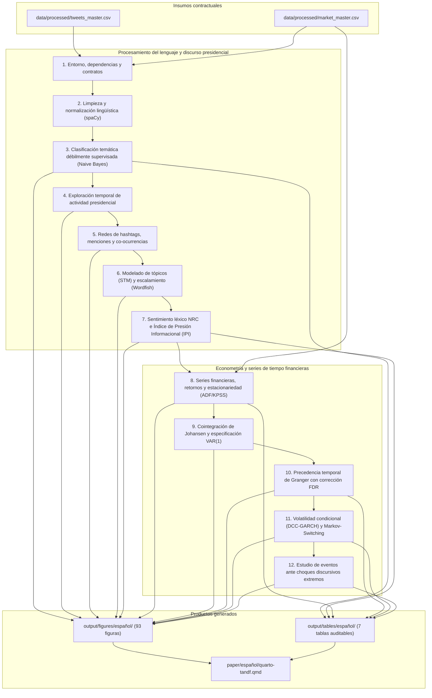
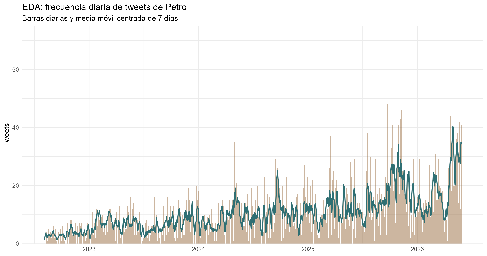
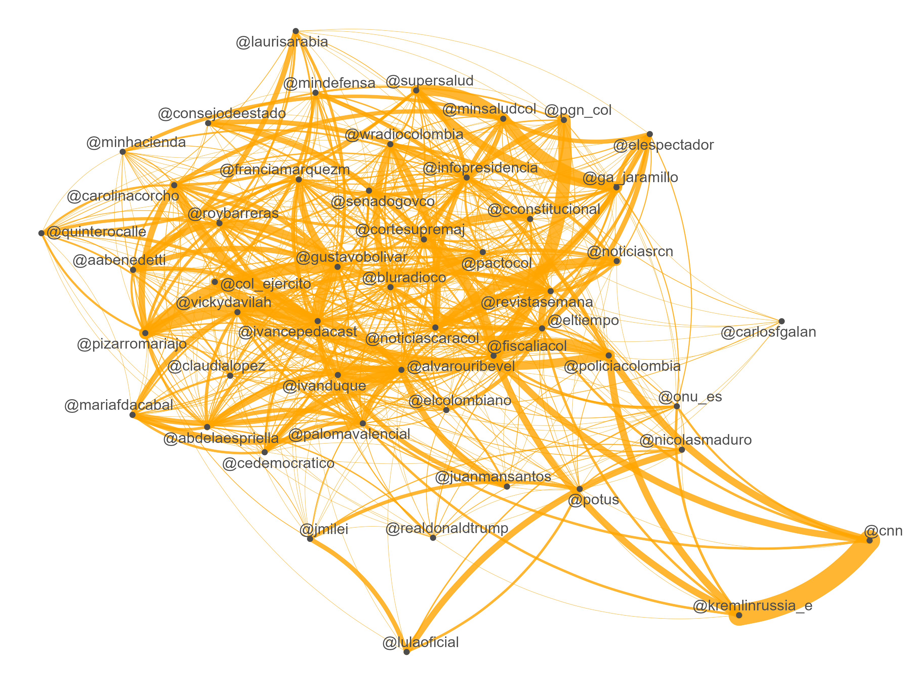

# Guía de réplica y arquitectura del cuaderno computacional

El archivo [`Cuaderno_Paper_Español.qmd`](Cuaderno_Paper_Español.qmd) constituye el motor computacional autocontenido del artículo de investigación. Modela la relación observacional y de precedencia temporal entre la comunicación emitida por la cuenta presidencial `@petrogustavo` (`corpus == "presidente"`) y las series financieras de Colombia (TRM, COLCAP, rendimientos de bonos soberanos TES cero cupón y precio spot de energía de XM).

El corpus complementario de conversación ciudadana (`corpus == "opinion"`) se procesa con fines de exploración léxica y para documentar las limitaciones de su proceso de extracción (concentración artificial del 97,49% a las 18:00 horas y cuotas diarias de 10 tweets). Este corpus queda formalmente excluido de la econometría de series de tiempo.

El archivo ejecutable Quarto genera [`Cuaderno_Paper_Español.html`](Cuaderno_Paper_Español.html), el cual contiene el código evaluado, 93 figuras de alta resolución, 7 tablas visibles y 100 párrafos de interpretación académica inmediata.

## Arquitectura de las 12 secciones analíticas

El flujo de ejecución del cuaderno se estructura en doce etapas secuenciales y reproducibles:



## Requisitos de software y dependencias

El entorno de cómputo utiliza R 4.1 o superior (validado en R 4.4.3 y R 4.6.1) junto con Quarto CLI. El uso del operador pipe nativo `|>` requiere R 4.1 o posterior.

Las dependencias analíticas se declaran al inicio del cuaderno agrupadas por propósito funcional:

| Finalidad | Librerías directas |
|---|---|
| Gestión de datos y fechas | `conflicted`, `readr`, `dplyr`, `tidyr`, `tibble`, `forcats`, `lubridate`, `stringr`, `here` |
| Visualización y redes | `ggplot2`, `scales`, `ggwordcloud`, `ggrepel`, `igraph`, `tidygraph`, `ggraph`, `DiagrammeR`, `ragg` |
| Procesamiento de texto | `quanteda`, `quanteda.textstats`, `quanteda.textmodels`, `syuzhet`, `sentometrics`, `stm`, `spacyr`, `reticulate` |
| Econometría de series temporales | `stats`, `tseries`, `lmtest`, `vars`, `urca`, `zoo`, `rmgarch`, `MSwM`, `sandwich` |
| Presentación y formato | `knitr`, `utils`, `methods` |

Para el procesamiento de lenguaje natural, spaCy requiere un entorno de Python configurado con el modelo en español `es_core_news_sm`. Puede definirse mediante la variable de entorno `SPACYR_PYTHON`. Si la variable no está fijada, el cuaderno busca el entorno de reticulate llamado `petro-spacyr`.

## Instrucciones para ejecutar desde una sesión limpia

Para reproducir la compilación completa del cuaderno desde la raíz del repositorio:

```bash
# 1. Configurar la ruta del intérprete Python con spaCy
export SPACYR_PYTHON="$HOME/.virtualenvs/petro-spacyr/bin/python"

# 2. Verificar que spaCy y el modelo en español estén disponibles
"$SPACYR_PYTHON" -c 'import spacy; spacy.load("es_core_news_sm"); print("spaCy version:", spacy.__version__)'

# 3. Compilar el cuaderno a HTML
quarto render notebooks/español/Cuaderno_Paper_Español.qmd
```

El proceso compila el documento completo, ejecuta las estimaciones deterministas y escribe las 93 figuras y las tablas en `output/`.

## Convención obligatoria de resultados y estilo

Cada bloque de resultados visibles del cuaderno sigue una secuencia contractual:

`contexto y objetivo en Markdown → código R reproducible → tabla o figura de salida → interpretación académica inmediata`

- **Contexto previo:** describe la pregunta, las variables de entrada, la transformación matemática o modelo aplicado y el objeto que se producirá.
- **Código modular:** los bloques de código no superan 40 líneas internas, manteniendo las funciones, pipes y llamadas completas sin divisiones arbitrarias.
- **Figuras autocontenidas:** cada gráfico incluye título descriptivo, subtítulo explicativo, ejes con unidades explícitas, leyenda y notas de pie con fuente y tamaño muestral.
- **Interpretación posterior obligatoria:** todo resultado visual o tabular es sucedido por un párrafo que analiza magnitudes numéricas, patrones visuales y limitaciones metodológicas.
- **Calibración inferencial:** se prohíbe el uso de términos causales como "impacto", "causa" o "determina" para interpretar resultados de modelos VAR, correlaciones DCC o contrastes de Granger, los cuales evalúan precedencia temporal y no identificación estructural.

## Figuras representativas del cuaderno

### Actividad diaria de publicaciones presidenciales (Sección 4)

Distribución temporal de los 14.659 tweets emitidos por `@petrogustavo` durante el mandato, con su media móvil de 7 días.

<p align="center">
  
</p>

### Distribución del discurso por agendas de reformas (Sección 3)

Participación porcentual y volumen de mensajes clasificados entre las agendas de reforma del gobierno nacional.

<p align="center">
  
</p>

### Red de menciones institucionales en Twitter (Sección 5)

Estructura de la red de menciones presidenciales calculada bajo el estándar de `quanteda`, destacando los nodos institucionales con mayor grado ponderado.

<p align="center">
  
</p>

### Dinámica temporal de emociones léxicas NRC (Sección 7)

Trayectoria diaria de las emociones básicas de Plutchik derivadas del léxico NRC sobre las publicaciones presidenciales.

<p align="center">
  
</p>

### Contrastes de precedencia temporal de Granger (Sección 10)

Resultados de los 112 contrastes de precedencia temporal entre variables discursivas presidenciales y mercados financieros.

<p align="center">
  
</p>

### Correlaciones condicionales dinámicas DCC-GARCH (Sección 11)

Estimación de la evolución temporal de la covarianza condicional entre señales presidenciales y variables bursátiles colombianas.

<p align="center">
  
</p>

### Respuestas acumuladas observadas en estudios de eventos (Sección 12)

Mapa de calor de las variaciones acumuladas de los activos financieros a 1, 3, 5 y 7 días ante choques discursivos extremos.

<p align="center">
  
</p>

## Navegación y enlaces relacionados

- **Documentación principal del repositorio:** [`README.es.md`](../../README.es.md) (Español) | [`README.md`](../../README.md) (English)
- **Manuscrito formal del artículo:** [`quarto-tandf.qmd`](../../paper/español/quarto-tandf.qmd)
- **Módulo de supervisión metodológica:** [`Supervision_Metodologica.qmd`](../../Methodology_Supervision/Supervision_Metodologica.qmd)
- **Directorio de figuras generadas:** [`output/figures/español/`](../../output/figures/español/)
- **Directorio de tablas auditadas:** [`output/tables/español/`](../../output/tables/español/)
- **Auditoría metodológica y econométrica:** [`auditoria_final_cierre_metodologico.md`](../../output/review/auditoria_final_cierre_metodologico.md)
