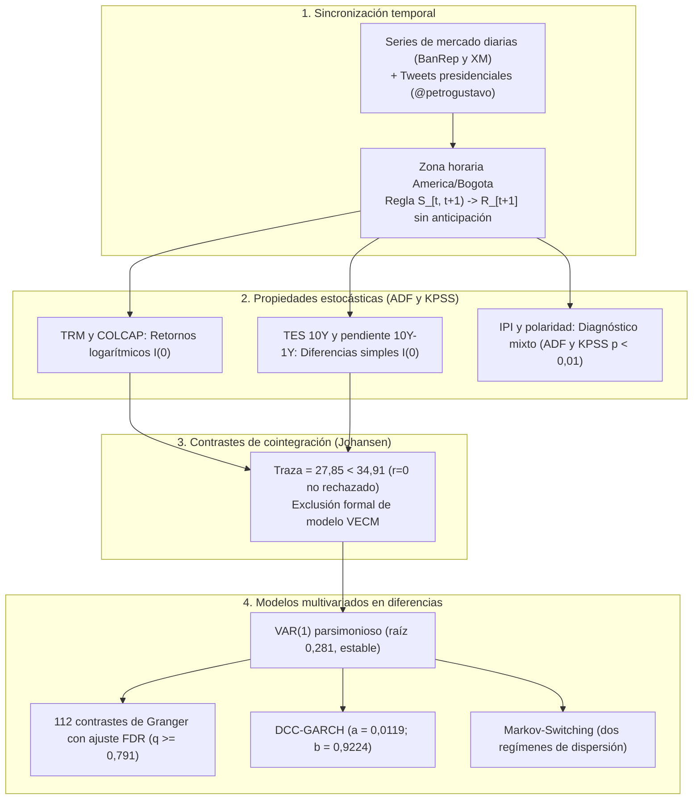
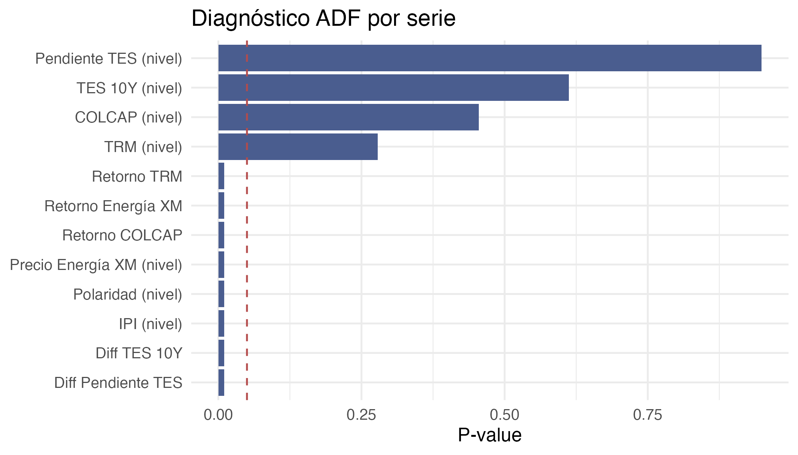
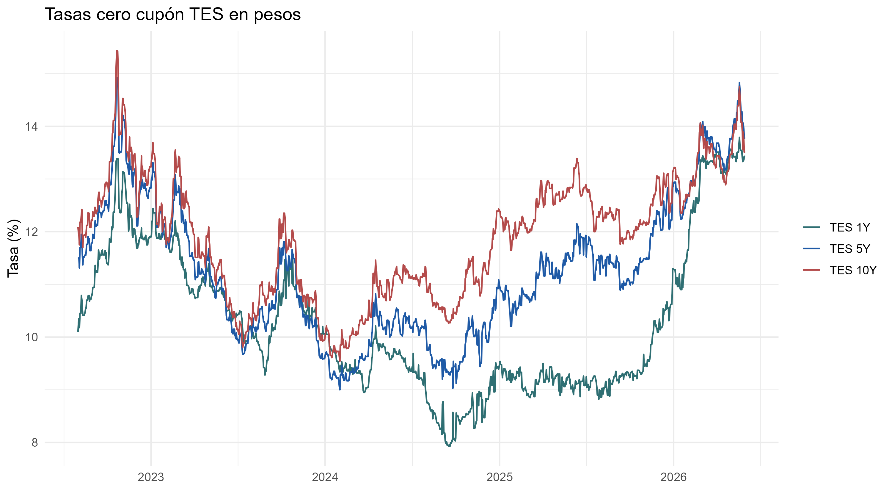

# Auditoría de especificación econométrica y series de tiempo

**Proyecto:** *Comunicación presidencial y mercados financieros en Colombia: evidencia textual y de series de tiempo*  
**Documento:** Informe de control y verificación econométrica  
**Estado:** Auditado y verificado  

## Flujo de verificación econométrica

El pipeline econométrico asegura la consistencia entre tipos de datos, propiedades estocásticas y modelos multivariados:

## 1. Matriz de control econométrico

| Componente | Estado | Especificación implementada | Justificación técnica | Diagnóstico empírico |
|---|---|---|---|---|
| **Zona horaria** | Verificado | `tweets_master.csv` conserva `timestamp_utc` y define `timestamp_bogota`, `date_bogota` y `date` en hora local. | Evita asignar publicaciones nocturnas colombianas al día calendario UTC posterior. | Los timestamps UTC y locales coinciden en todas las observaciones; cero contradicciones. |
| **Alineación temporal** | Verificado | Sincronización $S_t \to R_{t+1}$ mediante `date_sentiment` y `next_trading_date`. | Evita sesgo de anticipación (*look-ahead bias*) entre el sentimiento de una jornada y su propio cierre financiero. | Tabla `00_auditoria_temporal_paneles.csv` documenta las 934 sesiones de respuesta. |
| **Calendario financiero** | Verificado | El panel bursátil filtra observaciones efectivas mediante banderas `*_observed`. | Previene el uso de precios propagados de fin de semana como información nueva de mercado. | Retornos calculados exclusivamente sobre días de cotización efectiva. |
| **Desacoplamiento XM** | Verificado | Panel eléctrico separado con retornos condicionados a precio observado positivo. | XM opera en calendario continuo de 365 días y no debe forzarse a la jornada bancaria. | Serie continua de 1.400 días sin arrastre de fines de semana. |
| **Definición de retornos** | Verificado | TRM y COLCAP usan diferencias logarítmicas; tasas TES usan diferencias simples. | Coherencia con la naturaleza económica de cada activo (precios vs rendimientos porcentuales). | Retornos continuos acotados en activos bursátiles y cambios en puntos porcentuales en deuda soberana. |
| **Curva soberana TES** | Verificado | `diff_tes_10y` y `diff_tes_slope` calculadas como diferencias simples de rendimientos. | Las tasas de interés son rendimientos porcentuales y no precios estrictamente positivos. | Pendiente calculada como la diferencia entre tasa 10Y y tasa 1Y. |
| **Estacionariedad** | Verificado | Batería conjunta de pruebas ADF y KPSS en niveles y diferencias. | Contrastar presencia de raíz unitaria frente a hipótesis de estacionariedad. | Niveles son $I(1)$; retornos y primeras diferencias son $I(0)$; IPI presenta diagnóstico mixto. |
| **Cointegración** | Verificado | Prueba de traza de Johansen sobre series en niveles (TRM, COLCAP, TES 10Y). | Determinar si existe relación de equilibrio de largo plazo que justifique un VECM. | Estadístico de traza $27,85 < 34,91$; no se rechaza $r=0$; se descarta VECM. |
| **Causalidad de Granger** | Verificado | 112 contrastes bivariados sobre señales presidenciales con corrección FDR. | Contrastar precedencia temporal estadística con control de comparaciones múltiples. | 5 rechazos nominales ($p < 0,05$); 0 rechazos tras Benjamini-Hochberg ($q \ge 0,791$). |
| **Modelo VAR** | Verificado | Especificación VAR(1) en diferencias sobre 6 variables y 881 observaciones. | Parsimonia justificada en criterios bayesianos SC y HQ; evaluación de robustez en VAR(3). | Raíz máxima de 0,2807 garantiza estabilidad dinámica del sistema. |
| **Volatilidad DCC** | Verificado | Modelo DCC-GARCH multivariado para capturar covarianzas condicionales dinámicas. | Estimar comovimientos temporales entre señales presidenciales y mercado. | Parámetros $a = 0,0119$ ($p = 0,069$) y $b = 0,9224$ ($p < 10^{-10}$). |
| **Markov-Switching** | Verificado | Modelo de regímenes markovianos de dispersión sobre la correlación IPI-TRM. | Identificar cambios de estado en la dispersión de las correlaciones estimadas. | Dos regímenes con persistencia alta ($p_{ii} > 0,95$) y duraciones de 24,4 y 27,3 sesiones. |

## 2. Diagnóstico visual de series financieras y tasas TES

### Diagnóstico de estacionariedad de las series

Verificación de niveles y primeras diferencias para los activos financieros:

  

### Estructura de la curva de rendimientos TES

Evolución temporal de las tasas soberanas cero cupón a 1, 5 y 10 años emitidas por el Banco de la República:

  

## 3. Conclusiones y límites del alcance inferencial

1. **Precedencia temporal frente a causalidad estructural:** Los contrastes de Granger y los modelos VAR evalúan capacidad predictiva lineal en series de tiempo observacionales. No constituyen pruebas de causalidad estructural ni descartan la presencia de choques no observados intradiarios.
2. **Control estricto de multiplicidad:** Al corregir por la tasa de falso descubrimiento (FDR) mediante Benjamini-Hochberg, ningún contraste de precedencia temporal entre el discurso presidencial y las variables de mercado se mantiene significativo.
3. **Persistencia de volatilidad:** El modelo DCC-GARCH confirma la persistencia de la estructura de covarianza de los mercados colombianos, con una respuesta inmediata no significativa ante innovaciones discursivas presidenciales.
