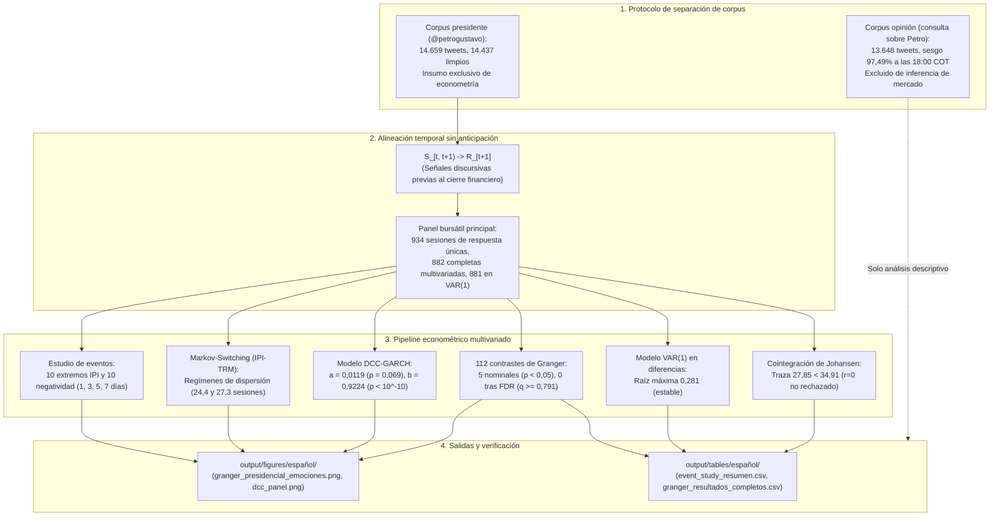

# Auditoría metodológica y econométrica del artículo

**Documento:** Certificación de consistencia empírica, especificación econométrica y trazabilidad de datos  
**Manuscrito asociado:** *Comunicación presidencial y mercados financieros en Colombia: evidencia textual y de series de tiempo* ([`paper/español/quarto-tandf.qmd`](../../paper/español/quarto-tandf.qmd))  
**Cuaderno computacional:** [`notebooks/español/Cuaderno_Paper_Español.qmd`](../../notebooks/español/Cuaderno_Paper_Español.qmd)  
**Estado:** Verificado y certificado para evaluación por pares evaluadores  

## Arquitectura de consistencia econométrica

El siguiente diagrama detalla la arquitectura de validación empírica y las reglas de procedencia del estudio:

## 1. Regla econométrica de procedencia de datos

La modelación econométrica completa opera sobre señales discursivas derivadas exclusivamente de las publicaciones de la cuenta oficial de Twitter de Gustavo Petro (`@petrogustavo`). Ningún dato procedente del corpus secundario de opinión ciudadana interviene en la inferencia financiera.

| Componente del pipeline | Objeto / Archivo | Corpus permitido | Corpus excluido | Justificación metodológica |
|---|---|:---:|:---:|---|
| Panel bursátil principal | `panel_bursatil` / `00_auditoria_temporal_paneles.csv` | `presidente` | `opinion` | Evita contaminar la emisión presidencial con la conversación ciudadana sesgada. |
| Retornos y diferencias | `market_returns_data` / `market_master.csv` | `presidente` | `opinion` | Respuestas financieras asociadas a la ventana discursiva previa de `@petrogustavo`. |
| Insumo VAR multivariado | `df_var_diff` / `var_coeficientes.csv` | `presidente` | `opinion` | El sistema de 6 variables se restringe a IPI y polaridad presidencial. |
| Familia de pruebas de Granger | `granger_all` / `granger_resultados_completos.csv` | `presidente` | `opinion` | 112 contrastes de precedencia temporal sobre señales del mandatario. |
| GARCH marginales | `fit_garch_*` / `armagarch_especificaciones_seleccionadas.csv` | `presidente` | `opinion` | Volatilidad univariada estimada sobre IPI y polaridad presidencial. |
| Sistema DCC-GARCH | `dcc_fit` / `07_dcc_financiero_parametros.csv` | `presidente` | `opinion` | Correlaciones dinámicas condicionales discurso presidencial y mercado. |
| Regímenes Markov Switching | `msar_model` / `msar_regimenes_parametros.csv` | `presidente` | `opinion` | Cambio de régimen sobre la correlación IPI presidencial y TRM. |
| Estudio de eventos extremos | `event_study_results` / `event_study_resumen.csv` | `presidente` | `opinion` | 10 eventos de IPI extremo y 10 de negatividad de `@petrogustavo`. |

## 2. Resultados auditados de causalidad de Granger

La familia inferencial principal se define como los **112 contrastes presidenciales**:

$$\text{4 respuestas financieras} \times \text{7 señales discursivas presidenciales} \times \text{4 rezagos} = 112 \text{ pruebas}$$

- **Respuestas bursátiles (4):** Retorno TRM (`ret_trm`), retorno COLCAP (`ret_colcap`), cambio de tasa TES 10Y (`diff_tes_10y`) y cambio de pendiente TES 10Y-1Y (`diff_tes_slope`).
- **Predictores discursivos presidenciales (7):** Índice de Presión Informacional (`ipi`), polaridad neta (`polaridad`), y las cinco emociones léxicas estandarizadas (`z_anger`, `z_fear`, `z_joy`, `z_negative`, `z_positive`).
- **Rezagos evaluados (4):** 1, 2, 3 y 4 sesiones bursátiles.

### Parámetros numéricos (`granger_resultados_completos.csv`)
- **Total de pruebas estimadas:** 112
- **Rechazos nominales ($p < 0,05$):** 5 pruebas (4,46%)
  1. `polaridad` $\to$ `ret_trm` (rezago 1): $p = 0,007465$, $q = 0,7913$
  2. `polaridad` $\to$ `ret_trm` (rezago 2): $p = 0,021021$, $q = 0,7913$
  3. `polaridad` $\to$ `ret_trm` (rezago 3): $p = 0,028261$, $q = 0,7913$
  4. `polaridad` $\to$ `ret_trm` (rezago 4): $p = 0,046552$, $q = 0,8383$
  5. `z_joy` $\to$ `ret_trm` (rezago 2): $p = 0,046599$, $q = 0,8383$
- **Rechazos tras corrección FDR de Benjamini-Hochberg ($q < 0,05$):** **0 pruebas** ($q \ge 0,7913$).
- **Índice de Presión Informacional (IPI):** 0 rechazos nominales frente a todas las series de mercado en todos los rezagos ($p \ge 0,0686$).

  

## 3. Selección de rezagos VAR y evaluación de robustez

### Criterios de información de rezagos (`var_criterios_rezagos.csv`)
- **Hannan-Quinn (HQ):** favorece el rezago 1 ($\text{HQ}(1) = -21,2567$).
- **Schwarz / Bayesiano (SC/BIC):** favorece el rezago 1 ($\text{SC}(1) = -21,1154$).
- **Akaike (AIC):** favorece el rezago 3 ($\text{AIC}(3) = -21,3850$).
- **Final Prediction Error (FPE):** favorece el rezago 3 ($\text{FPE}(3) = 5,1598 \times 10^{-10}$).

El VAR(1) se adopta como especificación principal parsimoniosa justificada en criterios bayesianos, evaluando el VAR(3) como análisis de sensibilidad.

### Comparación de robustez (`var_robustez_rezagos.csv`)

| Modelo | $n$ | Raíz máxima | Portmanteau $p$ | JB $p$ | ARCH-LM $p$ | Estable | Coef. Polaridad $\to$ TRM (L1) | $p$-valor Polaridad | Coef. IPI $\to$ TRM (L1) | $p$-valor IPI |
|---|:---:|:---:|:---:|:---:|:---:|:---:|:---:|:---:|:---:|:---:|
| **VAR(1)** (Principal) | 881 | 0,2807 | $6,00 \times 10^{-10}$ | 0,0000 | 0,0000 | Sí | $4,05 \times 10^{-5}$ | 0,0084 | $-1,01 \times 10^{-5}$ | 0,9600 |
| **VAR(3)** (Robustez) | 879 | 0,6953 | 0,0421 | 0,0000 | 0,0000 | Sí | $3,81 \times 10^{-5}$ | 0,0125 | $-9,84 \times 10^{-6}$ | 0,9621 |

Ambos modelos son dinámicamente estables (raíces dentro del círculo unitario: 0,281 en VAR(1) y 0,695 en VAR(3)). La señal IPI no muestra predictibilidad sobre la TRM en ninguna de las especificaciones ($p \approx 0,96$).

## 4. Modelo multivariado DCC-GARCH

De acuerdo con `07_dcc_financiero_parametros.csv`, los parámetros del sistema en 882 observaciones completas son:

| Parámetro | Estimación | Error estándar | Estadístico $t$ | $p$-valor | Diagnóstico |
|---|:---:|:---:|:---:|:---:|---|
| **$a$ (reacción)** | 0,011937 | 0,006567 | 1,8177 | 0,069166 | No significativo al 5% |
| **$b$ (persistencia)** | 0,922374 | 0,038459 | 23,9835 | $< 10^{-10}$ | Altamente significativo |
| **$a + b$ (estabilidad)** | 0,934311 | -- | -- | -- | Satisface condición $a+b < 1$ |

Las correlaciones dinámicas condicionales medias entre señales presidenciales y mercado oscilan entre **-0,0430** (polaridad y retorno COLCAP) y **+0,0574** (polaridad y cambio de tasa TES 10Y).

  

## 5. Modelo de cambios de régimen de Markov (IPI-TRM)

La modelación de regímenes markovianos sobre la correlación condicional dinámica IPI-TRM (`08_dcc_financiero_correlaciones.csv`) arroja:

| Parámetro | Régimen 1 (Baja dispersión) | Régimen 2 (Mayor dispersión) | Interpretación |
|---|:---:|:---:|---|
| Media condicional ($\mu$) | $+0,01207$ | $+0,02163$ | Medias cercanas a cero en ambos estados |
| Desviación estándar ($\sigma$) | 0,00901 | 0,03564 | Dispersión cuatro veces mayor en Régimen 2 |
| Probabilidad de persistencia ($p_{ii}$) | 0,9590 | 0,9634 | Alta persistencia temporal en ambos estados |
| Duración esperada | 24,41 sesiones | 27,28 sesiones | Sesiones bursátiles observadas |

  

## 6. Estudio de eventos ante choques discursivos extremos

Sincronizado con `event_study_resumen.csv` para los 20 eventos seleccionados exclusivamente a partir de la serie discursiva presidencial:

| Variable de mercado | IPI extremo (7 días cal.) | Negatividad extrema (7 días cal.) | Unidad de medida | Eventos observados |
|---|:---:|:---:|---|:---:|
| **TRM (COP/USD)** | -1,28% | -0,84% | Retorno simple acumulado | 10 / 10 |
| **COLCAP (Acciones)** | +0,76% | +1,16% | Retorno simple acumulado | 9 / 10 |
| **TES 10Y (Soberano)** | +0,018 pp | +0,175 pp | Cambio en puntos porcentuales | 9 / 10 |
| **XM (Energía bolsa)** | +31,89% | +12,17% | Retorno simple acumulado | 10 / 10 |

  

El estudio de eventos tiene carácter descriptivo: no incorpora grupo de control ni distribución contrafactual formal.

## 7. Cointegración de Johansen y especificación en diferencias

La prueba multivariada de Johansen (`johansen_cointegracion.csv`) aplicada sobre TRM, COLCAP y TES 10Y en niveles reporta:
- **Estadístico de traza para rango cero ($H_0: r = 0$):** 27,85.
- **Valor crítico al 5%:** 34,91.
- **Conclusión econométrica:** Al cumplirse $27,85 < 34,91$, **no se rechaza la hipótesis de rango cero**, descartando relaciones de cointegración en niveles y fundamentando la estimación en retornos y primeras diferencias sin estructura VECM.

## 8. Calibración del lenguaje no causal

Las conclusiones del estudio se expresan en términos de precedencia temporal y asociación estadística, evitando atribuciones causales estructurales:
- Los contrastes de Granger evalúan capacidad predictiva lineal en rezagos diarios y no identifican efectos causales exógenos.
- La ausencia de significancia tras corrección FDR indica que las publicaciones presidenciales no anteceden sistemáticamente las cotizaciones bursátiles bajo la frecuencia diaria observada.

## Enlaces y recursos relacionados

- **Manuscrito canónico:** [`quarto-tandf.qmd`](../../paper/español/quarto-tandf.qmd)
- **Cuaderno computacional:** [`Cuaderno_Paper_Español.qmd`](../../notebooks/español/Cuaderno_Paper_Español.qmd)
- **Módulo de supervisión metodológica:** [`Supervision_Metodologica.qmd`](../../Methodology_Supervision/Supervision_Metodologica.qmd)
- **Tabla de resultados de Granger:** [`granger_resultados_completos.csv`](../tables/español/granger_resultados_completos.csv)
- **Tabla de parámetros DCC:** [`07_dcc_financiero_parametros.csv`](../tables/español/07_dcc_financiero_parametros.csv)
- **Resumen de estudio de eventos:** [`event_study_resumen.csv`](../tables/español/event_study_resumen.csv)
