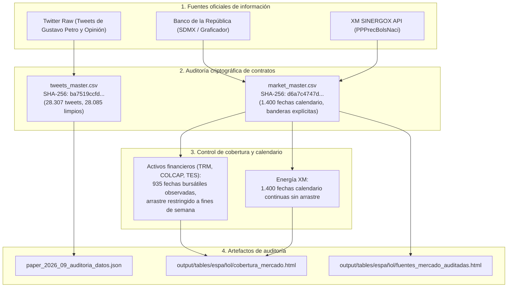

# Auditoría de datos y reconciliación de fuentes oficiales

**Documento:** Informe de integridad de datos, huellas criptográficas y fuentes oficiales  
**Ventana empírica:** 1 de agosto de 2022 a 31 de mayo de 2026 (1.400 días calendario)  
**Manuscrito asociado:** *Comunicación presidencial y mercados financieros en Colombia: evidencia textual y de series de tiempo*  

## Arquitectura de reconciliación de datos

El siguiente diagrama detalla el protocolo de verificación de integridad y procedencia de datos:

## 1. Reconciliación de contratos de datos

La reconstrucción de los contratos de datos reproduce de manera verificable ambos archivos maestros:
- **`tweets_master.csv`:** SHA-256 `ba7519ccfd32549c7cd783b386e23ad1cd64b56436583d4321b74e81a24e1029`
- **`market_master.csv`:** SHA-256 `d6a7c4747d6c286f3902c3d4e362123f9d2a15cb0502cfa94cde00ca881f9b4b`

Los valores en bruto de mercado coinciden con el archivo maestro en todas sus fechas observadas, sin duplicación de registros ni contradicciones entre las banderas de observación y arrastre.

| Serie de mercado | Fechas observadas en bruto | Arrastre fin de semana | Faltantes lunes a viernes | Tratamiento analítico |
|---|---:|---:|---:|---|
| TRM | 1.400 | 0 | 0 | Retornos logarítmicos sobre días hábiles financieros |
| COLCAP | 935 | 400 | 65 | Retornos logarítmicos sobre sesiones bursátiles efectivas |
| TES 1, 5 y 10 años (cada una) | 935 | 400 | 65 | Diferencias simples de tasa soberana en pesos |
| Precio spot XM | 1.400 | 0 | 0 | Retornos logarítmicos continuos sobre precios positivos |

El panel cubre 1.400 días calendario (1.000 días de lunes a viernes y 400 sábados y domingos). La propagación en COLCAP y TES cubre exclusivamente los fines de semana; los 65 días festivos o no hábiles entre semana permanecen como faltantes no imputados. La TRM se registra todos los días del calendario oficial del Banco de la República. XM conserva las 1.400 fechas continuas sin propagación.

## 2. Cobertura de series financieras oficiales

La visualización de disponibilidad de datos confirma la continuidad de las observaciones en el periodo evaluado:

  

## 3. Asignación de fecha local en publicaciones de Twitter

El script `scripts/data/twitter_process_raw_data.R` aplica la conversión explícita `as.Date(parsed_time_bogota, tz = "America/Bogota")` tanto para `date_bogota` como para el alias compatible `date`:

| Variable muestral | Corpus opinión | Corpus presidente | Total consolidado |
|---|---:|---:|---:|
| Tweets brutos | 13.648 | 14.659 | 28.307 |
| Textos limpios no vacíos | 13.648 | 14.437 | 28.085 |
| Días observados con tweets | 1.348 | 1.313 | 1.353 |
| Identificadores duplicados | 0 | 0 | 0 |
| Fechas que contradicen `timestamp_bogota` | 0 | 0 | 0 |

El archivo maestro consolidado contiene 28.307 tweets y 28.085 textos limpios no vacíos. La cuenta presidencial conserva un único `author_id`. El corpus de opinión registra 1.291 días con exactamente diez tweets y 13.305 mensajes concentrados en la hora 18:00 de Bogotá, fundamentando su exclusión de la econometría de series de tiempo.

## 4. Contraste con APIs oficiales y protección de ingesta

La consulta directa a los servicios del Banco de la República y XM confirma la trazabilidad de las fuentes:
- TRM, COLCAP y curvas TES cero cupón reproducen de forma exacta las fechas y cotizaciones de los archivos en bruto.
- El script de ingesta `scripts/data/ingest_market.R` incorpora guardas de seguridad: si alguna llamada a los servicios oficiales devuelve cero observaciones o falla por conectividad, la ejecución se interrumpe de inmediato con código de salida 1 antes de modificar los archivos en bruto existentes.

## Tablas y enlaces de verificación

- **Registro de fuentes auditadas:** [`fuentes_mercado_auditadas.html`](../tables/español/fuentes_mercado_auditadas.html)
- **Registro de cobertura de mercado:** [`cobertura_mercado.html`](../tables/español/cobertura_mercado.html)
- **Auditoría comparada de los dos corpus:** [`auditoria_comparada_dos_corpus.csv`](../tables/español/auditoria_comparada_dos_corpus.csv)
- **Auditoría de procedencia econométrica:** [`auditoria_procedencia_econometria.csv`](../tables/español/auditoria_procedencia_econometria.csv)
