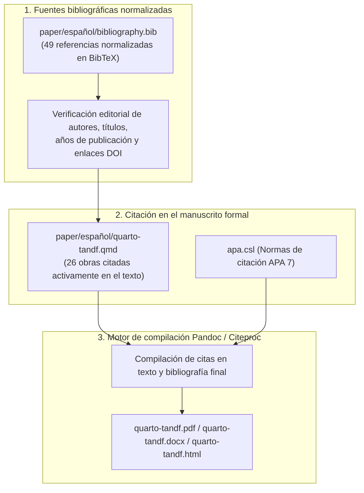

# Auditoría y verificación bibliográfica del manuscrito

**Documento:** Informe de consistencia bibliográfica, claves BibTeX y verificación de referencias  
**Manuscrito asociado:** *Comunicación presidencial y mercados financieros en Colombia: evidencia textual y de series de tiempo* ([`paper/español/quarto-tandf.qmd`](../../paper/español/quarto-tandf.qmd))  
**Archivo BibTeX:** [`paper/español/bibliography.bib`](../../paper/español/bibliography.bib)  

## Arquitectura de verificación bibliográfica

El proceso de verificación asegura que cada afirmación teórica y metodológica cuente con respaldo bibliográfico verificable:

## 1. Obras del corpus de referencia y decisiones de inclusión

El archivo [`paper/español/bibliography.bib`](../../paper/español/bibliography.bib) contiene 49 entradas normalizadas con claves BibTeX estables. La siguiente tabla resume las obras del marco conceptual y su estatus en el texto:

| Obra de referencia | Clave BibTeX | Decisión editorial y justificación |
|---|---|---|
| Benoit et al. (2018), análisis textual | `benoit_textual_2018` | Citada: procedimiento de cuantificación textual y diseño metodológico. |
| Benoit et al. (2018), quanteda | `quanteda` | Citada: paquete computacional empleado en el análisis de redes y frecuencias. |
| Blei et al. (2003) | `blei_2003` | Citada: fundamento teórico del modelo probabilístico de asignación latente de Dirichlet (LDA). |
| BVC (2018), COLEQTY | `bvc_2018_coleqty` | Antecedente en BibTeX: documento metodológico de la Bolsa de Valores de Colombia. |
| El-Hamdouchi y Willett (1986) | `el_hamdouchi_1986` | Citada: algoritmo de agrupación jerárquica en minería de texto. |
| Husson et al. (2016) | `husson_2016` | Citada: exploración multivariada y análisis de correspondencias. |
| Ince et al. (2017) | `ince_2017` | Citada: análisis de hashtags y acción colectiva en redes sociales. |
| Jockers (2017) | `jockers_2017` | Citada: implementación del análisis de sentimiento léxico en R. |
| Kahneman y Tversky (1979) | `kahneman_1979` | Citada: teoría prospectiva y toma de decisiones bajo riesgo e incertidumbre. |
| Kearney (2019) | `kearney_2019` | Citada: protocolos de recolección y análisis de publicaciones en Twitter. |
| Medhat et al. (2014) | `medhat_2014` | Citada: alcance, limitaciones y técnicas de minería de opinión. |
| Mohammad y Turney (2010) | `mohammad_turney_2010` | Citada: desarrollo y validación del léxico emocional NRC. |
| Mullainathan y Thaler (2000) | `mullainathan_thaler_2000` | Citada: marco teórico de economía conductual y límites a la racionalidad. |
| Plutchik (2003) | `plutchik_2003` | Citada: taxonomía psicoevolutiva de emociones primarias y secundarias. |
| Prada Espinel (2018) | `prada_espinel_2018` | Citada: análisis empírico de comunicación política en Colombia. |
| Roberts et al. (2019) | `stm` | Citada: paquete R para modelos de tópicos estructurales con covariables. |
| Schweinberger (2023) | `schweinberger_2023` | Citada: lingüística de corpus, colocaciones y matrices de coocurrencia. |
| Slapin y Proksch (2008) | `slapin_proksch_2008` | Citada: modelo Wordfish para escalamiento unidimensional de posiciones políticas. |
| Trott (2018) | `trott_2018` | Citada: marcos teóricos de acción conectiva en plataformas digitales. |
| Urdinez y Cruz (2020) | `urdinez_cruz_2020` | Citada: métodos cuantitativos aplicados a ciencia política y análisis discursivo. |
| Wiedemann y Niekler (2017) | `wiedemann_niekler_2017` | Citada: extracción computacional de colocaciones significativas en español. |

## 2. Marco teórico y figura de referencia

La conceptualización del sentimiento y las emociones léxicas sigue la rueda psicoevolutiva de Plutchik, citada en el manuscrito formal:

  

## 3. Literatura empírica incorporada

El manuscrito incorpora literatura empírica internacional sobre comunicación gubernamental y mercados financieros:
- **Gjerstad et al. (2021):** *Decision Support Systems*, DOI 10.1016/j.dss.2021.113577 (análisis de publicaciones políticas y volatilidad bursátil).
- **Bianchi, Gómez-Cram y Kung (2024):** *The Review of Financial Studies*, DOI 10.1093/rfs/hhae001 (comunicación presidencial y primas de riesgo de bonos soberanos).
- **Wang (2023):** *Political Analysis*, DOI 10.1017/pan.2023.3 (avances metodológicos en escalamiento textual).
- **Ardia et al. (2021):** *Journal of Financial Econometrics* (metodología del paquete `sentometrics` para series temporales de sentimiento).

## 4. Verificación de citas cruzadas

La compilación automática del documento valida:
- **Citas en el texto:** 26 obras citadas de manera explícita en el cuerpo del manuscrito.
- **Entradas bibliográficas generadas:** Exactamente 26 referencias impresas en la sección final bajo formato APA 7.
- **Correspondencia:** Correspondencia del 100% entre citas en el texto y referencias finales, sin alertas de citas huérfanas en Pandoc.
