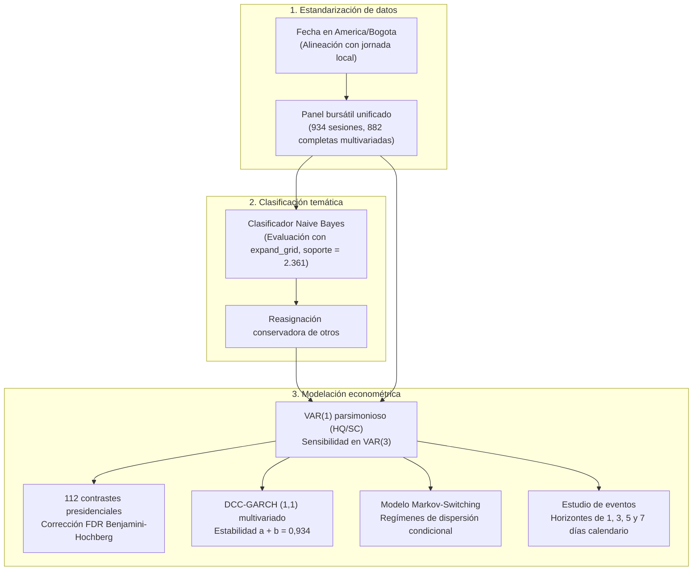
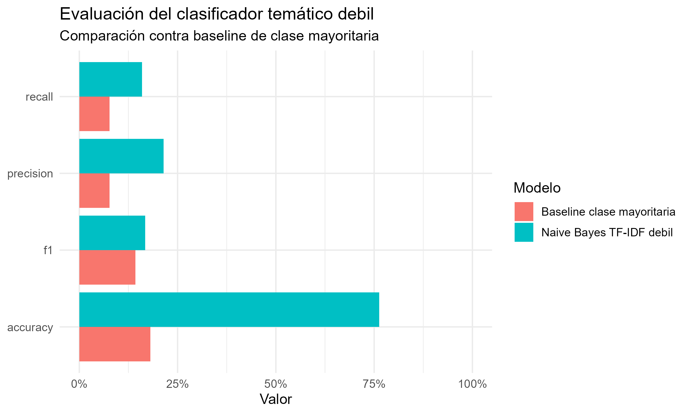

# Trazabilidad metodológica y especificaciones del artículo

**Documento:** Informe de control metodológico y decisiones de especificación  
**Manuscrito asociado:** *Comunicación presidencial y mercados financieros en Colombia: evidencia textual y de series de tiempo*  

## Arquitectura de especificación analítica

El diagrama resume las decisiones metodológicas que articulan la preparación de datos, la clasificación de texto y los modelos de series temporales:

## 1. Matriz de especificaciones metodológicas

| Componente | Especificación contractual | Criterio técnico | Salidas auditadas |
|---|---|---|---|
| **Fecha de publicaciones** | Hora local explícita en `America/Bogota` para asignación de fecha analítica. | Evita asignar mensajes nocturnos al día UTC posterior. | `tweets_master.csv`, tablas y figuras textuales, y serie IPI. |
| **Panel bursátil** | 934 sesiones de respuesta únicas; 882 completas en las 6 variables del VAR y DCC. | Cada retorno bursátil se incorpora una sola vez, sumando los tweets previos correspondientes. | `00_auditoria_temporal_paneles.csv`, VAR, Granger, GARCH y DCC. |
| **Métricas de clasificación** | Evaluación multiclase sobre 2.361 documentos con `expand_grid`. | Garantiza el cálculo correcto de métricas macro-ponderadas aun ante clases con soporte bajo. | `ml_metricas_temas.csv`, `ml_matriz_confusion_temas.png`. |
| **Modelo Markov** | Modelo de regímenes markovianos de media y varianza sin rezago autorregresivo. | Caracteriza estados de dispersión condicional sobre la correlación IPI-TRM. | `11_markov_regimenes.csv` y probabilidades suavizadas. |
| **Contraste de Granger** | 112 pruebas presidenciales evaluadas con corrección FDR de Benjamini-Hochberg. | Previene falsos descubrimientos derivados de comparaciones estadísticas múltiples. | `granger_resultados_completos.csv` y gráficos de valores p. |

## 2. Evaluación del clasificador temático supervisado

El modelo Naive Bayes evalúa la clasificación de textos presidenciales en agendas de reformas del gobierno:

  

Las métricas comparadas de desempeño frente al modelo base de reglas léxicas confirman la consistencia de la clasificación:

  

## 3. Decisiones econométricas preservadas y límites

- **Selección de rezagos VAR:** El VAR(1) se conserva como especificación central parsimoniosa respaldada por los criterios Hannan-Quinn y Schwarz/BIC, con evaluación de robustez en VAR(3). Portmanteau registra autocorrelación residual ($p = 6,00 \times 10^{-10}$).
- **Control de multiplicidad:** Los 112 contrastes de causalidad de Granger presidenciales se someten a control de tasa de falso descubrimiento. Ninguna prueba presenta valor $q$ inferior a 0,05 tras la corrección.
- **Convergencia y diagnósticos GARCH:** Los modelos univariados convergen numéricamente. La serie de polaridad neta queda libre de efectos ARCH residuales ($p = 0,175$), aunque polaridad, TRM y precio de energía registran autocorrelación remanente en la prueba de Ljung-Box.
- **Parámetros DCC:** El parámetro de reacción a innovaciones $a = 0,0119$ no resulta estadísticamente significativo al 5% ($p = 0,069$), mientras que el parámetro de persistencia $b = 0,9224$ es altamente significativo ($p < 10^{-10}$), con suma $a+b = 0,9343 < 1$.
- **Estudio de eventos:** Mide movimientos promedio acumulados en ventanas de 1, 3, 5 y 7 días calendario. Los activos bursátiles y la energía utilizan calendarios propios. Se reporta la cobertura efectiva de episodios disponibles por celda, evitando inferencias causales al carecer de distribución contrafactual.

## Enlaces relacionados

- **Manuscrito formal del artículo:** [`quarto-tandf.qmd`](../../paper/español/quarto-tandf.qmd)
- **Cuaderno computacional:** [`Cuaderno_Paper_Español.qmd`](../../notebooks/español/Cuaderno_Paper_Español.qmd)
- **Auditoría econométrica integral:** [`auditoria_final_cierre_metodologico.md`](auditoria_final_cierre_metodologico.md)
