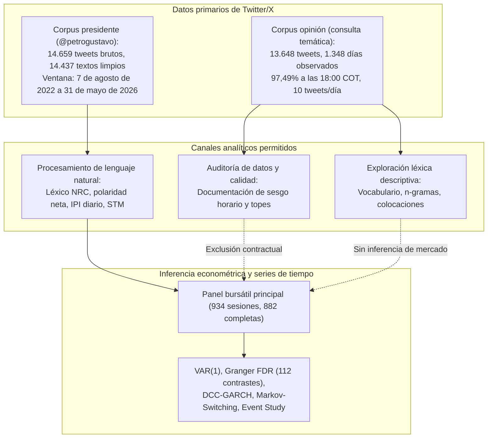
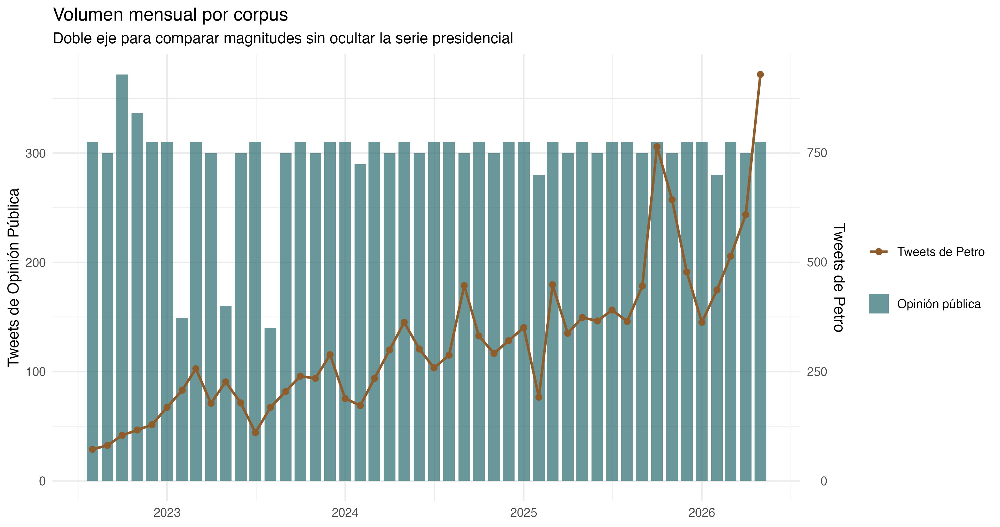
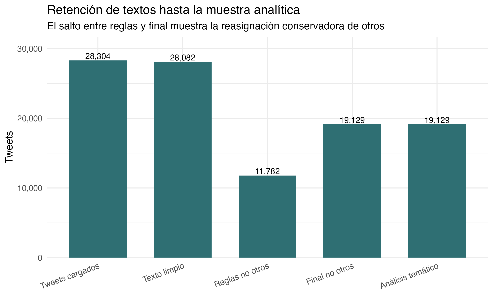

# Arquitectura del corpus presidencial y delimitación de la conversación ciudadana

**Proyecto:** *Comunicación presidencial y mercados financieros en Colombia: evidencia textual y de series de tiempo*  
**Documento:** Informe de diseño y delimitación metodológica de corpus  
**Repositorio:** `What_is_the_economic_impact_of_Colombian_President_tweets`  

## Protocolo de separación de corpus

El estudio establece una separación metodológica estricta entre la comunicación directa emitida por el presidente Gustavo Petro (`@petrogustavo`) y la conversación pública recuperada mediante consultas temáticas sobre el mandatario (`opinion`):

## 1. Justificación empírica de la delimitación

### Diagnóstico del corpus de opinión ciudadana
Durante la auditoría de los datos primarios almacenados en `data/raw/twitter/` y consolidados en `data/processed/tweets_master.csv`, se identificó una concentración artificial en los mensajes del corpus `opinion`:

1. **Concentración horaria:** De los 13.648 registros de `opinion`, **13.305 tweets (97,49%)** registran la marca temporal de las 18:00 horas (hora local de Bogotá, `America/Bogota`).
2. **Topes diarios de extracción:** En **1.291 de los 1.348 días con publicaciones (95,77%)**, la recolección contiene exactamente un tope de 10 tweets diarios.
3. **Ausencia de cobertura en el horario de negociación:** Al concentrarse a las 18:00 horas (después del cierre bursátil colombiano), la serie no representa la dinámica intradiaria del mercado financiero.

Esta concentración no afecta el análisis léxico estático (frecuencias, colocaciones, n-gramas), pero invalida cualquier métrica que involucre volumen temporal:
- La intensidad diaria observada es producto de la cuota fija de recolección.
- El Índice de Presión Informacional (IPI) calculado sobre `opinion` mediría la regularidad del scraper y no la atención pública real.
- Los contrastes de Granger, modelos DCC-GARCH y estudios de eventos construidos sobre este corpus confundirían el comportamiento del algoritmo de extracción con la dinámica del mercado financiero.

Por estas razones, el corpus `opinion` queda restringido a exploración textual descriptiva y auditoría, siendo excluido de toda modelación econométrica financiera.

  

## 2. Especificación econométrica sobre el corpus presidencial

La siguiente tabla resume las dimensiones analíticas del pipeline econométrico sustentado exclusivamente en `@petrogustavo` (`corpus == "presidente"`), utilizando los contratos de datos en `data/processed/`.

| Dimensión analítica | Especificación contractual (@petrogustavo) | Justificación e interpretación económica |
|---|---|---|
| **Objeto de estudio principal** | Comunicación directa y verificable de `@petrogustavo` | Delimita la responsabilidad discursiva al mandatario y elimina la distorsión del sesgo horario. |
| **Casos completos modelables** | $N = 882$ sesiones bursátiles ($N = 881$ en VAR(1)) | Sesiones hábiles con información conjunta de mercado y actividad discursiva en la ventana empírica. |
| **Índice discursivo (IPI)** | IPI presidencial ($\bar{x} = 0,005$, $\sigma = 1,226$, rango $[-11,47; 10,68]$) | Estandarizado dentro del universo presidencial ($z(\bar{s}_d) \cdot z(\log(1+n_d^{pres}))$). |
| **Cointegración (Johansen)** | Traza $= 27,8548 < 34,91$ ($r=0$ no rechazado) | Sistema financiero (TRM, COLCAP, TES 10Y en niveles): sin vectores de cointegración que justifiquen VECM. |
| **Estabilidad VAR(1)** | Raíz máxima $= 0,2807$; Portmanteau $p = 6,00 \times 10^{-10}$ | El sistema en diferencias es dinámicamente estable (raíz máxima $< 1$). En robustez, VAR(3) mantiene estabilidad (raíz $= 0,695$). |
| **Causalidad de Granger** | 112 contrastes presidenciales puros: 5 nominales ($p < 0,05$), **0 significativos tras FDR** ($q < 0,05$) | Descarta precedencia lineal estadística robusta del discurso presidencial hacia los mercados. |
| **Modelos GARCH marginales** | 7 modelos convergentes; polaridad libre de efectos ARCH ($p = 0,1751$) | Persiste dependencia serial en residuos de polaridad, TRM y energía (Ljung-Box). |
| **DCC-GARCH discurso-mercado** | $a = 0,01194$ ($p = 0,069$), $b = 0,92237$ ($p < 10^{-10}$) | Parámetro $a$ no significativo al 5%. Correlaciones condicionales medias entre $-0,0430$ y $+0,0574$. |
| **Markov Switching (IPI-TRM)** | Régimen 1: $\mu_1 = 0,0121$, dur. $= 24,4$ ses; Régimen 2: $\mu_2 = 0,0216$, dur. $= 27,3$ ses | Dos regímenes estadísticos persistentes con medias cercanas a cero y variación en dispersión condicional. |
| **Event study: IPI extremo (7d)** | TRM: $-1,28\%$; COLCAP: $+0,76\%$; TES 10Y: $+0,018$ pp; XM: $+31,89\%$ | Respuestas acumuladas observadas a 7 días calendario sobre 10 eventos presidenciales extremos sin contrafactual. |
| **Event study: negatividad (7d)** | TRM: $-0,84\%$; COLCAP: $+1,16\%$; TES 10Y: $+0,175$ pp; XM: $+12,17\%$ | Movimientos observacionales promedio sin significación causal ni distribución contrafactual. |

## 3. Retención de textos en el preprocesamiento

La depuración del corpus presidencial conserva el 98,49% de los mensajes brutos tras el filtrado de contenidos vacíos o exclusivamente compuestos por hipervínculos:

  

## 4. Calibración del lenguaje inferencial

Siguiendo las pautas metodológicas para evaluación por pares en revistas internacionales:

1. **Ausencia de afirmaciones causales absolutas:** Se descarta afirmar que las publicaciones de Gustavo Petro "causan", "impactan" o "determinan" los precios financieros, así como afirmar que se haya descartado la causalidad en términos universales.
2. **Uso de terminología observacional rigurosa:** Las relaciones estimadas se definen como:
   - Precedencia predictiva lineal estadística (en el sentido de Wiener-Granger).
   - Contenido predictivo marginal respecto a la dinámica autorregresiva propia de los activos.
   - Covariación condicional de segundo orden en el contexto DCC-GARCH.
3. **Control de multiplicidad con FDR:** La familia de contrastes de Granger se define sobre las 112 pruebas presidenciales con control de tasa de falso descubrimiento (FDR) mediante Benjamini-Hochberg (1995). La presencia de 5 significancias nominales y cero tras corrección FDR ($q \ge 0,791$) constituye el resultado central: la actividad de `@petrogustavo` en Twitter no exhibe capacidad predictiva lineal sistemática sobre las cotizaciones financieras en Colombia.

## 5. Tablas y artefactos de respaldo

- [`output/tables/español/auditoria_procedencia_econometria.csv`](../tables/español/auditoria_procedencia_econometria.csv): Matriz de procedencia que certifica el uso exclusivo del corpus presidencial en econometría.
- [`output/tables/español/auditoria_sesgo_horario_opinion.csv`](../tables/español/auditoria_sesgo_horario_opinion.csv): Desglose horario comparativo entre `opinion` y `presidente`.
- [`output/tables/español/auditoria_sesgo_horario_opinion_resumen.csv`](../tables/español/auditoria_sesgo_horario_opinion_resumen.csv): Resumen cuantitativo del sesgo horario y topes diarios de recolección.
- [`output/tables/español/var_robustez_rezagos.csv`](../tables/español/var_robustez_rezagos.csv): Comparación econométrica entre especificaciones VAR(1) y VAR(3).
