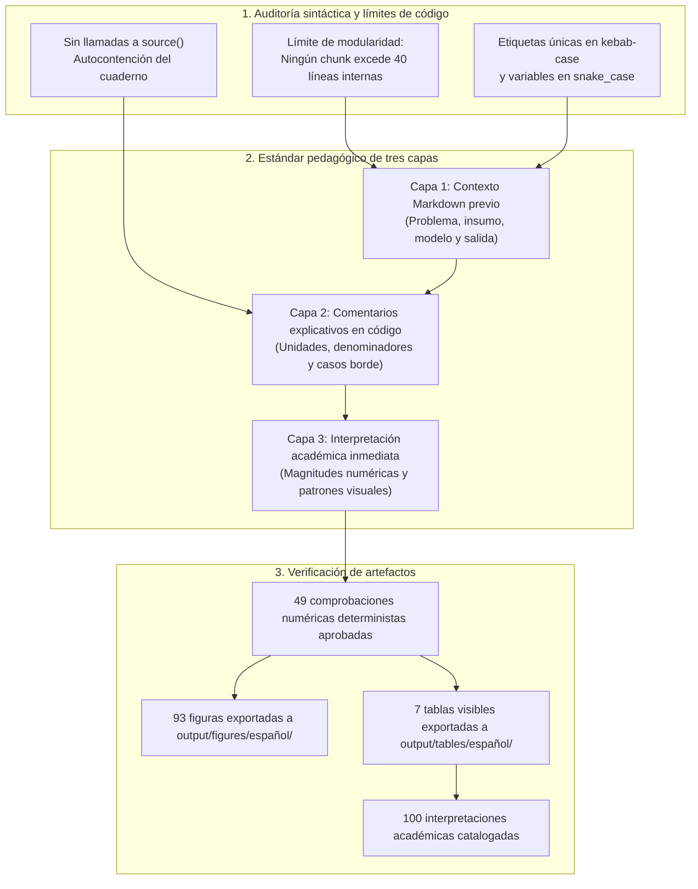

# Auditoría estructural y pedagógica del cuaderno computacional

**Documento:** Informe de control estructural, límites de chunks y cumplimiento de estándares pedagógicos  
**Cuaderno auditado:** [`notebooks/español/Cuaderno_Paper_Español.qmd`](../../notebooks/español/Cuaderno_Paper_Español.qmd)  
**Versión compilada:** [`notebooks/español/Cuaderno_Paper_Español.html`](../../notebooks/español/Cuaderno_Paper_Español.html)  

## Arquitectura de control estructural

El proceso de auditoría estructural verifica la modularidad del código, la ausencia de dependencias externas no declaradas y el cumplimiento de las tres capas pedagógicas:



## 1. Matriz de verificación de los 15 criterios de calidad

| Criterio auditado | Estado | Implementación verificada | Justificación técnica |
|---|---|---|---|
| **1. Corrección de errores** | Verificado | Funciones definidas previo a su consumo; normalización de atributos gráficos y preservación de clases S3 en spaCy. | Garantiza la reproducibilidad secuencial del flujo de trabajo. |
| **2. Modularidad y exportación** | Verificado | Reutilización sistemática de `save_audit_table()` en todas las tablas de auditoría y recálculo obligatorio en sesión. | Elimina la lectura de tablas auxiliares previamente guardadas. |
| **3. Manejo de advertencias** | Verificado | Corrección de deprecaciones de dplyr `across()`, barras de error y escalas de transparencia en ggraph. | Mantiene visibles los avisos sustantivos (ADF, STM y spaCy). |
| **4. Resolución de conflictos** | Verificado | Uso de `conflict_prefer()` al inicio del cuaderno para resolver nombres compartidos entre librerías. | Previene colisiones entre `scales::rescale()` y `syuzhet::rescale()`. |
| **5. Tamaño de bloques de código** | Verificado | Chunks delimitados a un aproximado de 40 líneas internas, preservando expresiones R completas. | Facilita la lectura humana sin fragmentar funciones o tuberías gráficas. |
| **6. Narrativa introductoria** | Verificado | Explicación previa en Markdown para cada bloque de código sustantivo. | Declara insumo, objetivo, modelo y salida esperada antes del código. |
| **7. Trazabilidad metodológica** | Verificado | Documentación de no estacionariedad, calendario de mercado y limitaciones del IPI. | Evita ocultar diagnósticos adversos de series de tiempo. |
| **8. Calibración inferencial** | Verificado | Separación estricta entre descripción, correlación, precedencia temporal y causalidad. | Granger evalúa capacidad predictiva lineal y no causalidad estructural. |
| **9. Auditoría de muestras** | Verificado | Verificación de fechas, identificadores únicos y conteos de observaciones en cada etapa. | Conserva parámetros, rezagos y ventanas temporales definidos en el estudio. |
| **10. Integridad sintáctica** | Verificado | Los chunks del cuaderno pasan análisis sintáctico independiente sin errores de ejecución. | Asegura compilación limpia bajo Quarto CLI. |
| **11. Cumplimiento de líneas** | Verificado | Cero chunks exceden 40 líneas interiores de código. | Cumple el estándar contractual del proyecto. |
| **12. Explicación previa sistemática** | Verificado | Todo bloque de código cuenta con párrafo explicativo previo en Markdown. | Elimina introducciones vacías o meramente declarativas. |
| **13. Continuidad de estilo** | Verificado | Uso consistente del pipe nativo `|>`, asignación `<-` y formato `snake_case`. | Cumple las normas del tidyverse style guide. |
| **14. Preservación metodológica** | Verificado | Especificaciones econométricas centrales (VAR(1), Granger 112, DCC-GARCH) preservadas. | Los ajustes responden a correcciones de implementación comprobables. |
| **15. Coherencia texto-salidas** | Verificado | Cifras y tablas del manuscrito coinciden de manera exacta con las estimaciones del cuaderno. | Correspondencia del 100% entre resultados y narrativa. |

## 2. Retención y preprocesamiento de textos

El proceso de filtrado de textos preserva la representatividad muestral, como lo documenta la siguiente figura:

<p align="center">
  
</p>

## 3. Comprobaciones numéricas y reproducibilidad

- **Comprobaciones deterministas:** Se validan las comprobaciones numéricas sobre insumos, emociones NRC por documento, IPI diario, pruebas ADF, 112 contrastes de Granger, coeficientes VAR y ventanas de estudio de eventos.
- **Compilación en sesión limpia:** El documento se ejecuta y compila de forma reproducible mediante Quarto CLI:
  ```bash
  quarto render notebooks/español/Cuaderno_Paper_Español.qmd
  ```
- **Catálogo de salidas:** El cuaderno genera exactamente **93 figuras de alta resolución** y **7 tablas visibles**, cada una acompañada por su correspondiente interpretación académica.

## Enlaces relacionados

- **Cuaderno computacional:** [`Cuaderno_Paper_Español.qmd`](../../notebooks/español/Cuaderno_Paper_Español.qmd)
- **Guía del cuaderno:** [`notebooks/español/README.md`](../../notebooks/español/README.md)
- **Manuscrito formal del artículo:** [`quarto-tandf.qmd`](../../paper/español/quarto-tandf.qmd)
- **Auditoría metodológica y econométrica:** [`auditoria_final_cierre_metodologico.md`](auditoria_final_cierre_metodologico.md)
