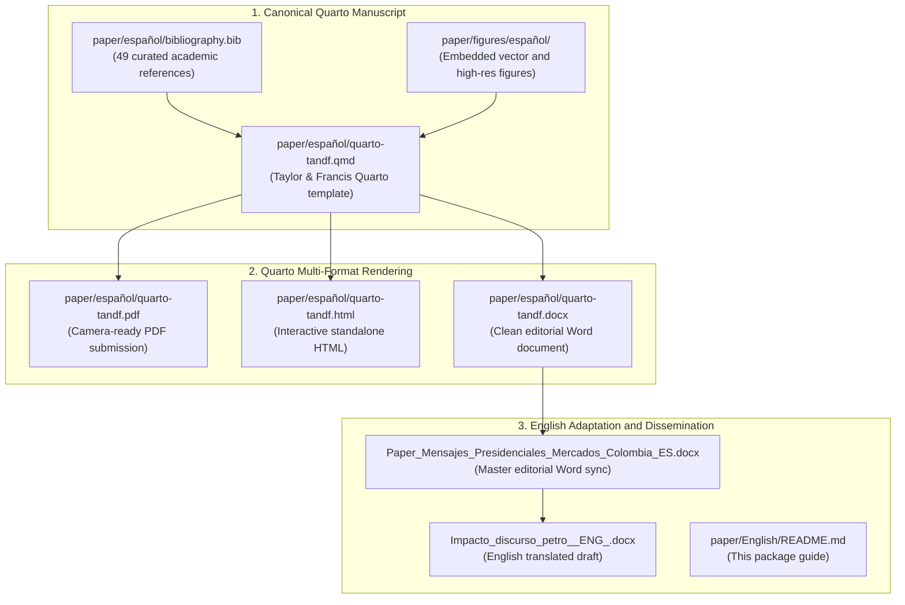

# English Manuscript and Publication Materials

This folder contains the translation and international publication materials for the academic paper *Presidential Communication and Financial Markets in Colombia: Textual and Time Series Evidence*.

The canonical manuscript is written in Spanish following Taylor & Francis author guidelines in [`paper/español/quarto-tandf.qmd`](../español/quarto-tandf.qmd). This directory houses the English adaptation assets and editorial Word packages used for journal submission and dissemination.

## Publication Package Architecture

The diagram below illustrates the relationship between the canonical Quarto manuscript in Spanish, the compiled formats, and the English editorial artifacts:



## Folder Contents and Synchronization

| File | Description | Target Audience |
|---|---|---|
| [`Paper_Mensajes_Presidenciales_Mercados_Colombia_ES.docx`](Paper_Mensajes_Presidenciales_Mercados_Colombia_ES.docx) | Synchronized editorial Word version generated from `quarto-tandf.qmd` | Journal production editors and co-authors |
| [`Impacto_discurso_petro__ENG_.docx`](Impacto_discurso_petro__ENG_.docx) | English translation draft of the complete research paper | International peer review and journal submission |
| [`README.md`](README.md) | Architectural documentation for the manuscript package | Peer reviewers and replicating researchers |

## Key Manuscript Figures

The manuscript embeds standalone figures generated directly from the reproducible R pipeline:

### Emotional Taxonomy of Presidential Communication

The paper uses Plutchik's psychodevelopmental wheel of emotions as the theoretical foundation for classifying presidential language via the Spanish NRC lexicon.

<p align="center">
  
</p>

### Granger Temporal Precedence Tests

The 112 bivariate Granger causality tests evaluating whether presidential emotional signals precede Colombian market returns over 1 to 4 trading sessions.

<p align="center">
  
</p>

## Compilation Instructions

To compile the canonical manuscript from the repository root:

```bash
# Render camera-ready PDF
quarto render paper/español/quarto-tandf.qmd --to pdf

# Render interactive HTML
quarto render paper/español/quarto-tandf.qmd --to html

# Render editorial Word document
quarto render paper/español/quarto-tandf.qmd --to docx
```

## Related Links

- **Canonical Spanish Manuscript:** [`quarto-tandf.qmd`](../español/quarto-tandf.qmd)
- **Spanish Manuscript Documentation:** [`paper/español/README.md`](../español/README.md)
- **Computational Notebook:** [`Cuaderno_Paper_Español.qmd`](../../notebooks/español/Cuaderno_Paper_Español.qmd)
- **Methodological Supervision Suite:** [`Supervision_Metodologica.qmd`](../../Methodology_Supervision/Supervision_Metodologica.qmd)
- **Master Repository Documentation:** [`README.md`](../../README.md) (English) | [`README.es.md`](../../README.es.md) (Español)
