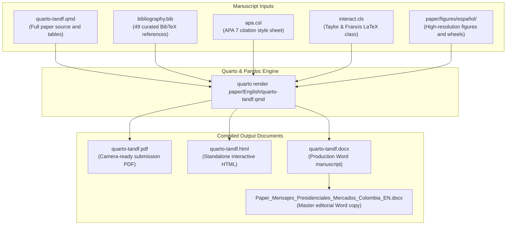
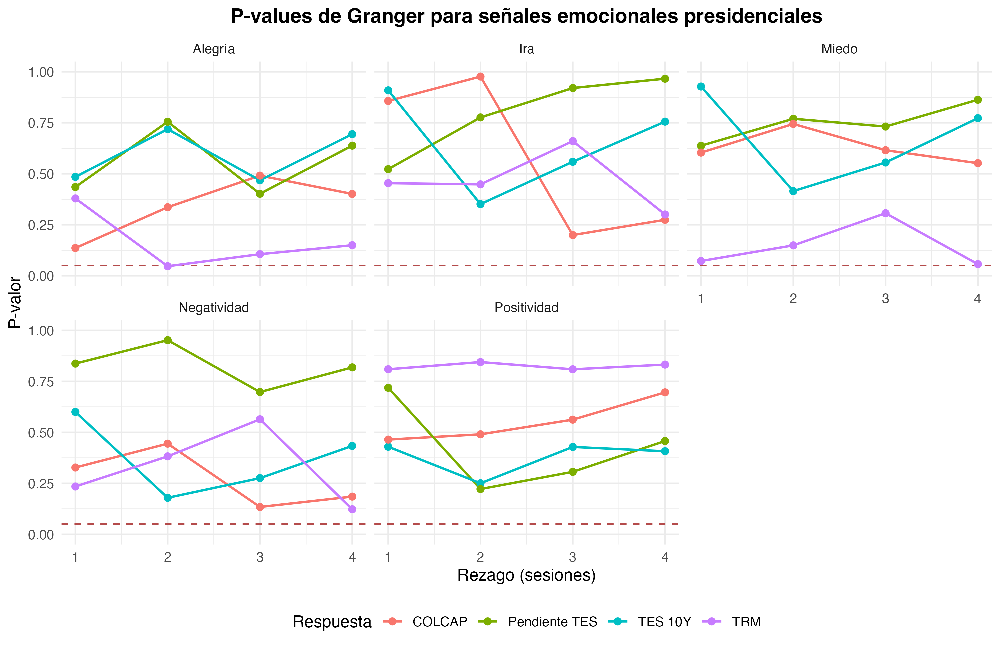

# Formal Research Manuscript (English Edition)

This directory contains the canonical English edition of the academic paper *Presidential Emotional Communication on X/Twitter and Financial Market Dynamics in Colombia: Tone, Emotions, and Discursive Intensity*, prepared under Taylor & Francis author guidelines.

The primary document is [`quarto-tandf.qmd`](quarto-tandf.qmd), which compiles reproducibly into a camera-ready PDF for peer review, an interactive standalone HTML version, and an editable Word manuscript.

## Manuscript Compilation Architecture

The diagram below outlines the inputs, citation assets, and rendering workflow for the English publication package:



## Directory Structure and Artifacts

| File | Purpose |
|---|---|
| [`quarto-tandf.qmd`](quarto-tandf.qmd) | Complete Quarto source containing frontmatter, empirical text, LaTeX equations, and formatted tables |
| [`bibliography.bib`](bibliography.bib) | BibTeX database with 49 verified and normalized academic references |
| [`quarto-tandf.pdf`](quarto-tandf.pdf) | Camera-ready PDF compiled via XeLaTeX and `interact.cls` for peer evaluation |
| [`quarto-tandf.html`](quarto-tandf.html) | Standalone interactive HTML document with dynamic tables and embedded vector plots |
| [`quarto-tandf.docx`](quarto-tandf.docx) | Editorial Word version generated with `reference-apa.docx` styling |
| [`Paper_Mensajes_Presidenciales_Mercados_Colombia_EN.docx`](Paper_Mensajes_Presidenciales_Mercados_Colombia_EN.docx) | Synchronized editorial Word document for co-authors and editorial committees |
| [`apa.csl`](apa.csl) | Citation Style Language stylesheet implementing APA 7th edition guidelines |
| [`interact.cls`](interact.cls) | Official Taylor & Francis LaTeX document class |
| [`orcidlink.sty`](orcidlink.sty) | LaTeX package rendering author ORCID identification links |
| [`reference-apa.docx`](reference-apa.docx) | Word reference document enforcing typography and table geometry |
| [`sunflower.png`](sunflower.png) | Template graphical asset required by the Taylor & Francis LaTeX bundle |

## Key Manuscript Figures

The paper incorporates standalone figures generated by the reproducible research pipeline:

### Emotional Taxonomy of Presidential Communication

Theoretical foundation using Plutchik's psychodevelopmental wheel to structure presidential tone and sentiment classification via the Spanish NRC lexicon.

<p align="center">
  
</p>

### Granger Temporal Precedence Tests

Empirical evaluation of 112 bivariate Granger causality tests assessing whether presidential emotional signals precede Colombian market returns across 1 to 4 trading sessions.

<p align="center">
  
</p>

## Compilation Instructions

From the root of the repository, execute the Quarto CLI to generate any of the target formats:

```bash
# Render camera-ready PDF for journal peer review
quarto render paper/English/quarto-tandf.qmd --to pdf

# Render interactive standalone HTML version
quarto render paper/English/quarto-tandf.qmd --to html

# Render editorial Word document
quarto render paper/English/quarto-tandf.qmd --to docx
```

## Related Resources

- **Canonical Spanish Manuscript:** [`paper/español/quarto-tandf.qmd`](../español/quarto-tandf.qmd)
- **Spanish Manuscript Documentation:** [`paper/español/README.md`](../español/README.md)
- **Executable Computational Notebook:** [`notebooks/español/Cuaderno_Paper_Español.qmd`](../../notebooks/español/Cuaderno_Paper_Español.qmd)
- **Computational Notebook Guide:** [`notebooks/español/README.md`](../../notebooks/español/README.md)
- **Methodological Supervision Suite:** [`Methodology_Supervision/Supervision_Metodologica.qmd`](../../Methodology_Supervision/Supervision_Metodologica.qmd)
- **Repository Overview:** [`README.md`](../../README.md) (English) | [`README.es.md`](../../README.es.md) (Español)
