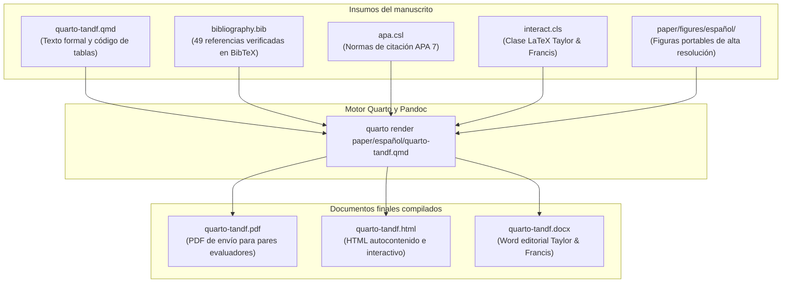

# Manuscrito formal del artículo de investigación

Esta carpeta contiene la fuente canónica del artículo de investigación académica *Comunicación presidencial y mercados financieros en Colombia: evidencia textual y de series de tiempo*, estructurado bajo el formato y estándares editoriales de Taylor & Francis.

El documento principal es [`quarto-tandf.qmd`](quarto-tandf.qmd), el cual se compila de manera reproducible a formatos PDF (apto para envío y evaluación por pares), HTML interactivo y documento de Word editable.

## Flujo de compilación del manuscrito

El diagrama siguiente describe la arquitectura de insumos, estilos y compilación del artículo:



## Estructura de archivos

| Archivo | Propósito |
|---|---|
| [`quarto-tandf.qmd`](quarto-tandf.qmd) | Archivo fuente Quarto del manuscrito con metadatos, texto, ecuaciones y código de tablas |
| [`bibliography.bib`](bibliography.bib) | Archivo BibTeX con 49 referencias académicas verificadas y normalizadas |
| [`quarto-tandf.pdf`](quarto-tandf.pdf) | Manuscrito compilado en PDF listo para evaluación de pares |
| [`quarto-tandf.html`](quarto-tandf.html) | Manuscrito compilado en HTML con tablas interactivas |
| [`quarto-tandf.docx`](quarto-tandf.docx) | Versión Word compilada para producción editorial |
| [`apa.csl`](apa.csl) | Archivo de estilo CSL para citas y referencias en formato APA 7 |
| [`interact.cls`](interact.cls) | Clase oficial LaTeX de Taylor & Francis |
| [`paper/figures/español/`](../figures/español/) | Figuras vectoriales y de alta resolución incluidas en el artículo |

## Figuras principales del artículo

El manuscrito incorpora figuras portables generadas directamente por el pipeline analítico reproducible:

### Taxonomía emocional de Plutchik aplicada al discurso

Marco teórico psicoevolutivo para la descomposición de sentimientos y emociones en el lenguaje presidencial.

<p align="center">
  
</p>

### Contrastes de causalidad de Granger

Rejilla de 112 contrastes bivariados de precedencia temporal entre emociones presidenciales y retornos financieros colombianos para rezagos 1 a 4.

<p align="center">
  
</p>

## Instrucciones de compilación

Desde la raíz del repositorio, ejecute Quarto para compilar el formato deseado:

```bash
# Compilar PDF formal para evaluación
quarto render paper/español/quarto-tandf.qmd --to pdf

# Compilar versión interactiva en HTML
quarto render paper/español/quarto-tandf.qmd --to html

# Compilar versión Word para comités editoriales
quarto render paper/español/quarto-tandf.qmd --to docx
```

## Redirección y enlaces relacionados

- **Cuaderno computacional en español:** [`Cuaderno_Paper_Español.qmd`](../../notebooks/español/Cuaderno_Paper_Español.qmd)
- **Guía del cuaderno en español:** [`notebooks/español/README.md`](../../notebooks/español/README.md)
- **Cuaderno computacional en inglés:** [`Cuaderno_Paper_English.qmd`](../../notebooks/English/Cuaderno_Paper_English.qmd)
- **Guía del cuaderno en inglés:** [`notebooks/English/README.md`](../../notebooks/English/README.md)
- **Manuscrito formal en inglés:** [`paper/English/quarto-tandf.qmd`](../English/quarto-tandf.qmd)
- **Módulo de supervisión metodológica:** [`Supervision_Metodologica.qmd`](../../Methodology_Supervision/Supervision_Metodologica.qmd)
- **Documentación principal del proyecto:** [`README.es.md`](../../README.es.md) (Español) | [`README.md`](../../README.md) (English)
- **Paquete de publicación en inglés:** [`paper/English/README.md`](../English/README.md)
