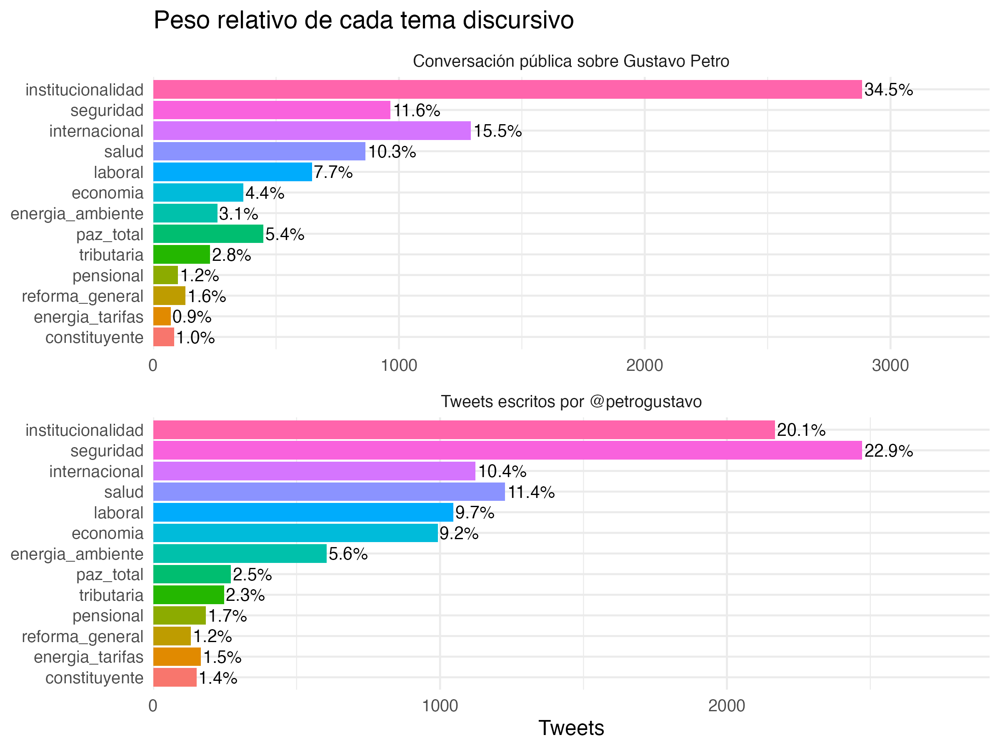
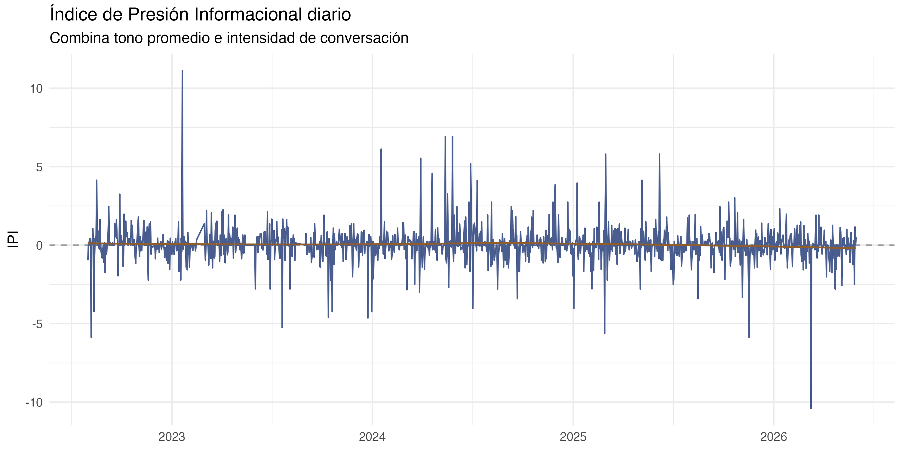

**Afiliación.** Facultad de Economía, Universidad Militar Nueva Granada, Bogotá, Colombia. Los tres autores comparten la afiliación indicada en el manuscrito original. **Autor de correspondencia:** Luis Eduardo Sandoval Garrido, <luis.sandoval@unimilitar.edu.co>.

**Resumen.**

Este artículo examina la relación observacional entre la comunicación presidencial, la conversación pública recopilada sobre Gustavo Petro y cuatro ámbitos de mercado en Colombia. Se auditaron 14.659 publicaciones de la cuenta presidencial y 13.648 de un corpus de conversación pública, entre agosto de 2022 y mayo de 2026, junto con la TRM, COLCAP, tasas TES y precio de bolsa de energía. Se describieron coberturas y temas, se construyeron medidas léxicas e índice de presión informacional (IPI), y se aplicaron pruebas de series temporales, modelos de volatilidad y correlación condicional, contrastes de Granger y ventanas descriptivas de eventos. Una corrección reproducible de zona horaria y unidad bursátil eliminó 463 retornos repetidos: el panel resultante contiene 934 sesiones únicas y 898 observaciones completas para el sistema principal. Las 208 pruebas de precedencia arrojan 19 rechazos nominales y ninguno tras ajustar por tasa de falsos descubrimientos en las familias implementadas. Las correlaciones DCC medias son pequeñas, aunque el modelo conserva diagnósticos adversos y su parámetro de reacción no es significativo. El corpus público tiene cupos de extracción y no representa la actividad total de la plataforma. Los resultados delimitan la información predictiva de estas señales diarias; no identifican un efecto causal de los mensajes sobre los mercados.

**Palabras clave:** comunicación presidencial; conversación pública; Twitter; mercados financieros; análisis textual; Colombia.

**Abstract.**

This article examines observational relationships among presidential communication, a collected corpus of public discussion about Gustavo Petro, and Colombian financial markets. We audit 14,659 posts from the president's account and 13,648 collected public posts from August 2022 through May 2026, alongside the official exchange rate, COLCAP, sovereign bond yields, and the electricity spot price. We describe coverage and topics, construct lexical sentiment measures and an informational pressure index, and apply time series diagnostics, volatility and conditional correlation models, Granger tests, and descriptive event windows. Reproducible corrections to local dates and the trading session unit remove 463 duplicated market returns. The resulting panel has 934 unique response sessions and 898 complete observations for the main system. Across 208 predictive precedence tests, 19 are nominally significant and none remains significant after false discovery rate adjustment within the implemented families. Mean DCC correlations are small, but several model diagnostics remain adverse and the correlation response parameter is not significant. The collected public corpus has extraction caps and cannot measure total platform activity. These findings bound the predictive evidence available at daily frequency; they do not identify a causal effect of presidential messages on markets.

**Keywords:** presidential communication; public conversation; Twitter; financial markets; text analysis; Colombia.

# 1. Introducción

La comunicación de un presidente puede incorporarse con rapidez al conjunto de información que observan ciudadanos, medios e inversionistas. Twitter (actualmente X) permite estudiar esa comunicación con marcas temporales y documentos individuales, pero también reúne mensajes de terceros que no deben atribuirse al mandatario. Distinguir ambas fuentes es indispensable para examinar su relación con las variables financieras colombianas. Estudios internacionales han observado respuestas de mercado a mensajes políticos mediante cotizaciones de alta frecuencia; trasladar esas conclusiones a series diarias y a otro contexto institucional exige cautela [@gjerstad_etal_2021; @bianchi_gomezcram_kung_2024].

Este artículo pregunta: **¿en qué medida el contenido, el sentimiento y la actividad observada en los mensajes de \@petrogustavo y en la conversación pública recopilada sobre Gustavo Petro preceden o acompañan variaciones de la TRM, el COLCAP, los rendimientos TES y el precio de bolsa de energía en Colombia durante la ventana empírica disponible?** La formulación diferencia el discurso presidencial directo de las intervenciones de otros usuarios. También separa la precedencia temporal de una afirmación causal: un hecho político o macroeconómico puede motivar a la vez mensajes y movimientos financieros.

El objetivo general es caracterizar estas señales discursivas y evaluar su asociación y contenido predictivo respecto de las series financieras observadas, sin atribuirles un efecto causal no identificado. Cuatro objetivos específicos articulan el análisis: (1) describir la cobertura, composición y evolución de los dos corpus; (2) construir y examinar medidas de temas, sentimiento e índice de presión informacional (IPI); (3) establecer las propiedades temporales y la disponibilidad efectiva de las señales textuales y de mercado; y (4) contrastar asociaciones, correlaciones dinámicas y precedencia predictiva con los modelos y diagnósticos reproducibles del estudio.

La contribución empírica consiste en una comparación explícita entre la cuenta presidencial y la conversación pública observada, junto con un panel que distingue días calendario de jornadas efectivamente observadas de mercado. La contribución metodológica es la trazabilidad entre cada afirmación, su unidad de análisis, el cálculo que la respalda y el alcance inferencial permitido. El estudio amplía la ventana del trabajo inicial, centrado en marzo y abril de 2023 y en el índice COLEQTY, y emplea las series vigentes del repositorio. El antiguo ejercicio aporta antecedentes y bibliografía, pero no determina las cifras ni las conclusiones de este artículo.

Después de revisar la literatura, se describen fuentes, variables y procedimientos; siguen los resultados textuales y temporales, la evaluación econométrica, la discusión de su alcance, las limitaciones y las conclusiones. El cuaderno ejecutable del repositorio constituye el principal anexo metodológico.

# 2. Revisión de la literatura

## 2.1 Comunicación política y datos de redes sociales

Las plataformas digitales modificaron los ritmos y las vías de circulación del discurso político: un mensaje presidencial puede difundirse sin mediación periodística inicial y desencadenar respuestas de otros actores. Esta observabilidad favorece el análisis de contenido y redes, pero la disponibilidad de publicaciones no equivale a una muestra representativa de opinión pública. Los mecanismos de búsqueda, recuperación y exclusión condicionan qué conversación queda registrada [@kearney_2019; @urdinez_cruz_2020; @prada_espinel_2018]. En consecuencia, este estudio separa la cuenta oficial de los mensajes de terceros y documenta la cobertura de cada corpus antes de interpretar actividad o sentimiento.

La investigación sobre comunicación digital ha relacionado hashtags y menciones con coordinación, visibilidad y asociación entre actores, aunque una coaparición textual no revela por sí sola apoyo, oposición ni influencia. Los trabajos sobre acción conectiva y discurso en redes muestran la utilidad de estas estructuras para ubicar agendas y comunidades; a la vez, advierten que su significado depende del contexto de cada publicación [@ince_2017; @trott_2018]. Por ello, las redes aquí sirven para describir vínculos de coocurrencia y no se emplean como prueba de transmisión económica.

## 2.2 Texto, temas y medición del sentimiento

Convertir textos políticos en variables cuantitativas requiere separar el fenómeno de interés de la herramienta que lo mide. Las matrices documento-término, frecuencias, términos distintivos y colocaciones resumen regularidades observables; Wordfish y los modelos estructurales de tópicos añaden estructuras latentes cuya orientación o etiqueta debe interpretarse con cautela [@benoit_textual_2018; @quanteda; @blei_2003; @slapin_proksch_2008; @stm; @schweinberger_2023; @wiedemann_niekler_2017]. El modelo de tópicos no identifica una agenda «verdadera», y una posición Wordfish no se traduce automáticamente en un eje ideológico. Este artículo triangula esos resultados con ejemplos de documentos, categorías de reforma y medidas temporales.

La medición automática del sentimiento enfrenta negación, ironía, polisemia y diferencias entre dominios. Los léxicos emocionales permiten construir variables comparables, mientras que la agregación temporal ofrece señales sintéticas; ninguna de estas operaciones garantiza que el índice corresponda exactamente a la postura política o a las expectativas financieras de quien escribe [@plutchik_2003; @mohammad_turney_2010; @medhat_2014; @jockers_2017; @sentometrics_jss]. La clasificación temática con etiquetas derivadas de reglas añade otro problema: una evaluación contra esas mismas etiquetas mide concordancia con la supervisión débil, no exactitud frente a una verdad codificada independientemente. Trabajos recientes muestran el valor de evaluar clasificadores políticos con etiquetas revisadas del dominio de interés; aquí esa alternativa delimita una línea futura y no se atribuye al pipeline vigente [@wang_2023_topic_classification]. Por ello las métricas implementadas se presentan junto con el modelo base, el desempeño por clase y sus límites.

## 2.3 Comunicación política y mercados financieros

Una posible relación entre mensajes políticos y mercados puede surgir porque los textos transmiten información novedosa, expresan incertidumbre o reaccionan a hechos ya conocidos. Los diseños que utilizan la hora exacta de publicación y cotizaciones intradía acotan con mayor precisión el orden temporal de los acontecimientos. El presente estudio, con agregación diaria y datos observacionales, responde a una pregunta distinta: si sus señales muestran asociación o información predictiva en la frecuencia disponible. Las teorías sobre decisiones bajo riesgo motivan examinar expectativas y tono, pero no sustituyen una estrategia de identificación [@kahneman_1979; @mullainathan_thaler_2000].

La evidencia existente tampoco implica que toda publicación sea relevante para todos los activos. El tema, el emisor, la novedad del mensaje, el horizonte de observación y los movimientos simultáneos de política económica pueden alterar la relación estimada. Esta heterogeneidad justifica comparar mensajes presidenciales con conversación pública, y TRM, acciones, deuda y energía por separado. También hace sustantiva una ausencia de señales robustas: no encontrar precedencia predictiva tras controlar pruebas múltiples delimita el contenido informativo de las medidas usadas, sin probar que ninguna comunicación política pueda afectar precios en otras escalas temporales.

## 2.4 Evidencia colombiana y vacío de investigación

Los antecedentes colombianos sobre la comunicación política en Twitter ayudan a situar el corpus, aunque no proporcionan por sí mismos una estimación del vínculo diario entre estos dos conjuntos de mensajes y los mercados elegidos [@prada_espinel_2018; @casallas_2020]. El paper original examinó una ventana corta y una serie accionaria distinta. La actualización aporta una ventana más extensa, procedimientos reproducibles, distinción de corpus, fuentes financieras auditadas y evaluación explícita de diagnósticos y comparaciones múltiples. El vacío que aborda es empírico y metodológico: conocer qué relaciones permanecen observables cuando se precisan las unidades, las coberturas y la temporalidad de cada serie.

# 3. Metodología

## 3.1 Diseño, población observada y unidades

La investigación tiene enfoque cuantitativo y componentes exploratorios, descriptivos, correlacionales y predictivos. Explora vocabulario, temas y redes; describe cobertura y distribuciones; mide covariaciones; y evalúa si señales previas aportan información sobre respuestas posteriores en especificaciones temporales. Los datos son observacionales. No se asignaron mensajes ni shocks de manera aleatoria y no existe un mecanismo de identificación que permita estimar efectos causales estructurales.

La unidad textual es el mensaje individual con identificador y fecha en hora de Bogotá. El corpus `presidente` reúne las publicaciones disponibles de \@petrogustavo; `opinion` reúne los mensajes recuperados por el procedimiento de búsqueda de conversación pública sobre Petro. Este último es el **corpus observado**, no una medición exhaustiva del número de publicaciones de la plataforma. Sus criterios de recuperación, posibles huecos y concentración horaria se detallan en la sección de datos. La unidad temporal cambia según la pregunta: día calendario para descripción textual y energía; jornada de mercado observada para los modelos bursátiles. No corresponde calcular un tamaño de muestra como en una encuesta probabilística.

## 3.2 Fuentes, cobertura y depuración

Los mensajes originales proceden de 46 archivos mensuales para `opinion` y del archivo consolidado de la cuenta presidencial. El código de extracción de opinión disponible consulta la búsqueda de X para `"Gustavo Petro" OR @petrogustavo`, restringe el idioma a español y excluye retuits, respuestas, citas y publicaciones con enlaces. Su función reparte un objetivo mensual en cupos por día, pagina hasta alcanzar el cupo o agotar los resultados y deduplica identificadores. La consulta especifica intervalos diarios en UTC, mientras que la fecha de análisis se calcula después en Bogotá. No se conservan registros de ejecución para probar que todos los archivos históricos se obtuvieron con la misma versión del script o en idénticas condiciones de acceso a la API. Por eso, el conteo de `opinion` describe publicaciones recuperadas y no la intensidad total ni una muestra probabilística de la conversación pública.

`scripts/data/twitter_process_raw_data.R` normaliza los campos, preserva el texto original y las marcas de tiempo UTC, deriva la fecha analítica en `America/Bogota`, limpia caracteres de control y deduplica por identificador. El dataset maestro conserva una fila por `(corpus, id)`; el subconjunto textual excluye mensajes cuyo texto limpio queda vacío. Los días sin recuperación no se interpretan como ausencia de conversación en la plataforma. Para preservar la diferencia entre fuente y calendario, la auditoría registra el identificador, la hora UTC, la hora local y la fecha analítica de cada mensaje. La corrección de fecha local aplicada en esta actualización y sus consecuencias se documentan en el registro de auditoría del repositorio.

Los datos financieros provienen de los archivos brutos versionados del proyecto y de las fuentes indicadas por el script de ingesta: TRM, COLCAP y tasas cero cupón TES de 1, 5 y 10 años del Banco de la República, más el precio de bolsa nacional de energía publicado por XM. La TRM se expresa en pesos por dólar; COLCAP, en puntos de índice; los TES, en unidades de tasa; y XM, en pesos por kWh. La pendiente TES 10Y–1Y es la diferencia entre ambas tasas. El estudio documenta para cada serie la primera y última fecha válida, observaciones reales, faltantes y origen. Los valores propagados a sábados y domingos para determinadas series financieras se identifican con banderas separadas y no cuentan como nuevas transacciones. Los días festivos sin dato observado permanecen faltantes. El precio XM no recibe esa propagación.

El registro de mercado se transforma en rendimientos logarítmicos para TRM y COLCAP cuando ambos niveles son positivos y están observados; los TES se analizan mediante diferencias de tasas. La energía emplea rendimientos logarítmicos entre precios diarios positivos observados. Las fechas, denominadores y exclusiones de cada transformación se auditan antes de estimar modelos. El índice COLEQTY documentado en el paper anterior se menciona únicamente como antecedente de la elección histórica de series [@bvc_2018_coleqty]; no se confunde con COLCAP ni entra en las especificaciones vigentes.

## 3.3 Operacionalización y secuencia analítica

| Variable | Construcción y unidad | Uso e interpretación |
|:--|:--|:--|
| Corpus y actividad | `presidente` u `opinion`; mensajes recuperados por fecha de Bogotá | Composición y cobertura observada; el número de `opinion` no estima volumen poblacional. |
| Tema | Reglas léxicas, términos distintivos, STM y clasificador auxiliar | Describe agenda y estructura textual; las etiquetas de reglas son supervisión débil. |
| Polaridad y emociones | Conteos NRC por documento; tasas por mil palabras y promedios diarios o por intervalo | Señal léxica, no postura política ni expectativa individual directamente observada. |
| IPI | $z(\mathrm{polaridad}/n)\,z[\log(1+n)]$ dentro de cada universo declarado | Combinación estandarizada de tono e intensidad del corpus recopilado; el signo requiere mirar ambos factores. |
| TRM y COLCAP | Nivel observado en COP/USD y puntos; diferencia de logaritmos entre sesiones válidas | Respuesta financiera en rendimiento logarítmico, sin duplicar una sesión. |
| TES 1, 5 y 10 años | Tasas cero cupón observadas; cambio de tasa 10 años y cambio de pendiente 10Y–1Y | Respuesta en unidades de tasa, no rendimiento porcentual del precio de un bono. |
| Energía XM | Precio nacional de bolsa en COP/kWh; rendimiento logarítmico entre fechas válidas | Panel diario propio, con calendario diferente del bursátil. |

: Operacionalización de las variables del estudio. Fuente: elaboración de los autores a partir de los scripts, datos maestros y cuaderno reproducible. {#tbl-operacionalizacion}

El procedimiento enlaza datos brutos, limpieza, datasets maestros, exploración, análisis léxico, redes y temas, sentimiento e IPI, agregación temporal, diagnóstico de series, modelos y pruebas de robustez. El análisis principal se realiza en R. `quanteda`, `stm`, `sentometrics` y `spacyr` apoyan los componentes textuales; `tseries`, `urca`, `vars`, `rugarch`, `rmgarch` y `MSwM` se utilizan donde corresponden a las especificaciones efectivamente ejecutadas. El repositorio conserva scripts, datos procesados, cuaderno, tablas y figuras para revisar cada etapa.

{#fig-flujo width="100%"}

*Nota.* Fuente: elaboración de los autores. El cuaderno metodológico y los archivos de reproducción se encuentran en <https://github.com/juanjo-edm/What_is_the_economic_impact_of_Colombian_President_tweets>.

## 3.4 Análisis textual y clasificación temática

La limpieza preserva una versión original de cada mensaje y crea otra para tokenización. Sobre esa segunda versión se calculan frecuencias, TF-IDF, hashtags, menciones, términos distintivos y colocaciones. Las redes definen nodos como términos, etiquetas o cuentas según el gráfico; una arista une elementos que coocurren en la misma unidad textual, y su peso expresa la frecuencia o medida de asociación especificada. Centralidades y comunidades resumen la estructura del grafo; no identifican efectos entre sus nodos. El análisis de correspondencias y la agrupación jerárquica sirven para visualizar proximidades, sin convertir distancia geométrica en equivalencia semántica [@el_hamdouchi_1986; @husson_2016].

Wordfish estima una coordenada latente a partir de los conteos de palabras por documento, con parámetros de frecuencia y discriminación por término. Su escala se orienta mediante documentos y vocabulario extremos observados, sin imponerle una interpretación ideológica. STM representa cada documento mediante una mezcla de tópicos y cada tópico mediante una distribución de términos; su lectura se apoya en prevalencia, coherencia y ejemplos de mensajes. El enriquecimiento lingüístico con spaCy agrega entidades, lemas y frases nominales a una muestra definida del corpus. Estas técnicas responden a preguntas descriptivas distintas y no se convierten en estimadores financieros por el solo hecho de compartir datos de origen.

La clasificación temática auxiliar parte de etiquetas construidas por reglas, transforma textos en una matriz TF-IDF y compara el clasificador implementado con un baseline de clase mayoritaria. Se reportan exactitud, F1 macro y desempeño por clase cuando la ejecución los produzca. La partición de entrenamiento y prueba evalúa consistencia frente a etiquetas débiles; no constituye una muestra de validación independiente codificada por personas. La reasignación de `otros` respeta el umbral de confianza del cuaderno y se interpreta como sensibilidad descriptiva.

## 3.5 Sentimiento e índice de presión informacional

El léxico NRC aporta conteos de categorías emocionales y términos positivos y negativos por documento. La polaridad diaria procede de la diferencia entre conteos positivos y negativos; las tasas emocionales normalizan por el total de palabras analizadas antes de estandarizarse cuando así lo define el cuaderno. `sentometrics` construye medidas agregadas por corpus y agenda. Toda comparación entre corpus conserva su denominador y su cobertura, evitando equiparar una cuenta individual con una muestra de publicaciones de terceros.

El IPI combina tono medio e intensidad **dentro del conjunto de mensajes efectivamente observado**, mediante la fórmula implementada en el cuaderno:

$$
\mathrm{IPI}_{d}=z\!\left(\frac{\mathrm{polaridad}_{d}}{n_{d}}\right)
                 z\!\left(\log(1+n_{d})\right),
$$

donde $n_d$ es el número de mensajes incluidos en el universo específico del índice y $z$ estandariza cada componente en ese universo. La multiplicación implica que un valor positivo no significa necesariamente sentimiento positivo: ambos componentes estandarizados también pueden ser negativos. Se distinguen la variante temática del corpus `opinion` y la variante por corpus; sus coberturas y escalas no se mezclan silenciosamente. En `opinion`, el conteo refleja el procedimiento de recuperación y no el volumen total de Twitter.

## 3.6 Alineación temporal e identificación

El texto se fecha en Bogotá y las respuestas de COLCAP y TES se basan únicamente en observaciones reales de mercado. La unidad bursátil exige que cada fecha de respuesta aparezca una sola vez dentro de cada corpus. Las señales que anteceden a esa fecha se agregan conforme a reglas explícitas que conservan el significado de sus componentes. El panel eléctrico mantiene su calendario propio. La auditoría registra intervalos, cobertura y correspondencias antes de cualquier contraste.

Sea $b(t)$ la primera sesión bursátil observada estrictamente posterior al día local $t$. La asignación anterior se escribe $S_{[b]}=g\{S_t:b(t)=b\}$, donde $g$ suma los conteos de publicaciones, palabras y términos léxicos; calcula las tasas a partir de las sumas; y vuelve a estandarizar el IPI en la unidad de sesión. La respuesta $R_b$ corresponde al cambio entre las observaciones reales de $b$ y la sesión anterior. Esta regla impide que varias filas textuales compartan el mismo $R_b$ dentro de un corpus. El promedio de IPI calculados antes de agregar se conserva únicamente como sensibilidad porque, en general, $z(\sum a/\sum n)z[\log(1+\sum n)]$ difiere de la media de los productos diarios.

La precedencia temporal no elimina la confusión. Si un shock político o macroeconómico anterior afecta tanto la comunicación de un día como el mercado posterior, una asociación entre ambos puede aparecer incluso sin un efecto del mensaje. En forma esquemática, $U_t\rightarrow S_t$ y $U_t\rightarrow M_{t+1}$ pueden coexistir con una relación predictiva $S_t\rightarrow M_{t+1}$. Ni Granger, ni DCC, ni una ventana de eventos descriptiva identifican por sí solos cuál mecanismo produjo la variación observada.

## 3.7 Diagnósticos y modelos financieros

Las pruebas ADF y KPSS evalúan, bajo hipótesis nulas diferentes, las propiedades de las series en niveles y transformadas. Una discrepancia entre ambas se comunica como diagnóstico mixto y no se convierte automáticamente en estacionariedad confirmada. Johansen se interpreta sobre las variables en niveles para las que resulte pertinente examinar cointegración; no rechazar rango cero limita el respaldo de un VECM en esa especificación, sin probar la inexistencia de cualquier relación de largo plazo.

El VAR del cuaderno representa cada variable estacionaria como función de rezagos propios y de las demás variables, con constante y el orden estimado que se documenta. Su utilidad inferencial depende de estabilidad y residuos suficientemente diagnosticados. Se reportan criterios de selección de rezagos, prueba de autocorrelación, normalidad y heterocedasticidad; si un diagnóstico falla, se mantiene visible y restringe la interpretación. Los contrastes de Granger se describen como pruebas de contenido predictivo lineal condicionado a los rezagos realmente utilizados. Los valores nominales se acompañan del ajuste Benjamini–Hochberg aplicado a las familias de pruebas declaradas en el código.

Para el vector de retornos, cambios de tasas e indicadores discursivos $X_b$, la ecuación de media estimada toma la forma $X_b=c+\sum_{j=1}^{p}A_jX_{b-j}+u_b$. Los criterios de información se calculan para los rezagos 1 a 5, y se reporta el orden usado en la estimación sin sustituir retrospectivamente una elección por su resultado estadístico. Las pruebas de Granger se aplican por respuesta, predictor y rezago: $H_0:\beta_1=\cdots=\beta_p=0$ en una regresión lineal de $Y_b$ sobre sus propios rezagos y los de la señal discursiva. El ajuste FDR se calcula dentro de cada conjunto de contrastes generado por el código, y el manuscrito informa el número efectivo de pruebas y sus valores $p$ y $q$. Un rechazo, si lo hay, describe precedencia predictiva condicionada a ese modelo y horizonte.

Los modelos ARMA–GARCH capturan media y varianza condicional de cada serie con las especificaciones implementadas y sus distribuciones de innovación. Se examinan convergencia, parámetros y residuos estandarizados antes de interpretar la persistencia de volatilidad. El modelo DCC resume correlaciones condicionales cambiantes entre las series incluidas; magnitudes pequeñas son informativas y no equivalen a independencia ni causalidad. El modelo de cambio de régimen se nombra conforme a su ecuación estimada: un cambio de media y varianza no se presenta como MS-AR si no contiene término autorregresivo.

La varianza marginal sGARCH(1,1) cumple $h_b=\omega+\alpha u_{b-1}^{2}+\beta h_{b-1}$ y acompaña una media AR(1); el cuaderno contrasta innovaciones $t$ estandarizadas y de error generalizado según la serie. La persistencia $\alpha+\beta$ y las pruebas ARCH-LM y Ljung–Box sobre residuos estandarizados condicionan su lectura. En el sistema multivariado bursátil, $H_b=D_bR_bD_b$ separa desviaciones condicionales $D_b$ y correlaciones $R_b$; DCC(1,1) actualiza esta última con las innovaciones estandarizadas y su propia historia. El precio XM permanece fuera de ese sistema debido a su calendario diario distinto. Por último, el cambio de régimen de dos estados se estima sobre una correlación DCC elegida, con media y varianza dependientes del estado latente; los estados se etiquetan *ex post* y no se identifican con hechos políticos particulares.

El estudio de eventos selecciona los diez días de mayor negatividad y los diez de mayor magnitud absoluta del IPI temático, conforme al cuaderno. Para cada fecha compara el nivel observado con el de 1, 3, 5 y 7 **días calendario** posteriores en el panel diario. TRM, COLCAP y energía se expresan como cambio simple relativo; TES 10Y y la pendiente 10Y–1Y como cambios en puntos porcentuales. Estas ventanas no son necesariamente sesiones negociadas: los valores de COLCAP o TES propagados durante fines de semana pueden generar movimientos mecánicamente nulos, y los festivos permanecen sin valor. La tabla informa los eventos con dato para cada combinación. El ejercicio es descriptivo y no incluye una prueba de significación ni un contrafactual causal. Las ventanas originales se conservan y sus limitaciones se señalan de forma expresa.

# 4. Resultados

## 4.1 Cobertura de los corpus y de los mercados

La ventana principal abarca del 1 de agosto de 2022 al 31 de mayo de 2026, es decir, 1.400 días calendario. La @tbl-cobertura resume la disponibilidad y distingue observaciones reales de niveles arrastrados.

| Fuente | Observaciones brutas | Fechas con mensajes o dato real | Unidad y precisión de cobertura |
|:--|--:|--:|:--|
| Conversación pública (`opinion`) | 13.648 | 1.348 | Publicaciones recuperadas; 46 archivos mensuales y 7.560 autores observados. |
| Cuenta presidencial (`presidente`) | 14.659 | 1.313 | Publicaciones de la cuenta; 14.437 textos limpios no vacíos. |
| TRM | 1.400 | 1.400 | COP por USD en el archivo oficial diario. |
| COLCAP y cada tasa TES | 1.335 niveles no vacíos | 935 | 935 observaciones reales, 400 arrastres de fin de semana y 65 faltantes de lunes a viernes. |
| Energía XM | 1.400 | 1.400 | COP/kWh en días calendario; sin arrastre. |

: Cobertura auditada de texto y mercado. Fuente: elaboración de los autores a partir de `tweets_master.csv`, `market_master.csv` y las tablas de cobertura regeneradas. Las cifras de COLCAP y TES distinguen valores reales de niveles propagados; no son 1.335 transacciones. {#tbl-cobertura}

El corpus de conversación pública contiene 13.648 publicaciones de 7.560 identificadores de autor, recuperadas en 1.348 fechas locales. La cuenta presidencial contiene 14.659 publicaciones de un solo identificador de autor en 1.313 fechas; comienza el 7 de agosto de 2022. La comparación estrictamente simultánea se limita a partir de esa última fecha. Tras la limpieza, quedan 28.085 textos utilizables para NLP: 13.648 de `opinion` y 14.437 de `presidente`; las 222 publicaciones presidenciales restantes carecen de texto léxico procesable bajo las reglas del cuaderno. La deduplicación por `(corpus, id)` no deja claves repetidas.

@fig-volumen muestra dos patrones de origen distinto. La cuenta presidencial varía ampliamente de mes a mes, mientras el corpus de opinión se concentra cerca del objetivo de extracción mensual. En efecto, 1.291 de sus 1.348 días con registros contienen exactamente diez mensajes y 13.305 de las 13.648 publicaciones tienen hora local 18:00. La altura estable de las barras no indica estabilidad de la conversación pública total: refleja principalmente el diseño y horario de recuperación. Por eso el doble eje de la figura solo compara trayectorias **dentro** de cada corpus y no volúmenes poblacionales entre ellos.

{#fig-volumen width="95%"}

*Nota.* Fuente: cuaderno reproducible, figura regenerada. Las barras de `opinion` corresponden a publicaciones recuperadas con topes diarios; la línea de la cuenta presidencial se lee en el eje derecho. No se comparan como tasas poblacionales.

La cobertura financiera presentada en la @tbl-cobertura condiciona cualquier conclusión posterior. COLCAP y TES tienen 935 sesiones realmente observadas en la ventana, y su último dato nuevo es el 29 de mayo de 2026; el nivel mostrado para el domingo 31 es un arrastre. Los 65 faltantes entre semana, compatibles con cierres y fechas sin cotización en el archivo, permanecen vacíos. TRM y XM tienen valores en todo el calendario, pero provienen de procesos de fijación distintos. Las transformaciones financieras usan solo pares de observaciones válidas para las sesiones a las que corresponden.

## 4.2 Agenda, clasificación y señales de sentimiento

La clasificación temática final conserva trece categorías sustantivas más `otros`. Entre los 19.133 textos asignados a una categoría no residual, la composición difiere por corpus. Institucionalidad representa el 34,5 % de los 8.349 textos clasificados de `opinion`, seguida de asuntos internacionales (15,5 %) y seguridad (11,6 %). En los 10.784 textos clasificados de `presidente`, seguridad alcanza 22,9 %, institucionalidad 20,1 % y salud 11,4 %. @fig-temas muestra esas proporciones con denominadores propios. No mide la proporción de una agenda en toda la conversación de X: se restringe al corpus recuperado y a los textos que el pipeline logró clasificar.

{#fig-temas width="92%"}

*Nota.* Fuente: cuaderno reproducible, figura regenerada desde `temas_reforma_resumen.csv`. Los porcentajes de cada panel usan como denominador solo textos con una de las trece etiquetas no residuales, después de la clasificación débil. Las etiquetas no constituyen una validación humana independiente.

La etapa auxiliar de Naive Bayes reasigna 7.351 textos desde `otros` al superar el umbral de confianza implementado. La fracción residual del conjunto limpio pasa de 58,0 % a 31,9 %. Esa reducción es un resultado del algoritmo, no una comprobación de que cada nueva etiqueta sea verdadera. El holdout de 2.361 textos compara predicciones con etiquetas producidas por reglas y alcanza una exactitud de 76,2 %, frente a 18,1 % del clasificador de clase mayoritaria. La tabla por clase se recalculó porque su versión anterior eliminaba predicciones repetidas al formar el producto con las categorías: el soporte de cada clase debe sumar 2.361 en cada modelo. Incluso tras esa corrección, el contraste solo evalúa concordancia con supervisión débil y no rendimiento frente a textos anotados por personas.

Las palabras `colombia`, `presidente` y `gobierno` son las tres unidades léxicas más frecuentes en el recuento agregado mostrado por el cuaderno, con 3.609, 3.040 y 2.880 apariciones. Las redes de menciones y términos, Wordfish y STM añaden vistas complementarias de la agenda; sus posiciones, comunidades y tópicos se interpretan mediante vocabulario y documentos concretos, sin inferir apoyo, oposición o influencia financiera a partir de una arista o distancia. En particular, la densidad máxima de una red de temas agregados surge de su regla de construcción y no de que todos los asuntos hayan coaparecido en cada mensaje.

La polaridad NRC diaria y el IPI tienen unidades y universos diferentes. En la serie temática de `opinion`, el IPI diario presenta 1.347 días con valor, media 0,037, desviación estándar 1,140 y extremos de -10,400 y 11,118. @fig-ipi muestra picos de ambos signos sin una tendencia lineal estable. Un IPI positivo puede resultar de dos componentes estandarizados negativos; por eso ningún pico se lee automáticamente como aprobación o rechazo presidencial. Además, el factor de volumen está limitado por el proceso de recuperación de `opinion`.

{#fig-ipi width="94%"}

*Nota.* Fuente: cuaderno reproducible, figura regenerada desde el IPI temático diario. El índice multiplica tono medio y logaritmo del número de textos, ambos estandarizados en ese universo. Su signo no equivale al signo del tono.

## 4.3 Calendario bursátil y propiedades de las series

La corrección del panel bursátil responde a una contradicción verificable: la implementación anterior vinculaba varios días de texto a una misma fecha de mercado y copiaba el retorno en cada fila. Sobre el calendario actual, ese procedimiento habría producido 1.397 filas para solo 934 sesiones de respuesta, es decir, 463 apariciones adicionales del mismo retorno; 209 sesiones recibían entre dos y cinco fechas textuales. El panel corregido tiene una fila por sesión y 934 fechas únicas. Reúne conteos y polaridad de los días asignados antes de calcular las tasas y el IPI de intervalo; la muestra completa de las seis variables del VAR/DCC es de 898 sesiones. La media de IPI diarios y el índice recalculado por intervalo no son intercambiables: en 898 pares disponibles su correlación es 0,649 y la diferencia absoluta media es 0,552 unidades de IPI.

| Comprobación | Panel anterior | Panel corregido | Alcance |
|:--|--:|--:|:--|
| Filas textuales asociadas a respuesta bursátil | 1.397 | 934 | Una respuesta por sesión y corpus en el panel nuevo. |
| Fechas de respuesta distintas | 934 | 934 | El calendario financiero observado no cambió. |
| Repeticiones de retorno por múltiples días de texto | 463 | 0 | Se suman componentes textuales antes de enlazar el retorno. |
| Sesiones que reúnen más de un día de texto | 209 | 209 | Se conserva explícito el intervalo antecedente. |
| Sesiones con las seis variables completas | — | 898 | Muestra de VAR, DCC y parte de Granger. |

: Trazabilidad de la corrección temporal del panel. Fuente: comparación reproducible de las reglas anterior y corregida y `00_auditoria_temporal_paneles.csv`; el guion de auditoría conserva el detalle por fecha de respuesta. {#tbl-panel}

Las pruebas ADF y KPSS sobre niveles de TRM, COLCAP, TES 10Y y pendiente muestran el patrón compatible con no estacionariedad: ADF no rechaza raíz unitaria, mientras KPSS rechaza estacionariedad. En retornos logarítmicos o primeras diferencias se invierte ese patrón al nivel usual. El precio de energía en nivel, el IPI y la polaridad arrojan un diagnóstico **mixto** porque ambas pruebas rechazan sus respectivas hipótesis nulas; no se les atribuye automáticamente estacionariedad ni un quiebre estructural particular. Para TRM, COLCAP y TES 10Y en niveles, el estadístico de traza de Johansen para rango cero es 27,85, por debajo del crítico de 34,91 al 5 %. En esta especificación no hay respaldo para añadir un término de corrección de error.

El VAR con un rezago conserva la especificación previa. Su raíz de mayor módulo es 0,281, dentro de la región de estabilidad, pero la selección de orden es ambigua: HQ y SC prefieren uno, AIC y FPE prefieren dos. Más importante para la inferencia, el Portmanteau rechaza ausencia de autocorrelación residual ($p=5,80\times10^{-6}$); Jarque–Bera y ARCH-LM también rechazan sus hipótesis nulas con valores $p$ inferiores a la precisión numérica informada. @tbl-diagnosticos presenta el estado sin convertir convergencia o estabilidad de raíces en validación del modelo de media.

| Etapa y diagnóstico | Estimación auditada | Implicación para la lectura |
|:--|:--|:--|
| Johansen, $H_0:r=0$ | Traza 27,85; crítico 5 % 34,91 | No se rechaza rango cero en tres niveles financieros. |
| VAR(1), estabilidad | 897 observaciones estimadas; raíz máxima 0,281 | Sistema estable bajo el rezago conservado. |
| VAR(1), Portmanteau | $p=5,80\times10^{-6}$ | Autocorrelación residual remanente. |
| VAR(1), Jarque–Bera y ARCH-LM | Ambos $p$ bajo precisión de reporte | No normalidad y heterocedasticidad condicional. |
| GARCH marginales | Siete convergencias; persistencia 0,696–0,999 | Algunos residuos mantienen ARCH o autocorrelación. |
| DCC(1,1), reacción y persistencia | $a=0,00441$ ($p=0,201$); $b=0,93009$ | La reacción estimada a innovaciones no se distingue de cero al 5 %. |

: Diagnósticos de series y modelos conservados después de corregir el panel. Fuente: tablas `johansen_cointegracion.csv`, `var_validacion.csv`, `var_diagnostico.csv`, `armagarch_especificaciones_seleccionadas.csv` y `07_dcc_financiero_parametros.csv` regeneradas. El valor impreso como cero es un límite de precisión, no una probabilidad literalmente nula. {#tbl-diagnosticos}

## 4.4 Volatilidad, correlaciones condicionales y estados

Los siete modelos marginales AR(1)-sGARCH(1,1) reportan convergencia del optimizador y persistencias $\alpha+\beta$ inferiores a uno. La cifra más alta corresponde al retorno de energía (0,999), cercana al límite de la especificación. Los residuos, sin embargo, no aprueban uniformemente las comprobaciones: para polaridad la prueba ARCH-LM da $p=8,06\times10^{-7}$ y su Ljung–Box $p=0,016$; la autocorrelación residual también persiste en TRM ($p=0,027$) y energía ($p<10^{-10}$). La diferencia entre una estimación obtenida y una especificación bien calibrada es sustantiva aquí. No se cambiaron distribuciones, órdenes o series para eliminar estos diagnósticos adversos después de verlos.

El DCC bursátil utiliza seis variables en 898 sesiones completas: IPI temático y polaridad de `opinion`, retorno TRM, retorno COLCAP, cambio TES 10Y y cambio de la pendiente. XM se estima solo en su GARCH marginal por tener un calendario diario propio; tampoco se introduce aquí la serie presidencial como si fuese la misma señal. El parámetro de actualización por innovaciones es $a=0,00441$ con $p=0,201$, mientras el de persistencia es $b=0,93009$ con valor $p$ inferior a la precisión de reporte. La suma, 0,93450, satisface la condición paramétrica de estabilidad DCC. Estas cifras difieren de las salidas anteriores al corregir simultáneamente las fechas locales y las respuestas bursátiles repetidas; el registro de auditoría conserva ambas versiones y no atribuye el cambio a una sola operación sin un experimento factorial adicional.

Las ocho correlaciones condicionales medias entre señales temáticas y las cuatro respuestas de mercado van de -0,0175 a 0,0570. La mayor media, 0,0570, relaciona polaridad y cambio de la tasa TES 10Y; la del IPI y retorno TRM es 0,0247 y la del IPI y COLCAP, -0,0175. @fig-dcc permite apreciar la variación temporal de cuatro pares seleccionados. Su escala vertical estrecha hace visibles oscilaciones de pocas centésimas que serían difíciles de ver en una escala completa de -1 a 1. El gráfico y las medias son descripciones **condicionadas al modelo**; los residuos marginales adversos, el $a$ no significativo y la ausencia de identificación impiden leerlas como efectos de los mensajes.

{#fig-dcc width="96%"}

*Nota.* Fuente: cuaderno reproducible, figura regenerada. `rho_ipi` denota el IPI temático de `opinion`, `rho_pol` su polaridad, `trm` el retorno cambiario, `colcap` el retorno accionario y `tes` el cambio TES 10Y. Los cuatro paneles usan escalas verticales propias y muestran asociaciones estimadas, no respuestas causales.

El modelo de dos estados aplicado a la correlación IPI–TRM estima medias de 0,0340 y 0,0182, ambas bajas y positivas. Sus probabilidades de permanencia son aproximadamente 0,954 y 0,965; las duraciones esperadas equivalen a 21,5 y 28,8 **sesiones** del panel, no días calendario. La matriz de transición se orientó en la tabla con estado de origen en filas para que cada fila sume uno. Etiquetar el estado de media 0,0182 como «co-movimiento moderado» habría invertido el orden observado; se conservan los nombres neutrales Régimen 1 y Régimen 2. El modelo describe persistencia estadística de una correlación ya estimada, sin localizar por sí solo shocks políticos.

## 4.5 Precedencia predictiva y eventos extremos

La familia de 112 contrastes de Granger de la serie temática de opinión reúne cuatro respuestas bursátiles, siete predictores textuales y rezagos de una a cuatro sesiones. Doce valores $p$ nominales son inferiores a 0,05; ninguno conserva $q<0,05$ tras Benjamini–Hochberg. El menor $p$ corresponde al IPI frente a COLCAP a tres rezagos ($p=0,00425$), con $q=0,21643$. La comparación por corpus tiene otras 96 pruebas: dos corpus, cuatro respuestas, tres predictores y cuatro rezagos. Allí siete $p$ son nominalmente menores de 0,05 y ninguno supera la corrección; la polaridad presidencial frente a TRM a un rezago alcanza $p=0,00747$ y $q=0,47510$. @tbl-granger conserva la separación de familias del código. Agregarlas después en una única familia o dividirlas en grupos más favorables cambiaría los $q$ y no forma parte de esta especificación.

| Familia FDR predefinida | Pruebas | $p<0,05$ | $q<0,05$ | Menor $p$; $q$ correspondiente |
|:--|--:|--:|--:|:--|
| IPI temático y otras señales de `opinion` | 112 | 12 | 0 | IPI → COLCAP, rezago 3: 0,00425; 0,21643. |
| Señales separadas de `opinion` y `presidente` | 96 | 7 | 0 | Polaridad presidencial → TRM, rezago 1: 0,00747; 0,47510. |
| **Total descriptivo** | **208** | **19** | **0** | Los valores $q$ se calculan dentro de cada familia. |

: Precedencia predictiva de Granger y control de comparaciones múltiples. Fuente: `granger_resultados_completos.csv` regenerado; las flechas representan la dirección de la prueba lineal condicionada a rezagos, no causalidad identificada. {#tbl-granger}

La ausencia de rechazos ajustados delimita la evidencia en estas especificaciones diarias. Tampoco convierte los 19 rechazos nominales en «falsos» individualmente: el procedimiento controla una tasa esperada bajo sus supuestos, no clasifica cada hipótesis como verdadera o espuria. Los resultados de `opinion` y `presidente` permanecen separados. La sensibilidad a los rezagos y la autocorrelación del VAR impiden presentar el ejercicio como una prueba definitiva de falta de relación económica.

El estudio de eventos selecciona diez fechas de negatividad extrema y diez de máximo IPI absoluto en la serie temática, sin usar la respuesta de mercado para elegirlas. @tbl-eventos muestra movimientos medios después de uno y siete días calendario con su número de episodios disponibles. En el horizonte de siete días, el retorno simple medio de COLCAP tras IPI extremo es -1,14 % con ocho eventos; tras negatividad extrema es +0,10 % con nueve. El precio XM muestra +17,34 % y +23,39 % con diez eventos en cada selección. Las diferencias de magnitud entre energía y activos financieros son visibles, pero mezclan mercados, mecanismos y calendarios distintos. Sin distribución de referencia, intervalos de confianza, control de shocks comunes o ajuste por solapamiento, no se puede afirmar que esos movimientos sean extraordinarios ni causados por los mensajes.

| Criterio y respuesta | 1 día calendario | 7 días calendario | Eventos con dato | Unidad |
|:--|--:|--:|--:|:--|
| IPI extremo: TRM | -0,14 | -0,92 | 10 | % de cambio simple |
| IPI extremo: COLCAP | +0,15 | -1,14 | 8 | % de cambio simple |
| IPI extremo: TES 10Y | +0,016 | -0,026 | 8 | Puntos porcentuales de tasa |
| IPI extremo: energía XM | +6,07 | +17,34 | 10 | % de cambio simple |
| Negatividad extrema: TRM | -0,31 | -0,43 | 10 | % de cambio simple |
| Negatividad extrema: COLCAP | -0,17 | +0,10 | 9 | % de cambio simple |
| Negatividad extrema: TES 10Y | -0,038 | -0,039 | 9 | Puntos porcentuales de tasa |
| Negatividad extrema: energía XM | -2,00 | +23,39 | 10 | % de cambio simple |

: Movimientos medios posteriores a extremos discursivos seleccionados. Fuente: `event_study_resumen.csv` regenerado; las cifras se redondean después de multiplicar los retornos fraccionales por 100 cuando la unidad es porcentaje. Los horizontes son días calendario; no se estiman efectos causales ni significación. {#tbl-eventos}

# 5. Discusión

## 5.1 Alcance de los resultados textuales

El primer objetivo era describir qué material se observa antes de vincularlo a mercados. La lectura conjunta de @tbl-cobertura, @fig-volumen y @fig-temas responde a esa necesidad: hay dos fuentes de naturaleza distinta, coberturas diferentes y una fuerte huella del mecanismo de extracción en `opinion`. La estabilidad mensual de sus barras y la concentración de publicaciones en una hora concreta impiden tratar su recuento como barómetro del número total de personas que hablan de Petro. Esta cautela también se aplica a los 7.560 identificadores de autor: representan cuentas recuperadas por la consulta, no una base muestral de la población colombiana. La cuenta presidencial permite describir su propia producción, pero no su alcance efectivo entre inversionistas.

El segundo objetivo exigía operacionalizar temas, sentimiento e IPI. Las proporciones temáticas difieren entre corpus, aunque están condicionadas por reglas léxicas, etiquetas débiles y los textos no residuales. El modelo auxiliar mejora la coincidencia con las etiquetas de reglas respecto del baseline y reduce la categoría `otros`; no demuestra que la nueva etiqueta de cada publicación corresponda a una interpretación humana independiente. La literatura sobre clasificación de textos políticos muestra por qué una pequeña muestra anotada dentro del dominio mejora la evaluación externa [@wang_2023_topic_classification]. El IPI, por su parte, es matemáticamente claro pero semánticamente delicado: el producto de dos desviaciones estandarizadas permite picos positivos por tono bajo y por volumen bajo simultáneos, y el volumen recuperado de `opinion` tiene un techo operativo. En consecuencia, hablar de «presión informacional» designa una señal construida dentro del corpus, no una fuerza de mercado medida directamente.

## 5.2 Qué permiten inferir los modelos financieros

El tercer objetivo consistía en establecer disponibilidad y propiedades temporales. La diferencia entre 935 sesiones reales de COLCAP/TES y 1.400 días calendario demuestra por qué una tabla diaria que contiene niveles propagados no equivale a una tabla de rendimientos negociados. La corrección del panel elimina 463 repeticiones de la respuesta financiera, sin cambiar las fechas de mercado observadas. Su impacto sobre la estimación es material: frente a la salida versionada anterior, el parámetro $a$ del DCC pasó de 0,09078, con un valor $p$ diminuto, a 0,00441, con $p=0,201$. También cambian la amplitud de las correlaciones y el número de rechazos nominales de Granger. Las correcciones de fecha local y de unidad bursátil se aplicaron en la misma reconstrucción, por lo que no se asigna esa diferencia a una sola causa. La comparación prueba que copiar cifras del Word o de CSV anteriores habría sustentado una conclusión distinta con una unidad temporal inconsistente.

El cuarto objetivo compara asociaciones, correlaciones condicionales y precedencia predictiva. La evidencia ajustada de Granger no respalda una señal lineal robusta de los predictores estudiados hacia las cuatro respuestas bursátiles: cero de 208 pruebas supera FDR en sus dos familias. Las correlaciones DCC estimadas son pequeñas en promedio; además, la respuesta a innovaciones del propio DCC no es significativa y varios modelos marginales retienen dependencia residual. Por ello la frase «desacople empírico demostrado» sería demasiado fuerte. Un resultado nulo de una prueba con errores de medición, rezagos limitados y posibles shocks omitidos acota esta implementación, no todas las relaciones posibles entre comunicación presidencial y mercados. A la inversa, los movimientos del estudio de eventos tampoco establecen impacto: no fueron comparados con una distribución contrafactual y sus ventanas incluyen fines de semana y festivos.

La comparación con estudios internacionales refuerza la diferencia de diseño. Gjerstad y colaboradores observan mensajes de Donald Trump con marcas exactas de publicación y datos financieros de alta frecuencia, y encuentran respuestas heterogéneas por tema [@gjerstad_etal_2021]. Bianchi, Gómez-Cram y Kung estudian mensajes de congresistas estadounidenses y movimientos de las empresas mencionadas en minutos próximos a la publicación; el contenido novedoso sobre acción legislativa concentra sus resultados [@bianchi_gomezcram_kung_2024]. Este artículo agrega texto y precios por día y compara señales amplias con índices, tipo de cambio, tasas y energía en Colombia. La ausencia de rechazos ajustados no contradice directamente aquellos trabajos: los emisores, activos, horizontes y fuentes de variación no son los mismos. Tampoco autoriza transportar sus efectos intradía a la pregunta diaria de este corpus.

Los diagnósticos adversos tienen consecuencias de interpretación. La estabilidad de raíces del VAR(1) permite calcular su dinámica estimada, pero su autocorrelación y heterocedasticidad residual limitan los errores convencionales y el uso de esa ecuación como explicación suficiente. GARCH y DCC resumen variación condicional bajo distribuciones elegidas; no reparan automáticamente la ecuación de media ni añaden un instrumento de identificación. El modelo de estados se aplica a una correlación DCC ya filtrada y sus dos medias, 0,0340 y 0,0182, tienen una diferencia pequeña. Sin observación independiente del shock que cause una transición, las probabilidades suavizadas no constituyen una cronología de decisiones presidenciales.

En conjunto, el resultado útil para la investigación es una frontera empírica trazable. El corpus muestra agendas y tonos distintos, y ciertos contrastes nominales aparecen en activos y rezagos específicos. Después de respetar la unidad bursátil, reportar familias FDR y conservar diagnósticos, esos contrastes no sostienen una afirmación general sobre efectos diarios del discurso. Una aplicación de política o inversión que interpretara cualquier pico textual como señal operable excedería la evidencia. El valor reproducible del análisis radica en mostrar dónde la medida textual, el calendario y los supuestos del modelo permiten describir, y dónde todavía no permiten atribuir.

# 6. Limitaciones y líneas futuras de investigación

La primera limitación es la selección de mensajes. La búsqueda de `opinion` aplica filtros de idioma, formato y contenido, además de objetivos mensuales repartidos en cupos diarios. El resultado no es un censo de X ni una muestra probabilística de colombianos, inversionistas o usuarios de la plataforma. La concentración observada de publicaciones en una misma franja horaria y la ausencia de bitácoras completas de extracción impiden calcular probabilidades de inclusión. Un día con diez mensajes recuperados no equivale a un día con diez mensajes publicados. Este límite afecta especialmente cualquier interpretación del volumen y del IPI de opinión como presión social agregada.

El corpus presidencial reúne la cuenta atribuida al mandatario, pero la frecuencia de una publicación no revela cuántas personas la leyeron, en qué momento recibieron la información ni cómo la interpretaron. Los retuits, las reacciones, la cobertura de medios y otras cuentas oficiales podrían mediar su circulación; no están incorporados como medidas de exposición. Del mismo modo, las redes de menciones y palabras reflejan asociaciones dentro de los textos recuperados y no contactos sociales comprobados. La información de ubicación, cuando falta o proviene de perfiles, no permite inferir la residencia o ciudadanía de los autores de `opinion`.

Las medidas lingüísticas tienen error de construcción. El léxico NRC puede clasificar palabras según sentidos generales que difieren de su uso en debates sobre reformas, precios o seguridad. La negación, el sarcasmo, las citas y la polaridad dirigida a un actor específico pueden alterar el signo; sentimiento y postura política son dimensiones distintas. Los temas de reglas, Wordfish y STM exigen interpretación contextual, y las métricas de un clasificador entrenado y evaluado con etiquetas débiles no prueban validez frente a anotadores independientes. Los resultados textuales sirven para caracterizar la muestra observada y formar señales replicables, no para estimar actitudes individuales latentes sin incertidumbre de medición.

La agregación diaria pierde el orden dentro de la jornada. Un mensaje posterior al cierre bursátil se asigna a la siguiente sesión, pero noticias, anuncios de política y operaciones previas a la publicación pueden afectar simultáneamente la señal y el precio. La agrupación de varios días textuales antes de una sesión evita repetir el mismo retorno, aunque mezcla intervenciones emitidas durante momentos distintos de un fin de semana o festivo. La TRM oficial y el precio XM tienen calendarios y mecanismos de formación diferentes de las cotizaciones de acciones y TES. Los horizontes del estudio de eventos cuentan días calendario; las series propagadas en fines de semana y los festivos sin observación reducen la comparabilidad de movimientos entre activos.

Las pruebas econométricas dependen de la muestra efectiva, de los rezagos, de la especificación de media y varianza y de sus diagnósticos. Los valores $q$ ajustan la multiplicidad definida en cada familia de pruebas, pero no corrigen sesgos de selección del corpus, variables omitidas o búsquedas adicionales no registradas. DCC resume covariación condicional según el modelo estimado; un cambio de régimen describe estados estadísticos y no asigna causas históricas. Las ventanas de eventos seleccionadas por extremos del propio índice pueden superponerse y carecen aquí de un grupo de comparación. Por estas razones, tanto resultados positivos como nulos deben leerse como hallazgos observacionales circunscritos a la frecuencia, el periodo y los activos estudiados.

La trazabilidad de las fuentes financieras también tiene un límite: los CSV brutos versionados no registran la hora de su descarga inicial. Una consulta posterior a XM devolvió revisiones de algunos precios de 2025 y 2026, cuya causa no se pudo verificar en la interfaz consultada. El análisis principal conserva el snapshot identificado por hash y documenta las diferencias; replicar con la respuesta actual puede producir cifras ligeramente distintas. Futuros trabajos deberían archivar metadatos y respuestas de cada extracción, registrar la versión del API y, cuando la licencia lo permita, preservar datos intradía. Una extensión con cotizaciones de alta frecuencia, acontecimientos externos fechados y anotación humana del tono y la postura permitiría separar mejor novedad informativa, reacción y confusión, siempre que el diseño de identificación se declare antes de estimar efectos.

# 7. Conclusiones

Este artículo actualizó la evidencia sobre mensajes de la cuenta presidencial, conversación pública observada y mercados colombianos entre agosto de 2022 y mayo de 2026. Para el primer objetivo, los datos auditados identifican 14.659 publicaciones presidenciales y 13.648 publicaciones de `opinion`, con 28.085 textos limpios en total. Los corpus deben leerse por separado: el segundo procede de una búsqueda con cupos y cobertura dependiente de la extracción, por lo que su tamaño no estima conversación poblacional.

Para el segundo objetivo, la composición temática y las medidas léxicas permiten comparar agendas dentro del material recuperado. Institucionalidad ocupa 34,5 % de los textos de opinión con tema no residual, mientras seguridad llega a 22,9 % en los presidenciales clasificados. El IPI ofrece una señal reproducible de tono e intensidad observada, pero su signo no representa por sí solo postura política y su componente de volumen hereda el límite de la extracción. Las etiquetas de entrenamiento y prueba de la clasificación temática provienen de reglas; la exactitud frente a ellas no constituye validación humana.

Para el tercer objetivo, la distinción entre calendario y observación real fue decisiva. El panel bursátil anterior repetía 463 retornos porque vinculaba varias fechas textuales a una respuesta común. La corrección agrupa esas señales en 934 sesiones únicas y deja 898 observaciones completas para el sistema principal. ADF/KPSS, Johansen y los diagnósticos del VAR indican que cualquier modelo debe presentarse con sus supuestos y fallos visibles. Las salidas previas no se trasladaron al artículo sin reestimación.

Para el cuarto objetivo, 19 de 208 pruebas de Granger tienen $p<0,05$ nominal y ninguna $q<0,05$ dentro de las dos familias implementadas. Las correlaciones DCC medias son pequeñas, pero su parámetro de reacción a innovaciones no es significativo al 5 % y algunas series marginales conservan problemas residuales. Los movimientos alrededor de extremos del IPI son descriptivos y no tienen contraste causal. La conclusión proporcionada por estos datos es acotada: **no se encuentra precedencia lineal robusta en las especificaciones diarias verificadas**, y tampoco se estima un efecto causal de la comunicación presidencial sobre los activos. La posible respuesta intradía a mensajes novedosos requiere un diseño y datos diferentes.

# Disponibilidad de datos y código

Los scripts de procesamiento, el cuaderno metodológico reproducible, los datos procesados, las tablas y las figuras están disponibles en <https://github.com/juanjo-edm/What_is_the_economic_impact_of_Colombian_President_tweets>. El cuaderno constituye el principal anexo metodológico del artículo. Las condiciones de acceso y cobertura de los datos originales se describen en la metodología.

# Declaración de conflicto de interés

Los autores declaran no tener conflictos de interés relacionados con esta investigación.

# Declaración de financiación

Esta investigación no recibió financiación.

# Referencias
