# Introducción

Gustavo Petro es el primer presidente colombiano asociado con un proyecto político de izquierda después de décadas de predominio presidencial de coaliciones conservadoras y de derecha. El paper original planteaba que esta novedad era relevante para el análisis económico porque el discurso presidencial puede incidir en expectativas, confianza institucional y percepción de riesgo, especialmente cuando el gobierno impulsa reformas laborales, pensionales, tributarias, de salud y de seguridad. Esa motivación se conserva: la comunicación política no opera únicamente como mensaje de campaña, sino como señal pública que ciudadanos, medios e inversionistas interpretan en contextos de incertidumbre [@sandoval_marin_2022; @original_petro_paper].

La trayectoria política de Petro también se caracteriza por el uso intensivo de Twitter/X. En la campaña presidencial de 2018, su actividad en esta red social estuvo asociada con movilización, hashtags, retweets, menciones y construcción de comunidad política [@prada_espinel_2018]. Trabajos colombianos sobre percepción política en Twitter han mostrado que Petro, Iván Duque y otros actores producen discusiones digitales con fuerte contenido emocional y partidista [@casallas_2020]. Por tanto, la pregunta central del documento se precisa: ¿la intensidad, el contenido y el sentimiento de la conversación pública sobre Petro y de los tweets escritos por el presidente tienen relación observable con el comportamiento de variables financieras colombianas?

El estado del arte del paper original vinculaba esta pregunta con la cuarta revolución industrial, la economía de datos y la investigación social computacional. Big data permite transformar conversaciones políticas masivas en señales de alta frecuencia, y cambia la relación entre ciudadanos, gobiernos y mercados porque la información pública se vuelve medible, reproducible y potencialmente anticipatoria [@bayod_2018; @cavanillas_2016; @conte_2012]. A la vez, Twitter como fuente de datos requiere criterios técnicos sobre acceso, costos, sesgos, habilidades y trazabilidad [@steinert_threlkeld_2018; @chen_duan_yang_2022].

Esta versión mejora el alcance empírico. El diseño separa el corpus `opinion`, construido desde la consulta `@Petro` y variantes asociadas a conversación pública, del corpus `presidente`, construido con tweets emitidos por `@petrogustavo`. Esta distinción evita atribuir a Petro mensajes que son, en realidad, opiniones, críticas o apoyos de terceros. El componente financiero actual usa TRM, COLCAP y TES del Banco de la República, y utiliza MSCI/BVC como documentación metodológica del índice accionario [@banrep_sdmx; @banrep_colcap; @banrep_tes; @msci_colcap].

La contribución también es metodológica. Se preservan las herramientas originales de procesamiento de lenguaje natural, sentimientos, redes, Wordfish, topic modeling y análisis temporal, pero se agregan controles de fuente, auditorías de cobertura, `sentometrics`, `spacyr`, estudio de eventos y un bloque de renta fija soberana. En literatura financiera, el análisis de sentimientos de Twitter ha sido utilizado para explorar predicción bursátil [@mittal_goel_2012], y el impacto de tweets presidenciales sobre mercados ha sido documentado en el caso de Donald Trump [@perez_llorente_2020]. Este trabajo traslada esa preocupación al caso colombiano con prudencia causal y fuentes verificables.

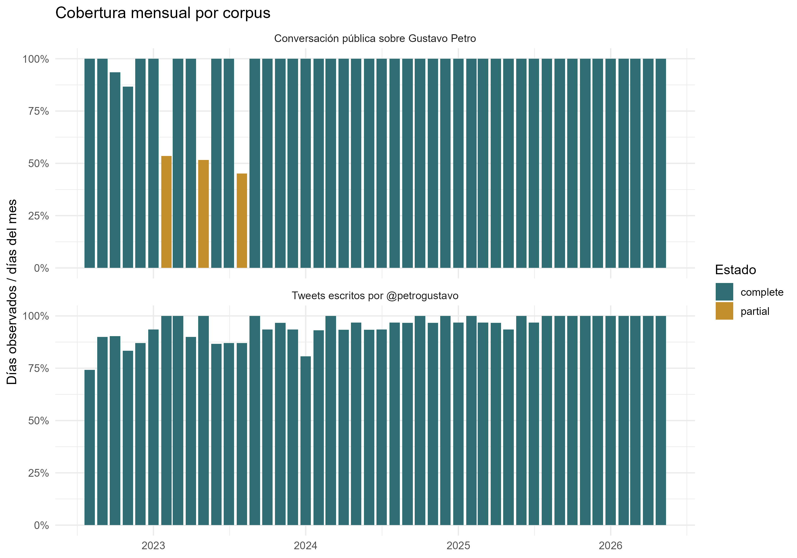{#fig-coverage width="90%"}

# Sentimientos y emociones en contextos políticos

Los estudios económicos suelen enfatizar indicadores cuantitativos, como producción, precios, tasas de interés o índices bursátiles. Sin embargo, el análisis cualitativo y textual permite observar dimensiones de expectativa, emoción y percepción que no aparecen directamente en las series financieras [@perez_llorente_2020]. El análisis de sentimientos convierte grandes volúmenes de texto en medidas interpretables de tono, polaridad y emoción [@medhat_2014]. En este documento, el sentimiento no sustituye a los datos de mercado; funciona como una señal discursiva que puede preceder, acompañar o seguir movimientos financieros.

La relación entre emoción y decisión económica se apoya en la economía del comportamiento. La idea de agentes plenamente racionales ha sido cuestionada por teorías que muestran sesgos, exceso de confianza, disonancia cognitiva, aversión a pérdidas y dependencia del punto de referencia [@mullainathan_thaler_2000; @kahneman_1979]. Esta intuición dialoga con la tradición de sentimientos morales de Adam Smith, donde las decisiones sociales y económicas también dependen de simpatía, juicio moral y reconocimiento social [@smith_1759]. En mercados financieros, el discurso presidencial puede importar porque las expectativas son informativas y emocionales a la vez.

El paper original utilizó la rueda de emociones de Plutchik para interpretar alegría, tristeza, ira, miedo, sorpresa, aversión, confianza y anticipación [@plutchik_2003]. El análisis de sentimientos en contextos políticos latinoamericanos también ha usado diccionarios, lexicones y modelos supervisados/no supervisados para estudiar opinión pública, marketing político y comunicación gubernamental [@romero_moreno_2020; @gomez_torres_2018; @cornejo_2022]. La versión actual conserva el enfoque NRC/Plutchik mediante `syuzhet` [@jockers_2017] y el léxico de Mohammad y Turney [@mohammad_turney_2010; @mohammad_turney_2013], y lo complementa con agregación diaria y medidas temáticas mediante `sentometrics` [@sentometrics_jss].

Twitter/X es especialmente útil para investigación política porque hashtags, menciones y redes muestran cómo se organizan conversaciones, apoyos, oposiciones y movilizaciones. Las guías de ciencia de datos políticos en R han destacado su utilidad para análisis reproducible [@urdinez_cruz_2020], mientras que la literatura sobre hashtags muestra su papel en acción conectiva, feminismo digital y activismo racial [@trott_2018; @ince_2017]. En este documento, las etiquetas y menciones permiten identificar quién participa en la conversación sobre Petro y qué temas concentran polarización.

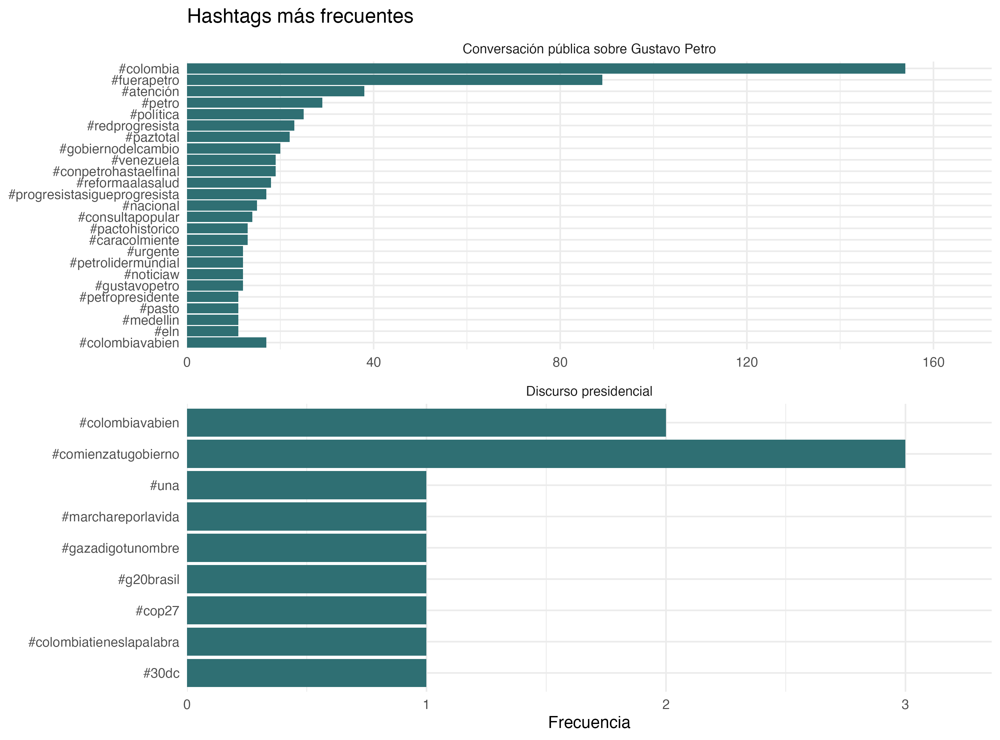{#fig-hashtags width="80%"}

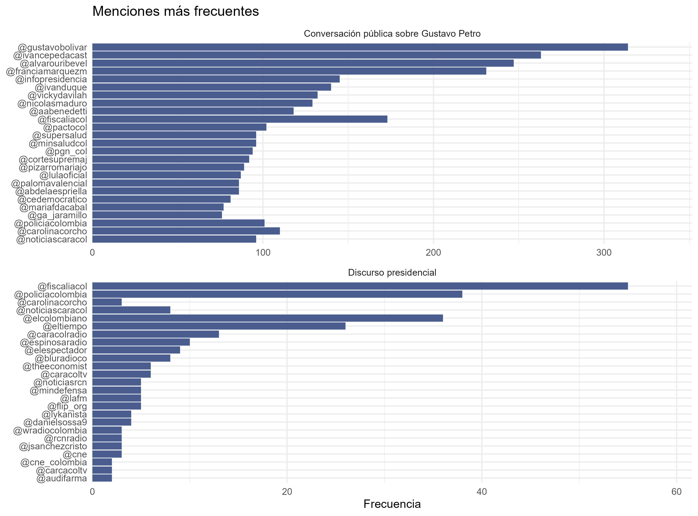{#fig-mentions width="80%"}

# Metodología

El documento original realizó una caracterización semántica y sentimental de microblogs de Twitter junto con información histórica de mercado. Esta versión conserva esa arquitectura y la vuelve reproducible mediante dos contratos estables: `tweets_master.csv`, con una fila por tweet y clave `(corpus, id)`, y `market_master.csv`, con una fila por fecha. El script prepara datos determinísticos; el cuaderno reconstruye la clasificación temática y conserva las decisiones NLP, sentimiento, IPI, redes y econometría. Esta separación permite comparar emisor y conversación pública sin mezclar corpus ni perder trazabilidad.

El primer paso consiste en recolección, auditoría y normalización. El scraping histórico se relaciona con flujos de trabajo de la API de Twitter y herramientas como `rtweet` [@kearney_2019]. La literatura reciente advierte que Twitter como dato exige documentar costos, restricciones, cambios de API y sesgos de cobertura [@steinert_threlkeld_2018; @chen_duan_yang_2022]. La versión original también usó inferencia de género desde nombres en español mediante `genero` [@marin_diaz_2020]; la actualización prioriza texto, temas y mercado porque la agregación diaria es más robusta para unir discurso con series financieras.

El segundo paso es la construcción del corpus. El texto se limpia, tokeniza y transforma en matrices documento-característica con `quanteda` [@benoit_textual_2018; @quanteda]. La minería textual práctica en R, el enfoque tidy text y la estadística de keyness permiten extraer términos distintivos y relaciones semánticas entre documentos [@kwartler_2017; @silge_robinson_2017; @bondi_scott_2010]. El análisis de coocurrencias, colocaciones y collexemas sigue la tradición de relaciones léxicas entre palabras, construcciones y contextos [@schweinberger_2023; @wiedemann_niekler_2017; @stefanowitsch_gries_2003; @stefanowitsch_gries_2005].

El tercer paso caracteriza la estructura semántica. La versión original usaba redes de conexiones, coocurrencias, dendrogramas y análisis multivariante. Esta actualización conserva esa lógica: la clasificación jerárquica de Ward ayuda a visualizar similitudes entre términos [@el_hamdouchi_1986], los biplots y análisis multivariantes apoyan la lectura de proximidades semánticas [@field_2012; @husson_2016], y las redes discursivas muestran asociaciones entre etiquetas, cuentas y términos. En las redes, los nodos representan cuentas o términos; las conexiones representan co-menciones o coocurrencias dentro de una ventana textual, los pesos cuentan la recurrencia de esas asociaciones y las comunidades agrupan nodos con mayor densidad interna [@kolaczyk_csardi_2020]. Para hashtags y menciones se adopta el estilo visual del ejemplo oficial de análisis de Twitter de `quanteda`: etiquetas visibles, nodos oscuros, aristas curvas y grosor proporcional a la frecuencia de coaparición [@quanteda_twitter_example]. Wordfish estima posiciones textuales a partir de patrones de uso de palabras [@slapin_proksch_2008].

El cuarto paso modela temas y lenguaje. Los modelos de tópicos permiten resumir corpus de alta dimensión [@blei_2003; @blei_2009], y el modelo estructural de tópicos agrega covariables y diagnósticos de coherencia/exclusividad [@stm]. La actualización incorpora además una clasificación temática con supervisión débil: se entrenan etiquetas derivadas de reglas no `otros`, se evalúan contra un modelo base con partición holdout y sólo se reasignan textos de `otros` cuando la confianza es conservadora. Esta estrategia sigue la lógica de evaluación supervisada de texto, pero se presenta como análisis de sensibilidad, no como reemplazo de etiquetas humanas [@hvitfeldt_silge_2022]. La actualización incorpora `spacyr` para enriquecer el corpus con entidades, lemas y patrones sintácticos [@benoit_spacyr]. Esta capa es útil para paz total, porque permite identificar actores, instituciones, territorios y términos de negociación que no siempre aparecen como palabras clave aisladas [@hirschberg_manning_2015].

El quinto paso une sentimientos y mercado. La polaridad, el volumen y el Índice de Presión Informacional se calculan por día y por corpus, y `sentometrics` agrega señales por tema y lexicón [@misuraca_2020; @sentometrics_jss]. La literatura de opinion mining financiero motiva interpretar esos indicadores como señales textuales de expectativa y tono, no como mecanismos causales por sí mismos [@opinion_mining_financial_2022; @kumar2014_text_mining]. Las variables financieras provienen de BanRep: TRM como tipo de cambio, COLCAP como proxy accionario y TES cero cupón en pesos a 1, 5 y 10 años. La pendiente TES 10Y-1Y se calcula como indicador de expectativas soberanas. La evaluación econométrica usa pruebas de Granger por corpus para TRM, COLCAP, TES 10Y y pendiente TES; VAR e impulsos-respuesta se reportan solo si existen suficientes casos completos. La interpretación temporal sigue referencias aplicadas de series y econometría en R [@hyndman_fpp; @kleiber_zeileis].

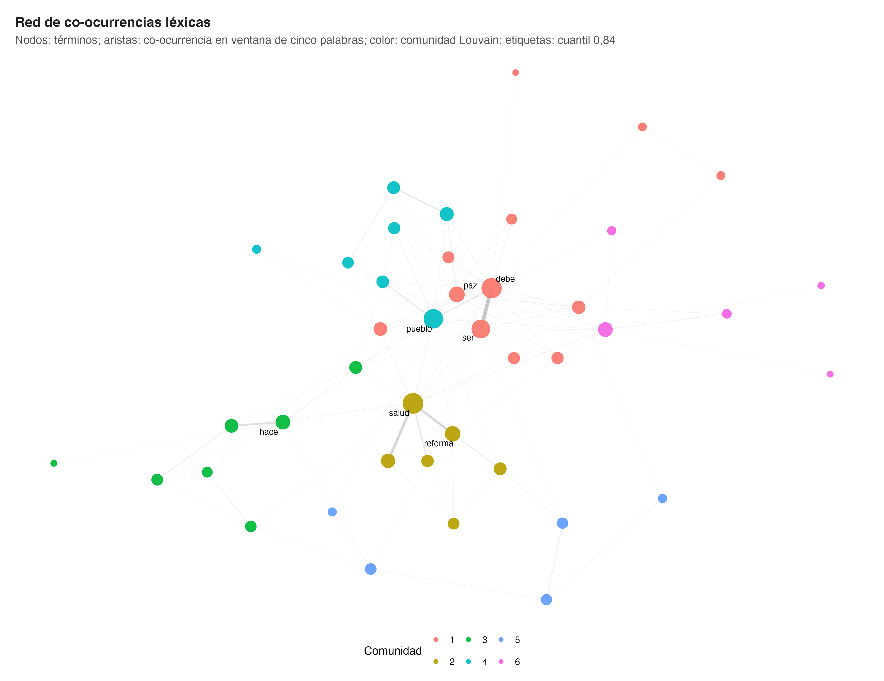{#fig-cooc width="80%"}

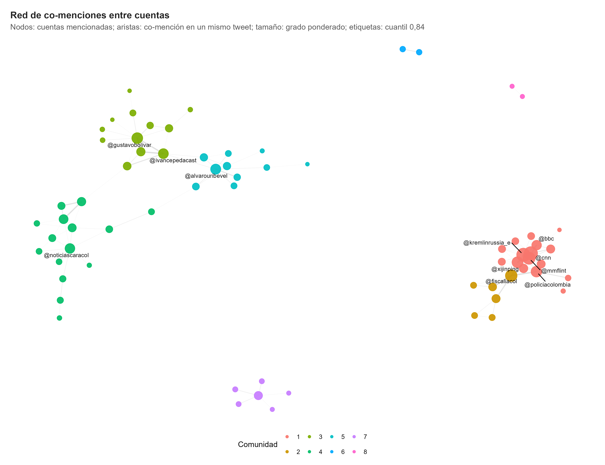{#fig-mentions-network width="80%"}

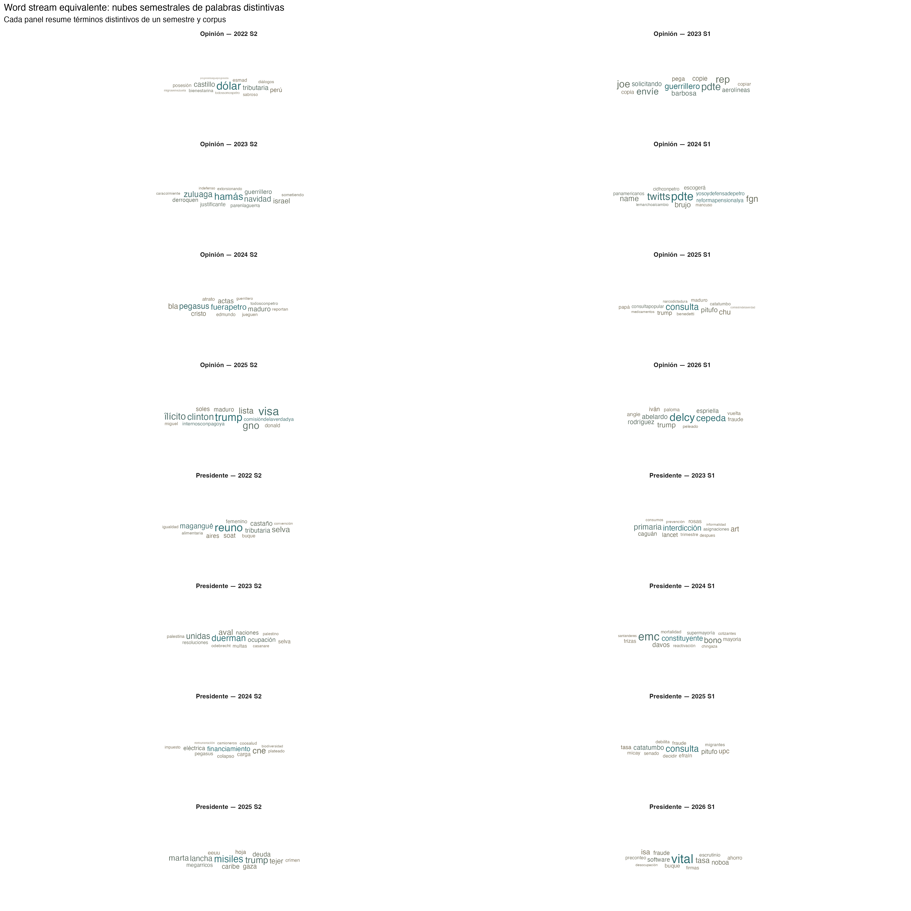{#fig-wordstream-cloud width="90%"}

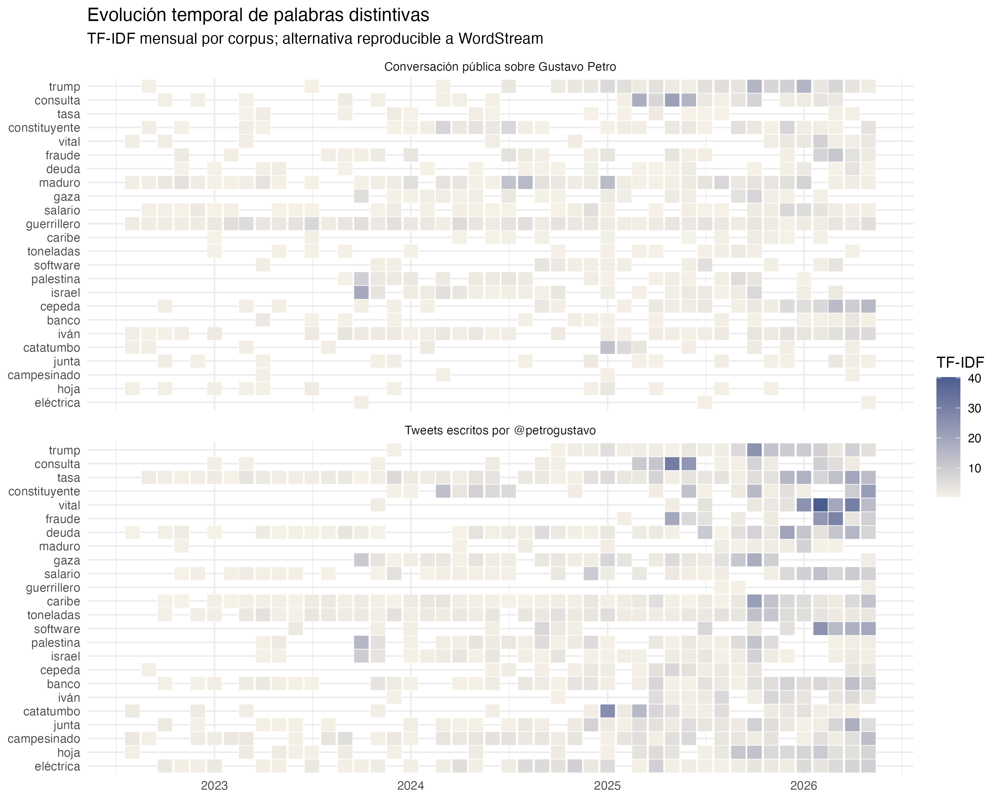{#fig-wordstream width="90%"}

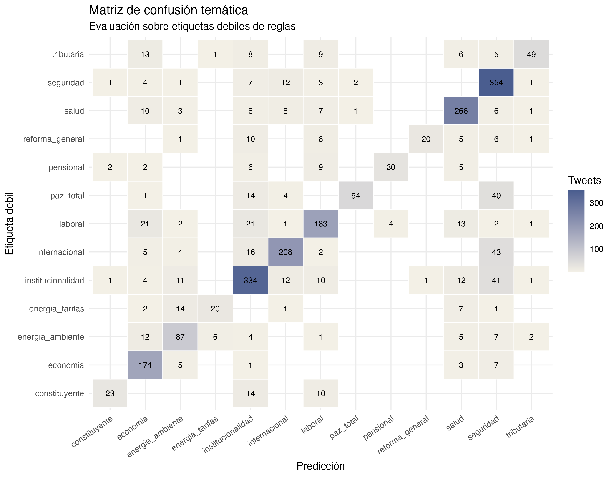{#fig-ml-confusion width="80%"}

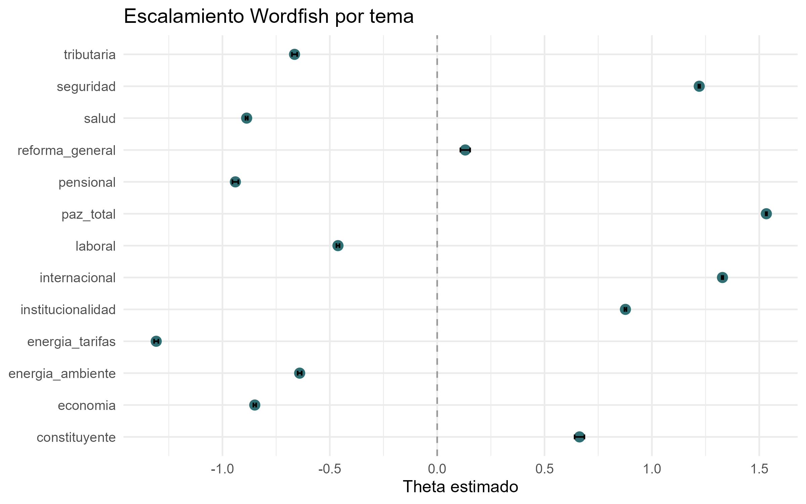{#fig-wordfish width="80%"}

# Resultados

La auditoría de datos confirma que el corpus `@Petro` amplía de manera sustancial el ejercicio original de marzo-abril de 2023 y que los tweets escritos por `@petrogustavo` permiten aislar el discurso presidencial directo. La ventana disponible cubre agosto de 2022 a mayo de 2026, con meses parciales marcados explícitamente. Esto permite distinguir entre controversias sociales, mensajes presidenciales y patrones repetidos de sentimiento y reacción financiera.

{#fig-corpus-volume width="90%"}

El análisis EDA de frecuencia presidencial muestra que `@petrogustavo` no publica con una cadencia uniforme. La actividad diaria contiene muchos días de baja producción y episodios concentrados de alta intensidad; la agregación mensual revela un salto pronunciado desde octubre de 2025, con picos en noviembre de 2025 y durante los primeros meses de 2026. Por eso, en la unión con mercado no basta contar tweets: también es necesario conservar la temporalidad, diferenciar meses parciales y observar semanas con sobrecarga comunicativa.

{#fig-petro-daily-frequency width="90%"}

{#fig-petro-monthly-frequency width="85%"}

{#fig-petro-calendar-frequency width="90%"}

Los resultados de hashtags y menciones conservan un hallazgo central del paper original: la conversación alrededor de Petro es polarizada. Existen etiquetas de apoyo, oposición, denuncia, movilización y crítica institucional. La actualización muestra que esa polarización no se limita a lenguaje electoral; también aparece alrededor de reforma de salud, laboral, pensional, tributaria, paz total, tipo de cambio, mercado accionario y confianza en la administración.

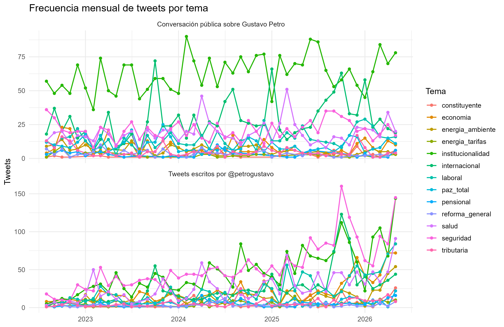{#fig-frequency width="90%"}

Las redes calculadas con `quanteda` refuerzan esta lectura. La red global de hashtags concentra etiquetas políticas y coyunturales que se conectan por coaparición dentro de tweets, mientras que la red de menciones muestra actores, cuentas institucionales, medios y usuarios que organizan la conversación. Al separarlas por corpus, el contraste es sustantivo: `opinion` captura una discusión pública más densa y confrontacional; `presidente` es más selectivo y permite ver el repertorio de etiquetas y cuentas que acompañan al discurso directo.

{#fig-quanteda-hashtags width="90%"}

{#fig-quanteda-mentions width="90%"}

{#fig-quanteda-hashtags-corpus width="95%"}

{#fig-quanteda-mentions-corpus width="95%"}

La lectura de coocurrencias y keyness muestra que la palabra "reforma" sigue estructurando el corpus, pero ya no debe interpretarse como un único objeto semántico. Salud, trabajo, pensiones y tributación comparten vocabulario institucional, mientras que paz total incorpora términos de seguridad, negociación, grupos armados, territorios y capacidad estatal. Esta distinción corrige una limitación del análisis inicial, donde el debate reformista podía quedar agrupado de manera demasiado amplia. La clasificación temática con supervisión débil reduce parcialmente la categoría `otros` bajo umbral de confianza, de modo que la reclasificación se usa para sensibilidad descriptiva y no para afirmar una verdad sustantiva definitiva.

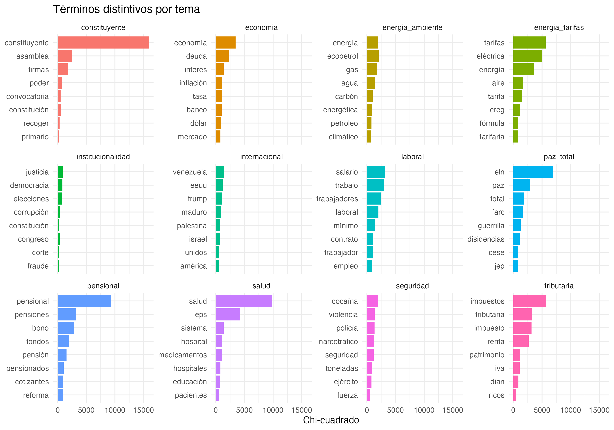{#fig-keyness width="90%"}

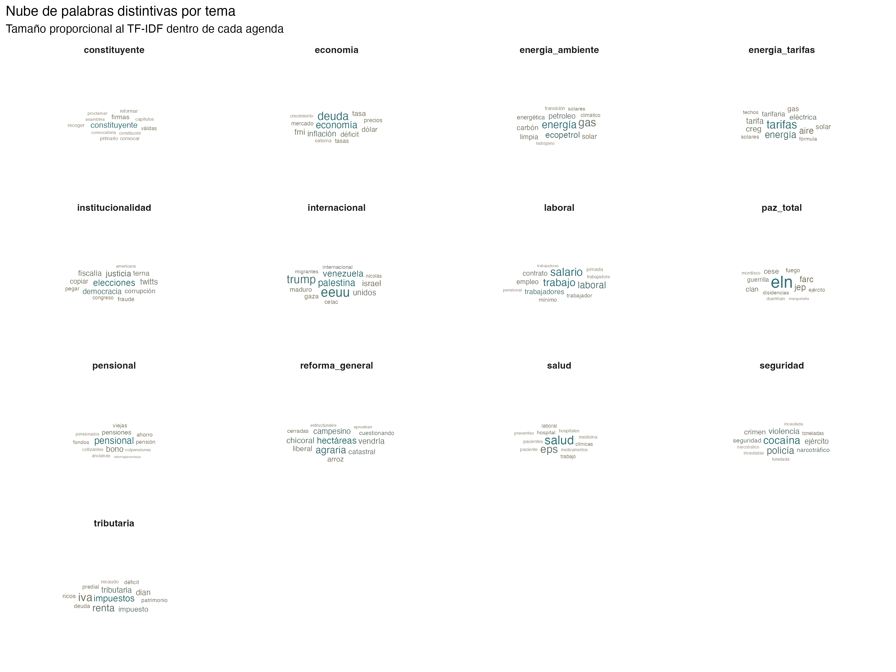{#fig-theme-cloud width="90%"}

{#fig-ca-themes width="85%"}

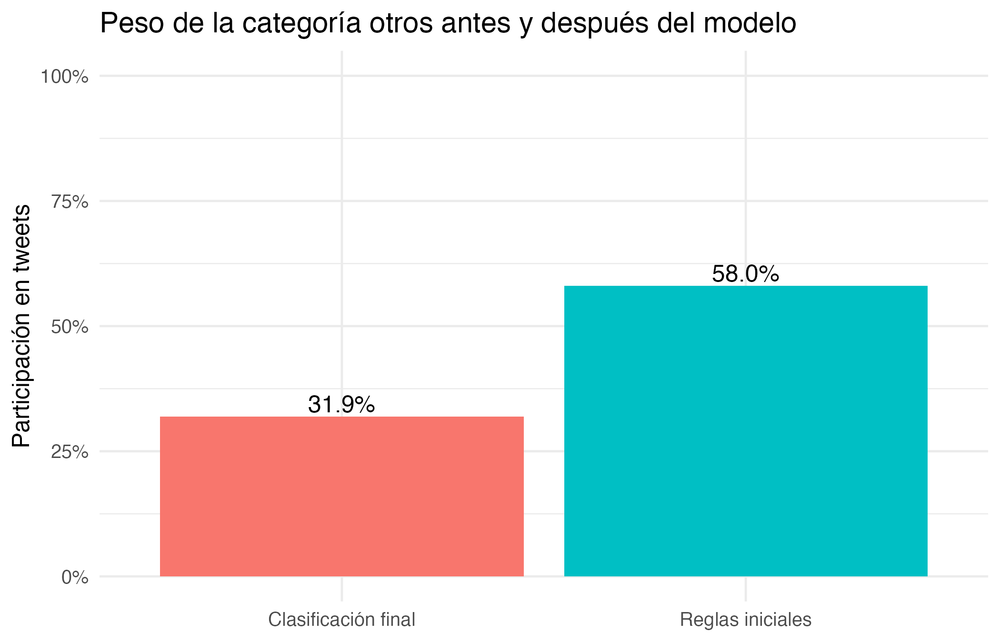{#fig-ml-other width="75%"}

Los tópicos estimados deben leerse como exploratorios. Twitter/X combina textos cortos, ironía, hashtags, citas, enlaces y confrontación política, lo que puede reducir la coherencia semántica de modelos latentes. Por eso, la interpretación combina STM con keyness, redes, Wordfish, entidades de spaCy y evidencia temporal. Esta triangulación preserva el enfoque del paper original y reduce el riesgo de sobrerrepresentar un solo algoritmo.

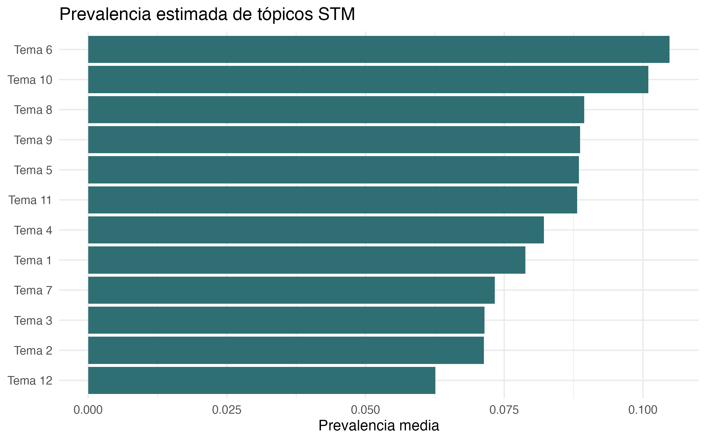{#fig-stm width="80%"}

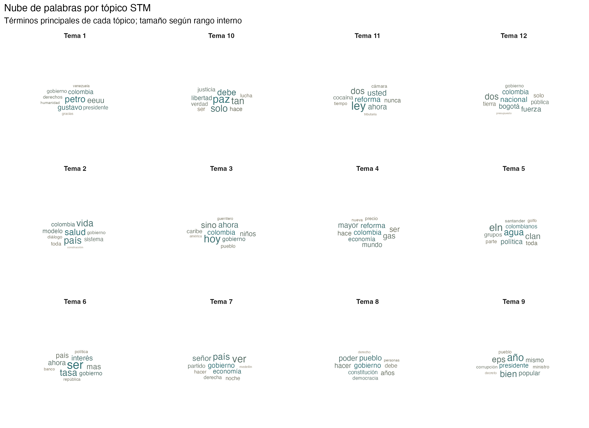{#fig-topic-cloud width="90%"}

Los resultados sentimentales mantienen la intuición original: la conversación sobre Petro es emocionalmente heterogénea. La nueva separación muestra además que esa conversación no debe confundirse con el tono presidencial directo. Confianza, miedo, ira, tristeza y anticipación aparecen como dimensiones relevantes, pero su significado depende del tema, del momento y del corpus. La versión mejorada agrega series diarias, polaridad, agregación sentométrica, fechas pico e Índice de Presión Informacional para comparar tono e intensidad con variables financieras.

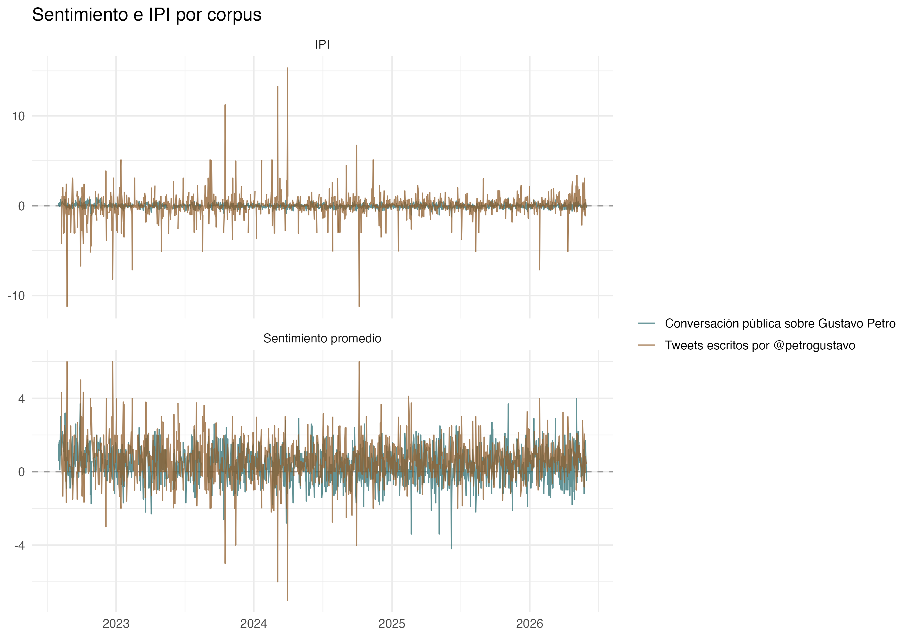{#fig-corpus-sentiment width="90%"}

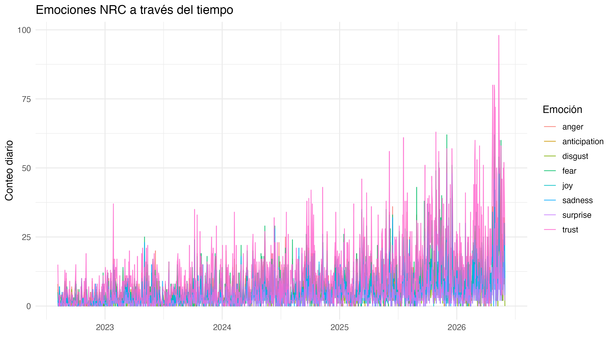{#fig-nrc width="90%"}

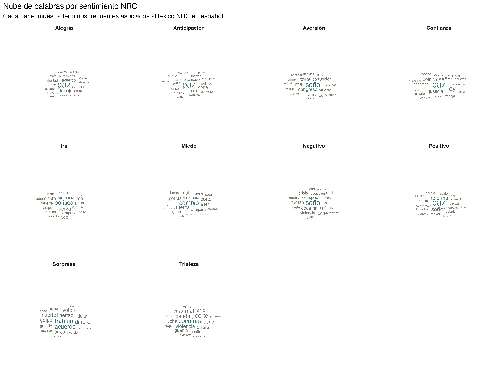{#fig-sentiment-cloud width="90%"}

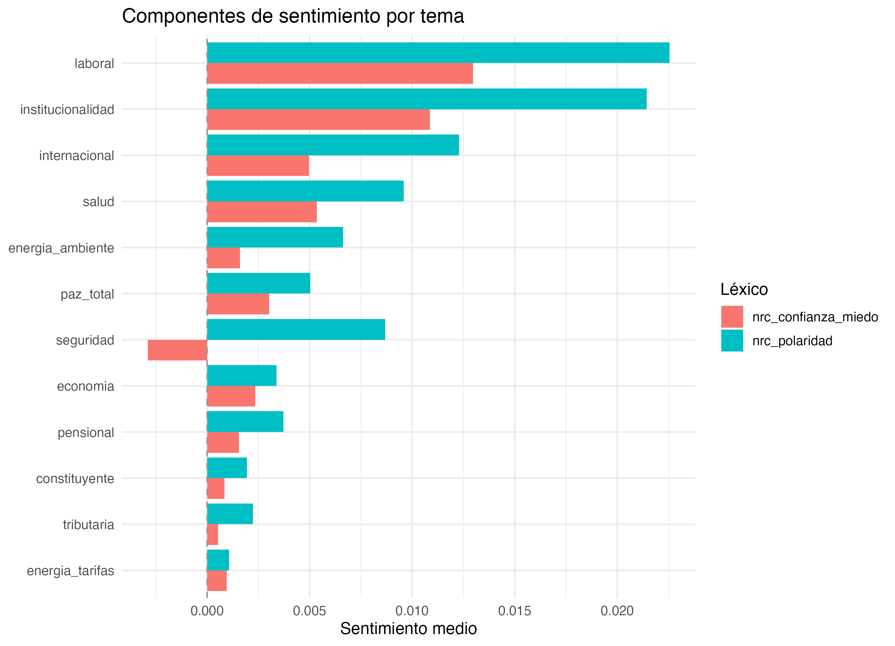{#fig-sentometrics width="90%"}

El enriquecimiento lingüístico con spaCy aporta una lectura adicional de paz total. La versión original se concentraba en reformas y hashtags asociados a Petro; la actualización separa paz total porque conecta seguridad, negociación, actores armados, Estado y expectativas institucionales. Las entidades y lemas ayudan a identificar actores y términos de política pública que aparecen de forma recurrente en esa conversación.

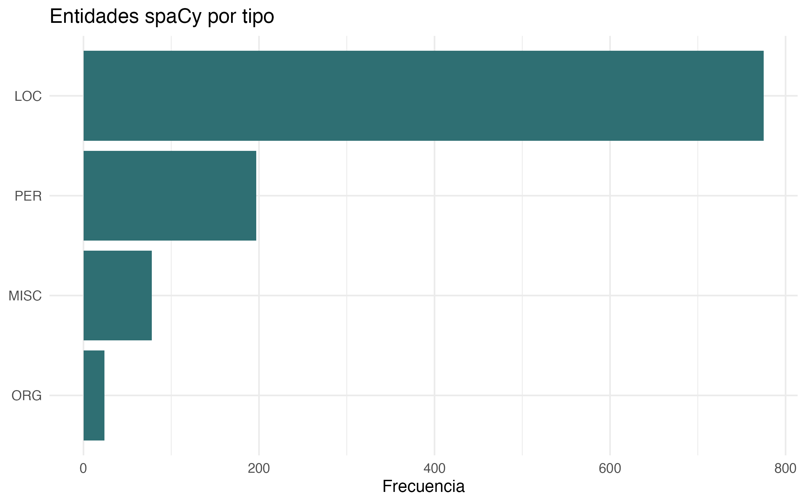{#fig-spacy width="80%"}

El bloque de mercado usa TRM para el canal cambiario, COLCAP para el canal accionario y TES para el canal de renta fija soberana. Esta ampliación es importante porque un mensaje político puede afectar de manera diferente expectativas sobre moneda, acciones y tasas soberanas. La curva TES permite observar variaciones de corto y largo plazo, y la pendiente 10Y-1Y resume cambios en la lectura intertemporal del riesgo.

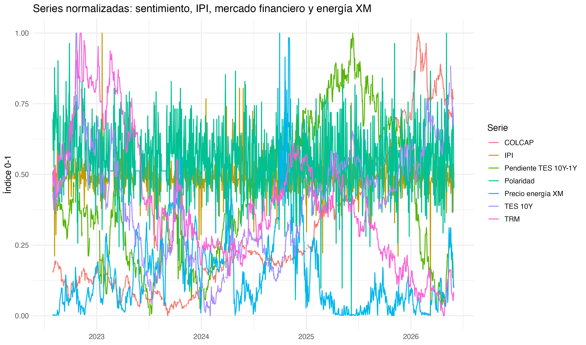{#fig-series width="90%"}

{#fig-tes-curve width="90%"}

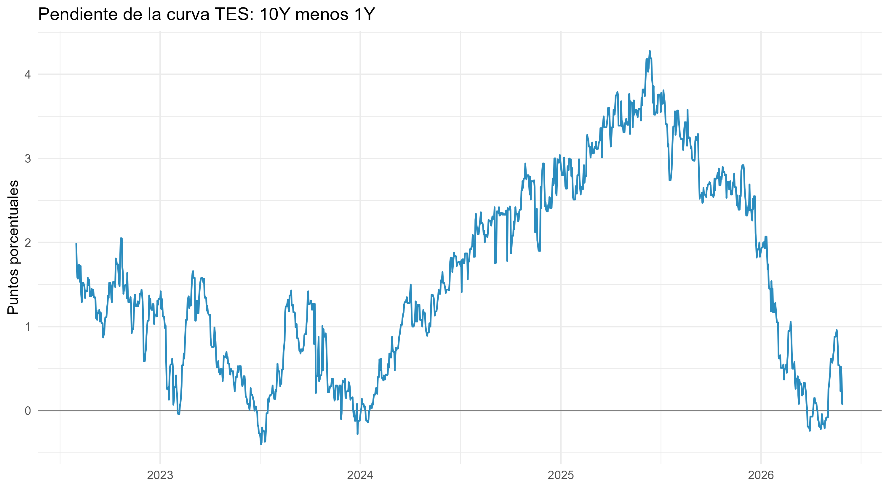{#fig-tes-slope width="90%"}

Las pruebas de Granger se interpretan como diagnósticos de precedencia temporal, no como causalidad estructural. Algunos indicadores de sentimiento, volumen o presión informacional pueden mejorar la predicción de respuestas específicas en ciertos rezagos, y ahora esa evaluación se reporta por corpus. Esto no demuestra que los tweets causen movimientos financieros: compara si la conversación pública y el discurso presidencial directo aportan señales predictivas exploratorias distintas. El estudio de eventos complementa esta lectura al describir qué ocurre después de días extremos de negatividad, volumen o presión informacional. TRM y COLCAP se leen como retornos, mientras TES 10Y y la pendiente se leen como cambios en tasas.

{#fig-granger width="90%"}

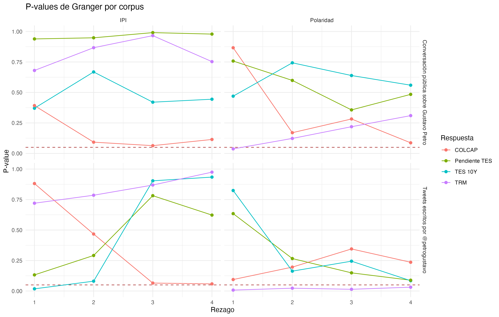{#fig-granger-corpus width="90%"}

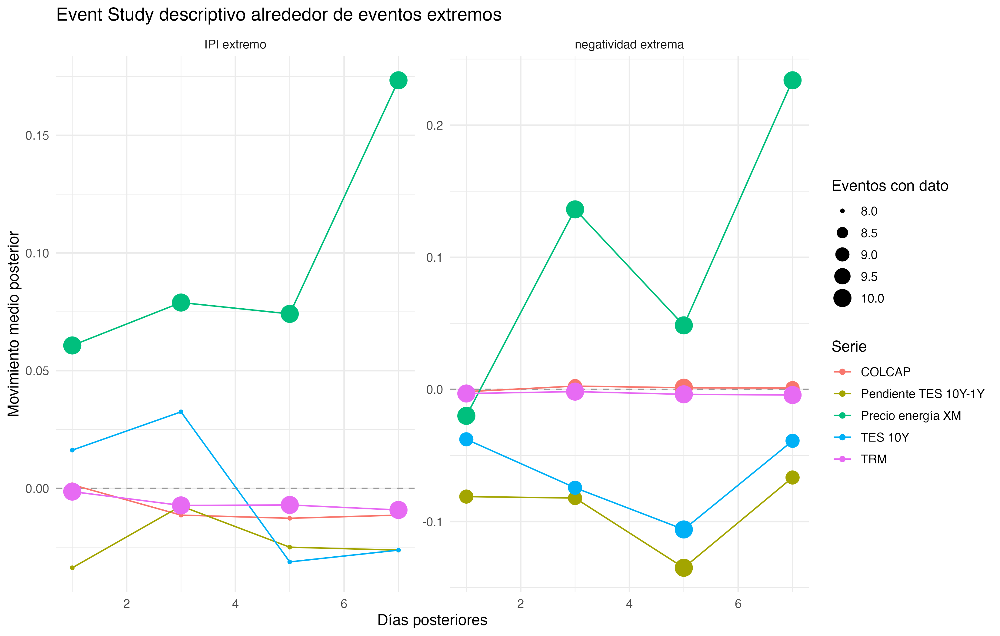{#fig-event-study width="90%"}

{#fig-event-study-heatmap width="90%"}

# Discusión preliminar

La principal diferencia frente al paper original no es únicamente el tamaño de la muestra, sino la separación conceptual entre reacción social y emisión presidencial. En el ejercicio inicial, las consultas sobre Petro podían mezclar voces de apoyo, crítica, prensa y mensajes del propio presidente. La arquitectura actual hace visible esa diferencia: el corpus `opinion` mide clima discursivo alrededor de Petro, mientras que el corpus `presidente` mide intensidad y contenido de una cuenta con poder institucional.

Las redes estilo `quanteda` ayudan a leer esa distinción sin cambiar la lógica metodológica original. Hashtags y menciones no se interpretan como pruebas aisladas de influencia, sino como mapas de coaparición que muestran cómo se agrupan temas y actores. La frecuencia de tweets presidenciales añade otra capa: meses con alta producción comunicativa pueden amplificar la exposición pública de ciertas discusiones, pero su efecto financiero depende del contexto, del contenido y de la reacción social medida en el corpus `opinion`.

Por esa razón, los resultados econométricos deben mantenerse como evidencia de precedencia y sincronía. La combinación de sentimiento, volumen, IPI, Granger, VAR condicionado y estudio de eventos sugiere que el discurso político puede contener señales informativas para TRM, COLCAP y TES en algunos momentos, pero no identifica por sí sola un mecanismo causal estructural. La contribución del paper es dejar un sistema reproducible para seguir esa relación con mejores datos y diseños futuros.

# Conclusiones

Twitter/X ha transformado la forma en que líderes políticos se comunican con ciudadanos, opositores, periodistas e inversionistas. El paper original sostenía que los mensajes de un presidente pueden influir en la imagen colectiva de su administración y, eventualmente, reflejarse en el mercado financiero. La versión actual fortalece y precisa ese argumento: el corpus `opinion` evidencia una conversación polarizada, emocionalmente intensa y estructurada por reformas, paz total y expectativas económicas, mientras el corpus `presidente` permite observar el discurso directo de `@petrogustavo` sin atribuirle voces de terceros.

La evidencia textual es más rica que en el documento inicial. Las redes de hashtags y menciones replican el estilo oficial de análisis de Twitter de `quanteda` y muestran confrontación, centralidad de actores y agrupamientos semánticos. El EDA de frecuencia de tweets presidenciales muestra que la actividad de `@petrogustavo` se concentra en episodios específicos, con un aumento importante desde finales de 2025. Keyness, las nubes de palabras TF-IDF y la evolución temporal muestran que las reformas no constituyen un único campo semántico y que el vocabulario cambia por periodo y corpus. La supervisión débil mejora la lectura de `otros` con cautela; Wordfish y STM ayudan a resumir posiciones y tópicos. NRC, sentometrics y spaCy profundizan la lectura de tono, actores y patrones lingüísticos.

La evidencia de mercado es más completa, pero debe mantenerse prudente. La actualización reemplaza fuentes locales frágiles por BanRep para TRM, COLCAP y TES, e incorpora la pendiente TES 10Y-1Y como indicador de renta fija soberana. Los resultados de Granger por corpus, VAR condicionado y estudio de eventos son útiles para describir precedencia, sincronía y predicción exploratoria, no para afirmar causalidad final entre discurso presidencial, conversación pública y mercado.

La recomendación principal es metodológica e institucional. La comunicación de altos funcionarios debe estudiarse con cuidado porque puede afectar expectativas en entornos polarizados. Al mismo tiempo, la interpretación responsable exige fuentes auditables, procesamiento textual transparente y cautela frente a afirmaciones causales. La versión mejorada conserva la advertencia original sobre sensatez y prudencia en redes sociales, y agrega una arquitectura reproducible que puede extenderse a nuevas consultas, indicadores financieros y diseños causales más fuertes.

# Disclosure of interest

In accordance with Taylor & Francis policy and our ethical obligations as researchers, we report that we do not receive financial funding that may be affected by the research reported in the enclosed paper.

# Declaration of funding

No funding was received.
